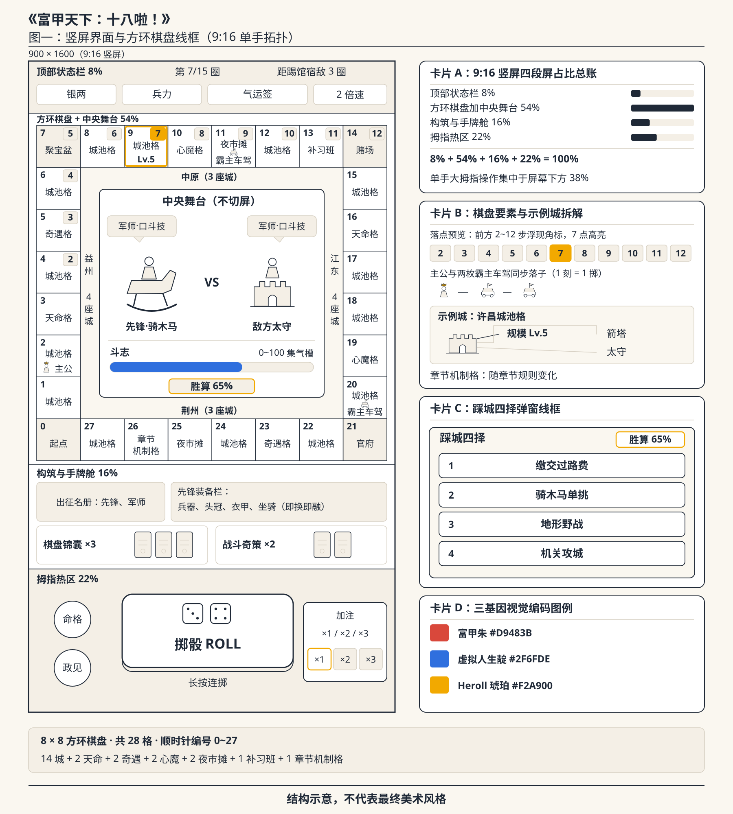

# 《富甲天下：十八啦！》核心玩法、方环棋盘与台味喜剧分册

> **文档编号**：`02_core_gameplay_and_board`｜**版本**：v1.0｜**执笔**：总制作人兼首席总策划（`@fable-lead`）
> **宪法基准**：严格对齐 `01_master_blueprint.md`（v1.0）。本册一切术语、品阶、货币与核心公式（F1~F9）均以总纲第三章为唯一准绳；未单独标注的系数一律按 `[假]`（待原型校准）管理。
> **视觉引用**：第二章界面拓扑严格对应 `/Users/kamisola/富甲天下/assets/fig01_portrait_board_wireframe.svg`；双循环关系对应 `fig02_trinity_core_loop_topology.svg`。现阶段严守不锁定最终美术画风原则。

---

## 第一章 市场痛点解剖、破局生态位与买量 3 秒钩子脚本

### 1.1 四大参照系结构死穴与《十八啦》破局对比

市面上并非没有掷骰子手游，也并非没有三国题材，但玩家始终找不到一款**「单手十分钟内既能体验买地垄断收过路费、又能派张飞拎折凳把债主揍到免单」**的产品。症结在于现有四类产品的底层结构各有死穴：

**表 1-1 四大参照系死穴与本案破局表**

| 参照品类 | 代表产品 | 核心体验死穴（玩家为什么流失） | 《富甲天下：十八啦！》的结构破局 |
| :-- | :-- | :-- | :-- |
| **传统单机大富翁** | 《富甲天下 3/4/5》《大富翁 4》 | **75% 时间在看别人走棋** `[证]`；进单挑与野战频繁切全屏黑幕；一局动辄 2 小时，后半程胜负已定却要熬到对手慢慢破产 | **霸主同步落子（零等待）**：你不掷，天下不动；一切战斗收进`中央舞台` 5~10 秒播完；第 15/20 圈拿全部`身家`化作炮火轰`天命魔王`，彻底消灭尾盘垃圾时间 `[推]` |
| **海外社交掷骰霸主** | 《MONOPOLY GO!》 | **局内零胜负、零主动博弈** `[证]`：踩格纯看数值播片，骰子只是换皮体力条；留存高度依赖熟人社交互拆互偷，在华语圈水土不服 | **踩城四择真博弈**：踩进敌城不是乖乖扣钱，而是算清`胜算`在交钱、单挑、野战、攻城间做风险定价；纯单人体验，无任何强制社交焦虑 `[推]` |
| **竖屏掷骰肉鸽** | 《Heroll（勇士团团转）》 | **踩怪只能自动对砍，题材可随意换皮** `[证]`：把小人换成史莱姆毫无违和感；缺少地产经营的复利爽感，局外角色溢价薄弱 | **地产复利 × 角色改规则**：连城垄断加`私掠站`一脚破万两；六位首发`主公`各自改写盘面规则，名将派驻当`太守`有城可守、有租可收 `[推]` |
| **重度三国卡牌/SLG** | 主流三国 SLG 与数值卡牌 | **打卡铺路坐牢、半夜被大佬沦陷** `[证]`：上班族想爽一把三国，结果比上班还累；抽到的非主力紫卡蓝卡全变废铁 | **十分钟一局、随时锁屏续玩**：单手大拇指操作；名将分`先锋`、`军师`、`太守`三岗外加图鉴羁绊，实现真正零冷板凳 `[推]` |

### 1.2 三套可直接投流的 15 秒买量短视频分镜脚本

买量素材不做虚假副玩法，直接拿局内真实发生的「踩城四择翻盘」「恶搞建筑剥皮」「算命邪道逆袭」拍成 15 秒竖屏实机爽片，兑现总纲「买量 3 秒承诺」。

**表 1-2 买量脚本 A：《住一晚八千两？派张飞拎折凳骑木马讲道理！》**

| 秒数 | 9:16 实机画面与动作 | 音效与节奏 | 配音与字幕台词 | 转化钩子 |
| :-- | :-- | :-- | :-- | :-- |
| **0~3s** | 刘备棋子一脚踩进泛红光的「Lv.5 许昌」，城头曹老板探头拨算盘，红字狂闪「过路费：8,160 两」，刘备银两只剩 950 两 | 警报钟声 + 算盘珠清脆暴响 | 刘备捂胸口飙泪：「夭寿哦！住一晚八千两，你们许昌是有送卤肉饭吃到饱哦？」（L2） | **前 3 秒制造绝境反差**：传统大富翁必死局 |
| **3~7s** | 屏幕弹出固定四按钮`踩城四择`，大拇指直接略过「缴交过路费」，重重按下「骑木马单挑（胜算 68%）」 | 战鼓急促敲击 + 清脆按键音 | 旁白（市井说书腔）：「没钱交过路费？在《十八啦》，讲道理不如拎折凳！」（L2） | **亮出核心差异化动词**：踩敌城可以动手免单 |
| **7~12s** | 不切屏！`中央舞台`张飞骑摇摇木马拎奇品`折凳`冲出，场边诸葛亮摇扇开喷`口斗技`，敌太守斗志暴跌；玩家点按`战斗奇策`《偷龙转凤》，一板凳拍飞敌太守 | 木马弹簧吱呀声 + 折凳闷响 + 金币爆盆声 | 张飞拍胸：「免单啦！顺便把你家招牌拆一层当茶水费！」（L2） | **政见 P14 视觉化**：不仅免单还拆敌城一级 |
| **12~15s** | 许昌降级吐出满屏银两，底部大键「掷骰 ROLL」流光闪烁，浮现游戏 Logo | 锣鼓齐鸣喊声「十八啦——！」 | 字幕：「单手十分钟，掷出三国首富！」（L1） | 引导立即下载试玩首局 |

**表 1-3 买量脚本 B：《在曹老板必经之路盖箭塔配屎王神》**

| 秒数 | 9:16 实机画面与动作 | 音效与节奏 | 配音与字幕台词 | 转化钩子 |
| :-- | :-- | :-- | :-- | :-- |
| **0~3s** | 过圈`置业时间`界面，手指在益州连占四城，啪啪点选`建筑蓝图`：三座`箭塔`夹一尊金光闪闪的`屎王神` | 盖章音效 ×4 + 诡异唢呐滑音 | 旁白：「打不过曹老板？那就把他的必经之路改成收费地狱！」（L1） | **基建阴人爽感**：一眼看懂的缺德布局 |
| **3~9s** | 玩家按下掷骰，`霸主车驾`（曹操）同步走 1D6 连过箭塔射程，护卫兵力狂掉归零陷入`瘫痪`，停在熏区捂鼻脸发绿，一脚踩中满级成都喷出 13,800 两 | 连珠箭破空声 + 捂鼻惨叫 + 银两狂喷声 | 曹操捏鼻掏空钱袋：「靠北（抱怨），这味道比过路费还要命！开发票！」（L3） | **展示霸主同步落子与反伤收租** |
| **9~15s** | 曹操金库见底触发`割地抵债`，两座郡城直接变玩家旗帜，曹老板剩花裤衩跑路 | 法槌敲定声 + 欢快小调 | 董卓/旁白大笑：「盖楼收租熏邻居，俗搁大碗！」（L2） | 击中包租公收租与恶搞解压心理 |

**表 1-4 买量脚本 C：《算命抽到下下签，反手邪道命格开芭乐票》**

| 秒数 | 9:16 实机画面与动作 | 音效与节奏 | 配音与字幕台词 | 转化钩子 |
| :-- | :-- | :-- | :-- | :-- |
| **0~3s** | 开局算命摊，问题「捡到曹老板私房钱袋怎么办？」，手指点选「C. 吞掉现金再敲诈一笔封口费」，`名望`狂跌至 −40 进入`邪道` | 算命签筒哗啦声 + 阴险锣声 | 算命仙瞪眼：「印堂发黑缺德冒烟——恭喜主公喜提邪道命格！」（L2） | **反套路开局**：做好人哪有当恶霸爽 |
| **3~10s** | 踩中敌方巨城，四择第一项自动改写为紫色按钮「开芭乐票」！一击免付溜走；转头在自己花光现金置业后打出《均富天下》，把首富金库强行平分过来 | 撕支票音效 + 算盘暴击 + 霸主吐血声 | 曹操抱头：「你拿空头支票住霸王店，转头还平分我家产？！」（L2） | **展示名望正邪改写四择与神级锦囊** |
| **10~15s** | 第 15 圈决战开启，十座满级城池化作万门火炮将`天命魔王`轰上天 | 万炮齐射重低音轰鸣 | 字幕：「正道邪道都能发财，《富甲天下：十八啦！》」（L1） | 吸引肉鸽构筑与《虚拟人生》情怀客 |

---

## 第二章 9:16 竖屏单手界面拓扑与 0.1 秒级操作时间轴

本章逐区对应结构资产 `fig01_portrait_board_wireframe.svg`（基准分辨率 `1080 × 1920`）。一切布局服从两条铁律：**单根大拇指在屏幕下方 40% 完成九成操作**；**同屏常驻数字严格不超过 7 组**（守总纲 2.3 低认知负荷标尺）。

### 2.1 黄金四区屏占比与单拇指人体工学



**表 2-1 9:16 竖屏四段式空间拓扑详表（对照 `fig01`）**

| 分区（自上而下） | 屏高占比与像素带 | 常驻核心元素（含常驻数字组编号） | 触控尺寸与双编码规范 | 视听与震感（Haptics）反馈 |
| :-- | :-- | :-- | :-- | :-- |
| **① 顶部状态栏** | **8%**<br>（`Y: 0 ~ 154px`） | **数字①**「第 X/15 圈」与「距踢馆宿敌 Y 圈」预警胶囊；**数字②**`银两`跳字槽；**数字③**`兵力`护卫槽；**数字④**`气运签`存量（0~3 支竹签图标）；右上角「1x / 2x 倍速」开关与设置；第三幕起嵌入**数字⑤**「预估火力 / 魔王气血」对比条 | 顶栏仅「倍速」与「设置」需低频点击，热区 `96 × 96px`；银两进出采用滚轮跳字加红绿箭头双编码 | 收过路费时银两槽放大 1.3 倍并配铜钱落袋短震（Light Impact ×3） |
| **② 方环棋盘 + 中央舞台** | **54%**<br>（`Y: 154 ~ 1190px`） | **外环**：28 格顺时针`方环棋盘`（编号 0~27，四角大格 `156 × 156px`，边格最短边 `≥114px`）；每格严控 ≤3 个信息元素（势力归属色+底纹形状、规模星标 Lv.1~5、威胁图标如箭塔/屎王神）；地面浮现 2~12 步`落点预览`角标（字号 `38px`，7 点琥珀金高亮）。<br>**内侧`中央舞台`（不切屏）**：平时显示主公与霸主势力动态小报；触发战斗/开奖时原位升起木马单挑台、攻城阵地、聚宝盆喷泉或赌场碗公；单挑时显示左右`斗志`条与明示**数字⑥**「胜算 X%」 | 任意棋盘格轻点可弹出非阻塞气泡查看详情，手指松开即收；势力采用「色值 + 旗帜几何角标（圆/方/三角/菱形）」双编码，色弱玩家一秒分清谁家的地 | 棋子跳格配木质棋盘「啪嗒」节拍与微震（Selection Tick）；敌方巨城格进入 7 点高危落点时地面泛红脉冲 |
| **③ 构筑与手牌舱** | **16%**<br>（`Y: 1190 ~ 1498px`） | 左舱：`出征名册`当前上阵的`先锋`与`军师`头像 + `先锋装备栏`四部位图标（`兵器`、`头冠`、`衣甲`、`坐骑`，实时映射小人外观）。<br>右舱：手牌双轨槽——`棋盘锦囊`槽 ×3 + `战斗奇策`槽 ×2（未单挑时置暗，单挑窗口亮起可点） | 每张锦囊手牌卡槽 `148 × 180px`（远大于 `88 × 88px` 底线），上滑或点选后点确认即施放，防大拇指误触；品阶统一按 3.2 色值 + 圆点角标（1~4 点）双编码 | 装备`即换即融`时舱口弹出「左旧右新」对比条，折银瞬间化作碎银飞向顶栏 |
| **④ 底部拇指热区** | **22%**<br>（`Y: 1498 ~ 1920px`） | 居中超大物理质感主按键「掷骰 ROLL」（`360 × 180px`，处于左右手单拇指最舒适自然弧线中心）；右侧档位拨片「加注 ×1 / ×2 / ×3」（解锁千术骰后含 ×5，记为**数字⑦**）；主按键下方「长按连掷」托管提示；左侧「命格」与「政见」已选词条抽屉入口 | 主键与加注拨片间距 `32px` 防误点；加注升至 ×3 时按钮边框燃起琥珀色火焰提醒高风险高回报 | 按住 ROLL 键蓄力时触发连续颗粒震感，松手掷出双骰碰撞碗公触发重击震感（Heavy Impact） |

> **同屏常驻数字核验**：① 圈数与宿敌倒数、② 银两、③ 兵力、④ 气运签、⑤（第三幕）火力对比、⑥（仅弹窗/舞台内）胜算、⑦ 加注档位——日常跑圈同屏常驻仅 **5~6 组数字**，严守 ≤7 组硬红线。

### 2.2 一「刻」之内的 0.1 秒级操作时间轴

守红线 R1（零等待）与 R2（不切屏）：玩家完成 1 次掷骰与落点结算定义为 **1 `刻`**。无战斗的普通刻耗时 **2.8~3.6 秒**；含`骑木马单挑`或`政见`选择的重决策刻耗时 **8.5~11.5 秒**；全章 60 掷加权均时稳定控制在 **≤9.2 秒/刻**（普通章净时长约 9.2 分钟）。

**表 2-2 单刻完整交互与同步落子时间轴（精确到 0.1 秒）**

| 时间轴（秒） | 阶段名称 | 玩家主线表现（镜头焦点） | 霸主并行线与后台结算（非阻塞） | 玩家可做操作 |
| :-- | :-- | :-- | :-- | :-- |
| **待机态** | `落点预览` | 前方第 2~12 格地面常驻半透明步数角标：第 7 格最亮，敌方高额城池泛红，聚宝盆/无主好城泛金 | 霸主车驾静置在各自当前格；上一圈亮出的`霸主手笔`图标悬停在顶栏下方备查 | 一击切换`加注`（×1/×2/×3）；打出`棋盘锦囊`；或直接按「掷骰 ROLL」 |
| **0.0 ~ 0.4s** | 拇指击发 | 按下「掷骰 ROLL」，中央舞台浮现陶土大碗公，两颗六面骰（2D6）高速旋转入碗 | 锁死本刻随机种子；按诚信骰律 R7 校验是否存在连败保底修正 | 若处于 2 倍速模式，0.0~2.0s 整体压缩至 1.0s |
| **0.4 ~ 1.2s** | 双骰落定 | 双骰碰撞停稳，大字报出点数（如「9 点！」；若为对子则敲锣喊「欢喜对！」或双六「十八啦——！」） | 前方对应落点格高亮放大，其余预览角标淡出 | 若掷出极凶落点且手握`气运签`，在 1.2~2.0s 跳格途中仍可点「重掷」撤回 |
| **1.2 ~ 2.0s** | **同步落子** | 主公棋子沿方环顺时针轻快弹跳至目标格（每格约 0.1s） | **全盘`霸主车驾`同刻起跳！** 各走 1D6 并在 0.8s 内完成自动落点（占无主城插旗 0.5s / 踩玩家城喷金币加肉痛台词气泡 0.8s / 挨箭塔扣护卫兵力飘红字），绝不弹窗抢戏 | 纯视觉爽感吸收窗口 |
| **2.0 ~ 2.3s** | 落点唤醒 | 主公踩实目标格：若为无主城弹出「盖下去啦（−P 两）」（L1）；若为自家城直接执行`回城探班`飘税银；若为敌城原位展开`踩城四择`面板 | 同刻先后律：若主公与某霸主车驾本刻落入同一无主城，**主公永远优先判定占领**，后结算的车驾当场变成踩你新城的冤大头缴交过路费！ | 无战斗格一击完结（2.8s 即进入下一刻）；踩敌城进入四择决策 |
| **2.3 ~ 5.0s** | 四择一击（若踩敌城） | 四择面板明示四个固定按钮与真实`胜算`色标（≥65% 翠绿、40%~64% 琥珀、<40% 绯红），玩家平均 2.5s 内一击拍板 | 场边我方军师根据胜算做小动作（胜算高摇扇微笑，胜算低擦冷汗拽主公衣角） | 一击点选「缴交过路费 / 骑木马单挑 / 地形野战 / 机关攻城」 |
| **5.0 ~ 11.0s** | `中央舞台`短演出（若动手） | 方环不黑屏、不切场！内侧中央舞台直接拉起木马对撞（5~8s）、地形兵阵冲锋（4~6s）或冲车火炮轰城（6~10s）；单挑中后段亮起 2.0s `战斗奇策`点按窗 | 军师在舞台两侧自动施放`口斗技`互喷涨落`斗志`；若触发`放水`则播摔下木马喜剧动作 | 在 2.0s 高光窗点选是否拍出 1 张`战斗奇策`（如《偷龙转凤》），或全程免手操观赏 |
| **11.0 ~ 11.6s** | Button 收刀与归位 | 胜负揭晓，银两清算或城头易帜，角色抛出一句 ≤14 字的 Button 短台词，舞台收拢，「掷骰 ROLL」立即恢复高亮可按 | 若本刻跨越了`0 起点`，无缝接起 ≤3s 的`过圈结算`（发俸禄税收 → `置业时间` → 霸主扩张亮新牌 → 盘面升阶） | **下一刻就绪**，大拇指无缝续按 |

---

## 第三章 28 格方环棋盘格点详表、章节机制格与掷骰加注数学

### 3.1 标准普通章 28 格「方环棋盘」逐行详表

标准盘由 **4 个`角格` + 24 个`边格`（14 座`城池格` + 10 个功能边格）** 构成，顺时针编号 `0~27`。四条边对应天下四`州`：西边`益州`（4 城）、北边`中原`（3 城）、东边`江东`（4 城）、南边`荆州`（3 城）。
开局归属严格对齐总纲 3.4（普通章 2 位霸主示例：玩家 1 城起手产业、主霸主 3 城、副霸主 2 城、无主 8 城；精英章增设副霸主 B 占走其中 2 座无主城，余 6 座无主城）。下表以**精英章三霸主满配盘（玩家 1 + 主霸主 3 + 副 A 2 + 副 B 2 + 无主 6 = 14 城）**逐格列死：

**表 3-1 28 格方环棋盘标准拓扑详表（编号 0~27，一行不漏）**

| 格号 | 盘面方位 | 格名 | 标准类型 | 所属州 | 地价 P（两） | 地形 | 开局归属（普通章注记） | 踩中（Land）与经过（Pass）核心规则 |
| :-- | :-- | :-- | :-- | :-- | :-- | :-- | :-- | :-- |
| **0** | **左下角** | **大营·起点** | `角格·起点` | — | — | — | 公共 | **经过或停靠**均触发`过圈结算`（F2 俸禄税收 → `置业时间` → 霸主扩张 → `盘面升阶`）；**精准停在 0 号格**额外领半份当圈俸禄作为「全勤奖」（L2） |
| **1** | 西边 1 | **涿县草鞋铺** | `城池格`（县城） | 益州 | 600 | 陆 | **玩家起手产业**（Lv.1） | 基准主公（刘备）自带起手城；其他主公按 `03` 各自替换起手槽位，开局保底有 1 座窝 |
| **2** | 西边 2 | **绵竹** | `城池格`（县城） | 益州 | 600 | 林 | 无主 | 首圈黄金抢地格；无主时点「盖下去啦」（L1）付 600 两即占为 Lv.1 |
| **3** | 西边 3 | **铁口算命摊** | `天命格` | — | — | — | 公共 | 摇签筒抽签：上上签（25%，得横财或政见）、中平签（50%，小幅四维加值）、下下签（25%，扣银两/倒退，可耗 1 支`气运签`改签） |
| **4** | 西边 4 | **汉中** | `城池格`（郡城） | 益州 | 900 | 林 | 副霸主 B（普通章为无主） | 益州咽喉郡城；林战适性高的太守在此驻守极具威慑力 |
| **5** | 西边 5 | **庙口夜市摊** | `夜市摊` | — | — | — | 公共 | 一屏混摆 3 个货位（`先锋装备栏`兵器护具、`棋盘锦囊`、补兵烧饼），魅力杀价同 F1，一击即买、不买直接走 |
| **6** | 西边 6 | **成都** | `城池格`（州府） | 益州 | 1,200 | 陆 | 无主 | 西边地王！凑齐 1、2、4、6 四城即达成益州全州垄断（`连城倍率` ×2.0） |
| **7** | **左上角** | **风水聚宝盆** | `角格·聚宝盆` | — | — | — | 公共 | 初始底池 1,500 两；全盘每次发生`缴交过路费`或`赌场`输钱，系统额外往盆里注资 20%。谁先踩中谁整碗抱走（吃`加注`放大！），抱走后重置底池 |
| **8** | 北边 1 | **洛阳** | `城池格`（州府） | 中原 | 1,200 | 陆 | 主霸主（Lv.2） | 北边高危区开端！中原仅 3 城即可凑满全州垄断，兵家必争 |
| **9** | 北边 2 | **街头心魔巷** | `心魔格` | — | — | — | 公共 | 刷出贪婪怪/懒惰虫/穷神等`心魔怪`，`中央舞台` 3~5 秒按单挑口径快斩：胜则掉装备（即换即融）加银两；败只扣 150 兵力并播搞笑数落 |
| **10** | 北边 3 | **陈留** | `城池格`（郡城） | 中原 | 900 | 陆 | 无主 | 夹在主霸主两座大城之间的钉子户地块，抢下来盖`屎王神`专熏洛阳与许昌 |
| **11** | 北边 4 | **红尘奇遇亭** | `奇遇格` | — | — | — | 公共 | 弹出 ≤40 字的市井两难抉择（最多 3 选项，含`四维`门槛锁），种下跨圈因果标记（见 9.3） |
| **12** | 北边 5 | **官渡补习班** | `补习班` | — | — | — | 公共 | 缴交学费（= 当圈俸禄 ×1），在`体魄`、`谋略`、`魅力`三项中任选一维永久 +5（`名望`正邪靠行事，不可花钱补习） |
| **13** | 北边 6 | **许昌** | `城池格`（州府） | 中原 | 1,200 | 陆 | 主霸主（Lv.2，主城） | **全盘头号鬼门关**！距离`7 聚宝盆`恰为 6 步、距`6 成都`恰为 7 步（2D6 最高频点数），主霸主最爱在此升 Lv.5 宰客 |
| **14** | **右上角** | **皇家大赌场** | `角格·赌场` | — | — | — | 公共 | 零等待一击博弈：筹码固定为当圈俸禄 ×1（吃`加注`），三选一「押大（8~12 点，×2）」「押小（2~6 点，×2）」「押七点或欢喜对（×4）」，点完即开碗，也可点「戒赌走人」领 100 两茶水钱 |
| **15** | 东边 1 | **建业** | `城池格`（州府） | 江东 | 1,200 | 水 | 副霸主 A（Lv.2，主城） | 东边水战大本营；陆旱鸭子在此打`地形野战`吃大亏 |
| **16** | 东边 2 | **吴郡** | `城池格`（县城） | 江东 | 600 | 水 | 无主 | 低门槛水乡县城，适合凑江东 2 城起手 ×1.5 倍率 |
| **17** | 东边 3 | **章节异变点** | `章节机制格` | — | — | — | 章节专属 | 每章唯一特殊规则格（如赤壁连环船、洛阳夜市、南蛮瘴气，详见表 3-3），保持每章七分熟三分新 |
| **18** | 东边 4 | **会稽** | `城池格`（县城） | 江东 | 600 | 林 | 副霸主 A（Lv.1） | 副霸主 A 的第二据点，与 15 号建业开局即形成江东 2 连城（×1.5）小垄断 |
| **19** | 东边 5 | **城隍夜市摊** | `夜市摊` | — | — | — | 公共 | 规则同 5 号格；进入下半圈决战前补齐`战斗奇策`与攻城器械的关键补给站 |
| **20** | 东边 6 | **柴桑** | `城池格`（郡城） | 江东 | 900 | 水 | 无主 | 紧邻右下官府的江东水寨郡城 |
| **21** | **右下角** | **州牧大官府** | `角格·官府` | — | — | — | 公共 | 三合一政务厅（任选一击）：① **领治安赏金**（免费领当圈俸禄 50% + 补兵 200）；② **踢馆补考**（若此前踢馆宿敌落败，花 1 倍俸禄重考拿回转职）；③ **法拍捡漏**（若有霸主破产遗留法拍屋，半价远程过户 1 座） |
| **22** | 南边 1 | **襄阳** | `城池格`（州府） | 荆州 | 1,200 | 水 | 主霸主（Lv.1） | 主霸主跨州飞地；距`14 赌场` 8 步、距`21 官府`仅 1 步 |
| **23** | 南边 2 | **荒郊心魔林** | `心魔格` | — | — | — | 公共 | 规则同 9 号格；第三幕盘面升阶后升级为精英心魔怪，奇品/绝品装备掉率翻倍 |
| **24** | 南边 3 | **江陵** | `城池格`（郡城） | 荆州 | 900 | 水 | 副霸主 B（普通章为无主） | 荆州仅 3 城（22、24、26），围绕江陵的夺城战往往决定下半圈谁能垄断南线 |
| **25** | 南边 4 | **半仙算命摊** | `天命格` | — | — | — | 公共 | 规则同 3 号格；冲刺终点前最后一次搏上上签横财的机会 |
| **26** | 南边 5 | **长沙** | `城池格`（县城） | 荆州 | 600 | 林 | 无主 | 距离`0 起点`仅差 2 步的收官县城，盖上`箭塔`专门拦截即将过圈领钱的霸主车驾 |
| **27** | 南边 6 | **江湖奇遇渡** | `奇遇格` | — | — | — | 公共 | 规则同 11 号格；前几圈在 11 号格种下的因果，极高概率在 27 号格渡口重逢兑现！ |

**盘面升阶（Loop Escalation）细则**：每次`过圈结算`最后一步，系统随机抽取 **2~3 个边格**发生可视异变（播报 ≤0.8 秒）：① 无主城池自动塞入一袋「乡民集资红包」（谁先占领倒贴谁 300 两）；② `心魔格`升级为「发财精英心魔」（必掉良品以上行头）；③ 随机 1 座`夜市摊`挂出「跳楼大拍卖」（全场五折 1 圈）。盘面越跑越肥，逼着你和霸主抢落点。

### 3.2 六大首发章节「章节机制格」异变规则表

17 号格为全盘唯一的动态插槽，每换一章就换一套盘面潜规则，连带改变`天命魔王`的破防解法（守总纲防钝化标尺）：

**表 3-2 首发第 1~6 章「章节机制格」与盘面异变表**

| 章节 | 章节名与主霸主 | 17 号格名称 | 踩中 / 经过机制与全盘异变规则 | 喜剧包装批注（L2） |
| :-- | :-- | :-- | :-- | :-- |
| **第 1 章** | 《洛阳抢摊记》<br>主霸主：张角 | **洛阳观光夜市** | **踩中**：免费连吃三摊（兵力回满 + 随机拿 1 张`棋盘锦囊` + 本圈下次占城打七折）。<br>**全盘异变**：全盘两处`夜市摊`货位 +1，最适合新手爽快买买买 | 边吃大肠包小肠边买城，这才是乱世该有的样子。 |
| **第 2 章** | 《酒池拆迁办》<br>主霸主：董卓 | **虎牢黑心收费站** | **经过必停**！吕布坐在栏杆前收「道路养护费」（当圈俸禄 ×0.8）：可乖乖交钱领一张免死通行贴（本圈踩敌城过路费 −20%），也可直接跟吕布骑木马单挑，打赢把收费站钱箱整箱端走（并破除魔王`奉先护驾`！） | 此树是我栽，不交钱就拿折凳来。 |
| **第 3 章** | 《官渡炒粮团》<br>主霸主：袁绍 | **乌巢粮仓交易所** | **全盘异变**：每圈粮价在「暴跌 ×0.7 / 平盘 ×1.0 / 疯涨 ×1.5」间波动，直接乘算全盘`粮仓`产出与征兵量。<br>**踩中 17 号格**：可放一把火「火烧乌巢」，当场烧掉主霸主金库 25% 现金并让粮价锁死疯涨 2 圈！ | 袁老板四世三公，炒期货照样赔到脱裤子。 |
| **第 4 章** | 《赤壁烧烤季》<br>主霸主：曹操 | **赤壁连环战船** | **全盘异变**：东、南两州共 7 座水地形城池由铁索相连，同一势力占领 ≥2 座连环水城时，过路费共享最高那座的 50%！<br>**踩中 17 号格**：祭坛「借东风」，点亮全局破防标记（决战破除曹操`水战装甲`，见 7.3）并获赠 1 张火攻奇策 | 曹丞相把船绑在一起，说是防晕船，其实是方便咱们烤鱿鱼。 |
| **第 5 章** | 《荆州老赖传》<br>主霸主：刘备（镜像） | **借荆州白条处** | **踩中**：可签署「有借无还契」，免钱白占盘面任意 1 座无主城 3 圈（3 圈内收的过路费全归你，期满若不补交半价地契则城池归公）。<br>**全盘异变**：霸主也会签白条抢城，专治慢热囤钱党 | 刘皇叔亲笔签名：等我拿下益州一定还，骗你是小狗。 |
| **第 6 章** | 《南蛮烤肉节》<br>主霸主：孟获与祝融 | **毒泉瘴气藤甲谷** | **全盘异变**：每过 1 圈，盘面随机 3 格飘起紫瘴气（持续 1 圈），踩入者兵力 −200 但`体魄`激增 +5。<br>**踩中 17 号格**：喝「解毒青草茶」，将本局累计被瘴气扣掉的兵力双倍返还，并领 1 件奇品`藤甲` | 祝融夫人友情提醒：穿藤甲逛夜市，千万离炭火远一点。 |

### 3.3 2D6 掷骰概率、三类对子与「加注」期望值精算

#### 1. 2D6 正态落点分布与三类对子规则

双六面骰（`2D6`）共 36 种等概率组合，点数范围 `2~12`，以 **7 点（6/36 = 16.67%）** 为钟形曲线峰值——这也是为什么`落点预览`永远把前方第 7 格渲染得最亮：玩家不需要背概率表，眼睛看亮度就知道哪一格最容易踩中。

**表 3-3 2D6 点数概率与特殊对子结算总表**

| 点数 / 形态 | 组合数与精确概率 | 盘面核心规则与联动接口 | 视听演出与浓度 |
| :-- | :-- | :-- | :-- |
| **2 点（1+1 `衰尾对`）** | 1/36（**2.78%**） | 触发`欢喜对`全部效果（本刻结算完毕后**免费再掷一次** + 触发全部对子词条），**额外当场补 1 支`气运签`**（已满则折算半份俸禄） | 乌鸦叫转喜鹊鸣：「衰到底，老天爷塞支签补你啦！」（L2） |
| **3 / 11 点** | 各 2/36（各 **5.56%**） | 常规移动；若与相邻点数构成「只差 1 点」（如 1+2、5+6），持有政见 P22 时每圈首回亦视同`欢喜对` | 轻快木鱼跳格声（L0） |
| **4 / 10 点** | 各 3/36（各 **8.33%**） | 常规移动；其中 `2+2`、`5+5` 属于`欢喜对`（各 1/36） | 对子时敲响小铜锣（L1） |
| **5 / 9 点** | 各 4/36（各 **11.11%**） | 中高频黄金落点带 | 常规跳格声（L0） |
| **6 / 8 点** | 各 5/36（各 **13.89%**） | 次高频核心落点带；其中 `3+3`、`4+4` 属于`欢喜对`（各 1/36） | 对子时敲响小铜锣（L1） |
| **7 点（钟形顶点）** | **6/36（16.67%）** | **全盘第一高频落点**（无对子组合）；`落点预览`默认最高亮锚点 | 7 点落中好格时飘金字「正中红心」（L1） |
| **12 点（6+6 `十八啦`）** | 1/36（**2.78%**；持有 P24 时升至 **5.56%**） | `欢喜对`全部效果 + **全场锣鼓大奖演出**：立得「当圈俸禄 ×1」彩金（吃`加注`！），且每局首次掷出`十八啦`必额外弹出 1 次`政见`三选一！ | 大碗公红光冲天，店小二破音高喊：「十八啦——通杀！」（L3） |
| **合计：`欢喜对`总概率** | **6/36（16.67%，即 1/6）** | 含 1+1 至 6+6 全部六组对子。连续掷出第 3 次欢喜对时不关大牢（咱们是乱世枭雄，谁敢抓），改为封顶不再连送第 4 掷并赏「赌神花红」500 两，防止无限连掷卡死节奏 | 每次欢喜对均触发老千流政见（P17/P21 等）与千术骰词条 |

#### 2. 「加注」风险收益放大器与三则实战期望值算账

掷骰前玩家可一击切换`加注`档位 **N ∈ {×1, ×2, ×3}**（装备高阶`千术骰子`后解锁 **×5**）。对齐总纲公式 `F4`：**本刻落点发生的全部银两进出（抱走聚宝盆、回城探班收税、奇遇横财、装备折银、赌场输赢，以及踩中敌城缴交/赔付过路费）一律同乘 N！**（注：占领无主城的地价 P 与补习班学费属于固定牌价资产购置，不乘 N，确保高加注踩中空城不亏钱。）

为什么说`加注`是《十八啦》每分钟最勾人的轻决策？看下面三笔账，玩家大拇指按下去之前心里门儿清：

* **算例一【顺风冲刺：主公停在 1 号涿县，前方 6 步是攒了 4,000 两的 `7 聚宝盆`，1~6 号格全是自家城或无主地，仅 8 号洛阳（7 步，T = 1,200 两）一处敌城】**
  - **盘面概率**：走 6 步踩中聚宝盆概率 `5/36 = 13.89%`；踩自家 6 号成都探班（收税 300 两）概率 `4/36`；踩 8 号洛阳交租（−1,200 两）概率 `6/36 = 16.67%`；其余落点银两净变动约为 `+150 两`（概率 `21/36`）。
  - **×1 期望净收益**：`4000×(5/36) + 300×(4/36) - 1200×(6/36) + 150×(21/36) = +556 + 33 - 200 + 88 = +477 两`。
  - **切 `加注 ×3` 期望净收益**：`+477 × 3 = +1,431 两`！一旦 6 点入魂直接抱走 **12,000 两**巨款，就算倒霉踩中 7 点洛阳也只赔 3,600 两（甚至还能选单挑免单！）。**结论：闭眼拉满 ×3！**
* **算例二【鬼门关前：主公停在 6 号成都，前方 7 步正是曹老板垄断中原且盖了私掠站的 Lv.5 `13 许昌`（T = 8,640 两），自身先锋残血胜算仅 25%，手头现金 9,000 两】**
  - **盘面概率**：第 7 步（13 号许昌）命中率高达 `6/36 = 16.67%`，第 2 步（8 号洛阳 Lv.4，T = 3,600 两）命中率 `1/36`；前方仅 7 号聚宝盆（不可达，至少 2 步）已错身而过，只剩 14 号赌场（8 步，`5/36`）算小利。
  - **若贪心维持 `加注 ×3`**：一旦掷出最高频的 7 点，需当场支付 `8,640 × 3 = 25,920 两`！9,000 两现金瞬间击穿，当场触发连割 3 座城的`割地抵债`惨案！
  - **果断切回 `加注 ×1`**：期望过路费损耗立刻压缩至 1/3，保住现金流安全滑过北线死亡走廊。**结论：北线敌城扎堆时，切回 ×1 就是赚到！**
* **算例三【老千控场：主公停在 11 号奇遇亭，前方 3 步是 `14 赌场`，但更妙的是手握棋盘锦囊《安步当车》（指定走 1~3 步）或政见 `P28 稳赚不赔（每圈首回支出只按 ×1 算）`】**
  - 当持有 `P28` 时，**下行风险被锁死在 ×1，而上行收益吃满 ×3（或千术骰 ×5）**！此时把加注焊死在最高档，踩进敌城只痛一倍，踩进聚宝盆或掷出`十八啦`狂赚三至五倍——这就是肉鸽构筑改写期望公式的极致爽感。

---

## 第四章 城池经营生态、四系建筑蓝图与「踩城四择」战力数学

本章管两件事：钱怎么长在城上，踩进别人的城怎么算。表内效果说明一律 L0，批注与台词逐条标注；未标注的数字一律按 `[假]` 处理，口径不动，系数等原型来校。

### 4.1 城池六参数：从路边摊养成金店面

**表 4-1 六参数演进规则**

| 参数 | 怎么变 | 进哪里 |
| :-- | :-- | :-- |
| `规模` | 占领即 Lv.1；置业时间每城每圈至多升 1 级，回城探班可插队再升 1 级 | F1、F2、F7 |
| `地形` | 陆、水、林，格点表写死，整局不变 | 式 4-2 |
| `守军` | 表 4-3 基础值 × 圈压系数，过圈自动重算；溃散、瘫痪、被熏时打折 | 式 4-2、式 4-3 |
| `城防` | 同上；只随规模与箭塔变，不会溃散 | 式 4-3 |
| `太守` | 置业时间从 6 位太守候补里派，可换防；招降来的敌太守本局留任 | 理财加成（≤30%）进 F1、F2 括号；三套口径的守方；式 7-3 |
| `建筑槽` | Lv.1~2 一槽，Lv.3~4 两槽，Lv.5 三槽；同名建筑一城一座，拆了不退款 | F1、F2 括号 |

**表 4-2 过路费、税收与累计造价速查**（单位：两。过路费依次为单城 / 同州 2 城 ×1.5 / 全州垄断 ×2.0，未计建筑、太守与魅力杀价）

| 规模 | 县城（P = 600）过路费 | 郡城（P = 900）过路费 | 州府（P = 1,200）过路费 | 每圈税收：县 / 郡 / 州 | 累计造价：县 / 郡 / 州 |
| :-- | :-- | :-- | :-- | :-- | :-- |
| Lv.1 | 150 / 225 / 300 | 225 / 338 / 450 | 300 / 450 / 600 | 30 / 45 / 60 | 600 / 900 / 1,200 |
| Lv.2 | 300 / 450 / 600 | 450 / 675 / 900 | 600 / 900 / 1,200 | 48 / 72 / 96 | 900 / 1,350 / 1,800 |
| Lv.3 | 600 / 900 / 1,200 | 900 / 1,350 / 1,800 | 1,200 / 1,800 / 2,400 | 72 / 108 / 144 | 1,500 / 2,250 / 3,000 |
| Lv.4 | 1,200 / 1,800 / 2,400 | 1,800 / 2,700 / 3,600 | 2,400 / 3,600 / 4,800 | 108 / 162 / 216 | 2,700 / 4,050 / 5,400 |
| Lv.5 | 2,400 / 3,600 / 4,800 | 3,600 / 5,400 / 7,200 | 4,800 / 7,200 / 9,600 | 150 / 225 / 300 | 5,100 / 7,650 / 10,200 |

- 连城倍率只乘过路费，不乘税收；银两四舍五入到个位。
- 税收是豆浆钱：州府 Lv.5 一圈才 300 两，抵不上第 1 圈的俸禄。过路费才是正餐。
- **口径裁定：建筑造价不计入累计造价。** F7 只认规模阶梯，6.3 那座盖了私掠站的许昌照记 10,200 两。盖楼的钱走另一条路回来：抬高过路费 T，T ÷ 10 进决战第二段的太守连携（式 7-3）。

**表 4-3 守军与城防基础标定**

| 规模 | 守军基础 | 城防基础 | 郡城实例（第 10 圈，×2.77）：守军 / 城防 |
| :-- | :-- | :-- | :-- |
| Lv.1 | 0.30P | 0 | 748 / 0 |
| Lv.2 | 0.40P | 0.10P | 997 / 249 |
| Lv.3 | 0.55P | 0.20P | 1,371 / 499 |
| Lv.4 | 0.70P | 0.35P | 1,745 / 873 |
| Lv.5 | 0.85P | 0.50P | 2,119 / 1,247 |

- **跟着圈压涨。** 实际值 = 基础值 × 当圈圈压系数（F6）。你的城与霸主的城同一口径，过圈自动重算，不花钱、不用管（守 R6）；名将面板不得再乘圈压。
- **折扣连乘。** 溃散 ×0.5（野战或上门找茬得手后挂 3 圈，城头插白旗倒数）、`瘫痪` ×0.7（该霸主车驾停摆期间）、被屎王神熏 ×0.8。城防不吃这三样。
- **没派太守的城。** 单挑由看门的里长伯代打（单挑值 30），野战值、攻城值按 0，地形适性按 ×1.0。
- **主公的兵跟着俸禄走。** 兵力上限 = 当圈俸禄 × 2（开局恰为 1,000），每次过圈补当圈俸禄的 30%。

**`置业时间`与`回城探班`**

- **一圈一级。** 每座城每次置业时间至多升 1 级，一座 Lv.5 得分四圈砸钱：霸主来得及眼红，你也来得及后悔。
- **一屏办完。** 每座城一行，升级、盖楼、调太守各一击；「阿伯代办」（L1）按"被踩一脚回本最快"自动勾选，长按连掷时默认代办。
- **探班是唯一的插队口。** 踩中自家城池：立刻多收一次税，并可单点再升 1 级，不占一圈一级的额度。

**表 4-4 实算：第 7 圈，成都（州府，益州已连 2 城）Lv.3**

| 操作 | 花费 | 结果 | 身家（F7） |
| :-- | :-- | :-- | :-- |
| 置业时间升 Lv.4 | 2,400 两 | 过路费 1,800 → 3,600 两，被踩一脚就回本；税收 144 → 216 两 | 不变：银两换成累计造价 |
| 置业时间加盖市集 | 1,200 两 | 过路费再涨一成到 3,960 两；税收翻倍到 432 两 | −1,200 两，被踩三四脚赚回 |
| 回城探班（未盖市集） | 0 | 当场多收 216 两，持有 P03 则 432 两；可插队升 Lv.5（4,800 两） | +216 两 |

### 4.2 四系`建筑蓝图`

蓝图由局外带进本局，带了才盖得出来。下表为 0 星基准值，星级词条由 `03` 登记。

**表 4-5 七座建筑**

| 系 | 建筑 | 造价 | 占槽 | 数值效果 | 盘面互动 | 图鉴批注（L2） |
| :-- | :-- | :-- | :-- | :-- | :-- | :-- |
| 收租系 | 粮仓 | 0.5P | 1 | 该城税收 +50%、守军 +30% | 每次过圈为主公征兵「规模 × 40」；守军厚了，霸主上门找茬的胜算跟着掉 | 有粮才有兵，有兵讲话才大声。 |
| 收租系 | 市集 | 1.0P | 1 | 该城过路费 +10%、税收 +100% | 回城探班时另得当圈俸禄的 20% | 人潮就是钱潮。试吃不买的，麻烦让一让。 |
| 收租系 | 私掠站 | 1.5P | 2 | 该城过路费 +20% | 霸主车驾路过不停，照抽该城过路费的 10%（金库不够就抽光为止，不触发割地抵债） | 路过也算踩，这叫使用者付费。 |
| 剥皮系 | 箭塔 | 1.0P | 1 | 该城城防 +30%；射程为本格，每箭伤害 100 × 圈压系数 | 车驾每刻的移动路径经过或停在射程内，护卫兵力挨 1 箭；归零即`瘫痪`（见 5.2） | 射人先射马。他坐的是车？那就射保镖。 |
| 剥皮系 | 天师坛 | 1.5P | 2 | 踩中并缴交过路费者，另被抽走其现金的 5% 当香油钱（上限 0.5T） | 在该城单挑，守方开场斗志 +20；霸主对该城上门找茬的门槛升一档 | 心诚则灵，钱包诚更灵。 |
| 禁魔系 | 定风珠 | 1.0P | 1 | 该城免疫点名类霸主手笔与屎王神的熏 | 自家任一城有定风珠，张角的`落雷`失效（见 7.3） | 风平浪静，百毒不侵，就是有点占位置。 |
| 恶搞系 | 屎王神 | 1.0P | 1 | 本城前后各 2 格内的他人城池：过路费 −25%、税收 −25%、守军 −20% | 代价是本城太守捏着鼻子办公，理财加成失效；全盘限供 1 尊；车驾停进熏区播掩鼻颜艺 | 请神容易送神难。邻居的房价，祂会负责。 |

- 加成一律进 F1、F2 括号里的"建筑加成"，同括号相加；被熏就是负的建筑加成。
- 箭塔计箭：同一座箭塔对同一枚棋子每刻至多 1 箭，起点格不算、终点格算。P05 把射程扩成本格加前后各 1 格，车驾停在射程里，下一刻出门还得再挨一箭。
- 霸主盖的建筑对你同价生效：他的箭塔扣你的兵力，他的天师坛抽你的银两、抬他太守的斗志。

> 制作人批注：屎王神是全作唯一一座"盖在自己家、亏在别人家"的建筑。邻里关系就是这样变差的。

### 4.3 `踩城四择`：三套战力口径与舞台微演出

守红线 R3：踩中他人城池（霸主城池）时，弹窗永远固定四个按钮、固定自上而下顺序：**`缴交过路费` → `骑木马单挑` → `地形野战` → `机关攻城`**。`四维`与`命格`只能改写按钮上的副文案与结算条款，绝不增删按钮。

#### 1. 三套战力口径公式（代入总纲 `F5 胜算`）

单挑看先锋与行头，野战看兵力与地形，攻城看兵力与器械——三套账各算各的，逼着玩家的`出征名册`不能只养一个莽夫。以下式 4-1 至式 4-3 与第 8.4 节向下游 `03` 交接的表 A 完全同构：

```text
式 4-1  单挑战力（骑木马单挑）
        我方 = (先锋单挑值 + 装备加值) × (1 + 体魄 × 1%) × (1 + 斗志净差 × 0.5%) × (1 + 政见与命格加成)
        敌方 = 敌城太守单挑值 × 圈压系数（F6）
        注：装备加值 = 先锋装备栏四部位加值之和；斗志净差 = 开场及口斗技结算后（我方斗志 − 敌方斗志）

式 4-2  野战战力（地形野战）
        我方 = 兵力 × (1 + 军师野战值 + 谋略 × 1%) × 我方军师该城地形适性
        敌方 = 敌城当前守军 × (1 + 敌太守野战值) × 敌太守该城地形适性
        注：地形分陆、水、林三类，适性档位统一为 ×0.8（旱鸭/水土不服）、×1.0（平）、×1.15（熟）、×1.3（王牌）

式 4-3  攻城战力（机关攻城）
        我方 = 兵力 × (1 + 先锋攻城值) × (1 + 机关加成)
        敌方 = (敌城当前守军 + 敌城城防) × (1 + 敌太守攻城值)
        注：机关加成来自夜市摊购入或锦囊赋予的冲车（+25%）、霹雳车（+50%）、跨次元加农炮（+100%）

代  入  F5 胜算 = clamp( 我方战力 ÷ (我方战力 + 敌方战力), 5%, 95% )
```

- **透明公示（守 R7 诚信骰律）**：四择面板弹出的那一刻，系统已完成开场固定项计算，直接在后三个按钮右侧亮出真实`胜算`百分比（如「骑木马单挑｜胜算 72%」）。若本局玩家连续 2 次在明示胜算 ≥60% 的战斗中落败，下一次动手面板自动追加金字角标 **「老天爷看不下去了：胜算 +15%」**（L2，封顶仍为 95%），绝不暗箱改点。
- **兵力置灰锁**：当主公随行`兵力 = 0`（光杆司令）时，`地形野战`与`机关攻城`两个按钮自动置灰并浮字「身边连个摇旗的小兵都没啦」（L2），此时只剩`缴交过路费`与`骑木马单挑`两条路可走——哪怕一兵一卒都没了，只要张飞手里还有把折凳，照样能骑木马砍翻太守白住一晚！

#### 2. 四择结算主副产物、名望改写与 5~10 秒舞台演出

**表 4-6 踩城四择全维度结算与微演出详表（赔付基准 T 已含 F1 与加注 F4）**

| 按钮序号与标准名 | 中央舞台时长与微演出流程 | 获胜收益（Reward） | 落败惩罚（Penalty） | 四维与正邪命格改写规则 |
| :-- | :-- | :-- | :-- | :-- |
| **① `缴交过路费`** | **0.8 秒（不进舞台）**：主公肉痛掏钱袋，银两飞入该霸主金库，主公头像弹出一句滴血吐槽 | 保全全部兵力与状态，稳健过关 | 银两 **−T**（已自动享受 `魅力 × 0.3%` 杀价，上限省 30%） | **邪道改写（名望 ≤−30）**：每 3 圈可改点 1 次 **「开芭乐票」**（L2）——本刻分文不付大摇大摆走人！代价是名望再 −10，且该霸主下圈必派 1 支`讨债队`追你 |
| **② `骑木马单挑`** | **5~8 秒**：双方骑弹簧摇摇木马冲入`中央舞台`对撞 3 合 → 两侧`军师`自动摇扇施放`口斗技`互喷涨落`斗志` → 亮起 **2.0 秒`战斗奇策`点按窗**（可拍出《偷龙转凤》等改命，不点则丝滑跳过）→ 斗志满格方施放华丽`武斗技`收尾！ | **免交过路费（0 两）**！且敌太守负伤（该城 2 圈内太守单挑值 −30%），先锋获实战历练（配合 P10/P16 叠面板），掉随机小钱袋 | 赔付双倍 **−2T**（持有 P12 则为 −1.5T）；我方兵力不损 | **`放水`喜剧演出机制**：当落败（或低胜算惊险判负）时，有 50% 概率表现为我方先锋全身金光暴涨大喊武斗技名号，结果木马弹簧卡壳脸先着地摔个狗吃屎！**放水纯属失败结果的高能喜剧包装，概率已含在 F5 胜算内，绝不二次暗扣命中率** |
| **③ `地形野战`** | **4~6 秒**：中央舞台浮现该城地形底板（陆地草坡/江东水寨/巴蜀密林），双方兵团对冲交锋，克制方箭头暴涨碾压 | **免交过路费（0 两）**！重创敌城守军，给该城挂上 3 圈 **`溃散`白旗（守军 ×0.5）**，我方仅微损 10% 参战兵力——专治吕布这种高单挑莽夫看守的少兵城，也为下圈攻城铺路！ | 赔付双倍 **−2T**；我方随行`兵力`折损 **35%** | `谋略`每点提升 1% 野战战力；水战王牌军师（周瑜/吕蒙）在江东、荆州水城具压倒性优势 |
| **④ `机关攻城`** | **6~10 秒**：冲车撞门、霹雳车抛石、或加农炮跨时代轰鸣！城墙砖石飞溅，守军溃逃，城头霸主大旗轰然折断换上我方旗帜 | **免交过路费 + 直接夺取整座城池所有权！** 城池保留既有`规模`（最低 Lv.1）及城内 **一半既有建筑**（向下取整，至少留 1 座），我方折损 20% 兵力作为入城驻防开销 | **赔夫人又折兵**：赔付三倍 **−3T**！随行`兵力`折损 **60%**，攻城器械损毁，极易直接打穿现金流触发`割地抵债` | **魅力招降（魅力 ≥60）**：夺城瞬间有 40% 概率将原守城太守当场说服留任本局临时太守！<br>**正道改写（名望 ≥+30）**：按钮改写为 **「开城劝降」**（L1）——乡民箪食壶浆迎王师，我方兵力损耗减半（仅 10%），若配政见 P30 更可无损保留城内全部建筑！ |

### 4.4 「什么时候该刚」：四择胜算临界点与期望收益速查表

玩家不需要拿纸笔算概率，但策划必须把底裤算穿。以过路费 `T` 为 1 个单位，对比乖乖缴交（固定净损 `−1.0T`）与其余三择的数学期望 `E = 胜算 p × 胜收益 − (1 − p) × 败赔付`：

**表 4-7 踩城四择数学期望盈亏平衡速查表**

| 选项 | 纯现金盈亏平衡胜算 `p*`（与缴交 −1.0T 打平） | 计入副产物后的实战推荐出手门槛 | 典型实战情境判词 |
| :-- | :-- | :-- | :-- |
| **`缴交过路费`** | 基准线（恒定 `−1.0T`） | 三项动手胜算均 **< 45%**，或手头现金吃不起 −2T 翻倍惩罚且无城可割时 | 留得青山在，下圈带菜刀回来算总账。 |
| **`骑木马单挑`** | `−2T × (1 − p) = −1.0T` ⇒ **`p* = 50%`**<br>（持有 P12 赔 1.5T 时，**`p* = 33.3%`**！） | **胜算 ≥ 48%** 即可果断出手（赢了还能挫伤太守、触发 P14/P15 倒赚一笔，零兵力损耗！） | **全作性价比最高的白嫖手段**！只要胜算过半，不点单挑就是跟钱过不去。 |
| **`地形野战`** | 现金平衡同为 **`p* = 50%`**，另计兵力折损成本 | **胜算 ≥ 58%**，且敌城太守单挑极强（如吕布/许褚）但城内守军偏少或地形被我方克制时 | 单挑只有 25% 胜算？拉到水里打野战胜算 70%，照样免单还插他三圈白旗！ |
| **`机关攻城`** | 夺城净值极高！设该城累计造价为 `C`（通常 `C ≈ 2.1T ~ 4.0T`），夺城等于省下 `-T` 并净增 `+C` 身家（同时削主霸主 `-C` 身家！）：<br>`p × C − (1 − p) × 3T = −1.0T` ⇒ 当 `C = 2.5T` 时，**`p*` 仅需 `36.4%`**！ | **现金充裕（扛得住 −3T 不破产）时，胜算 ≥ 55% 必抢**；现金紧绷时，**胜算 ≥ 72%** 再动手 | **抄家暴富的终极杠杆**！表面看输了赔 3T 很吓人，但赢一把里外里差出两万身家，魔王气血当场掉一截！ |

---

## 第五章 霸主系统运行细则、野心权重与 12 张「霸主手笔」牌库

本章将总纲 2.2 的「霸主七律」落实为程序可直接写状态机的行为表与牌库，确保单人零等待模式下，盘面上的曹老板、孙少东、董太师依然活灵活现、又贱又狠、还能被玩家薅秃破产。

### 5.1 野心三阶行为权重与金库安全线

每位`霸主`维护一口真实的`霸主金库`（普通章主霸主开局 5,000 两、副霸主 3,500 两；精英章主霸主 8,000 两、副霸主 5,000 两）。霸主花钱同样遵守**「金库安全线 = 当圈俸禄 × 2」**：置业与抢无主城后金库余额不得低于安全线，除非处于董卓那种强占特权下。

**表 5-1 霸主野心三阶（Ⅰ 圈地 / Ⅱ 筑防 / Ⅲ 围剿）行为决策权重表**

| 决策场景 | 野心 Ⅰ：圈地期（第 1~5 圈） | 野心 Ⅱ：筑防期（第 6~10 圈） | 野心 Ⅲ：围剿期（第 11 圈起） |
| :-- | :-- | :-- | :-- |
| **车驾落在无主城池** | 金库够安全线则 **85% 出资占领**，15% 观望路过 | **95% 出资占领**（优先凑同州连城） | **100% 占领**并当场补升至 Lv.2 |
| **车驾落在自家城池** | 70% 升 1 级规模，30% 不动攒钱 | 50% 升规模，**50% 加盖本势力偏好`建筑蓝图`**（曹操偏市集/私掠站，孙权偏粮仓/箭塔，董卓偏箭塔/天师坛） | 优先把主城拉满 **Lv.5**，满级则补满守军 |
| **车驾落在玩家城池** | **100% 乖乖缴交过路费**（给新手期玩家稳定送第一桶金，配肉痛气泡 0.8s） | 计算该霸主对本城的`上门找茬`胜算 `p_rival`：<br>• `p_rival < 60%`：乖乖缴交过路费；<br>• `p_rival ≥ 60%`（你城里没派强力太守且守军薄）：触发 **`上门找茬`**！ | `p_rival ≥ 50%` 即触发 **`上门找茬`**；若连吃你两座箭塔重伤，则怂回缴交 |
| **过圈结算：霸主扩张** | 仅收地盘税收，每 2 圈随机升 1 座自家城；第 3 圈末首次亮出低烈度`霸主手笔` | 每圈收税 + 升 1 城 + 调派帐下名将驻守核心城；**每 2 圈亮出 1 张中阶`霸主手笔`** | 每圈收税 + **放 1 支逆时针`讨债队`**（每霸主盘面限存 1 支）+ **每圈亮出高烈度`霸主手笔`**；主霸主每圈将剩余闲钱的 20% 注入魔王决战池 |

### 5.2 `上门找茬`、`讨债队`、车驾`瘫痪`、`割地抵债`与`清盘`公式

1. **`上门找茬`（车驾踩你弱城时的 2 秒自动应战）**
   - **判定公式**：霸主取其车驾随行战力 `敌挑衅值 = 90 × 圈压系数（F6）`，与你该城驻守`太守`按式 4-1（武夫型霸主如董卓、孟获）或式 4-2（统帅型霸主如曹操、孙权）计算胜算，随机数一锤定音，顶部跑马灯加城头刀光 **≤2.0 秒**播完，绝不拉起阻塞弹窗：
     * **你的太守打赢（守城成功）**：霸主偷鸡不成蚀把米！当场向你赔付 **双倍过路费 `2T`**（直接从霸主金库划入你银两槽，大字飘金「踢到铁板！双倍奉还！」L2），且霸主车驾护卫兵力折损一半！
     * **你的太守落败（被白嫖）**：霸主本刻免交过路费，并顺手把你该城挂上 2 圈`溃散`白旗（不夺你的城，守住单人体验底线，只让你心疼少收一笔巨款赶紧派关羽去镇场子）。
2. **`讨债队`（野心 Ⅲ 起逆时针迎面拦截棋子）**
   - **生成与移动**：第 11 圈起，金库未破产的霸主在过圈时若盘面无己方讨债队，则从其主城放出 1 枚小恶霸棋子，每刻与车驾同步**逆时针走 `1D6`**（提前在盘面标出紫黑色追缉路线）。
   - **迎面撞上结算**：当玩家移动路径穿过或停在讨债队所在格时，讨债队拦截成功（该队结算后即消失）：讨债队战力固定为 `55 × 圈压系数`，按式 4-1 由我方`先锋`自动迎击（≤3 秒舞台快斩）——**我方胜**：非但不交钱，反搜出讨债队身上的「走路工赏金」（= 当圈俸禄 ×0.8）！**我方败**：被强收「治安保护费」（= 当圈俸禄 ×1.2，可用魅力杀价）。玩家亦可在撞上前用`气运签`重掷或《暗渡陈仓》直接跨过去。
3. **车驾`瘫痪`（箭塔剥皮流的猎物）**
   - 每辆`霸主车驾`拥有护卫兵力上限 `300 × 圈压系数`（过圈回满）。当车驾经过玩家`箭塔`射程被射至 **0** 时，车驾当场冒黑烟翻车进入 **`瘫痪`态（持续 3 刻）**：立即拖回该霸主主城停摆不动，且**瘫痪期间该霸主名下全部城池守军 ×0.7**！正是玩家拎着冲车去端他老窝的天赐窗口。
4. **`割地抵债`与`清盘`（把霸主逼到穿花裤衩跑路！）**
   - **割地顺序**：当霸主（或玩家）现金不足以支付过路费差额 `Δ` 时，按名下城池「累计造价从低到高，直到足以覆盖 `Δ`（若单座大城即可覆盖则优先割单座）」自动抵扣，产权与城内全部既有建筑**当场免费过户给债主**！溢出的房产差价不找零（乱世法拍哪有找零的道理）。
   - **破产退场**：扣完现金、割光名下最后一座城仍还不清 `Δ` 时，该霸主宣告**破产**！中央舞台播放 1.8 秒穿花裤衩背小包袱狂奔退场动画，车驾与讨债队一并移除；若其因特殊事件残留未抵债飞地，一律转为官府半价法拍屋。
   - **`清盘`大捷**：若玩家在决战圈之前将盘面上 **全部霸主** 统统逼至破产退场，全场敲响金锣弹出「清盘大吉！天下店面尽归主公！」（L2），不必空跑剩余圈数，**立即结算剩余圈数保底俸禄并提前开启关底决战**，且主霸主残存率锁死为 `0`（魔王气血直砍四成，见 F9）！

### 5.3 12 张「霸主手笔」完整牌库详表

守总纲铁律：**一切`霸主手笔`必须在生效前 1 圈的过圈结算时明牌亮在顶栏下方**，鼠标/手指一点就能看到下圈会发生什么以及怎么破——被阴到只能拍大腿怪自己没防，绝无黑箱莫名扣血。

**表 5-2 12 张「霸主手笔」牌库与反制设计表**

| 编号 | 手笔名称 | 适用霸主 | 野心门槛 | 提前 1 圈亮牌预告台词 | 次圈过圈生效机制 | 玩家明牌反制手段 |
| :-- | :-- | :-- | :-- | :-- | :-- | :-- |
| **H01** | **恶意并购** | 曹操专属 | Ⅱ 筑防 | 「曹某看上你那间小破店了，明天带银子来办过户。」（L2） | 点名玩家当前**累计造价最低**的 1 座城，按累计造价 ×1.2 强行买走过户给曹操 | 在本圈`置业时间`或`回城探班`把被点名那座城**升 1 级**，或城内盖有`定风珠`，并购令当场作废！ |
| **H02** | **挟天子征税** | 曹操专属 | Ⅲ 围剿 | 「奉天子诏：今年中原地价税补缴三成，开发票！」（L2） | 玩家与其余副霸主须按各自现金的 20% 向曹操金库缴「勤王税」 | 在过圈前去`夜市摊`或`置业时间`把手上现金花光变成城池规模，让他连一个铜板都收不到！ |
| **H03** | **江东水产封锁** | 孙权专属 | Ⅱ 筑防 | 「周都督说了，今年江面禁渔，外地船只加收停泊费哦。」（L2） | 持续 2 圈：全盘所有`水`地形城池（含玩家与霸主）过路费一律 +40% | 顺水推舟！趁生效前抢下荆州或江东的水城，跟着孙少东一起涨价收租 |
| **H04** | **隔岸观火** | 孙权专属 | Ⅲ 围剿 | 「你们先打，我们江东在旁边卖瓜子就好。」（L2） | 孙权车驾下圈缩回建业不出门（免踩雷），同时建业免费加盖 1 座`箭塔`并补满守军 | 打出棋盘锦囊《暗渡陈仓》直接飞脸攻城，或用《均富天下》隔空抽他金库 |
| **H05** | **西凉拆迁队** | 董卓专属 | Ⅱ 筑防 | 「哪间店不交保护费？叫奉先牵马去踹门！」（L2） | 点名玩家**过路费最高**但未建`定风珠`的 1 座城，随机拆毁城内 1 座建筑（无建筑则挂 2 圈`溃散`） | 在高价值巨城预留 1 个槽位盖`定风珠`（直接免疫点名），或提前把董卓金库薅到低于 5,000 两使其部下怠工失效 |
| **H06** | **酒池肉林摊派** | 董卓专属 | Ⅲ 围剿 | 「太师今晚办流水席，全城摊贩每户出两头猪啦！」（L2） | 全盘每座非董卓城池被强抽 `150 × 规模` 两宴席费注入董卓金库（金库越肥决战回血越多） | 一张《顺手牵羊》或踩中聚宝盆对冲，决战前用《均富天下》一次性抽干酒池资金 |
| **H07** | **草鞋义卖募捐** | 刘备专属 | Ⅰ 圈地 | 「各位乡亲父老，汉室宗亲落难，买双草鞋做公益吧……」（L2） | 刘备在全盘随机 2 座无主城挂上「仁义草鞋摊」，下圈若无人抢占则刘备以**半价**自动收归名下 | 看准高亮预告的那 2 座无主城，用加注或步数锦囊赶在过圈前抢先买下！ |
| **H08** | **三顾挖墙脚** | 刘备专属 | Ⅱ 筑防 | 「听说贵城太守没劳健保？来备这里包吃包住搏感情啦！」（L3） | 点名玩家 1 座驻有太守的城（魅力<60 时生效），使该太守被刘备请去喝茶休假 2 圈（期间由里长伯代班） | 去`补习班`把主公`魅力`补到 ≥60（太守死心塌地不跳槽），或城内建`定风珠`免疫 |
| **H09** | **南蛮象群踩街** | 孟获夫妻 | Ⅱ 筑防 | 「大王放象出来遛弯啰！压坏摊位找祝融记账！」（L2） | 盘面编号为偶数的边格随机 4 格踩出象脚印（持续 1 圈），停入者兵力 −250 | 落点预览会用醒目脚印标出那 4 格，避开点数或穿奇品`藤甲`/带 P27 硬扛 |
| **H10** | **七擒七纵赖账卡** | 孟获夫妻 | Ⅲ 围剿 | 「这次不算啦！刚才大王鞋带松了，下次再给钱！」（L2） | 孟获获得 1 层「赖账护盾」：下一次车驾踩中玩家城池时，过路费只付 20%！ | 用`箭塔`先把他车驾射进`瘫痪`拖回老家，或直接踩他的城用单挑 P15 把钱从金库里揍出来 |
| **H11** | **黄天符水直销** | 张角专属 | Ⅰ 圈地 | 「大贤良师开坛啰，喝符水保升值，拉下线免年费！」（L2） | 将全盘 2 处`天命格`暂时染黄 1 圈：踩中者下下签概率翻倍，且张角叠 1 层`符水护盾`业绩 | 下圈路过不踩，或备好 1 支`气运签`当场改签破除妖法 |
| **H12** | **地公落雷拆违建** | 张角专属 | Ⅲ 围剿 | 「贫道夜观天象，你家顶楼加盖没拜拜，小心遭雷劈哦！」（L2） | 次圈过圈时降下天雷，劈向全盘规模最高的那座玩家城池，削掉 30% 当前守军并扣 500 两修缮费 | **自家任意 1 座城盖有`定风珠`**即可把整道雷吸走，分毫不伤还白看张角满头黑线装傻！ |

- **魔王蓄力前奏通牌（精英章第 17 圈 / 普通章第 13 圈固定亮出）**：主霸主在决战前 3 圈亮出专属蓄力预告（如曹操「铁索连环」、董卓「酒池蓄满」、张角「黄天聚雷」），宣告进入魔王化囤兵倒计时，提醒玩家立即对标 7.3 破防弱点收网。

---

## 第六章 先锋即换即融、32 条「政见」词条池与三大王牌流派

本章管局内构筑的三样东西：一身行头、一手政见、一条流派。未标注的数字一律按 `[假]` 处理，口径不动，系数等原型来校。

### 6.1 `先锋装备栏`：掉了就比，比完就卖

**规格。** 四个部位：`兵器`、`头冠`、`衣甲`、`坐骑`（默认摇摇木马，加值 0）。装备绑先锋位、不绑名将，中途换先锋，行头照穿。装备只进单挑口径：`装备加值`直接加在先锋单挑值上（汇总见 8.4 表 A）；奇品起另带 1 条词条。

**即换即融四步**（守 R5，全程不产生库存）

1. **掉落即比。** 心魔怪、夜市摊、聚宝盆、踢馆宿敌出货的瞬间，中央舞台下沿弹出"左旧右新"对比条，只比三行：加值差（升绿降红）、词条、折银价。
2. **一击定案。** 点右`换上`，点左`折银`，落选的那件当场折成银两飘进钱袋。没有"稍后再说"这个按钮。
3. **免打扰。** 新货的品阶与加值都不高于身上那件时，不弹对比条，直接折银飘字。约七成掉落走这条路，不占阻塞弹窗的额度。
4. **连掷代管。** 长按连掷期间一律"加值高者换上"，神品必弹、不代管；对比条 3 秒无操作，保留旧装、新货折银。

```text
式 6-1  折银 = 当圈俸禄（F2）× 品阶系数 × 加注 N（F4）
        品阶系数：凡品 0.2 ｜ 良品 0.5 ｜ 奇品 1.2 ｜ 绝品 3.0 ｜ 神品 8.0
```

折银挂在俸禄上，自动跟着通胀走：第 1 圈一件凡品折 100 两，第 10 圈一件绝品折 4,200 两。夜市摊售价 = 折银价 × 2.5（可用魅力杀价，口径同 F1），买来转手净亏六成，倒卖刷钱这条路在公式里就堵死了。

**十二件代表装备**

| # | 装备 | 品阶 | 部位 | 装备加值与词条 | 图鉴批注（L2） |
| :-- | :-- | :-- | :-- | :-- | :-- |
| 1 | 牙签 | 凡品 | 兵器 | +5 | 吃完卤肉饭顺手带的。伤害不高，侮辱性极强。 |
| 2 | 拖把 | 凡品 | 兵器 | +9 | 长柄兵器入门款，打完顺便把舞台拖干净。 |
| 3 | 纸箱甲 | 凡品 | 衣甲 | +8 | 夜市收摊捡的。防风，不防水，更不防刀。 |
| 4 | 菜刀 | 良品 | 兵器 | +42 | 前期砍人性价比之王。用完记得还给厨房。 |
| 5 | 安全帽 | 良品 | 头冠 | +20 | 骑木马不戴，官府会开单。 |
| 6 | 菜篮车 | 良品 | 坐骑 | +18 | 阿嬷买菜专用，过弯比木马稳，还能顺路载葱。 |
| 7 | 折凳 | 奇品 | 兵器 | +60；单挑开场斗志 +20 | 七种兵器之首。能打能坐，打完坐着等对方赔钱。 |
| 8 | 藤甲 | 奇品 | 衣甲 | +50；单挑落败赔付 −25%（最低 1.0T） | 刀枪不入，就是怕火。请远离烤香肠摊。 |
| 9 | 青龙偃月刀 | 绝品 | 兵器 | +120；单挑每连胜 1 场再 +10（上限 +50），落败清零 | 关老爷同款，号称八十二斤。夜市这把是空心的。 |
| 10 | 赤兔木马 | 绝品 | 坐骑 | +80；单挑获胜后，下一掷可在结果上 ±1 步 | 弹簧是进口的。跑不快，但摇起来特别有气势。 |
| 11 | 光剑 | 神品 | 兵器 | +160；银两低于当圈俸禄时加值翻倍 | 嗡——。来路不明，问就是宝箱里捡的。 |
| 12 | 金箍棒 | 神品 | 兵器 | +199；装备期间体魄按 99 计 | 借的。物主姓孙，脾气不太好，请尽快归还。 |

凡品与良品兵器带`市井`标签，供政见 P11 识别。两件神品的出货条件写进图鉴（守 R7）：

- **光剑**：银两低于当圈俸禄时踩中聚宝盆，奖池之外必出。
- **金箍棒**：同一局累计折银 10 件兵器后，下一次夜市摊必摆，标价为当圈俸禄 × 20。

> 制作人批注：菜刀配 P11 的加值是 126，比青龙偃月刀还高 6 点。这不是数值失误，是本作的世界观。

### 6.2 `政见`：三选一，选定全场喊"冻蒜"

**触发节点**

| 节点 | 教学章 | 普通章 | 精英魔王章 |
| :-- | :-- | :-- | :-- |
| 过圈`里民大会` | 第 2、3、5、6 圈 | 第 2、4、6、8、11、13 圈 | 普通章各圈，另加第 16、18 圈 |
| 踢馆宿敌过关 | 1 次 | 至多 2 次 | 至多 3 次 |
| 首次全州垄断 | — | 1 次 | 1 次 |
| 每局首次十八啦 | — | 1 次（约 82% 的局遇得到） | 1 次（约 89%） |
| 奇遇格与上上签 | — | 期望约 1 次 | 期望约 1 次 |
| **期望合计** | **5 次** | **约 10 次（8~12）** | **约 13 次（11~15）** |

**品阶权重**（三个货位各自独立抽取）

| 所在幕 | 凡品 | 良品 | 奇品 | 绝品 |
| :-- | :-- | :-- | :-- | :-- |
| 第一幕（第 1~5 圈） | 50% | 35% | 13% | 2% |
| 第二幕（第 6~10 圈） | 30% | 40% | 24% | 6% |
| 第三幕（第 11 圈起） | 15% | 35% | 35% | 15% |

**出货三规**

1. 同名政见一局只出现一次，同一次三选一内不重复。
2. `民调位`：手上同一流派的政见满 2 条后，三个货位里固定 1 个只出该流派，界面标注"民调显示"。
3. 正道、邪道政见只在名望达标时进池。

三条规则与上表权重都在三选一界面的"规则"角标里以 L0 公示。

**刷新**：耗 1 支气运签，三个货位全部重抽，每个节点至多 2 次。

**32 条政见总表**（政见名一律 L2，词条说明一律 L0；池内分布为凡品 8、良品 12、奇品 8、绝品 4）

| 编号 | 政见名 | 品阶 | 流派 | 词条 |
| :-- | :-- | :-- | :-- | :-- |
| P01 | 过路费年年涨，包租公笑嘻嘻 | 凡品 | 包租 | 自家全部城池过路费 +15%（计入 F1 加成括号） |
| P02 | 路平灯亮水沟通 | 凡品 | 包租 | 自家全部城池每圈税收 +20%（计入 F2 加成括号） |
| P03 | 主公探班，鸡排加蛋 | 良品 | 包租 | 回城探班多收的那次税 ×2，并补满该城守军 |
| P04 | 违章建筑，就地合法 | 良品 | 包租 | 置业时间内升级造价 −20%，累计造价仍按原价记入身家 |
| P05 | 箭塔加盖顶楼，视野更好 | 良品 | 包租 | 箭塔射程 +1 格，对霸主车驾护卫兵力的伤害 +50% |
| P06 | 一州一霸，肥水不流外人田 | 奇品 | 包租 | 全州垄断时连城倍率由 ×2.0 升为 ×2.5 |
| P07 | 收租强身，保养有方 | 奇品 | 包租 | 每收到 1,000 两过路费：兵力 +50，决战资产炮火 +1%（上限 +30%） |
| P08 | 万炮齐发保证班 | 绝品 | 包租 | 决战第一段，Lv.5 城池的炮火 ×2 |
| P09 | 先下手为强，后下手没便当 | 凡品 | 单挑 | 单挑开场斗志 +20 |
| P10 | 打完收工，便当加卤蛋 | 凡品 | 单挑 | 每赢 1 场单挑，体魄 +2（上限 +30） |
| P11 | 厨房就是军火库 | 良品 | 单挑 | 凡品、良品兵器的装备加值 ×3 |
| P12 | 输人不输阵，赔钱打七五折 | 良品 | 单挑 | 单挑落败赔付由 2T 降为 1.5T |
| P13 | 木马改装，排气管要大声 | 良品 | 单挑 | 坐骑装备加值 ×2；决战先锋收尾连击数 +1 |
| P14 | 赢了不只免单，还要拆招牌 | 奇品 | 单挑 | 单挑获胜：该城规模 −1（已是 Lv.1 则直接易主），并夺走其本级造价的 50% |
| P15 | 打狗看主人，打赢找主人收钱 | 奇品 | 单挑 | 单挑获胜：从该霸主金库夺走 0.5T |
| P16 | 一个打十个，我说的 | 绝品 | 单挑 | 每赢 1 场单挑，本局单挑战力 +3%（上限 +60%）；先锋收尾连击数 +3 |
| P17 | 欢喜对对碰，红包拿不完 | 凡品 | 老千 | 每次欢喜对，立得当圈俸禄的 50% |
| P18 | 衰到底，就会弹起来 | 凡品 | 老千 | 衰尾对多补 1 支气运签；气运签上限 3 → 4 |
| P19 | 逢六进宝，六六大顺 | 良品 | 老千 | 每掷出 1 颗 6 点，立得当圈俸禄的 30% |
| P20 | 阿伯教你顾骰子 | 良品 | 老千 | 每圈 1 次：掷骰后可免费重掷其中 1 颗 |
| P21 | 十八啦加码，输赢算我的 | 良品 | 老千 | 欢喜对送的那次再掷，加注自动 +1（×3 时为 ×4） |
| P22 | 差一点也算对，做人别计较 | 奇品 | 老千 | 两骰点数只差 1 时视为欢喜对，每圈限 1 次 |
| P23 | 赌场当自己家，聚宝盆当自己碗 | 奇品 | 老千 | 赌场与聚宝盆的银两收益 ×2 |
| P24 | 灌铅不算作弊，叫品管 | 绝品 | 老千 | 一颗骰子的 1 点面改刻 6 点：十八啦概率 1/36 → 1/18，衰尾对不再出现（界面同步公示） |
| P25 | 里长伯发便当，人人有份 | 凡品 | 通用 | 过圈俸禄 +30% |
| P26 | 夜市老主顾，杀价不用开口 | 凡品 | 通用 | 夜市摊售价 −20%，每次多摆 1 个货位 |
| P27 | 人多好办事，兵多好乘凉 | 良品 | 通用 | 兵力上限 +500，过圈兵力补给 +50% |
| P28 | 稳赚不赔，骗你是小狗 | 绝品 | 通用 | 每圈 1 次：加注状态下，银两支出只按 ×1 结算 |
| P29 | 好心有好报，乡亲会乐捐 | 良品 | 正道 | 正道时，每次过圈额外得「名望 × 10」两 |
| P30 | 以德服人，不服再讲一遍 | 奇品 | 正道 | 正道时，开城劝降得手后保留城内全部建筑（原为一半），敌太守本局改当你的临时太守 |
| P31 | 保护费月结，童叟无欺 | 良品 | 邪道 | 邪道时，每次过圈向每位霸主收其金库的 5%；名望每圈 −2 |
| P32 | 欠钱的是大爷 | 奇品 | 邪道 | 邪道时，缴交过路费一律只付七成；被欠的霸主下一圈讨债队提前出动（照样提前亮牌） |

P18 与 P24 互斥：一个靠衰尾对补签，一个让衰尾对绝迹。老千流要自己选走哪边。

### 6.3 三大王牌流派成型蓝图

命格名暂取考据档案，`03` 定稿后回填。

**一、`包租公流`（收租反伤）**

| 项 | 内容 |
| :-- | :-- |
| 搭档主公 | 曹操（"没有不能并购的城"）、孙权（"稳稳收租最实在"） |
| 建议命格 | 账房先生 → 巨贾大亨 → 财神转世 |
| 政见优先级 | P06 > P08 > P07 > P01 > P05 > P02 > P04 > P03 |
| 配套 | 建筑蓝图：市集、私掠站、箭塔、屎王神；棋盘锦囊：《生财有道》《乐不思蜀》（钉住上门找茬的车驾）；战斗奇策：留 1 张《迁延时日》保命 |
| 成型标志 | 第 8 圈前拿下 1 个全州垄断加 1 座 Lv.5 |

- **盘面：一脚万两。** 许昌 Lv.5（基础过路费 4,800 两）× P06 垄断 2.5 ×（1 + P01 15% + 私掠站 20% + 太守 10%）= 17,400 两。霸主车驾踩一脚，金库见底就得割地抵债；割来的城又多一处让他踩。
- **盘面：反伤。** 箭塔加 P05 把路过的车驾护卫兵力磨到归零，车驾瘫痪 3 刻、其全部城池守军减三成，正好给下一次机关攻城开门。P07 再把收来的钱变成兵力与炮火。
- **决战。** P08 让上面那座许昌一城打出 2,040 点炮火（累计造价 10,200 ÷ 10 × 2），外加 1,740 点连携。三段出力约为 45%、40%、15%。
- **命门。** 前五圈现金最紧，踩敌城基本只能缴交；最怕拆楼类的霸主手笔，以及兵力归零变光杆司令。

**二、`木马单挑流`（单挑秒杀）**

| 项 | 内容 |
| :-- | :-- |
| 搭档主公 | 刘备（关张起手）、董卓（"能用抢的，干嘛用买的"）、孟获与祝融（"输了不算"） |
| 建议命格 | 巡城小兵 → 白马义从 → 混世魔王 |
| 政见优先级 | P14 > P16 > P11 > P15 > P09 > P12 > P10 > P13 |
| 配套 | 先锋装备栏优先兵器与坐骑；战斗奇策：《偷龙转凤》《扮猪吃虎》；棋盘锦囊：《暗渡陈仓》（主动送上门找架打）、《安步当车》；建筑蓝图只留 1 座箭塔城护身 |
| 成型标志 | 第 6 圈前凑出"菜刀 + P11"，四择弹窗上的胜算稳定在 65% 以上 |

- **盘面：别人的巨城是我的提款机。** 第 10 圈算例：我方（先锋 85 + 菜刀 126 + 赤兔木马 80）×（1 + 体魄 50%）×（1 + 斗志 20 × 0.5%）= 480；敌太守 70 × 圈压 2.77 = 194；胜算 71%。踩进垄断后的 Lv.4 许昌（T = 4,800 两）：赢了免单，再靠 P15 夺 2,400 两、P14 拆一级并夺 1,200 两；输了赔 1.5T = 7,200 两。期望 +468 两，比乖乖缴交多赚五千两出头。
- **盘面：滚雪球。** 每赢一场，P16 加战力、P10 加体魄；主霸主的城被一级级拆薄，残存率跟着掉，魔王气血也跟着掉。
- **决战。** 连击数 = 基础 5 + 两张战斗奇策 4 + P16 的 3 + P13 的 1 = 13 击。三段出力约为 25%、10%、65%。
- **命门。** 身家薄、城少、兵力闲置；遇到验城防的踢馆宿敌与铁索连环舰的`铁索分摊`要吃亏。

**三、`老千十八啦流`（控骰暴富）**

| 项 | 内容 |
| :-- | :-- |
| 搭档主公 | 张角（玄学起家）、刘备（手气好） |
| 建议命格 | 算命学徒 → 摸金校尉 → 鬼谷天师 |
| 政见优先级 | P24 > P22 > P21 > P28 > P20 > P23 > P19 > P17（P18 与 P24 二选一） |
| 配套 | 棋盘锦囊：《瞒天过海》（再掷一次）、《安步当车》《暗渡陈仓》；局外千术骰子把加注上限抬到 ×5；建筑蓝图只盖收租系；战斗奇策随缘 |
| 成型标志 | P22 加 P21 到手：每圈欢喜对从期望 0.8 次升到约 1.5 次 |

- **盘面：运气变数学。** 每圈约 4.8 掷（含再掷），欢喜对 0.8 次。P22 把"两骰只差 1"（概率 10/36）每圈转正一次；每次欢喜对 = 再掷 + P17 半份俸禄 + P21 加注自动 +1。
- **盘面：想踩哪就踩哪。** 落点预览加 P20 重掷一颗，再加《安步当车》，瞄准聚宝盆。奖池以 3,000 两计：加注 ×3 × P23 翻倍 = 18,000 两，一把顶近半条普通章达标线。
- **决战。** 横财落袋就是炮火。P24 之后十八啦期望从每局 1.7 次升到 3.3 次。三段出力约为 60%、15%、25%。
- **命门。** 加注 ×3 一脚踩进敌方巨城就是三倍过路费。没有 P28 或气运签垫着，别在敌城扎堆的那一边逞强。

---

## 第七章 踢馆宿敌、天命魔王与「决战三段」终局检定数学

### 7.1 期中考：`踢馆宿敌`

**通则**

- **登场**：第 5、10 圈（精英章加第 15 圈）过圈结算之后、下一掷之前，宿敌走进中央舞台。顶栏提前 3 圈预告是谁、主考什么。
- **两条路**：每位宿敌给一门`主考`和`另一条路`，玩家二选一，期中考也有得选。凡是"验家底"的路（验现金流、验魅力、验谋略），达标即过，不掷任何随机；凡是动手的路，按 F5 明示胜算。
- **强度**：宿敌基准 × 圈压系数（F6）。第 5 圈 ×1.57，第 10 圈 ×2.77，第 15 圈 ×4.89。
- **过关**：转职（命格进下一阶，领该命格专属战斗奇策 1 张）+ 政见三选一 1 次 + 宿敌纪念品 1 件（装备，品阶按当幕权重）。
- **落败**：罚银 = 当圈俸禄 × 2（可用魅力杀价）；本次不转职；发 1 支`安慰签`（就是气运签，未满才发）；之后可到官府缴当圈俸禄 × 1 `补考`，宿敌强度锁在落败那一圈。全体霸主头像偷笑 0.8 秒，不阻塞。不出局。
- **15 秒时间轴**：0~3 秒登场呛声 → 3~5 秒二选一 → 5~13 秒中央舞台检定 → 13~15 秒结算，转职入口亮起。

| 宿敌 | 登场 | 主考 | 另一条路 | 登场呛声 | 败北 Button |
| :-- | :-- | :-- | :-- | :-- | :-- |
| `督邮·查税官` | 第 5 圈 | **验现金流**：银两 ≥ 当圈俸禄 × 3（第 5 圈为 2,700 两），验完分文不扣 | 单挑"鞭督邮"：督邮单挑值 40 × 圈压；赢了名望 −10 | "例行查税。存款证明拿出来，没有的话，红包也可以。"（L2） | "这……算工伤吗？"（L2） |
| `锦帆水霸·甘宁` | 第 5、10 圈 | **验野战**（水）：水贼兵力 600 × 圈压，按野战口径 | 魅力 ≥ 40：摆一桌搏感情，花当圈俸禄 × 1 | "铃铛一响，买路财拿来。安啦，只收现金。"（L2） | "铃铛还我啦。"（L2） |
| `虎痴·许褚` | 第 10、15 圈 | **验单挑**：许褚单挑值 90 × 圈压 | 谋略 ≥ 50：请他吃饭支开，花当圈俸禄 × 1 | "丞相说打赢你有加菜。歹势，我饿了。"（L2） | "……那便当还有吗？"（L2） |
| `南蛮象王·木鹿大王` | 第 15 圈（精英章） | **验城防**：象群 500 × 圈压冲你规模最高的城，该城「守军 + 城防」按攻城口径守方计 | 野战（林）：出城迎击，象群同上 | "大象没有刹车。代志大条了哦。"（L3） | "象是租的，别踩坏啦。"（L2） |

后备池（章节轮换用，不在本册展开）：华佗再世（医死不赔）、地下钱庄讨债恶霸。

### 7.2 期末总清算：`决战三段`

**公式**

```text
式 7-1  魔王气血（F9 展开）= 魔王胚子气血 × 圈压系数（F6，取决战发生圈）
                            × (0.6 + 0.4 × 主霸主残存率) + 魔王专属护盾
式 7-2  第一段 资产炮火 D1 = 身家（F7）÷ 10（即 F8）× (1 + 炮火加成)
式 7-3  第二段 太守连携 D2 = Σ（至多 6 位驻城太守）该城过路费 T（F1，不计魅力杀价）÷ 10
                            × (1 + 连携加成) × 合击系数（有羁绊的相邻两位 ×1.5）
式 7-4  第三段 先锋收尾 D3 = 先锋单挑战力 × 连击数 × 吆喝系数（1.0~1.2）
判  定  D1 + D2 + D3 ≥ 魔王气血 → 通关
```

| 章 | 魔王胚子气血 | 决战圈圈压 | 章节基准气血 | 主霸主章节标定身家 | 身家达标线 |
| :-- | :-- | :-- | :-- | :-- | :-- |
| 教学章 | 1,350 | ×2.21（第 8 圈） | 3,000 | 8,000 两 | — |
| 普通章 | 2,050 | ×4.89（第 15 圈） | 10,000 | 30,000 两 | 40,000 两 |
| 精英魔王章 | 2,900 | ×8.61（第 20 圈） | 25,000 | 60,000 两 | 100,000 两 |

口诀：章节基准气血 = 身家达标线 ÷ 4。身家除以十是炮火，过路费除以十是连携，两个"除以十"是故意对称的，玩家只要记一个数。

**三段演出**（魔王登场与收刀各 ≤3 秒，合计 ≤45 秒）

| 段 | 时长 | 演出 | 规则 |
| :-- | :-- | :-- | :-- |
| 一 `资产炮火` | ≤11 秒 | 自家城池按规模从小到大依次变炮台开火，每座城头顶的炮弹数字 = 该城累计造价 ÷ 10；最后主公把钱袋倒扣，银两 ÷ 10 一并轰出去 | 先打护盾再打气血；炮火加成来自 P07、P08 与命格 |
| 二 `太守连携` | ≤15 秒 | 驻城太守按城池编号依次飞入中央舞台各出一手；有羁绊的相邻两位合成一击 | 没派太守的城不出手；出征名册只有 6 位候补，所以至多 6 手 |
| 三 `先锋收尾` | ≤13 秒 | 先锋骑木马冲锋连击；玩家此时打出手里留着的战斗奇策，并在每一击落下时点按 ROLL 键`吆喝助威` | 连击数基础 5；每打出 1 张战斗奇策 +2 并执行卡面效果；P13 +1、P16 +3。吆喝踩中该击 +20%，不按照常结算 |

- **决战不放水**：第三段武斗技必中，界面以 L0 写明。唯一例外是彩蛋：最后一击的伤害超过魔王剩余气血十倍时，播"放水斩首"，先锋脸着地滑过去把魔王绊倒，纯演出。
- **预估条**：第三幕起，顶栏常驻"预估火力 / 魔王气血"。差多少一眼看得到，输了只能怪自己少盖一层楼。
- **气运签**：魔王剩余气血低于 10% 时，可耗 1 支重打第三段，已打出的战斗奇策返还。

**两组验算**

基准玩家设定：

- **普通章**：身家 40,000 两，D1 = 4,000；6 位太守的过路费合计 20,000 两，D2 = 2,000；先锋单挑战力 290、连击 7（打出 1 张奇策）、不吆喝，D3 = 2,030。总火力 8,030。
- **精英章**：身家 100,000 两，D1 = 10,000；过路费合计 50,000 两，D2 = 5,000；单挑战力 720 × 7 击，D3 = 5,040。总火力 20,040。

| 主霸主结局 | 残存率 | 普通章魔王气血 | 普通章结果 | 精英章魔王气血 | 精英章结果 |
| :-- | :-- | :-- | :-- | :-- | :-- |
| 薅到破产 | 0 | 6,000 | 胜，溢出 2,030：太守连携打完魔王已倒，先锋白骑一趟 | 15,000 | 胜，溢出 5,040 |
| 薅掉一半 | 0.5 | 8,000 | 险胜，只多 30 点 | 20,000 | 险胜，只多 40 点 |
| 放任坐大 | 1.0 | 10,000 | 败，差 1,970 点，折合还缺 19,700 两身家 | 25,000 | 败，差 4,960 点，折合还缺 49,600 两身家 |

**四条结论** `[推]`

1. **达标线的真实含义**：身家达标，加上把主霸主薅掉一半，等于刚好及格。
2. **薅主霸主的汇率**：普通章主霸主每少 1,000 两身家，魔王少 133 点气血；这 1,000 两若进了你的口袋，你再多 100 点炮火。合计 233 点，是闷头自己赚 1,000 两的 2.3 倍；精英章是 267 点，2.7 倍。
3. **一整条达标线**：把主霸主从坐大薅到破产，省下的 4,000 点（精英章 10,000 点）气血，正好折合一条身家达标线。
4. **清盘提前决战**：圈压取当圈。普通章第 12 圈清盘，魔王气血 = 2,050 × 3.48 × 0.6 ≈ 4,280 点。越早清盘，魔王越嫩。

校准注记：胚子气血、连携的"÷ 10"、基础连击数 5、吆喝 +20% 均为待原型校准的系数 `[假]`；三段顺序与 F7~F9 的口径不动。

> 制作人批注：最好的炮弹，是从主霸主口袋里掏出来的那一颗。

### 7.3 三位`天命魔王`档案

| 项 | ① `黄巾雷公坛·天师张角` | ② `酒池肉林巨像·魔化董卓` | ③ `赤壁铁索连环舰·丞相曹操` |
| :-- | :-- | :-- | :-- |
| 定位 | 教学章与首个普通章 | 普通章标杆 | 精英魔王章标杆 |
| 人形期（主霸主）特性 | 名下城池挂"符水摊"：你每缴交 1 次过路费，他记 1 层`业绩`（顶栏可见）。业绩当下不扣你任何东西，只在决战算总账，等于明着告诉新手别老是乖乖交钱 | "能用抢的，干嘛用买的"：不出资占无主城，改为每 2 圈强占 1 座，代价是名下税收只有七成；野心Ⅱ起上门找茬的门槛降一档。金库低于 5,000 两时，手下全体太守单挑值 −20%（讨薪怠工）。州府由吕布驻守 | "没有不能并购的城"：车驾踩进副霸主的城不缴过路费，直接出价收购，身家涨得最快。常驻一张霸主手笔「恶意并购」：提前 1 圈亮牌，点名你累计造价最低的城，按造价 × 1.2 强买；你在置业时间把那座城升一级，这张牌作废 |
| 魔王化基准气血 | 教学章 3,000；普通章 10,000 | 10,000 | 25,000 |
| 专属机制 | `符水护盾` = 业绩层数 × 基准气血的 3%，须先被资产炮火打穿。普通章起加`落雷`：第二段开始前，劈掉连携名单里过路费最低的 1 位太守 | `酒池回血`：第一、第二段结束时各回血 1 次，每次 = 霸主金库 ÷ 20。`奉先护驾`：吕布替巨像挡刀，先锋收尾连击数 −2 | `水战装甲`：非水地形城池的炮火与连携打八折，水地形不打折。`铁索分摊`：先锋收尾每一击的伤害上限为魔王气血上限的 8% |
| 破防弱点 | ① 本局对他的城动手（单挑、野战、攻城）赢过 2 次：神话戳破，符水护盾清零；② 自家任一城建有定风珠：落雷失效；③ 正道：乡民不信邪，护盾减半 | ① 决战前把金库掏空（巨城过路费、《顺手牵羊》《均富天下》）：无酒可回；② 本局单挑赢过吕布，或金库低于 5,000 两：吕布罢工不护驾；③ 连携名单里有貂蝉（见 9.3 奇遇三）：巨像分心，第二段 ×1.5 | ① 借东风：本章在章节机制格（赤壁连环船）停过至少 1 次，水战装甲全程失效；② `火烧连环`：第二段出现任意一组羁绊合击，铁索起火，铁索分摊解除，此后伤害 ×1.2；③ 头风：本局曹操向你缴交过路费累计满 30,000 两，开场头风发作，第一段炮火 ×1.1 |
| 战败 Button | "歹势，黄天今天公休。"（L3） | "紧酸……谁来推我一把啦！"（L3） | "夭寿，东风也要开发票？"（L3） |

三位魔王的弱点全部在人形期就能下手，而且全部写在章节预告里。打不过只可能是没准备，不可能是不知道。

---

## 第八章 三档章节心流剧本与下游模块（`03` / `04`）交接总表

### 8.1 教学章 8 圈首局逐刻脚本（32 掷，5 分 55 秒）

配置：主公刘备，先锋张飞、军师诸葛亮（均为试用，以 `03` 为准）；主霸主张角，开局 3 城。第 1~8 刻与另两处为保送，顶栏常驻"新手保送中：算命仙帮你顾骰子"（L0），守 R7。

| 时间 | 圈·刻 | 落点与事件 | 教什么 | 笑点 |
| :-- | :-- | :-- | :-- | :-- |
| 0:00 | 开场 | 算命摊 1 题（题三）。刘备登场："备只有草鞋和眼泪，各位多担待。"（L2） | 四维、命格 | — |
| 0:22 | 1·1 保送 | 益州无主县城，点「盖下去啦」，−600 两。张角车驾同刻起跳，在对面插旗 | 掷骰、占城、霸主同步落子 | — |
| 0:34 | 1·2 保送 | 心魔格·懒惰虫，4 秒自动战；掉`拖把`，对比条弹出，牙签折银 +100 两 | 中央舞台、即换即融 | ① 懒惰虫被拖把抽飞："我只是想躺着……"（L2） |
| 0:48 | 1·3 保送 | 中原无主郡城，−900 两（第 2 城） | 地价档 | — |
| 1:00 | 1·4 保送 | 过起点：俸禄与税收入袋；置业时间升 1 级、派太守；政见第 1 次，全场"冻蒜！"（L2） | 过圈结算、置业时间、政见 | — |
| 1:26 | 2·5 保送 | 夜市摊买`菜刀`。同刻张角车驾踩进你的县城，金币喷进钱袋 | 夜市摊、收到过路费 | ② 张角肉痛："入会费……怎么是贫道在缴？"（L2） |
| 1:40 | 2·6 保送 | 欢喜对，锣鼓一响再掷一次；落自家城，回城探班 | 欢喜对、回城探班 | — |
| 1:52 | 2·7 保送 | 张角的 Lv.2 县城（过路费 300 两），踩城四择首次弹出，胜算栏写明"新手保送：本场必胜"（L0）。引导选骑木马单挑：诸葛亮《夜市叫卖》；张飞武斗技放水，脸先着地，木马自己滑出去把太守撞飞。照样赢，免单 | 踩城四择、胜算、口斗技、放水 | ③ 张飞趴在地上："……俺是故意的。"（L2） |
| 2:12 | 2·8 保送 | 江东无主县城（第 3 城）。顶栏提示："阿伯下班了，接下来看你的哦。"（L1） | 占满 3 城 | — |
| 2:24 | 3·9~12 | 过圈政见第 2 次；自由跑圈，落点预览高亮与加注 ×2 首次解锁；张角亮出第一张霸主手笔 | 落点预览、加注、提前亮牌 | — |
| 3:05 | 4·13~16 | 过圈后`督邮`登场：银两够就验资过关，不够就鞭督邮。过关转职，领战斗奇策，政见第 3 次 | 踢馆、转职、战斗奇策 | 督邮："这……算工伤吗？"（L2） |
| 3:45 | 5·17~20 | 过圈政见第 4 次；系统赠《暗渡陈仓》，引导瞬移到张角的弱城（真实胜算 88%），选机关攻城：冲车一撞，城门是纸糊的。夺城，吞一半建设 | 棋盘锦囊、机关攻城、夺城 | ④ 张角："那间是样品屋啦！"（L2） |
| 4:20 | 6·21 保送 | 过圈政见第 5 次；天命格首签固定下下签（写明"新手体验"），引导用气运签改签。签文："出门踩到狗屎，倒退三步。"（L2） | 天命格、气运签 | — |
| 4:45 | 7·25~28 | 顶栏出现"预估火力 / 魔王气血"；提示："银两是炮弹，盖楼也是炮弹。"（L1） | 身家、资产炮火 | — |
| 5:08 | 8·29~32 | 最后 4 掷，回城探班凑身家 | — | — |
| 5:28 | 决战 | 黄巾雷公坛登场，三段连放（教学版 ≤27 秒）；魔王气血锁在预估火力的 90% 以内，界面写明"新手保送" | 决战三段 | ⑤ 张角："歹势，黄天今天公休。"（L3） |
| 5:55 | 结算 | 通关，五铢通宝入账；全程无广告入口、无付费弹窗 | 局外结算 | — |

**里程碑核对**

| 总纲要求 | 本脚本 |
| :-- | :-- |
| 30 秒内首掷 | 0:22 |
| 90 秒内首次占城 | 0:34 |
| 3 分钟内首次单挑且保送必胜 | 1:52 |
| 6 分钟内首次夺城并通关 | 夺城约 4:05，通关 5:55 |
| 占 3 城、欢喜对 1 次 | 2:12 占满 3 城；1:40 欢喜对 |
| 至少笑 3 次 | 5 处标定笑点 |
| 零等待、零强插广告 | 非玩家触发的演出最长 0.8 秒；全程零广告 |

### 8.2 普通章 15 圈三幕简表（60 掷，约 9.5 分钟）

| 幕 | 圈 | 霸主野心 | 必经节点 | 经济期望 | 情绪曲线（1~10） |
| :-- | :-- | :-- | :-- | :-- | :-- |
| 一 圈地 | 1~5 | Ⅰ 圈地 | 开局算命；占 3~4 城；首次单挑；第 5 圈踢馆与首次转职；政见 3~4 条 | 每圈净增约 1,400 两；幕末身家约 10,000；银两常在 1,000~3,000 两 | 4 → 6：开张的窃喜，期中考小紧张 |
| 二 筑防对抗 | 6~10 | Ⅱ 筑防 | 首个全州垄断；首座 Lv.5；霸主上门找茬；第 10 圈踢馆与二次转职；政见 3~4 条 | 每圈净增约 2,400 两；幕末身家约 22,000；置业后银两见底，波动最大 | 5 → 8，中间一个 3 分的谷（被找茬或下下签） |
| 三 围剿决战 | 11~15 | Ⅲ 围剿 | 讨债队；霸主手笔；割地抵债；清盘或决战；政见 3~4 条 | 每圈净增约 3,600 两；第 15 圈末身家约 40,000 | 先跌到 2（踩进巨城），再冲到 10（万炮齐发） |

流派成型时点：第一幕定方向（拿到 2 条同流派政见，民调位开启），第二幕成型（见 6.3 各流派成型标志），第三幕兑现。

### 8.3 精英魔王章 20 圈逐圈剧本（80 掷，12 分 50 秒）

配置：主公刘备，先锋张飞，军师诸葛亮；主霸主曹操（魔王化为赤壁铁索连环舰），副霸主孙权、张角。构筑主线：包租公流打底，单挑补刀。全程政见 13 次（表内以①~⑬标出）。

| 圈 | 时间 | 核心事件 | 身家（两） | 情绪 |
| :-- | :-- | :-- | :-- | :-- |
| 1 | 0:20 | 开局算命 3 题：魅力 +10、名望 +15，定草根命格；起手产业 1 城，再占 1 城 | 3,600 | 4 开张 |
| 2 | 0:53 | 政见①；曹操车驾首次踩进草鞋摊县城，掏了 150 两还要发票 | 4,600 | 5 |
| 3 | 1:26 | 心魔格打穷神，掉`菜刀`；首次骑木马单挑，免单 | 5,900 | 6 |
| 4 | 1:59 | 政见②拿 P01；益州连到第 2 城，连城倍率 ×1.5 | 7,500 | 5 |
| 5 | 2:32 | 踢馆·督邮：现金不够，改鞭督邮，赢。首次转职，领奇策，政见③ | 11,000 | 7 |
| 6 | 3:20 | 曹操进野心Ⅱ，亮出「恶意并购」盯上你的弱城；置业时间升一级顶回去；政见④ | 14,500 | 5 |
| 7 | 3:53 | 益州 4 城垄断，垄断政见⑤拿 P06；孙权车驾踩中 Lv.3 郡城 | 18,500 | 8 |
| 8 | 4:26 | 夜市摊买到《均富天下》，压在手里；赌场小输；天命格下下签，气运签改签；政见⑥ | 21,000 | 4 |
| 9 | 4:59 | 曹操上门找茬得手，白住一晚还顺走守军；奇遇种因（借书生五百两） | 24,000 | 3 憋屈 |
| 10 | 5:32 | 踢馆·许褚：胜算 58%，险胜。第二次转职，政见⑦ | 30,000 | 8 |
| 11 | 6:20 | 野心Ⅲ：曹操讨债队逆时针迎面而来（上一圈已亮牌），被拦下付了一笔；政见⑧ | 33,000 | 5 |
| 12 | 6:53 | 踩进垄断中原的 Lv.5 许昌，杀价后过路费 8,160 两；胜算 41% 硬选单挑，败，赔 16,320 两；银两见负，割 2 城抵债 | 20,000 | 1 谷底 |
| 13 | 7:26 | 政见⑨；置业时间先把余钱花光，再打出《均富天下》：曹操 38,000、孙权 12,000、张角 9,000、你 200，四家平分各 14,800。你进帐 14,600，曹操吐出 23,200 | 36,000 | 10 逆转 |
| 14 | 7:59 | 横财连升两座 Lv.5；孙权踩中垄断成都，一脚 13,800 两，金库见底 | 54,000 | 9 |
| 15 | 8:32 | 踢馆·木鹿大王验城防：成都箭塔城扛住象群。第三次转职（圆满或兼修，细则见 `03`），政见⑩ | 64,000 | 8 |
| 16 | 9:20 | 政见⑪；张角付不出过路费，割地抵债后破产跑路，法拍屋半价接 2 城；书生中举回来报恩 | 74,000 | 8 |
| 17 | 9:53 | 曹操亮出「铁索连环」开始囤兵；你停在章节机制格，借到东风 | 82,000 | 6 |
| 18 | 10:26 | 政见⑫；十八啦！全场锣鼓，再掷落聚宝盆，加注 ×3；首次十八啦政见⑬拿 P08 | 91,000 | 10 |
| 19 | 10:59 | 讨债队最后一拦，气运签重掷躲过；置业时间全数升满 | 97,000 | 7 |
| 20 | 11:32 | 最后一圈回城探班，身家过十万；12:05 决战开打，12:50 收刀 | 103,000 | 10 |

**终局验算**

- **实际结局**：身家 103,000 两，D1 = 10,300（借过东风，水战装甲失效）；D2 = 4,800，其中一组羁绊合击点燃火烧连环；D3 = 张飞单挑战力 600 × 9 击 × 1.2 = 6,480。总火力 21,580。曹操此时身家 24,000 两，残存率 0.4，魔王气血 = 25,000 × 0.76 = 19,000。胜，溢出 2,580。
- **对照**：若第 13 圈没有那张《均富天下》，你少 14,600 两，D1 只有 8,840；曹操多 23,200 两，残存率 0.79，魔王气血 22,870。总火力 20,120，差 2,750 点，败。
- **结论**：一张棋盘锦囊值 5,330 点（炮火 +1,460，魔王气血 −3,870）。第 12 圈那次单挑输掉的 16,320 两，转了一圈又从曹操身上平分回来。

### 8.4 向下游强制交接清单

以下战力口径与四维阈值是第四章定义的汇总版；若与第四章字面有出入，以第四章为准，合稿时由本人对平。

**交接给 `03_character_and_card_systems.md`**

表 A 三套战力口径接口（全部代入 F5）

| 口径 | 我方战力 | 敌方战力 | `03` 须提供的字段 |
| :-- | :-- | :-- | :-- |
| 单挑 | (先锋单挑值 + 装备加值) × (1 + 体魄 × 1%) × (1 + 斗志净差 × 0.5%) × (1 + 政见与命格加成) | 太守单挑值 × 圈压系数（F6） | 每名名将`单挑值`（30~100）；军师口斗技 1 个（门槛 + 斗志增减，格式见 9.2）；先锋武斗技 1 个（数值只许写成"单挑战力 +X%（条件）"） |
| 野战 | 兵力 × (1 + 军师野战值 + 谋略 × 1%) × 地形适性 | 守军 × (1 + 太守野战值) × 地形适性 | `野战值`（0~50%）；陆、水、林`地形适性`（×0.8~×1.3） |
| 攻城 | 兵力 × (1 + 先锋攻城值) × (1 + 机关加成) | (守军 + 城防) × (1 + 太守攻城值) | `攻城值`（0~50%） |
| 经营与决战（非战力） | — | — | 太守`理财加成`（进 F1、F2 括号，≤30%）；太守`连携加成`（进式 7-3，≤50%）；羁绊名单（决定合击）；战斗奇策须写明"决战第三段的卡面效果" |

守军与城防已含圈压，名将面板不得再乘。

表 B 四维检定阈值

| 场合 | 体魄 | 谋略 | 魅力 | 名望 |
| :-- | :-- | :-- | :-- | :-- |
| 城池格·踩城四择 | 单挑战力每点 +1% | 野战战力每点 +1%；口斗技门槛 20 / 35 / 50 / 65 | 缴交杀价每点 0.3%（上限 30%）；口斗技门槛 30 / 40；攻城得手后招降敌太守 ≥60 | ≥+30：机关攻城可改写为开城劝降；≤−30：缴交可改写为开芭乐票 |
| 心魔格 | 按单挑口径 | — | — | — |
| 夜市摊 | — | — | 售价杀价同 F1 口径 | — |
| 补习班 | 体魄、谋略、魅力任选一维 +5，学费 = 当圈俸禄 × 1 | 同左 | 同左 | 不可补 |
| 天命格 | — | — | — | 不影响签筒概率（守 R7） |
| 奇遇格 | 硬闯类选项 ≥40 | 识破类选项 ≥40 | 隐藏选项 ≥40 | 选项本身增减 5~15 |
| 踢馆宿敌 | 动手的路按对应口径 | 许褚另一条路 ≥50 | 甘宁另一条路 ≥40 | 鞭督邮 −10 |
| 命格转职 | 门槛只许取 20 / 40 / 60 / 80 四档 | 同左 | 同左 | 正邪分岔线固定为 ±30 |
| 决战 | 经单挑战力进第三段 | — | — | 正道使张角符水护盾减半 |

表 C 政见品阶分布：以 6.2 的三幕权重表与池内分布（凡品 8、良品 12、奇品 8、绝品 4）为交接基准；命格与主公特权若要改政见权重，只许改"民调位"的流派指向，不许改品阶权重。

**交接给 `04_commercialization_and_liveops.md`**

表 D 单局"差一点"时刻清单（频率为普通章期望值 `[假]`）

| # | 差一点时刻 | 发生圈数 | 单局频率 | 允许的出口 | 备注 |
| :-- | :-- | :-- | :-- | :-- | :-- |
| N1 | 天命格抽到下下签 | 全程 | 约 0.6 次 | 气运签改签；签尽后可看激励广告补签 | 不得直接付费改签 |
| N2 | 单挑惜败（胜算 ≥50% 落败） | 第 2 圈起 | 约 0.9 次 | 气运签重打；补签广告 | 连败保底触发时不得出现任何商品 |
| N3 | 政见三选一不合意 | 10 个节点 | 2~3 次 | 气运签刷新（每节点 ≤2 次）；补签广告 | 不得出售指定政见 |
| N4 | 差一格聚宝盆、两骰只差 1 点 | 全程 | 10 次以上 | 仅气运签重掷 | 高频时刻，不弹窗、不挂广告入口 |
| N5 | 加注 ×3 踩进敌城 | 第 6 圈起 | 约 0.4 次 | 落点结算前可用气运签重掷 | 不变现 |
| N6 | 踢馆宿敌惜败 | 第 5、10（、15）圈 | 约 0.3 次 | 气运签重打；补签广告；官府补考（花银两） | — |
| N7 | 聚宝盆被霸主截胡 | 全程 | 约 0.5 次 | 无 | 纯喜剧，不变现 |
| N8 | 讨债队迎面拦截 | 第 11 圈起 | 约 1.2 次 | 气运签重掷；棋盘锦囊 | — |
| N9 | 踩中 Lv.5 巨城濒临破产 | 第 9 圈起 | 0.3~0.5 次 | 依序：气运签重掷 → 割地抵债 → 两者用尽才出救急包 | 守 R9：每日 ≤2 次、一键可关；救急银两每局限 1 次 |
| N10 | 魔王只差一口血（剩余 <10%） | 决战 | 约 0.2 次 | 气运签重打先锋收尾；补签广告 | 不得出售伤害或"补一刀" |
| N11 | 局末结算 | 局末 | 1 次 | 激励广告双倍（每局 1 次） | — |
| N12 | 破产出局 | 第 9 圈起 | 约 0.15 次 | 救急包未购买即播喜剧退场 | 退场演出不得被弹窗打断 |

激励广告合计仍是每局至多 3 次（补签 2 + 结算双倍 1），所有差一点时刻的出口都先走气运签，签不够才露出补签入口。

**严禁变现的红线时刻**

1. 教学章全程：零广告入口、零付费弹窗。
2. 踩城四择弹窗与胜算栏内：不得出现任何"付费或看广告加胜算"的入口。
3. 踢馆检定与决战三段播放中：不得弹出任何窗口。
4. 诚信骰律保底触发的那一刻："老天爷看不下去了"只能是免费的。
5. 高频差一点（N4、N7）与全部霸主喜剧演出。
6. 玩家的割地抵债流程走完之前。

---

---

## 第九章 台味情景喜剧语料大典

本章将总纲第四章确立的喜剧工程学四铁律（`Base Reality` 真算账、`Comic POV` 一条歪理信到底、`Heightening` 逐级加码、`Button` 短促收刀不解释笑点）实装为可直接进配音棚与策划配置表的标准语料库。所有玩家可见文本均按总纲 4.2 标注台味浓度档位（`L0`~`L3`）。

### 9.1 六位首发主公 × 八大情境全量台词矩阵（满额 96 句）

触发规则：**常规句**于本局该情境首次发生时播放；**升级句（Heightening）**于同局第二次起、或单笔过路费超过当圈俸禄 3 倍的高压时刻播放。孟获与祝融为夫妻双簧对口，一组计 1 句。

#### 表 9-1 刘备（哭穷的草鞋摊老板｜歪理：仁义是天底下最好用的杀价工具）

| 固定情境 | 常规句（首次触发） | 升级句（Heightening：哭得更惨、算得更精） |
| :-- | :-- | :-- |
| **收到过路费** | 「歹势啦，小本生意，这笔算乡亲赞助汉室重建基金哦。」（L2） | 「二弟把门堵好！这位贵客心善，说要再包十双精装草鞋！」（L2） |
| **缴交过路费** | 「住一晚八千两，你们许昌是有送卤肉饭吃到饱哦？」（L2） | 「夭寿哦，连阿斗的奶粉钱都掏空了，能拿草鞋抵零头吗？」（L2） |
| **单挑开场** | 「备最不爱动刀动枪……三弟，拿折凳好好跟人家搏感情！」（L2） | 「仁义讲不通是吧？关二哥，账本收起来，砍他！」（L2） |
| **单挑放水** | 「地上凉，先锋先替备拜个早年……歹势手滑啦！」（L2） | 「这不是摔跤，这是汉室祖传五体投地礼啦！」（L2） |
| **掷出十八啦** | 「十八啦！列祖列宗显灵，今晚草鞋摊全员加卤蛋！」（L3） | 「又来十八啦？憨人有憨福，哭穷真的有用耶！」（L3） |
| **抽到下下签** | 「呜呜，算命仙你是不是收了曹老板的红包？」（L2） | 「连老天爷都欺负摆地摊的！拿气运签来，备重哭一卦！」（L2） |
| **濒临破产** | 「代志大条了……二弟三弟，咱们桃园那块地还能二胎贷款吗？」（L3） | 「别再催了啦！再逼下去，备当场哭倒你家城墙哦！」（L2） |
| **破产跑路** | 「紧酸！留得草鞋在，换个夜市继续哭！」（L3） | 「汉室暂时歇业整顿，各位债主咱们下局见啦！」（L2） |

#### 表 9-2 曹操（大魏建设集团董事长｜歪理：没有不能并购的城，只有没谈拢的价）

| 固定情境 | 常规句（首次触发） | 升级句（Heightening：输要发票、赢收公摊） |
| :-- | :-- | :-- |
| **收到过路费** | 「欢迎下榻大魏连锁名城，茶水费另计，谢绝赊账。」（L1） | 「含公摊面积加电梯维护费，一共一万二，刷卡还是割地？」（L2） |
| **缴交过路费** | 「宁教我负天下人，休教天下人收我停车费！开发票！」（L2） | 「抬头写大魏集团！信不信老子下圈把你整条街全并购了？！」（L2） |
| **单挑开场** | 「谈不拢就走法务程序——许仲康，上去给他盖个章！」（L2） | 「恶意阻挠大魏拆迁？把我的进口弹簧木马牵出来！」（L2） |
| **单挑放水** | 「咳……刚才那一下是压力测试，不算进会议纪要！」（L2） | 「谁采购的劣质木马？！扣光后勤部今年年终奖！」（L2） |
| **掷出十八啦** | 「十八啦！天命归曹，股价涨停板啦！」（L3） | 「天下气运尽入吾彀，连骰子都懂谁是董事长！」（L2） |
| **抽到下下签** | 「荒唐！把这个无证经营的算命摊给孤抄了！」（L2） | 「偏头风又犯了……来人，花钱把这支破签公关掉！」（L2） |
| **濒临破产** | 「资金链只是暂时周转不开，谁敢造谣大魏要倒？！」（L2） | 「荀文若快算算，把许昌抵押给钱庄还能撑几刻？！」（L2） |
| **破产跑路** | 「战略性退市而已！大魏集团一定会借壳重来的！」（L2） | 「紧酸！公章揣好，咱们去谯县重新注册一家皮包公司！」（L3） |

#### 表 9-3 孙权（江东水产行少东｜歪理：稳稳收租最实在，合肥那种地段碰都别碰）

| 固定情境 | 常规句（首次触发） | 升级句（Heightening：想浪又怂、被账本拿捏） |
| :-- | :-- | :-- |
| **收到过路费** | 「江东活虾现捞现算，过路顺便带两斤水产走嘛！」（L2） | 「周都督算过了，连本带利加码头停船费，一文不能少哦！」（L2） |
| **缴交过路费** | 「歹势啦周都督，这笔付完，水军下个月改划澡盆了……」（L2） | 「早知道不往北边逛了！这地段简直比合肥还坑人啊！」（L2） |
| **单挑开场** | 「账本说胜算过半才准打——甘兴霸，速战速决省便当钱！」（L2） | 「别拦我！今天就算大哥托梦骂我，本少东也要刚这一把！」（L2） |
| **单挑放水** | 「地板太滑啦！我们江东子弟在船上才发挥得出来！」（L2） | 「……哩咧冲啥（你在搞什么）？周都督别记这笔账行不行？」（L3） |
| **掷出十八啦** | 「十八啦！祖宗保佑，今年大闸蟹大丰收啦！」（L3） | 「手气旺成这样？快快快，趁周都督没看见去加注！」（L2） |
| **抽到下下签** | 「印堂发黑？安啦，回建业吃碗蟹黄面压压惊就好。」（L2） | 「夭寿，算命的说我今年忌北上……这不废话吗？！」（L2） |
| **濒临破产** | 「代志大条了，连太史慈的渔船都要拿去典当啦！」（L3） | 「鲁子敬救命啊！你家粮仓还有没有私房钱借少东周转？！」（L2） |
| **破产跑路** | 「紧酸！回江东老家钓鱼，再也不出长江口了啦！」（L3） | 「水产行盘给你们啦，记得按时喂我家那池锦鲤哦！」（L2） |

#### 表 9-4 董卓（砂石车起家的暴发户｜歪理：能用抢的，干嘛用买的）

| 固定情境 | 常规句（首次触发） | 升级句（Heightening：横行霸道到众叛亲离） |
| :-- | :-- | :-- |
| **收到过路费** | 「算你识相！太师地盘的空气都是镶金边的，拿钱来！」（L2） | 「才收这点塞牙缝都不够！把你身上那件破棉袄也扒下来！」（L2） |
| **缴交过路费** | 「反了反了！敢收太师的钱，小心半夜砂石车堵你家门！」（L2） | 「哭夭（鬼叫抱怨）啊！抢了一辈子人，今天被你们当肥羊宰？！」（L3） |
| **单挑开场** | 「吾儿奉先何在？把这不长眼的摊子给老子掀了！」（L2） | 「能动手就别吵吵，打赢赏十坛好酒，打输扣光伙食！」（L2） |
| **单挑放水** | 「太师吨位太重，把木马压塌了而已，换匹铁的来！」（L2） | 「吕奉先你是不是没吃饱？！连个看门阿伯都砍不倒？！」（L2） |
| **掷出十八啦** | 「十八啦！哈哈哈，老天爷都怕太师掀桌子！」（L3） | 「通杀通杀！今晚郿坞烤全羊，谁也别想跑！」（L2） |
| **抽到下下签** | 「放屁！太师命硬得很，把签筒劈了当柴烧！」（L2） | 「什么叫酒池漏水人财两空？庸医算命仙统统拖出去打！」（L2） |
| **濒临破产** | 「喂喂喂，郿坞金砖怎么全变砖头了？谁偷换的？！」（L2） | 「代志大条了！吕布讨薪、貂蝉翻脸，连厨子都抱锅跑了！」（L3） |
| **破产跑路** | 「紧酸！老子去夜市摆摊卖烤香肠东山再起！」（L3） | 「别扯我花裤衩啦！再扯真的一丝不挂了啦！」（L2） |

#### 表 9-5 孟获与祝融（南部山产行夫妻档｜歪理：输了不算，是让你的）

| 固定情境 | 常规句（首次触发） | 升级句（Heightening：大王死鸭嘴硬、夫人冷脸算账） |
| :-- | :-- | :-- |
| **收到过路费** | 孟：「入山拜码头啦！」祝：「数清楚，少一文放毒蛇咬你哦。」（L2） | 孟：「土产竹笋顺便买两筐！」祝：「大王别送赠品，毛利会掉！」（L2） |
| **缴交过路费** | 孟：「城里物价真黑！」祝：「闭嘴啦，还不是你非要走这边！」（L2） | 孟：「夭寿贵哦！」祝：「扣你半年零花钱补这笔窟窿！」（L2） |
| **单挑开场** | 孟：「本大王让你一只手！」祝：「你两只手一起上都悬啦！」（L2） | 孟：「放象踩扁他！」祝：「象饲料很贵，你自己抡板凳上！」（L2） |
| **单挑放水** | 孟：「刚才脚底踩到香蕉皮，不算不算！」祝：「丢死人了……」（L2） | 孟：「第七次才算真本事，前六次都算热身啦！」祝：「快起来赔钱！」（L2） |
| **掷出十八啦** | 孟：「十八啦！大王手气无敌！」祝：「钱先交老娘保管！」（L3） | 孟：「山神显灵啦！」祝：「总算够把上回赔掉的象赎回来了！」（L2） |
| **抽到下下签** | 孟：「中原算命仙懂个屁！」祝：「他写你怕老婆，挺准的啊。」（L2） | 孟：「大不了重抽一支！」祝：「气运签很贵耶，省着点用啦！」（L2） |
| **濒临破产** | 孟：「夫人，要不把你首饰押一下？」祝：「你想变烤乳猪吗？！」（L2） | 孟：「代志大条了，连藤甲都当掉了！」祝：「回南中种地去吧你！」（L3） |
| **破产跑路** | 孟：「这局场地太滑不算！」祝：「别嘴硬了，背好包袱紧酸！」（L3） | 孟：「七擒七纵懂不懂，咱下回必赢！」祝：「走快点啦败家爷们！」（L2） |

#### 表 9-6 张角（太平道直销上线｜歪理：信我者免过路费，下线越多雷越大）

| 固定情境 | 常规句（首次触发） | 升级句（Heightening：符水变理财、崩盘还在拉人头） |
| :-- | :-- | :-- |
| **收到过路费** | 「善哉，这不叫过路费，叫黄天钻石会员年费啦！」（L2） | 「施主慧根深厚，贫道直接帮你升级至尊功德主套餐！」（L2） |
| **缴交过路费** | 「入会费……怎么变成贫道在缴？剧本拿反了吧？！」（L2） | 「夭寿哦，收道长的钱会折福的，送你两瓶符水抵账行不行？」（L2） |
| **单挑开场** | 「苍天已死，黄天收钱！护法力士上去度化他！」（L2） | 「敢砸太平道场子？贫道今天物理超度你！」（L2） |
| **单挑放水** | 「咳，刚才天象信号不好，这道雷劈歪了一点点！」（L2） | 「贫道是看你印堂有缘，故意摔一跤替你挡劫啦！」（L2） |
| **掷出十八啦** | 「十八啦！神迹降临！看见没，入教包发财不是芭乐票！」（L3） | 「六六大顺黄天当立！现在报名下线送开光木马一匹！」（L2） |
| **抽到下下签** | 「同行相忌！这算命仙肯定是隔壁五斗米道派来抹黑我的！」（L2） | 「不可能！贫道自己印的签筒，怎么会塞进下下签？！」（L2） |
| **濒临破产** | 「各位信众莫慌，功德池只是暂时锁仓维护三天啦！」（L2） | 「代志大条了，符水兑太多自来水被官府查封了啦！」（L3） |
| **破产跑路** | 「紧酸！黄天今天公休，退费请找下线办理！」（L3） | 「贫道先上山闭关辟谷，各位债主切勿挂怀！」（L2） |

---

### 9.2 军师场边「口斗技」垃圾话对喷样本库（12 条）

对齐第 8.4 节表 A 与表 B：单挑开打第 1.5 秒，双方`军师`在舞台左右两侧摇扇互喷。若我方军师对应`谋略`或`魅力`跨过口斗技门槛，则当场触发`斗志`加减（每 1 点斗志净差在式 4-1 中提供 `+0.5%` 单挑战力，且我方斗志满 100 必放华丽`武斗技`）。

**表 9-7 12 条代表性军师「口斗技」实装样本表**

| 编号 | 口斗技名称 | 发动门槛 | 斗志效果（我 / 敌） | 我方军师摇扇开喷台词 | 敌方破防颜艺与短反应 |
| :-- | :-- | :-- | :-- | :-- | :-- |
| **K01** | **《夜市叫卖》** | 谋略 ≥ 20 | 我 `+15` / 敌 `−10`<br>（净差 `+25`） | 诸葛亮：「对面那位太守，你手上那把破刀夜市清仓三把五十，要不要顺便带块抹布？」（L2） | 敌先锋低头看刀满头黑线：「……老板明明收我五百！」（L2） |
| **K02** | **《算盘打歪》** | 谋略 ≥ 20 | 我 `+10` / 敌 `−15`<br>（净差 `+25`） | 鲁肃：「老兄，你们主公上个月发你的俸禄是不是拿冥币凑数的啊？」（L2） | 敌太守摸钱袋脸色发青：「难怪早市买烧饼老板拿扫帚赶我！」（L2） |
| **K03** | **《发际线警告》** | 魅力 ≥ 30 | 我 `+15` / 敌 `−15`<br>（净差 `+30`） | 周瑜：「风这么大，对面军师头顶那三根毛就别梳中分了，看着怪冷的。」（L2） | 敌军师捂头盔羞愤跺脚：「你才秃头！你全家都秃头！」（L2） |
| **K04** | **《指桑骂槐》** | 谋略 ≥ 35 | 我 `+20` / 敌 `−15`<br>（净差 `+35`） | 庞统：「听说有人昨天在皇家大赌场连押八把小全开大，裤腰带还是借隔壁校尉的？」（L2） | 敌军师冷汗狂飙转身捂嘴：「谁大嘴巴传出去的啦？！」（L2） |
| **K05** | **《芭乐支票》** | 魅力 ≥ 40 | 我 `+20` / 敌 `−20`<br>（净差 `+40`） | 郭嘉：「别替你家老板卖命啦，他画的升官大饼比洛阳锅盔还硬，跳槽来大魏包五险！」（L2） | 敌先锋木马一顿陷入沉思：「好像……有点道理哦？」（L2） |
| **K06** | **《羞惭满面》** | 谋略 ≥ 50 | 我 `+25` / 敌 `−20`<br>（净差 `+45`） | 诸葛亮：「亮观先生印堂发暗、算盘缺珠，连九九乘法表都背不利索，也敢摇羽扇？」（L2） | 敌军师一口老血喷在扇面上，抱头鼠窜退场！（L0） |
| **K07** | **《乌鸦铁嘴》** | 谋略 ≥ 35 | 我 `+10` / 敌 `−25`<br>（净差 `+35`） | 贾诩：「老夫掐指一算，你胯下那匹木马左前腿螺丝没拧紧，三秒内必劈叉。」（L2） | 敌先锋吓得死抓马脖子不敢挥刀：「代志大条，怎么真在晃？！」（L3） |
| **K08** | **《抓包私房钱》** | 魅力 ≥ 30 | 我 `+15` / 敌 `−15`<br>（净差 `+30`） | 小乔（客串军师）：「喂——你藏在战靴夹层那两百两私房钱，要不要我写信告诉你家夫人呀？」（L2） | 敌太守浑身一哆嗦差点跌下马：「姑奶奶饶命，我认怂还不行吗！」（L2） |
| **K09** | **《祖宗查账》** | 谋略 ≥ 50 | 我 `+20` / 敌 `−25`<br>（净差 `+45`） | 荀彧：「查过了，贵城连续三圈漏报营业税，打完这场官府封条直接贴你脑门上。」（L2） | 敌太守手抖刀歪：「我只是个打工看门的啊！」（L2） |
| **K10** | **《便当冷掉》** | 谋略 ≥ 20 | 我 `+20` / 敌 `−5`<br>（净差 `+25`） | 糜竺：「将士们砍快点！后厨刚炸好的脆皮大鸡排，晚一秒就被主公偷吃光啦！」（L2） | 我方先锋双目放光斗志狂飙：「谁敢动俺的鸡排——杀！！」（L2） |
| **K11** | **《无中生有》** | 谋略 ≥ 65 | 我 `+25` / 敌 `−30`<br>（净差 `+55`） | 司马懿：「快看你背后！你家主公带着小姨子卷款跑路啦！」（L2） | 敌先锋猛回头挨了一闷棍：「靠北（抱怨），兵不厌诈也不是这么诈的吧！」（L3） |
| **K12** | **《骂死王朗》** | 谋略 ≥ 65 | 我 `+30` / 敌 `−30`<br>（净差 `+60`） | 诸葛亮：「皓首匹夫、苍髯老贼！占着茅坑不交税，今天连人带木马一并收归国有！」（L2） | 敌军师当场翻白眼气晕抬走，敌先锋孤立无援斗志清零！（L0） |

---

### 9.3 开局算命摊题库（4 题）与「连续剧式因果奇遇」完整剧本（4 组）

#### 1. 开局算命摊灵魂拷问（每局随机抽 1~3 题定四维底色）

**表 9-8 开局铁口算命摊三选一题库表**

| 题号 | 算命仙提问（≤40 字） | 选项 A（正道/厚道向） | 选项 B（市侩/精明向） | 选项 C（邪道/恶霸向） | 算命仙收尾批语 |
| :-- | :-- | :-- | :-- | :-- | :-- |
| **题一** | 「半夜逛夜市踩到一个鼓囊囊的绣花钱袋，打开一看竟塞着曹老板的洗脚城贵宾卡，你怎办？」（L2） | **原封不动蹲原地等失主**<br>`名望 +15`、`体魄 +5` | **抽出碎银买碗蚵仔煎，卡寄回许昌收跑腿费**<br>`谋略 +8`、`银两 +300` | **刷爆他的卡，再写匿名信勒索曹老板封口费！**<br>`名望 −20`、`银两 +800` | 「从一只钱袋就看得出你这辈子是当圣人还是当债主啰！」（L2） |
| **题二** | 「城门口贴皇榜招兵买马，隔壁巷口地下钱庄招讨债打手，日薪差三倍，你去哪家报到？」（L2） | **投军报国，领死工资心里踏实**<br>`体魄 +8`、`名望 +10` | **白天当兵吃军粮，晚上兼职帮钱庄看账本**<br>`谋略 +6`、`魅力 +6` | **直接把两家的报名桌掀了，自己支摊收保护费！**<br>`体魄 +10`、`名望 −15` | 「乱世混口饭吃嘛，不寒碜，走好咯！」（L2） |
| **题三**<br>（教学章保送题） | 「过年回老家，七大姑八大姨围上来问你混成大官没有，你掏出什么镇场子？」（L2） | **掏出给全村老人买的新草鞋人人有份**<br>`魅力 +10`、`名望 +15` | **掏出镶金边的假地契吹牛正在搞跨州大工程**<br>`谋略 +10` | **反手向每位亲戚推销太平道发财符水收智商税**<br>`名望 −15`、`气运签 +1` | 「嘴皮子这么溜，不去抢地皮真是屈才啦！」（L2） |
| **题四** | 「单挑前夕发现对手吕布吃坏肚子蹲在茅房没手纸，他在里头敲门求救，你递什么进去？」（L2） | **老老实实递一卷上好草纸，君子不乘人之危**<br>`魅力 +8`、`名望 +15` | **明码标价：一张草纸五百两，童叟无欺现结**<br>`银两 +500`、`谋略 +5` | **递一把刷了辣椒油的竹片进去，顺手把茅房门锁死！**<br>`名望 −20`、`体魄 +8` | 「夭寿哦，连吕奉先的屁股你都敢算计，算你狠！」（L2） |

#### 2. 奇遇格「连续剧式 Callback 两难奇遇」完整剧本（4 组跨圈因果链）

11 号格`红尘奇遇亭`与 27 号格`江湖奇遇渡`互为因果双生格：前半程种下的因，必在中后盘结出令人拍案叫绝的果（严守 UCB 升级与 Button 原则）：

**表 9-9 四组跨圈连续剧奇遇完整因果链剧本表**

| 剧本编号与主题 | 初遇种因（第 2~9 圈踩奇遇格） | 三分支抉择与四维门槛（对齐 8.4 表 B） | 跨圈重逢结果（第 12~18 圈再踩奇遇格或过圈触发） | 重逢 Button 收刀台词 |
| :-- | :-- | :-- | :-- | :-- |
| **奇遇一**<br>**《落魄书生的烤地瓜》**<br>（对齐 8.3 第 9/16 圈剧本） | 衣衫褴褛的寒门书生蹲在桥头啃冷地瓜：「这位主公，小生赴洛阳赶考差五百两盘缠，可否借一步周转？」（L1） | • **【仗义疏财】** 借他 500 两（`银两 −500`、`名望 +10`，挂标记 `恩公`）<br>• **【高利贷契】**（`谋略 ≥40`）借 300 两但签九出十三归字据（`银两 −300`，挂标记 `债主`）<br>• **【恶霸抢食】** 钱不借，顺手把他手里半块烤地瓜抢来吃了！（`兵力 +50`、`名望 −15`，挂标记 `夺食之仇`） | • **`恩公`线**：书生高中状元出任州牧！当场将盘面 1 座无主郡城（全满时折 `4,500 两`）免税赠予你，另送奇品政见 1 次！<br>• **`债主`线**：书生当了主簿连本带利还你 `1,800 两`，但看你的眼神像看吸血鬼。<br>• **`夺食之仇`线**：书生当上督察御史，带衙役查封你规模最高的城 1 圈免收过路费！ | • 善果：「当年五百两，今日一座城，划算啦！」（L2）<br>• 恶果：「抢人烤地瓜，天打雷劈哦！」（L2） |
| **奇遇二**<br>**《神医华佗的试药摊》** | 背药篓的老郎中拦路：「老夫新研一粒九转大力丸，就是还没找活人试过毒，壮士敢不敢吞一颗？」（L2） | • **【闭眼生吞】**（`体魄 ≥40`）仰头吞下！（`体魄 +8`，挂标记 `药人`）<br>• **【买方转卖】** 花 400 两买下药方自己研究（`银两 −400`，挂标记 `假药贩`）<br>• **【踢翻药炉】** 骂他是江湖骗子，拿走药炉铜盖折银 `+200 两`（`名望 −10`，挂标记 `得罪神医`） | • **`药人`线**：药效在第三幕彻底化开！`先锋`单挑值本局永久 `+25`，且免疫一次单挑落败双倍赔付！<br>• **`假药贩`线**：把药卖给副霸主车驾，副霸主拉肚子`瘫痪` 3 刻并付你 `1,500 两`医药费！<br>• **`得罪神医`线**：华佗受雇给主霸主当随军保健医，主霸主名下全体太守单挑值 `+15%`！ | • 善果：「没毒死就是神药，赚翻啦！」（L2）<br>• 恶果：「得罪谁都别得罪拿手术刀的！」（L2） |
| **奇遇三**<br>**《郿坞貂蝉讨薪记》**<br>（对齐 7.3 魔化董卓弱点③） | 蒙面歌姬抱着琵琶在渡口叹气：「董太师拖欠歌舞团三个月工钱还拿砂石抵账，谁肯帮小女子讨回公道？」（L2） | • **【魅力挖角】**（`魅力 ≥40`）当场替她垫付 800 两欠薪聘为客卿！（`银两 −800`、`名望 +10`，挂标记 `红颜助阵`）<br>• **【拱火吃瓜】** 出主意教她去吕布面前哭诉挑拨离间（`谋略 ≥40`，挂标记 `连环计成`）<br>• **【通风报信】** 收董卓 600 两线人费把她位置卖了（`银两 +600`、`名望 −20`，挂标记 `助纣为虐`） | • **`红颜助阵`线**：貂蝉直接入驻你最高级城池担任额外协防客卿！决战对阵`酒池肉林巨像·魔化董卓`时触发破防弱点③，**第二段`太守连携`总伤害 ×1.5**！<br>• **`连环计成`线**：吕布与董卓内讧，董卓金库当场蒸发 30%！<br>• **`助纣为虐`线**：貂蝉被抓回郿坞献舞，董卓士气大振，下圈连放 1 支强化讨债队追你！ | • 善果：「太师看呆了，快开炮轰他啦！」（L2）<br>• 恶果：「卖友求荣，小心吕奉先找你！」（L2） |
| **奇遇四**<br>**《鲁班传人的拼夕夕图纸》** | 满脸煤灰的墨家工匠神秘兮兮凑过来：「老兄，跨时代秘密火器设计稿，只要一千两，赌一把？」（L2） | • **【豪爽投资】** 拍出 1,000 两入股研发！（`银两 −1,000`，挂标记 `天使股东`）<br>• **【砍价白嫖】**（`魅力 ≥40`）忽悠他先免费造台样机试用（挂标记 `试用客`）<br>• **【举报违禁】** 扭送官府领 300 两治安举报奖（`银两 +300`、`名望 −5`，挂标记 `死板良民`） | • **`天使股东`线**：工匠带着真家伙回来了！免费交付跨次元重器 **「加农炮（攻城机关加成 +100%）」**，且决战第一段`资产炮火`额外 `+1,500 点`！<br>• **`试用客`线**：送来一台半成品霹雳车（攻城加成 `+50%`），用一次就散架，倒也不亏。<br>• **`死板良民`线**：工匠出狱后转投主霸主怀抱，给主霸主主城免费加盖 2 座`箭塔`！ | • 善果：「时代变了太守大人，尝尝火炮吧！」（L2）<br>• 恶果：「省一千两，挨一顿炮，真会算！」（L2） |

---

### 9.4 全局高频 UI 与系统提示文案标准表（32 条）

消灭一切干瘪冰冷的策划说明书腔！以下 32 条标准文案直接写入客户端多语言字典表（严格遵循 L0 规则透明、L1/L2 市井鲜活的分级纪律）：

**表 9-10 全局 32 处高频触点标准文案表**

| 编号 | 触发界面与系统触点 | 标准实装文案 | 浓度档位 |
| :-- | :-- | :-- | :-- |
| **U01** | `行军包子`（体力）耗尽点击出征 | 「包子吃完了啦！饿着肚子是要怎么打天下？」 | L2 |
| **U02** | 选择`大碗出征`（双倍包子双倍局外奖励） | 「老板，包子加量大碗的！打赢双倍分红！」 | L1 |
| **U03** | 经过`0 起点`发放俸禄与税收 | 「过圈发薪水啰！名下店面税银一并入袋！」 | L1 |
| **U04** | 精准停在`0 起点`触发额外奖励 | 「一步不差踩中大营，赏半份俸禄当全勤奖啦！」 | L2 |
| **U05** | `置业时间`面板顶部标题语 | 「收租婆时间：趁热盖楼，下圈等冤大头上门！」 | L2 |
| **U06** | `置业时间`一键自动推荐勾选按钮 | 「阿伯代办（挑回本最快的盖）」 | L1 |
| **U07** | 踩中无主城池的购买确认键 | 「盖下去啦！」 | L1 |
| **U08** | 踩中自家城池触发`回城探班`飘字 | 「主公回城探班，掌柜孝敬一笔私房税银！」 | L1 |
| **U09** | `先锋装备栏`低阶新货自动折银飘字 | 「品相不如身上这件，当场卖废铁换银两啰！」 | L1 |
| **U10** | `政见`三选一拍板确认瞬间全场呼声 | 「冻蒜——！冻蒜——！」 | L2 |
| **U11** | 政见三选一出现流派保底货位角标 | 「民调显示：乡亲最挺这一条」 | L1 |
| **U12** | 霸主车驾踩中玩家巨城（过路费 ≥3,000 两） | 「肥羊进门啦！把算盘珠子拨到冒火星！」 | L2 |
| **U13** | 霸主车驾抢先一步抱走`7 聚宝盆` | 「夭寿，攒了一整盆的钱被隔壁截胡了啦！」 | L2 |
| **U14** | 霸主`上门找茬`被我方太守揍翻 | 「踢到铁板！偷鸡不成，双倍过路费拿来！」 | L2 |
| **U15** | 霸主`上门找茬`得手白住一晚 | 「歹势，看门没看住，被恶霸白吃白住了……」 | L2 |
| **U16** | 野心 Ⅲ 霸主放出逆时针`讨债队`预警 | 「注意前面！地下钱庄派讨债小弟迎面堵人啦！」 | L2 |
| **U17** | 霸主车驾被`箭塔`射穿进入`瘫痪` | 「保镖射趴下了！车驾拖回老家修三刻，趁现在端他城！」 | L2 |
| **U18** | 霸主现金见底触发`割地抵债` | 「现金不够拿房抵！恭喜主公喜提抵债店面一座！」 | L1 |
| **U19** | 玩家现金见底触发`割地抵债` | 「荷包见底啦，忍痛割座小城抵债，留得青山在！」 | L2 |
| **U20** | 全部霸主破产触发`清盘`大捷 | 「清盘大吉！整张盘面都姓咱的了，提前轰魔王！」 | L2 |
| **U21** | 名望 ≤−30 解锁四择改写按钮 | 「开芭乐票（免付溜走，下圈小心讨债队）」 | L2 |
| **U22** | 名望 ≥+30 解锁四择改写按钮 | 「开城劝降（仁义感召，折损减半）」 | L1 |
| **U23** | 随行`兵力 = 0` 时野战与攻城按钮置灰提示 | 「身边连个摇旗的小兵都没啦，只能交钱或单挑啰！」 | L2 |
| **U24** | 消耗 1 支`气运签`执行重掷/改签/重打 | 「我命由我不由天——塞支气运签重来一把！」 | L1 |
| **U25** | 气运签耗尽时的激励广告补签按钮 | 「请算命仙喝杯珍奶，重算一卦（剩 X 次）」 | L2 |
| **U26** | 局末结算页激励广告双倍领奖按钮 | 「敲锣加菜！看段小戏，通宝奖励翻双份」 | L1 |
| **U27** | 诚信骰律 R7 连败 2 次触发保底明示条 | 「老天爷看不下去了：本场胜算实打实 +15%」 | L2 |
| **U28** | 概率详情与保底规则公示弹窗（合规刚需） | 「本面板所示胜算即为真实结算概率，绝无暗箱修正。」 | L0 |
| **U29** | `棋盘锦囊`或`战斗奇策`超出槽位上限折银 | 「锦囊袋塞满啦，多出来这张直接折现补贴家用！」 | L1 |
| **U30** | 第三幕顶栏决战火力不足红色预警 | 「炮弹还差一截哦！赶紧多升两级城或薅一把主霸主！」 | L2 |
| **U31** | `决战三段`第三段点按 ROLL 键助威提示 | 「踩点敲锣喊加油，先锋每锤多痛两成！」 | L1 |
| **U32** | 官府补考踢馆宿敌入口说明 | 「上次期中考没发挥好？交份补考费把命格拿回来！」 | L2 |

---

*—— `02_core_gameplay_and_board` 完稿。从 9:16 拇指一按到万炮轰飞天命魔王，规则、算盘与笑点已全部锁死，可直接移交原型开发与 `03`、`04` 对账。*
