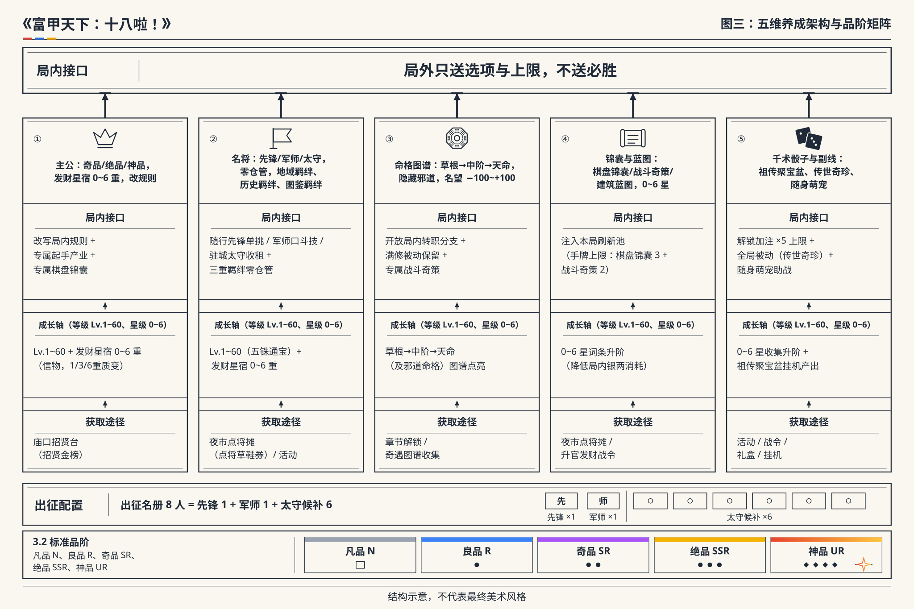

# 《富甲天下：十八啦！》角色价值、名将羁绊与卡牌养成系统设计分册

> **文档编号**：`03_character_and_card_systems`｜**版本**：v1.0｜**执笔**：首席角色、卡牌养成与数值架构师（`@fable-systems`）
> **上位依据**：`01_master_blueprint v1.0`（顶层宪法）、`00_research_dossier`（考据档案）；三套战力口径以 `02_core_gameplay_and_board` 为准
> **结构图解引用**：`assets/fig03_character_card_progression_matrix.svg`（五维养成架构，本册第一章逐柱对照）
> **对应立项书**：第五篇《角色与卡牌养成》5.1~5.7
> **证据标注**：沿用总纲 `[证]` `[推]` `[假]` `[待]`；另加 `〔锁〕` = 跨分册共享常数，本册任何章节不得改动。未标注的数字一律按 `[假]` 处理：系数可以调，结构、口径、名字不许动。

**本册三条算账铁律**（写任何一张卡之前先过这三问，过不了就不上卡）

| # | 铁律 | 审稿时问一句 | 违反的下场 |
| :-- | :-- | :-- | :-- |
| 一 | **只送选项与上限，不送必胜。** 局外养成往局内送的只能是"多一个选择"或"抬一个上限"。主公特权只许改写规则，绝不直接加 `胜算`。 | 这一条是让玩家多了一种打法，还是让数字替玩家赢？ | 后者退稿（咬合点 8、红线 R10） |
| 二 | **一条特权配一条代价，账要两边平。** 每条改规则的特权都得附一笔"算一笔账"（临界胜算或期望银两），代价必须真的咬到肉。 | 这条代价，玩家会不会在某一刻真的心疼？ | 写不出账的特权不许上卡 |
| 三 | **每一笔消耗都对得上零氪日产。** 基准〔锁〕：`逛街的` 活跃日均 `56,000 五铢通宝` + `35 册进修讲义` + `240 金元宝`。养满 1 位绝品至 Lv.60 需 8.6 天，连同发财星宿满六重约 32 天。 | 日均消耗有没有超过零氪日产的 1.2 倍？ | 超了就是卖绝望，退稿（6.4 对账点） |

**标注约定**

- 引号内的玩家可见文案（台词、星宿语音、卡面趣文）逐条标注 `[L0]`~`[L3]`；特权名、代价名、星宿名、产业名在首次出现处标档。
- "表演要点"一类是写给演出与美术看的内部说明，不标档。
- 新增材料名 `进修讲义`，以及内部用语 `施放费`、`规则口`、`生效等级`，统一在文末《术语增补申请》报备。

**全册章节对照**

| 本册章 | 立项书节 | 内容 |
| :-- | :-- | :-- |
| 第一章 | 5.1 | 五维养成总架构与设计铁律 |
| 第二章 | 5.2 | 六位首发主公设计卡与 S1 前瞻 |
| 第三章 | 5.3 | 名将：先锋、军师、太守与羁绊 |
| 第四章 | 5.4 | 四维与命格转职树 |
| 第五章 | 5.5 | 棋盘锦囊、战斗奇策与建筑蓝图 |
| 第六章 | 5.6 | 副线：千术骰子、祖传聚宝盆、传世奇珍、随身萌宠 |
| 第七章 | 5.7 | 养成消耗总表与《术语增补申请》 |

---

## 第一章 五维养成总架构与"只送选项与上限"设计铁律

> 对应立项书 5.1。一句话：局外养成是一间五层楼的批发行，往局内批发的只有"选项"和"上限"两种货。想批发"必胜"的，出门左转，本店不卖。

### 1.1 五维养成矩阵全景（映射 fig03）



fig03 的结构是五根立柱、一道顶梁、一块底座。每根柱子自下而上三层：获取途径、成长轴、局内接口。本表在此之上加第四栏"越界护栏"，写明每根柱子不许伸手的地方。

```text
        ┌──────────── 顶梁：局外只送选项与上限，不送必胜 ────────────┐
局内接口    ▲            ▲            ▲             ▲              ▲
          ①主公        ②名将      ③命格图谱    ④锦囊与蓝图   ⑤千术骰子与副线
成长轴    Lv.1~60      Lv.1~60     节点 0~6 星    0~6 星        各副线独立
          星宿 0~6 重   星宿 0~6 重
获取途径   保送/首充/    点将摊/      局内修满       点将摊/        礼盒/战令/
          招贤台        活动         即点亮         章节掉落       挂机/集册
        └──── 底座：出征名册 8 人 = 先锋 1 + 军师 1 + 太守候补 6 ────┘
```

**五维养成矩阵总表**

| 立柱 | 品阶范围 | 获取途径 | 成长轴 | 唯一局内接口 | 严禁越界护栏 |
| :-- | :-- | :-- | :-- | :-- | :-- |
| **① 主公** | 奇品、绝品、神品三阶（不出凡品与良品） | 创角保送、登录里程碑、`开市大吉首充红包`、`庙口招贤台`（耗 `招贤金榜`） | Lv.1~60（每 10 级突破，共 5 次，耗 `五铢通宝` + `进修讲义`）；`发财星宿` 0~6 重（每重 1 份同名 `信物`，本体 + 6 份满六重）〔锁〕 | **改规则**：开局账本 + 专属起手产业 + 1 条特权配 1 条代价 + 1 张专属棋盘锦囊 | 特权不得直接加胜算；每条特权必配对等代价；开局账本只许在基准 ±40% 内浮动；星宿第 1、3、6 重必为机制质变或专属演出，不许只加数值 |
| **② 名将** | 凡品至神品五阶 | `夜市点将摊`（耗 `点将草鞋券`）、活动、章节首通赠送 | Lv.1~60（同上）；`发财星宿` 0~6 重（同上） | **进名册**：以四项面板（`单挑基准`、`野战基准`、`攻防基准`、`经营加成`）代入 `02` 的 F5 三套口径与 F1/F2 的太守加成；未入册者经图鉴羁绊生效 | 面板只许使用 `02` 定义的三套口径；生效等级受章节等级帽约束（见 1.2）；重复获得自动折成信物，不产生库存；每张卡必须有岗位可上或有羁绊可挂，没有废卡 |
| **③ 命格图谱** | 不分品阶（节点制） | 局内首次修满某命格即永久点亮对应节点；踢馆宿敌首胜点亮分岔 | 节点 0~6 星（按局内修满次数累进；星级只扩充候选，不加面板）`[假]` | **解锁转职分支**：点亮的节点才会出现在本局的转职候选里；草根 4 → 中阶 8 → 天命 4，另有隐藏邪道 ≥2 | 图谱只决定"能转什么"，不决定"转了多强"；四维门槛与名望正邪分岔一律在局内现场检定；不得出现"开局自带满修被动" |
| **④ 锦囊与蓝图** | 凡品至神品 | `夜市点将摊`（与名将同池）、章节掉落、活动 `[假]` | 0~6 星（同名卡升星，改写词条） | **进本局刷新池**：已拥有的棋盘锦囊、战斗奇策、建筑蓝图才会进入本局的夜市摊与掉落候选 | 局内仍须用银两现买现用，手牌上限 3 + 2 不变（R4）；除主公专属锦囊外不得开局白送；星级词条不得加胜算 |
| **⑤ 千术骰子与副线** | 千术骰子：良品至神品；传世奇珍：神品；其余不分阶 `[假]` | 礼盒、战令、集册兑换、挂机 | 各副线独立成长（第六章详列） | 千术骰子：**掷骰键**（抬 `加注` 上限至 ×5，并挂 1 条欢喜对词条）；传世奇珍：开局携带 1 件规则类被动；随身萌宠：每局 1 个触发口；祖传聚宝盆：**局内零接口**，只接局末结算 | 副线不得绕过前四柱另开战力来源；外观与图鉴收集不挂面板；祖传聚宝盆只产 `五铢通宝`，不得产银两或信物 |

**读表三句话**

1. **五根柱子，五种接口，互不串门。** 主公改规则，名将填岗位，命格开分支，锦囊蓝图扩刷新池，千术骰子抬加注上限。任何新养成内容进来，先回答"你是哪根柱子的"，答不出来就是在盖违建。
2. **成长轴只有两种货。** 等级轴（Lv.1~60）只对冲章节基准强度，星级轴（0~6）只送质变、选项与演出。两条轴都不直接写进 F5 的结果里。
3. **底座是唯一入口。** 局外养成的一切成果，只能通过"出征配置"这一道门进局，进了门就按局内规则重新做人。

### 1.2 出征名册（8 人配置）与等级成长解耦逻辑

#### 1.2.1 八席怎么坐

| 席位 | 人数 | 上场方式 | 读取的面板 | 何时可换 |
| :-- | :-- | :-- | :-- | :-- |
| `先锋` | 1 | 随行；`骑木马单挑` 的出战者，`先锋装备栏` 4 部位绑定此位 | `单挑基准`；涉及野战口径时读 `野战基准` × 地形适性 | 开局定，局内不换（守 R6） |
| `军师` | 1 | 随行；单挑时站场边放 `口斗技` | 以 `02` 口径为准 | 开局定，局内不换 |
| `太守` 候补 | 6 | 占城后在 `置业时间` 派驻，每城 1 名 | `攻防基准`（驻城守御与被 `上门找茬` 时应战）、`经营加成`（F1 与 F2 的太守加成） | `置业时间` 内可任意调动 |

#### 1.2.2 为什么是 6 名太守候补

"6"是从 28 格方环棋盘上的 14 座城池格反推出来的。四笔账都指向同一个数：

| 账 | 算式 | 结论 |
| :-- | :-- | :-- |
| **连城账** | 标准盘四州：益州 4 城、中原 3 城、江东 4 城、荆州 3 城。"垄断一州 + 连城一州"的两种成型：4 + 2 = 6，或 3 + 3 = 6 | 6 名太守刚好够把一套完整的 `连城倍率` 打法每城派满，不多不少 |
| **持城账** | 普通章开局归属：玩家 1 城（起手产业），主霸主 3 城，副霸主 2 城，无主 8 城。零氪标准局的终局持城目标 6±1 座 `[假]` | 候补 6 人覆盖中位数；第 7 座城起太守位留空（太守加成按 0 计，被找茬时只靠守军与城防） |
| **地形账** | 地形三种（陆、水、林）× 每种带 2 名对口名将 = 6；地形适性 S = 1.25、A = 1.0、B = 0.8〔锁〕 | 每种地形都排得出"一个主守、一个替补"，不会因为盘面多刷两座水城就整本名册失灵 |
| **负荷账** | 名册界面 2 行 × 4 张 = 8 张卡，一屏看完，不滚动 | 守总纲 2.3 的认知负荷标尺；要是按 14 城配 14 名太守，玩家排名册的时间会比打一局还长 |

**留空是故意的。** 第 7 座城没有太守可派，玩家就得在置业时间做一道真题：把经营加成最高的那位留在州府收过路费，还是调去守刚抢来、马上要被找茬的边城。这道题与付费无关，神品名将再多也只有 6 个候补席。

**那其余的名将怎么办。** 抽到却没进名册的名将，通过图鉴羁绊（地域羁绊、历史羁绊）给名册内的同伴挂效果，细则在第三章。这就是总纲承诺的"没人坐冷板凳"。

#### 1.2.3 等级为什么不会吃掉单局的滚雪球

通胀有两层，各由一头负责，互不代班：

| 通胀层 | 来源 | 一局内变不变 | 谁来对冲 | 设计意图 |
| :-- | :-- | :-- | :-- | :-- |
| **章节基准强度**（跨章，静态） | 越往后的章节，霸主守军、太守、心魔怪、踢馆宿敌与天命魔王的基准越高 | 不变 | **局外等级**（Lv.1~60 抬名将四项面板的基准值） | 等级是入场券：练度到了，开局才站在同一条起跑线上 |
| **圈压系数**（局内，动态） | F6 = 1.12 ^（圈数 − 1）；第 15 圈为 ×4.89，第 20 圈为 ×8.61 | 每圈都涨 | **局内构筑**（政见、先锋装备栏、命格、收过路费滚出的银两） | 雪球必须在局内滚：这一局的输赢看这一局的脑袋 |

三道闸门保证等级只当入场券：

1. **章节等级帽。** 每章设 `章节推荐等级`；名将的 `生效等级` = min（实际等级，章节推荐等级 + 10）`[假]`。超出推荐等级的那 10 级只给一点甜头，对应面板溢出封顶约 +20% `[假]`。
2. **甜头活不过第三圈。** 圈压到第 3 圈就是 1.12² = ×1.254，已经高过 +20% 的溢出上限。也就是说，就算练度拉满，开局那点优势在第 3 圈就被通胀吃平，后面 12 圈照样得靠局内构筑。等级再高，也没法把低章打成不用动脑的局。
3. **等级只进基准，不进乘区。** 等级只抬四项面板的基准值；政见、装备、命格、连城这些乘区全部长在局内。主公的开局账本（银两、兵力、四维初值）与特权数值不随主公等级变化。主公等级的作用只有一个：名册内名将的生效等级不高于主公等级 + 10 `[假]`（主公带队，天花板跟着主公走）。

**R10 校验：零氪 30 日能养到哪。**

```text
零氪 30 日资源 = 56,000 × 30 = 1,680,000 五铢通宝
               +   35 × 30 =     1,050 册进修讲义
               +  240 × 30 =     7,200 金元宝（= 36 抽，守"月均 ≥35 抽"）

一主五将养满方案（全部 Lv.60）：
  刘备（绝品主公，保送）        480,000 + 300 册
  奇品名将 × 2                  640,000 + 400 册
  良品名将 × 2                  400,000 + 240 册
  凡品名将 × 1                  120,000 +  80 册
  合计                        1,640,000 + 1,020 册   ≤  1,680,000 + 1,050 册  ✓
```

各品阶单卡养满天数（按零氪日产折算）：凡品 2.3 天、良品 3.6 天、奇品 5.7 天、绝品 8.6 天、神品 11.4 天。

由此反推一条硬约束：**全部普通章的推荐等级曲线，必须落在"零氪 30 日养满 1 主公 + 5 名将"这条线以内**，最后一个普通章的推荐等级不得高于该练度的 85% `[假]`，留 15% 给手滑与歪池。精英魔王章可以要求更高练度，但不得要求任何付费限定卡（守 R10）。

### 1.3 高角色溢价的三重锚点

玩家凭什么为一位主公掏 150~200 元（神品主公单本成本带〔锁〕）？本册的回答是一个乘法：

```text
角色溢价 = 机制改写独占性 × 台味高颜艺视听情绪价值 × 规则生态位长线保值
```

三项相乘，任何一项为零，溢价归零。数值强度不在这个算式里。

| 锚点 | 玩家买到的是什么 | 设计抓手 | 验收口径 | 明确不卖什么 |
| :-- | :-- | :-- | :-- | :-- |
| **一、机制改写独占性** | 一套别的主公玩不出来的打法 | 每位主公独占一个 `规则口`（见下表），在这个口上改写规则；同一个口不发第二张更优的卡 | 遮住主公头像，只看一局的操作记录，策划能认出是谁在玩 | 不卖胜算，不卖通关资格 |
| **二、台味高颜艺视听情绪价值** | 一个"破产都舍不得跳过演出"的角色 | 主公 ≥8 种表情差分（得意、算计、肉痛、傻眼、暴怒、哭穷、狂喜、破产）；局外立绘与局内小人共用三锚点（发型轮廓、主色、标志道具）；专属全语音；每位主公一套专属花裤衩破产跑路演出；星宿第 1、3、6 重解锁新演出 | 头部缩到 96 像素仍认得出表情；5 秒盲测配对正确率 ≥90%（总纲 4.3）；破产演出首次观看的跳过率 <20% `[假]` | 不锁画风：三锚点只约束辨识信息，哪种画风来都得过同一道门槛 |
| **三、规则生态位长线保值** | 一张三个赛季后还有局可上的卡 | 新主公只开新的规则口，不在旧口上发数值更高的同型卡；每个赛季的 `章节机制格` 与霸主组合轮换，给老主公排"返场窗口" | 任一首发主公在上线 6 个月后的出征占比不低于 8% `[假]` | 不靠数值膨胀逼换代；不出上位替代 |

**规则口登记表**（主公设计的"地籍图"：一口一户，先到先得）

| 规则口 | 改写对象 | 占用者 |
| :-- | :-- | :-- |
| 败方赔付（单挑、野战） | F3 的"败 −2T" | 刘备 |
| 胜方收益（单挑、野战） | F3 的"胜 0" | 曹操 |
| 连城判定 | `连城倍率` 的全州垄断门槛 | 孙权 |
| 攻城赔付与吞并 | F3 的"败 −3T"与夺城吞并比例 | 董卓 |
| 落败后流程 | 落败后能否当场再来 | 孟获与祝融 |
| 欢喜对触发口 | 对子触发的额外结算 | 张角 |
| 掷骰信息 | 落点预览与骰面可见性 | 预留：卑弥呼（S1） |
| 过圈结算顺序、气运签用途、聚宝盆与赌场、霸主手笔亮牌、割地抵债 | — | 预留：S2 起 |

> 架构师批注：六位首发主公里有三位都在动 F3，看着像撞车，其实是三个不同的格子。刘备动"输了赔多少"，曹操动"赢了拿多少"，董卓动"攻城这一行"。同一张赔付表改三个格子，就是三种胆量。

---

## 第二章 高角色价值核心层：六位首发主公完整设计卡与 S1 赛季前瞻

> 对应立项书 5.2。六位主公是六套改规则的打法。免费的三位（刘备、孟获与祝融、张角）已经覆盖三大流派的入口；付费的三位卖的是另一种解法、另一套演出，不卖通关资格。

**读卡须知**（六张卡通用，不再逐卡重复）

1. **开局账本**：基准为银两 3,000 两、兵力 1,000（总纲 3.4）；各主公在 ±40% 内浮动，即银两 1,800~4,200 两、兵力 600~1,400。账本不随主公等级变化。
2. **起手产业**：开局即归玩家的 1 座城池，品阶、地价档与地形为〔锁〕。标注的"州"指该产业在方环棋盘上所属的那条边，具体格位编号以 `02` 的 28 格格点详表为准。
3. **特权与代价**：一条改规则，一条咬肉，都在开局生效、整局有效。数值一律 `[假]`，口径不可动。
4. **专属棋盘锦囊**：仅该主公出征时入局。开局自带 1 张，占棋盘锦囊手牌 3 格之一；施放须以银两支付 `施放费`；用掉后可在本局 `夜市摊` 再买（统一标价 400 两 `[假]`）；溢出折银 200 两。专属锦囊不走 0~6 星的卡牌养成，只随主公的发财星宿成长。
5. **发财星宿**：每重消耗 1 份同名信物〔锁〕。类型栏标【质变】【上限】【选项】【演出】；第 1、3、6 重必为质变或专属演出〔锁〕。
6. **三锚点**：只约束辨识信息（轮廓、主色、道具），不约束画风。主色只是信息编码，定画风后可整体换色，但六位主公之间的冷暖与明度区分不许乱。
7. **算一笔账**：只比较银两期望，不计 `02` 定义的胜负副作用（先锋状态、兵力损耗等）。魅力杀价是否作用于落败赔付，以 `02` 口径为准。

---

### 2.1 刘备｜绝品 SSR｜哭穷的草鞋摊老板

**A. 档案与三锚点**

| 项 | 内容 |
| :-- | :-- |
| 品阶与获取〔锁〕 | 绝品 SSR；创角后打通教学章，免费保送整卡 |
| 市井身份 `[L2]` | 哭穷的草鞋摊老板 |
| 深信不疑的歪理 | 仁义是天底下最好用的杀价工具 |
| 可升级的行为 | 过路费越贵哭得越惨，哭完照样多拗一双草鞋 |
| 三锚点 | 轮廓：垂到肩头的大耳垂 + 小发髻；主色：草席黄绿；标志道具：肩上一串草鞋 + 袖口一条手帕 |

**Character Game 一句话**：每当要掏过路费或输了单挑，刘备就因为"仁义是天底下最好用的杀价工具"当场开哭，哭完还要多拗一双草鞋的差价，结果对方的账越算越少、自己的招牌越擦越亮，钱包却永远在喊穷。

**B. 八种颜艺亮点与破产演出**

| 表情 | 触发情境 | 表演要点 |
| :-- | :-- | :-- |
| 得意 | 收到过路费 | 手帕还捏在手里，嘴角已经翘起来；把铜板一枚枚排进草鞋里 |
| 算计 | 四择弹窗出现 | 大耳垂抖一下，算盘藏在袖子里拨 |
| 肉痛 | 缴交过路费 | 捂胸口，背后的草鞋掉下一只 |
| 傻眼 | 先锋放水 | 眼泪停在半空，耳垂垂到肩膀以下 |
| 暴怒 | 起手产业被夺 | 把草鞋摔在地上，下一秒又捡起来拍灰 |
| 哭穷 | 特权或专属锦囊触发 | 泪如喷泉，眼珠却在偷瞄对方；袖口露出半瓶眼药水 |
| 狂喜 | 掷出十八啦 | 抱着关张转圈，草鞋抛上天 |
| 破产 | 破产跑路 | 只剩一条绣着"仁义"的花裤衩，背上一捆草鞋 |

- 破产跑路台词 `[L3]`："夭寿哦，连草鞋摊都被查封！二弟三弟，紧酸——哭的事路上再说。"

**C. 开局账本与专属起手产业**

| 账本项 | 数值 | 相对基准 | 备注 |
| :-- | :-- | :-- | :-- |
| 开局银两 | 2,400 两 | −20% | 本小利薄 |
| 开局兵力 | 800 | −20% | 兵少，靠兄弟 |
| 体魄 / 谋略 / 魅力 | 40 / 55 / 90 | — | 魅力 90：缴交过路费天然杀价 27%（F1，上限 30%） |
| 名望 | +40（正道） | — | 开局即享正道的选项改写（口径见 `02`） |
| 开局身家（F7） | 3,000 两 | — | 银两 2,400 + 起手产业 600 |

| 起手产业 `[L2]` | 所属州 | 地价档 | 规模 | 地形 | Lv.1 过路费 / 每圈税 | 升满 Lv.5 累计造价 | Lv.5 基础过路费 |
| :-- | :-- | :-- | :-- | :-- | :-- | :-- | :-- |
| `益州·平原草鞋坊`〔锁〕 | 益州 | 县城 P = 600 | Lv.1 | 陆 | 150 两 / 30 两 | 5,100 两 | 2,400 两 |

- 产业趣文 `[L2]`："平原草鞋坊：买一双送一段身世，哭完再结账。"

**D. 核心双刃机制**

| | 名称 | 规则 |
| :-- | :-- | :-- |
| **特权** | 《输了也要拗》`[L2]` | `骑木马单挑` 与 `地形野战` 落败时，赔付由 2T 改为 **1.5T**（改写 F3 的败方赔付；胜算一个点都不动）。`机关攻城` 不适用 |
| **代价** | 《仁义价》`[L2]` | 刘备名下城池向霸主收取的过路费一律 **×0.85**。招牌上写着仁义价，自己打的折，含着泪也要认 |

- 特权触发台词 `[L2]`："两倍？备织一双草鞋才赚三文啊……算一倍半，草鞋送你。"
- 代价触发台词 `[L2]`："招牌都挂出去了……歹势，只收八五折。"

**算一笔账**

| 胜算 | 标准主公单挑期望 | 刘备单挑期望 | 直接缴交 |
| :-- | :-- | :-- | :-- |
| 30% | −1.40T | −1.05T | −1T |
| 40% | −1.20T | −0.90T | −1T |
| 50% | −1.00T | −0.75T | −1T |

"该不该刚"的临界胜算从 50% 降到 **33.3%**：别人七成把握才敢上，皇叔四成就敢派张飞去试试。代价这一头：若一局向霸主收过路费合计 20,000 两，仁义价让他少收 3,000 两。所以刘备是"少赔钱"的主公，不是"多收钱"的主公。

**E. 专属棋盘锦囊《哭穷卖惨》`[L2]`**〔锁〕

| 项 | 内容 |
| :-- | :-- |
| 施放费 | 100 两（眼药水成本） |
| 施放时机 | 掷骰前，预埋在主公身上，至多持续 8 刻 |
| 规则改写 | 预埋期间，下一笔须支付的过路费（缴交，或单挑、野战的落败赔付）**只付 50%**；若施放当下银两 ≤500 两，改为**全免**（真穷才灵）。先减免，再乘加注。对机关攻城的落败赔付无效：城门都撞了，哭不动 |
| 施放台词 `[L2]` | "备自幼丧父，织席贩履……这笔，能不能算了？" |
| 真穷全免台词 `[L3]` | "夭寿哦，真的一文都没有了！歹势，这笔先欠着。" |

**F. 发财星宿演进表**

| 重数 | 星宿名 | 类型 | 规则改写与解锁内容 | 解锁语音 |
| :-- | :-- | :-- | :-- | :-- |
| 一重 | 「借荆州」`[L2]` | 【质变】 | 每局 1 次，踩中无主城池可不付地价直接占领；第 3 次过圈结算时自动补缴地价 P，付不出则该城归还无主（已投入的升级造价不退） | `[L2]`"先借我住几天，安啦，会还的。" |
| 二重 | 「眼泪自产自销」`[L2]` | 【上限】 | 《哭穷卖惨》施放费 100 → 0；全免门槛由银两 ≤500 放宽到 ≤800 | `[L1]`"眼药水省下来了，今天哭真的。" |
| 三重 | 「三顾茅庐」`[L2]` | 【质变】【演出】 | 每局前 3 次政见由三选一改为四选一（选项仍 ≤4，守总纲 2.3）；解锁专属"冻蒜"演出：刘备三鞠躬 | `[L2]`"先生不出山？备明天再来。后天也来。" |
| 四重 | 「攻城也讲情面」`[L2]` | 【上限】 | 特权覆盖到 `机关攻城`：落败赔付 3T → 2.5T | `[L2]`"攻城输了也能谈嘛。大家搏感情。" |
| 五重 | 「憨人有憨福」`[L2]` | 【上限】 | 气运签持有上限 3 → 4 支（只抬上限，开局仍 1 支） | `[L2]`"多一支签，多一条活路。憨人有憨福啦。" |
| 六重 | 「携民渡江」`[L2]` | 【质变】【演出】 | 每局 1 次，银两为负时可发动：欠额一笔勾销、银两归零、城池全保；其后 2 次过圈结算的城池税收归乡亲（税收项记 0，俸禄照发）。专属演出：全城乡亲扛着草鞋追着塞钱 | `[L3]`"乡亲们别塞了！歹势歹势……好啦，这袋也给我。" |

**G. 适配流派与付费吸引力**

- **适配流派**：主修 `木马单挑流`（临界胜算低，敢搏的次数多）；次修 `老千十八啦流`（五重后气运签上限高，容错大）。`包租公流` 可玩但被仁义价拖着，不推荐当主轴。
- **付费吸引力拆解**：
  - 定位是全民的第一张绝品。教学章打完就保送整卡，让每位玩家从第一天起手里就有一张鎏金卡，品阶价值感先立起来。
  - 0 重即完整：特权、代价、专属锦囊全部到手，零氪玩家不缺任何一块。
  - 付费深度在星宿：一重「借荆州」是性价比最高的一档（多一种赊账开局的打法）；六重卖的是多一条命和一套演出，不是数值。
  - 情怀价值：老光谱返场客的第一情怀位，语音包与破产演出是主要的传播素材。

---

### 2.2 曹操｜神品 UR｜大魏建设集团董事长

**A. 档案与三锚点**

| 项 | 内容 |
| :-- | :-- |
| 品阶与获取〔锁〕 | 神品 UR；`庙口招贤台` 旗舰 UP 主公 |
| 市井身份 `[L2]` | 大魏建设集团董事长 |
| 深信不疑的歪理 | 没有不能并购的城，只有没谈拢的价 |
| 可升级的行为 | 输了要开发票，赢了要收管理费 |
| 三锚点 | 轮廓：高冠 + 上扬的八字短须；主色：藏青；标志道具：一本支票簿（兼发票本） |

**Character Game 一句话**：每当输赢落地，曹操就因为"没有不能并购的城，只有没谈拢的价"掏出支票簿——输了要开发票，赢了要收管理费，结果每一场仗都被他开成股东会，对手的城一座座改姓曹，他自己的税单也一张比一张长。

**B. 八种颜艺亮点与破产演出**

| 表情 | 触发情境 | 表演要点 |
| :-- | :-- | :-- |
| 得意 | 收到过路费或管理费 | 捋短须，支票簿"啪"地合上 |
| 算计 | 四择弹窗出现 | 眯起一只眼，手指在空中按计算器 |
| 肉痛 | 缴交过路费 | 咬牙开发票，笔尖把纸戳破 |
| 傻眼 | 先锋放水 | 默默往额头贴一块头痛膏 |
| 暴怒 | 并购被拒或城池被夺 | 把合约撕成两半，再默默用胶带粘好（还要用） |
| 哭穷 | 银两见底 | 不哭，扶额改口"集团最近现金流比较紧" |
| 狂喜 | 掷出十八啦 | 仰天三段笑，笑到高冠歪掉 |
| 破产 | 破产跑路 | 官袍被扒，只剩一条花裤衩，腋下还夹着支票簿 |

- 破产跑路台词 `[L3]`："代志大条了，集团被查封！紧酸——发票记得补开给我。"

**C. 开局账本与专属起手产业**

| 账本项 | 数值 | 相对基准 | 备注 |
| :-- | :-- | :-- | :-- |
| 开局银两 | 3,600 两 | +20% | 资本雄厚 |
| 开局兵力 | 1,100 | +10% | — |
| 体魄 / 谋略 / 魅力 | 55 / 85 / 60 | — | 魅力 60 本可杀价 18%，被代价整条作废 |
| 名望 | −20（墙头草） | — | 离邪道线只差 10 点 |
| 开局身家（F7） | 4,800 两 | — | 银两 3,600 + 起手产业 1,200 |

| 起手产业 `[L2]` | 所属州 | 地价档 | 规模 | 地形 | Lv.1 过路费 / 每圈税 | 升满 Lv.5 累计造价 | Lv.5 基础过路费 |
| :-- | :-- | :-- | :-- | :-- | :-- | :-- | :-- |
| `中原·许昌总部大楼`〔锁〕 | 中原 | 州府 P = 1,200 | Lv.1 | 陆 | 300 两 / 60 两 | 10,200 两 | 4,800 两 |

- 产业趣文 `[L2]`："许昌总部大楼：一楼收过路费，二楼开发票，顶楼头痛。"

**D. 核心双刃机制**

| | 名称 | 规则 |
| :-- | :-- | :-- |
| **特权** | 《赢了收管理费》`[L2]` | `骑木马单挑` 与 `地形野战` 获胜时，除免缴本次过路费外，另向该城所属霸主的金库收取 **0.5T** 管理费（改写 F3 的胜方收益）。金库不足时有多少收多少，不触发割地抵债 |
| **代价** | 《抬头写大魏集团》`[L2]` | 曹操的一切过路费支出（缴交与落败赔付）**不适用魅力杀价**，并另加 **10% 开票税点**。大集团走公账，一毛都不能少 |

- 特权触发台词 `[L2]`："仗打完了，账还没算。管理费，五成。"
- 代价触发台词 `[L2]`："一千二？含税一千三百二。走公账的不杀价。"

**算一笔账**

- 临界胜算：0.5p − 2.2（1 − p）= −1.1，解得 p = **40.7%**（标准主公为 50%）。
- 实例：T = 1,200 两、胜算 45%。曹操直接缴交 = −1,320 两；单挑期望 = 0.45 × 600 − 0.55 × 2,640 = **−1,182 两**，比缴交划算。
- 代价这一头：同样魅力 60 的标准主公缴交这笔只付 984 两，曹操付 1,320 两，贵 34%。所以曹操的每一次踩城都更贵，他必须靠赢来回本。

**E. 专属棋盘锦囊《恶意并购》`[L2]`**〔锁〕

| 项 | 内容 |
| :-- | :-- |
| 施放费 | 目标城池累计造价 × 1.3，以现金支付，款项进该霸主金库 |
| 施放时机 | 掷骰前；目标为前方 12 格内任一霸主名下、规模 ≤Lv.4 的城池 |
| 规则改写 | **免战过户**：城池连同规模与全部建筑原样归你，原太守遣返，不触发四择 |
| 价目示例 | 县城 Lv.2：1,170 两；郡城 Lv.3：2,925 两；州府 Lv.4：7,020 两 |
| 内生代价 | 并购款进了对方金库，主霸主身家净增 0.3 倍累计造价，魔王气血（F9）会跟着厚一点。买贵了，就是在帮魔王补身子 |
| 施放台词 `[L2]` | "这座城，我出一点三倍。不卖？那我连你老板一起买。" |

**F. 发财星宿演进表**

| 重数 | 星宿名 | 类型 | 规则改写与解锁内容 | 解锁语音 |
| :-- | :-- | :-- | :-- | :-- |
| 一重 | 「发票抵税」`[L2]` | 【质变】 | 每圈 `缴交过路费` 的总额（含税点），在下一次过圈结算时返还 20%。落败赔付不计入 | `[L2]`"输钱可以，发票要开。抬头写大魏集团。" |
| 二重 | 「谈价是门手艺」`[L2]` | 【上限】 | 《恶意并购》溢价 ×1.3 → ×1.2 | `[L1]`"谈价这种事，多练就便宜了。" |
| 三重 | 「挟天子收税」`[L2]` | 【质变】【演出】 | 每局 1 次，过圈结算时指定 1 位霸主：其后 3 次过圈结算，该霸主地盘税收的 50% 改进你的钱袋。专属演出：曹操牵着小皇帝举牌收税 | `[L2]`"陛下坐好。诸位，税交这边。" |
| 四重 | 「拆除费另计」`[L2]` | 【上限】 | 特权覆盖到 `机关攻城`：攻城获胜同样收 0.5T 管理费 | `[L2]`"城拆了，拆除费另计。安啦，有开发票。" |
| 五重 | 「没有不卖的楼」`[L2]` | 【上限】 | 《恶意并购》目标规模上限 Lv.4 → Lv.5 | `[L1]`"盖到顶的楼，也是有价钱的嘛。" |
| 六重 | 「宁教我负天下人」`[L2]` | 【质变】【演出】 | 《恶意并购》的并购款不再进对方金库，改为注入 `聚宝盆` 奖池，谁踩到谁抱走（霸主车驾也可能截胡）。专属演出：合约从天而降，全场霸主头像被盖上"已收购"章 | `[L2]`"宁教我负天下人——夭寿哦，这价钱谁负得起。全买了。" |

**G. 适配流派与付费吸引力**

- **适配流派**：主修 `包租公流`（并购凑连城，州府起手产业是天然的收租核心）；次修 `木马单挑流`（管理费把每一场胜利变成收入，顺手掏空霸主金库，逼出割地抵债）。
- **付费吸引力拆解**：
  - 定位是开服旗舰，面向 `田侨仔` 与 `大头家`。成本带〔锁〕：单本期望 150~200 元，含保底硬上限 ≤180 抽（324 元）；满六重期望 1,100~1,400 元。
  - 0 重即完整：抽到第一本就拿到全套打法，不存在"不升星就是残废"。
  - 质变梯度清楚：一重「发票抵税」把代价的痛感缓掉一半，是 `田侨仔` 最划算的停靠点；三重开一条新的收入线；六重把专属锦囊从"养肥魔王"翻成"饿瘦魔王"，是给 `大头家` 的终点。
  - 卖的是"用钱解决问题"这种玩法幻想：别人打下来的城，他买下来。台词截图传播度预期最高，"开发票"是全游戏的头号口头禅。

---

### 2.3 孙权｜绝品 SSR｜江东水产行少东

**A. 档案与三锚点**

| 项 | 内容 |
| :-- | :-- |
| 品阶与获取〔锁〕 | 绝品 SSR；`开市大吉首充红包`（6 元）或 `庙口招贤台` |
| 市井身份 `[L2]` | 江东水产行少东 |
| 深信不疑的歪理 | 稳稳收租最实在，合肥那种地段碰都别碰 |
| 可升级的行为 | 每次想搏一把都被周都督的账本劝退，然后还是去了 |
| 三锚点 | 轮廓：束发小冠 + 一圈紫色短须；主色：海水青；标志道具：印着"江东直送"的海鲜保鲜箱 |

**Character Game 一句话**：每当胜算摆在眼前，孙权就因为"稳稳收租最实在"先回头看一眼周都督的账本、被劝退一次，然后还是忍不住去碰那块像合肥的地段，结果港口越收越稳，面子在陆地上越丢越多。

**B. 八种颜艺亮点与破产演出**

| 表情 | 触发情境 | 表演要点 |
| :-- | :-- | :-- |
| 得意 | 收到过路费 | 把算盘当琴拨一下，珠子排成一条鱼 |
| 算计 | 四择弹窗出现 | 偷瞄身后周都督摊开的账本 |
| 肉痛 | 缴交过路费 | 小算盘的珠子一颗颗崩飞 |
| 傻眼 | 先锋放水 | 手里的鱼滑掉，鱼也是傻眼的表情 |
| 暴怒 | 港口被夺 | 一掌拍在保鲜箱上，冰块溅自己一脸 |
| 哭穷 | 银两见底 | 抱着一只澡盆，表示下个月水军只能划这个 |
| 狂喜 | 掷出十八啦 | 把整箱渔获撒向全场 |
| 破产 | 破产跑路 | 花裤衩外面套着游泳圈，划着澡盆跑 |

- 破产跑路台词 `[L3]`："歹势啦周都督，港口被拍卖了！紧酸——合肥我就说不要去。"

**C. 开局账本与专属起手产业**

| 账本项 | 数值 | 相对基准 | 备注 |
| :-- | :-- | :-- | :-- |
| 开局银两 | 3,000 两 | ±0 | 四平八稳 |
| 开局兵力 | 1,000 | ±0 | — |
| 体魄 / 谋略 / 魅力 | 50 / 70 / 70 | — | 魅力 70：缴交杀价 21% |
| 名望 | +10（墙头草） | — | — |
| 开局身家（F7） | 3,900 两 | — | 银两 3,000 + 起手产业 900 |

| 起手产业 `[L2]` | 所属州 | 地价档 | 规模 | 地形 | Lv.1 过路费 / 每圈税 | 升满 Lv.5 累计造价 | Lv.5 基础过路费 |
| :-- | :-- | :-- | :-- | :-- | :-- | :-- | :-- |
| `江东·建业海鲜港`〔锁〕 | 江东 | 郡城 P = 900 | Lv.1 | 水 | 225 两 / 45 两 | 7,650 两 | 3,600 两 |

- 产业趣文 `[L2]`："建业海鲜港：现捞现收，过路的连人带船秤重计费。"

**D. 核心双刃机制**

| | 名称 | 规则 |
| :-- | :-- | :-- |
| **特权** | 《稳稳地收》`[L2]` | `连城倍率` 的"全州垄断"判定，孙权可**少占 1 城**：四城州占 3 城、三城州占 2 城，即按 ×2.0 计。"同州占 2 城起 ×1.5"的门槛不变 |
| **代价** | 《合肥恐惧症》`[L2]` | 对 `陆` 地形的敌城选择 `地形野战` 或 `机关攻城`，落败赔付各 **+1T**（野战 2T → 3T，攻城 3T → 4T）。`骑木马单挑` 不受影响 |

- 特权触发台词 `[L2]`："差一间而已？周都督，账面先算全包。"
- 代价触发台词 `[L2]`："这地段看着就像合肥……先说好，输了别算我的。"

**算一笔账**

| 情境 | 标准主公 | 孙权 | 差额 |
| :-- | :-- | :-- | :-- |
| 中原占 2/3 城，州府 Lv.3 的过路费 | 1,200 × 1.0 × 1.5 = 1,800 两 | 1,200 × 1.0 × 2.0 = 2,400 两 | +33% |
| 江东占 3/4 城，建业 Lv.4 的过路费 | 900 × 2.0 × 1.5 = 2,700 两 | 900 × 2.0 × 2.0 = 3,600 两 | +33% |
| 陆城野战的临界胜算 | 50% | 66.7% | 更难下手 |
| 陆城攻城落败赔付 | 3T | 4T | 多赔一整笔过路费 |

少占一座城就吃到垄断，等于把"最后一座城被霸主卡死"这个包租公最常见的死局直接拆掉。代价则把他钉在水边：上了陆地，每一次动手都更贵。

**E. 专属棋盘锦囊《江东封港令》`[L2]`**〔锁〕

| 项 | 内容 |
| :-- | :-- |
| 施放费 | 300 两 |
| 施放时机 | 掷骰前；指定自家 1 座城池挂上封港令，持续 6 刻（挂在 `水` 地形城池上持续 8 刻） |
| 规则改写 | 持续期间，每枚霸主车驾**首次进入该城所在的州**时，被直接"引航"拖到这座城，按踩中结算（每枚车驾限 1 次）。被引航的车驾本次只能缴交过路费，不得上门找茬 |
| 施放台词 `[L2]` | "港口今天不开，路过的通通靠边。安啦，停泊费有打折。" |

**F. 发财星宿演进表**

| 重数 | 星宿名 | 类型 | 规则改写与解锁内容 | 解锁语音 |
| :-- | :-- | :-- | :-- | :-- |
| 一重 | 「过港费」`[L2]` | 【质变】 | 霸主车驾路过（不停留）你已判定全州垄断的州内城池时，每刻至多 1 座，收该城过路费的 10% | `[L2]`"路过也算靠港啦。安啦，收一成而已。" |
| 二重 | 「封久一点」`[L2]` | 【上限】 | 《江东封港令》持续 6 → 8 刻（水城 8 → 10 刻），施放费 300 → 150 | `[L1]`"封久一点，鱼才不会跑嘛。" |
| 三重 | 「不夜渔港」`[L2]` | 【质变】【演出】 | 你的棋子路过（不停留）自家 `水` 地形城池也触发 `回城探班`（每城每圈 1 次）。专属演出：渔港夜市整排亮灯 | `[L2]`"自家港口，路过看一眼也要收账。歹势，习惯了。" |
| 四重 | 「野战可以啦」`[L2]` | 【上限】 | 代价松绑：`地形野战` 不再受《合肥恐惧症》影响，仅 `机关攻城` 保留 +1T | `[L2]`"野战可以啦。攻城？周都督先看一下。" |
| 五重 | 「榻上先讲定」`[L2]` | 【选项】 | 本局首次政见三选一，必含 1 条 `包租公流` 核心政见（定向，不加次数） | `[L1]`"先把收租的事讲定，别的再说。" |
| 六重 | 「生子当如孙仲谋」`[L2]` | 【质变】【演出】 | 霸主车驾在你已判定全州垄断的州内移动时，点数减半（向上取整）：进了你的海，就多踩几次你的城。专属演出：曹操头像探出来感叹一句，然后晕船 | `[L2]`"进了我的海，就照我的浪走。夭寿哦，曹老板晕船了。" |

**G. 适配流派与付费吸引力**

- **适配流派**：主修 `包租公流`，是全首发最纯的收租主公；不建议走 `木马单挑流` 以外的任何动手路线上陆地。
- **付费吸引力拆解**：
  - 定位是破冰首充位，面向 `小资族`。6 元换一位绝品主公加一整套包租打法，是全游戏性价比最高的第一笔消费，对应总纲"首充价值 ≥10 倍"的锚点。
  - 双获取口：不首充的玩家仍可在 `庙口招贤台` 抽到，不做付费独占。
  - 卖的是"安心感"：三位免费主公都偏搏命，孙权是第一位让人稳稳数钱的主公，给不爱赌的玩家一个付 6 元的正当理由。
  - 星宿深度：一重把路过也变成收入，三重把探班变成路过，六重直接改写霸主车驾的步数。每一档都能在盘面上看见变化，不是面板数字。

---

### 2.4 董卓｜神品 UR｜砂石车起家的暴发户

**A. 档案与三锚点**

| 项 | 内容 |
| :-- | :-- |
| 品阶与获取〔锁〕 | 神品 UR；`庙口招贤台` 旗舰主公 |
| 市井身份 `[L2]` | 砂石车起家的暴发户 |
| 深信不疑的歪理 | 能用抢的，干嘛用买的 |
| 可升级的行为 | 抢得越多跑得越多，最后连貂蝉都来讨薪 |
| 三锚点 | 轮廓：圆滚身形 + 炸开的络腮胡；主色：暴发金；标志道具：一只随身拎着的砂石车方向盘 |

**Character Game 一句话**：每当看上一座城，董卓就因为"能用抢的，干嘛用买的"直接把砂石车倒进去，抢完才发现手下排着队等分赃，结果城越抢越多、人越跑越多，最后追在车后面的只剩讨薪的貂蝉。

**B. 八种颜艺亮点与破产演出**

| 表情 | 触发情境 | 表演要点 |
| :-- | :-- | :-- |
| 得意 | 夺城成功 | 拍肚皮，金链子叮当响 |
| 算计 | 四择弹窗出现 | 掰手指，数到三就放弃，直接指向攻城 |
| 肉痛 | 缴交过路费 | 金牙咬得咯咯响（难得付一次钱） |
| 傻眼 | 先锋放水 | 嘴里的鸡腿掉下来 |
| 暴怒 | 分赃付不出 | 掀桌，桌上摆的是别人的城池模型 |
| 哭穷 | 银两见底 | 不会哭穷，改成躺在地上打滚耍赖 |
| 狂喜 | 掷出十八啦 | 撒钞票雨，自己被钞票淹到只剩一只手 |
| 破产 | 破产跑路 | 只剩花裤衩，扛着半袋砂石，身后貂蝉举着讨薪牌 |

- 破产跑路台词 `[L3]`："代志大条了，貂蝉在后面追讨薪水！紧酸——香肠摊算我一份。"

**C. 开局账本与专属起手产业**

| 账本项 | 数值 | 相对基准 | 备注 |
| :-- | :-- | :-- | :-- |
| 开局银两 | 4,200 两 | +40%（上限） | 全首发最厚 |
| 开局兵力 | 1,400 | +40%（上限） | 西凉兵多，攻城筹码足 |
| 体魄 / 谋略 / 魅力 | 75 / 30 / 15 | — | 魅力 15：缴交只杀价 4.5%，几乎原价 |
| 名望 | −60（邪道） | — | 开局即享邪道的选项改写（口径见 `02`） |
| 开局身家（F7） | 5,100 两 | — | 银两 4,200 + 起手产业 900 |

| 起手产业 `[L2]` | 所属州 | 地价档 | 规模 | 地形 | Lv.1 过路费 / 每圈税 | 升满 Lv.5 累计造价 | Lv.5 基础过路费 |
| :-- | :-- | :-- | :-- | :-- | :-- | :-- | :-- |
| `中原·郿坞砂石场`〔锁〕 | 中原 | 郡城 P = 900 | Lv.1 | 陆 | 225 两 / 45 两 | 7,650 两 | 3,600 两 |

- 产业趣文 `[L2]`："郿坞砂石场：砂石免费，过路的按吨计价。"

**D. 核心双刃机制**

| | 名称 | 规则 |
| :-- | :-- | :-- |
| **特权** | 《能抢干嘛买》`[L2]` | `机关攻城` 落败赔付由 3T 改为 **2T**；获胜时吞并城内建设由"一半"改为**全部**（改写 F3 的攻城一行与夺城吞并比例） |
| **代价** | 《坐地分赃》`[L2]` | 每次 `机关攻城` 夺城成功，下一次过圈结算时须向手下发放分赃 = 该城累计造价的 **20%**；付不出，这座城的太守连人带城跑路，城池变回无主 |

- 特权触发台词 `[L2]`："买？老子的砂石车没有倒车档。整碗端走。"
- 代价触发台词 `[L2]`："吕布一份、李儒一份、貂蝉两份……夭寿哦，我的呢？"

**算一笔账**（目标：州府 Lv.4，累计造价 5,400 两，T = 2,400 两）

| 项 | 标准主公 | 董卓 |
| :-- | :-- | :-- |
| 攻城落败赔付 | −7,200 两 | −4,800 两 |
| 胜算 40% 时的赔付期望 | −4,320 两 | −2,880 两 |
| 获胜所得 | 城池 + 一半建设 | 城池 + 全部建设 |
| 获胜后的账单 | 无 | 下次过圈付分赃 1,080 两，付不出城就跑 |

攻城对董卓来说是日常操作，不是孤注一掷。但每抢一座城就多一张分赃单，一圈之内连抢两座大城，过圈时银两不够，刚到手的城当场长脚跑掉。抢得越多，跑得越多，歪理表里那句话每个字都是机制。

**E. 专属棋盘锦囊《砂石车强拆》`[L2]`**〔锁〕

| 项 | 内容 |
| :-- | :-- |
| 施放费 | 400 两 |
| 施放时机 | 掷骰前；目标为前方 1~6 格内一座霸主城池 |
| 规则改写 | 拆除该城 1 个建筑（由你点选），并使其 `城防` 减半，持续到下一次过圈结算；拆下的建材折银，按该建筑造价的 50% 进你的钱袋。目标城没有建筑时，改为城防归零至下一次过圈结算 |
| 施放台词 `[L2]` | "这栋有申请吗？没有就是违建。歹势，车已经倒进去了。" |

**F. 发财星宿演进表**

| 重数 | 星宿名 | 类型 | 规则改写与解锁内容 | 解锁语音 |
| :-- | :-- | :-- | :-- | :-- |
| 一重 | 「连人带城」`[L2]` | 【质变】 | `机关攻城` 获胜时，该城原太守留任替你守城（本局有效，不占出征名册）；分赃付不出时，他第一个跑 | `[L2]`"城是我的，守城的也是我的。安啦，薪水照欠。" |
| 二重 | 「再开一台」`[L2]` | 【上限】 | 《砂石车强拆》射程由前方 1~6 格扩到 1~12 格；可拆建筑 1 → 2 个 | `[L1]`"一台不够，就开两台来嘛。" |
| 三重 | 「抢来的就脱手」`[L2]` | 【质变】【演出】 | 每局 1 次，`置业时间` 可把 1 座夺来的城原价脱手：取回其累计造价 100% 的现金，城池变回无主。专属演出：郿坞庆功宴 | `[L2]`"抢来的不卖，难道留着缴税？脱手啦。" |
| 四重 | 「少分一成」`[L2]` | 【上限】 | 代价松绑：分赃比例 20% → 10% | `[L2]`"这个月少分你们一成。貂蝉不要再瞪了。" |
| 五重 | 「不算违建」`[L2]` | 【上限】 | 起手产业 `郿坞砂石场` 在 Lv.1~2 时即有 2 个建筑槽（标准为 1 个），Lv.3 起与标准相同 | `[L1]`"多盖一间而已，不算违建啦。" |
| 六重 | 「整座郿坞搬上车」`[L2]` | 【质变】【演出】 | 每局 1 次，银两为负时可发动"搬家"：自家全部城池变回无主，每座按累计造价的 80% 折现带走，银两转正后继续。专属演出：砂石车队拖着整座郿坞上路 | `[L3]`"代志大条了？安啦，整座郿坞搬上车。油门踩到底。" |

**G. 适配流派与付费吸引力**

- **适配流派**：`包租公流` 的变体"以抢代买"（过路费不受代价影响，城从别人手里来）；次修 `木马单挑流`，用单挑先削弱目标城，再开砂石车。不适合慢慢盖楼的玩法：他的优势全在动手那一下。
- **付费吸引力拆解**：
  - 定位是旗舰双子星的另一极。曹操卖"买下来"，董卓卖"抢过来"，两位神品互不替代，给 `大头家` 第二个抽取理由。成本带与曹操相同〔锁〕。
  - 爽点最直给：夺城吞并全部建设是全游戏单次收益最大的一个按钮，买量素材里"连城带锅整碗端走"说的就是他。
  - 喜剧价值最高：分赃付不出、太守带着城跑路，是唯一一种"赢了还能输得好笑"的演出，天然是直播与短视频素材。
  - 星宿梯度：一重解决"太守不够派"，三重给现金流出口，六重把破产改写成一次清仓搬家。每一档都在放大"抢了就跑"的那条歪理。

---

### 2.5 孟获与祝融｜奇品 SR｜南部山产行夫妻档（夫妻同棋）

**A. 档案与三锚点**

| 项 | 内容 |
| :-- | :-- |
| 品阶与获取〔锁〕 | 奇品 SR；创角初始直接解锁 |
| 市井身份 `[L2]` | 南部山产行夫妻档 |
| 深信不疑的歪理 | 输了不算，是让你的 |
| 可升级的行为 | 被抓第七次还在讲价，夫人在旁边记账 |
| 三锚点 | 轮廓：一大一小叠在一起的双人剪影（兽骨头冠 + 高马尾）；主色：山林橙；标志道具：一筐竹笋 + 一本厚账本 |
| 夫妻同棋 | 两人共用一枚棋子、一份账本、一条特权；全部表情差分为双人差分，同一情境下两人反应相反是固定的喜剧结构 |

**Character Game 一句话**：每当孟获从木马上摔下来，他就因为"输了不算，是让你的"拍拍屁股要求再来一把，祝融在旁边一笔一笔往账本上记，结果面子越输越硬、赔付越记越厚，对面抓人的手都酸了。

**B. 八种颜艺亮点与破产演出**

| 表情 | 触发情境 | 表演要点（孟获 / 祝融） |
| :-- | :-- | :-- |
| 得意 | 收到过路费 | 孟获叉腰大笑 / 祝融低头把收入记进账本 |
| 算计 | 四择弹窗出现 | 孟获掰手指数不清 / 祝融的算盘已经打完 |
| 肉痛 | 缴交过路费 | 孟获掏钱袋 / 祝融按住钱袋不放，两人拔河 |
| 傻眼 | 先锋放水 | 孟获张嘴看天 / 祝融单手扶额 |
| 暴怒 | 重打再败 | 祝融的飞刀钉在孟获头顶的野果上 / 孟获不敢动 |
| 哭穷 | 银两见底 | 孟获坚称"这次不算" / 祝融把账本翻到第七页 |
| 狂喜 | 掷出十八啦 | 孟获把祝融举起来转圈 / 祝融在半空继续记账 |
| 破产 | 破产跑路 | 祝融拎着孟获的耳朵 / 孟获抱着竹笋筐，兽皮纹花裤衩 |

- 破产跑路台词 `[L3]`：孟获："夭寿哦，寨子被查封？这次不算，是让他的啦！"祝融："第七次了。紧酸，回家跪算盘。"

**C. 开局账本与专属起手产业**

| 账本项 | 数值 | 相对基准 | 备注 |
| :-- | :-- | :-- | :-- |
| 开局银两 | 2,000 两 | −33% | 山产行本小 |
| 开局兵力 | 1,300 | +30% | 寨里人多 |
| 体魄 / 谋略 / 魅力 | 85 / 20 / 50 | — | 体魄全首发最高，谋略全首发最低；魅力 50：缴交杀价 15% |
| 名望 | 0（墙头草） | — | — |
| 开局身家（F7） | 2,600 两 | — | 银两 2,000 + 起手产业 600 |

| 起手产业 `[L2]` | 所属州 | 地价档 | 规模 | 地形 | Lv.1 过路费 / 每圈税 | 升满 Lv.5 累计造价 | Lv.5 基础过路费 |
| :-- | :-- | :-- | :-- | :-- | :-- | :-- | :-- |
| `益州·南中竹笋寨`〔锁〕 | 益州 | 县城 P = 600 | Lv.1 | 林 | 150 两 / 30 两 | 5,100 两 | 2,400 两 |

- 产业趣文 `[L2]`："南中竹笋寨：现挖现卖，夫人不在不二价，夫人在更不二价。"

**D. 核心双刃机制**

| | 名称 | 规则 |
| :-- | :-- | :-- |
| **特权** | 《输了不算》`[L2]` | 每圈 1 次，`骑木马单挑` 或 `地形野战` 落败后可当场**免费重打**（不耗气运签）。每一场显示的胜算不变，改写的是落败之后的流程。重打再败，赔付由 2T 升为 **3T**：夫人记账，加罚一倍 |
| **代价** | 《被当冤大头》`[L2]` | `夜市摊` 与 `补习班` 的全部标价 **+30%**。山上下来的，一开口就被看穿 |

- 特权触发台词 `[L2]`：孟获："刚才是让你的，这把才算。"祝融："记下了。再输赔三倍。"
- 代价触发台词 `[L2]`：摊主："山上下来的哦？算你一千三，俗搁大碗啦。"

**算一笔账**

- 首败之后，重打还是认赔？重打期望 = −3（1 − p）T，认赔 = −2T。胜算高于 **33.3%** 才值得喊"不算"。
- 把重打算进去，单挑的整体期望 = −3（1 − p）² T，对比缴交 −1T，临界胜算 **42.3%**（标准主公为 50%）。

| 胜算 | 标准主公单挑期望 | 孟获单挑期望（含重打） | 直接缴交 |
| :-- | :-- | :-- | :-- |
| 40% | −1.20T | −1.08T | −1T |
| 50% | −1.00T | −0.75T | −1T |
| 60% | −0.80T | −0.48T | −1T |

胜算越高，"不算"越赚；但连输两把就是三倍，一次吐光前面省下的。代价这一头：若一局在夜市摊与补习班合计消费 6,000 两，要多付 1,800 两，构筑成型比别人慢半拍。

**E. 专属棋盘锦囊《老婆记账》`[L2]`**〔锁〕

| 项 | 内容 |
| :-- | :-- |
| 施放费 | 150 两 |
| 施放时机 | 掷骰前；施放后持续到下一次过圈结算 |
| 规则改写 | 持续期间，你缴交与落败赔付的全部过路费由祝融夫人逐笔记账；过圈结算时上门对账，向各收款霸主的金库**追回 40%**（金库不足则追到见底为止，不触发割地抵债） |
| 用法提示 | 一圈刚开始、准备连搏几把之前施放最划算；快过圈才用，等于白付工本费 |
| 施放台词 `[L2]` | 祝融："付多少、付给谁，一笔一笔都写着。月底，上门对账。" |

**F. 发财星宿演进表**

| 重数 | 星宿名 | 类型 | 规则改写与解锁内容 | 解锁语音 |
| :-- | :-- | :-- | :-- | :-- |
| 一重 | 「夫人代打」`[L2]` | 【质变】 | 重打的那一场可改由祝融夫人亲自上木马：以主公当前 `体魄` 按 `02` 的单挑口径折算，沿用先锋装备栏；也可仍派原先锋（多一个人选，不多一分面板） | `[L2]`祝融："让开，这把换我。回家再跟你算。" |
| 二重 | 「对账免工本」`[L2]` | 【上限】 | 《老婆记账》施放费 150 → 0；追回比例 40% → 50% | `[L1]`祝融："对账不收工本费了，一半拿回来。" |
| 三重 | 「七擒七纵」`[L2]` | 【质变】【演出】 | 每局 1 次：本局四择累计落败到第 7 次时，这一次不赔付，对方霸主实在不想再抓了，把这座城直接过户给你。专属演出：对面太守亲手把城门钥匙塞过来 | `[L2]`孟获："第七次了，你抓不腻哦？歹势，这城算精神赔偿。" |
| 四重 | 「越输越熟」`[L2]` | 【上限】 | 重打再败的赔付 3T → 2.5T | `[L1]`孟获："输两次才赔两倍半，划算啦。" |
| 五重 | 「夫人会杀价了」`[L2]` | 【上限】 | 代价松绑：夜市摊与补习班加价 30% → 10% | `[L2]`祝融："再喊一千三试试看？一千一，搏感情。" |
| 六重 | 「这把要算」`[L2]` | 【质变】【演出】 | 重打获胜时规则反转：对方霸主的金库赔你 1T（金库不足有多少赔多少，不触发割地抵债）。专属演出：祝融把账本拍在对方太守脸上 | `[L3]`孟获："这把我赢，要算！"祝融："夭寿哦，他会算账了。来，一倍，歹势。" |

**G. 适配流派与付费吸引力**

- **适配流派**：主修 `木马单挑流`（重打权让每圈多一次搏命机会）；起手产业是 `林` 地形，适合带林地适性 S 的名将守家。`包租公流` 因构筑成本偏高不推荐。
- **付费吸引力拆解**：
  - 定位是创角即送的"胆量教练"。新手最怕单挑输了赔两倍，孟获用一条"不算"把这个心理门槛拆掉，让玩家在前三局就敢按第二个按钮。
  - 夫妻同棋是全首发唯一的双人演出，所有表情都是两人反应相反，语音量是其他主公的两倍，是免费内容里的情绪价值标杆。
  - 星宿付费点：三重「七擒七纵」是一个"输到第七次白捡一座城"的传播型机制，天然产出截图；六重把"输了不算"反转成"赢了要算"，完成歪理的最后一级升级。
  - 作为奇品，信物获取成本最低，是 `逛街的` 与 `小资族` 最容易养满六重的主公，让零氪玩家也有一位完全体。

---

### 2.6 张角｜奇品 SR｜太平道直销上线

**A. 档案与三锚点**

| 项 | 内容 |
| :-- | :-- |
| 品阶与获取〔锁〕 | 奇品 SR；新手次日登录或里程碑免费赠送 |
| 市井身份 `[L2]` | 太平道直销上线 |
| 深信不疑的歪理 | 信我者免过路费，下线越多雷越大 |
| 可升级的行为 | 符水从治病卖到保平安，再卖到保升值 |
| 三锚点 | 轮廓：披发 + 黄头巾 + 及胸长须；主色：明黄；标志道具：符水保温壶 + 手持扩音喇叭 |

**Character Game 一句话**：每当骰子开出对子，张角就因为"信我者免过路费，下线越多雷越大"把这当成天意显灵、当场加收会费，结果下线越拉越多、楼越盖越高，头顶那朵乌云也越养越肥。

**B. 八种颜艺亮点与破产演出**

| 表情 | 触发情境 | 表演要点 |
| :-- | :-- | :-- |
| 得意 | 欢喜对收会费 | 捋长须，身后亮起一圈"业绩达标"的黄光 |
| 算计 | 四择弹窗出现 | 在会员申请表背面画金字塔 |
| 肉痛 | 缴交过路费 | 自己先喝一口符水压惊 |
| 傻眼 | 先锋放水 | 黄头巾滑下来遮住眼睛 |
| 暴怒 | 爆雷劈中自家城 | 举喇叭喊到破音，天上只飘来一朵小乌云 |
| 哭穷 | 银两见底 | 自称两袖清风，一抖袖子掉出一叠申请表 |
| 狂喜 | 掷出十八啦 | 腾云驾雾，镜头拉远才发现是踩在下线肩膀上 |
| 破产 | 破产跑路 | 太极纹花裤衩，抱着保温壶，身后一串举着"退费"牌的下线 |

- 破产跑路台词 `[L3]`："代志大条，下线全来退费！紧酸——符水买一送一啦！"

**C. 开局账本与专属起手产业**

| 账本项 | 数值 | 相对基准 | 备注 |
| :-- | :-- | :-- | :-- |
| 开局银两 | 1,800 两 | −40%（下限） | 全首发最薄，起步全靠拉人 |
| 开局兵力 | 1,200 | +20% | 信众多 |
| 体魄 / 谋略 / 魅力 | 30 / 80 / 75 | — | 魅力 75：缴交杀价 22.5% |
| 名望 | +25（墙头草） | — | 离正道线只差 5 点，再骗一次就掉下去 |
| 开局身家（F7） | 2,400 两 | — | 银两 1,800 + 起手产业 600 |

| 起手产业 `[L2]` | 所属州 | 地价档 | 规模 | 地形 | Lv.1 过路费 / 每圈税 | 升满 Lv.5 累计造价 | Lv.5 基础过路费 |
| :-- | :-- | :-- | :-- | :-- | :-- | :-- | :-- |
| `中原·巨鹿养生馆`〔锁〕 | 中原 | 县城 P = 600 | Lv.1 | 陆 | 150 两 / 30 两 | 5,100 两 | 2,400 两 |

- 产业趣文 `[L2]`："巨鹿养生馆：入会免过路费，退会请先找到你的上线。"

**D. 核心双刃机制**

| | 名称 | 规则 |
| :-- | :-- | :-- |
| **特权** | 《下线上缴》`[L2]` | 每次掷出 `欢喜对`（含十八啦与衰尾对），每座自家城池立刻上缴其当前过路费 T 的 **10%** 作为会费（系统发放，不扣任何霸主）。城就是下线，下线越多，每个对子越值钱 |
| **代价** | 《爆雷》`[L2]` | 掷出 `衰尾对` 时不补气运签，改为雷劈自家规模最高的城池（并列取地价高者）：**规模 −1**（Lv.1 不再降）。可当场耗 1 支气运签让雷劈歪，免除本次降级（守 R8）。概率即双一的真实概率 1/36，明示于主公卡（守 R7） |

- 特权触发台词 `[L2]`："对子开了。各位下线，会费交一交。信我者，免手续费。"
- 代价触发台词 `[L3]`："夭寿哦，雷怎么劈自己人！衰尾啦，当作消灾。"

**算一笔账**

| 项 | 估算 |
| :-- | :-- |
| 普通章欢喜对期望次数 | 60 掷 × 1/6 ≈ 10 次 |
| 单次会费示例 | 第 8 圈持 5 城、过路费合计 6,000 两 → 每个对子进账 600 两 |
| 全局会费粗估 | 5,000~8,000 两 `[假]`，随城数与规模滚大 |
| 普通章衰尾对期望次数 | 60 掷 × 1/36 ≈ 1.7 次 |
| 单次爆雷损失 | 县城 Lv.3 → Lv.2 损失 600 两造价；州府 Lv.5 → Lv.4 损失 4,800 两造价；另少拿 1 支气运签 |

前期城少楼矮，对子进账少，被雷劈也不痛；后期每个对子都在下金币雨，但头顶那道雷瞄准的是你最贵的那栋楼。"下线越多雷越大"在这里是一条随局势自动加码的曲线。

**E. 专属棋盘锦囊《大贤良师符水》`[L2]`**〔锁〕

| 项 | 内容 |
| :-- | :-- |
| 施放费 | 200 两 |
| 施放时机 | 掷骰前；目标为前方 12 格内一座霸主城池 |
| 规则改写 | 给该城灌符水，持续到下一次过圈结算：期间你踩中它，`缴交过路费` 的金额为 **0**（按钮文案改写为"自己人免单"）；其余三择照常可选，落败赔付仍按原过路费计 |
| 施放台词 `[L2]` | "来，喝一口，保平安、保升值。喝了就是自己人，免过路费。" |

**F. 发财星宿演进表**

| 重数 | 星宿名 | 类型 | 规则改写与解锁内容 | 解锁语音 |
| :-- | :-- | :-- | :-- | :-- |
| 一重 | 「上线抽成」`[L2]` | 【质变】 | 符水有效期内，被灌符水的城向其他霸主车驾收到的过路费，抽 30% 给你 | `[L2]`"他收的钱，我抽三成。这叫上线，不叫抢。" |
| 二重 | 「加强版配方」`[L2]` | 【上限】 | 符水有效期延长到第 2 次过圈结算；施放费 200 → 100 | `[L1]`"新配方，一口顶两圈哦。" |
| 三重 | 「黄天当立」`[L2]` | 【质变】【演出】 | 掷出 `十八啦` 时，当次会费比例 10% → 30%，并播放万人造势专属演出 | `[L3]`"苍天已死，黄天当立！来造势的都有走路工——冻蒜！"（走路工：造势场合发的车马费；灰名单首次出现加注，单局至多 1 次） |
| 四重 | 「老天有良心」`[L2]` | 【上限】 | 代价松绑：爆雷照劈，但恢复衰尾对的补签（仍补 1 支气运签） | `[L1]`"雷照劈，签照补，老天有良心啦。" |
| 五重 | 「开坛优先」`[L2]` | 【选项】 | 若已拥有 `天师坛` 建筑蓝图，本局首次进 `夜市摊` 必刷出 1 张（定向，不加量） | `[L1]`"开坛的东西，头一摊就帮你留好。" |
| 六重 | 「霸主也是下线」`[L2]` | 【质变】【演出】 | 每局 1 次，指定 1 位霸主"入会"：此后你每掷出一次欢喜对，该霸主的金库按其名下每座城过路费的 5% 向你上缴（金库不足有多少缴多少，不触发割地抵债）。专属演出：该霸主头像被戴上黄头巾 | `[L2]`"曹老板，头巾戴好。从今天起，你叫我上线。" |

**G. 适配流派与付费吸引力**

- **适配流派**：主修 `老千十八啦流`，是这条流派的代表主公：一切提高对子频率的政见、兵器词条、千术骰子词条，在他手里都多一层进账。次修 `包租公流`（城数即下线数，两条流派在他身上是同一件事）。
- **付费吸引力拆解**：
  - 定位是次日留存钩子：第二天登录就送，并且是三位免费主公里唯一把"掷骰本身"变成收入的，让玩家第二天有一个非回来不可的新玩法。
  - 与副线的乘法联动：千术骰子的欢喜对词条、加注上限与张角特权天然相乘，是老千遥控骰礼盒（12 元）最顺的转化场景。但礼盒只抬上限，不改 1/6 的对子概率（守 R7）。
  - 星宿付费点：三重把十八啦做成全场造势的高潮演出，六重让霸主戴上黄头巾。两处都是"把对手拖下水"的喜剧升级，卖的是演出与新的收入口。
  - 与孟获同为奇品，信物成本低，零氪玩家可在首月内养出完全体。

---

### 2.7 六位首发主公横向参数与生态位总览对比表

**表一：硬参数总表**（全部数字与 2.1~2.6 逐项一致）

| 项 | 刘备 | 曹操 | 孙权 | 董卓 | 孟获与祝融 | 张角 |
| :-- | :-- | :-- | :-- | :-- | :-- | :-- |
| 品阶〔锁〕 | 绝品 SSR | 神品 UR | 绝品 SSR | 神品 UR | 奇品 SR | 奇品 SR |
| 获取〔锁〕 | 教学章通关保送 | 庙口招贤台旗舰 UP | 首充 6 元或庙口招贤台 | 庙口招贤台旗舰 | 创角初始解锁 | 次日登录或里程碑 |
| 市井身份〔锁〕 | 哭穷的草鞋摊老板 | 大魏建设集团董事长 | 江东水产行少东 | 砂石车起家的暴发户 | 南部山产行夫妻档 | 太平道直销上线 |
| 起手产业〔锁〕 | 益州·平原草鞋坊 | 中原·许昌总部大楼 | 江东·建业海鲜港 | 中原·郿坞砂石场 | 益州·南中竹笋寨 | 中原·巨鹿养生馆 |
| 地价档 P / 地形 | 县城 600 / 陆 | 州府 1,200 / 陆 | 郡城 900 / 水 | 郡城 900 / 陆 | 县城 600 / 林 | 县城 600 / 陆 |
| 开局银两 | 2,400 | 3,600 | 3,000 | 4,200 | 2,000 | 1,800 |
| 开局兵力 | 800 | 1,100 | 1,000 | 1,400 | 1,300 | 1,200 |
| 开局身家（F7） | 3,000 | 4,800 | 3,900 | 5,100 | 2,600 | 2,400 |
| 体魄 / 谋略 / 魅力 | 40 / 55 / 90 | 55 / 85 / 60 | 50 / 70 / 70 | 75 / 30 / 15 | 85 / 20 / 50 | 30 / 80 / 75 |
| 缴交杀价（F1） | 27% | 作废（代价） | 21% | 4.5% | 15% | 22.5% |
| 名望与立场 | +40 正道 | −20 墙头草 | +10 墙头草 | −60 邪道 | 0 墙头草 | +25 墙头草 |
| 专属棋盘锦囊〔锁〕 | 《哭穷卖惨》 | 《恶意并购》 | 《江东封港令》 | 《砂石车强拆》 | 《老婆记账》 | 《大贤良师符水》 |
| 锦囊施放费 | 100 两 | 累计造价 × 1.3 | 300 两 | 400 两 | 150 两 | 200 两 |
| Lv.60 养满消耗〔锁〕 | 480,000 + 300 册 | 640,000 + 400 册 | 480,000 + 300 册 | 640,000 + 400 册 | 320,000 + 200 册 | 320,000 + 200 册 |
| 零氪养满天数 | 8.6 天 | 11.4 天 | 8.6 天 | 11.4 天 | 5.7 天 | 5.7 天 |

**表二：机制与生态位总览**

| 项 | 刘备 | 曹操 | 孙权 | 董卓 | 孟获与祝融 | 张角 |
| :-- | :-- | :-- | :-- | :-- | :-- | :-- |
| 占用规则口 | 败方赔付 | 胜方收益 | 连城判定 | 攻城赔付与吞并 | 落败后流程 | 欢喜对触发口 |
| 特权一句话 | 单挑、野战输了只赔 1.5T | 单挑、野战赢了另收 0.5T | 垄断判定少占 1 城 | 攻城输了只赔 2T，赢了吞全部建设 | 每圈 1 次输了免费重打 | 每个对子全城上缴 10% |
| 代价一句话 | 自家过路费只收 85% | 支出不杀价，另加 10% 税点 | 陆城野战、攻城输了多赔 1T | 每夺一城下圈付 20% 分赃，付不出城就跑 | 夜市摊、补习班贵 30%；重打再输赔 3T | 衰尾对不补签，雷劈最高的城 |
| 单挑临界胜算 | 33.3% | 40.7% | 50%（标准） | 50%（标准） | 42.3%（含重打） | 50%（标准） |
| 主修流派 | 木马单挑流 | 包租公流 | 包租公流 | 包租公流（以抢代买） | 木马单挑流 | 老千十八啦流 |
| 次修流派 | 老千十八啦流 | 木马单挑流 | — | 木马单挑流 | — | 包租公流 |
| 银两曲线 | 前期紧，全程少失血 | 前期厚，支出贵，靠赢回本 | 平稳爬升，后期最稳 | 开局最厚，随夺城大起大落 | 前期紧，构筑慢半拍 | 开局最薄，后期随对子暴涨 |
| 上手难度 | ★☆☆☆ | ★★★☆ | ★★☆☆ | ★★★★ | ★★☆☆ | ★★★☆ |
| 目标受众圈层 | 老光谱返场客、全体新手 | 竖屏肉鸽刷子、大头家 | 掷骰收集休闲客、小资族 | 竖屏肉鸽刷子、大头家 | 全体新手 | 掷骰收集休闲客、肉鸽刷子 |
| 星宿质变主题 | 赊账、多选、多一条命 | 抵税、抽成、并购饿瘦魔王 | 路过也收、改写车驾步数 | 留人、脱手、整城搬家 | 换人、输七次捡城、赢了要算 | 抽成、造势、霸主入会 |

**三条横向结论**

1. **免费三位已覆盖三大流派的入口。** 刘备与孟获走 `木马单挑流`，张角走 `老千十八啦流`，三位都能次修或兼修 `包租公流`。付费三位提供的是包租公流的三种专精解法（买、稳、抢），不是通关资格（守 R10）。
2. **开局身家高不等于强。** 董卓开局身家 5,100 两，是张角 2,400 两的两倍多，但他的代价按夺城次数累加，而张角的特权按城数与对子滚大。六位主公在普通章的通关率目标差距 ≤8 个百分点 `[假]`，由 `02` 的心流剧本与原型数据校准。
3. **规则口互不重叠。** 六位主公各占一个规则口，没有任何两位在同一个口上分高下，因此不存在"谁是谁的上位"。这是 1.3 第三锚点（规则生态位长线保值）的底气。

---

### 2.8 首个赛季（S1）神品主公前瞻：卑弥呼（东瀛邪马台观光季预告）

> 本节只立方向，不立数值。除标〔锁〕的两项外，全部内容为 `[假]` 或 `[待]`，在 S1 开工前另出完整设计卡，并走总纲修宪流程登记新词。

**A. 已锁定项**

| 项 | 内容 |
| :-- | :-- |
| 品阶〔锁〕 | 神品 UR |
| 市井身份〔锁〕`[L2]` | 东瀛邪马台灵媒观光导游 |
| 上线档期 | S1 赛季旗舰主公（赛季 6 周），`庙口招贤台` 限时 UP；首发两位神品届时的卡池安排由 `04` 定 `[待]` |

**B. 市井人设方向**

| 项 | 拟定方向 |
| :-- | :-- |
| 歪理（拟） | 行程表上写的就是天意，照着走不会错；自费项目另计 |
| 可升级的行为（拟） | 每次占卜都准，每次都要加收导览费；团费越收越高，团员越带越少，最后整团只剩她和一面小旗子 |
| 三锚点方向（画风中立） | 轮廓：高髻 + 一面导游小旗；主色：朱红（与首发六位的主色拉开冷暖）；标志道具：一面当作扩音器用的铜镜 |
| 破产演出方向 | 花裤衩 + 小旗子，对着空无一人的身后继续讲解景点 |

- 预告台词 `[L2]`："各位贵宾，前方七点钟方向，就是各位的命运。自费项目，请先刷卡。"

**C. 鬼道占卜：改规则方向**

卑弥呼占用登记表里预留的 **"掷骰信息"规则口**。首发六位改的全是"掷完之后怎么算"，她改的是"掷之前能看到什么"，与首发生态位零重叠。

| 候选方向 | 规则改写草案 | 对等代价草案 | 待验证点 |
| :-- | :-- | :-- | :-- |
| 甲：先翻一颗 | 每圈限若干次，掷骰前先翻开两颗骰子中的一颗，看完再决定是否加注 | 看过的命不能改：该次掷骰不可用气运签重掷；每次占卜另收一笔随圈数上涨的导览费 | 半明牌下的加注是否过强；与千术骰子 ×5 上限相乘后的期望值上限 |
| 乙：行程表 | 过圈结算时，为下一圈预排 1 次掷骰的点数，写进行程表，到时必须照走 | 行程不可退团：预排的那一掷即使踩进敌方巨城也不得更改 | 预排是否拖慢置业时间的节奏（守单掷均时 ≤9.5 秒） |
| 丙：铜镜照牌 | `霸主手笔` 对她再提前 1 圈亮牌（共提前 2 圈） | 看得越远，团费越贵：过圈俸禄按比例抽作导览成本 | 信息优势能否被玩家感知为爽点 |

三个方向都只动信息与时机，不碰 F5，且显示概率仍是真实概率（守 R7）。垂直切片后择一定案。

**D. 红颜联动前瞻**

| 项 | 方向 |
| :-- | :-- |
| 联动对象 | 出征名册内的红颜名将（拟含貂蝉、大乔、小乔、孙尚香、甄姬等，名单随第三章名将表与后续卡池扩充） |
| 联动形式 | "红颜观光团"：名册内每带 1 名红颜名将，占卜的每圈可用次数上限 +1，至多 +2。只抬上限，不加面板 |
| 羁绊挂接 | 另设历史羁绊一组（拟名「邪马台姊妹团」），按第三章的羁绊规格登记；未入册的红颜名将照常经图鉴羁绊生效 |
| 明确不做 | 不做"红颜名将面板提升若干百分比"这类裸加；不做只有红颜名将才能通关的章节 |

**E. 对首发生态的影响评估**

| 关注点 | 评估 |
| :-- | :-- |
| 是否挤压首发主公 | 不挤压：她独占掷骰信息口，没有在任何已占用的规则口上给出更优版本 |
| 是否抬高通关门槛 | 不抬高：S1 新章节以首发零氪班底可通关为验收前提（守 R10） |
| 与副线的联动 | 与千术骰子（加注上限）天然相乘，是 S1 的主要付费联动点；乘数上限须在定案前由 `02`、`04` 联合对账 |
| 长线意义 | 验证"新主公只开新口、不抬旧口"这条保值承诺的第一次实操，后续赛季主公照此登记 |

卑弥呼的完整设计卡、星宿六重与起手产业，待 S1 盘面与赛季日历确定后补入本章。

---

## 第三章 名将卡牌体系：三岗分工、战力口径映射与“零仓管”羁绊矩阵（对应立项书 5.3）

> **本章一句话**：名将不是拿来比面板的，是拿来上班的。抽到谁都有岗可上、有城可守、有会可入；没排进名册的，也在图鉴里替你顾摊。
>
> **标注约定**：证据标注沿用总纲（`[证]` `[推]` `[假]`），本章系数未标注者一律按 `[假]` 处理，待原型校准。全部系统命名（武斗技、口斗技、驻城特性、羁绊与行会名）按总纲 4.2 归 `[L2]` 档，不逐一标注；台词、星宿语音、趣文、判词逐条标注。

### 3.1 三岗职责解构与 F5 三套战力口径标准化映射

#### 3.1.1 三岗一张表

`出征名册` 8 人 = `先锋` 1 + `军师` 1 + `太守` 候补 6。三个岗位各管各的事，各读各的面板。

| 岗位 | 名额 | 管哪几件事 | 读哪项面板 | 露脸时机 |
| :-- | :-- | :-- | :-- | :-- |
| `先锋` | 随行 1 人 | ① `骑木马单挑` 的出战者<br>② `先锋装备栏` 4 槽（兵器、头冠、衣甲、坐骑）的穿戴者；装备绑岗不绑人，换先锋不用换装<br>③ `地形野战`、`机关攻城` 的带队者<br>④ `决战三段` 第三段 `先锋收尾` | 单挑基准 100%<br>野战基准 × 适性 100%<br>攻防基准 100% | 四择第 2、3、4 键；踢馆宿敌；魔王第三段 |
| `军师` | 随行 1 人 | ① 单挑场边喊 `口斗技`：给我方灌 `斗志`、打击敌军师<br>② 放大野战与攻城的谋略端<br>③ `看破`：敌方锦囊与 `霸主手笔` 对你造成的银两、兵力损失按品阶减免（凡品 10%、良品 15%、奇品 20%、绝品 25%、神品 30%），仅军师系名将站军师位时生效 | 野战基准 × 适性 50%<br>攻防基准 50%<br>口斗先后手比野战基准 | 同上；霸主手笔生效时 |
| `太守` | 候补 6 人，每城 1 人 | ① 按 `陆/水/林` 地形镇守<br>② 提供 F1、F2 的 `太守加成`<br>③ 霸主 `上门找茬` 时自动应战<br>④ `决战三段` 第二段发动 `太守连携`，全城齐射天命魔王 | 经营加成 100%<br>应战时三项基准各 100%（野战 × 适性） | 过圈结算；车驾踩城；魔王第二段 |

三条补充规则：

1. **谁都能上任何岗。** 名将卡面标的是 `主岗`，决定他带的是武斗技（先锋系）还是口斗技（军师系、太守系）。站错岗不扣面板，只是用不了对面岗位的招：先锋系站军师位没有口斗技，只贡献 50% 的野战与攻防基准；军师系站先锋位没有武斗技，斗志攒满也只是普通对砍。
2. **太守位对所有人敞开。** 每名名将都有驻城特性与太守连携特性，不分主岗。这是“零仓管”的第一道保险。
3. **霸主用同一套卡。** 霸主在野心 Ⅱ 调来的太守，直接调用本章的名将面板，再乘 F6 圈压系数。一张表两头用，玩家看敌城太守的头像就估得出斤两。

`四维`（体魄、谋略、魅力、名望）归主公，局内成长；四项面板归名将，局外成长。两者在 `02` 的口径里相乘，互不越界。

#### 3.1.2 四项面板硬参数：定义、成长与品阶预算

| 参数 | 定义 | 进哪条公式 | 谁在读 |
| :-- | :-- | :-- | :-- |
| `单挑基准` | 骑上摇摇木马一对一的本钱 | F5·单挑口径 | 先锋（进攻）、太守（应战） |
| `野战基准` | 带兵与用谋的本钱；结算前先乘地形适性 S = 1.25 / A = 1.0 / B = 0.8 | F5·野战口径 | 先锋 100% + 军师 50%；太守（应战） |
| `攻防基准` | 攻时管机关攻城，守时管驻城守御，一个数两头用 | F5·攻城口径与守御口径；太守连携 | 先锋 100% + 军师 50%（攻）；太守（守、连携） |
| `经营加成` | 百分比；当太守时原样填进“太守加成” | F1 过路费、F2 过圈税收 | 仅太守 |

**成长公式**（四项通用，一条到底）：

```text
面板(Lv) = Lv.1 值 × [1 + 1.5 × (Lv − 1) ÷ 59]        → Lv.60 = Lv.1 × 2.50
突破（Lv.10/20/30/40/50）只开等级闸门并解锁表情与语音差分，本身不加面板
```

**品阶预算**（Lv.60 口径：三项战斗基准之和 + 经营加成百分点 × 40）：

| 品阶 | 神品 UR | 绝品 SSR | 奇品 SR | 良品 R | 凡品 N |
| :-- | :-- | :-- | :-- | :-- | :-- |
| 预算 | 3,600 | 3,200 | 2,800 | 2,400 | 2,000 |

品阶定总预算，主岗定怎么分。相邻品阶只差一成出头，神品对凡品不到两倍。代入 F5：1,000 对 520，胜算也才 66%，离“必胜”远得很。

#### 3.1.3 面板怎么进公式：F1、F2、F5 槽位映射

战力口径的最终定义权在 `02`（总纲 6.4 对账点）。本节只声明名将面板填哪个槽 `[推]`，局内乘区一律引用 `02`。

```text
【F5·单挑口径】 我方 = 先锋·单挑基准 × (1 + 武斗技战力项) × 局内乘区〔体魄、兵器、政见〕
               敌方 = 太守·单挑基准 × (1 + 武斗技战力项) × F6 圈压系数
【F5·野战口径】 我方 = (先锋·野战基准 × 先锋适性 + 军师·野战基准 × 军师适性 × 50%) × 局内乘区〔谋略、兵力、政见〕
               敌方 = 太守·野战基准 × 太守适性 × 守军项 × F6
【F5·攻城口径】 我方 = (先锋·攻防基准 + 军师·攻防基准 × 50%) × 局内乘区〔机关、兵力、政见〕
               敌方 = 太守·攻防基准 × 城防项 × 守军项 × F6
【上门找茬】    攻守对调：我方太守读对应基准，霸主出战者 × F6
【F1 / F2】    太守加成 = 经营加成 + 驻城特性修正 + 地域羁绊修正      （三项合计封顶 60%）
【决战第二段】  单发连携火力 = 太守·攻防基准 × 驻守城规模 Lv × 连携系数 0.10
               出手顺序按城池格编号 0→27；全体合计封顶 = 第一段资产炮火 × 60%
【决战第三段】  先锋收尾读 先锋·单挑基准 × 局内乘区
```

两道封顶各有用意。太守加成封 60%，防止“貂蝉加私掠站加羁绊”把霸主金库一脚踩穿。第二段封在资产炮火的六成，守住咬合点 6：太守再猛，也是给身家打下手。

**验算五则**（局内乘区双方取 1，F6 取第 1 圈 = 1.00，除非另注）

| # | 场景 | 算式 | 结果 |
| :-- | :-- | :-- | :-- |
| ① F1 | 貂蝉 Lv.60（经营 35%）驻守中原·许昌总部大楼（P = 1,200），规模 Lv.3，无连城无建筑 | 1,200 × 1.0 × 1.0 × (1 + 0.35) | **1,620 两**（空城 1,200） |
| ①′ | 同城升到 Lv.5，全州垄断，加私掠站（按 +20% 计） | 1,200 × 4.0 × 2.0 × (1 + 0.20 + 0.35) | **14,880 两** |
| ② F2 | 鲁肃 Lv.60（经营 25%）驻守江东·建业海鲜港（P = 900），规模 Lv.4，税率 18% | 900 × 18% × (1 + 0.25) | **202.5 两/圈**（空城 162） |
| ③ F5 单挑 | 张飞 Lv.60（960，武斗技 80 档 +20%）挑敌太守吕布 Lv.60（1,200，120 档无人灌注出不了手） | 1,152 ÷ (1,152 + 1,200) | **49.0%** |
| ③′ | 敌军师给吕布灌注 +20，120 档出手（× 1.45 = 1,740） | 1,152 ÷ (1,152 + 1,740) | **39.8%**；我方诸葛亮先手喷退敌军师，灌注作废，回到 49.0% |
| ④ F5 野战 | 甘宁（野战 760）+ 周瑜（野战 960）打水城，敌方野战战力 1,300 | 760 × 1.25 + 960 × 1.25 × 50% = 1,550；1,550 ÷ 2,850 | **54.4%** |
| ④′ | 同一对搭档拉到陆地（甘宁 B、周瑜 A） | 760 × 0.8 + 960 × 1.0 × 50% = 1,088；1,088 ÷ 2,388 | **45.6%** |
| ⑤ 连携 | 关羽 Lv.60（攻防 880）驻守 Lv.5 城，《过五关》叠满 +100%，前一位是诸葛亮《借东风》× 1.5 | 880 × 5 × 0.10 × 2.0 × 1.5 | **1,320 点**，约为达标身家（40,000 两）资产炮火 4,000 点的三成 |

③ 与 ④ 说明两件事：军师的价值是“让不让对面出招”，地形的价值是九个百分点上下的胜算差。两样都不是裸加胜算，是让玩家在掷骰前多一道“派谁去”的算盘。

#### 3.1.4 单挑节拍账：斗志、武斗技档位与口斗技四种打击

总纲规定胜算显示值即真实值（R7），`放水` 概率已含在胜算内。所以单挑内的一切都必须在开打前算得出来。本节给一套确定性的节拍账 `[推]`，交 `02` 3.4 收编。

| 项 | 规则 |
| :-- | :-- |
| 节拍 | 每场 5 拍，演出 5~8 秒；每拍双方先锋 `斗志` 各 +20，没人捣乱时自然攒满 100 |
| 武斗技档位 | 斗志消耗 60 / 80 / 100 / 120 四档，对应战力项 +10% / +20% / +30% / +45%。**同档同值，全池统一**；名将之间的差异全部长在副作用上 |
| 出手条件 | 5 拍内斗志 ≥ 消耗即“可出手”，战力项计入弹窗胜算；攒不够就只有普通对砍 |
| 口斗技 | 第 1 拍后双方军师各喊 1 次，内容固定印在卡上：`灌注`（我方斗志 +N）加一种 `打击` |
| 四种打击 | `哑火`：敌军师本场灌注作废<br>`倒灌`：敌先锋斗志 −N<br>`喷退`：敌军师离场，其灌注与打击全部作废，敌先锋斗志再 −20<br>`倒戈`：敌军师的灌注改加到我方先锋身上 |
| 先后手 | 比双方军师的野战基准（含局内谋略乘区），高者先喊；被喷退的一方后手作废 |
| 太守应战 | 军师系、太守系名将当太守应战单挑时，口斗技的打击部分照常发动（隔着城墙骂） |
| 放水 | 胜负按 F5 一次掷定，演出照着结果播。判负且我方武斗技“可出手”时，播该名将的放水演出；概率已在胜算里，不另扣 |

四档的手感差别，玩家不用背表：

- **60 档抢快**：第 3 拍就出手，被倒灌 40 照样出。
- **80 档抗压**：被倒灌 20 照样出。
- **100 档标准**：没人捣乱就出，一被倒灌就哑。
- **120 档要人喂**：没有军师灌注出不了手，出手就是全池最重的一下。

弹窗上的提示只有两种写法：`[L0]`「武斗技：可出手」；`[L1]`「还差 20 斗志，带个军师啦」。

#### 3.1.5 名将 `发财星宿` 通用范式

本体加 6 份同名 `信物` 满六重，每重固定消耗 1 份。名将星宿不卖数值，卖机制：

| 重数 | 类型 | 通用范式 |
| :-- | :-- | :-- |
| 一重 | **机制质变①** | 主岗机制升级：武斗技或口斗技多一条副作用（赢了多拿、输了少赔、多一个选项） |
| 二重 | 数值 | 三项战斗基准 +5% |
| 三重 | **机制质变②** | 驻城特性进阶：作用范围从本城扩到本州，或新增一手反制，或取消原有代价 |
| 四重 | 数值 | 经营加成 +3 个百分点；太守连携系数 +20%（0.10 → 0.12） |
| 五重 | 数值 | 三项战斗基准再 +5%（累计 +10%） |
| 六重 | **机制质变③ + 专属演出** | 星宿奥义：一条每局限次的规则改写，外加专属登场演出与语音 |

三次数值重加起来只有 +10% 基准、+3 个百分点经营、+20% 连携系数。真正值钱的是一、三、六重给的选项。

#### 3.1.6 标杆示范一：神品 UR 关羽·镇店关老爷

| 重数 | 星宿名 | 类型 | 效果 | 星宿语音 |
| :-- | :-- | :-- | :-- | :-- |
| 一重 | 温酒 | 质变 | 《温酒斩》获胜时，向该城追收 0.5T 的“压惊费” | `[L2]`「酒还烫，人已回。压惊费，放桌上。」 |
| 二重 | 千里 | 数值 | 三项战斗基准 +5% | `[L2]`「千里走单骑，路费实报实销。」 |
| 三重 | 镇店 | 质变 | 《关老爷镇店》的找茬门槛效果，由本城扩大到本州全部自家城池（3T 赔付仍只限本城） | `[L2]`「一条街都是关某罩的。安啦，照常营业。」 |
| 四重 | 春秋 | 数值 | 经营加成 +3 个百分点；连携系数 +20% | `[L2]`「夜读《春秋》，顺便对账。少一文都不行。」 |
| 五重 | 水淹 | 数值 | 三项战斗基准再 +5% | `[L2]`「水淹七军，淹的都是呆账。」 |
| 六重 | 单刀赴会 | 质变 + 演出 | 每局 1 次，四择第四键 `机关攻城` 的文案改写为“单刀赴会”：不动用兵力（兵力为 0 也可点），胜算改按单挑口径计算；胜则夺城，败则按单挑赔 2T 而非 3T。解锁独自骑木马入城、守军列队让路的专属演出 | `[L3]`「一个人，一把刀，一张请帖。歹势，城我带走了，安啦不用送。」 |

六重守 R3：按钮还是第四个，顺序不变，只改文案与赔率。

#### 3.1.7 标杆示范二：神品 UR 诸葛亮·卧龙岗名嘴兼气象主播

| 重数 | 星宿名 | 类型 | 效果 | 星宿语音 |
| :-- | :-- | :-- | :-- | :-- |
| 一重 | 舌战 | 质变 | 《羞惭满面》喷退敌军师后，我方先锋本场武斗技斗志消耗 −20（120 档从此不用别人喂） | `[L2]`「舌战群儒，亮一个人就够了。茶，续一杯。」 |
| 二重 | 草船 | 数值 | 三项战斗基准 +5% | `[L2]`「草船借箭，借了当然不用还。」 |
| 三重 | 空城 | 质变 | 《空城计》触发时，前来找茬的霸主车驾额外“疑心罚站”1 刻，每车驾每圈至多 1 次；解锁城头抚琴演出 | `[L2]`「城门大开，欢迎参观。歹势，里面真的没人。」 |
| 四重 | 八阵 | 数值 | 经营加成 +3 个百分点；连携系数 +20% | `[L2]`「八阵图摆好了，出口在礼品店。」 |
| 五重 | 七擒 | 数值 | 三项战斗基准再 +5% | `[L2]`「抓了放，放了抓。安啦，第七次有打折。」 |
| 六重 | 锦囊三袋 | 质变 + 演出 | 开局随身带 1 只“孔明锦囊袋”：本局任一次踢馆宿敌或天命魔王开战前可拆，三选一拿 1 张 `战斗奇策`，该场手牌上限临时 +1，战后恢复。解锁七星坛登场演出 | `[L3]`「危急时再拆。夭寿哦，主公怎么现在就拆？歹势，售出不退。」 |

#### 3.1.8 养成边界自检（咬合点 8 与 R10）

| 检查项 | 结论 |
| :-- | :-- |
| 有没有裸加胜算 | 没有。武斗技战力项按斗志档位全池同值；差异在副作用、赔付改写与选项 |
| 局外面板到底值多少 | 假设 `02` 把霸主太守第 1 圈的基准标在“奇品 Lv.40”一档（单挑约 605）`[假]`：满级满重神品先锋（1,000 × 1.10 = 1,100）第 1 圈胜算 64.5%，第 5 圈（F6 = 1.574）53.6%，第 10 圈（F6 = 2.773）39.6% |
| 这说明什么 | 局外养成的全部家底，约等于开局 14.5 个百分点的起跑优势，第 5 圈被圈压追平。之后看的是局内的兵器、政见与命格。送的是上限，不是必胜 |
| 星宿卖的是什么 | 一、三、六重全是选项：多一次重打、多一种付法、多看一张牌。二、四、五重合计只有 +10% 基准 |

> 数值架构师批注：有人会问，神品关羽凭什么贵。答案不在那 1,000 点单挑基准，在“单刀赴会”那一下。兵都打光了，还敢一个人进城把许昌端走，这才是关老爷该有的价钱。

---

### 3.2 十五位首发代表名将全览表与深度机制卡

首发名将全池的完整名单归 5.7 附表。本节取 15 名代表：五阶品阶、三种主岗、三种地形的 S 级适性全部点到。

#### 3.2.1 标准化参数总表

面板格式：单挑基准 / 野战基准 / 攻防基准 / 经营加成。Lv.1 = Lv.60 × 0.4。

| 编号 | 姓名·市井头衔 | 品阶 | 主岗 | 陆 / 水 / 林 | Lv.1 面板 | Lv.60 面板 | 预算校验 |
| :-- | :-- | :-- | :-- | :-- | :-- | :-- | :-- |
| M01 | 关羽·镇店关老爷 | 神品 UR | 先锋 | S / A / B | 400 / 368 / 352 / 8% | 1,000 / 920 / 880 / 20% | 2,800 + 800 = 3,600 |
| M02 | 吕布·按刻计费的天下第一打手 | 神品 UR | 先锋 | S / B / A | 480 / 416 / 384 / 4% | 1,200 / 1,040 / 960 / 10% | 3,200 + 400 = 3,600 |
| M03 | 诸葛亮·卧龙岗名嘴兼气象主播 | 神品 UR | 军师 | A / S / A | 208 / 432 / 400 / 10% | 520 / 1,080 / 1,000 / 25% | 2,600 + 1,000 = 3,600 |
| M04 | 张飞·菜市场大嗓门肉摊老板 | 绝品 SSR | 先锋 | S / B / A | 384 / 320 / 336 / 6% | 960 / 800 / 840 / 15% | 2,600 + 600 = 3,200 |
| M05 | 赵云·使命必达外送员 | 绝品 SSR | 先锋 | A / A / A | 360 / 344 / 336 / 6% | 900 / 860 / 840 / 15% | 2,600 + 600 = 3,200 |
| M06 | 周瑜·耳朵很挑的江东音乐总监 | 绝品 SSR | 军师 | A / S / B | 240 / 384 / 336 / 8% | 600 / 960 / 840 / 20% | 2,400 + 800 = 3,200 |
| M07 | 貂蝉·闭月楼看板娘 | 绝品 SSR | 太守 | A / A / B | 208 / 256 / 256 / 14% | 520 / 640 / 640 / 35% | 1,800 + 1,400 = 3,200 |
| M08 | 鲁肃·借据收不回来的老好人掌柜 | 奇品 SR | 太守 | A / S / B | 160 / 272 / 288 / 10% | 400 / 680 / 720 / 25% | 1,800 + 1,000 = 2,800 |
| M09 | 甘宁·挂铃铛的锦帆快艇船长 | 奇品 SR | 先锋 | B / S / A | 320 / 304 / 256 / 6% | 800 / 760 / 640 / 15% | 2,200 + 600 = 2,800 |
| M10 | 夏侯惇·大魏建设独眼工地主任 | 奇品 SR | 先锋 | S / B / A | 304 / 320 / 336 / 4% | 760 / 800 / 840 / 10% | 2,400 + 400 = 2,800 |
| M11 | 祢衡·夜市打鼓骂街名嘴 | 奇品 SR | 军师 | A / A / B | 256 / 352 / 272 / 6% | 640 / 880 / 680 / 15% | 2,200 + 600 = 2,800 |
| M12 | 糜竺·散尽家财的头号金主 | 良品 R | 太守 | A / A / B | 128 / 208 / 224 / 10% | 320 / 520 / 560 / 25% | 1,400 + 1,000 = 2,400 |
| M13 | 周仓·帮关老爷扛刀的头号粉丝 | 良品 R | 先锋 | A / A / S | 288 / 256 / 256 / 4% | 720 / 640 / 640 / 10% | 2,000 + 400 = 2,400 |
| M14 | 刘禅（阿斗）·乐不思蜀的安乐少东 | 凡品 N | 太守 | A / B / B | 96 / 160 / 224 / 8% | 240 / 400 / 560 / 20% | 1,200 + 800 = 2,000 |
| M15 | 管辂·夜市铁口仙 | 凡品 N | 军师 | A / B / A | 128 / 288 / 224 / 4% | 320 / 720 / 560 / 10% | 1,600 + 400 = 2,000 |

覆盖核对：神品 3、绝品 4、奇品 4、良品 2、凡品 2；先锋 7、军师 4、太守 4；陆 S 四人、水 S 四人、林 S 一人（周仓；林地形的其余专精者在全池扩编席）。

#### 3.2.2 深度机制档案

每张卡五栏：歪理（Character Game 的那条市井信念）、主岗招式、驻城特性、太守连携、星宿质变点。关羽与诸葛亮的星宿见 3.1.6、3.1.7。

**M01 关羽｜镇店关老爷｜神品 UR｜先锋**

- **歪理**：输赢事小，面子事大。每当单挑开场，他都坚持先温酒、捋须三下才动手，酒钱记主公账上。
- **武斗技《温酒斩》**：斗志 100，战力项 +30%。副作用：获胜时本场演出压到 3 秒，酒还没凉。放水演出：捋须捋到第三下，青龙刀从木马上滑下去，砸了自己的脚。
- **驻城特性《关老爷镇店》**：霸主对本城上门找茬的胜算门槛提高 15 个百分点；找茬落败的赔付由 2T 改为 3T。
- **太守连携《过五关》**：你每有 1 座规模 Lv.3 以上的自家城池，本发 +20%，至多 +100%。
- **台词**：登场 `[L2]`「关某看店，童叟无欺。单挑请先抽号码牌。」｜出招 `[L3]`「酒先温着。歹势，借过一刀——安啦，还烫。」｜放水 `[L2]`「……是木马先动的手。」

**M02 吕布｜按刻计费的天下第一打手｜神品 UR｜先锋**

- **歪理**：忠诚有价，而且每圈调薪。
- **武斗技《辕门套圈》**：斗志 120，战力项 +45%，没有灌注出不了手。副作用：获胜后该城太守吓到腿软，你下一次踩中该城时，单挑落败只赔 1T。放水演出：画戟脱手飞出中央舞台，套中隔壁摊位的保温杯，摊主摇铃恭喜中奖。
- **驻城特性《给多少打多少》**：本城应战单挑时，来犯者的武斗技斗志消耗 +20。代价：每圈从本城税收抽三成当安家费；过圈结算时你的银两不足 1,000 两，他当圈罢工，经营加成归零且不应战。
- **太守连携《辕门一箭》**：本发 × 1.3；本局他只要罢过一次工，本发拒绝出手。
- **星宿质变**：一重，腿软效果在本局内对该城一直生效｜三重“签长约”，不再罢工，欠的安家费改在决战前一次结清｜六重【人中吕布】，每局 1 次，单挑落败可掀桌重打，不耗气运签，且本次 120 档无需灌注。
- **台词**：登场 `[L2]`「天下第一，按刻计费。先讲好，加班另外算。」｜出招 `[L2]`「辕门射戟，套圈圈版。中了，薪水翻倍哦。」｜放水 `[L2]`「戟呢？……老板，那个保温杯我不要。」

**M03 诸葛亮｜卧龙岗名嘴兼气象主播｜神品 UR｜军师**

- **歪理**：嘴巴讲赢了，仗就不用打。
- **口斗技《羞惭满面》**：灌注 +40；打击为喷退。军师位 `看破` 30%。
- **驻城特性《空城计》**：本城守军低于上限三成时，霸主对本城的找茬判定一律按“守军满编”计算。
- **太守连携《借东风》**：自己不开火，令下一位出手的太守本发 × 1.5；对方驻守的是水地形城池则 × 2.0。
- **台词**：登场 `[L2]`「亮夜观天象，今日宜收租、忌单挑。歹势，忌的是对面。」｜口斗 `[L3]`「对面那位，印堂发黑、算盘少三颗珠子，裤腰带还是跟太守借的。夭寿哦，这样也敢出来摇扇子？紧酸啦。」

**M04 张飞｜菜市场大嗓门肉摊老板｜绝品 SSR｜先锋**

- **歪理**：嗓门够大，秤就不用准。
- **武斗技《当阳桥头吼》**：斗志 80，战力项 +20%。副作用：获胜时吼跑该城守军 15%。放水演出：吼到一半缺氧，扶着木马喘了整整两拍。
- **驻城特性《肉摊开张》**：本城征兵量 +50%。你每掷出一次欢喜对，他就开一坛酒：本城本圈税收 −25%（可叠到归零），但本城应战时开场斗志 +20。
- **太守连携《喝断当阳》**：魔王气血低于五成时，本发 × 1.5。
- **星宿质变**：一重，获胜后的下一刻你若再踩中同一霸主的城，对方军师开场即哑火｜三重，开酒不再扣税，只留斗志｜六重【据水断桥】，每局 1 次，讨债队迎面拦到你时一吼逼退，对方原路折返。
- **台词**：登场 `[L2]`「俺老张卖肉不找零，单挑不留情！对面的，自己下马。」｜出招 `[L3]`「燕人张翼德在此——！夭寿哦，谁敢再过来？代志大条给你看！」｜放水 `[L2]`「等、等一下……俺喘口气。」

**M05 赵云｜使命必达外送员｜绝品 SSR｜先锋**

- **歪理**：货送到了，仗才算打完。
- **武斗技《七进七出》**：斗志 100，战力项 +30%。副作用：落败赔付由 2T 降为 1.5T，人没赢，货带回来了。放水演出：杀到第七趟冲出来，低头一看怀里是空的。
- **驻城特性《长坂坡保全》**：本城被夺走时，城内建筑蓝图不被吞并，当场按全额折成银两退给你。
- **太守连携《开路》**：本发之后，第三段先锋收尾 +15%。
- **星宿质变**：一重，落败时加注放大的部分作废，只按 ×1 赔｜三重，保全范围扩大到本城本圈尚未入账的税收｜六重【一身是胆】，每局 1 次，兵力归零时野战与攻城按钮不置灰，赵云单骑代兵出战，不损兵力。
- **台词**：登场 `[L2]`「常山赵子龙，使命必达。您的单挑到了，请签收。」｜出招 `[L2]`「七进七出，一趟一件。安啦，不收跑腿费。」｜放水 `[L3]`「代志大条了，少主忘在对面没拿。歹势，我再进去一趟。」

**M06 周瑜｜耳朵很挑的江东音乐总监｜绝品 SSR｜军师**

- **歪理**：天底下的错都逃不过我的耳朵，除了孔明那个。
- **口斗技《曲有误，周郎顾》**：灌注 +20；打击为倒灌 −40。军师位 `看破` 25%。
- **驻城特性《都督查水表》**：仅水地形生效。霸主车驾路过本城不停留，也要付两成过路费当“过港费”。
- **太守连携《火烧连环》**：驻守水城时，此后每位太守出手 +8%，逐个递增，至多 +40%。
- **星宿质变**：一重，把敌先锋压到出不了武斗技时，我方先锋斗志再 +20｜三重，过港费吃得到连城倍率｜六重【火烧赤壁】，每局 1 次，水地形野战获胜直接视同机关攻城获胜并夺城，但城内建设金烧光，不吞并。
- **台词**：登场 `[L2]`「曲有误，周郎顾。对面军师那句，走音了。」｜口斗 `[L3]`「你这套说词，孔明三年前就讲过，还讲得比你好——夭寿哦，我干嘛夸他！总之你，紧酸。」

**M07 貂蝉｜闭月楼看板娘｜绝品 SSR｜太守**

- **歪理**：客人不是来住店的，是来看我的。
- **口斗技《连环计》**：灌注 0；打击为倒戈。
- **驻城特性《闭月看板娘》**：车驾在本城缴交过路费后舍不得走，下一刻原地多停 1 刻；每车驾每圈至多 1 次。
- **太守连携《离间》**：不开火，直接削去魔王当前气血的 3%。
- **星宿质变**：一重，被倒戈的敌军师下一场口斗也哑火｜三重，车驾被留客的那一刻，其霸主名下全部城池守军 −10%｜六重【凤仪亭】，每局 1 次，指定两位霸主翻脸 3 圈，其间他们踩到彼此的城一律改为上门找茬，金库与守军互耗；场上只有一位霸主时，改为其一座城的太守闹离职 3 圈。
- **台词**：登场 `[L2]`「客官里面请。两位一起来的？顺便翻个脸嘛。」｜口斗 `[L2]`「听说你家先锋的薪水比你高。歹势，我多嘴了。」

**M08 鲁肃｜借据收不回来的老好人掌柜｜奇品 SR｜太守**

- **歪理**：借出去的都会回来，只是还没回来。
- **口斗技《人品担保》**：灌注 +40；无打击。副作用：单挑落败的赔付可缓缴到下一次过圈结算。
- **驻城特性《借据本》**：每局 1 次，现金不够时可向本城预支未来 2 圈税收，立即到账，之后 2 圈本城无税。
- **太守连携《联盟军费》**：本发追加“本城累计造价 ÷ 10”的火力，等于把这座城按 F8 再算一遍。
- **星宿质变**：一重，缓缴期间你每赢 1 次单挑，欠款打八折｜三重，预支范围从本城扩到本州全部自家城池｜六重【榻上策】，霸主手笔对你多亮一张，提前 2 圈看牌。
- **台词**：登场 `[L2]`「子敬做人实在，借钱免利息。荆州那笔？安啦，快还了。」｜口斗 `[L2]`「我方先锋的人品，我担保！输了算我的——等等，算谁的？」

**M09 甘宁｜挂铃铛的锦帆快艇船长｜奇品 SR｜先锋**

- **歪理**：抢要抢得有仪式感，铃铛一定要响。
- **武斗技《百骑劫营》**：斗志 60，战力项 +10%，第 3 拍就出手。副作用：获胜时顺手从该城霸主金库摸走 0.3T。放水演出：铃铛忘了拆，还没摸到营门，全营都醒了。
- **驻城特性《锦帆夜巡》**：霸主在本城上门找茬之前先被劫一趟营，车驾护卫兵力 −10%。
- **太守连携《百骑》**：驻守水城或林城时，本发拆成两发，各按 60% 计。
- **星宿质变**：一重，获胜时该霸主已亮出的霸主手笔延后 1 圈生效｜三重，车驾路过本城不停留也被劫，护卫兵力 −5%｜六重【锦帆贼】，每局 1 次，`缴交过路费` 的文案改写为“留铃铛当押金”：先记账，3 刻内赢下 1 次单挑或野战就一笔勾销，否则双倍补缴。
- **台词**：登场 `[L2]`「听到铃铛响，钱包先收好。歹势，来不及了。」｜出招 `[L2]`「百骑劫营，只借不还！」｜放水 `[L3]`「夭寿哦，铃铛忘了拆。全营都醒了，紧酸！」

**M10 夏侯惇｜大魏建设独眼工地主任｜奇品 SR｜先锋**

- **歪理**：父精母血不可弃，工地上的东西一样都不许浪费。
- **武斗技《拔矢啖睛》**：斗志 80，战力项 +20%。副作用：就算落败，也要拆掉该城 20% 城防再走。放水演出：拔下来才发现是烤香肠的竹签，顺口吃了。
- **驻城特性《工地监工》**：本城升级造价 −15%，城防上限 +20%。
- **太守连携《拆迁重锤》**：本城建筑槽全满时，本发 × 1.5。
- **星宿质变**：一重，落败时除了拆城防，再让该城 1 座建筑停摆 2 刻｜三重，监工范围扩到本州全部自家城池｜六重【刚烈】，每局 1 次，机关攻城落败时赔付由 3T 改为 2T，本次投入的机关原样带回。
- **台词**：登场 `[L2]`「大魏建设工地主任，夏侯惇。这面墙，今天拆。」｜出招 `[L2]`「父精母血，不可浪费！安啦，另一只还看得到。」｜放水 `[L2]`「（嚼）……这支是烤香肠的竹签。」

**M11 祢衡｜夜市打鼓骂街名嘴｜奇品 SR｜军师**

- **歪理**：骂人是做公益，不收钱已经很客气。
- **口斗技《裸衣击鼓》**：灌注 0，他连自己人都嫌；打击为倒灌 −60，全池最高。军师位 `看破` 20%。
- **驻城特性《骂街揽客》**：本城过路费 +20%（看热闹的多），本城税收 −10%（住户被骂跑）。
- **太守连携《骂到加钱》**：本局你每缴交过一次过路费，本发 +5%，至多 +100%。越憋屈，骂得越凶。
- **星宿质变**：一重，获胜后追加“返场骂”，该城太守下次应战时开场斗志 −20｜三重，骂街不再赶跑住户，税收惩罚取消｜六重【击鼓骂曹】，每局 1 次，踢馆宿敌开战前可让祢衡上门叫阵，宿敌一方的口斗技本场作废。
- **台词**：登场 `[L2]`「鼓借我一下。先声明，我不是针对谁。」｜口斗 `[L3]`「你家主公是饭袋，你是酒囊，后面那位是摆饰。夭寿哦，凑一桌刚好开饭。歹势，我是说在座各位。」

**M12 糜竺｜散尽家财的头号金主｜良品 R｜太守**

- **歪理**：投资皇叔稳赚不赔，只是回本期比较长。
- **口斗技《全场我买单》**：灌注 +20；无打击。副作用：单挑落败的赔付由他代垫两成，你实付 1.6T。
- **驻城特性《金主坐镇》**：在本城 `回城探班` 时，多收的那一次税改为两倍。
- **太守连携《撒钱》**：本发追加“你当前银两 × 2%”的火力。
- **星宿质变**：一重，单挑获胜的那一刻若你紧接着占城或升级，造价 −10%｜三重，探班时顺手把本城守军免费补满｜六重【倾家荡产】，每局 1 次，银两为负时他变卖家产，立刻补给你本城累计造价五成的银两，本城规模不降，糜竺本局退场回老家。
- **台词**：登场 `[L2]`「糜某别的没有，就是有钱——以前有。安啦，账我来付。」｜口斗 `[L2]`「打赢这场，全场糜某买单！……等等，我看一下余额。」

**M13 周仓｜帮关老爷扛刀的头号粉丝｜良品 R｜先锋**

- **歪理**：刀是老爷的，力气是我的，功劳也是老爷的。
- **武斗技《扛刀冲锋》**：斗志 60，战力项 +10%。副作用：获胜时山寨旧部来投，兵力 +50。放水演出：八十二斤的刀往肩上一甩，木马当场被压趴。
- **驻城特性《守刀人》**：本城守军上限 +20%。
- **太守连携《扛刀助威》**：关羽也在连携名单时，关羽那一发 +25%；否则自己这发 × 1.2。
- **星宿质变**：一重，名册里有关羽时，周仓落败可由关羽接力重打，与桃园的次数分开算｜三重，与关羽同州驻守时互为犄角，任一城被找茬，按两位太守中较高的单挑基准应战｜六重【水擒庞德】，每局 1 次，水地形单挑获胜直接把敌太守扛走，该城太守缺席 3 圈。
- **台词**：登场 `[L2]`「老爷的刀我扛。老爷的架，我先打！」｜出招 `[L2]`「借过借过！刀很重，砸到不赔！」｜放水 `[L3]` 周仓：「歹势，刀比我重。」敌太守：「……哩咧冲啥（你在搞什么）？」

**M14 刘禅（阿斗）｜乐不思蜀的安乐少东｜凡品 N｜太守**

- **歪理**：有相父在，我只要负责开心。
- **口斗技《相父说》**：灌注 +10；无打击。名册里有诸葛亮时，改为照念相父的稿：灌注 +20，打击为哑火。
- **驻城特性《此间乐》**：本城税收 +10%，他什么都不管，百姓反而自在。本城被夺走时，对方得补你一笔“安乐公年金”，等于该城累计造价的三成。
- **太守连携《相父救我》**：火力照常（很低）；但第二段打完，魔王气血只剩 5% 以内时，由他补上最后一下。
- **星宿质变**：一重，诸葛亮不在名册也能照念，改念你图鉴里已点亮的任一位军师系名将的口斗技，效果减半｜三重，被夺走的城此后每圈税收的两成仍归你，领到本局结束｜六重【憨人有憨福】，每局 1 次，抽到下下签自动改判为无事发生，不耗气运签；解锁“打瞌睡躲过一劫”演出。
- **台词**：登场 `[L2]`「此间乐，不思蜀。这城的卤肉饭不错，我不走了。」｜口斗 `[L2]`「相父说……相父说什么来着？憨人有憨福啦。」

**M15 管辂｜夜市铁口仙｜凡品 N｜军师**

- **歪理**：算得准要加钱，算不准是你心不诚。
- **口斗技《铁口直断》**：灌注 +20；打击为哑火。军师位 `看破` 10%。
- **驻城特性《铁口摊》**：在本城回城探班时，免费预览你下一支天命签的吉凶。
- **太守连携《卜一卦》**：出手后，第三段开打前你可以免费把名册里任一名将换上先锋位。
- **星宿质变**：一重，哑火打中后，你下一次在天命格抽签可多看一支再选｜三重，预览从吉凶升级为完整签文｜六重【卜筮通神】，每局 1 次，掷骰前先卜一卦，提前亮出本次双骰中 1 颗的点数，再决定要不要加注。
- **台词**：登场 `[L2]`「铁口直断，不准免钱。准的话，那是另外的价钱。」｜口斗 `[L3]`「这位军师印堂发黑，今日必衰尾。歹势，化解要加钱。」

> 数值架构师批注：凡品的管辂和阿斗，六重给的是“先看一颗骰子”和“下下签不算”。这两条在老千十八啦流里比多数绝品都抢手。品阶管面板，不管有没有用。

---

### 3.3 “零仓管”三层羁绊体系

#### 3.3.1 零仓管三不

| 原则 | 落法 |
| :-- | :-- |
| 不喂卡 | 名将不当任何人的升级材料；等级只吃 `五铢通宝` 与 `进修讲义` |
| 不分解 | 重复获得自动折成同名 `信物`；满六重后的溢出信物自动折算，不产生库存（折算口径见 5.7） |
| 不下岗 | 名册只有 8 席，但三层羁绊层层兜底：第一层看驻城，第二层看名册，第三层看图鉴。没上场的人，在第三层上班 |

#### 3.3.2 第一层：`地域羁绊`（看驻城）

每名名将带 1~2 张 `籍贯牌`。把同牌名将派到指定驻地的自家城池当太守：2 人 `小成`，3 人 `大成`。只算人头，不看等级，Lv.1 的凡品也顶一席。

这层羁绊与 `连城倍率` 天然同路。小成需要同州 2 城，必然同时吃到 ×1.5；中原、荆州各只有 3 城，大成即全州垄断 ×2.0。玩家抢地盘的理由从一条变成两条。

| 羁绊 | 指定驻地 | 15 名代表中的会员 | 小成（2 人） | 大成（3 人） | 卡面趣文 |
| :-- | :-- | :-- | :-- | :-- | :-- |
| `益州蜀锦商会` | 益州自家城池 | 诸葛亮、张飞、赵云、刘禅 | 益州自家城池 F2 税收 +15%（计入太守加成项） | `天府囤货`：在益州自家城池回城探班时，多收的那一次税改为多收两次 | `[L2]`「蜀道难，所以运费另计。」 |
| `中原皇家地皮团` | 中原自家城池 | 吕布、貂蝉、夏侯惇、祢衡、管辂 | 中原自家城池 F1 过路费 +15%（计入太守加成项） | `内部认购价`：中原自家城池升级造价 −20% | `[L2]`「天子脚下，停车都要抽签。」 |
| `江东水产大亨会` | 江东自家城池 | 周瑜、鲁肃、甘宁 | 会员驻守水地形城池时，水适性升一档（B→A，A→S，S 封顶） | `自家渔场`：霸主在江东自家水城上门找茬，一律改按野战口径结算（在你最熟的水里打） | `[L2]`「今早现捞，恕不二价。」 |
| `荆州九省通衢帮` | 荆州自家城池 | 关羽、周仓、糜竺 | `码头管理费`：霸主之间互付过路费时，你抽一成 | `借荆州`：每局 1 次，指定荆州一座霸主城池借用 3 圈，其间过路费归你、税收仍归原主；到期可按该城累计造价五成买断（比照法拍屋），或原样归还 | `[L2]`「借的，会还。安啦。」 |
| `南蛮藤甲山产队` | 任意州的林地形自家城池 | 周仓、甘宁（均为双牌）；扩编席沙摩柯、兀突骨、木鹿大王在首发全池 | `藤甲`：林城守军在找茬野战与攻城中的兵力损耗 −30% | `七擒`：霸主在林城找茬落败后，车驾当场瘫痪 1 刻并补缴一次过路费；同一车驾每局至多 7 次 | `[L3]`「被抓满七次可集点。歹势，只能换山产，俗搁大碗。」 |

五组红利各走一路：税收、过路费与造价、水地形、车流抽成与借城、林地形。没有一组直接碰胜算。

#### 3.3.3 第二层：`历史羁绊`（看名册）

同在 `出征名册` 8 人中即触发，不论岗位。15 名代表每人至少挂一组。

**① `桃园草鞋合伙人`**——关羽、张飞（结拜的）、赵云（补签的）、糜竺（出钱的）、周仓（扛刀的）、刘禅（合伙人二代）

- 2 人·单挑协战 `替兄弟讨公道`：先锋单挑落败时，名册内任一位合伙人可立刻接力重打 1 次，不耗气运签，每局 1 次；再败照赔。
- 3 人·决战连携 `同一张发票`：合伙人在太守连携中相邻出手时，后一位 +30%。
- 主公为刘备 `合伙人分红`：接力重打获胜，向该城追收 0.5T 医药费。
- 趣文 `[L2]`「不求同年同月同日生。但求同一张发票。」

**② `赤壁纵火俱乐部`**——诸葛亮、周瑜、鲁肃、甘宁

- 2 人·野战协战 `东风到货`：水地形野战获胜时追加一把火，该城守军 −20%、城防 −20%，替下一次机关攻城铺路。
- 3 人·决战连携 `连环船`：成员在太守连携中每多出手一位，后一位 +25%，至多 +75%。
- 趣文 `[L2]`「万事俱备，只欠东风。打火机我带了。」

**③ `董府讨薪自救会`**——吕布、貂蝉

- 2 人·单挑协战 `集体协商`：免除吕布驻城的安家费与罢工。吕布任先锋单挑获胜时，貂蝉追加一手离间，该城霸主金库再流失 0.5T，进你口袋。
- 主公为董卓 `老板在场`：安家费照收，董太师的账一分不能少；但两人的连携系数各 +50%。
- 趣文 `[L2]`「薪水没到，义父免叫。」

**④ `大魏内卷加班办`**——夏侯惇、祢衡

- 2 人·置业协作 `加班赶工`：置业时间可指定 1 座自家城赶工，本次升级造价 −25%。代价：该城太守下一圈补休，经营加成归零。
- 口斗合击 `主任在看`：夏侯惇任先锋、祢衡任军师时，《裸衣击鼓》的倒灌由 −60 升为 −80。
- 主公为曹操 `董事长巡楼`：赶工名额由 1 座改为 2 座；补休照旧。
- 趣文 `[L2]`「今天不加班。明天来加班。」

**⑤ `夜市名嘴相声社`**——诸葛亮、周瑜、祢衡、管辂

- 2 人·口斗合击 `一搭一唱`：军师位喊出口斗技时，名册内另一位社员帮腔，追加其口斗技的打击部分（不追加灌注），每场 1 次。
- 3 人 `三句半`：敌军师被喷退或哑火后，敌先锋笑场，其武斗技斗志消耗 +20。
- 趣文 `[L2]`「说学逗唱，骂不还口。歹势，是你不还口。」

五组的落点分别是重打次数、守军城防、金库流失、造价与补休、斗志账。主公在场的三条加码都带代价或条件，不白送。

#### 3.3.4 第三层：`图鉴羁绊`（看馆藏）——名册外名将的就业通道

**馆藏点规则**：点亮一名名将（拥有本体）+2 点，每升一重 +1 点，满六重 8 点。**不分品阶，一视同仁。** 凡品与良品信物最好拿，所以最先满点的往往是它们。

每名名将按主岗归入一个岗位行会；凡品与良品额外归入 `草根打工人联盟`，一张卡领两份馆藏点。下表档位按 15 名代表标定，全池扩编时每新增 4 名会员加开一档。

| 行会 | 收谁（15 名代表） | 满点 | Ⅰ 档 | Ⅱ 档 | Ⅲ 档 | Ⅳ 档 | 行会判词 |
| :-- | :-- | :-- | :-- | :-- | :-- | :-- | :-- |
| `菜市场猛人榜` | 先锋系 7 人：关羽、吕布、张飞、赵云、甘宁、夏侯惇、周仓 | 56 | 6 点：每局首次进 `夜市摊` 可免费换一批 | 16 点：夜市摊选品槽 3 → 4 | 30 点：名将同款兵器（青龙偃月刀、丈八蛇矛等）进入夜市摊刷新池 | 48 点：每局 1 次“寄卖”，换下的旧兵器按 150% 折银 | `[L2]`「拳头大的，逛夜市都有人让路。」 |
| `算盘精账房会` | 太守系 4 人：貂蝉、鲁肃、糜竺、刘禅 | 32 | 4 点：`祖传聚宝盆` 挂机累积上限 +2 小时 | 10 点：累计 +4 小时 | 18 点：累计 +8 小时 | 28 点：累计 +12 小时，并解锁掌柜“一键代收” | `[L2]`「钱放着会生钱。安啦，有人顾。」 |
| `摇扇名嘴堂` | 军师系 4 人：诸葛亮、周瑜、祢衡、管辂 | 32 | 4 点：`补习班` 课表多 1 门可选 | 10 点：每局首次政见多亮 1 条备选 | 18 点：“名嘴讲座”课进入补习班课表 | 28 点：每局首次在天命格抽签，改为抽两支留一支 | `[L2]`「一张嘴，养活一个补习班。」 |
| `草根打工人联盟` | 全体凡品与良品：糜竺、周仓、刘禅、管辂 | 32 | 4 点：局末 `五铢通宝` 结算 +3% | 10 点：+6% | 18 点：+10% | 28 点：+15%（封顶），并解锁结算画面“领薪”演出 | `[L2]`「没上场，也有领钱。憨人有憨福啦。」 |

**边界核对**：四条奖励线分别是夜市摊选品、聚宝盆挂机上限（基准值见 5.6）、补习班与政见的选项、局末结算率。没有一条进 F5。

**对账**（交 `04` 复核）：零氪日产 56,000 五铢通宝与 35 册进修讲义是不含行会加成的口径。草根联盟满档后通宝日产升到 64,400，但讲义不变，养满一位绝品仍是 300 ÷ 35 = 8.6 天，契约里的 8.6 天不动。这 8.6 天多出的约 72,000 通宝，够把一名凡品替补养到六成。

#### 3.3.5 就业证明：十五人去处矩阵

“去处”= 可任岗位数 + 籍贯牌数 + 历史羁绊数 + 行会数。

| 名将 | 可任岗位 | 地域羁绊 | 历史羁绊 | 图鉴行会 | 去处合计 |
| :-- | :-- | :-- | :-- | :-- | :-- |
| 关羽 | 先锋、太守 | 荆州 | 桃园 | 猛人榜 | 5 |
| 吕布 | 先锋、太守 | 中原 | 董府 | 猛人榜 | 5 |
| 诸葛亮 | 军师、太守 | 益州 | 赤壁、相声社 | 名嘴堂 | 6 |
| 张飞 | 先锋、太守 | 益州 | 桃园 | 猛人榜 | 5 |
| 赵云 | 先锋、太守 | 益州 | 桃园 | 猛人榜 | 5 |
| 周瑜 | 军师、太守 | 江东 | 赤壁、相声社 | 名嘴堂 | 6 |
| 貂蝉 | 太守、军师 | 中原 | 董府 | 账房会 | 5 |
| 鲁肃 | 太守、军师 | 江东 | 赤壁 | 账房会 | 5 |
| 甘宁 | 先锋、太守 | 江东、南蛮 | 赤壁 | 猛人榜 | 6 |
| 夏侯惇 | 先锋、太守 | 中原 | 大魏 | 猛人榜 | 5 |
| 祢衡 | 军师、太守 | 中原 | 大魏、相声社 | 名嘴堂 | 6 |
| 糜竺 | 太守、军师 | 荆州 | 桃园 | 账房会、草根联盟 | 6 |
| 周仓 | 先锋、太守 | 荆州、南蛮 | 桃园 | 猛人榜、草根联盟 | **7** |
| 刘禅 | 太守、军师 | 益州 | 桃园 | 账房会、草根联盟 | 6 |
| 管辂 | 军师、太守 | 中原 | 相声社 | 名嘴堂、草根联盟 | 6 |

每人至少 5 个去处。去处最多的是良品周仓（7 个），最少的反而是几位神品与绝品。

**案例：周仓下岗再就业。** 玩家第 12 天抽到赵云，周仓让出先锋位，之后他有三条路：

1. **留在名册当太守。** 林适性 S，派去林地形城池，与甘宁凑成南蛮藤甲山产队小成；名册里有关羽或张飞，桃园的接力重打照样生效。
2. **连太守候补也排不进。** 他已满六重，替猛人榜贡献 8 点、替草根联盟贡献 8 点。前者把夜市摊推向四选一，后者把每局的通宝结算往上垫。
3. **哪天想打林地形章节**，随时调回来，面板与星宿一样不少。

再算一笔零氪账 `[假]`：糜竺、周仓、刘禅、管辂四张全满六重，草根联盟 32 点直接满档（结算 +15%），同时给账房会 16 点、猛人榜 8 点、名嘴堂 8 点，四个行会都过 Ⅰ 档，账房会过 Ⅱ 档。再点亮一张鲁肃就到 Ⅲ 档。这四张卡是任何人头一个月都凑得齐的。

#### 3.3.6 术语挂号

本章新增用语：`主岗`、`看破`、`灌注`、`哑火`、`倒灌`、`喷退`、`倒戈`、`连携系数`、`籍贯牌`、`小成`、`大成`、`馆藏点`，以及四个行会名与十组羁绊名。它们已列入文末《术语增补申请》，收编前仅限本分册使用。其中单挑节拍账（3.1.4）与三套口径的槽位映射（3.1.3）以 `02` 定稿为准，本章只锁面板与接口。

---

## 第四章 虚拟人生式四维命盘与网状命格转职树（对应立项书 5.4）

> **本章一句话**：《富甲天下》管你兜里有几两银子，《虚拟人生》管你这辈子混成什么人。主公进盘面时是个摆摊算命的草根，挨过两轮踢馆宿敌、踩过几桩前因后果的奇遇，到第 15 圈站在天命魔王面前时，可能是一呼百应的仁德至尊，也可能是刚从官府大牢翻墙出来的天牢钦犯。
>
> **口径与边界**：`四维`（`体魄`、`谋略`、`魅力`、`名望`）与 `命格` 全部是**局内当场养成、局末清零**的单局肉鸽资产；局外 `命格图谱` 只负责点亮可转职的分支节点（守咬合点 8 与红线 R10）。本章直接引用总纲公式 F1、F3、F5 的参数按原式锁定，其余系数均为 `[假]`，待原型校准；结构与接口为 `[推]`；原作机制溯源标 `[证]`。

---

### 4.1 开局庙口算命摊心理测验：三道灵魂拷问定底色

明日工作室《虚拟人生》最深入人心的开场仪式，是在踏入棋盘前做几道荒诞又扎心的心理测验定下人生底色 `[证]`。本案将其浓缩为台湾庙口“铁口直断算命摊”开局定盘戏——既替本局锚定初始 `四维` 倾向与起手 `草根命格`，又在 15 秒内把玩家拉进市井算计的喜剧语境。

**零等待护栏（守 R1）**

- **首局必演，熟手秒过**：每位主公首次出征时完整演出 3 题（每题 3 选项，正文 ≤36 字，一击即选，全程 ≤12 秒）；自第 2 局起，算命摊右上角常驻勾选框 `[L1]`「照旧例开张」，勾选后开局自动沿用上次命盘并在 0.3 秒内飞入起点格。
- **不卖初始点数**：3 道题每道题的三个选项，四维净增减折算价值严格对等（前三维合计净值恒为 `+10 点`，名望拨动 `−15 ~ +15`），只分流派方向，没有“标准答案”。

**庙口算命摊题库标杆样本（开局从 12 道母题库随机抽 3 道，下表为首发定调三题）**

| 题号 | 算命仙铁口拷问（玩家可见题干） | 选项按钮（玩家可见文案） | 四维即时拨动 | 名望拨动 | 草根命格倾向权重 |
| :-- | :-- | :-- | :-- | :-- | :-- |
| **第一签**<br>捡钱问心 | `[L2]`「半夜收摊踩到曹老板掉的鼓鼓钱袋，里头还夹着张洗脚城贵宾卡，你怎办？」 | **甲** `[L2]`「连夜送还曹府，顺便暗示给点跑腿茶水费。」 | 魅力 +8、谋略 +2 | 名望 +12 | 钱庄小学徒 +2 |
| 〃 | 〃 | **乙** `[L2]`「钱留着进货，贵宾卡用刘皇叔的名字寄去官府举报！」 | 谋略 +9、体魄 +1 | 名望 −12 | 庙口算命童 +2 |
| 〃 | 〃 | **丙** `[L2]`「先去洗脚城按个全套补补身子，剩下的明早买肉包子！」 | 体魄 +8、魅力 +2 | 名望 −5 | 巡城打更夫 +2 |
| **第二签**<br>恶霸砸摊 | `[L2]`「西凉恶霸骑着摇摇木马来收保护费，开口就要五百两，你掏什么？」 | **甲** `[L2]`「抄起屁股底下的折凳，跟他讲讲江湖规矩！」 | 体魄 +9、谋略 +1 | 名望 +5 | 巡城打更夫 +2 |
| 〃 | 〃 | **乙** `[L2]`「抱住他大腿嚎啕大哭，把祖宗三代房贷全念一遍。」 | 魅力 +8、体魄 +2 | 名望 +10 | 草鞋摊贩 +2 |
| 〃 | 〃 | **丙** `[L2]`「笑眯眯递上两百两假银票，指路让他去隔条街抢孙少东。」 | 谋略 +8、魅力 +2 | 名望 −15 | 庙口算命童 +2 |
| **第三签**<br>发财捷径 | `[L2]`「土地公托梦说城北荒地底下埋着前朝铜钱，但上头盖着座破庙，你挖不挖？」 | **甲** `[L2]`「先帮土地公刷层金漆修好庙门，求他老人家入股分红。」 | 魅力 +6、谋略 +4 | 名望 +15 | 草鞋摊贩 +2 |
| 〃 | 〃 | **乙** `[L2]`「连夜拿算盘丈量地界，先把周边三块地皮全盘下来！」 | 谋略 +6、魅力 +4 | 名望 0 | 钱庄小学徒 +2 |
| 〃 | 〃 | **丙** `[L2]`「管他谁的庙，天亮前抡锄头全刨出来再说！」 | 体魄 +7、谋略 +3 | 名望 −15 | 巡城打更夫 +1 |

- 算命结算演出：老算命仙胡子一抖，啪地拍下惊堂木：
  - 正道底色（累计名望 ≥ +15）：`[L2]`「印堂发亮，是个扶老太太过马路还要收锦旗的好人呐！」
  - 墙头草底色（名望 −14 ~ +14）：`[L2]`「半仙半滑头，见人说人话，乱世就数你活得久。」
  - 邪道底色（名望 ≤ −15）：`[L3]`「夭寿哦，算盘珠子都给你崩飞了，阎王爷见你都得锁保险柜！」
- **草根落定**：主公第二章标定的初始四维底盘加上三签拨动后，按最高倾向权重展示 2 个 `草根命格` 供玩家二选一开张（若已点亮命格图谱对应节点则扩展为三选一）。

---

### 4.2 `四维` 精确数学作用点、`名望` 正邪改写协议与连续剧奇遇

#### 4.2.1 四维参数总账与公式接口

四维不是摆在面板里看的气氛数字。每一维都精准咬住一条核心算账公式、一类命格门槛与一串奇遇选项锁（守咬合点 2）。

| 维度 | 取值区间 | 局内主要来源 | 嵌入的核心机制与数学乘区 `[推]` | 封顶护栏 |
| :-- | :-- | :-- | :-- | :-- |
| `体魄` | `0 ~ 99` | `补习班`（武术课 +8~12）、`心魔格` 胜场（+3）、政见、奇遇 | ① **F5 单挑口径局内乘区**：先锋单挑战力 `× (1 + 体魄 × 0.6%)`<br>② **决战第三段先锋收尾**：先锋承受魔王反击韧性 `+ 体魄 × 0.5%`<br>③ 武道系命格与重型恶搞兵器的穿戴/晋升门槛 | 99 点封顶（最高提供 `+59.4%` 局内单挑乘区，须局内跑圈养成） |
| `谋略` | `0 ~ 99` | `补习班`（算学/兵法课 +8~12）、`天命格`、政见、奇遇 | ① **F5 野战与攻城口径局内乘区**：我方野战与攻城战力 `× (1 + 谋略 × 0.5%)`<br>② **单挑场边口斗增幅**：军师 `口斗技` 的斗志灌注量额外 `+ floor(谋略 ÷ 20) × 5`<br>③ 奇谋系命格门槛，以及在 `奇遇格` 识破杀猪盘骗局的隐藏选项锁 | 99 点封顶（口斗额外灌注至多 `+20` 点斗志） |
| `魅力` | `0 ~ 99` | `补习班`（公关课 +8~12）、`回城探班`、政见、奇遇 | ① **严格代入总纲 F1 过路费杀价**：玩家踩敌城缴交过路费时，实付额 `× (1 − min(0.30, 魅力 × 0.3%))`〔锁〕<br>② **`夜市摊` 搏感情抹零**：选购装备、锦囊、奇策时购价 `× (1 − min(0.20, 魅力 × 0.2%))`<br>③ 商道与仁德系命格门槛、红颜贵人奇遇锁 | F1 杀价硬上限 `30%`（在魅力 99 时达 29.7%，配合政见亦锁死 30%） |
| `名望` | `−100 ~ +100` | 开局算命、奇遇善恶抉择、四择行为、特定锦囊（如《路边拾遗》） | **双向正邪光谱**〔锁〕：<br>• `≥ +30` 为 **`正道`**（其中 `≥ +60` 进二阶【王师】）<br>• `−29 ~ +29` 为 **`墙头草`**<br>• `≤ −30` 为 **`邪道`**（其中 `≤ −60` 进二阶【混世】）<br>核心作用：**动态改写 `踩城四择` 条款**，并解锁正邪分岔命格与隐藏邪道命格！ | 双向极值 `±100`；不提供任何无脑面板百分比，只改写规则与代价 |

**算一笔魅力的账**：曹操的 Lv.5 州府许昌（全州垄断加私掠站，牌面过路费 `T = 11,520 两`）。一个 `体魄 80、魅力 10` 的莽夫踩上去，若不敢单挑，乖乖掏钱得付 `11,520 × 97% = 11,174 两`，一脚踩回解放前；而一个走商道把 `魅力` 叠到 `90` 的笑面虎踩上去，抹眼泪搏感情直接砍掉 `27%`，立省 **`3,110 两`**——相当于白赚半座郡城！这就是为什么不爱打架的休闲玩家也有动力去 `补习班` 上公关课。

---

#### 4.2.2 `名望` 正邪改写 `踩城四择` 协议（死守红线 R3）

总纲红线 R3 铁令：**踩敌城永远四个按钮、固定顺序（① 缴交过路费 → ② 骑木马单挑 → ③ 地形野战 → ④ 机关攻城），属性与命格只能改写文案与赔率，严禁增删按钮。**

本协议通过名望档位对第 ① 键与第 ④ 键施行“换芯不换壳”改写，让正道仁君与邪道老赖玩出截然相反的算账快感：

| 名望档位 | 第 ① 键（原：缴交过路费） | 第 ② 键（骑木马单挑） | 第 ③ 键（地形野战） | 第 ④ 键（原：机关攻城） |
| :-- | :-- | :-- | :-- | :-- |
| **二阶正道【王师】**<br>`名望 ≥ +60` | 维持原名；实付再享乡绅捐助减免 `5%`（与魅力杀价叠算，总减免仍封顶 35%） | 维持原名；单挑获胜免单时，额外感化城民获 `名望 +5` | 维持原名 | 改写为 `[L2]`**「开城劝降」**：城内百姓里应外合，敌方 `城防项` 按 **50%** 代入 F5；**胜**：免单夺城，且 **100% 完整保留城内全部既有建筑**（普通攻城只留一半），但仁义之师不抢私财（不吞并城内留存金）；**败**：乡亲掩护撤退，赔付由 `−3T` 轻判为 **`−2T`** |
| **一阶正道【仁人】**<br>`+30 ~ +59` | 维持原名 | 单挑获胜额外 `名望 +3` | 维持原名 | 改写为 `[L2]`**「仁义攻城」**：胜算按原 F5 计；**胜**：夺城并保留城内既有建筑（最多保 2 座），不吞留存金；**败**：照赔 `−3T` |
| **中立【墙头草】**<br>`−29 ~ +29` | `[L0]`「缴交过路费」（`−T`） | `[L0]`「骑木马单挑」（胜 `0` / 败 `−2T`） | `[L0]`「地形野战」（胜 `0` / 败 `−2T`） | `[L0]`「机关攻城」（胜夺城吞半建 / 败 `−3T`） |
| **一阶邪道【恶霸】**<br>`−59 ~ −30` | 改写为 `[L2]`**「赊账欠条」**（每局限 2 次）：当场只付 **`0.6T`**，余款 `0.5T`（含一成利）在下圈 `过圈结算` 从俸禄强扣；名望 `−8` | 单挑获胜顺手牵走敌太守零花钱 `+150 两`，名望 `−3` | 维持原名 | 维持原名 |
| **二阶邪道【混世】**<br>`名望 ≤ −60` | 改写为 `[L2]`**「开芭乐票」**（每局限 2 次）：拍下一张空头支票，当场只付 **`0.3T`** 大摇大摆走人！**代价**：名望再跌 `−15`，且该霸主下一刻直接在盘面刷出 1 支逆时针行进的 `讨债队`（撞上连本带利追讨 **`1.5T`**） | 同上 | 维持原名 | 改写为 `[L2]`**「破城抄家」**：胜算按原 F5 计；**胜**：夺城并从该霸主金库额外强刮 **`0.8P` 抄家银两**，但暴力拆迁导致城内既有建筑 **全部损毁归零**；**败**：被全城痛打落水狗，赔付仍为 `−3T` 且先锋重伤下场单挑基准临时 `−15%`（持续 1 场） |

**弹窗表现与算账验算**

- 当玩家跌入 `名望 ≤ −60` 踩进敌方 Lv.5 州府（`T = 6,000 两`），手里只有 `2,500 两` 现金——换作墙头草当场就得卖城抵债，但邪道老赖一看第 ① 键金光一闪变成 `[L2]`「开芭乐票（实付 1,800 两）」，底下小字预警 `[L1]`「小心讨债队追杀哦！」。点下去后主公潇洒签单：`[L3]`「安啦！下个月初一拿冥币跟曹老板结！」（17 字 → 收刀版 ≤14 字：`[L3]`**「安啦，支票兑现算我输！」**）。
- 接下来 3 刻内，玩家只要靠一張《暗渡陈仓》或踩进 `官府` 避开迎面走来的 `讨债队`（讨债队在盘面存续 4 刻未追上即骂骂咧咧收队），就等于净白嫖了 `4,200 两` 过路费！反之若迎头撞上讨债队，就得连本带利吐出 `9,000 两`——风险与喜剧爽感全部摆在明面上由玩家自己赌。

---

#### 4.2.3 四维锁 × Callback 连续剧奇遇联动机制

为根除传统肉鸽事件“点一下加 200 两、看完就忘”的快餐感，本案承袭《虚拟人生》连续剧叙事精髓 `[证]`，将盘面上的 2 个 `奇遇格` 设计为 **「前圈埋因（四维检定）→ 隔圈追果（Callback 自动回响）」** 的双幕因果链：

1. **埋因（第 1~9 圈踩中 `奇遇格`）**：弹出 3 个选项，其中必有 1 个带 **四维或名望门槛锁**（未达标时按钮呈灰色锁头并写明差几点，激励玩家去补习班进修）。玩家选完即在顶栏状态侧挂一枚极小的因果签记，耗时 ≤3 秒。
2. **追果（间隔 5 圈后的首次 `过圈结算`，或再次踩中 `奇遇格`）**：当年埋下的角色自己找上门来结账！无需玩家再选，直接用 1.5 秒中央舞台快闪演完反转结局并结算大奖或爆笑报应。

**首发标杆 Callback 连续剧奇遇样本表（精选 4 组）**

| 奇遇剧名 | 第一幕：初遇埋因（第 1~9 圈） | 选项与四维/名望门槛 | 当场即时结算 | 第二幕：Callback 追果（5 圈后回响） | 收刀台词（Button ≤14 字） |
| :-- | :-- | :-- | :-- | :-- | :-- |
| **①《落魄书生烤地瓜》** | 寒冬腊月，衣衫褴褛的书生蹲在城角啃冷地瓜，求借 500 两进京赶考 `[L2]` | **甲** 慷慨解囊借 500 两<br>**乙** `[魅力 ≥45]` 送钱再赠件棉袄结拜<br>**丙** 抢走他的烤地瓜自己吃 | 甲：银两 −500，名望 +10<br>乙：银两 −600，名望 +18<br>丙：体魄 +4，名望 −15 | **甲**：书生中举任侍郎，奉还 `1,800 两` 谢礼<br>**乙**：书生高中状元出任州牧，直接将盘面 1 座无主城池免费过户给你并升至 Lv.2！<br>**丙**：书生考上巡按御史，带衙役给你最贵的一座城贴消防整改封条（停收过路费 1 圈） | 乙：`[L2]`「大哥当年的地瓜，值一座城！」<br>丙：`[L3]`「抢我地瓜？封你店面啦！」 |
| **②《华佗表弟卖秘药》** | 自称华佗远房表弟的江湖郎中推销一瓶冒绿泡的“十全大补汤”，索价 400 两 `[L2]` | **甲** 闭眼干了这碗绿汤<br>**乙** `[谋略 ≥50]` 闻出是过期凉茶反讹他<br>**丙** 买下来转身掺进霸主马槽 | 甲：银两 −400，体魄随机 +12 或 −5<br>乙：银两 +600，谋略 +3<br>丙：银两 −400，名望 −12 | **甲**：药劲五圈后彻底化开，先锋单挑斗志初始永久 +20！<br>**乙**：郎中改行开正规药铺，送你 1 张奇品战斗奇策《瘟神附体》<br>**丙**：主霸主车驾拉肚子跑不动，接下来 2 刻步数固定为 1，但悬赏通缉令你名望再 −10 | 甲：`[L2]`「嗝——医死不赔，没死算赚！」<br>丙：`[L3]`「夭寿，谁在马料里下泻药！」 |
| **③《江东走私大闸蟹》** | 神秘渔贩拉着一车绑草绳的膏蟹问你要不要包圆囤货，本金 800 两 `[L2]` | **甲** 规矩报税拿一半货（400 两）<br>**乙** `[邪道：名望 ≤−30]` 黑吃黑连车带蟹全扣下<br>**丙** `[体魄 ≥55]` 帮他扛麻袋闯关分干股 | 甲：银两 −400，名望 +5<br>乙：银两 +300，名望 −18<br>丙：体魄 +3 | **甲**：中秋蟹价飞涨，稳赚分红 `+1,100 两`<br>**乙**：螃蟹半夜全咬断草绳爬进你城里，虽卖了 `+2,000 两` 暴利，但夹伤太守致下场应战基准 −10%<br>**丙**：渔贩竟是甘宁旧部，送你 1 件良品坐骑并替你在水地形城池免费加筑 1 层城防 | 乙：`[L2]`「螃蟹横着走，我比它更横！」<br>丙：`[L2]`「搏感情啦，水路归咱罩！」 |
| **④《关公庙前掷圣杯》** | 路过香火鼎盛的武财神庙，庙公问你求财、求武还是偷摸功德箱 `[L2]` | **甲** 添 300 两香油钱求正财<br>**乙** `[正道：名望 ≥+30]` 替关老爷擦刀净坛<br>**丙** 趁庙公打盹顺走功德箱 | 甲：银两 −300，名望 +8<br>乙：体魄 +5，名望 +12<br>丙：银两 +700，名望 −25 | **甲**：下次踩中 `聚宝盆` 奖池额外追加 `+30%`<br>**乙**：关二爷显灵护体，本局下一次单挑落败免赔双倍过路费！<br>**丙**：晴天一道五雷轰顶，扣减 `300 兵力`，但劈焦的头发让你直接满足隐藏邪道《天牢钦犯》半截触发线 | 乙：`[L2]`「二爷点头，这单免赔啦！」<br>丙：`[L3]`「代志大条，连神明都敢偷！」 |

---

### 4.3 网状 `命格` 转职树全解（19 节点：草根 4 → 中阶 8 → 天命 4 + 隐藏邪道 3）

#### 4.3.1 转职节拍、满修继承与局外 `命格图谱` 接口

1. **三幕转职节拍（咬合点 5）**：
   - **起手（第 1 圈前）**：算命落定 **1 个 `草根命格`**，立即领 1 张草根专属 `战斗奇策`；
   - **一转（第 5 圈末）**：击败首位 `踢馆宿敌`（期中检定），系统根据玩家当前 `四维` 与 `名望` 亮出 **3 个已满足门槛（或差一点但可用气运签破格）的 `中阶命格`**，选定即晋升，换上中阶头衔与棋子装扮配件，再领 1 张中阶专属 `战斗奇策`；
   - **二转（普通章第 10 圈末 / 精英章第 10 或 15 圈末）**：击败次轮 `踢馆宿敌`，从达标候选中晋升至终极 **`天命命格`**，领 1 张足以在魔王决战一锤定音的天命专属 `战斗奇策`；
   - **邪道乱入（任意圈数即时触发）**：一旦玩家在盘面上干出天怒人怨的荒唐事（如名望跌破 `−60` 进官府蹲大牢、连开芭乐票不还、或在赌场连掷欢喜对掏空庄家），算命仙会半路跳出来敲破锣：**`[L3]`「正经路你不走，偏要走歪门邪道是吧？」**——玩家可当场选择放弃常规晋升线，直接堕入超强双刃剑 **`隐藏邪道命格`**！
2. **满修保留定律（单局叠被动的核心肉鸽爽点）`[证][推]`**：
   - 每个命格均设有一条极易理解的 **「满修微目标」**（如草鞋摊贩累计杀价省下 600 两、巡城打更夫赢下 2 场单挑）。
   - 只要在转入下一阶命格前完成该微目标，界面盖下红色印章 `[L1]`「修成出师！」，该命格的 **`满修被动` 在本局后续所有圈数中永久保留并与新命格叠加**！一局下来，玩家身上同时挂着「草根满修被动 + 中阶满修被动 + 天命本职被动 + 专属奇策」，构筑成就感层层爆炸；反之若贪快没修满就转职，旧被动随之消散。
3. **局外 `命格图谱` 0~6 星成长表（严格对齐第一章 1.1 第③柱，不卖面板）**：
   - 创角默认点亮全部 4 个草根命格、4 个基础中阶命格与 2 个基础天命命格（零氪开局即有一套完整闭环）。其余进阶分岔与 3 个隐藏邪道命格，只要在局内首次达成条件或首胜对应踢馆宿敌即永久点亮入图谱。
   - 每次在局内将某一命格“修成出师”，该命格在局外 `命格图谱` 的熟练计数 +1，自动点亮 0~6 星（无需消耗五铢通宝或金元宝）：

| 图谱节点星级 | 累计局内满修次数 | 唯一局内接口效果（只送候选权重与演出，零属性加成） |
| :-- | :-- | :-- |
| **0 星** | 首次点亮解锁 | 该命格正式进入本局转职三选一候选池（满足四维与名望门槛即可刷出） |
| **1 ~ 2 星** | 满修 2 / 5 次 | 达标时在转职三选一中的出现权重提升至 `×1.15 / ×1.30` |
| **3 星（质变）** | 满修 10 次 | **容错宽限**：当主公四维距该命格门槛仅差 `≤ 5 点` 时，允许消耗 1 支 `气运签`「塞红包破格录取」！ |
| **4 ~ 5 星** | 满修 18 / 28 次 | 出现权重提升至 `×1.45`；解锁该命格专属金色头衔牌匾 |
| **6 星（满星）** | 满修 40 次 | **奇策升阶**：转职进入该命格时，获赠的那张专属 `战斗奇策` 自动升级为 **【真传版】**（词条拓宽一档并附高光喜剧演出）！ |

---

#### 4.3.2 网状命格转职流向与正邪分岔拓扑图

以下拓扑展示从开局草根到终局天命（含旁逸斜出的隐藏邪道）的网状晋升路径——**不锁死单线父子绑定**，只要第 5/10 圈检定时你的 `四维` 与 `名望` 跨过门槛，草鞋摊贩发了横财照样能转摸金校尉，算命童练出一身腱子肉也能转白马义从！

```text
【开局算命】                  【第 5 圈：一转·中阶命格 (8)】               【第 10/15 圈：二转·天命命格 (4)】
草根命格 (4)                  （四维专精 × 名望正邪开始分流）               （终局大成，直面天命魔王）

┌────────────┐               ┌─► [M1 白马义从] (体魄≥35, 名望≥0)  ───────┬─► 【T1 盖世霸王尊】
│ G1 草鞋摊贩 │──(魅力/正道)──┼─► [M2 夜市总铺师] (体魄≥25, 魅力≥25) ─────┤   (体魄≥70｜木马单挑流终极形态)
└────────────┘               │                                           │
                             ├─► [M5 收租包租公] (魅力≥35, 持有≥3城) ────┼─► 【T2 仁德九五尊】
┌────────────┐               │                                           │   (魅力≥65 且 名望≥+50｜正道劝降顶峰)
│ G2 钱庄小学徒│──(魅力/谋略)──┼─► [M6 鲁班包工头] (谋略≥30, 建筑≥2座) ────┤
└────────────┘               │                                           ├─► 【T3 五路财神爷】
                             ├─► [M3 铁嘴状师]   (谋略≥35, 魅力≥25) ─────┤   (魅力≥60, 身家≥25000｜包租公流顶峰)
┌────────────┐               │                                           │
│ G3 庙口算命童│──(谋略/奇门)──┼─► [M8 太平道乩童] (谋略≥35, 欢喜对≥2次) ──┴─► 【T4 鬼谷通天师】
└────────────┘               │                                               (谋略≥70｜老千十八啦流/奇策顶峰)
                             ├─► [M7 锦帆水产王] (体魄≥30, 名望≤+10) ────┐
┌────────────┐               │                                           │
│ G4 巡城打更夫│──(体魄/江湖)──┴─► [M4 摸金校尉]   (谋略≥30, 名望≤−20) ────┘
└────────────┘                                   │
       │                                         ▼ (任意圈数极端恶行乱入！放弃正统天命，坠入邪道狂欢)
       └──────────(名望 ≤ −40 ~ −60 + 特殊恶行事件)──────────► ★【E1 天牢钦犯】    (蹲官府大牢 + 名望≤−60)
                                                             ★【E2 地下钱庄大鳄】(放贷收芭乐票 + 名望≤−50)
                                                             ★【E3 千门鬼手】    (赌场连赢/欢喜对 + 名望≤−40)
```

---

#### 4.3.3 全量 19 节点命格详表（门槛、满修被动、专属战斗奇策与判词）

##### 表一：起手阶 · `草根命格`（4 个，开局二/三选一）

| 编号与命格名 | 初始加成与开局门槛 | 满修微目标条件 | 永久保留 `满修被动`（出师后本局常驻） | 转职即赠专属 `战斗奇策`（真传版为图谱6星效果） | 台味命格判词 |
| :-- | :-- | :-- | :-- | :-- | :-- |
| **G1 `草鞋摊贩`** | 无门槛（算命倾向或直接选）；开局魅力 +5 | 本局通过魅力杀价或夜市砍价累计省下 `≥ 500 两` | **【买一送一】**：每次在 `夜市摊` 购买任意装备或锦囊后，摊主抹零返还 `80 两` 茶水钱 | **《草鞋糊脸》**（单挑）：开打前把草鞋拍敌太守脸上，敌方单挑战力 `−12%`（真传版：`−16%` 且获胜得名望 +4） | `[L2]`「皇叔同款手工编织，打架逃跑两相宜。」 |
| **G2 `钱庄小学徒`** | 无门槛；开局谋略 +3、魅力 +2 | 本局累计完成 `3 次` 过圈结算且现金未曾低于 500 两 | **【利滚利】**：每次 `过圈结算` 时，按你当前手头现金的 `4%` 额外发一笔活期利息（单圈封顶 `300 两`） | **《算盘垫背》**（单挑/野战）：若本场落败，赔付的 `2T` 过路费可当场抹去 `25%`（真传版：抹去 `35%`） | `[L2]`「算盘响一响，黄金万两进别人账房。」 |
| **G3 `庙口算命童`** | 无门槛；开局谋略 +5 | 本局累计踩中 `天命格`、`奇遇格` 或掷出 `欢喜对` 合计 `≥ 3 次` | **【趋吉避凶】**：每次踩中 `天命格` 抽到下下签时，自动补偿 `180 两` 压惊红包 | **《铁口瞎掰》**（单挑/野战）：开打前唬住敌军，敌方军师本场 `口斗技` 哑火率额外 `+35%`（真传版：必哑火且我方斗志 +15） | `[L2]`「算准收三百，算不准怪你八字太硬。」 |
| **G4 `巡城打更夫`** | 无门槛；开局体魄 +5 | 本局累计在 `心魔格` 或 `骑木马单挑` 获胜 `≥ 2 场` | **【夜路壮胆】**：每次经过或停在无主/敌方城池受箭塔射击时，`兵力` 损耗减免 `25%` | **《敲锣喊抓贼》**（单挑）：我方先锋开场斗志 `+25`（真传版：`+35` 且敌太守吓一跳单挑战力 `−8%`） | `[L2]`「天干物燥，小心曹老板半夜强拆。」 |

---

##### 表二：一转阶 · `中阶命格`（8 个，第 5 圈过踢馆宿敌后晋升）

| 编号与命格名 | 四维与名望门槛 | 满修微目标条件 | 永久保留 `满修被动`（出师后本局常驻） | 转职即赠专属 `战斗奇策` | 台味命格判词 |
| :-- | :-- | :-- | :-- | :-- | :-- |
| **M1 `白马义从`** | `体魄 ≥ 35`<br>且 `名望 ≥ 0` | 在 `骑木马单挑` 中以 ≥65% 胜算正面获胜 `3 场` | **【银鞍照白马】**：先锋穿戴 `坐骑` 部位装备时，其提供的单挑战力加成翻为 `1.5 倍` | **《回马冷枪》**（单挑）：当弹窗胜算在 `40%~65%` 焦灼带时，我方单挑战力临时 `+25%`（真传版：`+32%` 且胜场回兵力 150） | `[L2]`「木马刷层白漆，跑起来也是千里马啦！」 |
| **M2 `夜市总铺师`** | `体魄 ≥ 25`<br>且 `魅力 ≥ 25` | 累计在 `置业时间` 盖出收租系建筑或进 `夜市摊` 消费 `≥ 4 次` | **【大火快炒】**：每次 `过圈结算` 领俸禄时，顺手颠勺卖宵夜，额外回补 `150 兵力` 与 `200 两` | **《热油泼锅》**（单挑/野战）：拿滚烫卤汁泼阵，敌方守军或太守战力 `−18%`（真传版：`−24%`，获胜再打包 `300 两` 伙食费） | `[L2]`「打仗哪有摆摊赚？卤肉饭加蛋十块！」 |
| **M3 `铁嘴状师`** | `谋略 ≥ 35`<br>且 `魅力 ≥ 25` | 军师在单挑中成功 `喷退` 敌军师，或累计杀价/打折省钱 `≥ 1,200 两` | **【状纸护身】**：踩敌城四择若选单挑或野战落败，赔付由 `2T` 依法抗辩降至 **`1.6T`** | **《当庭翻供》**（单挑/野战）：本场若落败，有 `50%` 明示概率当庭判为“证据不足平局”，一分钱过路费不交！（真传版：`65%`） | `[L2]`「黑的说成白的，输的告成他违建！」 |
| **M4 `摸金校尉`** | `谋略 ≥ 30`<br>且 `名望 ≤ −20` | 累计偷取霸主金库、踩宝箱/聚宝盆或抄家达 `3 次` | **【寻龙点穴】**：踩中 `心魔格`、`奇遇格` 或夺下敌城时，额外从地砖缝里抠出 `250 两` 私房钱 | **《黑驴蹄子》**（单挑/踢馆宿敌）：专克邪祟硬茬，无视敌方太守 `驻城特性` 的防守减伤，敌战力 `−20%`（真传版：`−26%`） | `[L2]`「曹老板发丘印盖过的墓，归大魏产权。」 |
| **M5 `收租包租公`** | `魅力 ≥ 35`<br>且名下城池 `≥ 3 座` | 单圈内靠霸主踩你城池收到的 `过路费` 累计突破 `2,000 两` | **【串钥匙响叮当】**：你名下每拥有 1 座规模 `≥ Lv.3` 的城池，过圈俸禄额外 `+120 两`（至多计 5 座） | **《催租大喇叭》**（野战/攻城）：按你名下城池总数壮声势，每城提供我方野战与攻城战力 `+5%`，封顶 `+30%`（真传版：封顶 `+40%`） | `[L2]`「穿背心踩拖鞋的，整条街店面都姓他。」 |
| **M6 `鲁班包工头`** | `谋略 ≥ 30`<br>且已建建筑 `≥ 2 座` | 累计把自家城池升至 `Lv.4` 或盖满 2 槽建筑达 `2 座` | **【偷工省料】**：在 `置业时间` 升级城池规模或建造 `建筑蓝图` 时，银两造价一律 **`× 90%`** | **《违建脚手架》**（攻城/守御）：本次 `机关攻城` 敌方城防项归零按 **30%** 折算，获胜夺城立刻免费修满城防（真传版：夺城免费升 1 级规模，限 Lv.3 以下） | `[L2]`「今天刚封顶，明天就能收过路费啦！」 |
| **M7 `锦帆水产王`** | `体魄 ≥ 30`<br>且 `名望 ≤ +10` | 在 `水` 地形城池赢下战斗或占领水城达 `2 座` | **【浪里白条】**：全名册名将在 `水` 地形的适性保底视为 `A (1.0)`，原为 `S (1.25)` 者升至 **`1.35`** | **《咸鱼拍脸》**（单挑/野战）：抡起冻硬的江东大黄鱼砸人，水地形下敌方战力 `−25%`，其他地形 `−15%`（真传版：水地形 `−32%`） | `[L2]`「挂铜铃的不止送外卖，还管收水产摊！」 |
| **M8 `太平道乩童`** | `谋略 ≥ 35`<br>且本局 `欢喜对 ≥ 2 次` | 转职后累计再掷出 `2 次欢喜对`（含十八啦/衰尾对） | **【起乩借法】**：每次掷出 `欢喜对` 时，主公 `谋略` 永久 `+3`，且随机 1 座敌城守军被天雷吓跑 `10%` | **《神打护体》**（单挑/踢馆宿敌）：请神上身，本场我方单挑战力按 `谋略` 而非 `体魄` 代入局内乘区，且额外 `+18%`（真传版：`+26%`） | `[L3]`「天灵灵地灵灵，掷出双六算显灵！」 |

---

##### 表三：二转终极阶 · `天命命格`（4 个，第 10/15 圈过踢馆宿敌后登顶）

天命命格不再设后续转职，其被动转入瞬间**即刻满额生效**，专门为第 11~15/20 圈的围剿抗压与关底 `决战三段` 提供终极规则引擎：

| 编号与命格名 | 四维与名望硬门槛 | 对接流派 | 即刻常驻 `天命本职被动` | 转职即赠终极 `战斗奇策`（可用于决战三段！） | 台味命格判词 |
| :-- | :-- | :-- | :-- | :-- | :-- |
| **T1 `盖世霸王尊`** | `体魄 ≥ 70` | `木马单挑流` | **【万人莫敌】**：① 踩敌城选 `骑木马单挑` 获胜时，除免单外，直接把敌城规模 **震塌 1 级**（Lv.2+ 生效），并将其折算造价的 `50%` 揣进自己怀里！<br>② `决战三段` 的 `先锋收尾` 段，先锋输出倍率 `× 1.35` | **《霸王掀桌》**（单挑 / 踢馆 / 先锋收尾）：直接把摇摇木马举起来砸向对面！本场我方单挑战力 `+35%`；用于魔王收尾段时直接削去魔王基准气血的 `12%`（真传版：`16%`） | `[L2]`「交什么过路费？老子的拳头就是通行证！」 |
| **T2 `仁德九五尊`** | `魅力 ≥ 65`<br>且 `名望 ≥ +50`（正道） | 正道劝降 / 稳健经营 | **【天下归心】**：① 自动锁定二阶正道【王师】全部权益（即使名望小幅波动也不掉档）；<br>② 每圈 `过圈结算` 时，四方百姓慕名投奔，全城税收额外 `+20%` 且自动回满 `300 兵力`；<br>③ `决战三段` 的 `太守连携` 封顶上限由资产炮火的 60% 抬升至 **`75%`** | **《万民请愿书》**（攻城劝降 / 决战太守连携）：用于攻城时敌方守军当场倒戈 `40%`；用于魔王决战时，全体驻城太守连携齐射伤害 `× 1.30`（真传版：`× 1.45`） | `[L2]`「哭着哭着就登基了，百姓非要塞房契给我。」 |
| **T3 `五路财神爷`** | `魅力 ≥ 60`<br>且 `身家 ≥ 25,000 两` | `包租公流` | **【钱生钱母】**：① 霸主车驾踩中你名下任何城池缴交过路费时，财神金算盘自动加收 **`15%` 茶水服务费**；<br>② 核心决战质变：代入总纲公式 **F8** 时，你的 `资产炮火` 换算率由 `身家 ÷ 10` 升格为 **`身家 ÷ 8.5`**（同等身家炮火凭空多炸 `17.6%`！） | **《金砖砸人》**（全舞台通用，含魔王决战）：现掏 `1,000 两` 真金白银砸向敌方（不扣身家估值只扣现金，无现金不可放），敌方战力当场 `-30%`；砸天命魔王直接轰掉 `1,500 点` 固定气血（真传版：`2,200 点`） | `[L2]`「能用金砖砸死的事，千万别劳烦关二爷动手。」 |
| **T4 `鬼谷通天师`** | `谋略 ≥ 70` | `老千十八啦流` / 奇策控场 | **【算尽天机】**：① `战斗奇策` 手牌上限破例维持 2 槽不变（守 R4），但每打完 1 张奇策有 `40%` 概率不消耗、留手复用 1 次（同名卡每局限复用 1 次）；<br>② 每次掷出 `欢喜对`，免费随机获赠 1 张良品或奇品 `棋盘锦囊`（满槽则直接折银 `+280 两`） | **《乾坤借法》**（全舞台通用）：复制本局你曾打出过的最强 1 张 `战斗奇策` 效果再次施放（若未打过则默认使敌战力 `-32%`；真传版：附加军师口斗必定先手喷退） | `[L2]`「老夫夜观星象，算定曹老板下步必踩屎王神。」 |

---

##### 表四：旁逸斜出 · `隐藏邪道命格`（3 个，致敬《虚拟人生》“囚犯”传奇路线 `[证]`）

《虚拟人生2》里玩家故意干坏事进大牢触发隐藏路线“囚犯”，至今仍是无数老玩家津津乐道的神来之笔。本案设计 **3 个严苛触发、荒诞绝伦、高风险高暴利的隐藏邪道命格**——一旦转入，本局锁定邪道到底（名望上限锁死在 `−30` 以下，不可再转正道天命），但那股“光脚不怕穿鞋”的流氓爽感无可替代：

| 编号与命格名 | 盘面隐藏触发条件（满足即弹窗询问是否黑化） | 常驻 `邪道狂欢双刃机制`（特权 + 代价同体） | 入伙即赠专属邪道 `战斗奇策` | 台味黑化演出与判词 |
| :-- | :-- | :-- | :-- | :-- |
| **E1 `天牢钦犯`** | `名望 ≤ −60`，且停在 21 号角格 `官府` 被抓进大牢（或四择败北濒临破产剩 `< 300 两` 时触发越狱奇遇） | **特权【光脚不怕穿鞋】**：身披木枷锁链跑圈！① 踩中霸主城池缴交过路费或战败赔付时，官府认为你本来就是穷鬼，一切银两赔付硬性封顶为 **`1,500 两`**（哪怕踩中一万两的 Lv.5 州府也只赔一千五！）；② 先锋抡起铁脚镣搏命，单挑战力常驻 `+25%`。<br>**代价【通缉犯】**：经过 `起点` 官府不发俸禄（F2 中俸禄项归 `0`，只收自家城池税收）；踩回 `官府` 角格原地关押停 `1 刻` | **《牢饭毒计》**（单挑 / 踢馆 / 先锋收尾）：掏出珍藏半个月的发霉牢饭糊敌一脸，敌方战力暴跌 `-35%`，但我方名望再 `-15`（真传版：战力 `-42%` 且顺走敌方 `500 两` 越狱路费） | 棋子换上条纹囚服拎铁球跑圈。<br>判词 `[L3]`「悬赏榜排第一！包吃包住，出来又是条好汉！」 |
| **E2 `地下钱庄大鳄`** | `名望 ≤ −50`、`魅力 ≥ 45`，且本局开出过 `≥ 1 张芭乐票`（或用《顺手牵羊》《均富天下》薅过霸主超过 `3,000 两`） | **特权【九出十三归】**：把霸主当赌狗放贷！① 每当任意 `霸主金库` 因交过路费或被均富跌破 `2,000 两` 时，你自动强塞一笔高利贷给他：下圈 `过圈结算` 该霸主必须连本带利向你偿还 `1,200 两`，还不出来立刻向你 `割地抵债`！② 芭乐票每局可用次数由 2 次抬升至 **4 次**。<br>**代价【黑吃黑】**：盘面上的 `讨债队` 移动速度由 1D6 翻倍为 `2D6`，且 `夜市摊` 老板怕你赖账，全部商品对你涨价 `15%` | **《暴力催收团》**（野战 / 攻城 / 决战连携）：摇来十几个穿花衬衫的讨债小弟助阵，目标霸主每欠你一笔账或金库每少于你 1,000 两，我方攻城与野战战力 `+8%`（封顶 `+40%`；真传版：获胜额外逼对方割让 1 座建筑） | 棋子戴黑墨镜叼牙签夹小皮包。<br>判词 `[L3]`「借一千还三千，没钱拿许昌地契来抵啦！」 |
| **E3 `千门鬼手`** | `名望 ≤ −40`、`谋略 ≥ 45`，且本局在 14 号角格 `赌场` 连赢 2 把（或单局累计掷出 `≥ 4 次欢喜对`） | **特权【十赌九骗】**：① 每次掷出 `欢喜对` 时，袖口偷换筹码，直接从身家最高的霸主金库顺走 `400 两` 并使本次 `加注` 收益额外 `× 1.25`；② 踩进 14 号角格 `赌场` 玩十八啦押注时，首次落败自动触发“桌子底下换骰”重摇 1 次！<br>**代价【老千心虚】**：城池经营无心打理，名下全部自家城池的 `过圈税收`（F2 第二项）常驻 `-20%`，逼你靠赌桌、加注与老千连环套活着轰死魔王 | **《袖里乾坤骰》**（全舞台通用）：开打前跟敌太守赌一把单双，按你当前 `谋略 ÷ 2 + 40%` 概率（封顶 85%）直接把敌方战力砍半（`-40%`）；万一失手被抓包，我方战力反扣 `-15%`（真传版：抓包也不反扣！） | 棋子披赌神大背头风衣抛金骰。<br>判词 `[L2]`「谁说十赌九输？那是你没拜我当师父。」 |

---

#### 4.3.4 构筑实战验算：同一位刘备，两局走出两种人生

为证明第四章与第二章（主公）、第三章（名将）、第五章（锦囊）拼在一起不是各玩各的，而是化学反应拉满的肉鸽闭环，算两笔第 15 圈终局账：

- **路线甲【正道哭穷劝降流】**：刘备（哭穷杀价 + 草鞋坊）→ 算命选仁义底色 → 起手 `G1 草鞋摊贩`（修满拿夜市返现）→ 第 5 圈转 `M3 铁嘴状师`（修满拿战败只赔 1.6T 兜底）→ 奇遇救书生第 10 圈白得一座 Lv.2 郡城，名望冲上 `+72` → 第 10 圈转终极 `T2 仁德九五尊`！最后 5 圈踩进曹操的 Lv.4 大城，第 ④ 键直接变成 **「开城劝降」**，配合《万民请愿书》不费一兵一卒把曹老板满建筑的摇钱树整座劝降姓刘，第 15 圈身家冲破 `52,000 两`，一炮轰碎天命魔王！
- **路线乙【黑化皇叔老赖流】**：同一个刘备，开局算命全选损人利己，奇遇偷关公庙功德箱 + 抢书生地瓜，第 4 圈名望跌到 `−65`，一脚踩进 `官府` 当场触发黑化——堂堂汉室宗亲穿上条纹囚服转入隐藏邪道 **`E1 天牢钦犯`**！从此曹操的 Lv.5 许昌收一万两过路费？刘皇叔把铁脚镣往柜台上一拍：**`[L3]`「钦犯封顶一千五，爱要不要啦！」** 省下来的钱全砸在先锋关羽的兵器与《霸王掀桌》/《牢饭毒计》上，硬生生靠脚镣单挑把两位霸主砍到割地清盘！

> 制作人批注：同一个主公，第一局演《感动东汉十大人物》，第二局演《监狱风云之草鞋大亨》。玩家截图发群的那一刻，留存就不用运营操心了。

---

## 第五章 策略手牌与城建构筑：棋盘锦囊、战斗奇策与建筑蓝图 0~6 星演进表（对应立项书 5.5）

> **本章交付**：20 张首发公共标杆卡，其中 `棋盘锦囊` 8 张、`战斗奇策` 6 张、`建筑蓝图` 6 张，每张给出 0~6 星全量词条。
> **口径**：过路费 T、赔付、胜算、魔王气血一律引用总纲 F1~F3、F5、F9。除直接引用总纲的数字外，本章数值均为 `[假]`，待原型校准；结构与接口为 `[推]`；原作出处标 `[证]`。
> **不在本章**：六位首发主公的专属棋盘锦囊、各命格的专属战斗奇策，词条分别见本分册主公章与命格章。它们同样占用下文的 3+2 槽位，但不进公共刷新池。

### 5.1 双轨手牌舱（3+2）与四系建筑蓝图运转法则

#### 5.1.1 三类资产一张表

手牌只有两轨，守红线 R4：盘面上用的叫 `棋盘锦囊`，中央舞台里用的叫 `战斗奇策`。不恢复按颜色分四类的旧制，也不新增第三类。`建筑蓝图` 不是手牌，不进手牌舱。

| 项目 | 棋盘锦囊 | 战斗奇策 | 建筑蓝图 |
| :-- | :-- | :-- | :-- |
| 在哪生效 | 方环棋盘（盘面） | 中央舞台 | 自家城池的建筑槽 |
| 持有上限 | 3 张 | 2 张 | 不可持有 |
| 使用窗口 | `掷骰前` 或 `落点时`，卡面写明 | 踩城四择弹窗、踢馆宿敌开场、决战三段的指定段 | `置业时间`、`回城探班` |
| 使用上限 | 每刻至多 1 张 | 每场至多 1 张 | 每个空槽每次三选一 |
| 操作 | 上滑出牌，再点高亮目标，至多两击 | 先点卡，再点四择按钮；胜算与赔付当场改写 | 点空槽，点蓝图，付钱即盖 |
| 局内来源 | 夜市摊（付购价）；聚宝盆、宝箱、奇遇格（白拿） | 同左；另有转职所得的专属奇策 | 槽上报价（付造价） |
| 超上限 | 一击替换，旧卡折银 | 同左 | 不存在 |
| 折银价 | 基准价 × 40% | 基准价 × 40% | 拆改时返还实付造价 × 50% |
| 局外成长 | 0~6 星 | 0~6 星 | 0~6 星 |

补充三条：

- **霸主不持手牌。** 霸主的阴招只走 `霸主手笔`，且照总纲提前 1 圈亮牌。
- **窗口对齐一刻之内的时间契约。** `掷骰前` 指 ROLL 键可按的任意时刻；`落点时` 指 2.0 秒起的落点结算，含踩城四择弹窗弹出的那一下。
- **演出不拖节奏。** 锦囊出牌演出 ≤1.2 秒；6 星高光版首次 ≤2.5 秒，第二次起可点按跳过。奇策演出嵌在舞台时长内，不加时。由霸主车驾触发的建筑演出一律非阻塞，≤0.8 秒，6 星高光版 ≤2 秒（守 R1）。

#### 5.1.2 手牌超上限：一击替换，旧卡当场折银（守 R5）

第 4 张锦囊或第 3 张奇策到手时，弹出一个替换窗：新卡与现有手牌并排，每张卡下方标出折银价。

- 选项恒 ≤4：换掉第 1 张、换掉第 2 张、换掉第 3 张、不换。奇策只有前两项加不换，共 3 个。
- 被换下的旧卡，或被放弃的新卡，当场折成银两进钱袋。没有"稍后整理"这回事。
- 界面字样：标题 [L1]「手牌满了，换哪张？」；放弃按钮 [L1]「不换，折成银两」；飘字 [L1]「旧卡折银 +160」。
- 算例：手握《暗渡陈仓》《顺手牵羊》《安步当车》，宝箱开出《均富天下》。换掉《安步当车》，折银 400 × 40% = 160 两。
- 防套利：折银恒按基准价的四成计，不随星级折扣浮动；满星购价最低七五折，买来就折银只会亏。

#### 5.1.3 战斗奇策的三个改写口（守 R3、R7）

| 改写口 | 做什么 | 本章代表 |
| :-- | :-- | :-- |
| 战力项 | 开打前改写某一方战力口径里的一项（守军、军师项、双方对调），代入 F5 重算 | 《偷龙转凤》《火烧连营》《瘟神附体》《羞惭满面》 |
| 赔付条款 | 改写 F3 的胜负赔付 | 《扮猪吃虎》《迁延时日》 |
| 适用与判定 | 拓宽可用舞台、把落败改判平手 | 各卡 3 星、6 星 |

五条铁律：

1. 改写后弹窗显示的胜算就是真实胜算，并注明来源。示例 [L0]「胜算 22% → 78%（偷龙转凤）」。
2. 演出（血条对调、军师离场、木马爆胎）只是结果的喜剧呈现，不另掷暗骰。
3. 四择仍是四个按钮、固定顺序，奇策只改按钮上的数字。
4. F5 的 5%~95% 截断，任何卡任何星级不得突破。
5. 战力口径以 `02` 为准，本章只写"改哪一项、改多少"。

#### 5.1.4 建筑蓝图：不进手牌，槽上现盖

| 派系 | 改写哪里 | 本章标杆 | 一句话打法 |
| :-- | :-- | :-- | :-- |
| `收租系` | F1、F2 的建筑加成 | 卤肉饭连锁市集、地下私掠站 | 把城养肥，等人来踩 |
| `剥皮系` | 霸主车驾的护卫兵力与步数 | 夺命连环箭塔、五雷天师坛 | 路过也要留下点什么 |
| `禁魔系` | 霸主手笔与讨债队 | 八卦定风珠 | 不准使阴招 |
| `恶搞系` | 邻近霸主城池的守军与税率 | 屎王神金身 | 我不打你，我熏你 |

- **建筑槽**照总纲表 B：规模 Lv.1~2 一槽，Lv.3~4 两槽，Lv.5 三槽。
- **槽上报价**：在 `置业时间` 或 `回城探班` 点空槽，从本局蓝图刷新池亮出 3 张，选 1 张付造价即盖，不选不留。报价刷新细则以 `02` 城池经营一节为准。
- **同城同名限 1 座。** 想换就盖新拆旧，返还旧楼实付造价的 50%。
- **造价按地价 P 计。** 同一张蓝图，县城便宜、州府贵，盖在哪座城本身就是一道题。
- **城池易主**时建筑的去留，按 `02` 四择规则处理（机关攻城并吞一半建设）。

三种典型盖法（供 `02` 流派章节对接）：

| 城池规模 | 包租公盖法 | 死亡走廊盖法 | 稳健盖法 |
| :-- | :-- | :-- | :-- |
| Lv.1~2（一槽） | 地下私掠站 | 夺命连环箭塔 | 八卦定风珠 |
| Lv.3~4（两槽） | 私掠站 + 市集 | 箭塔 + 天师坛 | 私掠站 + 定风珠 |
| Lv.5（三槽） | 私掠站 + 市集 + 箭塔 | 箭塔 + 天师坛 + 屎王神金身 | 私掠站 + 市集 + 定风珠 |

#### 5.1.5 局外 0~6 星的公平边界（咬合点 8）

**通用星阶表**（锦囊、奇策、蓝图共用）

| 星级 | 同品阶内刷出权重 | 局内购价或造价 | 本星必给 |
| :-- | :-- | :-- | :-- |
| 0 星 | ×1.00 | 100% | 解锁入池，核心功能完整 |
| 1 星 | ×1.10 | 100% | 专属词条小幅成长 |
| 2 星 | ×1.10 | 95% | 专属词条小幅成长 |
| 3 星 | ×1.25 | 90% | **机制质变**：规则拓宽 |
| 4 星 | ×1.35 | 85% | 专属词条小幅成长 |
| 5 星 | ×1.35 | 80% | 专属词条小幅成长 |
| 6 星 | ×1.50 | 75% | **满星质变**，并解锁高光喜剧演出 |

各卡演进表里，3 星与 6 星行没写数值的，沿用前一星。

**升星给什么，不给什么**

| 给 | 不给 |
| :-- | :-- |
| 刷出权重：只在同品阶内部重新分配，封顶 ×1.5 | 品阶出货概率：星级不让神品更常出现，只决定出现的是哪张神品 |
| 购价与造价折扣：封顶七五折 | 手牌上限：恒为 3+2 |
| 上限与范围的窄带成长：0 星已有的数值词条，0→6 星涨幅 ≤ 三分之一；新增的小额返利逐卡封顶 | 四维、战力面板与 F5 截断 |
| 3 星规则拓宽，只限六种：多一个时机、多一个舞台、多一个目标、多一个选项、改写一条赔付、放宽一道门槛 | 开局白送手牌 |
| 6 星满星质变与高光演出 | 通关资格：`02` 的普通章达标线一律按"全卡 0 星"校准（守 R10） |

**权重怎么算**

- 概率说明 [L0]「同品阶内出现概率 = 本卡权重 ÷ 同品阶已解锁卡权重之和」。玩家可在卡面长按查看。
- 算例：已解锁 3 张奇品棋盘锦囊，《顺手牵羊》6 星，另两张 0 星。《顺手牵羊》出现概率 = 1.5 ÷ (1.5 + 1 + 1) = 42.9%，全 0 星时为 33.3%。
- 所以升星买到的是"更常遇见、更便宜、多一种用法"。它买不到多一张手牌，也买不到更高的胜算上限。

**基准价带**（夜市摊购价，`[假]`）

| 品阶 | 凡品 N | 良品 R | 奇品 SR | 绝品 SSR | 神品 UR |
| :-- | :-- | :-- | :-- | :-- | :-- |
| 基准价 | 150 两 | 400~450 两 | 700~800 两 | 1,200~1,500 两 | 2,400~2,800 两 |

定价锚：基准价约等于该卡在第 8 圈前后一次典型收益的五到七成。参照物是开局银两 3,000 两、第 8 圈俸禄 1,200 两（F2）。

**解锁与投放（建议，交 `04` 落表）**

- 《路边拾遗》《安步当车》《迁延时日》与 `卤肉饭连锁市集` 四张开局即解锁。
- 六张奇品（《顺手牵羊》《乐不思蜀》《瘟神附体》《羞惭满面》、`夺命连环箭塔`、`八卦定风珠`）的本体，建议由主线章节通关保底送出。这样零氪玩家两轨手牌各有选择，剥皮系与禁魔系也各有一座可盖。
- 绝品与神品走 `夜市点将摊` 与活动。`屎王神金身` 建议放进免费里程碑，让每个老玩家都盖得上一座。
- 升星消耗登记在本分册养成消耗总表，本章只管词条。

#### 5.1.6 文案标注约定

- 卡名、蓝图名，以及词条里的效果小名（公证费、香油钱之类），属系统命名，统一按 [L2] 管理。
- 卡面的数值与条件句按 [L0] 书写；概率说明按 [L0]。
- 卡面趣文、演出台词、竣工横幅、按钮与飘字，下文逐条标注档位。

> 批注：星星买的是"这张卡更常来找你"，不是"这张卡替你赢"。0 星的《偷龙转凤》照样能把吕布的血条换走。

---

### 5.2 `棋盘锦囊` 标杆卡池与 0~6 星完整演进表

**总览**（8 张，覆盖五个品阶）

| 卡名 | 品阶 | 基准价 | 施放时机 | 一句话定位 |
| :-- | :-- | :-- | :-- | :-- |
| 《均富天下》 | 神品 UR | 2,400 两 | 掷骰前 | 把钱花光再喊平分 |
| 《反客为主》 | 神品 UR | 2,800 两 | 落点时 | 不动刀兵的过户 |
| 《孟女哭城》 | 绝品 SSR | 1,400 两 | 落点时 | 城防归零，攻城开路 |
| 《暗渡陈仓》 | 绝品 SSR | 1,200 两 | 掷骰前 | 指哪落哪 |
| 《顺手牵羊》 | 奇品 SR | 800 两 | 掷骰前 | 偷霸主金库 |
| 《乐不思蜀》 | 奇品 SR | 700 两 | 掷骰前 | 把车驾定在原地 |
| 《安步当车》 | 良品 R | 400 两 | 掷骰前 | 固定走 1 步 |
| 《路边拾遗》 | 凡品 N | 150 两 | 掷骰前 | 捡一笔小钱 |

#### 5.2.1 《均富天下》

| 字段 | 内容 |
| :-- | :-- |
| 品阶｜基准价 | 神品 UR｜2,400 两 |
| 出处 | 原作同名锦囊：全体主公现金强制平分 `[证]` |
| 施放时机 | `掷骰前` |
| 0 星 基础效果 | 你的银两与全部在场霸主金库的现金加总后均分；均分后，你再从每位霸主那一份里抽 6% 公证费 |
| 1~2 星 | 公证费 6.5% / 7% |
| **3 星 机制质变** | 多一个选项 [L1]「点名均富」：只与你指定的 1 位霸主两家平分（专挑首富下手），或维持全体均分 |
| 4~5 星 | 公证费 7.5% / 8% |
| **6 星 满星质变** | 施放时机拓宽到 `落点时`：踩进天价巨城、四择弹窗弹出的那一刻，也能先均富再付账 |
| 6 星 高光演出 | 里长伯的广播响起，全体霸主车驾原地排成一列领号码牌，金库的钱沿着队伍一路传进你的钱袋 |
| 卡面趣文 | [L2]「钱嘛，大家平分最公平。尤其是我没钱的时候。」 |
| 演出台词 | 广播 [L2]「均富发放开始。请带印章排队。」／被均富的霸主 [L3]「代志大条了，我排到缴钱那排。」 |
| 验算 | 你 500 两、甲霸主 12,000 两、乙霸主 6,500 两，合计 19,000 两，每家 6,333 两。公证费 6,333 × 6% = 380 两，收两份。你到手 7,093 两，两位霸主各剩 5,953 两 |

#### 5.2.2 《反客为主》

| 字段 | 内容 |
| :-- | :-- |
| 品阶｜基准价 | 神品 UR｜2,800 两 |
| 出处 | 原作：免战把敌城变成自家城 `[证]` |
| 施放时机 | `落点时`（踩中霸主城池、四择弹窗弹出时） |
| 0 星 基础效果 | 目标规模 ≤Lv.3：免交本次过路费，城池直接过户给你。规模保留，城内建筑全拆，原太守遣返，守军留下 30% |
| 1~2 星 | 守军留下 32% / 34% |
| **3 星 机制质变** | 过户时可保留城内 1 座建筑，由你挑 |
| 4~5 星 | 守军留下 36% / 38% |
| **6 星 满星质变** | 目标上限放宽到 Lv.4，守军留下 40%。原太守留任试用 3 圈，驻城特性照常生效，期满回老东家。Lv.5 巨城任何星级都不能过户，只能靠 `机关攻城` |
| 6 星 高光演出 | 原太守当场把城门口的旗子翻面，背面早就绣好了你的字号 |
| 卡面趣文 | [L2]「来者是客？歹势，房东换人了。」 |
| 演出台词 | 留任太守 [L2]「老板好。前老板的坏话，我能讲三天。」 |
| 验算 | 州府 Lv.3：累计造价 2.5P = 3,000 两，本次过路费 1,200 两。一张卡换回 4,200 两的账面价值，还拆掉霸主一环连城倍率。改走机关攻城，落败要赔 3T = 3,600 两 |

#### 5.2.3 《孟女哭城》

| 字段 | 内容 |
| :-- | :-- |
| 品阶｜基准价 | 绝品 SSR｜1,400 两 |
| 出处 | 原作：孟姜女一哭，城墙耐久归零 `[证]` |
| 施放时机 | `落点时`（踩中霸主城池、四择弹窗弹出时） |
| 0 星 基础效果 | 目标城 `城防` 当场归零，弹窗上 `机关攻城` 的胜算即时重算。其后该城每次过圈修回城防上限的 50% |
| 1~2 星 | 每圈只修回 46% / 42% |
| **3 星 机制质变** | 改写赔付：本次 `机关攻城` 落败按 2T 赔，原为 3T |
| 4~5 星 | 每圈只修回 39% / 36% |
| **6 星 满星质变** | 哭声传遍全州：目标城同州的其余霸主城池 `城防` 各减 50%；每圈只修回 34% |
| 6 星 高光演出 | 孟姜女举起大声公，城墙砖头一块接一块自己举手请辞，鱼贯走下城楼 |
| 卡面趣文 | [L2]「她不是来闹的，是来讨公道的。城墙听完，自己倒了。」 |
| 演出台词 | 孟姜女 [L3]「夭寿哦——还我老公啦——」／城墙砖头 [L3]「歹势，我也想下班。」 |
| 搭配 | 本刻出《孟女哭城》，本场再挂战斗奇策《火烧连营》（3 星起可用于攻城），一刻之内城防与守军两头削 |

#### 5.2.4 《暗渡陈仓》

| 字段 | 内容 |
| :-- | :-- |
| 品阶｜基准价 | 绝品 SSR｜1,200 两 |
| 出处 | 原作：瞬移到视野内任意格 `[证]` |
| 施放时机 | `掷骰前`（本刻不掷骰，加注照常可选） |
| 0 星 基础效果 | 直接落到前方第 2~12 格中任选的 1 格，即落点预览范围；不触发欢喜对 |
| 1~2 星 | 可选范围扩到前方第 1~12 格 / 第 1~13 格 |
| **3 星 机制质变** | 多一个方向：也可逆时针退到后方第 1~6 格。逆行不触发过圈结算 |
| 4~5 星 | 前方范围扩到第 1~14 格 / 第 1~15 格 |
| **6 星 满星质变** | 前方第 1~27 格任选，含直达起点办过圈结算、直飞聚宝盆。且本次移动视同掷出欢喜对：触发全部对子词条，并再掷一次 |
| 6 星 高光演出 | 主公钻进脚边的地道口，下一拍从目标格的水沟盖底下冒头，盖子还顶在头上 |
| 卡面趣文 | [L2]「栈道修给人看，小路留给自己走。过路费？改天啦。」 |
| 演出台词 | 主公 [L2]「安啦，我走的是员工通道。」 |

#### 5.2.5 《顺手牵羊》

| 字段 | 内容 |
| :-- | :-- |
| 品阶｜基准价 | 奇品 SR｜800 两 |
| 出处 | 原作：偷取对手银两或道具 `[证]` |
| 施放时机 | `掷骰前`，指定 1 位霸主 |
| 0 星 基础效果 | 偷走目标霸主金库现金的 10%，单次封顶 1,500 两 |
| 1~2 星 | 封顶 1,600 / 1,700 两 |
| **3 星 机制质变** | 多一个选项 [L1]「牵走手笔」：不偷钱，改为让目标已亮出的下一张 `霸主手笔` 作废 |
| 4~5 星 | 封顶 1,800 / 1,900 两 |
| **6 星 满星质变** | 封顶 2,000 两。再多一个选项 [L1]「牵走太守」：借调目标 1 座城池的太守 2 圈，期间该城太守位空缺，太守加成归零 |
| 6 星 高光演出 | 主公牵着一只羊路过，羊后面拴着牛，牛后面跟着霸主的太守，太守边走边打卡 |
| 卡面趣文 | [L2]「羊是自己跟上来的。钱袋也是。」 |
| 演出台词 | 被借调的太守 [L2]「请问……这样算加班吗？」 |
| 验算 | 金库 9,000 两，偷 900 两；金库 22,000 两，按封顶偷 1,500 两 |

#### 5.2.6 《乐不思蜀》

| 字段 | 内容 |
| :-- | :-- |
| 品阶｜基准价 | 奇品 SR｜700 两 |
| 出处 | 原作：让目标原地罚站 `[证]` |
| 施放时机 | `掷骰前`，指定 1 位霸主车驾 |
| 0 星 基础效果 | 目标车驾原地停留 2 刻：不移动、不结算落点、不能 `上门找茬`。可用来防截胡聚宝盆，或拖住正要进你弱城的车驾 |
| 1~2 星 | 醒来后的第 1 次移动步数 −1 / −2，最少走 1 步 |
| **3 星 机制质变** | 续住收费：车驾若被定在你的城池上，每停 1 刻按该城过路费的 50% 再付一次，单刻封顶 2.0P。金库付不出，照样 `割地抵债` |
| 4~5 星 | 续住比例 55% / 60% |
| **6 星 满星质变** | 多一个选项：只定 1 位、定满 4 刻；或全部霸主车驾各定 2 刻 |
| 6 星 高光演出 | 车驾当场变成按摩椅，霸主泡着脚、端着卤肉饭，护卫在旁边帮忙扇风 |
| 卡面趣文 | [L2]「此间有卤肉饭，有按摩椅。蜀？哪位？」 |
| 演出台词 | 泡脚中的霸主 [L2]「再加一钟。账记公司的。」 |
| 验算 | 霸主停在你的郡城 Lv.4（T = 900 × 2.0 = 1,800 两）。3 星续住每刻 900 两，2 刻合计 1,800 两，等于白收一次过路费 |

#### 5.2.7 《安步当车》

| 字段 | 内容 |
| :-- | :-- |
| 品阶｜基准价 | 良品 R｜400 两 |
| 出处 | 原作：固定走 1 步 `[证]` |
| 施放时机 | `掷骰前`（本刻不掷骰，加注照常可选） |
| 0 星 基础效果 | 固定前进 1 步 |
| 1~2 星 | 可选 1~2 步 / 1~3 步 |
| **3 星 机制质变** | 多一个选项 [L1]「原地踏步」：走 0 步，把脚下这一格再结算一次。在自家城池上，等于再探一次班。起点格除外，过圈结算每圈只办一次 |
| 4~5 星 | 沿途每走 1 格捡 20 / 30 两 |
| **6 星 满星质变** | 走完并结算后，立即再正常掷骰一次。不算欢喜对，不触发对子词条 |
| 6 星 高光演出 | 主公双手负在身后散步，霸主车驾在后面猛按喇叭，主公头也不回 |
| 卡面趣文 | [L2]「走路有三好：省钱、养生、踩得准。」 |
| 演出台词 | 主公 [L1]「慢慢来，比较快。」 |

#### 5.2.8 《路边拾遗》

| 字段 | 内容 |
| :-- | :-- |
| 品阶｜基准价 | 凡品 N｜150 两 |
| 施放时机 | `掷骰前` |
| 0 星 基础效果 | 捡到银两 = 基础额 300 两 + 20 两 × 当前圈数 |
| 1~2 星 | 基础额 315 / 330 两 |
| **3 星 机制质变** | 基础额 345 两。多一道选择：[L1]「塞进袖子」银两全拿、名望 −3；[L1]「交给官府」只拿三成、名望 +5。这给想走正道或邪道命格的人一个便宜的名望调节口 |
| 4~5 星 | 基础额 360 / 375 两 |
| **6 星 满星质变** | 基础额 390 两。钱袋里多一张贵宾卡：下一次在夜市摊消费半价，减免封顶 600 两 |
| 6 星 高光演出 | 主公弯腰捡起钱袋，左看右看，吹着口哨往袖子里塞，袖口掉出一张烫金卡片 |
| 卡面趣文 | [L2]「地上的钱不捡，是对土地公不敬。」 |
| 演出台词 | 主公 [L2]「咦，洗脚城贵宾卡？失主姓曹。」 |

**与三大流派的咬合**

- `包租公流`：最爱《乐不思蜀》3 星续住与《均富天下》。
- `木马单挑流`：靠《暗渡陈仓》挑城踩。
- `老千十八啦流`：把《暗渡陈仓》6 星与《安步当车》6 星当成额外的掷骰机会。

---

### 5.3 `战斗奇策` 标杆卡池与 0~6 星完整演进表

**总览与适用舞台矩阵**（格内数字为解锁该舞台所需星级，"—"为不可用）

| 卡名 | 品阶 | 基准价 | 改写口 | 单挑 | 野战 | 攻城 | 踢馆宿敌 | 天命魔王 |
| :-- | :-- | :-- | :-- | :-- | :-- | :-- | :-- | :-- |
| 《偷龙转凤》 | 神品 UR | 2,600 两 | 战力项 | 0 星 | — | — | 3 星 | 6 星（先锋收尾段） |
| 《扮猪吃虎》 | 绝品 SSR | 1,500 两 | 赔付条款 | 0 星 | 3 星 | — | — | — |
| 《火烧连营》 | 绝品 SSR | 1,300 两 | 战力项 | — | 0 星 | 3 星 | — | — |
| 《瘟神附体》 | 奇品 SR | 800 两 | 战力项 | 0 星 | — | — | 6 星 | — |
| 《羞惭满面》 | 奇品 SR | 750 两 | 战力项 | 0 星 | 3 星 | — | 6 星 | — |
| 《迁延时日》 | 良品 R | 450 两 | 赔付与判定 | 0 星 | 3 星 | 6 星 | — | — |

#### 5.3.1 《偷龙转凤》

| 字段 | 内容 |
| :-- | :-- |
| 品阶｜基准价 | 神品 UR｜2,600 两 |
| 出处 | 《富甲天下》将战中双方剩余血量互换；《虚拟人生3》的换血神卡 `[证]` |
| 适用舞台 | 0 星：`骑木马单挑`；3 星加 `踢馆宿敌`；6 星加 `天命魔王` 的 `先锋收尾` 段 |
| 0 星 基础效果 | 开打前对调双方的单挑战力，再代入 F5：胜算 p 变成 1 − p，截断 5%~95% 照旧。派最弱的先锋去踩最硬的城，这张卡最值钱 |
| 1~2 星 | 本场获胜，返还本卡购价的 10% / 20% |
| **3 星 机制质变** | 舞台拓宽：可用于 `踢馆宿敌` 检定中的单挑对局（以 `02` 检定公式为准） |
| 4~5 星 | 获胜返还购价的 30% / 40% |
| **6 星 满星质变** | 舞台拓宽：`先锋收尾` 段可对调先锋与魔王的剩余血条比例一次。魔王因此损失的气血，封顶为章节基准气血的 20% |
| 6 星 高光演出 | 一龙一凤各叼一根血条在空中交换，落下时两根都贴到了对方头上 |
| 演出台词 | 我方先锋 [L3]「歹势，你的血条借我一下。安啦，不会还。」／天命魔王 [L2]「……这条不是我的。」 |
| 验算 | 凡品先锋踩州府 Lv.5（T = 4,800 两），原胜算 12%，硬打的期望赔付是 2T × 88% = 8,448 两。出卡后胜算 88%，期望赔付 2T × 12% = 1,152 两，比乖乖缴交省 3,648 两，卡价 2,600 两。魔王段示例：魔王剩 35%、先锋剩 10%，对调本应让魔王掉到 10%，受封顶限制只掉 20 个点，停在 15% |

#### 5.3.2 《扮猪吃虎》

| 字段 | 内容 |
| :-- | :-- |
| 品阶｜基准价 | 绝品 SSR｜1,500 两 |
| 出处 | 原作：派牙签小兵反杀满血吕布 `[证]` |
| 适用舞台 | 0 星：`骑木马单挑`；3 星加 `地形野战` |
| 0 星 基础效果 | 仅当弹窗胜算低于 50% 时可用。胜：免单之外，再从该霸主金库反收 1T，金库不足照样 `割地抵债`。败：照赔 2T |
| 1~2 星 | 可用门槛放宽到胜算低于 55% / 60% |
| **3 星 机制质变** | 舞台拓宽到 `地形野战`。且越冷门越肥：胜算 ≤25% 时获胜，反收翻成 2T |
| 4~5 星 | 可用门槛放宽到胜算低于 65% / 70% |
| **6 星 满星质变** | 胜算 ≤25% 获胜时再加一条：敌城规模 −1（最低 Lv.1），离它最近的 1 座自家城池规模 +1；已满级则折成该级造价的银两 |
| 6 星 高光演出 | 先锋戴着猪头套上场；赢了摘下头套，里面还有一层猪头套 |
| 演出台词 | 先锋开场 [L2]「大哥手下留情，我很弱的。」／先锋获胜 [L2]「憨人有憨福啦。」／敌方太守（6 星）[L2]「夭寿哦，我的城怎么矮一截？」 |
| 验算 | 3 星、胜算 25%：0.25 × 2T − 0.75 × 2T = −T，期望刚好等于乖乖缴交，多出来的是四分之一的翻盘戏 |

#### 5.3.3 《火烧连营》

| 字段 | 内容 |
| :-- | :-- |
| 品阶｜基准价 | 绝品 SSR｜1,300 两 |
| 适用舞台 | 0 星：`地形野战`；3 星加 `机关攻城` |
| 0 星 基础效果 | 开打前烧掉目标城 30% `守军`，胜算当场重算。被烧的守军战后不回来，要等该霸主下次过圈扩张才补 |
| 1~2 星 | 烧掉 32% / 34% |
| **3 星 机制质变** | 舞台拓宽到 `机关攻城`。地形联动：`林` 地形敌城多烧 10 个百分点 |
| 4~5 星 | 烧掉 36% / 38% |
| **6 星 满星质变** | 烧掉 40%。火势沿州蔓延：目标城同州的其余霸主城池守军各减 20%，同样等过圈才补 |
| 6 星 高光演出 | 军师点着火才发现架上摆的是香肠，敌方守军循着香味整队出城，自带碗筷 |
| 演出台词 | 军师 [L2]「东风来了，炭也红了。」／敌兵 [L2]「……有没有刷酱？」／出城的守军（6 星）[L3]「歹势啦太守，那边俗搁大碗。」 |

#### 5.3.4 《瘟神附体》

| 字段 | 内容 |
| :-- | :-- |
| 品阶｜基准价 | 奇品 SR｜800 两 |
| 出处 | 原作同名将战阴招 `[证]`；衰运转嫁的口径为本案设计 `[推]` |
| 适用舞台 | 0 星：`骑木马单挑`；6 星加 `踢馆宿敌` |
| 0 星 基础效果 | 把你这一局的衰运转嫁给对面：敌方单挑战力 −15%。本局你每遇过 1 次衰事（抽到下下签、掷出衰尾对、单挑落败，各记 1 次）再 −5%，合计封顶 −35% |
| 1~2 星 | 封顶 −37% / −39% |
| **3 星 机制质变** | 瘟神赖着不走：无论胜负，战后目标城 2 圈内太守加成归零，F1 与 F2 同时少一截 |
| 4~5 星 | 封顶 −41% / −43% |
| **6 星 满星质变** | 封顶 −45%，舞台拓宽到 `踢馆宿敌`。若出了这张卡仍落败，瘟神认错人，本卡退回手牌舱，每局限 1 次 |
| 6 星 高光演出 | 穿拖鞋的小瘟神趴在敌方太守背上打喷嚏，木马应声爆胎 |
| 演出台词 | 瘟神 [L2]「衰尾这种事，会传染。」／敌方太守 [L3]「哩咧冲啥（你在搞什么）！谁在我背上打喷嚏？」／瘟神退卡（6 星）[L2]「歹势，趴错人了。这张还你。」 |
| 设计意图 | 守 R8：前面越衰，这张卡越硬。下下签和衰尾对从纯倒霉变成攒出来的弹药 |

#### 5.3.5 《羞惭满面》

| 字段 | 内容 |
| :-- | :-- |
| 品阶｜基准价 | 奇品 SR｜750 两 |
| 出处 | 原作军师口斗技：敌方军师羞愤离场，敌将斗志大跌 `[证]` |
| 适用舞台 | 0 星：`骑木马单挑`；3 星加 `地形野战`；6 星加 `踢馆宿敌` |
| 0 星 基础效果 | 可用条件：我方军师 `谋略` ≥ 敌方军师 `谋略` − 10，不满足时卡面置灰。效果：敌方军师羞愤离场，敌方战力中由军师贡献的那一项本场按 0 计 |
| 1~2 星 | 允许落后 13 / 16 点 |
| **3 星 机制质变** | 舞台拓宽到 `地形野战`：谋略本就管野战，军师一跑，阵脚也散 |
| 4~5 星 | 允许落后 19 / 22 点 |
| **6 星 满星质变** | 允许落后 25 点，舞台拓宽到 `踢馆宿敌`。被骂跑的军师 2 圈内不回岗，该霸主名下全部城池这 2 圈都按没有军师计 |
| 6 星 高光演出 | 我方军师从袖子里抽出一张赌场欠条，清清嗓子开始朗读，敌方军师捂着脸冲出舞台 |
| 演出台词 | 我方军师 [L3]「对面那位，昨晚押大开小连输八把。裤腰带还是跟太守借的。」／我方军师（6 星）[L3]「兹欠赌场三百两，立据人——」／敌方军师 [L3]「紧酸！」 |

#### 5.3.6 《迁延时日》

| 字段 | 内容 |
| :-- | :-- |
| 品阶｜基准价 | 良品 R｜450 两 |
| 出处 | 原作：把将战拖到时限判平 `[证]` |
| 适用舞台 | 0 星：`骑木马单挑`；3 星加 `地形野战`；6 星加 `机关攻城` |
| 0 星 基础效果 | 开打前挂上。本场若落败，改判"拖到舞台时长上限，平手"：只付 1.0T，免去加倍那一截。获胜照常免单 |
| 1~2 星 | 平手只付 0.95T / 0.9T |
| **3 星 机制质变** | 舞台拓宽到 `地形野战`：野战落败同样改判平手，兵力折损减半 |
| 4~5 星 | 平手只付 0.85T / 0.8T |
| **6 星 满星质变** | 平手只付 0.75T。舞台拓宽到 `机关攻城`：攻城落败由赔 3T 改为赔 1.5T |
| 6 星 高光演出 | 先锋在木马上泡茶、看报、给木马投币续时；裁判看了看日头，敲锣收工 |
| 演出台词 | 先锋 [L2]「打不赢没关系，拖到他想下班。」／裁判（6 星）[L2]「时间到。两位，明天请早。」 |
| 验算 | 胜算 40%、T = 2,400 两。硬打的期望赔付是 2T × 60% = 2,880 两，不如缴交。挂卡后期望赔付 T × 60% = 1,440 两，比缴交省 960 两，卡价 450 两。所以这张卡该留给大城 |

---

### 5.4 四系 `建筑蓝图` 标杆卡池与 0~6 星完整演进表

**总览**（造价按地价 P 计，括号内依次为县城、郡城、州府的 0 星造价）

| 蓝图 | 派系 | 品阶 | 造价 | 接口 |
| :-- | :-- | :-- | :-- | :-- |
| `卤肉饭连锁市集` | 收租系 | 良品 R | 0.4P（240 / 360 / 480 两） | F2 建筑加成 |
| `地下私掠站` | 收租系 | 奇品 SR | 0.6P（360 / 540 / 720 两） | F1 建筑加成 |
| `夺命连环箭塔` | 剥皮系 | 奇品 SR | 0.8P（480 / 720 / 960 两） | 车驾护卫兵力、瘫痪 |
| `五雷天师坛` | 剥皮系 | 绝品 SSR | 1.0P（600 / 900 / 1,200 两） | 车驾步数、护卫兵力 |
| `八卦定风珠` | 禁魔系 | 奇品 SR | 0.7P（420 / 630 / 840 两） | 霸主手笔、讨债队 |
| `屎王神金身` | 恶搞系 | 神品 UR | 1.5P（900 / 1,350 / 1,800 两） | 邻近霸主城池的守军与税率 |

竣工横幅挂在该城格上方 0.8 秒，不阻塞操作。

#### 5.4.1 `卤肉饭连锁市集`

| 字段 | 内容 |
| :-- | :-- |
| 派系｜品阶 | 收租系｜良品 R |
| 造价 | 0.4P |
| 0 星 基础效果 | 本城过圈税收的建筑加成 +50%（代入 F2） |
| 1~2 星 | +53% / +56% |
| **3 星 机制质变** | 夜场加开：`回城探班` 本城时，多收的那一次税按双份结算 |
| 4~5 星 | +59% / +62% |
| **6 星 满星质变** | +65%。连锁加盟：同州每多 1 座自家城池，本城市集加成再加 10 个百分点，至多加 30 |
| 6 星 高光演出 | 竣工那一下，同州的自家城池同时亮起同款灯笼 |
| 竣工横幅 | [L2]「贺！卤肉饭连锁市集开幕。肉燥管够，过路费另计。」 |
| 6 星横幅 | [L2]「加盟热线已满线。老板在数钱，没空接。」 |
| 验算 | 州府 Lv.5：税 1,200 × 25% = 300 两/圈，盖后多 150 两/圈，造价 480 两，3.2 圈回本。县城 Lv.3：税 72 两/圈，盖后多 36 两/圈，造价 240 两，要 6.7 圈。所以市集该盖在大城 |

#### 5.4.2 `地下私掠站`

| 字段 | 内容 |
| :-- | :-- |
| 派系｜品阶 | 收租系｜奇品 SR |
| 造价 | 0.6P |
| 0 星 基础效果 | 本城过路费的建筑加成 +20%（代入 F1） |
| 1~2 星 | +21% / +22% |
| **3 星 机制质变** | 过境抽成：霸主车驾路过本城而未停留时，也要留下本城过路费的 5% |
| 4~5 星 | +23% / +24% |
| **6 星 满星质变** | +25%。霸主因付不出本城过路费而 `割地抵债` 时，割哪一座由你从等值候选里挑 |
| 6 星 高光演出 | 站长把一排地契摊在桌上，用算盘珠子一张一张点过去 |
| 竣工横幅 | [L2]「贺！本站通过消防检查。检查员还没回来。」 |
| 6 星台词 | 站长 [L2]「地契放桌上。哪一张，我们挑。」 |
| 验算 | 州府 Lv.5 全州垄断：T = 1,200 × 4.0 × 2.0 = 9,600 两，盖站后 11,520 两，多收 1,920 两，造价 720 两，被踩一次就回本。县城 Lv.3 无连城：T 从 600 两涨到 720 两，造价 360 两，要踩三次 |

#### 5.4.3 `夺命连环箭塔`

| 字段 | 内容 |
| :-- | :-- |
| 派系｜品阶 | 剥皮系｜奇品 SR |
| 出处 | 原作箭阵、箭塔、箭楼：路过不进城也挨箭 `[证]` |
| 造价 | 0.8P |
| 0 星 基础效果 | 霸主车驾路过或停在本城格，挨一轮箭：扣护卫兵力上限的（15% + 5% × 本城规模）。护卫兵力归零即 `瘫痪` 3 刻并遣返主城，期间该霸主全部城池守军减三成（总纲霸主七律口径） |
| 1~2 星 | 基数 16% / 17% |
| **3 星 机制质变** | 连环：射程扩到本城格及左右各 1 格。同一车驾每刻至多挨 1 轮 |
| 4~5 星 | 基数 18% / 19% |
| **6 星 满星质变** | 基数 20%。箭上绑催缴单：车驾被本塔射到瘫痪时，你当场收到一笔催缴款，数额为该霸主金库现金的 5%，封顶 1.0P |
| 6 星 高光演出 | 万箭齐发，每支箭尾都飘着一张小纸条；车驾护卫一边拔箭一边念纸条 |
| 竣工横幅 | [L2]「贺！夺命连环箭塔落成。路过请低头，谢谢合作。」 |
| 6 星字样 | 箭上纸条 [L2]「欠款请于三刻内缴清，逾期再射。」 |
| 验算 | 车驾每刻走 1D6，期望 3.5 步，绕盘一周约 8 刻，即你的 2 圈。Lv.3 箭塔每轮扣 30%，第 4 次路过射瘫；Lv.5 每轮扣 40%，第 3 次射瘫。相邻两城各盖一塔，就是原作的"死亡走廊"。护卫兵力基准待 `02` 霸主细则回填后复核 `[假]` |

#### 5.4.4 `五雷天师坛`

| 字段 | 内容 |
| :-- | :-- |
| 派系｜品阶 | 剥皮系｜绝品 SSR |
| 出处 | 原作天师坛：作法让路过敌军乌龟爬行并持续掉血 `[证]` |
| 造价 | 1.0P |
| 0 星 基础效果 | 霸主车驾路过或停在本城格，中乌龟符 2 刻：每刻步数减半（向上取整，1D6 变成 1、1、2、2、3、3，期望 2 步），且每刻扣护卫兵力上限的 6%。车驾走得慢，在你这一州就多踩几脚 |
| 1~2 星 | 每刻扣 6.5% / 7% |
| **3 星 机制质变** | 腿软：中符期间的车驾不能 `上门找茬`，踩到你的城只会乖乖缴交过路费 |
| 4~5 星 | 每刻扣 7.5% / 8% |
| **6 星 满星质变** | 远程贴符：每次过圈结算，你可点名 1 位霸主车驾，不必路过也中符 2 刻 |
| 6 星 高光演出 | 坛上道士举着铜铃念咒，第一道雷先劈在自己头上；他冒着烟比了个没事的手势，第二道才劈中车驾 |
| 竣工横幅 | [L2]「贺！五雷天师坛开坛。雷公值班中，请勿撑伞。」 |
| 6 星台词 | 道士 [L2]「安啦，第一道是试电。」 |
| 搭配 | 天师坛盖在箭塔的上游一格：车驾中符后步数减半，在箭塔射程里多停一刻，多挨一轮 |

#### 5.4.5 `八卦定风珠`

| 字段 | 内容 |
| :-- | :-- |
| 派系｜品阶 | 禁魔系｜奇品 SR |
| 出处 | 原作定风珠类建筑：范围内禁止对手使用锦囊 `[证]`；单人版改为封锁霸主手笔与讨债队 `[推]` |
| 造价 | 0.7P |
| 0 星 基础效果 | 以本城格为中心、左右各 2 格为定风范围。范围内：① 指向你城池的 `霸主手笔` 一律无效，亮牌时牌面就盖上无效戳，让你提前一圈看见这颗珠子值多少钱；② `讨债队` 不得在范围内拦截你，只能在范围外干等 |
| 1~2 星 | 每挡下 1 张手笔，领一笔精神赔偿，数额为当圈俸禄的 10% / 15% |
| **3 星 机制质变** | 范围扩到左右各 3 格。被挡下手笔的霸主，下一张手笔延后 1 圈亮出 |
| 4~5 星 | 精神赔偿为当圈俸禄的 20% / 25% |
| **6 星 满星质变** | 精神赔偿 30%。原路退件：被挡下的手笔若带负面效果，改由出牌的霸主自己承受 |
| 6 星 高光演出 | 珠子嗡地一亮，飞来的手笔卡在半空调头，正正拍回霸主头像上 |
| 竣工横幅 | [L2]「贺！八卦定风珠安座。本区阴招，请改道。」 |
| 6 星台词 | 被退件的霸主 [L2]「这招……怎么有点眼熟？」 |
| 验算 | 第 10 圈俸禄 = 500 + 100 × 9 = 1,400 两。2 星挡下 1 张手笔，赔偿 210 两；6 星赔偿 420 两 |

#### 5.4.6 `屎王神金身`

| 字段 | 内容 |
| :-- | :-- |
| 派系｜品阶 | 恶搞系｜神品 UR |
| 出处 | 《富甲天下4》的屎王神：在城头立神像，熏得周围敌城士兵逃亡 `[证]` |
| 造价 | 1.5P；全盘限建 1 座 |
| 0 星 基础效果 | 城头立起一尊纯金便便财神像。以本城格为中心、左右各 3 格为香火范围，范围内的霸主城池：过圈税率 −50%；每过 1 圈守军再掩鼻跑掉 10%，累计封顶 −40%。自家城池不受影响，太守早就领了鼻夹补贴 |
| 1~2 星 | 税率 −52% / −55% |
| **3 星 机制质变** | 香油钱：范围内霸主城池少收的税，一半随过圈结算进你的钱袋 |
| 4~5 星 | 税率 −58% / −62% |
| **6 星 满星质变** | 税率 −65%，范围扩到左右各 4 格。熏到弃管：范围内守军已跑到封顶的霸主城池，该霸主在过圈扩张时不再给它升级、加盖或补守军 |
| 6 星 高光演出 | 金身放出一圈彩虹光，范围内每座霸主城头同时升起白旗，太守戴着鼻夹探头张望 |
| 竣工横幅 | [L2]「贺！屎王神金身安座大典。纯金打造，臭名远播。」 |
| 界面字样 | 飘字 [L1]「香油钱 +54」 |
| 6 星台词 | 霸主太守 [L2]「夭寿哦，城我不要了，口罩给我。」 |
| 验算 | 霸主州府 Lv.4：税 1,200 × 18% = 216 两/圈，被熏后少收 108 两/圈；3 星起其中 54 两变成你的香油钱。税是小钱，大头有两处：范围内守军少四成，野战与攻城的胜算跟着上去；主霸主越收越穷，F9 的魔王气血也跟着变薄 |

**卡通喜剧化脱敏规范**（表现约束，不构成画风决定；任何候选画风都须满足）

| 项 | 要 | 不要 |
| :-- | :-- | :-- |
| 造型 | 螺旋堆叠的几何轮廓，头戴财神帽，带笑脸；材质一眼读作纯金 | 写实质感、棕褐色系、任何流体与黏着表现 |
| 气味 | 彩虹色波浪线加小星星，飘向香火范围的边界 | 蝇虫特写、滴落、污渍 |
| 受害者反应 | 只许四种颜艺：捏鼻、戴鼻夹、举白旗、翻白眼 | 呕吐、接触、进食相关动作 |
| 文案 | 只玩"金、财、香火、臭名远播"的反差与双关 | 生理细节描写、辱骂 |
| 音效 | 庙会唢呐加一声气球音 | 写实拟声 |
| 合规开关 | 设置项 [L0]「恶搞建筑清爽显示」：开启后外观换成聚宝财神金身，名称显示为「金王神」，词条不变 | 把开关藏进二级菜单 |

买量素材默认使用清爽版，尺度风险由 `04` 风险登记册裁定。审稿只问一句：把"臭"字拿掉，这座神像还好不好笑。还好笑，才算做对。

> **术语报备**：本章新增的卡内效果词 `乌龟符`、`衰事`、`定风范围`、`香火范围`，随本分册文末《术语增补申请》一并提交，收编前只在本章卡面语境内使用。

---

## 第六章 副养成线矩阵：四大外围系统的唯一局内接口与克制边界（对应立项书 5.6）

主公、名将、命格图谱、锦囊蓝图是承重柱；本章四条副线是骑楼下的招牌，负责好看、好玩、好收集，但房子不能靠招牌撑。四条副线共守三条家规，后面每节都照此验收：

| 家规 | 口径 | 验收方式 |
| :-- | :-- | :-- |
| 一线一口 | 每条副线伸进局内的接口只有一个，写死在本章；要加第二个，走修宪流程 | 逐节核对"唯一局内接口" |
| 不抢主粮 | 四线一律不吃 `进修讲义`；`五铢通宝` 月消耗合计 ≤ 零氪月产出的 3%（50,400） | 见 7.4、7.6 |
| 不碰胜算 | F5 战力口径、F6 圈压系数、F9 魔王气血，副线一个系数都不许动；只许动选项、上限与演出（咬合点 8） | `02` 模拟器开关副线做对照 |

**四线总览**

| 副线 | 局外成长轴 | 唯一局内接口 | 出征上限 | 单局影响封顶 |
| :-- | :-- | :-- | :-- | :-- |
| `千术骰子` | 0~6 星（掷出来的，不是买出来的） | F4：`加注` 上限由 ×3 拓宽到 ×5，外加 `欢喜对`、`十八啦` 专属演出 | 1 颗 | ×5 档每局 ≤3 次 |
| `祖传聚宝盆` | Lv.1~20（盆阶） | **无，0 接口** | — | 0 |
| `传世奇珍` | 0~6 星 | 开局微规则，或首次 `政见` 的一个栏位 | 2 件 | 两件合计折银 ≤800 两 |
| `随身萌宠` | 0~6 星（随行里程碑） | `欢喜对`、`过圈结算`、`中央舞台` 的 ≤0.8 秒互动 | 1 只 | 折银 ≤800 两 |

奇珍与萌宠合计封顶 1,600 两，是普通章身家达标线 40,000 两的 4% `[假]`。本章所有内容名（骰子、盆、奇珍、萌宠）按 `[L2]` 命名档起名，属内容表条目，不占术语词典。

---

### 6.1 千术骰子：名字叫千术，手脚一点没动

**定位**：掷骰是全局 60 次的主动作，骰子是玩家盯得最久的一件东西。它卖的是手感、声音和那一嗓子，不是点数。

**局外成长轴**

骰子不进卡池，不出重复件，升星只认"手感"：用这颗骰子累计掷出多少次 `欢喜对`。普通章一局 60 掷，期望 10 次欢喜对；每天 6 局约 60 次，一颗骰子约 7 天掷满六星 `[推]`。

| 星级 | 累计欢喜对 | 解锁内容 | 性质 |
| :-- | :-- | :-- | :-- |
| 1 星 | 20 | 专属落定音效 | 演出 |
| 2 星 | 60 | 掷出轨迹与骰盅外观 | 演出 |
| 3 星 | 120 | 欢喜对专属特效；奇品、绝品骰在此节点调整 ×5 档 | 演出 + 上限 |
| 4 星 | 200 | 衰尾对专属自嘲演出 | 演出 |
| 5 星 | 300 | 落点预览角标主题 | 演出 |
| 6 星 | 420 | 十八啦专属全场演出；神品骰 ×5 档次数到顶 | 演出 + 上限 |

升星消耗：`五铢通宝` 0、`进修讲义` 0。造型与材质以美术定稿为准，本节只定功能。

**五款代表骰子**

| 骰子 | 品阶 | 建议获取（归 `04` 定稿） | 加注上限 | ×5 档每局次数 | 样本文案 |
| :-- | :-- | :-- | :-- | :-- | :-- |
| `大碗公骨瓷骰` | 凡品 N | 创角即送，默认骰 | ×3 | 0 | 落定喊声 `[L2]`「碗公借你，手气自己顾。」 |
| `夜市烤香肠赌神骰` | 良品 R | 市井风物志首册集齐 | ×3 | 0 | 十八啦喊声 `[L3]`「十八啦！香肠整摊扛走，安啦！」 |
| `金算盘招财骰` | 奇品 SR | 主线第 3 章首通（零氪必得） | 3 星起 ×5 | 1 | 欢喜对飘字 `[L1]`「算盘响了，再掷一次哦！」 |
| `鲁班齿轮机关骰` | 绝品 SSR | 升官发财战令或赛季兑换 | ×5 | 1（3 星起 2） | 卡面趣文 `[L2]`「机关归机关，点数归老天。」 |
| `十八啦赤金龙王骰` | 神品 UR | 赛季限定或大型活动 | ×5 | 2（6 星起 3） | 十八啦喊声 `[L3]`「十八啦！龙王请客，冻蒜！」 |

**唯一局内接口：F4 的 N**

```text
F4 加注 = 本次落点全部银两进出 × N
默认 N ∈ {1, 2, 3}；出征携带的千术骰子可追加 N = 5（没有 ×4 这一档）
×5 档每局可用次数 = 0 / 1 / 2 / 3，由骰子品阶与星级决定，硬上限 3 次
```

×5 是把刀，不是护身符。踩自家城 `回城探班` 多收的那次税乘五很香；踩进别人的 Lv.5 州府，4,800 两乘五就是 24,000 两 `[证]`。因此按下 ×5 时必出一次确认：`[L1]`「加注 ×5，输赢都乘五哦。」按钮 `[L1]`「跟了！」与 `[L1]`「再想想」。

**诚信骰律写死表（R7）**

所有骰子共用同一张表，同一个服务端随机源：

| 点数 | 2 | 3 | 4 | 5 | 6 | 7 | 8 | 9 | 10 | 11 | 12 |
| :-- | :-- | :-- | :-- | :-- | :-- | :-- | :-- | :-- | :-- | :-- | :-- |
| 组合数（共 36） | 1 | 2 | 3 | 4 | 5 | 6 | 5 | 4 | 3 | 2 | 1 |
| 概率 | 2.78% | 5.56% | 8.33% | 11.11% | 13.89% | 16.67% | 13.89% | 11.11% | 8.33% | 5.56% | 2.78% |

`欢喜对` 6/36 = 16.67%，`十八啦` 1/36 = 2.78%，`衰尾对` 1/36 = 2.78%，任何骰子都一样。每颗骰子的详情页固定挂一行 `[L0]`「本骰子仅改变外观、音效与加注上限，2~12 各点数概率与标准双骰完全一致。」

**千术骰子与"老千遥控骰"的楚河汉界**

| 对比项 | `千术骰子` | `老千遥控骰` |
| :-- | :-- | :-- |
| 是什么 | 局外收藏品，出征带 1 颗 | 局内一次性道具，用一次少一次 |
| 归类 | 第五柱副线 | `棋盘锦囊`，占 3 张手牌位之一（守 R4） |
| 动不动点数 | 不动，2D6 照掷 | 明着动：由玩家指定本次步数 2~12 |
| 概率口径 | 显示概率 = 真实概率 | 没有概率，指定即所得 |
| 对子判定 | 照常触发 | 指定的步数不计入欢喜对、十八啦、衰尾对 `[待 02 确认]` |
| 与加注的关系 | 决定 ×5 档有没有、每局几次 | 不改加注上限；使用的那一掷加注锁在 ×3 以内 `[待 02 确认]` |
| 来源 | 里程碑、贴纸册、战令、活动 | `阿伯秘传老千遥控骰礼盒`（归 `04`） |
| 每局上限 | 1 颗 | 建议每局带入 ≤1 次 `[待 04 确认]` |

遥控骰的使用界面固定标注 `[L0]`「使用后由你指定本次步数（2~12）。指定的步数不计入欢喜对、十八啦与衰尾对。」

**公平护栏**

1. 骰子的外观编号不得进入随机函数入参。验收：任选一颗骰子取 100 万次掷骰日志做卡方检验，与上表无显著差异。
2. ×5 档每局硬上限 3 次，任何礼包、月卡、战令不得再加。
3. 零氪在主线第 3 章拿到 `金算盘招财骰`，约 2 天掷到 3 星，人人都摸得到 ×5。
4. 请 `02` 把普通章身家达标线按"加注上限 ×3"校准，×5 只当锦上添花，不当及格线。
5. 骰子不带四维、不带战力、不带任何"每次欢喜对获得某某"的词条。这类词条归 `政见` 与兵器，骰子只管喊。

> 数值架构师批注：谁要是在评审会上提"神品骰子欢喜对概率 +1%"，请直接把他的午餐便当加注 ×5，让他体会一下什么叫输赢都乘五。

---

### 6.2 祖传聚宝盆：只吐钱，不上桌

**定位**：主界面底座上的离线挂机盆，把"每天得刷几局才够养成"的焦虑收走。先分清两个盆：盘面 7 号角格 `聚宝盆` 是局内奖池；`祖传聚宝盆` 是局外挂机底座。两者只共用吉利，不共用一两银子。

**局外成长轴**

盆阶 Lv.1~20，只认主线首通章节数，不收一文钱（全表见 7.4）。最多囤积 24 小时收益。

| 盆阶 | 段位名 | 时产五铢通宝 | 日产进修讲义 | 日产风物贴纸 | 领取台词 |
| :-- | :-- | :-- | :-- | :-- | :-- |
| Lv.1~3 | `缺角搪瓷脸盆` | 450~550 | 5~7 册 | 1 张 | `[L2]`「盆是破了点，钱没漏，安啦。」 |
| Lv.4~7 | `阿婆腌菜陶瓮` | 600~750 | 8~11 册 | 1~2 张 | `[L2]`「腌菜腌出通宝味，开瓮啦。」 |
| Lv.8~11 | `庙口香油功德箱` | 800~950 | 12~15 册 | 2 张 | `[L2]`「香油钱满了，神明说先借你。」 |
| Lv.12~15 | `里长伯不锈钢大鼎` | 1,000~1,150 | 16~19 册 | 2~3 张 | `[L2]`「里长伯的鼎，俗搁大碗。」 |
| Lv.16~19 | `鎏金貔貅聚宝盆` | 1,200~1,350 | 20~23 册 | 3 张 | `[L2]`「貔貅只进不出，对你例外。」 |
| Lv.20 | `祖传十八代聚宝盆` | 1,400 | 24 册 | 3 张 | `[L2]`「十八代的家底，等你来领。」 |

配套系统文案：满盆推送 `[L1]`「盆满了啦，快回来收！」；领取按钮 `[L1]`「整盆端走」；规则说明 `[L0]`「最多囤积 24 小时收益，超出部分不再累计。」

**唯一接口：纯局外产出，与局内战力 0 接口**

- 只产三样：`五铢通宝`、`进修讲义`、微量 `风物贴纸`。
- 不产 `金元宝`、`信物`、抽卡券，以及任何带品阶的卡。
- 盆阶不换算成任何局内数值：不加开局银两，不加兵力，不加过圈俸禄。
- 记账口径：首月盆阶从 Lv.1 爬到 Lv.12 上下，时间加权按 **Lv.8** 记，即每日 19,200 通宝、12 册讲义、2 张贴纸 `[假]`。它占零氪日产通宝的 34%（19,200 ÷ 56,000）。

**公平护栏**

1. 囤积上限 24 小时：一天上线一次就不亏，不逼人半夜爬起来收盆。
2. 付费只许动囤积时长（便利），不许动时产（强度）。此条移交 `04`。
3. 满盆推送每日至多 1 条，可永久关闭。
4. 盆阶只跟主线首通挂钩，不设"刷某章 N 次升盆"的重复劳动。

> 数值架构师批注：聚宝盆是发钱的柜台，不是收钱的窗口。升盆还要交钱，那叫互助会，不叫祖传。

---

### 6.3 传世奇珍：开局那一下的润滑油

**定位**：每局开场的"第一口气"。它不让你更强，只让你更容易走上想玩的那条流派。

**局外成长轴**

0~6 星，升星套用 7.4 的同品阶卡牌矩阵（同名件 + 少量 `五铢通宝`）。星级只开三样东西：效果里的"品阶下限"、信息便利、演出。

**六件样本**（每个流派一件"锚定件"加一件"润滑件"）

| 奇珍 | 品阶 | 服务流派 | 类型 | 0 星效果 | 3 星追加 | 6 星追加 | 卡面趣文 |
| :-- | :-- | :-- | :-- | :-- | :-- | :-- | :-- |
| `萝卜刻的传国玉玺` | 绝品 | `包租公流` | 锚定 | 本局首次政见三选一，必有 1 栏是包租公流政见 | 该栏品阶不低于良品 | 首次政见可免费刷新 1 次，不耗气运签；盖章掉萝卜渣演出 | `[L2]`「受命于天，萝卜会烂，盖章要快。」 |
| `曹老板偏头痛药枕` | 奇品 | `包租公流` | 润滑 | 本局第一次置业时间，第一笔升级费九折（减免上限 200 两） | 改为八折，上限不变 | 董事长揉太阳穴演出 | `[L2]`「头痛归头痛，过路费照收。」 |
| `食神折凳拓片` | 奇品 | `木马单挑流` | 锚定 | 首次政见必有 1 栏是木马单挑流政见 | 开局先锋装备栏兵器位若为空，自带凡品折凳 | 拓片展开演出 | `[L2]`「藏于民居，随手可得，还能坐。」 |
| `关二爷春秋夜读灯` | 绝品 | `木马单挑流` | 润滑 | 本局第一次骑木马单挑落败，赔付按 1T 计（原为 2T），减免上限 400 两，仅 1 次 | 第一次单挑前，四择弹窗多显示对方太守的单挑基准 | 夜读灯长明演出 | `[L2]`「二爷夜读不费油，只费对手。」 |
| `十八啦开光大碗公` | 神品 | `老千十八啦流` | 锚定 | 首次政见必有 1 栏是老千十八啦流政见 | 开局第一掷可免费重掷 1 次，不耗气运签 | 本局首次十八啦追加全场演出 | `[L2]`「开过光的碗，不保证开大。」 |
| `算命仙铁算盘` | 奇品 | `老千十八啦流` | 润滑 | 本局第一次抽到下下签，可免费改签 1 次，不耗气运签 | 本局第一次加注后净亏，退回多亏部分的一成（上限 200 两） | 算盘珠子自己跳演出 | `[L2]`「算对加钱，算错歹势。」 |

**唯一局内接口**

出征限佩 **2 件**，只在两处生效：开局微规则（全部带"本局第一次"字样），或首次 `政见` 的一个栏位。

- 锚定只保证"出现在三选一里"，不替玩家选。其余栏位照 `02` 的政见池随机，品阶分布照 `02` 的表。
- 同佩两件锚定件时，首次政见是"两栏锚定加一栏随机"。
- 第 2 圈之后，六件奇珍等同摆设。它们管起步，不管终点。

**公平护栏**

1. 所有效果只许带"首次"或"开局"限定，禁止"每次""每圈""全局"。
2. 单件折银上限 400 两，两件合计 ≤800 两。
3. 佩戴位 2 格写死，付费不卖第 3 格。
4. 不改四维，不改名望，不改 F5 的任何口径。
5. 神品奇珍与奇品奇珍的效果量级同档。品阶只代表稀有度与演出，不代表更强。

> 数值架构师批注：玉玺是萝卜刻的，所以只管第一次盖章。哪天它管到第十次，就不是萝卜，是钢印，那得另外收编。

---

### 6.4 随身萌宠：跟在屁股后面的气氛组

**定位**：承接《富甲天下5》的随身宠物与《Heroll》的跟跑单位。它在盘面上是一枚紧跟主公的小棋子，职责是让 60 次掷骰里多几次"咦，它又干了什么"。

**局外成长轴**

0~6 星，升星条件是随行累计过圈数加一点驯养费（`五铢通宝`，全表见 7.4）。每天 6 局约 90 圈，一只约 7 天满星。星级只加演出套数与触发次数上限，**数值全程锁死**。

**五只样本**

| 萌宠 | 触发口 | 互动（≤0.8 秒，非阻塞） | 局内效果（0~6 星不变） | 6 星追加 | 样本文案 |
| :-- | :-- | :-- | :-- | :-- | :-- |
| `巴蜀竹叶熊猫` | 中央舞台：骑木马单挑开场 | 朝我方先锋扔一根竹笋 | 我方开场 `斗志` +10 | 野战、攻城开场也扔（纯演出） | `[L2]`「竹笋请你，打赢要还。」 |
| `夜市招财橘猫` | `欢喜对` | 沿路叼回一串铜钱 | 银两 +30 两，不受加注影响 | 十八啦那一次改为 +180 两 | `[L1]`「地上捡的，算你的啦。」 |
| `木牛机械柴犬` | `过圈结算` | 驮着补给箱小跑进起点 | 兵力 +10 | 置业时间里摇尾巴，标出"升级后回本最快"的一座城 | `[L2]`「汪。补给到，电费另计。」 |
| `南蛮暴躁毒蛙` | 中央舞台：地形野战开场 | 跳上阵前呱一声 | 本场野战我方兵力损耗 −5%（单场上限 30 点）；胜负仍按 F5 | 林地形时追加瘴气演出 | `[L2]`「呱！谁踩我家的田？」 |
| `庙口报喜八哥` | 抽到下下签 | 落在主公肩头喊吉祥话化煞 | 每局首次下下签，负面效果打八折 | 每局前 2 次生效 | `[L2]`「大吉大利，衰尾退散！」 |

八哥在 `欢喜对` 时还会喊一句纯氛围的报喜 `[L1]`「恭喜发财，再掷一把！」，无数值。

**唯一局内接口**

随行 **1 只**，只在 `欢喜对`、`过圈结算`、`中央舞台` 三类时机做一次 ≤0.8 秒的互动（八哥的下下签化煞在中央舞台的开签演出里完成）。

- 时间契约（守 R1）：互动与主演出并行播放，不弹窗、不抢镜头、不占玩家可操作时间；每刻至多触发 1 次。
- 熊猫的 +10 斗志只决定武斗技早几拍登场，属于演出节奏，不进入 F5 的战力口径。若 `02` 的单挑口径把开场斗志计入战力，本条自动降级为纯演出（见附录 A 待确认项）。
- 单局折银封顶 800 两。橘猫 0~5 星约 300 两，6 星约 550 两；柴犬 15 圈合计 150 兵力 `[推]`。

**公平护栏**

1. 萌宠不上场对砍，不占出征名册，不吃先锋装备栏。
2. 不出"萌宠专属卡池"：获取走贴纸册、活动与战令，由 `04` 分配。
3. 萌宠不得携带任何会改写胜算显示值的效果。
4. 同屏只有 1 只。不卖第 2 个随行位。

> 数值架构师批注：萌宠的 KPI 是让玩家截图，不是让玩家通关。熊猫扔竹笋砸中的要是胜算，下一个被砸的就是本册。

---

## 第七章 全量养成消耗总表、突破材料登记与零氪养成周期精算（对应立项书 5.7）

### 7.1 货币汇率锚点复核与突破材料极简原则

**汇率复核**（与总纲 3.3 逐字一致）

| 换算 | 数值 | 来源 |
| :-- | :-- | :-- |
| 官方牌价 | 1 元 = 10 传国玉璧 = 100 金元宝 = 10,000 五铢通宝（只能从左往右换） | 总纲 3.3 `[证]` |
| 单抽 | 200 金元宝 = 2 元 | 总纲 3.3 |
| 十连 | 1,800 金元宝 = 18 元（九折） | 总纲 3.3 |
| 抽卡券 | 招贤金榜、点将草鞋券：1 张 = 1 抽 = 200 金元宝 | 总纲 3.3 |
| `进修讲义` | 不设直购牌价；对账影子价 1 册 = 16 金元宝 = 1,600 通宝当量（56,000 ÷ 35） | 本册提案 `[假]` |

按影子价换算，一位绝品养到 Lv.60 是 96 元当量（通宝 48 元 + 讲义 48 元）。零氪每日产出是 13.6 元当量（通宝 5.6 + 讲义 5.6 + 金元宝 2.4）。

**突破材料极简原则**

1. **只有一种**：`进修讲义`。主公与名将通吃，五个品阶通吃，三种岗位通吃。卡面趣文 `[L2]`「补习班内部讲义。翻印必究，照翻。」
2. **只在五个节点收**：Lv.10、20、30、40、50 各一次，其余升级只收 `五铢通宝`。
3. **不出分支材料**：没有按四维分的讲义，没有主公专属突破件，没有"周几才开的材料章"。

**等级无损两件套**

| 机制 | 规则 | 界面文案 |
| :-- | :-- | :-- |
| `退班退费`（免费重置） | 局外任意时刻，把任一主公或名将退回 Lv.1；已投入的 `五铢通宝` 与 `进修讲义`（含突破费）100% 返还；不收手续费、不设冷却、不限次数；`发财星宿` 不受影响 | 按钮 `[L1]`「退班退费」；确认 `[L2]`「讲义原封不动还你，安啦。」 |
| `同窗共鸣`（等级共享） | 出征名册里的主公、先锋、军师为三位 `领读`，三人中的最低等级即共鸣等级；名册里 6 名太守候补自动进 `旁听席`，视同等级 = min(共鸣等级, 50)，实际等级更高则取高；旁听不花一文 | 说明 `[L2]`「三位领读读到哪，旁听的就蹭到哪。」 |

三条补充说明：

- **零损耗继承**：前期养的凡品、良品，抽到绝品、神品后一键"退班再投"，一个铜板不亏。例：良品 Lv.40 突破后退回 86,000 通宝与 72 册讲义，转投绝品可到 Lv.28 上下，还剩 27 册。
- **旁听只到 Lv.50**：Lv.50 突破与 Lv.51→60 这最后一段必须本尊进修，占单卡通宝的 37%、讲义的 40%，是名册变宽之后的长线消耗。提示文案 `[L2]`「旁听只到五十级，毕业考自己来。」
- **不封"歪招"**：把凡品塞进先锋、军师位冲共鸣等级，等于自废四择里的单挑，系统不拦。这是先养太守的包租公打法，不是漏洞。

### 7.2 主公与名将等级（Lv.1~60，每 10 级突破）全量消耗总表

**生成规则**：通宝按千分权重 20、10、50、20、90、40、140、60、200、80、290 分到十一档（合计 1,000）；讲义按二十分权重 1、2、4、5、8 分到五次突破（合计 20）。主公只有奇品、绝品、神品三列适用。

单元格格式：`五铢通宝`；突破档另加 `进修讲义` 册数。

| 档位 | 凡品 N | 良品 R | 奇品 SR | 绝品 SSR | 神品 UR |
| :-- | :-- | :-- | :-- | :-- | :-- |
| Lv.1→10 升级 | 2,400 | 4,000 | 6,400 | 9,600 | 12,800 |
| Lv.10 突破 | 1,200 + 4 册 | 2,000 + 6 册 | 3,200 + 10 册 | 4,800 + 15 册 | 6,400 + 20 册 |
| Lv.11→20 升级 | 6,000 | 10,000 | 16,000 | 24,000 | 32,000 |
| Lv.20 突破 | 2,400 + 8 册 | 4,000 + 12 册 | 6,400 + 20 册 | 9,600 + 30 册 | 12,800 + 40 册 |
| Lv.21→30 升级 | 10,800 | 18,000 | 28,800 | 43,200 | 57,600 |
| Lv.30 突破 | 4,800 + 16 册 | 8,000 + 24 册 | 12,800 + 40 册 | 19,200 + 60 册 | 25,600 + 80 册 |
| Lv.31→40 升级 | 16,800 | 28,000 | 44,800 | 67,200 | 89,600 |
| Lv.40 突破 | 7,200 + 20 册 | 12,000 + 30 册 | 19,200 + 50 册 | 28,800 + 75 册 | 38,400 + 100 册 |
| Lv.41→50 升级 | 24,000 | 40,000 | 64,000 | 96,000 | 128,000 |
| Lv.50 突破 | 9,600 + 32 册 | 16,000 + 48 册 | 25,600 + 80 册 | 38,400 + 120 册 | 51,200 + 160 册 |
| Lv.51→60 升级 | 34,800 | 58,000 | 92,800 | 139,200 | 185,600 |
| 升级六档小计 | 94,800 | 158,000 | 252,800 | 379,200 | 505,600 |
| 突破五档小计 | 25,200 + 80 册 | 42,000 + 120 册 | 67,200 + 200 册 | 100,800 + 300 册 | 134,400 + 400 册 |
| **总计** | **120,000 + 80 册** | **200,000 + 120 册** | **320,000 + 200 册** | **480,000 + 300 册** | **640,000 + 400 册** |

**加总验算**（以绝品列为例）：9,600 + 4,800 + 24,000 + 9,600 + 43,200 + 19,200 + 67,200 + 28,800 + 96,000 + 38,400 + 139,200 = 480,000；讲义 15 + 30 + 60 + 75 + 120 = 300。其余四列同法复核，与共享契约锁定的总消耗一致。

**累计速查**（对账与"退班再投"换算用）

| 节点 | 凡品 N | 良品 R | 奇品 SR | 绝品 SSR | 神品 UR |
| :-- | :-- | :-- | :-- | :-- | :-- |
| Lv.10 突破后 | 3,600 + 4 册 | 6,000 + 6 册 | 9,600 + 10 册 | 14,400 + 15 册 | 19,200 + 20 册 |
| Lv.20 突破后 | 12,000 + 12 册 | 20,000 + 18 册 | 32,000 + 30 册 | 48,000 + 45 册 | 64,000 + 60 册 |
| Lv.30 突破后 | 27,600 + 28 册 | 46,000 + 42 册 | 73,600 + 70 册 | 110,400 + 105 册 | 147,200 + 140 册 |
| Lv.40 突破后 | 51,600 + 48 册 | 86,000 + 72 册 | 137,600 + 120 册 | 206,400 + 180 册 | 275,200 + 240 册 |
| Lv.50 未突破（旁听上限） | 75,600 + 48 册 | 126,000 + 72 册 | 201,600 + 120 册 | 302,400 + 180 册 | 403,200 + 240 册 |
| Lv.50 突破后 | 85,200 + 80 册 | 142,000 + 120 册 | 227,200 + 200 册 | 340,800 + 300 册 | 454,400 + 400 册 |
| Lv.60 | 120,000 + 80 册 | 200,000 + 120 册 | 320,000 + 200 册 | 480,000 + 300 册 | 640,000 + 400 册 |
| 其中"毕业段"（Lv.50 突破 + 51→60） | 44,400 + 32 册 | 74,000 + 48 册 | 118,400 + 80 册 | 177,600 + 120 册 | 236,800 + 160 册 |

### 7.3 发财星宿（一重至六重）信物消耗、残片合成与满重溢出转化表

**点亮消耗**：每重固定 1 份同名 `信物`，另收少量 `五铢通宝` 点亮费。总纲规定第一、三、六重必为机制质变或演出解锁，所以这三重的点亮费更高（权重 2、1、4、2、3、8，合计 20）。

| 重数 | 同名信物 | 凡品 N | 良品 R | 奇品 SR | 绝品 SSR | 神品 UR |
| :-- | :-- | :-- | :-- | :-- | :-- | :-- |
| 一重（质变） | 1 份 | 3,000 | 5,000 | 8,000 | 12,000 | 16,000 |
| 二重 | 1 份 | 1,500 | 2,500 | 4,000 | 6,000 | 8,000 |
| 三重（质变） | 1 份 | 6,000 | 10,000 | 16,000 | 24,000 | 32,000 |
| 四重 | 1 份 | 3,000 | 5,000 | 8,000 | 12,000 | 16,000 |
| 五重 | 1 份 | 4,500 | 7,500 | 12,000 | 18,000 | 24,000 |
| 六重（质变） | 1 份 | 12,000 | 20,000 | 32,000 | 48,000 | 64,000 |
| **合计** | **6 份** | **30,000** | **50,000** | **80,000** | **120,000** | **160,000** |

本体 1 本加信物 6 份，共 7 本满六重，与总纲 3.2 一致。绝品完全体（Lv.60 加六重）总账：7 本 + 600,000 通宝 + 300 册讲义。

**残片合成**

| 规则 | 口径 |
| :-- | :-- |
| 合成比 | 10 枚同名 `信物残片` = 1 份同名 `信物` |
| 合成本体 | 尚未拥有时，10 枚残片可直接合成本体；仅限凡品至绝品名将。神品名将与全部主公的本体不开放残片合成，守旗舰溢价 |
| 残片来源（建议口径，归 `04` 定稿） | 心愿单：每日任务全清送心愿名将残片 1 枚；周常兑换每周限 3 枚；商会分红兑换每周限 2 枚；活动另计 |
| 整份来源 | 抽到已拥有的名将或主公，自动折成 1 份同名信物（总纲 3.3） |

**满重溢出转化**（第 8 本起）

满六重后再得到的同名信物不折通宝、不降品阶、不收手续费、不过期。弹窗 `[L2]`「七本满了，多的这本转给谁？」，两条路任选：

| 品阶 | 路线甲：转赠 | 路线乙：兑抽卡券（公示牌价） |
| :-- | :-- | :-- |
| 凡品 | 1 份换 1 份同品阶、已拥有、未满六重的名将信物 | 每 5 份换 1 张点将草鞋券 |
| 良品 | 同上，1 换 1 | 每 2 份换 1 张点将草鞋券 |
| 奇品 | 同上，1 换 1（主公换主公，名将换名将） | 1 份换 2 张（名将换点将草鞋券，主公换招贤金榜） |
| 绝品 | 同上，1 换 1 | 1 份换 8 张 |
| 神品 | 同上，1 换 1 | 1 份换 25 张 |

- 路线甲是真正的零折损：一本顶一本。
- 路线乙的牌价约为该品阶单本期望抽数的三分之一，这是故意的。硬约束：全图鉴毕业的极端状态下，每 1 抽返还的抽卡券期望必须小于 1 张，否则卡池变成永动机。此项由 `04` 按最终概率表复核 `[待]`。
- 所谓"无损"，指信物不会被贬成通宝、不会烂在手里；不是指能把一本名将原价退回卡池。

### 7.4 锦囊、奇策与建筑蓝图（0~6 星）及副线升级消耗总表

**卡牌升星矩阵**（`棋盘锦囊`、`战斗奇策`、`建筑蓝图` 通用；`传世奇珍` 按同品阶套用）

单元格格式：同名卡张数 / `五铢通宝`。首张即 0 星本体，不计入表内。

| 品阶 | 0→1 星 | 1→2 星 | 2→3 星 | 3→4 星 | 4→5 星 | 5→6 星 | 合计 |
| :-- | :-- | :-- | :-- | :-- | :-- | :-- | :-- |
| 凡品 N | 2 张 / 250 | 3 张 / 500 | 4 张 / 750 | 6 张 / 1,000 | 8 张 / 1,500 | 10 张 / 2,000 | 33 张 / 6,000 |
| 良品 R | 2 张 / 500 | 2 张 / 1,000 | 3 张 / 1,500 | 4 张 / 2,000 | 6 张 / 3,000 | 8 张 / 4,000 | 25 张 / 12,000 |
| 奇品 SR | 1 张 / 1,000 | 2 张 / 2,000 | 2 张 / 3,000 | 3 张 / 4,000 | 4 张 / 6,000 | 6 张 / 8,000 | 18 张 / 24,000 |
| 绝品 SSR | 1 张 / 2,000 | 1 张 / 4,000 | 2 张 / 6,000 | 2 张 / 8,000 | 3 张 / 12,000 | 3 张 / 16,000 | 12 张 / 48,000 |
| 神品 UR | 1 张 / 4,000 | 1 张 / 8,000 | 1 张 / 12,000 | 1 张 / 16,000 | 1 张 / 24,000 | 1 张 / 32,000 | 6 张 / 96,000 |

- 卡牌升星不吃 `进修讲义`。
- 满 6 星后的同名卡自动折 `五铢通宝`：凡品 200、良品 500、奇品 2,000、绝品 8,000、神品 30,000，不留库存。
- 星级给的是局内刷新权重、使用门槛与进阶演出（各卡 0~6 星词条见本册 5.5），不给胜算。

**祖传聚宝盆 Lv.1~20**（升阶消耗恒为 0）

| 盆阶 | 升阶条件：累计首通章节 | 时产通宝 | 24 小时满盆通宝 | 日产讲义 | 日产贴纸 |
| :-- | :-- | :-- | :-- | :-- | :-- |
| Lv.1 | 创角即有 | 450 | 10,800 | 5 | 1 |
| Lv.2 | 1 章 | 500 | 12,000 | 6 | 1 |
| Lv.3 | 2 章 | 550 | 13,200 | 7 | 1 |
| Lv.4 | 3 章 | 600 | 14,400 | 8 | 1 |
| Lv.5 | 4 章 | 650 | 15,600 | 9 | 1 |
| Lv.6 | 5 章 | 700 | 16,800 | 10 | 2 |
| Lv.7 | 6 章 | 750 | 18,000 | 11 | 2 |
| **Lv.8（首月记账口径）** | 7 章 | **800** | **19,200** | **12** | **2** |
| Lv.9 | 8 章 | 850 | 20,400 | 13 | 2 |
| Lv.10 | 9 章 | 900 | 21,600 | 14 | 2 |
| Lv.11 | 10 章 | 950 | 22,800 | 15 | 2 |
| Lv.12 | 11 章 | 1,000 | 24,000 | 16 | 2 |
| Lv.13 | 12 章 | 1,050 | 25,200 | 17 | 3 |
| Lv.14 | 13 章 | 1,100 | 26,400 | 18 | 3 |
| Lv.15 | 14 章 | 1,150 | 27,600 | 19 | 3 |
| Lv.16 | 15 章 | 1,200 | 28,800 | 20 | 3 |
| Lv.17 | 16 章 | 1,250 | 30,000 | 21 | 3 |
| Lv.18 | 17 章 | 1,300 | 31,200 | 22 | 3 |
| Lv.19 | 18 章 | 1,350 | 32,400 | 23 | 3 |
| Lv.20 | 19 章 | 1,400 | 33,600 | 24 | 3 |

教学章、普通章、精英魔王章首通各算 1 章。首发章节不足 19 章时，高盆阶随赛季新章开放 `[待]`。老玩家高盆阶多出的产出，对应的是名册变宽后更多名将的"毕业段"消耗，产销同步抬升。

**千术骰子、随身萌宠、传世奇珍**

| 星级 | 千术骰子：累计欢喜对 | 骰子通宝 | 随身萌宠：累计随行过圈 | 萌宠驯养费（通宝） | 传世奇珍 |
| :-- | :-- | :-- | :-- | :-- | :-- |
| 0→1 星 | 20 | 0 | 30 | 500 | 套用上方同品阶卡牌矩阵 |
| 1→2 星 | 60 | 0 | 90 | 1,000 | 同上 |
| 2→3 星 | 120 | 0 | 180 | 1,500 | 同上 |
| 3→4 星 | 200 | 0 | 300 | 2,000 | 同上 |
| 4→5 星 | 300 | 0 | 450 | 3,000 | 同上 |
| 5→6 星 | 420 | 0 | 630 | 4,000 | 同上 |
| 满星合计 | 420 次（约 7 天） | 0 | 630 圈（约 7 天） | 12,000 | 奇品 24,000 / 绝品 48,000 / 神品 96,000 |

副线首月预算 `[假]`：锦囊蓝图升星约 15,000 + 一只萌宠满星 12,000 + 奇珍起步 3,000 = **30,000 通宝**，占零氪月产出 1,680,000 的 1.8%，低于 3% 上限。

### 7.5 零氪（逛街的）日产出账单与"养满一位绝品名将要几天"精确折算

**标准零氪活跃日**：6 局普通章，用掉 30 个行军包子，约一小时；走 `大碗出征` 则 3 局办完，约半小时。合计数锁死，明细为需求侧拆解，由 `04` 定稿 `[假]`。

| 来源 | 五铢通宝 | 进修讲义 | 金元宝 | 其他 |
| :-- | :-- | :-- | :-- | :-- |
| 祖传聚宝盆（24 小时收满，盆阶 Lv.8 口径） | 19,200 | 12 册 | — | 风物贴纸 2 张 |
| 每日任务（6 项全清） | 12,800 | 8 册 | 100 | 心愿名将信物残片 1 枚 |
| 局末结算（6 局普通章，每局 4,000 通宝 + 2 册） | 24,000 | 12 册 | — | 宝箱贴纸若干 |
| 每日签到 | — | — | 30 | — |
| 周常折日（踢馆周赏、讨债塔周赏等） | — | 3 册 | 40 | 点将草鞋券 1 张/周；定向残片 5 枚/周 |
| 成就与限时活动折日 | — | — | 50 | — |
| 市井风物志集册折日 | — | — | 20 | — |
| **日合计** | **56,000** | **35 册** | **240** | — |

**月均免费抽数**

| 项目 | 算式 | 抽数 |
| :-- | :-- | :-- |
| 金元宝（按单抽牌价保守计） | 240 × 30 ÷ 200 | 36.0 |
| 周常点将草鞋券 | 1 张/周 × 30 ÷ 7 | 4.3 |
| 战令免费线点将草鞋券 | 2 张/季 × 30 ÷ 42 | 1.4 |
| **合计** | | **41.7，约 42 抽** |

高于总纲"月均 ≥35 抽"底线；全走十连九折则约 46 抽。日均 240 金元宝也高于"日均 ≥200"底线。招贤金榜来自活动与里程碑，不入本账。

前 7 天盆阶偏低的缺口（每日约少 4,000~8,000 通宝），由章节首通与新手七日的一次性奖励补平。一次性奖励不计入日均。

#### 必答题第一层：等级与突破满级（Lv.1 → Lv.60）

```text
五铢通宝：480,000 ÷ 56,000 = 8.57 天
进修讲义：    300 ÷ 35     = 8.57 天
```

**两条线同日到站：约 8.6 天，第 9 天之内满级上阵。** 这不是巧合：日产出的通宝与讲义之比（1,600 : 1）是按绝品消耗之比配平的。

把全部日产投给一位绝品时的逐日进度：

| 第几天收盘 | 累计通宝 | 累计讲义 | 到达等级 | 卡在哪 |
| :-- | :-- | :-- | :-- | :-- |
| 1 | 56,000 | 35 | Lv.20（未突破） | 讲义差 10 册 |
| 2 | 112,000 | 70 | Lv.30（未突破） | 讲义差 35 册 |
| 3 | 168,000 | 105 | Lv.38 上下 | 通宝差 9,600 |
| 4 | 224,000 | 140 | Lv.40（未突破） | 讲义差 40 册 |
| 6 | 336,000 | 210 | Lv.50（未突破） | 讲义差 90 册 |
| 8.6 | 480,000 | 300 | **Lv.60** | 毕业 `[L1]`「毕业啦，上工！」 |

讲义卡突破，通宝卡冲刺。卡讲义的那几天，富余的通宝正好拿去养另外两位 `领读`，一文不浪费。

各品阶同口径天数（两种资源取较慢者）：

| 品阶 | 通宝天数 | 讲义天数 | 养满天数 |
| :-- | :-- | :-- | :-- |
| 凡品 N | 2.14 | 2.29 | 2.3 天 |
| 良品 R | 3.57 | 3.43 | 3.6 天 |
| 奇品 SR | 5.71 | 5.71 | 5.7 天 |
| **绝品 SSR** | **8.57** | **8.57** | **8.6 天** |
| 神品 UR | 11.43 | 11.43 | 11.4 天 |

#### 必答题第二层：完全体（Lv.60 + 发财星宿六重，共 7 本）

这一层的瓶颈是 7 本同名卡，折合 70 枚残片当量。推演前提 `[假]`：

1. 全部金元宝与点将草鞋券投入 `夜市点将摊`，心愿单锁定 1 名绝品名将。日均 1.4 抽。
2. 心愿单定轨后，该绝品名将单本期望 **24 抽**（单抽牌价 48 元，十连口径 43.2 元，落在总纲 40~60 元成本带内；概率表归 `04`）。
3. 心愿单每日送该名将残片 1 枚。
4. 周常兑换 3 枚加商会分红兑换 2 枚，共 5 枚/周，每周第 7 天到账。

```text
每日残片当量 = 抽卡 1.4 ÷ 24 × 10 + 心愿 1 = 1.583 枚
第 D 天累计  = 1.583 × D + 5 × ⌊D ÷ 7⌋
第 31 天：49.08 + 20 = 69.08 枚（差一口气）
第 32 天：50.67 + 20 = 70.67 枚 ≥ 70 枚
```

| 里程碑 | 到达日 | 抽卡期望折算 | 心愿残片 | 周兑残片 | 累计当量 |
| :-- | :-- | :-- | :-- | :-- | :-- |
| 本体到手 | 第 7 天 | 4.08 | 7 | 5 | 16.08 |
| 一重 | 第 10 天 | 5.83 | 10 | 5 | 20.83 |
| 二重 | 第 14 天 | 8.17 | 14 | 10 | 32.17 |
| 三重 | 第 19 天 | 11.08 | 19 | 10 | 40.08 |
| 四重 | 第 23 天 | 13.42 | 23 | 15 | 51.42 |
| 五重 | 第 28 天 | 16.33 | 28 | 20 | 64.33 |
| **六重** | **第 32 天** | **18.67** | **32** | **20** | **70.67** |

来源拆分：抽卡约 1.9 本、心愿残片 3.2 本、周兑 2.0 本，合计约 7.1 本。

配套资源毫无压力：完全体共需 600,000 通宝（10.7 天产出）与 300 册讲义（8.6 天产出），都远早于第 32 天备齐。

**结论：零氪定向追满一尊绝品名将完全体，期望 32 天。** 一个赛季 6 周共 42 天，留有 10 天余量，稳拿一尊。

敏感度：单本期望落在成本带下沿 20 抽时为 30 天，上沿 30 抽时为 35 天。以上是期望值口径，个体运气的上下波动由 `04` 的定轨保底兜住。付费走纯抽卡拿齐 7 本约 336 元（7 × 48）；零氪用 32 天换。付费买的是时间，不是资格。

### 7.6 跨分册三方对账（对齐总纲 6.4）与零氪 30 日通关底线验算

**对账一：养成节奏（`03` 对 `04`）**

"30 日理想满配"的定义：三位领读全 Lv.60，6 名太守全部毕业到 Lv.60，星宿点亮到手，副线首月预算。

| 项目 | 五铢通宝 | 进修讲义 |
| :-- | :-- | :-- |
| 刘备（绝品）Lv.60 | 480,000 | 300 |
| 心愿先锋（绝品）Lv.60 | 480,000 | 300 |
| 奇品军师 Lv.60 | 320,000 | 200 |
| 星宿点亮：刘备一、二重 18,000；先锋一至五重 72,000；军师一重 8,000 | 98,000 | — |
| 6 名太守毕业段：奇品 ×2、良品 ×3、凡品 ×1 | 503,200 | 336 |
| 副线首月预算 | 30,000 | — |
| **理想满配合计** | **1,911,200** | **1,136** |
| 零氪 30 日产出 | 1,680,000 | 1,050 |
| **消耗 ÷ 产出** | **1.14** | **1.08** |

日均口径：消耗节奏 63,707 通宝/日、37.9 册/日；红线是产出的 1.2 倍，即 67,200 通宝/日、42 册/日。两项都在线内，对账成立。

缺口 231,200 通宝与 86 册讲义，约等于 4 天产出。月卡与战令卖的就是"早 4 天"；不买，第 35 天上下自然补齐。有饿感，没有绝望。

**对账二：零氪第 30 天标准 8 人出征名册样本**

具体名将以本册 5.3 名将表为准，此处只锁规格。

| 岗位 | 规格 | 等级 | 发财星宿 | 等级来源 |
| :-- | :-- | :-- | :-- | :-- |
| 主公 | 刘备（绝品，教学章保送） | Lv.60 | 二重（信物来自新手七日与主线首通，`04` 确认 `[待]`） | 第 1~8.6 天本尊进修 |
| 先锋 | 心愿单锁定的绝品先锋 | Lv.60 | 五重（第 28 天；第 32 天六重） | 第 8.6~17.1 天 |
| 军师 | 奇品军师（保送或抽卡所得） | Lv.60 | 一重 | 第 17.1~22.9 天 |
| 太守 1 | 奇品，益州地域羁绊 | Lv.60 | 0 重（保守口径） | 旁听到 50 + 毕业段 |
| 太守 2 | 良品，益州地域羁绊 | Lv.60 | 0 重 | 同上 |
| 太守 3 | 良品，益州地域羁绊 | Lv.60 | 0 重 | 同上 |
| 太守 4 | 奇品，历史羁绊搭档 | Lv.50 | 0 重 | `旁听席`，零成本 |
| 太守 5 | 良品，地域羁绊 | Lv.50 | 0 重 | 同上 |
| 太守 6 | 凡品，地域羁绊 | Lv.50 | 0 重 | 同上 |

30 日收支：

| 项目 | 五铢通宝 | 进修讲义 |
| :-- | :-- | :-- |
| 收入（30 天） | 1,680,000 | 1,050 |
| 三位领读 Lv.60 | −1,280,000 | −800 |
| 星宿点亮 | −98,000 | — |
| 3 名太守毕业段（奇品 ×1 + 良品 ×2） | −266,400 | −176 |
| 副线首月预算 | −30,000 | — |
| **结余** | **5,600** | **74** |

第 22.9 天三位领读齐到 Lv.60，共鸣等级到顶，6 名太守当场全员 Lv.50；最后 7.1 天的产出用来点星宿、送 3 名太守毕业。

**对账三：普通章通关胜率纸面验算**

先说清性质：以下是用总纲公式搭的纸面模型，全部参数为 `[假]`，最终以 `02` 模拟器 1 万局的结果为准。模型不计副线贡献，属保守口径。

```text
通关率 = 不破产撑到决战 ×（身家达标比例 + 未达标但靠太守连携与先锋收尾翻盘）
身家达标比例 = Φ( ln(身家中位数 ÷ 达标线 40,000) ÷ σ )，σ 取 0.30
```

身家中位数的来历：以全员 Lv.1 的白板名册 37,000 两为底。

- 太守 `经营加成` 均值 +18%，作用于税收与过路费收入（约占身家流入的六成，F1、F2），折合 +10.8%。
- 四择动手约 6 场，胜算均值比白板高 9 个百分点；每场胜负差额 2T（F3），T 取 1,850 两，折合 +5.4%。
- 合计 +16.2%，即 37,000 × 1.162 ≈ 43,000 两。

| 名册 | 不破产率 | 身家中位数 | 达标比例 | 翻盘补刀 | **通关率** |
| :-- | :-- | :-- | :-- | :-- | :-- |
| 白板（全员 Lv.1，无共鸣） | 72% | 37,000 | 39.7% | +4% | 31.5% |
| 零氪第 14 天（领读 50/50/40，太守旁听 Lv.40） | 82% | 40,500 | 51.7% | +6% | 47.3% |
| **零氪第 30 天（上表名册）** | **88%** | **43,000** | **59.5%** | **+8%** | **59.4%** |

敏感度：σ 取 0.35 时为 58.2%，取 0.25 时为 61.1%。**取下沿，零氪第 30 天名册的普通章通关率 ≥58%**，高于总纲 6.4 的 50% 底线。R10"不卖通关资格"在纸面上守住，待模拟器盖章。

若 `02` 的模拟结果低于 58%，按以下顺序拧旋钮，一次只拧一个：

1. 普通章身家达标线 40,000 两（`02` 的表）。
2. 圈压系数底数 1.12（F6）。
3. 旁听上限 Lv.50 上调到 Lv.55（本册 7.1）。

三步都不涉及卖东西。

**对账四：总纲 6.4 五个对账点回执**

| 对账点 | 本切片的结论 | 状态 |
| :-- | :-- | :-- |
| 抽卡成本带（`04` 对 `01`） | 本册推演按绝品名将单本 24 抽（48 元）取值，在 40~60 元带内 | 待 `04` 概率表确认 |
| 养成节奏（`03` 对 `04`） | 通宝 1.14 倍、讲义 1.08 倍，均 ≤1.2 倍 | 成立 |
| 差一点时刻（`02` 对 `04`） | 奇珍与萌宠提供的"首次下下签改签""首次单挑落败减赔"均为不变现的缓冲，不占气运签广告位 | 声明不变现 |
| 战力口径（`02` 对 `03`） | 四条副线不新增任何战力口径，不进 F5 | 成立 |
| 通关底线（三方） | 零氪 30 日名册纸面通关率 ≥58% | 待 `02` 模拟器复核 |

---

## 附录 A 跨分册数据接口回执：核心数值锚点速查

**交给 `02`（核心玩法与棋盘）**

| 编号 | 锚点 | 数值与口径 | 需要 `02` 做什么 |
| :-- | :-- | :-- | :-- |
| A-01 | 加注上限 | F4 的 N ∈ {1, 2, 3, 5}；×5 档每局 0~3 次，由千术骰子决定 | 期望值速查表补 ×5 一列；身家达标线按 ×3 校准 |
| A-02 | 老千遥控骰 | 归入棋盘锦囊；指定步数 2~12；不计对子；该掷加注 ≤×3 | 确认或驳回 |
| A-03 | 萌宠触发口 | 欢喜对、过圈结算、中央舞台；≤0.8 秒；每刻 ≤1 次 | 写进一刻时间契约 |
| A-04 | 熊猫 +10 斗志 | 不进 F5 战力口径；若斗志计入战力则降级为纯演出 | 确认单挑口径 |
| A-05 | 奇珍锚定 | 首次政见 1~2 个栏位按流派标签锚定 | 政见表补"流派标签"字段 |
| A-06 | 副线折银封顶 | 奇珍 ≤800 两，萌宠 ≤800 两，合计 ≤ 达标线 4% | 模拟器加开关做对照 |
| A-07 | 校准名册 | 7.6 的零氪第 30 天名册规格 | 作为验收用例跑 1 万局，目标通关率 ≥58%，底线 50% |
| A-08 | 同窗共鸣 | 太守候补视同等级 = min(共鸣等级, 50) | 太守面板按视同等级取值 |
| A-09 | 主公六大规则口 | 首发六主公分别独占过路费杀价返现、并购开票、水域连城、强拆讨薪、七擒让步、符水引雷；S1 卑弥呼独占掷骰信息口 | 盘面结算管线预留对应 Hook，不进 F5 裸乘 |
| A-10 | 名将四项面板与节拍 | `单挑基准`、`野战基准`（× 地形适性 1.25/1.0/0.8）、`攻防基准`、`经营加成`（太守加成合计封顶 60%，连携总和封顶资产炮火 60%） | 3.1.3 与 3.1.4 槽位映射与 `02` 三套战力口径对齐 |
| A-11 | 四维乘区与名望改写 | 体魄 `+0.6%/点` 单挑、谋略 `+0.5%/点` 野战攻城、魅力代入 F1 杀价上限 30%；名望正邪改写第 ① 与第 ④ 键条款（4.2.2） | 四择弹窗读取名望档位动态切换文案与赔付系数 |

**交给 `04`（变现与长线运营）**

| 编号 | 锚点 | 数值与口径 | 需要 `04` 做什么 |
| :-- | :-- | :-- | :-- |
| B-01 | 零氪日产出 | 56,000 通宝 + 35 册讲义 + 240 金元宝；月约 42 抽 | 产出消耗对账表按此合计数落明细 |
| B-02 | 一次性奖励 | 新手七日、章节首通不计入日均 | 单列 |
| B-03 | 讲义影子价 | 1 册 = 16 金元宝，用于礼包价值倍数计算；不设直购牌价 | 确认 |
| B-04 | 心愿单 | 定轨后绝品名将单本期望 24 抽；每日残片 1 枚；周兑 5 枚 | 概率表与兑换表对齐；若偏离，完全体天数在 30~35 天间浮动 |
| B-05 | 首发主公获取分布 | 奇品孟获祝融（创角）、奇品张角（次日登录）、绝品刘备（教学章保送且30日可得2份信物）、绝品孙权（6元首充/招贤台）、神品曹操与董卓（庙口招贤台旗舰） | 对齐首充红包、新手里程碑与庙口招贤台排期 |
| B-06 | 溢出牌价 | 见 7.3；全毕业状态每抽返券期望 <1 张 | 按概率表复核 |
| B-07 | 骰子投放 | 金算盘招财骰必须零氪可得；×5 档次数不得作为礼包卖点加码 | 分配其余四款获取途径 |
| B-08 | 聚宝盆付费边界 | 只许动囤积时长，不许动时产 | 月卡权益设计遵守 |
| B-09 | 副线通宝占比 | ≤ 零氪月产出 3% | 副线相关礼包不得内含讲义 |
| B-10 | 月卡、战令的养成价值 | 理想满配缺口约 4 天产出（231,200 通宝 + 86 册） | 月卡日产增量建议落在零氪的 15%~20% |
| B-11 | 20 张公共标杆卡投放 | 4 张基础卡开局解锁；6 张奇品（含夺命连环箭塔、八卦定风珠）主线保底送本体；屎王神金身建议入免费里程碑 | 对接夜市点将摊卡池权重与章节首通奖励表 |

**待确认项汇总**：A-02、A-04、B-04、B-05、B-06，以及首发章节数是否支撑盆阶 Lv.20。

---

## 附录 B 《术语增补申请》

依总纲修宪流程第 1 条提交。下列词在收编前仅限本册使用；各章出现的具体主公特权名、名将招式名、锦囊蓝图名、命格名及骰子奇珍萌宠名属内容配置表条目，不在系统级术语申请之列。

| # | 拟用名 | 定义 | 现有术语为什么不够用 | 波及分册 |
| :-- | :-- | :-- | :-- | :-- |
| 1 | `进修讲义` | 主公与名将 Lv.10/20/30/40/50 五次突破的唯一通用材料；不分品阶、岗位、四维 | 总纲 3.2 写明突破"其余材料由 `03` 登记"，3.3 货币表中无此项 | `03` 消耗表；`04` 产出表与礼包内容物 |
| 2 | `信物残片` | `信物` 的十分之一单位；10 枚同名残片合成 1 份信物，或合成凡品至绝品名将的本体 | 总纲的 `信物` 以"份"为最小单位，无法承载每日 1 枚的心愿单细水长流 | `03` 星宿表；`04` 心愿单与兑换表 |
| 3 | `同窗共鸣` | 出征名册中主公、先锋、军师三人的最低等级，共享给 6 名太守候补，上限 Lv.50 | 现有术语没有"等级共享"的概念；没有它，"抽到的名将都有城可守"在消耗上不成立 | `03`；`02` 太守面板取值 |
| 4 | `领读` / `旁听席` | 同窗共鸣中提供等级基准的主公、先锋、军师三人称 `领读`；被共享等级的 6 个太守候补席位称 `旁听席` | 同窗共鸣的配套界面称谓 | 同上 |
| 5 | `退班退费` | 把主公或名将免费退回 Lv.1，并 100% 返还已投入的五铢通宝与进修讲义 | 现有术语没有"重置"类动作；需要一个不带二游腔的系统名 | `03`；`04` 不得对其收费 |
| 6 | `盆阶` | `祖传聚宝盆` 的等级 Lv.1~20，仅由主线首通章节数决定 | 避免与主公名将的"等级"、城池的"规模"混用 | `03`；`04` 产出表 |
| 7 | `老千遥控骰`（归类申请） | 一次性指定本次步数的局内道具，归入 `棋盘锦囊` | 总纲只在礼盒名中出现该词，未定归类；不归类会与 R4 手牌双轨及千术骰子混淆 | `02` 锦囊表；`04` 礼盒 |
| 8 | `规则口` / `生效等级` / `施放费` | 主公特权独占改写的机制切面称 `规则口`；受章节等级帽约束后的局内实效等级称 `生效等级`；专属锦囊在盘面打出时消耗的银两称 `施放费` | 第一、二章界定角色保值边界、防等级碾压与专属锦囊开销所需的精确研发内部词 | `03`；`02` 结算管线 |
| 9 | `主岗` / `看破` / `连携系数` | 名将卡面标定的默认专长岗称 `主岗`；军师减免敌方手笔与锦囊损耗称 `看破`；太守在决战第二段换算火力的倍率称 `连携系数` | 第三章拆分三岗职责与决战三段第二段算式所需的子参数名 | `03`；`02` 四择与决战公式 |
| 10 | `灌注` / `哑火` / `倒灌` / `喷退` / `倒戈` | 口斗技四种确定性斗志结算动作（给我方涨斗志、令敌军师失声、扣敌斗志、骂退敌军师），以及驻城/奇策令敌守军临阵反水称 `倒戈` | 第三章 3.1.4 将单挑场边口斗技转化为可预演确定性算式所需的动作原语 | `03`；`02` 单挑节拍 |
| 11 | `籍贯牌` / `小成` / `大成` / `馆藏点` | 地域羁绊的州属标记称 `籍贯牌`，2/3人档称 `小成/大成`；图鉴羁绊按拥有与星宿折算的行会积分称 `馆藏点` | 第三章 3.3 零仓管三层羁绊定量计分所需，且严避二游好感数值腔 | `03` 羁绊表 |
| 12 | `真传版` | `命格图谱` 节点修满 6 星后，局内转职获赠的专属 `战斗奇策` 自动升阶后的形态名 | 第四章 4.3.1 承接图谱满星奖励而不破坏局内初始数值平衡所需 | `03` 命格表 |

本分册未改动总纲任何公式与表格，无"改数字"类修宪申请。

第五篇的账到此结清。讲义一种，接口一条，零氪第 9 天满级，第 32 天完全体——十八啦。
