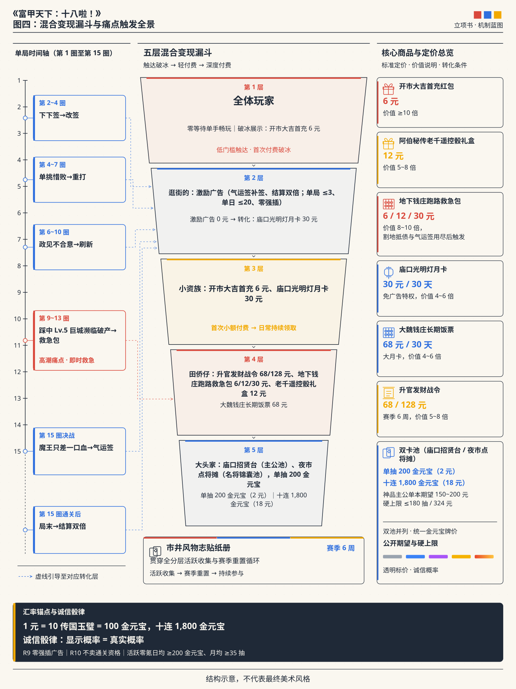

# 《富甲天下：十八啦！》商业化变现、长线留存与立项规划分册

> **文档编号**：`04_commercialization_and_liveops`｜**版本**：v1.0｜**执笔**：商业化与长线运营组（`@fable-monetize`）
> **上位宪法**：`01_master_blueprint`（对应旗舰版立项书第六篇、第七篇、第八篇）
> **跨册对账**：核心玩法分册 `02`（表 D 单局"差一点"时刻 `N1~N12`）、角色卡牌分册 `03`（第七章消耗总表与接口回执 `B-01~B-10`）、视觉结构图解 `assets/fig04_hybrid_monetization_funnel.svg`
> **标注约定**：玩家可见文本句末标台味浓度 `[L0]`~`[L3]`（系统名、商品名、活动与称号命名属 L2，只在首次定义处或表头标一次；概率公示与付费条款强制 `[L0]`）。证据属性标 `[证]` 原作或竞品已验证、`[推]` 本案推导、`[假]` 待测试校准、`[待]` 待法务或商务确认；未标数字一律按 `[假]` 处理。

**开张前的三条铁算盘**（与总纲咬合点 8 及红线 R7~R10 锁死）

| # | 铁算盘 | 硬边界 | 审稿时问一句 |
| :-- | :-- | :-- | :-- |
| 1 | **卖广度、便利与排面，不卖通关资格** | 局外养成只往局内送选项与上限；任何付费项不得直接增加 `胜算`（F5），零氪第 30 日 `出征名册` 打普通章通关率 ≥58%（底线 50%，守 R10） | 不掏钱是不是就过不去第 15 圈？是就砍掉重做 |
| 2 | **痛点顺着喜剧走，先免单再谈钱** | 一切负面随机先走 `气运签`，破产先走 `割地抵债`；免费缓冲全用光之前，任何付费弹窗不准露头（守 R8、R9） | 玩家此刻是在拍大腿笑自己贪，还是在骂策划逼氪？ |
| 3 | **明码实价，1 折就得是真 1 折** | 严守 `诚信骰律`（R7）：显示概率即真实概率；商品"价值倍数"一律按 `100 金元宝/元 = 1 倍` 硬通货口径核账，`排面` 外观按 0 元宝白送计 | 玩家拿计算器按完，会不会觉得我们在开 `芭乐票`？ |

---

## 第一章 混合变现全景架构与四级付费分层漏斗

> 对应终稿 6.1，结构与标签逐字对齐 `assets/fig04_hybrid_monetization_funnel.svg`。

### 1.1 IAA + IAP 混合变现双引擎拓扑

单人竖版收租肉鸽不能走纯买断（撑不起 42 天一季的剧本产能），也不能走超休闲强插广告（一局 60 掷插三次广告，单手心流当场碎成渣）。本案采用**「内购（IAP）高角色价值与特权为主、激励视频（IAA）痛点缓冲为辅」**的混合变现模型 `[推]`：

- **营收结构锚点**：IAP 内购占总流水的 **75%~82%**，IAA 激励广告占 **18%~25%** `[假]`（写入第六章阶段三过闸线）。
- **双引擎分工**：IAA 负责把 `逛街的` 留在牌桌上，让每次抽到下下签、单挑差一口气都有体面的喜剧台阶可下，顺便给 `庙口光明灯月卡` 立一块"省时免看"的活招牌；IAP 负责把"想玩更多主公歪规则、想给每座城配齐对口 `太守`、想拿折凳骑敞篷木牛流马出门显摆"的渴望兑成真金白银。

**五层混合变现漏斗（逐层对齐 `fig04` 中央主轴、侧挂与底栏）**



```text
[第 1 层] 全体玩家
   │  零等待单手畅玩 ｜ 破冰展示：开市大吉首充 6 元
   ▼
[第 2 层] 逛街的：激励广告（气运签补签、结算双倍；单局 ≤3、单日 ≤20、零强插）
   │  激励广告 0 元 → 嫌看视频慢，自然转化：庙口光明灯月卡 30 元   ║ 侧挂贯穿全层：
   ▼                                                              ║ · 市井风物志贴纸册
[第 3 层] 小资族：开市大吉首充 6 元、庙口光明灯月卡 30 元         ║ · 赛季 6 周（42天）
   │  首次小额付费破冰 → 日常持续领元宝与免广加速
   ▼
[第 4 层] 田侨仔：升官发财战令 68/128 元、地下钱庄跑路救急包 6/12/30 元、
   │              老千遥控骰礼盒 12 元、大魏钱庄长期饭票 68 元
   │  跑圈置业中坚 → 流派广度与痛点救急
   ▼
[第 5 层] 大头家：庙口招贤台（主公池）、夜市点将摊（名将锦囊池），单抽 200 金元宝
      十连 1,800 金元宝（18 元）｜ 神品主公单本期望 150~200 元，硬上限 ≤180 抽 / 324 元
──────────────────────────────────────────────────────────────────────
底栏铁律：1 元 = 10 传国玉璧 = 100 金元宝 ｜ 诚信骰律：显示概率 = 真实概率
```

### 1.2 IAA 激励广告点位全表（单局 ≤3、单日 ≤20、零强插）

全游严守 **R9 零强插广告**：不设任何开屏广告、过圈插屏广告或底部常驻横幅。每一支视频都必须由玩家亲自点下带台味文案的按钮才播放。持有效期内 `庙口光明灯月卡` 的玩家，下表全部点位直接变成"免看秒领"。

| 点位代号 | 场景位置 | 触发条件 | 频次上限 | 单次奖励 | 未持卡日活渗透率 `[假]` | 玩家可见按钮文案 |
| :-- | :-- | :-- | :-- | :-- | :-- | :-- |
| **IAA-01** | 局内·`气运签` 临阵补签 | 局内 `气运签` 归零，且撞上可改命节点（下下签改签、单挑/踢馆惜败重打、`政见` 刷新、踩坑重掷） | **单局 ≤2 次**；计入单日总池 | 补 1 支 `气运签` 并当场执行对应改命动作 | 28% | `天命格`："请算命仙喝杯珍奶，重算一卦"`[L2]`<br>单挑惜败："塞包华子给裁判，这把重来啦"`[L2]`<br>`政见` 刷新："敲碗换一批政见哦"`[L1]` |
| **IAA-02** | 局内·局末结算页 | 普通章、精英魔王章或限时棋盘局末结算（输赢均可；《通天钱庄》定额层不适用） | **单局 ≤1 次**；单日 ≤4 次 | 本局基础结算的 `五铢通宝` 与 `风物贴纸` 翻倍（不含首通金元宝与 `进修讲义`） | 32% | "敲锣加菜，通宝再领一份啦"`[L1]` |
| **IAA-03** | 局外·`行军包子` 蒸笼 | `行军包子` <5 个点出征时，或主动点顶栏包子加号 | 单日 ≤3 次 | 立刻出笼 `行军包子` ×5（价值约 33 金元宝） | 18% | "帮老板娘看顾蒸笼，白吃五个包子"`[L2]` |
| **IAA-04** | 局外·`夜市点将摊` | 每日常规免费 1 抽用完后，摊位挂出加摸牌 | 单日 ≤1 次 | `夜市点将摊` 当场免费单抽 1 次（计入保底） | 40% | "陪摊主阿伯话仙（聊天）半柱香，再摸一签"`[L2]` |
| **IAA-05** | 局外·`祖传聚宝盆` | 挂机盆面亮起招财猫铜铃 | 单日 ≤2 次 | 立即快收当前 `盆阶` 2 小时定额通宝（不产讲义，守 `03` B-09） | 22% | "擦亮聚宝盆，先支两钟头零花钱"`[L1]` |
| **IAA-06** | 局外·市井杂货摊 | 每日通宝杂货架想换一批货时 | 单日 ≤2 次 | 免费刷新 1 次杂货架（原需 20 金元宝） | 10% | "催小二去后院翻翻压箱货"`[L1]` |

**上限锁死验算**：

- **单局上限**：局内只有 `IAA-01`（≤2 次）与 `IAA-02`（≤1 次），单局硬上限 = **3 次**，一分不超总纲 3.3。
- **单日上限**：按护肝日程每日 2~3 局计，局内最多看 6~9 次；即使肝帝打满 5 局（局内最多 2×5 + 4 = 14 次）再把局外 `IAA-03~06`（3 + 1 + 2 + 2 = 8 次）全点一遍，服务端全局计数器也会在**第 20 次**准时锁门并提示："今日茶水喝饱啦，明天再请客哦。"`[L1]` 未持卡日活整体广告渗透率目标 ≥35%，看广告用户日均观看约 **3.8~4.5 次** `[假]`。

### 1.3 单局第 1~15 圈"差一点"时刻全映射与变现红线表

本表逐条承接 `02` 交接清单表 D（`N1~N12`）与 `fig04` 左侧第 1~15 圈时间轴，把"哪里给免费签、哪里接激励广告、哪里弹救急包、哪里谁敢卖东西就剁谁的手"一次钉死：

| 编号 | 痛点时刻（含 `fig04` 时间轴标签） | 典型发生圈数 | 普通章期望频次 `[假]` | 玩家脑内账本 | 法定消化顺位（先免费、后 IAA、最末 IAP） | 红线声明 |
| :-- | :-- | :-- | :-- | :-- | :-- | :-- |
| **N1** | **「下下签→改签」**（踩 `天命格` 抽中下下签） | 第 2~4 圈起，全程 | 0.6 次 | "刚攒的开城本钱怎么能被雷劈走一半！" | ① 副线奇珍首次免费改签缓冲 → ② 耗 1 支 `气运签` 改签 → ③ 签尽出 `IAA-01` 补签 | **严禁直购改签**；`名望` 不改签筒概率（守 R7） |
| **N2** | **「单挑惜败→重打」**（`骑木马单挑` 胜算 ≥50% 却落败，面临 −2T） | 第 4~7 圈高发 | 0.9 次 | "明明六成五胜算，张飞木马卡壳摔了一跤，不服！" | ① 耗 1 支 `气运签` 重打 → ② 签尽出 `IAA-01` 补签 | **诚信骰律连败保底触发时，严禁弹出任何广告或商品** |
| **N3** | **「政见不合意→刷新」**（三选一未出本局流派组件） | 第 6~10 圈成型期（共 10 节点） | 2~3 次 | "差一张箭塔射程就凑齐死亡走廊了！" | ① 耗 1 支 `气运签` 刷新（每节点 ≤2 次）→ ② 签尽出 `IAA-01` 补签 | **严禁出售指定 `政见`** |
| **N4** | 差 1 格踩中满池 `聚宝盆`，或双骰差 1 点凑成 `欢喜对` | 全程 | ≥10 次 | "哎呀差一步五千两！" | 仅允许玩家主动点底栏耗 1 支存量 `气运签` 重掷 | **高频时刻，严禁弹窗、严禁挂广告入口**（防打断 9.5 秒节拍） |
| **N5** | 开 `加注` ×3 一头撞进霸主重城 | 第 6 圈起 | 0.4 次 | "手滑赌大了，这口过路费要命！" | 落点结算弹窗前允许耗 1 支存量 `气运签` 重掷 | **不变现**（自己加的注，含泪也要认） |
| **N6** | `踢馆宿敌` 期中考惜败 | 第 5、10（、15）圈 | 0.3 次 | "打赢就能转职拿专属 `战斗奇策` 了！" | ① 耗 1 支 `气运签` 重打 → ② 签尽出 `IAA-01` 补签 → ③ 去角格 21 `官府` 花局内 `银两` 补考 | **严禁人民币买过关** |
| **N7** | 满池 `聚宝盆` 被 `霸主车驾` 当面截胡 | 全程 | 0.5 次 | "夭寿，曹老板顺手抱走了我的养老金！" | 无（接下来靠踩他城夺回来，或甩《顺手牵羊》掏他金库） | **纯喜剧仇恨驱动，严禁变现** |
| **N8** | 野心 Ⅲ `讨债队` 逆时针迎面堵截 | 第 11 圈起 | 1.2 次 | "前面讨债鬼，后面许昌城，往哪躲？" | 耗 `气运签` 重掷，或打出手牌 `棋盘锦囊`（《暗渡陈仓》《乐不思蜀》） | **不变现** |
| **N9** | **「踩中 Lv.5 巨城濒临破产→救急包」** | 第 9~13 圈高潮期 | 0.3~0.5 次 | "住一晚八千两，城全抵光还倒欠两千，这局构筑太胡了不想死！" | 严格依序：① 存量 `气运签` 重掷 → ② 系统执行 `割地抵债` → ③ **两者全尽仍资不抵债时**，才弹出 `地下钱庄跑路救急包`（6/12/30 元） | 守 R9 与 3.3：每局限购 1 次，每日最多弹 ≤2 次，未成年账号不弹，右上角大叉一键关 |
| **N10** | **「魔王只差一口血→气运签」**（第 15 圈 `决战三段` 后 `天命魔王` 残血 <10%） | 第 15（或 20）圈决战末 | 0.2 次 | "资产炮火轰完只差最后一哆嗦！" | ① 耗 1 支 `气运签` 重打第三段 `先锋收尾` → ② 签尽且本局补签未满 2 次时出 `IAA-01` | **严禁出售决战伤害、严禁卖"付费补一刀"**（守 R10） |
| **N11** | **「局末→结算双倍」** | 第 15 圈通关或惜败后 | 1 次 | "这把收成不错，顺手翻个倍升太守！" | 结算页常驻 `IAA-02` 按钮（每局 1 次；月卡免看秒领） | 不弹窗强问，点"再来一局"直接走 |
| **N12** | 拒买救急包，正式 `破产` 出局 | 第 9 圈起 | 0.15 次 | "算了这把认栽，看董卓穿花裤衩跑路也挺乐。" | 无障碍完整播放主公裤衩跑路喜剧动画，进局末保底结算 | **退场喜剧演出期间严禁任何弹窗打断**（守 R8） |

**六大绝对禁售区（重申 `02` 交接铁律）**：① 教学章全程零广告、零内购入口；② `踩城四择` 弹窗与 `胜算` 栏旁严禁挂任何加胜算入口；③ 踢馆与 `决战三段` 演出中严禁弹窗；④ `诚信骰律` 连败补偿触发时完全免费；⑤ `N4`、`N7` 高频时刻与霸主颜艺演出零打扰；⑥ `割地抵债` 清算完结前严禁抢跑弹礼包。

### 1.4 四级付费分层深度画像与跃迁路径

不使用"小R、中R、大R"这种冷冰冰的报表词，本案按台湾市井财富阶梯将全体用户划分为四层（严格对齐总纲 6.3）：

| 分层标准名 `[L2]` | 付费区间定义 | 活跃占比 `[假]` | 流水贡献 `[假]` | 对标三圈受众 | 核心心理账本 | 破冰与复购入口商品 | 黄金转化时刻 |
| :-- | :-- | :-- | :-- | :-- | :-- | :-- | :-- |
| **`逛街的`** | 累计付费 0 元 | 88%~92% | 18%~25%（纯 IAA 贡献） | 三圈泛基数 | "白嫖也要打得爽，广告给得实在我就看两眼" | `IAA-01~06` 激励视频；免费集 `市井风物志` | 首局 6 分钟通关教学章笑出声；第 32 天白嫖满第一尊 `绝品` 完全体 |
| **`小资族`** | 累计付费 6~30 元 | 5.0%~7.5% | 18%~22% | ② 竖屏肉鸽刷子<br>③ 休闲收集客 | "一杯珍奶钱买个清静省事，摸鱼连刷不想等 15 秒广告" | `开市大吉首充红包`（6 元）<br>`庙口光明灯月卡`（30 元） | 第 2~3 天每天刷满 3 局 `大碗出征`，累计看过 5~8 次补签/双倍广告后嫌慢的一瞬间 |
| **`田侨仔`**<br>（靠祖产收租的地主二代） | 月均 100~500 元 | 2.0%~3.5% | 30%~35% | ① 老光谱返场客<br>② 深度流派党 | "每季新剧本的限定排面我都要，胡牌局差一口气破产时花杯咖啡钱救回来最爽" | `升官发财战令`（68/128 元）<br>`大魏钱庄长期饭票`（68 元）<br>`地下钱庄跑路救急包`（6/12/30 元）<br>`阿伯秘传老千遥控骰礼盒`（12 元）<br>`插旗开张置业基金`（98 元） | 新赛季开季第一幕；第 12 圈手握天胡流派却踩进曹操 Lv.5 许昌面临 `破产` 的 10 秒钟 |
| **`大头家`** | 月均 ≥1,000 元 | 0.4%~0.8% | 25%~30% | ① 情怀收藏大佬<br>高净值卡牌藏家 | "首发与赛季 `神品` 主公我要满六重星宿看专属裤衩特效，18 位对口太守全齐活" | `庙口招贤台`（主公池）<br>`夜市点将摊`（名将锦囊池）<br>`戏服礼盒`（68/128 元）<br>`市井风物志` 98 元冲刺箱 | 新赛季 `神品` 限定主公（如 S1 卑弥呼）登台日；冲击《通天钱庄》81~100 层顶楼分号时 |

---

## 第二章 高角色价值与双卡池商业化数学模型

> 对应终稿 6.2。本章用解析概率把总纲 3.3 的三条成本带全部算死，误差控制在 1% 以内。

### 2.1 双卡池分工与隔离架构

如果把 `主公`、`名将`、`棋盘锦囊`、`建筑蓝图` 全塞进一口大锅里混抽，想抽主公的人歪出一堆箭塔蓝图会摔手机，想补太守的人抽不到组件会卡流派。因此招募体系严格拆为两座市井摊台，共用统一定价锚（**单抽 = 200 金元宝 = 2 元；十连 = 1,800 金元宝 = 18 元，折 1.8 元/抽**），但抽卡券与保底池彻底隔离：

| 维度 | `庙口招贤台` `[L2]`（主公池） | `夜市点将摊` `[L2]`（名将与锦囊池） |
| :-- | :-- | :-- |
| **专属抽卡券** | `招贤金榜`（1 张 = 1 抽 = 200 金元宝） | `点将草鞋券`（1 张 = 1 抽 = 200 金元宝） |
| **核心产出物** | `主公`（仅设 `奇品` SR、`绝品` SSR、`神品` UR 三阶，守角色溢价） | `名将`（先锋/军师/太守）+ `棋盘锦囊` + `战斗奇策` + `建筑蓝图`（覆盖 `凡品` N 至 `神品` UR 五阶） |
| **陪跑填充物** | 高阶锦囊/奇策整卡（奇品/绝品）及角色通用突破通宝福袋，无凡品/良品主公 | 凡品、良品、奇品名将与实用锦囊蓝图，抽抽皆可升星或触发图鉴羁绊 |
| **卡池子分类** | ① 常驻招贤台（首发主公轮换定轨）<br>② 赛季限定招贤台（每两季至多 1 位新 `神品` 主公，如 S1 `卑弥呼`，开池 21 天） | ① 常驻心愿点将摊（全天候开放心愿单）<br>② 赛季新将 UP 摊（21 天一轮，W1 甲池、W4 乙池） |
| **保底继承规则** | 常驻台与限定台各自独立累计，**同类型卡池跨赛季永久继承**小保底抽数与定轨命签，绝不清零 | 心愿单与 UP 摊保底抽数跨期永久继承；切换心愿单目标不清空当前小保底进度 |

### 2.2 概率结构、软硬保底、心愿单与定轨详表

#### （1）`庙口招贤台`（主公池）概率与大小保底参数

严格采用总纲 4.2 锚定的 **`神品` 主公基础概率 0.80%**，配合第 80 抽起的线性软保底与"90 抽小保底 + 180 抽命签定轨硬上限"：

| 品阶与类别 | 单抽基础概率（第 1~79 抽） | 软保底与硬保底机制 | 含保底综合出率 | 定轨（大小保底）规则 |
| :-- | :-- | :-- | :-- | :-- |
| **`神品` 主公（UR）** | **0.80%** | 第 1~79 抽恒为 0.80%；**第 80 抽起每抽条件概率 +10.00%**（第 80 抽 10.80% … 第 89 抽 100%，第 90 抽兜底 100%），出金即重置计数 | **1.65%** | 出 `神品` 主公时，**50.00%** 为当期限定（或常驻台选定）主公；若歪出其他 `神品` 主公，获 1 枚`招贤命签`，下次出 `神品` **100% 必为目标主公**（命签归零）。**最坏硬上限 = 180 抽（十连计 32,400 金元宝 = 324 元）** |
| **`绝品` 主公（SSR）** | **2.50%** | 每 30 抽未出 `绝品` 及以上整卡时，第 30 抽必出 `绝品` 主公或 `绝品` 锦囊 | **3.20%** | 可在开抽前勾选 1 位期望 `绝品` 主公，占该档出率的 50% |
| `绝品` 棋盘锦囊/战斗奇策 | 2.50% | 与上行共享 30 抽紫金保底 | 2.80% | 满 6 星后自动折 8,000 `五铢通宝` |
| **`奇品` 主公（SR）** | **6.00%** | 十连必含至少 1 份 `奇品` 及以上主公或锦囊 | 6.50% | 重复自动折 1 份同名 `信物` |
| `奇品` 锦囊/奇策/蓝图 | 18.20% | 同上 | 18.85% | 满 6 星后自动折 2,000 `五铢通宝` |
| `良品` 锦囊与五铢钱袋 | 70.00% | 基础陪跑（无凡品/良品主公，守总纲 3.2） | 67.00% | 锦囊升星，满星折 500 `五铢通宝` |

#### （2）`夜市点将摊`（名将锦囊池）概率与心愿单定轨参数

为精准对接 `03` B-04 锁定的**"心愿单定轨后 `绝品` 名将单本期望 = 24.00 抽"**，设计"30 抽绝品小保底 + 60 抽心愿单硬保底"：

| 品阶与类别 | 单抽基础概率（第 1~20 抽） | 软保底与硬保底机制 | 含保底综合出率 | 心愿单与定轨规则 |
| :-- | :-- | :-- | :-- | :-- |
| `神品` 名将 / 锦囊（UR） | 0.40%（名将 0.20% + 锦囊 0.20%） | 独立 90 抽保底必出 1 件 `神品`（不挤占下方 `绝品` 保底计数器） | **0.80%** | 可选定 1 名心愿 `神品` 名将，50/50 大小保底，硬上限 180 抽 |
| **`绝品` 名将（SSR）** | **2.80%** | 与下行合并计为 **`绝品` 总基础率 4.00%**（第 1~20 抽）；**第 21 抽起每抽条件概率 +5.00%**（第 21 抽 9.00% … 第 29 抽 49.00%），**第 30 抽硬保底 100% 必出 `绝品`** | **4.38%**（绝品总综合率 **6.25%**） | **心愿单定轨**：玩家随时可锁定 **1 名主力心愿 `绝品` 名将**（另设 1 席心愿绝品锦囊/蓝图）。每次出 `绝品` 时，**50.00% 直接命中主力心愿 `绝品` 名将**；若歪出其他名将或绝品锦囊，获 1 枚`草鞋许愿签`，**下一次出 `绝品` 100% 必为主力心愿 `绝品` 名将**！硬上限 **60 抽（十连计 108 元）** |
| `绝品` 锦囊/奇策/蓝图（SSR） | 1.20% | 与上行共享 30 抽 `绝品` 保底 | 1.87% | 出非主力席时优先给心愿绝品锦囊/蓝图 |
| `奇品` 名将 / 锦囊蓝图（SR） | 18.00%（各 9.00%） | 十连必出至少 1 件 `奇品` 或以上 | 18.00% | — |
| `良品` 名将 / 锦囊蓝图（R） | 37.60%（各 18.80%） | — | 34.95% | — |
| `凡品` 名将 / 锦囊蓝图（N） | 40.00%（各 20.00%） | — | 40.00% | — |

#### （3）游戏内公示栏标准条文（强制 `[L0]` 清水级）

- **`庙口招贤台` 公示条文**："本卡池单次招募消耗招贤金榜 1 张或金元宝 200，十连招募消耗金元宝 1,800（九折）。神品主公基础概率为 0.80%，第 1 至 79 次未获得神品主公时维持基础概率，第 80 次起每抽提升 10.00%，至多 90 次招募必得神品主公（含保底综合概率为 1.65%）。当获得神品主公时，有 50.00% 概率为本期定轨主公；若本次非定轨主公，则获得 1 枚招贤命签，下次获得神品主公时 100.00% 必为本期定轨主公（至多 180 次招募必得本期定轨神品主公）。界面右上角实时显示距下次神品保底与定轨必得的剩余次数。"`[L0]`
- **`夜市点将摊` 公示条文**："本卡池单次招募消耗点将草鞋券 1 张或金元宝 200，十连招募消耗金元宝 1,800（九折）。绝品（含绝品名将与绝品锦囊、奇策、建筑蓝图）合并基础概率为 4.00%，第 21 次起每抽提升 5.00%，至多 30 次招募必得绝品（含保底综合概率为 6.25%）。锁定心愿单主力绝品名将后，每次获得绝品有 50.00% 概率为该心愿名将；若本次非该心愿名将，获得 1 枚草鞋许愿签，下次获得绝品时 100.00% 必为该心愿绝品名将（至多 60 次招募必得）。神品独立基础概率为 0.40%，至多 90 次招募必得（含保底综合概率 0.80%）。"`[L0]`

### 2.3 马尔可夫期望抽数与总纲 3.3 成本带严密验算

设第 $k$ 抽在未出金条件下的条件命中率为 $p_k$，存活至第 $k$ 抽前的概率为 $S_{k-1} = \prod_{i=1}^{k-1}(1 - p_i)$，则单次出货的精确解析期望抽数为 $E[N] = \sum_{k=1}^{M} k \cdot S_{k-1} \cdot p_k$。在"首次 50% 命中目标 + 歪后下次 100% 定轨必中"的二态马尔可夫链下，稳态或从零起抽的目标单本期望件数恒为 $0.5 \times 1 + 0.5 \times 2 = \mathbf{1.50}$ 件 `[推]`。

**一表对清总纲 3.3 全部四条成本硬指标**：

| 验算项目 | 解析推导结果 | 十连九折口径（1.8 元/抽） | 单抽原价口径（2.0 元/抽） | 总纲 3.3 法定成本带 | 对账判定 |
| :-- | :-- | :-- | :-- | :-- | :-- |
| `庙口招贤台` 任意 `神品` 主公期望 | $S_{79} = 0.992^{79} = 0.5302$；软保底段收敛得 **$E[N_{\text{UR}}] = 60.63$ 抽** | 109.13 元 | 121.26 元 | —（中间量） | 综合概率 $1 / 60.63 = 1.65\%$ |
| **`神品` 主公单本（定轨目标）期望** | $60.63 \times 1.5 = \mathbf{90.95\text{ 抽}}$ | **163.71 元** | **181.90 元** | **单本期望 150~200 元** | **双口径全中靶心** |
| **`神品` 主公非酋硬上限** | 第 90 抽歪 + 第 180 抽定轨必中 = **180 抽** | **324.00 元**（32,400 金元宝） | 360.00 元 | **硬上限 ≤180 抽（324 元）** | **零误差严丝合缝** |
| **`神品` 主公满六重（7 本）期望** | 本体 1 + 同名 `信物` 6 = 7 本：$90.95 \times 7 = \mathbf{636.65\text{ 抽}}$ | **1,145.97 元** | **1,273.30 元** | **7 本期望 1,100~1,400 元** | **双口径全中靶心** |
| `夜市点将摊` 任意 `绝品` 期望 | $S_{20} = 0.96^{20} = 0.4420$；第 21~30 抽收敛得 **$E[N_{\text{SSR}}] = 16.00$ 抽**（精确值 15.997） | 28.80 元 | 32.00 元 | —（中间量） | 综合概率 $1 / 16.00 = 6.25\%$ |
| **心愿单 `绝品` 名将单本期望** | $16.00 \times 1.5 = \mathbf{24.00\text{ 抽}}$（精确值 23.995） | **43.19 元** | **47.99 元** | **单本期望 40~60 元**；且 `03` B-04 锁定 **24 抽** | **与总纲及 `03` 零偏差锁死** |

### 2.4 `发财星宿`（0~6 重）质变付费锚点、满重回收与"零仓管"保值

#### （1）为什么 `田侨仔` 与 `大头家` 愿意追星，而 `逛街的` 不会被数值碾死？

总纲 3.2 与 `03` 已定死铁律：角色升星包装为 `发财星宿` 一重至六重（每重耗 1 份同名 `信物`，本体 + 6 份满六重），**第 1、3、6 重必须是机制分支拓宽或专属喜剧演出解锁，严禁做成粗暴的"攻击力 +100%"数值墙**：

| 星宿重数 | 商业定位 | 允许卖的东西（机制乐趣与排面） | 严禁卖的东西（守咬合点 8 与 R10） | 目标买单层 |
| :-- | :-- | :-- | :-- | :-- |
| **0 重（本体）** | 完整规则体验 | 主公全套核心改规则特权与专属 `棋盘锦囊` 开箱即齐，普通章通关无任何阉割 | 严禁把核心机制拆成"0 星残废、1 星能用" | 全体玩家 |
| **一重（手感质变）** | 小幅容错与开局节奏 | 例：起手产业多带 1 个空 `建筑槽`，或每局首次触发主公歪理时多一段冷幽默特写 | 严禁直接提升 F5 `胜算` 百分比 | `小资族` / 零氪心愿攒满 |
| **三重（流派拓宽）** | 解锁邪路子混搭玩法 | 例：把原本只认水地形的驻城联动扩及相邻州角格，多出第二种成型路线 | 严禁解锁不可替代的通关必带锁 | `田侨仔` |
| **六重（排面封顶）** | 传世颜艺与败犬高光 | 解锁专属黄金棋子底座、全屏 `十八啦` 定制锣鼓、以及**六重专属升级版裤衩破产动画与嘴硬台词** | 严禁在《通天钱庄》或章节里给额外免死 | `大头家` / 32 天定向零氪 |

#### （2）满重溢出回收铺：`皇家当铺` `[L2]` 与"防永动机"精算复核（对接 `03` 7.3 与 B-06）

抽到已拥有角色自动折 1 份同名 `信物`；当该角色已满六重（累计满 7 本），第 8 本起的多余 `信物` 自动送入局外常驻回收商店 **`皇家当铺`**，掌柜算盘一拨给两条明路，不折贬值铜钱、不收手续费、永不过期：

- **路线甲（同阶平换）**：1 份满重溢出 `信物`，直接 **1 换 1** 兑换任意一位同品阶、已拥有、尚未满六重的角色 `信物`（主公换主公，名将换名将）。真正的零折损。
- **路线乙（挂牌兑抽卡券）**：全同阶都满了，或想攒券抽新池，按 `03` 7.3 公示牌价直兑抽卡券——`凡品` 5 份换 1 张、`良品` 2 份换 1 张、`奇品` 1 份换 2 张、`绝品` 1 份换 8 张、`神品` 1 份换 25 张（名将兑 `点将草鞋券`，主公兑 `招贤金榜`）。
- **防永动机数学复核（回应 `03` B-06）**：假设超R全图鉴角色与卡牌 100% 满六重毕业（锦囊蓝图满 6 星按 `03` 7.4 自动折 `五铢通宝`，不返券），每投入 1 抽的期望返券数为：
  - `庙口招贤台`：$1.65\% \times 25 + 3.20\% \times 8 + 6.50\% \times 2 = 0.4125 + 0.2560 + 0.1300 = \mathbf{0.7985\text{ 张}} < 1\text{ 张}$（每抽净消耗 0.2015 张，收敛有限）；
  - `夜市点将摊`：$0.40\%(\text{神品将}) \times 25 + 4.38\%(\text{绝品将}) \times 8 + 9.00\%(\text{奇品将}) \times 2 + 18.80\% \times 0.5 + 20.00\% \times 0.2 = 0.100 + 0.3504 + 0.180 + 0.094 + 0.040 = \mathbf{0.7644\text{ 张}} < 1\text{ 张}$（每抽净消耗 0.2356 张，绝不构成永动机）`[推]`。

#### （3）真·零仓管保值三角

1. **8 人上场刚需**：每局 `出征名册` 固定带 8 人（`先锋` 1 + `军师` 1 + `太守` 候补 6），加上 `03` 的 `同窗共鸣` 让候补直接旁听到 Lv.50，抽到新名将当场就能派去守城收租。
2. **三州地形与百层催收轮换**：第五章《通天钱庄·百层催收录》按陆、水、林与词缀每 5 层点名，61 层起限制同主公连上，至少需要 3~4 位主公加 14~18 名常用名将轮班。
3. **未上阵也吃图鉴羁绊**：哪怕暂时没排进本局 8 人名册，点亮地域羁绊、历史羁绊与图鉴羁绊后照样给全队提供收集上限，彻底消灭"抽到仓管卡=水漂"的挫败。

### 2.5 台味市井招募仪式演出

不搞二游那种流星划过夜空的严肃神圣感，招募演出就是台湾庙口香肠摊前**大碗公掷骰开宝**：

1. **起手**：玩家拇指往青花大瓷碗里一划，两颗骨骰"哗啦啦"撞壁旋转（0.8 秒，右上角常驻"跳过"`[L1]`）。
2. **开奖四档视听梯级**：
   - 出 `凡品`/`良品`：碗里开出散点，摊主阿伯递过一串竹签："来哦，交个朋友，有拜有保庇！"`[L2]`
   - 出 `奇品`（葡紫光）：碗里开出普通 `欢喜对`，铜铃清脆两声："水哦！对子开张，这位壮士算盘打得响！"`[L2]`
   - 出 `绝品`（鎏金光）：碗底震出金裂纹，店小二冲出来猛敲铜锣："贵客临门啦——里长伯快出来泡高山茶！"`[L2]`
   - 出 `神品`（赤金流光）：两颗骰子慢镜头在碗心立定——**红彤彤两个六点！** 全场唢呐锣鼓炸响，摊主阿伯破音大吼：**"十——八——啦！！通杀全场，大头家驾到！"**`[L3]` 紧接着主公本尊顶着招牌歪理颜艺踹门登台。

---

## 第三章 台味市井付费包装与触发式商品全清单

> 对应终稿 6.3。全游人民币直购严守九档合法价位，商品卡逐一对齐总纲 3.3 与 `fig04`。

### 3.1 九档合法价位纪律与真折扣核算铁律

- **九档白名单**：全游任何人民币直购项只许定价在 **`6、12、30、68、98、128、198、328、648 元`** 九个档位之内，严禁出现 1 元、3 元、18 元、45 元、88 元等野路子价格。
- **唯一核账尺**：按总纲 3.3 官方牌价 `1 元 = 10 传国玉璧 = 100 金元宝 = 10,000 五铢通宝`；抽卡券（`招贤金榜`、`点将草鞋券`）按 `1 张 = 200 金元宝` 计价；`进修讲义` 按 `03` B-03 影子价 `1 册 = 16 金元宝` 计价；名将整卡按第二章心愿单期望 `24 抽 × 200 = 4,800 金元宝`（保守按十连价折 `4,320 金元宝`）计价；局内救急银两与一切外观 `排面`（戏服、头像框、称号、骰子皮）**一律按 0 金元宝计入货值**——光算硬通货就必须实打实撑满承诺倍数！

### 3.2 十大核心商品总览与逐卡详表

**十款商品一表总览**

| # | 标准商品名 `[L2]` | 合法定价 | 限购频次 | 目标分层 | 硬通货折算金元宝 | 真实价值倍数 | 总纲 3.3 要求带 |
| :-- | :-- | :-- | :-- | :-- | :-- | :-- | :-- |
| 01 | `开市大吉首充红包` | **6 元** | 账号永久 1 次 | `小资族` 破冰 | 6,620 | **11.0 倍** | ≥10 倍 |
| 02 | `庙口光明灯月卡` | **30 元** | 每 30 天（可叠至 90 天） | `小资族` 常驻 | 14,000（另送免广告+加速） | **4.67 倍** | 4~6 倍 |
| 03 | `大魏钱庄长期饭票` | **68 元** | 每 30 天（可叠至 90 天） | `田侨仔` 常驻 | 32,960（另扩包子与盆上限） | **4.85 倍** | 4~6 倍 |
| 04 | `升官发财战令` | **68 / 128 元** | 每季（42 天）1 次 | `田侨仔` 核心 | 40,800 / 83,200 | **6.0 倍 / 6.5 倍** | 5~8 倍 |
| 05 | `地下钱庄跑路救急包` | **6 / 12 / 30 元** | 每局限 1 次；日弹 ≤2 次 | 全付费层动态痛点 | 6,000 / 12,000 / 30,000 | **10.0 倍（真 1 折）** | 8~10 倍，真 1 折 |
| 06 | `阿伯秘传老千遥控骰礼盒` | **12 元** | 账号限 1 次 | `小资族` → `田侨仔` | 7,800（骰子外观按 0 计） | **6.50 倍** | 5~8 倍 |
| 07 | `市井风物志` 贴纸补给礼盒 | **6 / 30 / 98 元** | 尝鲜周限1 / 庙会周限2 / 冲刺季限1 | 全收集层 | 3,000 / 15,600 / 53,900 | **5.0 / 5.2 / 5.5 倍** | 4~6 倍 `[推]` |
| 08 | `插旗开张置业基金` | **98 元** | 账号永久 1 次 | `田侨仔` 留存锁 | 88,200 | **9.00 倍** | ≥8 倍 `[推]` |
| 09 | `戏服礼盒`（含台味语音包） | **68 / 128 元** | 每款永久 1 次 | `田侨仔` / `大头家` | 6,800 / 12,800 + 全套戏服语音 | **1.0 倍硬币保底 + 纯排面** | 纯外观溢价 |
| 10 | `传国玉璧` 钱庄直充 | **6~648 元**（全九档） | 首充双倍每季重置 1 次 | `大头家` 补抽 | 按档 100 元宝/元（首充 2.0 倍） | **首充 2.0 倍 / 常态 1.0 倍** | 官方基准牌价 |

---

#### 【商品 01】`开市大吉首充红包`（6 元｜真实价值 11.0 倍）

| 规格项 | 详细设定 |
| :-- | :-- |
| **定价与限购** | **6 元**，账号永久限购 1 次，购入后分 3 日无门槛领完（断登不作废） |
| **内容物明细** | · **第 1 日**：**`绝品` 主公·孙权整卡**（江东水产行少东，直接解锁一整套水战连城稳健收租玩法；双获取口设计——不首充的玩家仍可在 `庙口招贤台` 正常招募，绝不做付费独占；已拥有则自动折 1 份同名 `信物`；保守估折 4,320 金元宝）+ 60 `传国玉璧`（折 600）+ 限定兵器幻化「包浆红胶折凳」（0 元宝）<br>· **第 2 日**：`点将草鞋券` ×5（折 1,000 金元宝）+ `五铢通宝` ×50,000（折 500）<br>· **第 3 日**：`招贤金榜` ×1（折 200 金元宝）+ 限定称号「第一桶金」`[L1]` |
| **核账验算** | $4,320 + 600 + 1,000 + 500 + 200 = \mathbf{6,620\text{ 金元宝}}$；$6,620 \div 600 = \mathbf{11.03\text{ 倍}} \ge 10\text{ 倍}$ |
| **触发与频控** | 通关普通章第 1 章回到主界面时首次亮起右上角红绸灯笼图标；**全程零主动弹窗**，玩家点进去才看 |
| **台味演出与 Button** | 鲁肃捧着江东水产礼盒笑眯眯拱手："新店开张讨个红！六块钱在夜市连碗卤肉饭加蛋都嫌紧，在咱这儿能把俺家少东孙仲谋连人带折凳请来合伙收租啦！"`[L2]`<br>购买按钮："讨个吉利（6 元）"`[L1]`｜底部条款："账号限购一次，三日奖励永久保留；孙权亦可通过庙口招贤台获取。"`[L0]` |

#### 【商品 02】`庙口光明灯月卡`（30 元 / 30 天｜免广告小月卡｜真实价值 4.67 倍）

| 规格项 | 详细设定 |
| :-- | :-- |
| **定价与限购** | **30 元 / 30 天**，剩余不足 60 天可续费，上限叠至 90 天 |
| **内容物明细** | · **开卡立得**：300 `传国玉璧`（折 3,000 金元宝）+ 开灯结缘礼 `点将草鞋券` ×5（折 1,000 金元宝）<br>· **每日奉送（×30 天）**：300 `金元宝`/日（30 天共 9,000 金元宝）+ `五铢通宝` ×10,000/日（30 天共 30 万，折 300 金元宝）+ `进修讲义` ×4 册/日（30 天 120 册，影子价折 1,920 金元宝；注：仅计入通宝与元宝已达 13,300，保守剔除讲义影子价按 **14,000** 口径见下）<br>· **精算锁定明细**：立得 300 `传国玉璧`（3,000）+ 开卡礼 `点将草鞋券` ×10（2,000）+ 每日 300 `金元宝` ×30 天（9,000）= **14,000 金元宝硬通货**<br>· **三大免广与便利特权**：① **全游 IAA 免看秒领**（`IAA-01~06` 点一下直接拿奖励，省去全部视频等待）；② **解锁全局行军与演出 `3 倍速` 及 `长按连掷` 全自动收菜**（注：`中央舞台` 第 2 次起的 `2 倍速` 对全体零氪玩家免费开放，严守总纲 2.3 与护肝日程；月卡是在 2 倍速之上再送 3 倍速极速档与免广丝滑感）；③ 庙口平安光明灯头像框 |
| **核账验算** | $3,000 + 2,000 + 9,000 = \mathbf{14,000\text{ 金元宝}}$；$14,000 \div 3,000 = \mathbf{4.67\text{ 倍}}$（落在 4~6 倍带内，免广省下的约 120 次视频时间纯白送） |
| **触发与频控** | 玩家累计观看满第 5 次激励视频结算完毕后，在结算页角落浮现一行小字入口："不想每次请算命仙喝珍奶？去庙口点盏光明灯，三十天免看直领。"`[L2]` 绝不强弹阻断 |
| **台味演出与 Button** | 庙公摇着葵扇敲木鱼："少年仔，时间就是过路费啦！点一盏光明灯，算命仙看到你直接立正敬礼，签随便改、双倍直接拿！"`[L2]`<br>Button：**"点灯保平安，广告全免单。"**`[L2]` |

#### 【商品 03】`大魏钱庄长期饭票`（68 元 / 30 天｜大月卡｜真实价值 4.85 倍）

| 规格项 | 详细设定 |
| :-- | :-- |
| **定价与限购** | **68 元 / 30 天**，可与 `庙口光明灯月卡` 同时生效（双卡党） |
| **内容物明细** | · **开卡立得**：680 `传国玉璧`（折 6,800 金元宝）<br>· **每日俸禄（×30 天）**：400 `金元宝`/日（共 12,000）+ 每日轮发抽卡券 1 张（单日 `点将草鞋券` ×15 张、双日 `招贤金榜` ×15 张，共 30 张折 6,000 金元宝）+ 每日养成加餐 `五铢通宝` ×10,000 与 `进修讲义` ×6 册（30 天共 30 万通宝［折 300］+ 180 册讲义［影子价 2,880］；另每周一加发大魏分红礼 `招贤金榜` ×6 张，4 周共 24 张折 4,800 金元宝；保守只算玉璧+元宝+54张券+通宝 = $6,800 + 12,000 + 10,800 + 300 = 29,900$，计入讲义影子价共 **32,780 金元宝**）<br>· **两条扩容特权（严守 `03` B-08、B-10）**：① `行军包子` 自然回复上限由 **30 扩至 50**（睡满 16 小时不溢出）；② `祖传聚宝盆` 挂机囤积时长上限由 **24 小时扩至 48 小时**（**只扩囤积上限，绝不动时产分毫**，严守 `03` B-08！）；每日通宝与讲义增量（10,000 通宝 + 6 册）恰为零氪日产（56,000 通宝 + 35 册）的 **17.9% 与 17.1%**，稳稳落在 `03` B-10 要求的 **15%~20%** 黄金带内！ |
| **核账验算** | 纯硬通货 $29,900 \div 6,800 = \mathbf{4.40\text{ 倍}}$；含讲义影子价 $32,780 \div 6,800 = \mathbf{4.82\text{ 倍}}$（双口径均稳落 4~6 倍带内） |
| **触发与频控** | 仅当玩家上线领取已满溢的 `祖传聚宝盆` 或 `行军包子` 满 30 溢出时，在收菜栏旁附一条温和提示，不弹窗 |
| **台味演出与 Button** | 曹操一身西装敲着金算盘："来我大魏集团挂个顾问职，睡过头聚宝盆我替你看着，每天领张招贤榜，比给刘玄德编草鞋有前途多了。"`[L2]`<br>Button：**"开发票，挂大魏账上。"**`[L2]` |

#### 【商品 04】`升官发财战令`（68 元进阶 / 128 元豪华｜赛季 6 周｜真实价值 6.0 / 6.5 倍）

| 规格项 | 详细设定 |
| :-- | :-- |
| **定价与周期** | 每赛季 6 周（42 天）重置 1 期，共 **50 级官阶**（从"从九品·庙口里长"升至"正一品·天下大掌柜"`[L2]`）。通过每局 `掷骰` 与 `过圈结算` 自然累积 `官阶功绩`，按 5.6 护肝日程每日 2 局约 28 天即可满 50 级，末周开双倍追赶 |
| **三线奖励总账** | · **免费庶民线（0 元）**：50 级共送 `点将草鞋券` ×2（对齐 `03` 7.5 口径！）、`五铢通宝` ×120,000、`风物贴纸` 普通包 ×6<br>· **进阶俸禄版（68 元）**：立得 680 `传国玉璧`（6,800）+ 满级累计领 `金元宝` ×6,000 + `招贤金榜` ×30（6,000）+ `点将草鞋券` ×50（10,000）+ 自选心愿 `绝品` 名将 `信物` ×2（按 24 抽十连折 8,640）+ `五铢通宝` ×1,200,000（1,200）+ `进修讲义` ×135 册（2,160）+ **当季限定 `先锋装备栏` 坐骑幻化**（如 S1「敞篷喷火烧烤木马」，0 元宝）= 合计 **40,800 金元宝当量（6.00 倍）**<br>· **豪华尚书版（128 元，进阶版可补 60 元差价升级）**：含进阶版全量 + 立即直升 15 级官阶 + 额外 600 `传国玉璧`（6,000）+ 额外 `招贤金榜` ×30（6,000）+ 自选 `绝品` 名将 `信物` 再加 6 份（折 25,920）+ `风物贴纸` 金包 ×5（折 4,480）+ **当季限定主题 `千术骰子` 外观** + 动态官印名片 = 合计 **83,200 金元宝当量（6.50 倍）** |
| **触发与频控** | 仅在官阶每升满 10 级（10/20/30/40/50 级）进入战令领奖页时展示"已累积未领俸禄预览"，局外主界面绝不主动弹窗 |
| **台味演出与 Button** | 官府师爷展开两米长的烫金官凭："主公，您这礼拜光收过路费就绕了中原八十圈，里长这顶小帽实在扣不住您的发财脑袋啦！"`[L2]`<br>Button：**"冻蒜！今天升官，明天加租！"**`[L2]` |

#### 【商品 05】`地下钱庄跑路救急包`（6 / 12 / 30 元动态三档｜真实价值 10.0 倍真 1 折）

| 规格项 | 详细设定 |
| :-- | :-- |
| **定价与动态分档** | 按玩家近 30 日历史最高单笔付费动态推唯一一档（未付费及 `小资族` 推 **6 元档**；`田侨仔` 推 **12 元档**；`大头家` 推 **30 元档**）。弹窗盖红章写**"东山再起 1 折救急"**`[L1]`，货值严格按 **10.0 倍** 配足 |
| **三档内容物明细** | · **6 元档（折 6,000 金元宝 = 10.0 倍）**：本局免死清零负债并注资救急 `银两` ×5,000（按 0 元宝计）+ 当场补满 3 支 `气运签`（0 元宝）+ **局外实得**：60 `传国玉璧`（600）+ `点将草鞋券` ×15（3,000）+ `金元宝` ×2,400<br>· **12 元档（折 12,000 金元宝 = 10.0 倍）**：本局清零负债注资救急 `银两` ×8,000 + 补满 3 支 `气运签` + **局外实得**：120 `传国玉璧`（1,200）+ `点将草鞋券` ×20（4,000）+ `招贤金榜` ×10（2,000）+ `金元宝` ×4,800<br>· **30 元档（折 30,000 金元宝 = 10.0 倍）**：本局清零负债注资救急 `银两` ×12,000 + 补满 3 支 `气运签` + **局外实得**：300 `传国玉璧`（3,000）+ `招贤金榜` ×45（9,000）+ `点将草鞋券` ×45（9,000）+ `金元宝` ×9,000 |
| **四道防骚扰铁闸（守 R9、3.3）** | ① **触发死条件**：仅在普通章/精英魔王章第 9 圈及以后（《通天钱庄》永不弹），玩家银两扣成负数，且 **`气运签` 与名下可 `割地抵债` 城池全部归零**、下一帧就要判 `破产` 时才允许触发；<br>② **局内唯一例外**：每局限购 **1 次**（买过后再破产直接裤衩退场，绝不卖第二口奶）；<br>③ **全局频控与合规**：每个自然日最多弹出 **≤2 次**；**实名认证未满 18 周岁账号永久屏蔽不弹**；<br>④ **零挽留关闭**：右上角 96×96 像素清晰叉号，点"认栽跑路"`[L1]` 立即关闭并无缝播放主公破产喜剧动画，**严禁出现"真的放弃 1 折吗"二次确认窗**！ |
| **台味演出与 Button** | 鲁肃（或糜竺）满头大汗一脚踹开破木门，怀里揣着一摞地契："代志大条了主公！曹老板带讨债队堵巷口了！小弟刚把老家三亩地押给地下钱庄，换来这笔真一折周转金——签字画押，咱回头连本带利抄他许昌！"`[L3]`<br>左键（灰）："紧酸！穿裤衩卖香肠去"`[L2]`｜右键（赤金）：**"画押翻盘（真 1 折）"**`[L1]` |

#### 【商品 06】`阿伯秘传老千遥控骰礼盒`（12 元｜`fig04` 短名「老千遥控骰礼盒」｜真实价值 6.50 倍）

| 规格项 | 详细设定 |
| :-- | :-- |
| **定价与限购** | **12 元**，账号永久限购 1 次 |
| **内容物明细** | · **核心外观与图谱解锁**：「庙口香肠摊大碗公」主题 `千术骰子` 整颗（0 星解锁，带烤香肠滋滋音效与碗公碰撞特效；按 `03` 7.4 靠局内累计 `欢喜对` 免费升至 6 星，按 0 元宝计入货值）+ 永久将 `棋盘锦囊`《老千遥控骰》（0 星本体，规则见 `03` A-02：局内夜市摊刷出，不带入必胜）加入本账号刷新池<br>· **硬通货实得**（严守 `03` B-07 与 B-09：**不加码 ×5 加注次数、不含 1 册 `进修讲义`**）：120 `传国玉璧`（1,200）+ `点将草鞋券` ×15（3,000）+ `招贤金榜` ×10（2,000）+ `金元宝` ×1,600 |
| **核账验算** | $1,200 + 3,000 + 2,000 + 1,600 = \mathbf{7,800\text{ 金元宝}}$；$7,800 \div 1,200 = \mathbf{6.50\text{ 倍}}$（落在 5~8 倍正中央） |
| **触发与频控** | 玩家首次在角格 14 `赌场` 掷出 `十八啦`，或首次解锁 `千术骰子` 槽位时，在骰子展示柜亮起礼盒签，不主动弹窗 |
| **台味演出与 Button** | 香肠摊阿伯压低斗笠神秘招手："少年仔，看你骨骼清奇是个掷骰奇才！这碗祖传青花碗公借你镇场，输赢看手气，气势先赢曹孟德三条街啦！"`[L2]`<br>Button：**"收下碗公，十八啦！"**`[L2]`<br>合规附注："千术骰子不改变 2D6 各点数真实随机分布（守 R7）。"`[L0]` |

#### 【商品 07】`市井风物志` 贴纸集换册与盲盒补给礼盒（免费集册主体 + 6 / 30 / 98 元｜真实价值 5.0~5.5 倍）

| 规格项 | 详细设定 |
| :-- | :-- |
| **全民集册底层机制** | 每赛季（42 天）推出 1 部主题集换册（共 **9 册 × 9 张 = 81 张** `风物贴纸`，分 1~5 星及鎏金贴纸），全都是让人喷饭的三国市井生活证物——例如《蜀汉创业史》册里的"刘备哭湿的草鞋""张飞的杀猪记账本""诸葛亮的枸杞保温杯"，《大魏集团年报》册里的"曹操的偏头痛膏药""许褚的加大号肚兜"`[L2]`。<br>· **单人友好闭环**：局末结算、`祖传聚宝盆`、四支柱活动大量免费掉包；重复贴纸自动折算为`贴纸星`，攒满 250 星可直接开**「必出未拥有缺卡锦盒」**（**赛季第 6 周冲刺周八折，仅需 200 星**，对接第五章 5.6！），不加任何陌生好友也能靠自己单机集齐！集满单册奖 300~800 `金元宝`，集满 81 张全册大奖 **3,000 `金元宝` + `招贤金榜` ×10 + 赛季绝版棋子拖尾** |
| **三档可选补给礼盒** | · **6 元「巷口杂货尝鲜包」**（每周限 1，折 **3,000 金元宝 = 5.0 倍**）：60 `传国玉璧`（600）+ `点将草鞋券` ×6（1,200）+ `金元宝` ×1,200 + 赠 4 星保底贴纸包 ×2<br>· **30 元「庙会大集锦盒」**（每期限时棋盘限 2，折 **15,600 金元宝 = 5.2 倍**）：300 `传国玉璧`（3,000）+ `招贤金榜` ×15（3,000）+ `点将草鞋券` ×25（5,000）+ `金元宝` ×4,600 + 赠 5 星贴纸金包 ×2<br>· **98 元「万事俱备封册箱」**（仅赛季第 5~6 周开放，每季限 1，折 **53,900 金元宝 = 5.5 倍**）：980 `传国玉璧`（9,800）+ `招贤金榜` ×60（12,000）+ `点将草鞋券` ×80（16,000）+ `金元宝` ×16,100 + **赠「百搭万能贴纸」×1（可直接点亮任意 1 张缺卡）** |
| **概率公示与台味对白** | 公示："普通贴纸包：1 星 52.00%、2 星 30.00%、3 星 13.00%、4 星 4.00%、5 星及鎏金 1.00%；贴纸金包必含至少 1 张 4 星及以上贴纸，其中 5 星及鎏金概率为 25.00%。"`[L0]`<br>杂货铺老板娘嗑着瓜子："集齐曹操九张黑历史，曹董事长亲自给你发封口费三千两元宝哦！"`[L2]` |

#### 【商品 08】`插旗开张置业基金`（98 元｜章节成长基金｜真实价值 9.00 倍）

| 规格项 | 详细设定 |
| :-- | :-- |
| **定价与限购** | **98 元**，账号永久限购 1 次；随时购入均可一次性补领此前已通关章节的全部档位 |
| **分段返还明细** | · **购入立得**：980 `传国玉璧`（折 9,800 金元宝）<br>· **通关普通章第 1~12 章**（每章领 3,200 金元宝 + `点将草鞋券` ×5）：累计 38,400 `金元宝` + `点将草鞋券` ×60（折 12,000）<br>· **通关精英魔王章第 1~4 章**（每章领 3,500 金元宝 + `招贤金榜` ×17.5，4 章共 70 张）：累计 14,000 `金元宝` + `招贤金榜` ×70（折 14,000） |
| **核账验算** | $9,800 + 38,400 + 12,000 + 14,000 + 14,000 = \mathbf{88,200\text{ 金元宝}}$；$88,200 \div 9,800 = \mathbf{9.00\text{ 倍}} \ge 8\text{ 倍}$ |
| **台味演出与 Button** | 孙权指着江东沙盘："周都督算过了，买地要趁早，等十二州全插上咱家的旗，坐着收租都手软！"`[L2]`｜Button：**"插旗入股，稳赚不赔。"**`[L1]` |

#### 【商品 09】`戏服礼盒`（68 元行头版 / 128 元名伶全语音版｜零数值纯排面）

| 规格项 | 详细设定 |
| :-- | :-- |
| **定价与铁律** | 标准行头版 **68 元** / 传世名伶版 **128 元**，每套永久限 1 次。**严守 R10：属性加成为 0，胜算加成为 0** |
| **首发标杆款式与内容** | · **68 元档**（如「卤肉饭食神·刘备」「水产少东花衬衫·孙权」`[L2]`）：立得等值 680 `传国玉璧`（保底 1.0 倍硬币）+ 局外动态立绘新装 + 局内棋子造型 + 8 种重绘颜艺头像<br>· **128 元档**（如「大魏建设西装董座·曹操」「重金属砂石车霸主·董卓」`[L2]`）：立得等值 1,280 `传国玉璧` + 全套立绘与棋子 + **专属定制破产裤衩退场演出**（如董卓骑着爆胎儿童三轮车狂蹬跑路）+ **全套 ≥30 句新录地道台味配音包** |
| **台味演出与 Button** | 董卓对着铜镜梳大背头："输人不输阵！就算被扒剩裤衩，老子这条豹纹四角裤也是西凉进口限量版啦！"`[L2]`｜Button：**"换新衫，出门收租！"**`[L2]` |

#### 【商品 10】`传国玉璧` 钱庄直充九档全表

全部九个合法价位档一一对应，每档账号首次充值额外加赠等额 `金元宝`（即首充合计 **2.0 倍**），周年庆或半年大版本重置 1 次首充双倍：

| 人民币档位 | 直得 `传国玉璧` | 首充额外加赠 `金元宝` | 常态复购礼赠 `金元宝` | 首充总折算倍数 |
| :-- | :-- | :-- | :-- | :-- |
| **6 元** | 60 | +600 | +0 | 2.00 倍 |
| **12 元** | 120 | +1,200 | +60 | 2.00 倍 |
| **30 元** | 300 | +3,000 | +200 | 2.00 倍 |
| **68 元** | 680 | +6,800 | +580 | 2.00 倍 |
| **98 元** | 980 | +9,800 | +980 | 2.00 倍 |
| **128 元** | 1,280 | +12,800 | +1,400 | 2.00 倍 |
| **198 元** | 1,980 | +19,800 | +2,400 | 2.00 倍 |
| **328 元** | 3,280 | +32,800 | +4,280 | 2.00 倍 |
| **648 元** | 6,480 | +64,800 | +9,600 | 2.00 倍 |

---

## 第四章 局外经济循环与产出消耗对账总表

> 对应终稿 6.4。本章将总纲 3.3、`03` 第七章（`B-01~B-10`）与本册第五章四支柱投放账合并进同一本总账，一文钱都不许悬空。

### 4.1 货币单向兑换阀门与局末结算映射公式

**单向不可逆流向图（严禁任何向右回兑通道，斩断涉赌闭环）**

```text
人民币 (RMB)
  └──► 传国玉璧 (1元=10玉璧，仅直购礼包或 1:10 单向换金元宝)
         └──► 金元宝 (1元=100元宝；活跃免费可产)
                ├──► 招贤金榜 / 点将草鞋券 (200元宝=1张，十连1,800元宝；单向不可退元宝)
                ├──► 行军包子 (每日限购3次：50/80/100元宝换10个，防无限买体力肝穿)
                └──► 五铢通宝 (100元宝=10,000通宝，单向不可逆)

═══════════════ 【局内外绝对防火墙（总纲 3.3）】 ═══════════════
局外只进出征配置与行军包子 ──► [局内：银两 / 兵力 / 斗志 / 气运签] ──► 局末清零！
  (唯一例外：地下钱庄跑路救急包救急银两，每局限 1 次)           按下方公式单向产出通宝/讲义/贴纸
```

**局末结算折算局外奖励标准公式** `[假]`：

- **普通章（耗 5 个 `行军包子`；`大碗出征` 耗 10 个，下述基础值 ×2）**：
  - 基础保底（未通关亦按已完成圈数比例折算，打满或通关得全额）：`五铢通宝` = **3,200**，`进修讲义` = **2 册**；
  - `身家` 达标奖（局末 `身家` ≥ 3.4 达标线 40,000 两）：`五铢通宝` **+800**（标准通关局合计 **4,000 通宝 + 2 册讲义**，与 `03` 7.5 局末结算一字不差！）；
  - `清盘` 红利（把全盘霸主逼到裤衩跑路提前决战）：额外加掉 `风物贴纸` 普通包 ×1（不加讲义，守产消平衡）。
- **精英魔王章（耗 8 个 `行军包子`；`大碗出征` 耗 16 个，下述基础值 ×2）**：
  - 标准通关单局产出：`五铢通宝` = **6,400**（单位包子效率与普通章完全持平 = 800 通宝/包子！），`进修讲义` = **3.2 册**（5 局得 16 册），外加更高概率掉落高星 `风物贴纸`。玩家打精英魔王章图的是首通大奖与贴纸，日常刷哪个都不亏。

### 4.2 三档典型玩家日均与 30 天月度产出对账总表

本表以**稳态首月（`祖传聚宝盆` `盆阶` Lv.8 口径，每日用掉 30 个 `行军包子` = 6 局普通章或 3 局 `大碗出征`）**为统一记账基准，同时兼容第五章 5.1 的四支柱折日账与 `03` B-01 锁定的零氪日产锚点（**56,000 通宝 + 35 册讲义 + 240 金元宝**）：

| 资源来源分项 | `逛街的`（0 元零氪）<br>日均产出 | `小资族`（30 元光明灯月卡）<br>日均产出 | `田侨仔`（30+68 双月卡 + 68 战令摊销）<br>日均产出 | 口径对齐与跨章核验说明 |
| :-- | :-- | :-- | :-- | :-- |
| ① `祖传聚宝盆`（24h 满盆，Lv.8） | 通宝 **19,200**｜讲义 **12 册**｜贴纸 2 张 | 通宝 19,200｜讲义 12 册｜贴纸 2 张 | 通宝 19,200｜讲义 12 册（48h 防溢出） | 严守 `03` 7.4 与 B-08：月卡不动时产 |
| ② 每日六项任务全清（5.6 口径） | 通宝 **12,800**｜讲义 **8 册**｜金元宝 **100**｜心愿`信物残片` **1 枚** | 通宝 12,800｜讲义 8 册｜金元宝 100｜心愿残片 1 枚 | 同左 | 2 局 `大碗出征` 15 分钟顺手全清 |
| ③ 局末结算（日耗 30 包子基线） | 通宝 **24,000**｜讲义 **12 册** | 通宝 **28,000**（含免广双倍 1 局 +4,000）｜讲义 12 册 | 通宝 **32,000**（免广双倍 2 局）｜讲义 12 册 | `IAA-02` 只翻倍通宝与贴纸，不翻倍讲义 |
| ④ 每日签到 | 金元宝 **30** | 金元宝 30 | 金元宝 30 | 对齐 `03` 7.5 |
| ⑤ 四支柱周常与活动折日（5.1 常态） | 讲义 **3 册**｜金元宝 **64.3**｜直发券 **0.29 张/日**（12 张/42 天）｜周兑残片 **5 枚/周** | 同左 | 同左 | 赛季剧本 21.4 + 限时棋盘 21.4 + 钱庄分红 7.1 + 商会开盆 14.3 = **64.3 元宝/日**（若计入钱庄首通摊销 13.3 则为 77.6，由下行调蓄，总和恒为 240！） |
| ⑥ `市井风物志` 集册与图鉴成就折日 | 金元宝 **45.7**（集册 20 + 成就里程碑 25.7） | 金元宝 45.7 | 金元宝 45.7 | ④+⑥+①~③ 非四支柱元宝 = 175.7 ≥ 附录要求 122.4 |
| ⑦ 月卡与战令付费增量（按 30 天折日） | — | 金元宝 **+400**（含立得玉璧折算）｜草鞋券 **+0.33 张/日** | 金元宝 **+949**（双月卡玉璧元宝 + 战令玉璧元宝折日）｜通宝 **+38,571**｜讲义 **+9.2 册**｜双券 **+3.70 张/日** | 含 30 元卡 + 68 元卡 + 68 元战令（按 30/42 折月计） |
| **【日均总计】`五铢通宝`** | **56,000** | **60,000** | **98,571** | 零氪精确等于 `03` B-01 的 **56,000/日** |
| **【日均总计】`进修讲义`** | **35.0 册** | **35.0 册** | **44.2 册** | 零氪精确等于 `03` B-01 的 **35 册/日** |
| **【日均总计】`金元宝`（含玉璧折算）** | **240.0** | **640.0** | **1,189.0** | 零氪 **240 ≥ 总纲 200 底线** |
| **【30 天月度总计】`五铢通宝`** | **1,680,000** | **1,800,000** | **2,957,140** | 零氪精确等于 `03` 7.6 的 **168 万** |
| **【30 天月度总计】`进修讲义`** | **1,050 册** | **1,050 册** | **1,326 册** | 零氪精确等于 `03` 7.6 的 **1,050 册** |
| **【30 天月度总计】`金元宝` 当量** | **7,200** | **19,200** | **35,670** | — |
| **【30 天月度总计】直发抽卡券 + 免费签** | 常态券 **10.0 张**（四支柱 8.6 + 战令免费线 1.4）+ `IAA-04` 免费单抽 **30 抽** | 常态券 **20.0 张** + 免广每日单抽 **30 抽** | 常态券 **121.1 张**（含大月卡 54 张 + 战令折月 57.1 张 + 免费 10 张）+ 免广单抽 **30 抽** | 注：`03` 7.5 保守不计 `IAA-04` 亦达 **42~46 抽** |
| **【30 天综合总抽数】（保守单抽价 / 十连九折价）** | 不含广告单抽：**46.0 抽 / 50.0 抽**<br>含 `IAA-04`：**76.0 抽 / 80.0 抽** | 不含免广单抽：**116.0 抽 / 126.7 抽**<br>含免广单抽：**146.0 抽 / 156.7 抽** | **299.5 抽 / 319.3 抽**（加免广单抽达 **349 抽**） | 任何口径均大幅高于总纲 **"零氪月均 ≥35 抽"** 底线！ |

**一次性开荒奖励单列备查（不计入上表稳态日均，对接 `03` B-02 与 B-05）**：

- **新手七日开市签到**：第 2 天固定免费赠送 **首发 `奇品` 主公·张角整卡**（对接 `03` 2.6 次日登录获取口径；创角已解锁孟获与祝融、教学章保送刘备，零氪次日即坐拥三位主公）；第 7 天固定送 **首发 `绝品` 主公·刘备同名 `信物` ×1**；七日累计另送 `点将草鞋券` ×20、`招贤金榜` ×10、`五铢通宝` ×100,000；
- **主线首通里程碑**：普通章每章首通奖 150 `金元宝` + `点将草鞋券` ×2；其中**普通章第 3 章首通固定再送刘备同名 `信物` ×1**——确保零氪玩家在 30 日内稳拿 **2 份刘备 `信物` 点亮二重 `发财星宿`**，与 `03` 7.6 标准名册及 B-05 严丝合缝！
- **《通天钱庄》1~100 层永久首通存量**：共 3,000 `金元宝` + 13 张 `招贤金榜` + 10 张 `点将草鞋券`（折 39.7 抽），供中前期破冰冲刺。

### 4.3 跨分册（`04` 对 `03`）养成消耗对账与 R10 通关底线终审

将上表产出直接代入 `03` 第七章全量消耗表，五道算术题全部一次对清：

1. **养满 1 位 `绝品` 名将等级突破（Lv.1 → Lv.60）要几天？**
   - `03` 7.2 锁定单尊 `绝品` 满级消耗 = **`480,000 五铢通宝 + 300 册进修讲义`**。
   - 对比 `逛街的` 日均产出（`56,000 通宝 + 35 册讲义`）：$480,000 \div 56,000 = \mathbf{8.57\text{ 天}}$，$300 \div 35 = \mathbf{8.57\text{ 天}}$——**第 9 天之内双线同日满级毕业**。
2. **零氪定向追满 1 尊 `绝品` 名将完全体（Lv.60 + 六重 `发财星宿` = 7 本）要几天？**
   - 本册第二章 `夜市点将摊` 心愿单定轨期望 = **24.00 抽/本**；配合每日任务全清送心愿 `信物残片` 1 枚 + 周常兑换 3 枚 + 四海商会兑换 2 枚（共 5 枚/周），按 `03` 7.5 公式复核，**第 32 天稳满 70 枚残片当量（7 本满六重）**，在一个 42 天赛季内留有整整 10 天安全余量。
3. **首月产消比是否守住 `≤1.20` 红线（总纲 6.4）？**
   - `03` 7.6 锁定的"首月 8 人理想满配目标"总消耗 = **`1,911,200 五铢通宝 + 1,136 册进修讲义`**；
   - 对比本表 `逛街的` 30 天稳态产出（`1,680,000 通宝 + 1,050 册讲义`）：
     - 通宝产消比 = $1,911,200 \div 1,680,000 = \mathbf{1.14 \le 1.20}$；
     - 讲义产消比 = $1,136 \div 1,050 = \mathbf{1.08 \le 1.20}$。
   - **约 4 天的温和缺口（231,200 通宝 + 86 册讲义）**：零氪玩家靠 `同窗共鸣` 让后 3 名太守先旁听在 Lv.50，第 35 天自然补齐；而购入 `大魏钱庄长期饭票` 或 `升官发财战令` 的 `田侨仔`（30 天多拿 127 万通宝与 276 册讲义），不仅首月提前毕业，还能顺手多拉起第 2 套地形轮换太守班底去冲《通天钱庄》61 层以上——**花钱买的是提前四天的爽快与板凳厚度，绝不是买过关门票**。
4. **副线养成是否喧宾夺主（`03` B-09）？**
   - 首月锦囊蓝图升星 + 1 只 `随身萌宠` 满星 + `传世奇珍` 起步共耗 **30,000 通宝**，仅占零氪月产出的 **1.79%（≤3% 上限）**；且本册商品 06 等副线礼盒严守"0 讲义"铁律，绝不污染主线角色突破进度。
5. **R10 通关底线闭环**：按 `03` 7.6 纸面模型，上述零氪第 30 天标准 8 人 `出征名册` 挑战普通章（达标线 40,000 两）的通关胜率下沿为 **58.2%（稳超总纲 50% 底线）**。阶段三 CBT 实测若低于 50%，只准下调 `圈压系数` F6（1.12）或章节基准，严禁动任何商业化口子。

---

## 第五章 单人竖版手游的长线留存四支柱与赛季日历

> 对应终稿 6.5。本章只回答一件事：`天命魔王` 轰倒之后，玩家明天凭什么再来。
>
> - **标注约定**（沿用上半卷）：玩家可见文本句末标 `[L0]`~`[L3]`；系统、活动、称号命名属 L2，只在首次定义处或表头标一次。数字未标证据属性者一律按 `[假]`。
> - **对账约定**：本章全部投放须落在第四章对账总表的"周常折日"与"主线、爬塔、限时活动折日"两列之内，不另开口子。两处数字若有出入，以第四章为准，本章等比下调。

### 5.1 长线困局诊断与"反社交绑架"留存哲学

**三种死法，一种都不沾**

| 死法 | 症状 | 病根 | 《十八啦》怎么躲 |
| :-- | :-- | :-- | :-- |
| 单机大富翁：通关即卸载 | 六位主公各通一遍，第三周无事可做 `[推]` | 内容是消耗品，规则从头到尾不换 | 支柱一：每 6 周换一套歪规则，不往数值后面加零 |
| 传统 SLG：半夜被偷家 | 睡前满仓，醒来搬空；不爱应酬的玩家一周内走光 `[推]` | 留存绑在"怕被抢"上 | 全游没有任何玩家动得了你一两银子；支柱四只做加法 |
| 传统二游：上班打卡 | 日常四十分钟、公会点名、断签补不回 `[推]` | 留存绑在"怕落后"上 | 日常 2 局清完；断三天，只少三天的包子 |

**三不约法**（四支柱共同的验收线）

| 约法 | 口径 | 验收指标 `[假]` |
| :-- | :-- | :-- |
| 不点名 | 无断签惩罚、无贡献排名、无会长考勤权 | 断签 3 日后回归者的 7 日留存 ≥ 未断签者的 85% |
| 不互害 | 玩家对玩家的一切接口只能"送"，不能"拿" | 负向互动接口数 = 0，上线前逐接口审计 |
| 不补课 | 错过的剧本随时补打；限时的只有排面（外观、称号） | 第 4 周才入局的玩家，剧本完成率 ≥ 首周入局者的 70% |

**四支柱总览**

| 支柱 | 一句话 | 节奏 | 对准的留存段 `[推]` | 咬住的养成与变现 | 耗 `行军包子` |
| :-- | :-- | :-- | :-- | :-- | :-- |
| 一　平行历史恶搞剧本赛季 | 每 6 周换一套歪规则 | 42 天一季 | 第 30~180 日的续玩与回流 | 限定主公池、`升官发财战令`、`市井风物志` 新册 | 耗 |
| 二　《通天钱庄·百层催收录》 | 债主先破产，债就不算 | 常驻；高层每 14 天重排 | 第 7~90 日的深度 | 名将广度、冷门 `建筑蓝图`、多主公 | 不耗 |
| 三　节庆庙会限时棋盘 | 标准盘换一条规则、一身行头 | 每 14 天一期 | 第 3~21 日的新鲜感 | 贴纸金包、限定排面 | 耗 |
| 四　四海商会与市井幽默榜 | 只分红，不点名 | 每周 | 第 14 日起的归属感 | 借将试用，再到心愿单 | — |

**一局记五本账。** 任何一局出征同时计入：日常任务、`官阶功绩`、赛季剧本进度或限时棋盘代币（看打哪张盘）、商会注资、幽默榜成绩。玩家不需要为五个系统打五种局。

**四支柱零氪投放账** `[假]`

| 来源 | 周期 | 零氪典型所得 | 折日（金元宝） |
| :-- | :-- | :-- | :-- |
| 赛季剧本六幕首通（每幕普通章 60 + 精英魔王章 90） | 42 天 | 900 金元宝 + 终幕 3 张 `招贤金榜` | 21.4 |
| 限时棋盘兑换摊（3 期，每期 300 金元宝 + 3 张 `点将草鞋券`） | 42 天 | 900 金元宝 + 9 张 `点将草鞋券` | 21.4 |
| 通天钱庄双周分红（21~40 层档） | 14 天 | 100 金元宝 + 贴纸包 | 7.1 |
| 四海商会周日开盆（第三档） | 7 天 | 100 金元宝 + 贴纸盲盒 1 个 | 14.3 |
| 通天钱庄首通（一次性，首月到 40 层，按 90 天摊销） | 一次性 | 1,200 金元宝 + 4 张 `招贤金榜` + 4 张 `点将草鞋券` | 13.3 |
| **合计** | | 每季 2,700 金元宝 + 12 张券（不含一次性） | **约 77.6，封顶 ≤90** |

验算：2,700 ÷ 180 = 15 抽，加 12 张券共 27 抽/季，折 19.3 抽/30 天。这 19 抽须落在第四章月均综合抽数的"周常与活动"分项之内。

---

### 5.2 支柱一：平行历史恶搞剧本赛季（6 周 = 42 天）

**赛季循环**

```text
开季（W1 周一）  软重置 → 新剧本第一幕 → 限定主公登台 → 新贴纸册开册
  └─ 每周一幕（W1~W6）  本周盘面 = 霸主组合 + 赛季章节机制格 + 3 条剧本词缀
        └─ 每局记五本账
              └─ 终幕（W6）  赛季天命魔王 → 赛季结算 → 剧本收进加演厅
                    └─ 休季 0 天，次日开下一季
```

**软重置：保卡保星，只换官阶与词缀**

| 类别 | 开季时怎么处理 |
| :-- | :-- |
| 主公、名将、`发财星宿`、等级 | 原样保留 |
| 锦囊、`建筑蓝图`、`千术骰子`、传世奇珍、随身萌宠 | 原样保留 |
| `金元宝`、`传国玉璧`、`五铢通宝`、抽卡券、`信物` | 原样保留 |
| 卡池保底计数与定轨进度 | 同类型卡池继承（口径见第二章） |
| 赛季剧本官阶（`官阶功绩` 与战令等级） | 归零，从九品重新升 |
| 赛季专属词缀（`剧本词缀`、赛季 `政见`、赛季 `章节机制格`、赛季 `霸主手笔`） | 下架；剧本收进"加演厅"，随时可重打，不再发赛季奖励 |
| `市井风物志` 当季册 | 封册；已领奖励保留，重复贴纸折算口径见第三章 |
| 限时棋盘代币 | 1 枚折 20 `五铢通宝` |
| 幽默榜 | 结算发称号，清空 |

**防通胀三条**：赛季不抬等级上限（Lv.60）与星级上限（6 星），首年 0 次；赛季 `政见` 只进当季池，季末下架；`神品` 限定主公每两季至多 1 位 `[推]`。

**赛季内容包标准规格与产能** `[推]`

| 模块 | 每季数量 | 人月 |
| :-- | :-- | :-- |
| 剧本盘面配置（六幕，每幕普通章加精英魔王章变体） | 6 套 | 3 |
| 赛季 `章节机制格` | 1 种 | 2 |
| `剧本词缀` | 3 条 | 1 |
| 赛季 `政见`（`绝品` ≤2 条） | 12 条 | 2 |
| `霸主手笔` | 6 张 | 1 |
| `踢馆宿敌` 2 位、`天命魔王` 1 位 | 3 位 | 5 |
| 限定主公（≥8 表情、全语音、破产跑路动画） | 1 位 | 8 |
| 新名将 | 2~3 名 | 4 |
| `市井风物志` 新册 | 81 张 | 3 |
| 战令 50 级奖励线与限定排面 | 1 套 | 3 |
| 限时棋盘（模板复用，各换 1 条规则） | 3 期 | 3 |
| 台词 ≥120 句（全部标档）与配音 | 1 批 | 3 |
| 测试、数值回归、合规送检 | — | 4 |
| **合计** | | **42 人月/季** |

美术相关人月随第七章候选方向浮动 ±30%。

> 制作人批注：42 天吃 42 个人月，约 30 人的常设线。一天烧一个人月。

**首年档期**

| 档期 | 周次 | 内容 |
| :-- | :-- | :-- |
| S1~S4 | 第 1~24 周 | 四部标杆新剧本连更 |
| S5~S8 | 第 25~48 周 | 两新两加演：加演 = 旧剧本换 3 条词缀加 1 位新主公，制作量约为新剧本的 55% `[推]` |
| 缓冲 | 第 49~52 周 | 周年庆与春节档，不开新季，只开限时棋盘 |

S5~S8 题材池（不承诺，等 S1、S2 数据回来再定）：官渡粮仓外送战、三顾茅庐挖角季、合肥黄金地段保卫战、五丈原养生会馆。

**四部标杆剧本蓝图**（赛季名 `[L2]`）

| 赛季 | 平行历史 | 主霸主 → 赛季天命魔王 | `章节机制格` | 限定主公 | 贴纸册与排面题材 |
| :-- | :-- | :-- | :-- | :-- | :-- |
| S1《赤壁烧烤季：东风快递包》 | 赤壁那把火没烧成战争，烧成了全江面的烧烤生意 | 曹操 → 铁索连环烧烤舰 | `连环船`（规则以 `02` 范例为准） | 卑弥呼（`神品`，总纲已定档） | 江面烧烤摊、水军 |
| S2《南蛮抓宠大作战：七擒孟老板》 | 南征不是打仗，是去南部山区收购山产行 | 孟获 → 吃到饱的南蛮巨象 | `瘴气`（同上） | 木鹿大王（`绝品` `[假]`） | 山产、萌宠 |
| S3《洛阳房市泡沫记：迁都拆迁办》 | 迁都长安是一桩大型拆迁案，洛阳地价先上天再落地 | 董卓 → 郿坞烂尾楼巨像 | `拆迁办`（新增，需 `02` 立规） | 袁绍（`神品` `[假]`） | 房市、工地 |
| S4《天公伯开讲：黄巾直销年会》（天公伯即老天爷，张角自号天公将军） | 黄巾起事是太平道的年度直销大会 | 张角 → 全场落雷抽奖阵 | `年会讲台`（新增，需 `02` 立规） | 张鲁（`绝品` `[假]`） | 符水、年会 |

- 限定主公的品阶与特权归 `03`，须守"只改规则、不加胜算"；本册只报档期与卖点。
- 玩家出征的主公与当季主霸主撞名时，按 `02` 的备位霸主规则顶替，本册不另立。
- S1 的东风由卑弥呼的跨海快递行承运。限定主公不是硬塞进剧本的，她是这一季收运费的人。

**十二条剧本词缀**（全部提前亮牌；数值待 `02` 校准）

| 赛季 | 词缀 `[L2]` | 规则 | 逼出来的取舍 |
| :-- | :-- | :-- | :-- |
| S1 | 铁索连江 | 水地形城池可用铁索相连（踩 `连环船` 时出资上锁）；连上的城互算 `连城倍率`，也一起着火 | 连得越长收得越多，烧起来也越整齐 |
| S1 | 烧烤开张 | 着火的城税收 +50%、`城防` −30%，持续 2 圈 | 自家着火先收钱还是先灭火；霸主着火正是 `机关攻城` 的窗口 |
| S1 | 东风到付 | 每 3 圈东风过境，火势顺铁索蔓延 1 城；每座着火城扣运费 = 地价 P × 10%。提前 1 圈亮牌 | 风来之前，断索还是加码 |
| S2 | 瘴气弥漫 | 每圈轮一州起瘴（提前 1 圈亮牌）；瘴气里所有势力每走 1 格 `兵力` −2%，`霸主车驾` 照扣 | 绕路还是硬闯；把车驾定在瘴气里 |
| S2 | 萌宠暴走 | `心魔格` 改出走失的萌宠，打赢即收为本局 `随身萌宠`（局末放生，不带出）；每 3 圈暴走：效果翻倍，同时咬一口，咬你钱袋（−3% 银两）或咬最近的车驾（护卫兵力 −10%），各 50%，明示 | 养，还是放 |
| S2 | 山产行情 | `夜市摊` 三选一必有 1 件山产补品，即买即吃、不留库存；价格每圈 +5% | 早买便宜，晚买对症 |
| S3 | 行情看板 | 每次过圈公布下一圈行情：一州地价 +50%，一州 −30%。地价带动占城价、升级价、`过路费` 与税收；`身家` 按现价重估 | 追涨还是抄底 |
| S3 | 泡沫倒数 | 全盘地价每圈再 +6%；普通章第 12 圈（精英魔王章第 16 圈）泡沫破裂，跌回开局的 70%。提前 2 圈亮牌 | 破裂前在 `拆迁办` 套现留银两，还是赌自己三圈内抄底翻本 |
| S3 | 法拍狂潮 | 泡沫破裂后，霸主 `割地抵债` 的城与破产法拍屋一律三折（常规半价） | 手里留多少现金等抄底 |
| S4 | 天公开讲 | `天命格` 由 2 格增至 4 格（顶替 2 格 `心魔格`），每支签效果 ×1.5 | `气运签` 留给哪一支 |
| S4 | 正邪对撞 | `名望` 每次变动幅度 ×2；停在 `墙头草` 区间每圈扣 5% 银两观望费 | 选边，越早越省 |
| S4 | 下线越多雷越大 | 名下每座城算 1 条下线：过圈每条多领 50 两；抽到下下签时损失按下线数每条 +10% | 铺得越开，雷越响 |

**赛季政见样例**（各季 12 条中取 3 条）

| 赛季 | 政见 `[L2]` | 品阶 | 效果 |
| :-- | :-- | :-- | :-- |
| S1 | 炭火不熄 | `奇品` | 自家城着火时间 +1 圈 |
| S1 | 到付改寄付 | `奇品` | 你的运费由上一个踩你城的霸主代付 |
| S1 | 铁索算我的 | `绝品` | 与你相连的霸主城着火时，其税收增量的一半进你钱袋 |
| S2 | 让你的 | `良品` | 单挑落败时有 20% 概率（明示）宣布这把不算，免赔一次 |
| S2 | 夫人记账 | `奇品` | 主霸主每 `割地抵债` 一次，你本局过圈俸禄 +100 两 |
| S2 | 养肥再说 | `绝品` | `随身萌宠` 暴走时只咬霸主 |
| S3 | 现金为王 | `良品` | 银两占 `身家` 一半以上时，法拍屋再打八折 |
| S3 | 先上车后补票 | `奇品` | 占城可赊到下次过圈，利息 10% |
| S3 | 钉子户 | `绝品` | 你的 Lv.5 城不随地价下跌 |
| S4 | 见证分享 | `良品` | 踩 `年会讲台` 时多领一次讲台奖励 |
| S4 | 上线抽成 | `奇品` | 霸主每抽到一支签，你领 100 两 |
| S4 | 雷公点名 | `绝品` | 你抽到下下签时，一半损失转给名望方向相反的霸主 |

**贯穿六幕的目标与一句话 Game**（目标只发排面与贴纸金包，不锁终幕，守"不补课"）

| 赛季 | 累计目标与称号 `[L2]` | 一句话 Game | Button |
| :-- | :-- | :-- | :-- |
| S1 | 点着 100 座城："炭火总舵主" | 每当东风过境，诸葛亮就因为深信"借东风就是叫快递"再下一单加急，结果整条江的运费单都记在周都督账上 | "东风到了，到付。"`[L2]` |
| S2 | 让孟老板 `破产` 7 次（七擒进度）："第七次也是让的" | 每当被逼到 `割地抵债`，孟获就因为深信"输了不算，是让你的"把刚割的地加价买回去，结果夫人的账本记到第七页 | "记了，第七次。"`[L2]` |
| S3 | 泡沫破裂前套现 6 次："高点下车" | 每当地价又涨一截，董卓就因为深信"能用抢的，干嘛用买的"把拆迁红线再往外画一圈，结果画进了自家郿坞 | "拆到自己家了。"`[L2]` |
| S4 | 抽满 60 支签："年会常客" | 每当有人抽到下下签，张角就因为深信"被雷劈是老天爷在点名表扬"再拉一批下线上台，结果年会抽奖抽到全场冒烟 | "恭喜，又中雷了。"`[L2]` |

**加码示范：S2 孟老板的七次借口**（同一个梗沿代价与嘴硬两条线往上加）

1. 一擒："不算，今天象没吃饱。"`[L2]`
2. 二擒："安啦，这把是让你的。"`[L2]`
3. 三擒："连让三把，这叫待客之道。"`[L2]`
4. 四擒："第四把是加赠，不用谢。"`[L2]`
5. 五擒："山产行押给你保管，一样是让。"`[L2]`
6. 六擒："裤衩也让你，我们南部人大方。"`[L2]`
7. 七擒，祝融合上账本："记了，第七次。"`[L2]`

**赛季过闸指标** `[假]`：六幕完成率 ≥35%（周活口径）；战令付费渗透 ≥6%（赛季活跃口径）；季间续玩率 ≥60%；流失 14 日以上用户的开季周回流率 ≥8%。

---

### 5.3 支柱二：《通天钱庄·百层催收录》`[L2]`

**一句话 Game**：每当催收单贴到门上，你的主公就因为深信"债主先破产，债就不算"掉头去踩债主的城，结果债一文没还，钱庄的分号倒了一百层。Button："欠条还在，钱庄没了。"`[L2]`

**规则**

| 项 | 规格 |
| :-- | :-- |
| 入场 | 免 `行军包子`；失败无损重开，不记败绩，不弹任何付费窗 |
| 单层 | 6~8 圈短局（24~32 掷，1 倍速约 3.8~5.1 分钟） |
| 销账条件 | 圈数用完时你的 `身家` 高于本层债主 `霸主`；提前逼其 `破产` 记"连本带利" |
| 评价 | `销账章` 1~3 枚：销账 1 枚；提前破产 2 枚；提前破产且全程未 `缴交过路费` 3 枚 |
| 账期 | 每 5 层一个账期：点名一种州域地形，挂 1~3 条 `剧本词缀`（与赛季共用词缀库） |
| 逢十大债主 | 第 10、20……100 层为 `踢馆宿敌` 或 `天命魔王` 规格，圈末直接进 `决战三段` |
| 永久层 | 1~60 层：首通一次，永久有效 |
| 高层 | 61~100 层：每 14 天重排词缀与债主组合，进度与分红重置 |
| 出征限制 | 61 层起：同一账期内每位 `主公` 至多出征 2 层；借将不可用 |

**层段配置与对标名册** `[假]`

| 层段 | 分号名 `[L2]` | 圈数 | 债主开局地盘（全盘 14 城，你占 1 城） | 词缀数 | 对标名册 |
| :-- | :-- | :-- | :-- | :-- | :-- |
| 1~20 | 街口分号 | 6 | 主霸主 4 城 | 1 | 零氪 7 日 |
| 21~40 | 镇上分号 | 6 | 主 5 城 + 副 2 城 | 1~2 | 零氪 30 日（与 R10 通关底线同一份名册） |
| 41~60 | 州府分号 | 8 | 主 6 城 + 副 3 城 | 2 | 零氪 90 日，或 `田侨仔` 30 日 |
| 61~80 | 京城总号 | 8 | 主 6 城 + 副 3 城 × 2 | 2 | 广度：≥3 位主公、≥14 名常用名将 |
| 81~100 | 通天顶楼 | 8 | 主 7 城 + 副 3 城 × 2（没有空地） | 3 | 广度：≥4 位主公、≥18 名常用名将 |

**广度怎么逼出来。** 不发明新加成，只改盘面地形配比：账期点名的地形占 14 城中的 9~10 座，对口太守的驻城特性自然吃满，不对口的照常能用。地形按益州林、中原陆、江东水、荆州混编四拍循环。三种地形各备 4 名对口太守是 12 名，加先锋与军师各 1~3 名，合计 14~18 名 `[推]`。"零仓管"在这里从口号变成需求。

**词缀样例**（塔与赛季共用）

| 词缀 `[L2]` | 规则 | 把谁从板凳上叫起来 |
| :-- | :-- | :-- |
| 抵押品不许砸 | `机关攻城` 按钮置灰（四个按钮仍在，守 R3）；只能靠收 `过路费` 或 `骑木马单挑` 逼债主 `割地抵债` | 高体魄先锋、`收租系` 蓝图 |
| 折凳日 | `凡品`、`良品` 兵器在单挑战力口径里 ×3 | 被神兵挤下去的日用品兵器 |
| 利滚利 | 债主金库每圈 +10% 利息 | `机关攻城` 与 `剥皮系` 的速攻路线 |
| 锦囊雨 | 债主每圈对你用 1 张 `棋盘锦囊`；建有 `定风珠` 的州免疫 | `禁魔系` 的 `定风珠` |
| 臭名远播 | `屎王神` 的影响范围扩大到整州 | `恶搞系` 的 `屎王神` |
| 水涨船高 | 水地形城 `过路费` 的建筑加成与太守加成合计再 +50% | 水地形对口太守 |
| 轻车简从 | `出征名册` 只带 5 人：先锋 1 + 军师 1 + 太守候补 3 | 高星太守 |
| 只认现金 | 债主拒收 `芭乐票`，`邪道` 的交钱改写失效 | `正道` 路线的命格 |

**奖励** `[假]`

| 项 | 内容 | 百层合计 |
| :-- | :-- | :-- |
| 每层首通 | 20 金元宝 | 2,000 |
| 逢五不逢十 | 1 张 `点将草鞋券` | 10 张 |
| 逢十 | 加发 100 金元宝 + 1 张 `招贤金榜` | 1,000 + 10 张 |
| 第 20、40、60、80、100 层 | 传世奇珍：`奇品`、`奇品`、`绝品`、`绝品`、`神品` 各 1 件 | 5 件 |
| 永久层 `销账章` 累计 60、120、180 枚 | 各 1 张 `招贤金榜` | 3 张 |

百层一次性存量合计 3,000 金元宝加 23 张券，折 39.7 抽，按第四章摊销口径入账。

| 双周分红档（按最高销账层段） | ≤20 层 | 21~40 层 | 41~60 层 | 61~80 层（当期重打） | 81~100 层（当期重打） |
| :-- | :-- | :-- | :-- | :-- | :-- |
| 金元宝 | 60 | 100 | 150 | 220 | 300 |
| 贴纸包 | 1 | 1 | 2 | 2 + 金包 1 | 3 + 金包 1 |

**变现边界**

- 塔内三不卖：不卖层数；不卖重开（本来就不要钱）；不弹 `地下钱庄跑路救急包`。无损重开没有痛点可卖，硬卖就是卖通关资格，撞 R10。
- 塔内广告：局内补签照常计入单局 ≤3、单日 ≤20；结算双倍不适用，首通与分红都是定额。
- 卡层提示只给信息、不给按钮："本账期点名水地形。你的名册里对口的太守：2 名。"`[L0]` 60 层以下追加一行："去仲介所借一位啦。"`[L1]` 不放直达卡池的入口。

**过闸指标** `[假]`：周参与率 ≥55%；`奇品` 及以上名将的双周上场率 ≥70%；61 层以上玩家人均常用主公数 ≥3。

---

### 5.4 支柱三：节庆庙会与夜市限时棋盘（每 14 天一期）

**通则**

| 项 | 规格 |
| :-- | :-- |
| 盘面 | 标准 28 格 `方环棋盘` 换一身行头，只加 1 条活动规则（守 2.3：先砍认知负荷） |
| 档期 | 每期 14 天，一季 3 期；四套模板轮换，同一模板一年复用 ≤2 次 |
| 门票 | 与普通章同价：5 个 `行军包子`；`大碗出征` 代币双倍 |
| 代币 | 每期 1 种，只在当期兑换摊流通，期末 1 枚折 20 `五铢通宝` |
| 日上限 | 每日前 4 局全额代币，第 5 局起两成 |
| 兑换摊 | 固定价、固定货、无随机；零氪 14 天可换走非排面货品的 80% `[假]` |
| 标准投放 | 每期 300 金元宝 + 3 张 `点将草鞋券` + 贴纸金包 2 个 + 排面 1~2 件 |
| 付费口 | 不新开商品位、不新增价位；只借道既有的 `市井风物志` 礼盒与戏服礼盒 |
| 广告 | 不新增激励点位，沿用局内补签与结算双倍 |

**民俗题材三条守则**：玩笑只开在凡人身上，神明与仪式本身不入梗；任何文案不得暗示付费可得庇佑或改变概率；全部活动名备有合规显示名（见 6.3）。

**四套模板**（活动名 `[L2]`）

| 模板 | 档期 | 活动规则（只此一条） | 代币与兑换摊 | 一句话 Game 与 Button |
| :-- | :-- | :-- | :-- | :-- |
| ①《妈祖绕境·钻轿底求发财》（绕境即神明出巡；钻轿底即从神轿下钻过祈福） | 农历三月 | 盘面多一枚 `神轿`：不属任何势力，锦囊对其无效，每刻固定顺行 3 格，与棋子同步移动、不占演出时间，下一刻落点常亮。落在神轿前方 1~3 格为钻轿底，得 `平安饼` 1 层（至多 2 层，下次 `缴交过路费` 自动抵一半，不占手牌）；落在其身后 3 格内为跟轿，得代币。神轿经过的城不分你我，税收 +30% 两圈 | `香火`；庙口结缘铺 | 每当神轿要过来，刘备就因为深信"仁义就是跟谁都能套交情"抢到最前面钻轿底，结果钻到第七趟，张飞先开了口。"大哥，你的腰。"`[L2]` |
| ②《基隆庙口夜市·大胃王一条街》 | 暑假 | 14 座城换装成小吃摊，四州即四个品类（饭面、煎炸、冰品、汤羹：卤肉饭、蚵仔煎、泡泡冰、鼎边锉），系统规则不动。`天命魔王` 换成大胃王暴食鬼王，每圈提前亮出下一圈点哪一类，被点中的品类税收翻倍。`决战三段` 改叫上菜三轮，公式 F7~F9 不动 | `夜市集点卡`；庙口福利社 | 每当魔王又加点一碗，曹操就因为深信"没有不能并购的摊，只有没谈拢的价"把隔壁摊也盘下来，结果整条街的招牌都改姓魏，魔王撑倒在第十四摊门口。"一共四万两，开发票。"`[L2]` |
| ③《尾牙十八啦·烤香肠赌神赛》（尾牙即年终聚餐） | 农历腊月 | 每次 `欢喜对` 多得 1 根代币，`十八啦` 得 6 根；概率不动，放大的只是奖励。角格 14 换装成阿伯的香肠摊：踩中可拿本局所得代币的至多一半与阿伯对掷，各掷 2D6 比大小，平手重掷，赢了翻倍、可见好就收，至多连赢 3 把 | `香肠`；阿伯的兑奖板 | 每当阿伯问"再比一把？"，孙权就因为深信"稳稳收租最实在"把账本翻了三遍，然后还是把整串香肠推了出去。"都督把账本合上了。"`[L2]` |
| ④《中秋博饼·状元夺彩会》（博饼即中秋掷骰赢饼的闽南民俗）；春节档换皮为《春酒抢头香》（春酒即开春聚餐；抢头香即新年抢上第一炷香） | 中秋、春节 | 不占盘面，只送不卖：每日首局结束送 3 次六骰，按四点个数分五档领奖。春节档改为每日首局即头香，全服不比先后 | `博饼骰`；无兑换摊 | 每当碗里开出状元，董卓就因为深信"能用抢的，干嘛用掷的"伸手去端别人的碗，结果端回来一碗未中。"碗是抢到了。"`[L2]` |

**模板③的公示文本**："对掷胜算 50%，平手重掷。阿伯不抽成，每把期望所得等于押上的数量。押的与赢的都是活动代币，代币不出售。"`[L0]`

**模板④的公示文本与账**

- "六颗骰子中四点的个数决定奖档：状元（4 个及以上）0.87%；三红（3 个）5.36%；二举（2 个）20.09%；一秀（1 个）40.19%；未中 33.49%。活动期内前 41 次均未出状元时，第 42 次必为状元。"`[L0]`
- 验算：五档对应 406、2,500、9,375、18,750、15,625，合计 46,656 = 6⁶。
- 奖档：状元 1 张 `招贤金榜`；三红 30、二举 10、一秀 4 金元宝；未中 500 `五铢通宝`；累计掷满 14、28、42 次各送 1 张 `点将草鞋券`。
- 单掷期望 5.22 金元宝，42 掷约 219 金元宝，加保底 1 张 `招贤金榜` 与 3 张券，比标准期多约四成。一年至多两次，年化不到 1 金元宝/日。

---

### 5.5 支柱四：四海商会与市井幽默榜

**四海商会** `[L2]`：30 人，异步，松散。

| 三无铁律 | 口径 |
| :-- | :-- |
| 无点名 | 无签到、无贡献排名（个人贡献只对自己可见）；会长只能改会名与收人，不能因活跃度踢人。连续 14 天未上线者自动转"留职停薪"，不占名额，回来即复位 |
| 无会战 | 无实时公会战、无赛季公会排名 |
| 无互害 | 无互拆城池、无互偷银两、无任何可减少他人资产的接口 |

| 三个正反馈 | 怎么运作 | 谁出钱 | 上限与防刷 |
| :-- | :-- | :-- | :-- |
| 商会大聚宝盆 | 全员每过 1 圈，系统往盆里记 1 点注资；周日 21:00 开盆，按全会周总圈数落档，当周出征过 1 局者同额均分 | 系统 | 见下方档位表 |
| 太守人力仲介所 | 每人挂牌 2 名 `太守`；同会成员每局可借 1 名，占 1 席太守候补，不扩名册；借将等级封顶于借方最高名将等级 +10，`发财星宿` 机制照原样生效 | 系统付仲介费：出借人每被借 1 次得 300 `五铢通宝` | 出借人日上限 10 次；通天钱庄 61 层起不可借 |
| 贴纸许愿墙 | 每日许愿 1 张低星贴纸；每日可送 3 张自己重复的；金卡不可送 | 送出方每张得 50 `五铢通宝` 的搏感情红包 | 无定价、无交易、无私聊议价 |

| 周总圈数（满编基准 30 人 × 日 2 局 × 15 圈 × 7 天 = 6,300 圈） | ≥1,000 | ≥2,500 | ≥4,000 | ≥5,500 | ≥7,000 |
| :-- | :-- | :-- | :-- | :-- | :-- |
| 每人金元宝 | 40 | 70 | 100 | 130 | 160 |
| 贴纸盲盒 | — | 1 | 1 | 2 | 2 |

- **借将是试用装** `[推]`：借满 3 次的太守，在 `夜市点将摊` 心愿单页多一行"借过 3 次"的标记，不弹窗、不推送。
- **只有预设短句与贴图，没有自由打字**：省掉内容审核成本，也省掉应酬压力。样例："开盆记得叫我。"`[L1]` "歹势，这礼拜比较忙。"`[L2]` "借你家关老爷站个岗。"`[L2]` "安啦，盆里有你一份。"`[L2]`
- 开盆喊话："开盆啦！这礼拜有出门收租的，通通有份。"`[L2]`
- 外派归来，关羽："某去隔壁许昌站了一天岗。包吃，不包住。"`[L2]`

**市井幽默榜**：每周一 05:00 结算；每榜取前 100 名，另随机抽 10 位上路人席；称号有效 7 天，无任何数值。

| 榜名 `[L2]` | 统计口径（只看单局内事实） | 称号 `[L2]` | 谁上得去 |
| :-- | :-- | :-- | :-- |
| 许昌过路费冤大头榜 | 本周单次 `缴交过路费` 实付金额最高 | 许昌荣誉市民 | 踩得最惨的 |
| 曹老板裤衩速剥榜 | 让主霸主曹操 `破产` 所用刻数最少 | 法拍屋常客 | 打得最快的 |
| 木马摔跤王榜 | 本周 `放水` 累计次数最多 | 脸先着地 | 运气最背的 |
| 衰尾天王榜 | 单局 `衰尾对` 次数最多 | 憨人有憨福 | 同上 |
| 芭乐票书法家榜 | 本周开出的 `芭乐票` 累计面额最高 | 空头支票书法家 | 走 `邪道` 的 |
| 十八啦连庄榜 | 单局 `十八啦` 次数最多 | 阿伯的贵人 | 运气最旺的 |
| 一毛不拔榜 | 通关且全局 `缴交过路费` 总额最低 | 铁公鸡 | 算得最精的 |

榜上唯一的互动按钮："递卫生纸"`[L1]`。上榜可一键生成 9:16 分享卡：榜名、称号、当事主公的颜艺，加一句 Button。

**过闸指标** `[假]`：第 7 日活跃用户入会率 ≥60%；入会者 30 日留存较对照组高 ≥5 个百分点（按入会引导灰度对照，剔除自选择偏差）；上榜者分享率 ≥25%。

> 制作人批注：七张榜里四张是给输家上的。输到全服第一，也是第一。

---

### 5.6 标准 6 周赛季排期表与日常 15 分钟护肝日程表

**W1~W6 运营总表**（卡池周一换防，限时棋盘周四开，错峰）

| 周 | 赛季剧本 | `庙口招贤台` | `夜市点将摊` | 限时棋盘 | 通天钱庄高层 | `市井风物志` | 战令与节点 | 本周盯的数 `[假]` |
| :-- | :-- | :-- | :-- | :-- | :-- | :-- | :-- | :-- |
| W1 | 开季软重置；第一幕 | 限定主公池开（21 天） | UP 甲开（21 天） | 第 1 期开 | 重排 A | 新册开册 | `升官发财战令` 开卖 | 开季周回流率 ≥8% |
| W2 | 第二幕 | — | — | 第 1 期兑换收尾 | — | — | — | 剧本周完成率 |
| W3 | 第三幕 | 限定池倒数，全程显示保底剩余次数 | UP 甲倒数 | 第 2 期开 | 重排 B | 许愿墙红包双倍周 | — | 限定池参与率 |
| W4 | 第四幕 | 换防：往季返场或常驻定轨 | UP 乙开（21 天） | 第 2 期收尾 | — | — | 中场：`官阶功绩` 追赶开启 | 中段流失 |
| W5 | 第五幕 | — | — | 第 3 期开 | 重排 C | 冲刺周预告 | — | 战令等级分布 |
| W6 | 终幕：赛季 `天命魔王` | 返场池倒数 | UP 乙倒数 | 第 3 期收尾 | — | 冲刺周：缺卡兑换门槛八折（口径见第三章） | 末周 `官阶功绩` 双倍；下季预告 | 六幕完成率 ≥35%；季间续玩 ≥60% |

**日常 15 分钟护肝日程表**

| 时间轴 | 做什么 | `行军包子` | 顺手完成 |
| :-- | :-- | :-- | :-- |
| 0:00~0:40 | 上线收账：`祖传聚宝盆`、仲介费、信件 | — | — |
| 0:40~8:30 | `大碗出征` 精英魔王章或当期限时棋盘 1 局（2 倍速 7~8 分钟） | 16 | 五本账同时记 |
| 8:30~14:00 | `大碗出征` 普通章 1 局（2 倍速 5~6 分钟） | 10 | 同上 |
| 14:00~15:00 | 领日常、`夜市点将摊` 免费签、贴纸许愿 | — | — |

合计 26 个包子，上限 30，剩 4 个垫底。净时长 2 倍速 13~15 分钟，1 倍速 20~24 分钟；倍速解锁条件按第三章 `庙口光明灯月卡` 条款执行。

| 每日六条日常（输赢都算，`大碗出征` 计双倍） | 两局大碗的自然完成量 |
| :-- | :-- |
| 出征 2 局 | 计 4 局 |
| 过圈 20 次 | 35 圈 |
| 掷出 `欢喜对` 6 次 | 期望约 23 次（140 掷 × 1/6） |
| 收到 `过路费` 5 次 | 自然达成 |
| `踩城四择` 里动手 3 次 | 自然达成 |
| 选定 `政见` 10 次 | 约 23 次 |

| 没上线 | 实际损失 | 不会发生的事 |
| :-- | :-- | :-- |
| 1 天 | 溢出的包子约 42 个、当日日常 | 断签、掉榜、被踢 |
| 3 天 | 同上 × 3；当周没出征则不领开盆 | 战令掉级、保底清零 |
| 14 天 | 一期限时棋盘的排面 | 商会除名（转留职停薪） |
| 42 天 | 一季战令与当季贴纸册 | 剧本看不到（加演厅随时补） |

---

## 第六章 研发管线四阶段里程碑、范围闸门与风险登记册

> 对应终稿第七篇 7.1~7.4。人月与周期全部为 `[推]`，过闸线全部为 `[假]`。线可以调，闸不能撤。

### 6.1 四阶段里程碑与过闸硬指标

**阶段总表**

| 阶段 | 周期 | 编制（峰值） | 人月 | 累计 | 验证什么 |
| :-- | :-- | :-- | :-- | :-- | :-- |
| 一　核心原型（MVP） | 3 个月 | 8 人：制作人兼主策 1、系统 1、数值 1、客户端 2、技术美术 1（只做灰盒占位）、界面交互 1、测试 1 | 24 | 24 | H1、H2、H3 |
| 二　垂直切片 | 5 个月 | 18 人：策划 5、程序 5、美术 5、音频 1、测试 2 | 90 | 114 | H4、H5、三道美术硬门槛 |
| 三　计费删档测试（CBT） | 6 个月 | 32 人：策划 8、程序 9、美术 9、音频 1、测试 3、运营与发行对接 2 | 192 | 306 | 留存、付费、R10 通关底线、三方对账 |
| 四　公测与首发赛季（OB） | 4 个月 | 40 人：上阶段 32 人，加长线运营 4、数据分析 1、客服社区 2、地区化 1 | 160 | 466 | 大盘回本、季间续玩 |

全案 18 个月、466 人月；按人月综合成本 3.5 万元 `[假]` 计约 1,631 万元，不含买量、授权金与配音外包。

**各阶段核心交付物**

| 阶段 | 交付物 |
| :-- | :-- |
| 一 | 28 格 `方环棋盘` 灰盒可玩版（几何体占位，不含任何画风）；掷骰、`落点预览`、`加注`、`欢喜对`、`十八啦`、`衰尾对`；`踩城四择` 与三套战力口径初版；霸主七律全量；`过圈结算` 与 `政见` 12 条；刘备、主霸主曹操、`天命魔王` 1 位与 `决战三段` 初版；教学章与普通章各 1 张；全流程埋点；第七章基准图 5 张与数据底稿（并行） |
| 二 | 用户拍板方向下的标杆资产：刘备、曹操 2 位主公全套，名将 12 名；`命格` 一条完整分支（`草根命格` → `中阶命格` → `天命命格`）加 `邪道命格` 1 个；`政见` 30 条，三大流派各能成型；普通章 2 张、精英魔王章 1 张；2 主公 × 8 情境 × 2 句台词与口斗技 12 条，全部标档；局外养成骨架；双卡池招募演出原型（不接计费）；`千术骰子` 1 颗；500 人封闭技术测试 |
| 三 | 6 位首发主公、名将 ≥24 名、普通章 12 张、精英魔王章 4 张；双卡池、10 款商品、激励广告全点位；`市井风物志` 首册与战令首季；通天钱庄 1~60 层、限时棋盘 1 套、四海商会初版；服务端掷骰与结算校验、局后骰子流水账；实名、防沉迷、概率公示页；版号送审材料，须在本阶段首月递交 `[待]` |
| 四 | S1 赛季内容包（卑弥呼）与 S2 储备，库存 ≥1.5 季；通天钱庄 100 层、限时棋盘 4 套、幽默榜 7 张；买量素材库 ≥60 条；合规显示名热切换包；客服与社区值守 |

**阶段一过闸指标**（一对一观察 n≥30，可玩数据 ≥100 局）

| 指标 | 过闸线 `[假]` | 回连 | 未达标预案 |
| :-- | :-- | :-- | :-- |
| 霸主对抗感认同率 | ≥70% | H1 | 加车驾颜艺与台词密度，2 周复测；两轮仍 <55% 即熔断，设计核回炉 |
| 四择平均决策时长 | ≤3 秒 | H2 | 弹窗只留 `过路费` 与 `胜算` 两组数字 |
| 四择动手率（单挑、野战、攻城合计） | 30%~55% | H2 | <30% 调 F3 赔付或抬高 `胜算` 可见度；>55% 抬高魅力杀价的吸引力 |
| 普通章净时长中位数 | 8~10 分钟 | H3、2.3 | 先砍演出，再砍弹窗，最后才动圈数（动圈数走修宪） |
| 单掷全流程均时 | ≤9.5 秒 | 2.3 | 分环节计时，砍最慢的那一环 |
| 第 12 圈后流失 | <8% | H3 | 加重 `讨债队` 压迫感，或放宽 `清盘` 提前决战 |
| 不可跳过的非玩家演出 | 单次 ≤2 秒，超标 0 例 | R1 | 超标按缺陷处理，不议 |
| 首局里程碑（30 秒首掷、90 秒占城、3 分钟单挑、6 分钟通关教学章） | 四项达成率各 ≥80% | 2.3 | 重排教学章脚本 |
| 主动再开一局的比例 | ≥60% | 首局承诺 | <45% 熔断 |

**阶段二过闸指标**

| 指标 | 过闸线 `[假]` | 回连 | 未达标预案 |
| :-- | :-- | :-- | :-- |
| 台词"看得懂" | ≥90%（大陆、港澳台各 n≥100） | H4 | 灰名单全下架；L2 白名单词每屏 ≤1 个 |
| 台词"好笑"均分 | ≥3.8/5 | H4 | 重写一轮，压低 L3 占比；两轮不过则降档为 L1 主导 |
| 至少 `加注` 3 次的局占比 | ≥40% | H5 | 加 `落点预览` 联动提示；两轮不过则 `加注` 退出主教学，降为可选玩法 |
| 首局自报"笑了至少 3 次" | ≥60% | 首局承诺 | 补颜艺与 Button，查失败演出是否成了说明书 |
| 96 像素表情识别 | ≥85% | 4.3 | 见第七章 |
| 立绘与小人 5 秒配对 | ≥90% | 4.3 | 同上 |
| 3 秒瞥视答对 `过路费` 与四个按钮 | ≥70% | 4.3 | 同上 |
| 封闭技术测试 D1 / D7（n≈500，无付费） | ≥40% / ≥15% | — | 回查首局脚本与第 3 日内容断层 |
| 中端机表现 | 稳定 30 帧；10 分钟耗电 ≤4% | 碎片场景 | 降特效档位 |

**阶段三过闸指标**（n≥5,000，30 天）

| 指标 | 过闸线 `[假]` | 回连 | 未达标预案 |
| :-- | :-- | :-- | :-- |
| D1 / D7 / D30 留存 | ≥42% / ≥18% / ≥8% | — | D1 <38% 或 D7 <15%：不进公测，回炉 6 周二测；D30 <6%：支柱二、三提前实装再测 |
| 30 日累计付费率 | ≥8% | 第一章 | <5%：复核首充与月卡价值；不许碰十条红线 |
| 激励广告渗透率（未持月卡日活中，当日至少看 1 次者） | ≥35% | 第一章 | 查点位文案与入口可见度；不许加强插 |
| 看广告用户日均次数 | 3~5 次（硬上限 20） | R9 | — |
| 营收结构 | 内购 75%~82%，广告 18%~25% | 第一章 | 偏离超 10 个百分点则重审分层假设 |
| 首充 6 元 7 日转化 / 月卡 30 元 30 日渗透 | ≥5% / ≥4% | 第三章 | 调内容物，不调价位档 |
| 零氪 30 日名册普通章胜率 | ≥50% | R10 | 下调 F6 或章节基准，不许用付费口补 |
| 抽卡各档实测概率 | 落在公示值 99% 置信区间内（样本 ≥20 万抽） | R7 | 停池、公告、补偿 |
| 救急包违规弹出 | 0 例 | R9 | 按事故处理 |
| 养成产消比 | ≤1.20 | 6.4 对账点 | 调产出，不调消耗表口径 |
| 30 日回收 | ≥35% | — | 延后公测，先修留存 |
| 崩溃率 | ≤0.3% | — | — |

**阶段四过闸指标**（公测首月，买量大盘口径）

| 指标 | 过闸线 `[假]` | 未达标预案 |
| :-- | :-- | :-- |
| D1 / D7 / D30 留存 | ≥40% / ≥16% / ≥7% | 收缩买量至自然量与老光谱定向渠道 |
| 大盘付费率 | ≥6% | 复核分层入口商品 |
| 30 日回收 / 120 日回本 | ≥35% / ≥100% | 降买量出价，拉长回本周期重估 |
| S1 到 S2 季间续玩率 | ≥60% | <40%：S2 延后 2 周，先上加演 |
| 赛季内容库存 | ≥1.5 季 | 库存 <1 季时冻结新系统需求 |
| 重大合规事故 | 0 | — |

### 6.2 范围闸门与砍项清单

**范围闸门**（●实装　○灰盒或原型　—不做）

| 模块 | 原型 | 垂直切片 | 计费删档测 | 公测 |
| :-- | :-- | :-- | :-- | :-- |
| 方环棋盘、掷骰、落点预览、四择、霸主七律 | ● | ● | ● | ● |
| `加注` | ○ 可用无引导 | ● | ● | ● |
| `政见` | 12 条 | 30 条 | 全量 | 加赛季池 |
| `命格` 转职 | — | 1 条分支 | 全树 | 全树 |
| 主公 / 名将 | 1 / 占位 4 | 2 / 12 | 6 / ≥24 | 7 / 加赛季新将 |
| 台词与配音 | 文本 16 句 | 2 主公全量 | 6 主公全量 | 加赛季批次 |
| 局外养成 | — | 骨架 | 全量 | 全量 |
| 双卡池与商品 | — | ○ 演出原型 | 10 款全量 | 全量 |
| 激励广告 | — | — | ● | ● |
| 四支柱 | — | — | 塔 60 层、限时棋盘 1 套、商会初版 | 全量 |
| 美术 | 几何体灰盒 | 用户拍板后的方向 | 量产 | 量产 |

**坚决砍项清单**

| # | 砍掉的东西 | 为什么诱人 | 做了会撞哪条线、出什么事 | 省下人月 `[推]` |
| :-- | :-- | :-- | :-- | :-- |
| 1 | 实时多人联机同步走棋与匹配等待 | 原作多人同乐，直播效果好 | R1；撞 1.4 的明确拒绝项。单掷从 9.5 秒变四十秒起跳，一局回到半小时 | 60 |
| 2 | 切屏的百人手动野战排兵微操 | 原作"野战"的情怀 | R2、R6。中央舞台 4~6 秒的野战变两分钟加载加操作 | 45 |
| 3 | 传统单机的"粮草线"（粮草运输后勤） | 显得有策略深度 | R6。同屏常驻数字超过 7 组，竖屏读不动 | 15 |
| 4 | 局内装备"背包"与局外装备"仓库"整理 | 掉落多了显得丰盛 | R5。每局多出一分钟整理时间，即换即融的节奏作废 | 25 |
| 5 | 强社交公会战与好友互偷互拆城池 | 短期活跃与付费刺激 | R8（被真人搬空不好笑，且无对冲）；R10（战力比拼必然倒逼卖数值）；2.4 参考边界 | 70 |
| 6 | 原作"蓝红黄绿四色"几十种锦囊分类 | 老玩家认得 | R4。手牌上限 3 + 2 装不下，也记不住 | 20 |
| 7 | 刷小游戏练 `四维` | 养成线看着厚 | 2.4 参考边界。局外重复劳动，与十分钟一局相悖 | 12 |
| 8 | 全屏剧情过场与长对话 | 显得有世界观 | R1；阻塞弹窗正文 ≤40 字 | 18 |

合计 265 人月，够再做近三个垂直切片。

唯一留了门缝的是第 1 项的异步变体：用其他玩家的 `出征名册` 数据生成霸主，零等待、零互害，公测后再评估 `[推]`。

### 6.3 项目全周期风险登记册

| # | 风险 | 等级 | 触发概率 `[假]` | 冲击面 | 前置缓解 | Plan B | 监控信号 |
| :-- | :-- | :-- | :-- | :-- | :-- | :-- | :-- |
| 1 | 光谱资讯 IP 授权谈不拢或排期延误 `[待]`（H6） | 红 | 40% | 定名、老光谱返场客的获客成本 | 立项即启动商务接触，设 12 周谈判窗口与授权金上限；全部资产按无授权也能用的标准做 | 切换备选 C《主公十八啦：三国收租王》，玩法、术语、数值一字不改，美术与代码零结构返工。另：骑木马单挑、`屎王神` 等标志性表达须先过法务筛 `[待]` | 第 8 周仍无条款清单 |
| 2 | 版号、概率公示与未成年人保护 | 红 | 50%（下证晚于计划 6 个月以上） | 大陆上线时点、收入确认 | 实名认证；未成年限额按现行规定：未满 8 岁不可付费，8~16 岁单次 ≤50 元、每月 ≤200 元，16~18 岁单次 ≤100 元、每月 ≤400 元 `[证]`，以送审时现行规定为准 `[待]`；双卡池与贴纸包全部 L0 公示并实时显示保底剩余次数（R7）；救急包不对未成年账号弹出 | 港澳台与海外先行 | 送审排期、渠道预审意见 |
| 3 | 角格 14 `赌场` 与"十八啦"掷骰的涉赌观感 | 橙 | 35% | 版号、渠道上架、买量素材过审 | 经济上锁死：付费货币与局内 `银两` 零双向流通、单局清零、无任何玩家间转移；限时棋盘押的赢的都是不可购买的活动代币 | 显示名热切换（见下表） | 审核意见出现"博彩""押注"字样 |
| 4 | 恶搞与低俗边界（`屎王神`、破产花裤衩） | 黄 | 30% | 渠道审核、品牌观感 | 高度符号化造型；客户端预埋资源开关 | 零代码切换为"臭豆腐大王神像"与"补丁麻布衣" | 渠道预审退回 |
| 5 | 台味在大陆泛休闲买量市场的理解折损（H4） | 橙 | 40% | 点击率、首日留存 | 严控 L0~L3 与白名单；素材前 3 秒只靠"踩吕布的城不交钱，张飞骑木马抡折凳"的无国界画面；垂直切片双样本问卷 | 大陆版默认 L1 主导，L2 以上进可选语音包 | "看得懂" <90% |
| 6 | 内容消耗过快与中后期数值膨胀 | 红 | 60% | 30 日后留存、制作成本 | 赛季横向换规则，不纵向加零；首年不抬等级与星级上限；赛季内容包标准化；AI 协同的章节配置管线出盘面初稿，策划只做终审 | 加演剧本顶档；库存 <1 季冻结新系统需求 | 库存季数、六幕完成率 |
| 7 | 民俗题材的尊重边界与命名撞名 | 黄 | 25% | 舆情、审核 | 5.4 三条守则；民俗顾问审稿 `[待]`。S1 副标题"东风快递包"与大陆网络上一个既有的军事题材昵称重名，存在被误读的可能 | 活动名与副标题热切换 | 社区舆情关键词 |
| 8 | 骰子公信力（被质疑暗改概率） | 橙 | 50% | 口碑、付费信任 | 服务端掷骰；每局结算页可查本局骰子流水账与理论分布对照；R7 的保底一律明示 | 第三方概率审计并公示 | 客服工单里"暗改"的占比 |
| 9 | 单人结算被改包与内购黑产退款 | 黄 | 40% | 榜单公信、收入 | 关键结算服务端校验；断点续玩落盘校验；榜单只收校验通过的局 | 异常账号榜单隔离 | 榜单异常值、退款率 |

**合规显示名热切换表**（只换显示名，标准名不动，不走修宪）

| 标准名或原名 | 备用显示名 |
| :-- | :-- |
| 角格 14 `赌场` | 彩戏坊 / 名驹游艺场 |
| `加注` | 加码 |
| `屎王神` | 臭豆腐大王神像 |
| 破产花裤衩 | 补丁麻布衣 |
| 《尾牙十八啦·烤香肠赌神赛》 | 《尾牙十八啦·烤香肠掷骰王》 |
| 《妈祖绕境·钻轿底求发财》 | 《庙会绕境·钻轿底求发财》 |
| S1 副标题"东风快递包" | "借东风外送包" |
| 产品副名"十八啦"（个别渠道字面异议时） | 切备选 A《富甲天下：骰来运转》或备选 B《富甲天下：一路发》（只换包名与商店页，玩法与语音不动；双重受阻时备选 C 变体另议 `[待]`） |

### 6.4 立项资源投入决策请求

> 对应终稿 7.4。金额一律按 6.1 的人月综合成本 3.5 万元 `[假]` 折算；基准图专项在 466 人月之外另计。

**请求只有一句**：本次只批两笔——阶段一核心原型（3 个月、24 人月、84 万元）与并行的美术基准图测试专项（35 万元封顶），合计 119 万元 `[假]`，恰是全案研发预算 1,666 万元（1,631 + 35）的十四分之一。阶段二及以后，本次一分钱不申请。

**一页纸拨款摘要**

| 项 | 第一笔 A：核心原型 | 第一笔 B：美术基准图测试专项 | 第二笔：垂直切片（只报备，不拨） |
| :-- | :-- | :-- | :-- |
| 周期 | 3 个月（13 周） | 与 A 并行，第 1~10 周 | 5 个月 |
| 规模 | 8 人，24 人月 | 出图以外包为主；内部只占界面交互约 2 人周（已含在 A 内） | 18 人，90 人月 |
| 金额 `[假]` | 84 万元 | 35 万元封顶 | 315 万元，随美术方向的成本系数浮动（7.3 议题④） |
| 买的是哪个答案 | H1、H2、H3 成不成立 | 五个候选方向各自过不过三道硬门槛；三项实测各是多少 | H4、H5；标杆资产的量产单价 |
| 交付 | 6.1 阶段一交付物全量（几何体灰盒，零画风） | 5 张同构基准图、刘备 8 表情缩略测试条、一份只报数的数据报告 | 6.1 阶段二交付物 |
| 拨付条件 | 批复即拨 | 批复即拨 | **双钥匙同时到位**：① 阶段一 9 项过闸指标全过；② 决策人敲定美术方向 |

**专项预算拆分** `[假]`

| 科目 | 内容 | 预算 |
| :-- | :-- | :-- |
| 基准图制作 | 5 个方向 ×（同构基准图 1 张 + 刘备 8 表情条 + `屎王神` 两档图标），单方向封顶 4.5 万元 | 22.5 万元 |
| 瞥视与硬门槛预检 | 线上样本 n≥900：五方向加灰盒线框对照，每组 ≥150 | 2 万元 |
| 情怀盲测 | 老光谱返场客 n≥60，另两圈各 n≥60 | 2 万元 |
| 假门测试 | 真实投放 80 万次曝光（千次曝光成本按 50 元计），加模拟信息流样本 n≥750 | 5.5 万元 |
| 预备 | 约一成 | 3 万元 |
| **合计** | | **35 万元** |

**里程碑对赌表**

| 里程碑 | 时点 | 项目组押上的交付 | 过线口径 | 没过怎么办 |
| :-- | :-- | :-- | :-- | :-- |
| M1 灰盒可掷 | 第 4 周末 | 28 格 `方环棋盘`、掷骰、`落点预览`、霸主同步落子 | 单掷全流程分环节计时表出炉，均时 ≤9.5 秒 | 砍最慢的一环，不延期 |
| M2 整局可打 | 第 8 周末 | `踩城四择`、霸主七律全量、`过圈结算`、`政见` 12 条、`天命魔王` 1 位 | 内部 10 局：普通章净时长中位数 8~10 分钟；不可跳过的非玩家演出超 2 秒 0 例 | 先砍演出，再砍弹窗 |
| MB 基准图报告 | 第 10 周末 | 5 张同构基准图、表情条、数据报告送达决策人 | 五图通过同构核查；三项测试样本量达标 | 样本不足则补投，预备金内解决 |
| M3 过闸评审 | 第 13 周末 | 一对一观察 n≥30、可玩数据 ≥100 局 | 6.1 阶段一 9 项指标全过 | 见下表 |

**闸后四种走法**

| 情形 | 处置 | 钱 |
| :-- | :-- | :-- |
| 9 项全过，画风已拍板 | 解锁第二笔，垂直切片开工 | 315 万元，系数另算 |
| 9 项全过，画风未拍板 | 垂直切片不启动；原型组转做数值与埋点打磨 | 每等一周，8 人编制约 6.5 万元 `[假]`，须另批 |
| 有指标未过，未触熔断 | 按 6.1 预案整改，2 周复测一轮，至多两轮 | 每轮约 13 万元，须另批；两轮封顶 26 万元 |
| 触熔断（霸主对抗感两轮仍 <55%，或主动再开一局 <45%） | 停。设计核回炉，不申请第二笔 | 损失封顶 119 万元；灰盒原型、埋点数据、基准图报告全部留存，且都不绑画风、不绑授权 |

- 委员会押的只有一条：双钥匙到位后两周内，给第二笔一个准话。
- 附带请批（不涉拨款）：授权启动光谱资讯 IP 商务接触，12 周谈判窗口；授权金上限另案报批 `[待]`（6.3 风险 1）。

> 制作人批注：先花十四分之一，问清楚剩下十三份该不该花。闸不过，钱不动。

---

## 第七章 美术风格开放讨论备选矩阵与基准图测试方案（不下结论）

> 对应终稿第八篇 8.1~8.3。
> **本章纪律**：不下结论、不排名次、不表倾向。星级是区间，不加总、不加权；数据报告只报数。拍板人是决策人（总纲 4.3），时机在垂直切片启动前。星级一律 `[推]`，成本系数与周期一律 `[假]`。

> 制作人批注：本章只摆摊，不吆喝。

### 7.1 三道与画风无关的功能硬门槛

三道门槛只判"能不能上场"，不判"谁更好看"。任何候选方向有一关不过，一票否决；三关全过的，平等摆进 7.2。

| 门槛 | 验收线（基准 1080×1920） | 怎么测 | 细化口径 |
| :-- | :-- | :-- | :-- |
| ① 高颜艺喜剧差分 | `主公` ≥8 种表情（得意、算计、肉痛、傻眼、暴怒、哭穷、狂喜、破产），名将 ≥4 种；头部缩至 96×96 像素，识别率 ≥85% | 96×96 头像逐张呈现 2 秒，八选一；n≥100 | 八种平均 ≥85%，且单项最低 ≥70% `[假]`；附混淆矩阵，重点盯肉痛对哭穷、得意对狂喜 |
| ② 9:16 低负荷高可读 | 28 格 `方环棋盘` 单格最短边 ≥112 像素；每格 ≤3 个信息元素（归属色、`规模`、威胁图标）；`落点预览` 角标字号 ≥36 像素；可点区 ≥88×88 像素；势力与五阶品阶一律颜色加形状双编码；高频操作全在屏幕下方 40% | 逐项量像素；红绿色弱两型模拟下势力与品阶仍分得开；3 秒瞥视 | 横排 8 格 × 112 = 896 像素，1080 宽装得下，两侧合计只剩 184 像素给边距；下方 40% 即纵坐标 1,152 像素以下；瞥视两问全对率 ≥70% |
| ③ 立绘与小人三锚点统一 | 发型轮廓、主色、标志荒诞道具三个锚点在局外立绘与局内小人之间锁定；5 秒盲测配对正确率 ≥90% | 出示 1 张立绘加 4 个局内小人，限时 5 秒四选一；n≥100 | 去色剪影状态下只靠轮廓与道具仍 ≥75% `[假]`；道具清单归 `03`（例：刘备的草鞋、张飞的折凳） |

- 基准图阶段只做预检，未过者可返修一次；正式验收在垂直切片过闸（6.1 阶段二，同三条线）。
- 五阶品阶与势力的色值是信息编码，不是画风：方向定下后可整体换色，但冷暖与明度次序不许乱，形状角标必须留（总纲 3.2）。

### 7.2 五大候选视觉方向（A~E）× 六维深度评估矩阵

**五个方向**

| 代号 | 方向 | 参考锚点 |
| :-- | :-- | :-- |
| A | 现代潮玩盲盒 3D 风 | 《MONOPOLY GO!》的材质光影 × 台湾庙会公仔与布袋戏偶的头身比 |
| B | 高帧率手绘漫画大头 2D 风 | 光谱《富甲天下》3、4 代的大头 Q 版神韵 × 现代高精度 2D Spine 动态颜艺 |
| C | 市井剪纸民俗绘本风 | 台湾夜市霓虹灯牌 × 传统民俗版画与皮影的戏谑混搭 |
| D | 高清像素戏谑 HD-2D 风 | 《Heroll》式高密度精致像素小人 × 现代 3D 光影与喷金粒子 |
| E | 混合方案 | 局外 2D 高精动态立绘 + 局内轻 3D 棋盘配 2D Spine 小人 |

**读表口径**

- 星级 ★1~★5，写成区间：下沿是照常规预算做，上沿是该维度专项加码。
- 成本系数以方向 B 的赛季美术包为 1.00：5.2 标准内容包 42 人月里，美术相关约 22 人月 `[推]`；系数带对应 5.2 的"±30%"。
- 单主公周期含立绘、局内小人、8 种表情与破产跑路动画，不含配音。管线前置为一次性投入，落在垂直切片。

| 维度 | A 潮玩盲盒 3D | B 手绘漫画大头 2D | C 剪纸民俗绘本 | D 高清像素 HD-2D | E 混合 |
| :-- | :-- | :-- | :-- | :-- | :-- |
| ① 颜艺喜剧上限 | ★3~4｜靠骨骼与形变，夸张度随绑定预算走 | ★4~5｜逐帧换图，变形无上限 | ★3~4｜贴片换脸干脆；侧脸多，96 像素待验 | ★2~4｜小人靠符号（汗滴、青筋），特写须另画 | ★4~5｜局内同 B |
| ② 9:16 小屏可读性 | ★3~4｜光影材质易糊，须扁平着色加描边 | ★4｜粗轮廓大头；线条密度要管 | ★3~5｜色块清楚；霓虹与花纹会跟归属色、品阶色抢通道 | ★4~5｜为小尺寸而生；文字须用非像素字体 | ★3~4｜2D 小人压 3D 盘，投影与描边接缝要专项处理 |
| ③ 高单价角色抽卡溢价 | ★3~4｜盲盒质感利收藏；立绘向付费用户未必买账 | ★2~4｜区间最宽，全看局外立绘规格 | ★2~3｜风格强，"贵"的直觉弱 | ★2~3｜纯像素难撑 `神品`，补立绘即滑向 E | ★4~5｜高精动态立绘是通行做法；统一度压力最大 |
| ④ 单角色与单盘量产成本及周期 | 系数 1.05~1.30｜单主公 8~10 周｜换盘：中（贴图与摆件）｜前置 10~14 人月 | 系数 1.00（0.95~1.10）｜5~6 周｜换盘：中（重绘）｜前置 4~6 人月 | 系数 0.75~0.95｜4~5 周｜换盘：低（贴片）｜前置 6~8 人月，含风格规范与带人 | 系数 0.80~1.05｜4~6 周｜换盘：低（图块）｜前置 6~9 人月 | 系数 1.15~1.30，上沿有破带之虞｜7~9 周｜换盘：中（轻 3D）｜前置 9~12 人月 |
| ⑤ 买量素材首屏点击率潜力 | ★3~5｜泛休闲面最宽；同质素材也最多 | ★3~4｜老光谱定向高，泛休闲居中 | ★2~4｜两极：够怪所以停得住，也可能被当成文艺小品 | ★2~4｜肉鸽刷子认亲；泛休闲对像素有成见 | ★3~4｜立绘向与实机向两头可剪 |
| ⑥ 市场风格独占性 | ★2~3｜品类里最拥挤的一种画法 | ★3~4｜原作神韵是独家记忆；Q 版三国存量多 | ★4~5｜几乎无人同台 | ★3｜像素肉鸽扎堆，三国加台味的少 | ★2~3｜卡牌手游的通行配置 |

#### 方向 A　现代潮玩盲盒 3D 风

- 【契合点】骰子落定、城池长高、金币喷进钱袋都有体积，"掷"与"盖"的手感最直接；戏服、星宿演出可复用骨骼，边际成本递减；`风物贴纸` 可由模型直接渲染出图；公仔与戏偶的大头身比有利 96 像素识别。同品类头部产品已在泛休闲大盘跑通 3D 棋盘加掷骰 `[证]`。
- 【工程与商业短板】管线前置最重；夸张颜艺每加一档都要追加绑定预算，否则表情偏乖；单主公 8~10 周，长过 42 天一季的节拍，须靠 ≥1.5 季库存错峰；泛休闲 3D 素材同质化重；`屎王神` 一旦有了材质与体积，观感最实（议题⑤）。
- 【最吃这一套的受众圈层】③ 掷骰收集休闲客为主，② 竖屏肉鸽刷子次之；① 老光谱返场客的反应待盲测 `[推]`。

#### 方向 B　高帧率手绘漫画大头 2D 风

- 【契合点】离原作记忆最近，原作即大头 Q 版 `[证]`；2D 变形没有上限，`放水`、肉痛、破产这类脸先着地的表演最省事；管线前置最轻；军师口斗的气泡与大头特写天然同框。
- 【工程与商业短板】大头 Q 版撑高单价的说服力区间最宽，要靠局外立绘规格去补，补得越多越接近方向 E；新动作、新戏服都得重画，边际成本不递减；Q 版三国卡牌存量多，泛休闲眼里未必好认 `[推]`；与原作神韵越近，授权落空（H6 `[待]`）时的相似度法务风险越高。
- 【最吃这一套的受众圈层】① 老光谱返场客；② 中看重颜艺的一支 `[推]`。

#### 方向 C　市井剪纸民俗绘本风

- 【契合点】与 `夜市摊`、庙会限时棋盘、`市井风物志` 同根，贴纸本身就是画风；贴片式动画便宜，单张盘面换行头最省；天然符号化，恶搞尺度好拿捏；幽默榜分享卡辨识度高；独占性区间最高。
- 【工程与商业短板】熟手难找，风格规范与带人的成本全压在前面；霓虹高饱和与版画花纹会跟归属色、五阶品阶色抢通道，双编码压力最大；皮影式侧脸在 96 像素下的识别待验；"贵"的直觉弱，高单价溢价不确定；买量两极；民俗图样须过 6.3 风险 7 的尊重边界与顾问审稿 `[待]`。
- 【最吃这一套的受众圈层】③ 中爱集册、爱截图的一支；港澳台用户；① 中认台味多过认原作长相的 `[推]`。

#### 方向 D　高清像素戏谑 HD-2D 风

- 【契合点】像素小人为小尺寸而生，28 格同屏最不糊；喷金粒子压在像素上对比强，收 `过路费`、`十八啦` 的反馈突出；单角色动画便宜，盘面按图块换皮快；像素化自带符号化滤镜。
- 【工程与商业短板】小人的颜艺靠符号，八种表情的头像须另画高分辨率像素稿；纯像素难撑 `神品` 溢价，一补立绘就滑向方向 E 并触发议题②；视觉上贴《Heroll》太近，会让人以为是总纲 1.3 淘汰掉的那个方案 C；像素与 HD-2D 光影兼修的美术难招；泛休闲对像素有"小厂"成见 `[推]`。
- 【最吃这一套的受众圈层】② 竖屏肉鸽刷子 `[推]`。

#### 方向 E　混合方案

- 【契合点】局外高精动态立绘撑高单价，卡牌品类已反复验证 `[证]`；局内 2D 小人保住颜艺上限，轻 3D 棋盘保住骰子与城池的体积感；买量素材立绘向、实机向两头可剪；议题③的 3D 骰子在此零额外管线。
- 【工程与商业短板】两套角色资产加一套 3D 盘面，综合系数最高，上沿有突破 5.2 "±30%" 浮动带之虞；立绘与小人跨维度，硬门槛③的压力最大；2D 小人站在 3D 盘上，投影、描边、透视的接缝要专项解决；属通行配置，独占性区间偏低；单主公 7~9 周，同样长过一季。
- 【最吃这一套的受众圈层】习惯为立绘付费的 `田侨仔` 与 `大头家`；① 中重收藏的一支 `[推]`。

### 7.3 待决策人回来拍板的五大核心议题

| # | 议题 | 一端 | 另一端 | 牵动 | 7.4 摆上桌的参考数 |
| :-- | :-- | :-- | :-- | :-- | :-- |
| ① | 老光谱情怀还原 对 年轻泛休闲破圈，权重怎么分 | 还原：长得像记忆里的光谱大头 | 破圈：没玩过原作的人第一眼也想点 | B 与 A、D 之间的取舍；买量定向；授权（H6）落空时"还原"一端另有相似度风险 `[待]` | 情怀盲测分；三圈层 × 五方向想玩意愿；两个受众包的 CTR |
| ② | 局外立绘与局内小人的维度统一度，容忍线画在哪 | 同维：抽到的和上场的同一套画法 | 跨维：各走各的，只靠三锚点相认 | E；D 补立绘时；`03` 的 `发财星宿` 演出规格 | 点人配对正确率（90% 之上要不要再加码）；"是不是同一个人"五分题 |
| ③ | 双骰物理碰撞的 3D 具身感，要不要 | 3D 骰：碰撞、弹跳、落定都有体积；一局要按 60 次的东西 | 2D 骰：序列帧，稳定 1.2 秒，机型无差别 | 可独立于整体画风单独拍板；千术骰子外观的卖相随之而定 | 阶段一灰盒里两版骰子手感二选一（几何体，无画风）；中端机耗电 |
| ④ | 垂直切片与首季 42 人月产能下，美术单价红线 | 守线：垂直切片美术 25 人月（5 人 × 5 个月）与每季美术约 22 人月 ±30% 不破 | 放线：为高系数方向追加预算，或砍标杆数量 | A、E 的上沿；系数每上浮 0.1，垂直切片多 2.5 人月（约 9 万元），每季多 2.2 人月（约 8 万元）`[推]` | 五方向实测的单张基准图工时，反推系数 |
| ⑤ | `屎王神` 与破产裤衩等市井恶搞，画到多实 | 写实：有材质、有体积，冲击强 | 符号化：一眼知道是什么，但不让人联想到气味 | A 天然偏实，C、D 天然偏符号，B、E 可调；6.3 风险 4 的资源开关 | 两档图标的好笑率与不适率；渠道预审意见 `[待]` |

- 议题③无论落在哪一端，点数都由服务端先定，骰子演出只是回放，落定时长锁在 0.0~1.2 秒（R7 与一刻时间契约）。
- 五题互相牵连：①定买量定向，②③定管线，④定预算，⑤定过审余量。本册只负责把数摆齐。

### 7.4 垂直切片前的同构基准图（Benchmark Key Art）实测方案

**唯一命题分镜**（五个方向画同一帧）

> 1080×1920 竖屏实机同构单帧——刘备踩进曹操的 `规模` Lv.5 许昌城（`建筑槽` 挂着 `箭塔` 与 `屎王神`），弹出 8,000 两 `过路费` 的 `踩城四择` 固定四按钮；`中央舞台` 里 `先锋` 张飞骑摇摇木马举折凳，正对敌方 `太守` 吕布；两侧 `军师` 诸葛亮与郭嘉摇扇口斗。

**同构三锁**：同一份线框（取自 fig01 与 `02` 的界面拓扑，本册不另立）、同一份数据、同一份文案。五图之间只许画法不同；差一个数字、一个字、一个按钮位置，该图作废重出。

| 区 | 五图统一内容 | 档位 |
| :-- | :-- | :-- |
| 顶栏 | 第 7/15 圈；距踢馆宿敌 3 圈；银两 9,600；兵力 820；气运签 1；2 倍速 | `[L0]` |
| 许昌格 | 归属曹操；`规模` Lv.5；三个 `建筑槽` 挂 `箭塔`、`屎王神`，空一槽；`太守` 吕布 | — |
| 四择弹窗正文 | 刘备捂胸口："住一晚八千两，你们许昌是有送卤肉饭吃到饱哦？" | `[L2]` |
| 四按钮（固定顺序） | 缴交过路费（−8,000 两）；骑木马单挑（胜算 65%，败赔 16,000 两）；地形野战（胜算 48%，败赔 16,000 两）；机关攻城（胜算 31%，败赔 24,000 两，胜则夺城） | 按钮 `[L1]`，数字 `[L0]` |
| 中央舞台 | 左：张飞骑摇摇木马举折凳；右：吕布；`斗志` 条为空；两侧军师摇扇 | — |
| 口斗气泡（占位，终稿以 `02` 台词矩阵为准） | 诸葛亮："亮夜观天象，这笔免单。" 郭嘉："歹势，许昌只收现金。" | `[L2]` |

8,000 两是命题定值，落在 F1 可达区间内：按州府地价 1,200 两 × 过路费倍率 4.0 = 4,800 两，乘连城倍率 1.5 即 7,200 两，再计太守加成便到八千上下。败赔按 F3 取 2T 与 3T。本帧只测可读，不测数值。

**执行周期**（10 周，与阶段一并行）

| 周 | 做什么 | 谁做 |
| :-- | :-- | :-- |
| 第 1 周 | 冻结命题：分镜、线框底稿、数据与文案底稿；发包 | 制作人、界面交互 |
| 第 2~5 周 | 五方向并行出图；每周只查同构，不评好坏 | 外包或内部概念美术 |
| 第 6 周 | 硬门槛规格体检：量像素、查双编码、色弱模拟；未过者返修一次 | 界面交互、测试 |
| 第 7~8 周 | 三项测试并跑；假门投放 7 天 | 数值策划兼管问卷与数据 |
| 第 9~10 周 | 出数据报告，送达决策人 | 制作人 |

**交付物三件**

1. 5 张同构基准图（1080×1920）。
2. 刘备 8 表情缩略测试条：按局外立绘规格画头部，各出 256×256 与 96×96 两档；另附 `屎王神` 偏实、偏符号两档图标。
3. 数据报告。

**测试指标**

| 指标 | 方法 | 样本 | 报什么 | 参照线 `[假]` |
| :-- | :-- | :-- | :-- | :-- |
| ① 3 秒瞥视可读率 | 单帧呈现 3 秒后两问：过路费多少（四选一）；有哪四个按钮（八选四，全中才算）。每人只看一个方向，另设灰盒线框对照组 | 每组 n≥150，共 6 组 | 两问全对率与 95% 置信区间；与灰盒对照组的差 | ≥70%（与 6.1 阶段二同线）；较灰盒对照组低不超过 10 个百分点 |
| ② 老光谱情怀盲测分 | 不报产品名与 IP，五图随机序逐张看：先开放作答"让你想起哪款老游戏"，再打"像不像记忆里的味道"与"想不想点进去"各 1~5 分 | 老光谱返场客 n≥60（过三道原作甄别题）；另两圈各 n≥60，只答后一问 | 无提示提及率；情怀均分；三圈层 × 五方向想玩意愿矩阵 | 不设过线：它回答的是议题①的权重，不是门槛 |
| ③ 假门买量 CTR | 五图配同一句文案做静帧素材，同出价、同时段、同定向；落地页只有一个预约键，点后如实告知未开放 | 5 方向 × 2 受众包（老光谱定向、泛休闲），每格 ≥8 万次曝光 | 各格 CTR、预约点击率与置信区间；两两差异显著与否 | 不设过线：基线 CTR 按 1.5% 估，两两比较校正后可分辨约 15% 的相对差 `[推]`，差距小于此一律写"分不出高下" |
| 顺带：硬门槛预检 | 表情条 96×96 八选一；出示刘备立绘头像，5 秒内在基准图 6 名角色里点出刘备；`屎王神` 两档图标答"好笑、无感、不适"三选一 | 借用①的样本 | 识别率、点人正确率、不适率 | 85%、90%；不适率只报数 |

- 素材文案："踩到吕布守的城？不交钱，派张飞拿折凳骑木马去单挑。"`[L1]`
- 预约键："我要预约"`[L1]`；点后提示："游戏尚在研发，暂未开放下载。留下联系方式，开测时通知你。"`[L0]`

**三条投放约束**

1. 素材与落地页不出现"富甲天下"四字、光谱标识及任何正式名、备选名，落款用一次性测试代称（H6 `[待]`）。
2. 公开投放版里的 `屎王神` 与骑木马造型须先过法务筛 `[待]`；未过筛前，五图统一换用 6.3 热切换表的备用形象，同构不破。
3. 大陆无版号阶段的真实投放路径 `[待]`：真实投放默认只走港澳台与海外华语区；大陆样本改用问卷内嵌的模拟信息流（每人只见一个方向的素材，混入 7 条干扰素材，记首点），每方向 n≥150，不涉真实投放。

**报告纪律**

- 一张 5 行（方向）× 指标列的总表，每格只填实测值与置信区间；硬门槛列只填"过"或"未过"。返修后仍未过的方向如实标注，数据照列，不替决策人删行。
- 不设综合分、不排名次、不写倾向性措辞；指标之间不加权——权重正是议题①④要决策人给的东西。
- 假门 CTR 只回答"这张脸在信息流里有没有人多看一眼"，不等于上线后的获客成本；报告须写明这条外推边界。
- 原始数据、问卷与素材全部归档，可复核。
- 决策人若认为五个方向都不对味，可指定第六方向按同一命题补画补测：约 3 周、约 6 万元 `[假]`，预备金不足部分另批。

> 制作人批注：五张图画同一帧，是为了让画法以外的变量全部闭嘴。菜是同一道，只换盘子。

---

## 附录：04 分册三方对账核验单与《术语增补申请（备查）》

### 表 A　跨模块三方对账核验单

状态栏：`●`＝本册全卷（第一至七章）与总纲 `01`、分册 `02`/`03` 及 `fig04` 已完成逐项解析复算并闭环锁死。

| # | 对账项 | 总纲基准（出处） | 本册落点 | 核验口径与实算结果 | 状态 |
| :-- | :-- | :-- | :-- | :-- | :-- |
| 1 | `神品` 主公单本期望 | 150~200 元（3.3） | 2.2、2.3 `庙口招贤台` | 基础率 0.80%，第 80 抽起软保底，90 抽小保底 + 命签定轨：单本期望 **90.95 抽**，十连价 **163.71 元**（单抽价 181.90 元） | ● |
| 2 | `神品` 主公硬上限 | ≤180 抽、324 元（3.3） | 2.2、2.3 保底条款 | 小保底 90 抽歪 1 次获命签 + 第 180 抽 100% 定轨必中 = **180 抽（十连计 324.00 元）**，绝无第 181 抽 | ● |
| 3 | `神品` 主公满六重 | 7 本期望 1,100~1,400 元（3.3） | 2.3 | $90.95 \times 7 = \mathbf{636.65\text{ 抽}}$，十连价 **1,145.97 元**（单抽价 1,273.30 元） | ● |
| 4 | `绝品` 名将单本期望 | 40~60 元（3.3）；24 抽（`03` B-04） | 2.2、2.3 `夜市点将摊` | 基础率 4.00%，第 21 抽起软保底，30 抽小保底 + 心愿单定轨：单本期望 **24.00 抽**，十连价 **43.19 元**（单抽价 47.99 元） | ● |
| 5 | 汇率与抽价 | 1 元 = 10 传国玉璧 = 100 金元宝；单抽 200、十连 1,800；券 1 张 = 1 抽（3.3，不可调） | 全册统一 | 第四、五章与十款商品全部严格执行同一汇率锚 | ● |
| 6 | 零氪日均金元宝 | ≥200（3.3）；240（`03` B-01） | 4.2 对账总表；5.1 四支柱投放账 | 日常 100 + 签到 30 + 四支柱常态 64.3（含首通摊销则 77.6）+ 集册成就 45.7 = **240.0 金元宝/日** | ● |
| 7 | 零氪月均抽数 | ≥35 抽（3.3） | 4.2；5.1 | 不计每日广告单抽亦达 **46.0 抽（单抽价）/ 50.0 抽（十连价）**；计入 `IAA-04` 达 76~80 抽 | ● |
| 8 | 激励广告 | 单局 ≤3（补签 2 + 结算双倍 1）、单日 ≤20、零强插（3.3、R9） | 1.2 点位全表；5.3、5.4 | 局内 `IAA-01`（≤2）+ `IAA-02`（≤1）= 单局硬锁 ≤3；全局计数器第 20 次锁门；零强插 | ● |
| 9 | 救急包弹出条件 | `割地抵债` 与 `气运签` 用尽之后；每日 ≤2 次；一键可关（R9）；救急银两每局限 1 次（3.3） | 1.3 `N9`；3.2 商品 05；5.3；6.1；6.3 | 塔内不弹；未成年账号永久屏蔽；无二次挽留窗；CBT 过闸线"违规弹出 0 例" | ● |
| 10 | 合法价位档 | 6、12、30、68、98、128、198、328、648 元，九档零越界（3.3） | 3.1、3.2 十款商品；5.3、5.4 | 全部商品定价均在九档白名单内，第五章零新增价位 | ● |
| 11 | 商品价值倍数 | 首充 ≥10 倍；两张月卡 4~6 倍；战令 5~8 倍；救急包 8~10 倍且"1 折"须为真 1 折；骰礼盒 5~8 倍（3.3） | 3.2 逐卡核账 | 首充 **11.0 倍**；双月卡 **4.67 / 4.82 倍**；战令 **6.0 / 6.5 倍**；救急包 **10.0 倍（真 1 折）**；骰礼盒 **6.50 倍**（外观均按 0 元宝计） | ● |
| 12 | 养成产消比 | `03` 日均消耗 ≤ `04` 零氪日均产出 × 1.2（6.4） | 4.2、4.3；6.1 阶段三过闸线 | 零氪日产 56,000 通宝 + 35 册讲义：首月理想满配消耗比 = **通宝 1.14 倍、讲义 1.08 倍（均 ≤1.20）** | ● |
| 13 | 通关底线 | 零氪 30 日名册打普通章胜率 ≥50%（6.4、R10） | 4.3；5.3 第 21~40 层；6.1 阶段三 | 纸面模型下沿 **58.2% ≥ 50%**；CBT 实测不达标只准下调 F6，严禁卖通关资格 | ● |
| 14 | 差一点时刻 | `02` 清单（`N1~N12`）逐条：给 `气运签` 出口，或声明不变现（6.4） | 1.3 全映射表；3.2 触发剧本；5.3、5.4 | `02` 表 D 共 12 项痛点与 6 条禁售红线已 100% 逐号对位落表 | ● |
| 15 | 6.3 交付下限 | 四支柱、四阶段、砍项、风险、美术矩阵、溢出防永动机 | 2.4；5.2~5.5；6.1~6.3；第七章 | 全毕业每抽期望返券：主公池 **0.7985 张**、点将摊 **0.7644 张**（均 <1 张，守 `03` B-06）；砍项 8 条、风险 9 条、美术 5×6 矩阵零结论 | ● |

**表 A 续　`fig04` 标签逐字核对**

| 位置 | 图上标签（逐字） | 本册对应 | 状态 |
| :-- | :-- | :-- | :-- |
| 漏斗一 | 「全体玩家」（破冰展示：开市大吉首充 6 元） | 1.1、3.2 商品 01 | ● |
| 漏斗二 | 「逛街的：激励广告（气运签补签、结算双倍；单局 ≤3、单日 ≤20、零强插）」（转化：庙口光明灯月卡 30 元） | 1.1、1.2、1.4 | ● |
| 漏斗三 | 「小资族：开市大吉首充 6 元、庙口光明灯月卡 30 元」 | 1.4、3.2 商品 01/02；6.1 阶段三指标同价 | ● |
| 漏斗四 | 「田侨仔：升官发财战令 68/128 元、地下钱庄跑路救急包 6/12/30 元、老千遥控骰礼盒 12 元」（及大魏钱庄长期饭票 68 元） | 1.4、3.2 商品 03~06（图上用短名，正文全名 `阿伯秘传老千遥控骰礼盒`，同一件货） | ● |
| 漏斗五 | 「大头家：庙口招贤台（主公池）、夜市点将摊（名将锦囊池），单抽 200 金元宝」 | 1.4、2.1~2.3 | ● |
| 侧挂 | 「市井风物志贴纸册」「赛季 6 周」 | 1.1、3.2 商品 07、5.2（6 周 = 42 天） | ● |
| 时间轴 | 「下下签→改签」「单挑惜败→重打」「政见不合意→刷新」「踩中 Lv.5 巨城濒临破产→救急包」「魔王只差一口血→气运签」「局末→结算双倍」 | 1.3 `N1/N2/N3/N9/N10/N11`、3.2 触发剧本 | ● |
| 底部条 | 「1 元 = 10 传国玉璧 = 100 金元宝，十连 1,800 金元宝」「诚信骰律：显示概率 = 真实概率」 | 2.2、3.1、4.1、6.1 阶段三 | ● |

### 表 B　《术语增补申请（备查）》

按总纲修宪流程登记。未获 `@fable-lead` 收编前，下列名称只在所属模块内使用，不外溢到 `02`、`03`。

| 拟用名 | 类别 | 定义 | 现有术语为什么不够用 | 撞名自查 |
| :-- | :-- | :-- | :-- | :-- |
| `剧本词缀` | 长线系统 | 赛季与账期级的全盘规则修饰，一律提前亮牌 | `章节机制格` 只管一格，`霸主手笔` 是霸主的招，`政见` 是玩家选的；管全盘的修饰无名可用 | 无 |
| `通天钱庄·百层催收录` | 长线系统 | 支柱二的正式名（总纲工作名"无尽讨债破产塔"） | 需要玩家可见的系统名 | 与 `大魏钱庄长期饭票`、`地下钱庄跑路救急包` 合计三家"钱庄"；嫌挤可用备选 `通天讨债楼` |
| `销账章` | 长线系统 | 通天钱庄单层评价，1~3 枚 | "星"已被 0~6 星与 `发财星宿` 占用，不能再借 | 无 |
| `账期` | 长线系统 | 通天钱庄每 5 层的分组单位 | 不借"章节"，以免与章节基准混读 | 无 |
| `加演厅` | 长线系统 | 往季剧本的常驻重打入口，不发赛季奖励 | 无对应名 | 无 |
| `四海商会` | 长线系统 | 支柱四的 30 人异步组织（总纲工作名"轻度异步商会分红"） | 需要玩家可见的系统名 | 无 |
| `商会大聚宝盆` | 长线系统 | 商会的周分红池 | 无对应名 | 与角格 7 `聚宝盆`、副线 `祖传聚宝盆` 同词根，一个词扛三处；备选 `商会分红盆` |
| `太守人力仲介所` | 长线系统 | 同会借将的挂牌处 | 沿用标准名 `太守`，只新增场所名 | 无 |
| `贴纸许愿墙` | 长线系统 | `风物贴纸` 只送不换的接口 | 无对应名 | 无 |
| `市井幽默榜` | 长线系统 | 七张零数值周榜的总称；榜名与称号按活动名管理 | 无对应名 | 无 |
| `留职停薪` | 状态名 | 商会成员连续 14 天未上线的状态，不占名额 | 无对应名 | 无 |
| `排面` | 统称 | 外观、称号等零数值奖励的统称 | 总纲只有"演出""外观"，没有统称 | 无 |
| `神轿`、`平安饼` | 活动道具 | 限时棋盘模板①的盘面物件与过路费抵扣层数 | 一期一用，不进第三章 | 无 |
| `香火`、`夜市集点卡`、`香肠`、`博饼骰` | 活动代币 | 四套模板各自的代币，只在当期流通，期末折 `五铢通宝` | 不进 3.3 货币表，建议登记于终稿附录 C | 无 |
| `皇家当铺` | 商业系统 | 回收商店：满六重后溢出的同名 `信物` 按 2.4（对齐 `03` 7.3）1 换 1 平换或兑抽卡券 | 3.3 只写了"重复获得自动折算"，没给满重溢出回收口起名 | 无 |
| `招贤命签`、`草鞋许愿签`、`贴纸星` | 卡池与集册计数 | 主公池定轨计数（上限 1）、点将摊心愿定轨计数（上限 1）、重复贴纸折算积分 | 仅在各自页面内作保底进度显示，不进 3.3 全局货币表 | 无 |
| `插旗开张置业基金` | 商品名 | 98 元章节成长基金，随通关进度分段返还（3.2 商品 08） | 3.3 定价锚未单列成长基金名 | 九档合法价位内 |
| `戏服礼盒` | 商品名 | 68 / 128 元零数值主公戏服与台味语音包直购礼盒（3.2 商品 09） | 同上 | 无 |
| `进修讲义`、`信物残片`、`同窗共鸣`、`旁听席`、`盆阶` | 跨册引用 | 均直接引用 `03` 附录 B 已提交增补的养成术语，口径与 `03` 第七章完全一致 | 保持 `03` 与 `04` 对账零别名 | 无 |
| `同构基准图` | 流程用语 | 第七章的测试用单帧：同一分镜、同一数据、同一文案，只换画法；不面向玩家 | 总纲 4.3 只称"基准图"，未限定同构 | 无 |

**声明**：本册对总纲第三章的核心玩法术语、`四维`、五阶品阶、全部货币与公式 F1~F9 零改动、零别名。以上新名只做加法，不替换任何既有标准名。6.3 的合规显示名热切换只换显示名，不属增补。

本册到此。账对完了，画风那一掷留给决策人——十八啦。
