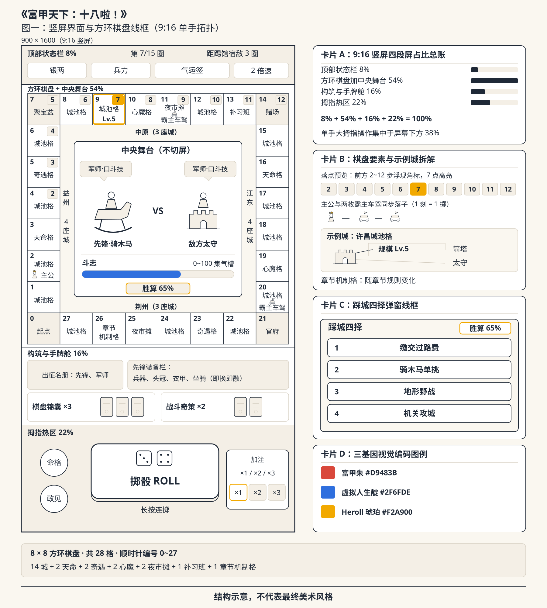
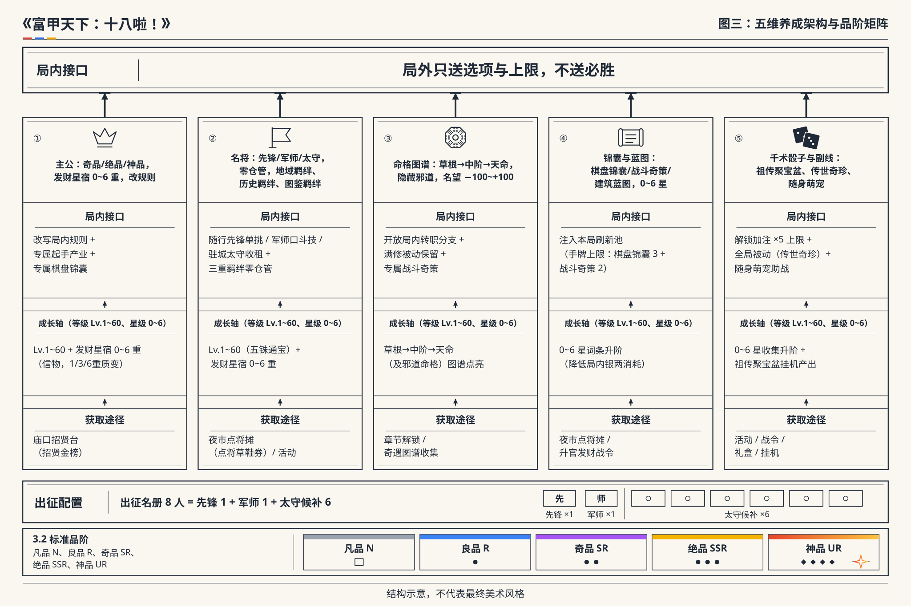
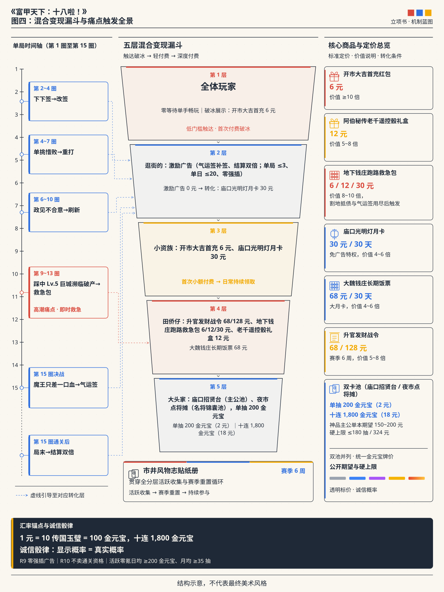
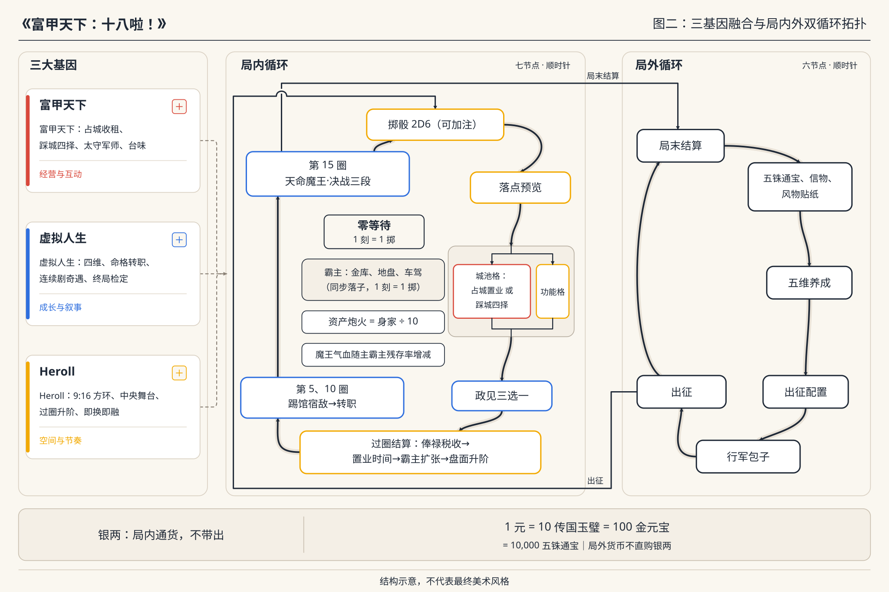

# 《富甲天下：十八啦！》项目立项书（旗舰总成版）
### ——单手十分钟，掷出三国首富｜单人竖版收租肉鸽策略喜剧手游

> **正式项目名**：《富甲天下：十八啦！》（副标题：「单手掷出三国首富」｜内部代号：`FJ18`）
> **文档性质**：投融资 / 立项过闸评审与研发总纲契约（统合顶层宪法 `01` 与四大详设分册 `00/02/03/04` 及 `fig01~fig04` 结构资产）
> **核心品类**：9:16 竖屏单手 · 零等待方环掷骰收租 × 踩城四择博弈 × 命格转职肉鸽 × 高角色价值混合变现（IAA+IAP）
> **美术边界声明**：严格遵照决策人指示**「美术风格我们回来再讨论」**——全书绝不锁死单一最终画风，仅锁定高颜艺喜剧差分、9:16 小屏可读性与立绘小人三锚点三道功能硬门槛，并在第八篇提供 A~E 五大候选视觉方向开放评估矩阵与同构基准图盲测方案。
> **证据标注体系**：`[证]` 原作或头部竞品已验证规律；`[推]` 本案数学/机制推导结论；`[假]` 待原型或测试校准参数；`[待]` 待商务授权或法务确认事项。玩家可见文本统一标注台味浓度档位（`L0` 清水合规 ~ `L3` 重台高潮）。

---

## 卷首 一页纸立项决策请求与全案分册导航

### 0.1 一页纸决策摘要：我们做什么、为什么现在做、请求批多少资源

| 决策维度 | 核心结论与量化锚点 |
| :-- | :-- |
| **一句话高概念** | **一根大拇指、十分钟一局的三国收租肉鸽**：零等待掷骰跑圈抢城盖楼，踩进敌城四选一搏命（乖乖交钱 / 骑木马单挑 / 地形野战 / 机关攻城），最后拿全部身家化作万门火炮去轰关底的天命魔王。 |
| **为什么现在值得做** | ① **品类空白**：《MONOPOLY GO!》验证了竖屏掷骰年入数十亿美元的泼天流量 `[证]`，但纯数值播片无战斗博弈且强绑欧美熟人互偷；《Heroll》验证了 9:16 外环跑圈+中央舞台肉鸽 `[证]`，但踩怪只能自动对砍缺乏策略逆转；传统《富甲天下》坐拥几代华语玩家白月光情怀，却困死在“看电脑走棋等三分钟”的老旧单机节奏里。<br>② **唯一化学解**：用本案独创的**「霸主同步落子（1 刻 = 1 掷，你不掷天下不动）」**砍掉 75% 等待垃圾时间，把《富甲天下》灵魂四择与地道台湾市井冷幽默装进 9.5 分钟单手闭环，同时吃下超低买量吸睛成本与卡牌级角色溢价 `[推]`。 |
| **商业化与公平铁律** | **IAA（激励视频 18%~25%）+ IAP（内购 75%~82%）混合变现** `[假]`。严守十条红线：零强插广告（单局 ≤3 次、单日 ≤20 次）、诚信骰律（显示概率 = 真实概率）、局外五维养成**只送选项与上限、不卖胜算与通关资格**。零氪玩家 **8.6 天**满级一尊绝品名将、**32 天**稳拿六重星宿完全体，零氪 30 日名册普通章通关率 **≥58.2%**（守 50% 底线）。`神品`主公单本期望 **163.7 元**（硬上限 180 抽 / 324 元），十款台味市井商品全部严守九档合法定价与真折扣核账。 |
| **研发总盘与排期** | 全周期 **18 个月、466 人月**（峰值 40 人，按 3.5 万/人月计约 1,631 万元，加基准图专项 35 万共 **1,666 万元** `[假]`），切分为：**阶段一核心原型 MVP（3 个月）→ 阶段二垂直切片（5 个月）→ 阶段三计费删档测 CBT（6 个月）→ 阶段四公测 OB（4 个月）**，坚决砍掉实时联机、百人微操、粮草线、背包仓库等八大包袱（立省 **265 人月**）。 |
| **本次唯一拨款请求** | **首期仅申请批复 119 万元（全案预算的 1/14）**：<br>• **第一笔 A（核心原型 MVP，84 万元 / 8 人 × 3 个月）**：交付零画风几何灰盒可玩版，实测验证 H1（霸主对抗感 ≥70%）、H2（四择决策 ≤3s 且动手率 30%~55%）、H3（普通章 8~10 分钟且 12 圈后流失 <8%）；<br>• **第一笔 B（美术同构基准图测试专项，35 万元封顶 / 并行 10 周）**：用同一帧“刘备踩进曹操 Lv.5 许昌交八千两过路费”绘制 A~E 五种候选画风同构实机图，跑完 3 秒瞥视可读率、情怀盲测与 80 万曝光假门 CTR 报告，交决策人回来拍板；<br>• **阶段二及后续预算本次一分不拨**，必须等「阶段一 9 项指标全过 + 决策人敲定美术方向」**双钥匙同时到位**后方可解锁；并请同步授权启动光谱资讯《富甲天下》IP 商务接触（12 周窗口，备选去 IP 保底方案 C 零返工兜底）。 |

### 0.2 全项目文档体系与视觉结构资产总索引

本旗舰立项书为全案总成正文；各模块颗粒度至单卡逐级词条、单日产消流水及方法论考据的完整底稿，同步存档于 `./docs/` 五大详设分册与 `./assets/` 四张自包含矢量蓝图中，全库术语、公式、汇率 100% 闭环对齐：

| 资产 / 分册编号 | 文件路径 | 规模 | 核心承载内容与查阅指引 |
| :-- | :-- | :-- | :-- |
| **考据底稿 `00`** | [00_research_dossier.md](./docs/00_research_dossier.md) | 376 行 | `GameDesignOS` 立项推导链、体验浓度 ED 公式、UCB 情景喜剧引擎；《富甲天下 3/4/5》《虚拟人生 1/2/3》《Heroll》细颗粒度拆解 |
| **顶层宪法 `01`** | [01_master_blueprint.md](./docs/01_master_blueprint.md) | 682 行 | 命名裁定、三基因八咬合点、霸主七律、十条红线、标准术语禁用词表、五阶品阶、汇率定价锚与核心公式 F1~F9 |
| **核心玩法 `02`** | [02_core_gameplay_and_board.md](./docs/02_core_gameplay_and_board.md) | 976 行 | 买量脚本、9:16 四段界面与 0.1s 时间轴、28 格逐行详表、四择战力数学、12 张霸主手笔、32 条政见、决战三段、20 圈剧本、96 句主公台词矩阵 |
| **角色卡牌 `03`** | [03_character_and_card_systems.md](./docs/03_character_and_card_systems.md) | 2,700 行 | 五维养成架构、6 位首发主公逐重完整设计卡 + S1 卑弥呼前瞻、15 名代表名将深度档案、零仓管三层羁绊、19 节点命格树、20 张锦囊奇策蓝图逐星词条、四副线、全量消耗与通关率验算 |
| **商业长线 `04`** | [04_commercialization_and_liveops.md](./docs/04_commercialization_and_liveops.md) | 1,213 行 | IAA+IAP 漏斗、N1~N12 痛点映射、双卡池马尔可夫精算、皇家当铺、10 款台味商品逐卡详表、30 日产消对账、长线四支柱、466 人月路线图、风险册、A~E 美术开放评估与基准图方案 |
| **结构蓝图 `fig01`** | [fig01_portrait_board_wireframe.svg](./assets/fig01_portrait_board_wireframe.svg) | 1800×2000 | 9:16 竖屏四段屏占比线框、28 格顺时针方环棋盘、不切屏中央舞台与踩城四择固定弹窗示意（嵌入本册 **3.1**） |
| **结构蓝图 `fig02`** | [fig02_trinity_core_loop_topology.svg](./assets/fig02_trinity_core_loop_topology.svg) | 2400×1600 | 《富甲天下×虚拟人生×Heroll》三大基因融合与局内外双循环闭合拓扑图（嵌入本册 **附录 B**） |
| **结构蓝图 `fig03`** | [fig03_character_card_progression_matrix.svg](./assets/fig03_character_card_progression_matrix.svg) | 2400×1600 | 五维养成架构（主公/名将零仓管/命格图谱/锦囊蓝图/千术骰副线）与 8 人出征底座图（嵌入本册 **5.1**） |
| **结构蓝图 `fig04`** | [fig04_hybrid_monetization_funnel.svg](./assets/fig04_hybrid_monetization_funnel.svg) | 1800×2400 | 五层混合变现漏斗、单局 1~15 圈痛点触发时间轴与台味商品定价全景图（嵌入本册 **6.1**） |

---

## 第一篇 立项总论（Market Opportunity & Proposal Spine）

### 1.1 命名矩阵与正式定名

| 名称 | 定位 | 买量吸睛 | 情怀唤醒 | 品牌延展 | 判词 |
| :-- | :-- | :-- | :-- | :-- | :-- |
| **《富甲天下：十八啦！》**<br>副标题「单手掷出三国首富」 | **正式名** | ★★★★☆ | ★★★★★ | ★★★★★ | "十八啦"是掷骰时的那一嗓子，三个字把玩法、台味、赌性全喊完。大陆玩家未必知道典故，但念一遍就会跟着喊，副标题负责解释。赛季可直接接《十八啦！赤壁烧烤季》 |
| 《富甲天下：骰来运转》 | 备选 A | ★★★☆☆ | ★★★★☆ | ★★★☆☆ | 谐音稳妥，长辈看了都点头，可惜像理财 App |
| 《富甲天下：一路发》 | 备选 B | ★★★★☆ | ★★★★☆ | ★★★☆☆ | 168 一路发，绕圈加发财一语双关；缺骰子意象，买量图得多花一秒解释 |
| 《主公十八啦：三国收租王》 | 备选 C（去 IP 保底） | ★★★★★ | ★★☆☆☆ | ★★★☆☆ | 买量最直给，但白月光没了 |

**宣布：全套立项书与所有分册统一采用《富甲天下：十八啦！》，简称《十八啦》，内部代号 `FJ18`。**
正式名以取得光谱资讯《富甲天下》授权为前提 `[待]`。授权落空则整体切换备选 C，玩法、术语、数值一个字不改。

### 1.2 高概念与电梯演讲

**一句话高概念**

> 一根大拇指、十分钟一局的三国收租肉鸽：零等待掷骰跑圈抢城盖楼，踩进敌城四选一搏命，最后拿全部身家去轰关底的天命魔王。

**30 秒电梯演讲**

> 还记得小时候派张飞拿折凳去单挑吕布、赢了就不用交过路费的快乐吗？《十八啦》把它装进一只手里。大拇指一按掷出双骰，在 28 格方环棋盘上抢城、盖箭塔、收租；踩进曹老板的地盘，算盘一拨四选一——乖乖交钱、骑木马单挑、拉到城外野战，还是连城带锅整碗端走。全程没有任何 AI 回合要等：你不掷，天下不动。十分钟后，你攒下的每一两银子都变成炮弹，轰向关底的天命魔王。俗搁大碗，输了也笑得出来。

### 1.3 黄金推导链

**① 概念种子（Concept Seed）**

| 种子 | 内容 |
| :-- | :-- |
| 题材种 | 三国英雄用菜市场的脑袋打天下：逐鹿中原 = 抢黄金店面 |
| 玩法种 | 掷骰绕圈 + 占城收租 + 踩了别人的城可以不交钱而是动手 |
| 情绪种 | 算盘打得精的窃喜、以小博大的贼爽、破产破得好笑 |

**② 玩家动词清单（Player Verb Inventory）**——普通章一局 60 掷、约 9.5 分钟

| 动词 | 每局频次 | 玩家脑内在算的账 |
| :-- | :-- | :-- |
| 掷（含加注） | 60 次 | 前面 2~12 格谁的地盘多？7 点踩到哪？这把敢不敢加注 |
| 择（踩城四择） | 10~14 次 | 过路费多少、胜算几成、输了赔两倍我扛不扛得住 |
| 置（占城、升级、盖楼、派太守） | 约 15 轮，集中在过圈 | 盖下去被踩一次就回本；这笔钱先盖楼还是留着保命 |
| 选（政见三选一） | 10±2 次 | 这条跟我手上的流派搭不搭 |
| 出（锦囊、奇策） | 6~10 次 | 现在用，还是留给魔王 |
| 换（装备即换即融） | 5~8 次 | 折凳换菜刀，是赚是亏 |
| 决（踢馆宿敌、天命魔王） | 2 + 1 次 | 这一局攒的家当够不够轰 |

重决策（择、选、出、决）合计约 33 次，折合每分钟 3~4 次；其余全部是一击完成的轻决策。

**③ 设计核候选与判决（Design Nucleus）**

| 方案 | 玩家每分钟在干嘛 | 判决 |
| :-- | :-- | :-- |
| A 原作照搬：四位主公轮流走棋 | 操作 1 分钟，看 AI 逛街 3 分钟 | 淘汰。一局 40 分钟起跳，竖屏用户等不到第二圈 |
| B《MONOPOLY GO!》式：无尽烧骰 + 局外盖地标 | 连点，看数字涨 | 淘汰。没有局内输赢，四择、夺城、太守无处安放；留存靠社交互偷，与"单人"相悖 |
| C《Heroll》换皮：三国小人自动对撞 | 掷，看自动战斗，三选一 | 淘汰。标准题材幻觉——把张飞换成史莱姆，玩法一个字不用改 |
| D 异步或实时对战大富翁 | 等匹配，被大佬踩 | 淘汰。等待与社交焦虑正是受众的明确拒绝项 |
| **E 零等待单人方环升阶棋盘 × 踩城四择 × 天命魔王身家决战** | 掷→算→择→置，约 9 秒一个来回 | **选定** |

E 成立，是因为三个部件各自改变了玩家每分钟的取舍 `[推]`：

- **零等待**把原作 75% 的旁观时间还给玩家，一整局才塞得进十分钟。
- **四择**把"踩敌城"从被动扣钱变成一道风险定价题：此刻张飞的武力不是面板数字，是一张过路费免单券的中奖率。题材第一次真正改变了取舍。
- **身家决战**给"为什么要多盖一层楼"一个终点：每 10 两身家折 1 点炮火。大富翁后期的垃圾时间就此消失。

**④ 玩家承诺（Player Promise）**

| 承诺 | 内容 |
| :-- | :-- |
| 买量 3 秒 | "踩到吕布的城？不交钱，派张飞拿折凳骑木马去单挑。"（画面：一掷、一择、一翻盘） |
| 首局 10 分钟 | 打完一整局教学章：占 3 座城、赢 1 次单挑免单、夺 1 座城、掷出 1 次欢喜对、轰倒 1 个天命魔王、至少笑 3 次；零等待、零强制广告 |
| 30 天长线 | 6 位主公是 6 套改规则的玩法；每周一张新盘面或新霸主组合；抽到的每位名将都有城可守、有租可收，没人坐冷板凳 |

### 1.4 三圈受众画像

| 圈层 | 核心渴望 | 碎片场景与行为 | 付费爽点 | 明确拒绝 |
| :-- | :-- | :-- | :-- | :-- |
| ① 老光谱返场客（玩过《富甲天下》《大富翁4》的那一代） | 再听一次军师互喷，再拿一次折凳；想确认小时候的快乐不是滤镜 | 通勤单手、睡前两局；会截图台词发群 | 主公语音包与破产动画、情怀名将、月卡 | 挂 IP 卖数值、一局半小时、被逼联机、台词变网络烂梗 |
| ② 竖屏肉鸽刷子（《Heroll》《弹壳特攻队》用户） | 流派成型那一刻的数值爆炸；"再来一局"的手痒 | 蹲厕所、排队、带薪摸鱼；开 2 倍速连刷 | 免广告、倍速、战令、补齐流派的关键名将 | 纯自动对撞没得选、强制广告、卡数值墙 |
| ③ 掷骰收集休闲客（《MONOPOLY GO!》与大富翁类用户） | 掷骰的赌性快感、集册的完成欲、轻松好笑 | 追剧时的副屏、等餐；每次 3~5 分钟 | 贴纸册、千术骰子外观、6~12 元小礼包 | 密密麻麻的属性表、失败惩罚太痛、看不懂三国就玩不了 |

### 1.5 立项假设账本

| 编号 | 核心假设 | 验证口径 | 阶段 |
| :-- | :-- | :-- | :-- |
| H1 | 霸主"同步落子"能给出"我在跟人抢地盘"的对抗感 | 首局后访谈认同率 ≥70% | MVP |
| H2 | 四择不会让人过载 | 平均决策 ≤3 秒；单挑、野战、攻城合计选择率 30%~55% | MVP |
| H3 | 60 掷 9.5 分钟不累 | 普通章净时长中位数 8~10 分钟；第 12 圈后流失 <8% | MVP |
| H4 | 台味两岸通吃 | 台词"看得懂" ≥90%，"好笑"均分 ≥3.8/5 | 垂直切片 |
| H5 | 加注是乐趣不是负担 | ≥40% 的局至少加注 3 次 | 垂直切片 |
| H6 | 光谱 IP 授权可得 | 商务结论 | 立项前 `[待]` |

---

### 1.6 竞品死穴解剖与 15 秒买量钩子实机脚本（摘编自 `02` 第一章）

#### 1.1 四大参照系结构死穴与《十八啦》破局对比

市面上并非没有掷骰子手游，也并非没有三国题材，但玩家始终找不到一款**「单手十分钟内既能体验买地垄断收过路费、又能派张飞拎折凳把债主揍到免单」**的产品。症结在于现有四类产品的底层结构各有死穴：

**表 1-1 四大参照系死穴与本案破局表**

| 参照品类 | 代表产品 | 核心体验死穴（玩家为什么流失） | 《富甲天下：十八啦！》的结构破局 |
| :-- | :-- | :-- | :-- |
| **传统单机大富翁** | 《富甲天下 3/4/5》《大富翁 4》 | **75% 时间在看别人走棋** `[证]`；进单挑与野战频繁切全屏黑幕；一局动辄 2 小时，后半程胜负已定却要熬到对手慢慢破产 | **霸主同步落子（零等待）**：你不掷，天下不动；一切战斗收进`中央舞台` 5~10 秒播完；第 15/20 圈拿全部`身家`化作炮火轰`天命魔王`，彻底消灭尾盘垃圾时间 `[推]` |
| **海外社交掷骰霸主** | 《MONOPOLY GO!》 | **局内零胜负、零主动博弈** `[证]`：踩格纯看数值播片，骰子只是换皮体力条；留存高度依赖熟人社交互拆互偷，在华语圈水土不服 | **踩城四择真博弈**：踩进敌城不是乖乖扣钱，而是算清`胜算`在交钱、单挑、野战、攻城间做风险定价；纯单人体验，无任何强制社交焦虑 `[推]` |
| **竖屏掷骰肉鸽** | 《Heroll（勇士团团转）》 | **踩怪只能自动对砍，题材可随意换皮** `[证]`：把小人换成史莱姆毫无违和感；缺少地产经营的复利爽感，局外角色溢价薄弱 | **地产复利 × 角色改规则**：连城垄断加`私掠站`一脚破万两；六位首发`主公`各自改写盘面规则，名将派驻当`太守`有城可守、有租可收 `[推]` |
| **重度三国卡牌/SLG** | 主流三国 SLG 与数值卡牌 | **打卡铺路坐牢、半夜被大佬沦陷** `[证]`：上班族想爽一把三国，结果比上班还累；抽到的非主力紫卡蓝卡全变废铁 | **十分钟一局、随时锁屏续玩**：单手大拇指操作；名将分`先锋`、`军师`、`太守`三岗外加图鉴羁绊，实现真正零冷板凳 `[推]` |

#### 1.2 三套可直接投流的 15 秒买量短视频分镜脚本

买量素材不做虚假副玩法，直接拿局内真实发生的「踩城四择翻盘」「恶搞建筑剥皮」「算命邪道逆袭」拍成 15 秒竖屏实机爽片，兑现总纲「买量 3 秒承诺」。

**表 1-2 买量脚本 A：《住一晚八千两？派张飞拎折凳骑木马讲道理！》**

| 秒数 | 9:16 实机画面与动作 | 音效与节奏 | 配音与字幕台词 | 转化钩子 |
| :-- | :-- | :-- | :-- | :-- |
| **0~3s** | 刘备棋子一脚踩进泛红光的「Lv.5 许昌」，城头曹老板探头拨算盘，红字狂闪「过路费：8,160 两」，刘备银两只剩 950 两 | 警报钟声 + 算盘珠清脆暴响 | 刘备捂胸口飙泪：「夭寿哦！住一晚八千两，你们许昌是有送卤肉饭吃到饱哦？」（L2） | **前 3 秒制造绝境反差**：传统大富翁必死局 |
| **3~7s** | 屏幕弹出固定四按钮`踩城四择`，大拇指直接略过「缴交过路费」，重重按下「骑木马单挑（胜算 68%）」 | 战鼓急促敲击 + 清脆按键音 | 旁白（市井说书腔）：「没钱交过路费？在《十八啦》，讲道理不如拎折凳！」（L2） | **亮出核心差异化动词**：踩敌城可以动手免单 |
| **7~12s** | 不切屏！`中央舞台`张飞骑摇摇木马拎奇品`折凳`冲出，场边诸葛亮摇扇开喷`口斗技`，敌太守斗志暴跌；玩家点按`战斗奇策`《偷龙转凤》，一板凳拍飞敌太守 | 木马弹簧吱呀声 + 折凳闷响 + 金币爆盆声 | 张飞拍胸：「免单啦！顺便把你家招牌拆一层当茶水费！」（L2） | **政见 P14 视觉化**：不仅免单还拆敌城一级 |
| **12~15s** | 许昌降级吐出满屏银两，底部大键「掷骰 ROLL」流光闪烁，浮现游戏 Logo | 锣鼓齐鸣喊声「十八啦——！」 | 字幕：「单手十分钟，掷出三国首富！」（L1） | 引导立即下载试玩首局 |

**表 1-3 买量脚本 B：《在曹老板必经之路盖箭塔配屎王神》**

| 秒数 | 9:16 实机画面与动作 | 音效与节奏 | 配音与字幕台词 | 转化钩子 |
| :-- | :-- | :-- | :-- | :-- |
| **0~3s** | 过圈`置业时间`界面，手指在益州连占四城，啪啪点选`建筑蓝图`：三座`箭塔`夹一尊金光闪闪的`屎王神` | 盖章音效 ×4 + 诡异唢呐滑音 | 旁白：「打不过曹老板？那就把他的必经之路改成收费地狱！」（L1） | **基建阴人爽感**：一眼看懂的缺德布局 |
| **3~9s** | 玩家按下掷骰，`霸主车驾`（曹操）同步走 1D6 连过箭塔射程，护卫兵力狂掉归零陷入`瘫痪`，停在熏区捂鼻脸发绿，一脚踩中满级成都喷出 13,800 两 | 连珠箭破空声 + 捂鼻惨叫 + 银两狂喷声 | 曹操捏鼻掏空钱袋：「靠北（抱怨），这味道比过路费还要命！开发票！」（L3） | **展示霸主同步落子与反伤收租** |
| **9~15s** | 曹操金库见底触发`割地抵债`，两座郡城直接变玩家旗帜，曹老板剩花裤衩跑路 | 法槌敲定声 + 欢快小调 | 董卓/旁白大笑：「盖楼收租熏邻居，俗搁大碗！」（L2） | 击中包租公收租与恶搞解压心理 |

**表 1-4 买量脚本 C：《算命抽到下下签，反手邪道命格开芭乐票》**

| 秒数 | 9:16 实机画面与动作 | 音效与节奏 | 配音与字幕台词 | 转化钩子 |
| :-- | :-- | :-- | :-- | :-- |
| **0~3s** | 开局算命摊，问题「捡到曹老板私房钱袋怎么办？」，手指点选「C. 吞掉现金再敲诈一笔封口费」，`名望`狂跌至 −40 进入`邪道` | 算命签筒哗啦声 + 阴险锣声 | 算命仙瞪眼：「印堂发黑缺德冒烟——恭喜主公喜提邪道命格！」（L2） | **反套路开局**：做好人哪有当恶霸爽 |
| **3~10s** | 踩中敌方巨城，四择第一项自动改写为紫色按钮「开芭乐票」！一击免付溜走；转头在自己花光现金置业后打出《均富天下》，把首富金库强行平分过来 | 撕支票音效 + 算盘暴击 + 霸主吐血声 | 曹操抱头：「你拿空头支票住霸王店，转头还平分我家产？！」（L2） | **展示名望正邪改写四择与神级锦囊** |
| **10~15s** | 第 15 圈决战开启，十座满级城池化作万门火炮将`天命魔王`轰上天 | 万炮齐射重低音轰鸣 | 字幕：「正道邪道都能发财，《富甲天下：十八啦！》」（L1） | 吸引肉鸽构筑与《虚拟人生》情怀客 |

---

---

## 第二篇 设计宪法（Design Constitution）

> 本篇完整收编顶层总纲 [01_master_blueprint.md](./docs/01_master_blueprint.md) 第二、三章全部法定条款、术语红线、货币汇率与九条核心公式（F1~F9），作为全项目唯一设计宪法。

### 2.1 融合公式与八个咬合点

```text
《十八啦》 = Heroll 的骨（9:16 方环 + 中央舞台 + 拇指掷骰 + 过圈升阶）
          × 富甲天下的肉（占城收租 + 踩城四择 + 太守军师 + 恶搞建筑兵器 + 台味）
          × 虚拟人生的魂（四维门槛 + 命格转职 + 连续剧奇遇 + 魔王终局检定）
```

三样东西不是并排摆着，而是在下面八个点上用数学和交互咬死：

| # | 咬合点 | 谁出什么 | 怎么锁死 |
| :-- | :-- | :-- | :-- |
| 1 | 落点预览 × 四择 | Heroll 出预览，富甲出四择 | 掷骰前，前方第 2~12 格浮现步数角标，7 点最亮。玩家按下 ROLL 之前就在算"踩到许昌怎么办"，决策前移，弹窗出来只需一击 `[证]` |
| 2 | 四维 × 四择 | 虚拟人生出四维，富甲出四择 | `体魄`管单挑战力，`谋略`管野战与口斗技，`魅力`管过路费杀价与招降，`名望`正邪改写选项（正道可把攻城改成"开城劝降"，邪道可把交钱改成"开芭乐票"）。按钮永远四个 |
| 3 | 欢喜对 × 构筑 | Heroll 出对子联动，富甲出喊声 | 对子概率 1/6 是全局节拍器。政见、兵器、千术骰子的词条统一以"每次欢喜对"为触发口，把运气变成可构筑的数学 |
| 4 | 过圈 × 收租 × 通胀 | Heroll 出升阶，富甲出税收 | 过圈一次办完：发俸禄与税收 → 置业时间 → 霸主扩张 → 盘面升阶。敌方强度按 `圈压系数` 爬升，逼玩家用租金跑赢通胀 |
| 5 | 踢馆 × 转职 | 虚拟人生出检定与转职 | 第 5、10（、15）圈的踢馆宿敌是期中考，过关即转职并领 1 张专属 `战斗奇策`；修满的旧命格被动本局保留 |
| 6 | 身家 × 魔王 | 富甲出资产，虚拟人生出终局 | 玩家每 10 两身家 = 1 点 `资产炮火`；主霸主被薅得越穷，`天命魔王` 气血越薄。两边家底对轰，谁厚谁赢 |
| 7 | 即换即融 × 无厘头兵器 | Heroll 出零背包，富甲出折凳 | 掉落即弹左右对比，一击换装，旧装当场折成银两。`先锋装备栏` 只有 4 格，没有背包这种东西 |
| 8 | 局外五维 × 局内规则 | 手游养成 × 富甲主公非对称 | 主公改规则，名将当太守，锦囊蓝图进本局刷新池，命格图谱解锁转职分支，千术骰子抬加注上限。**局外只往局内送选项与上限，不送必胜** |

### 2.2 单人化对手重构：霸主系统（本案第一机制，定死）

**定义**：`霸主` 是盘面上的割据势力，既是对手，也是会走路的提款机。每章 1 位 `主霸主`（本章天命魔王的人形期）加 1~2 位 `副霸主`。

**霸主七律**

1. **你不掷，天下不动。** 全局时钟单位是 `刻`：玩家完成 1 次掷骰与落点结算 = 1 刻。霸主没有自己的回合，只在刻内与过圈时行动。
2. **三件家当。** `霸主金库`（真银两，可被掏空）、`地盘`（名下城池，带势力色）、`霸主车驾`（盘面上的一枚棋子，带护卫兵力）。
3. **同步落子。** 每 1 刻，所有车驾与玩家棋子同时起跳，各走 `1D6`（比玩家慢一半，主角是你）。车驾的移动与落点表现必须在玩家棋子跳格的那 1 秒内播完，不弹窗、不抢镜头。同刻先后：玩家先结算，霸主按座次后结算。
4. **落点自动结算。** 车驾落在哪就按下表自动处理，玩家不需要做任何操作。
5. **过圈扩张。** 玩家每次过起点，霸主依次：金库收地盘税收 → 检查 `野心阶段` → 上一圈亮出的 `霸主手笔` 生效，同时亮出下一张 → 盘面升阶。合计表现 ≤3 秒，与玩家的置业时间并行。**霸主手笔一律提前 1 圈亮牌**，被阴到只能怪自己没防。
6. **野心三阶。** Ⅰ 圈地（第 1~5 圈）：只抢空城，踩到你乖乖交租。Ⅱ 筑防（第 6~10 圈）：加盖建筑、调名将当太守，踩到你的弱城会 `上门找茬`。Ⅲ 围剿（第 11 圈起）：派 `讨债队` 逆时针迎面拦你，主霸主开始为魔王化囤兵。
7. **破产与清盘。** 金库付不出过路费就 `割地抵债`：把等值城池直接过户给债主，也就是你。无城可割即破产，穿着裤衩跑路退场，剩余城池变法拍屋，半价可接。全部霸主破产叫 `清盘`：立即提前决战，魔王气血只剩六成。

**一刻之内的时间契约**

```text
玩家按下 ROLL
 ├─ 0.0~1.2 秒   双骰落定
 ├─ 1.2~2.0 秒   玩家棋子跳格 ‖ 同时：全部霸主车驾各走 1D6 并自动结算
 ├─ 2.0 秒起     玩家落点结算（全流程只有这里可能出现弹窗）
 └─ 结算完毕     下一刻开始，ROLL 键立即可按
```

**车驾落点自动结算表**

| 车驾落在 | 自动结算 | 给玩家的反馈（全部非阻塞） |
| :-- | :-- | :-- |
| 无主城池 | 按野心阶段的概率出资占领 | 插旗 0.5 秒 |
| 自家城池 | 升级、加盖或补守军 | 城池图标长高一截 |
| **玩家城池** | 默认缴交过路费，金库的钱进你口袋；野心 Ⅱ 起且胜算够高时改为上门找茬，由你的太守自动应战 | 金币从该格喷进钱袋，霸主头像弹出肉痛颜艺加一句台词（≤0.8 秒）；上门找茬出 ≤2 秒战报 |
| 其他霸主城池 | 照付过路费，金库互转 | 顶栏跑马灯一行字 |
| 聚宝盆 | 抱走奖池 | "夭寿，被曹老板截胡了" |
| 其余功能格 | 无事发生 | 无 |

**玩家对霸主的全部互动口**：收租（他踩你）、四择（你踩他）、棋盘锦囊（《均富天下》平分你与全体霸主的现金，《顺手牵羊》偷金库，《乐不思蜀》把车驾定在原地）、箭塔（车驾路过即扣护卫兵力，归零则 `瘫痪` 3 刻并遣返主城，期间其全部城池守军减三成）。

**原作的快乐一样没丢**

| 原作的快乐 | 单人版怎么保住 |
| :-- | :-- |
| 看对手一步步踩进我的巨城 | 车驾在盘面上看得见，还差几格算得出，踩中即喷金币加颜艺 |
| 把对手养肥的城连根拔起 | 四择之 `机关攻城`：夺城，并吞城内一半建设 |
| 《均富天下》薅首富羊毛 | 霸主有真金库，可被平分、被偷、被逼到割地 |
| 把对手逼到破产 | 割地抵债 → 裤衩跑路演出 → 清盘红利 |
| 被 AI 阴一手的气急败坏 | 霸主手笔与讨债队，但全部提前亮牌 |

> 制作人批注：原作里等曹操走棋的那三分钟，我们一秒都不留。但曹操踩进你家许昌、掏钱掏到脸发绿的那 0.8 秒，一帧都不能少。

### 2.3 体验浓度（ED）控制标尺

| 标尺 | 硬指标 | 管哪一项 |
| :-- | :-- | :-- |
| 单掷全流程均时 | ≤9.5 秒（60 掷 ≈ 9.5 分钟） | 时长 |
| 重决策密度 | 每分钟 3~4 次 | MD/min |
| 轻决策 | 加注、换装、单城升级一律一击完成 | CLP |
| 阻塞弹窗 | 每分钟 ≤2 个；选项 ≤4 个；正文 ≤40 字 | CLP |
| 同屏常驻数字 | ≤7 组 | CLP |
| 中央舞台时长 | 心魔 3~5 秒，单挑 5~8 秒，野战 4~6 秒，攻城 6~10 秒，踢馆宿敌 ≤15 秒，天命魔王 ≤45 秒；第二次起可 2 倍速 | SF 与节奏 |
| 非玩家触发的不可跳过演出 | 单次 ≤2 秒 | 零等待 |
| 首局里程碑 | 30 秒内首掷；90 秒内首次占城；3 分钟内首次单挑且保送必胜；6 分钟内首次夺城与教学章通关 | 首局心流 |
| 防钝化 | 每章 1 个 `章节机制格` + 1 条主公异变规则 + 霸主组合轮换，保持七分熟三分新 | 长线 |

调优顺序固定：先砍认知负荷，再加反馈与氛围，最后才动决策频率。

### 2.4 参考边界与十条红线

**Reference Game Boundary**

| 参考系 | 拿走 | 坚决不抄 | 要赢过它的地方 |
| :-- | :-- | :-- | :-- |
| 《富甲天下》3/4/5 | 四择博弈、太守与军师口斗、建筑流派、无厘头兵器锦囊、台味 | AI 回合等待；切黑屏的百人野战；粮草线；四色几十种锦囊 | 同样的博弈，十分钟打完 |
| 《虚拟人生》1/2/3 | 四维门槛、算命开局、连续剧奇遇、转职继承、终局检定 | 刷小游戏肝属性；不读档就玩不下去的恶性随机 | 负面随机一定有可见的对冲手段，且收尾好笑 |
| 《Heroll》 | 三段式单手界面、中央舞台不切屏、过圈升阶、对子联动、即换即融 | 踩怪只能自动砍的零博弈；后期数值墙配高频广告 | 每次踩格都有得选 |
| 《MONOPOLY GO!》 | 倍率择时 `[证]`、贴纸册、破产瞬间的礼包时机 | 拿骰子当体力无限烧；强社交互拆互偷 | 局内有真输赢，付费买的是再搏一把，不是多烧几颗骰子 |

**十条红线**（违反即退稿）

| 编号 | 红线 | 判定口径 |
| :-- | :-- | :-- |
| R1 | 零等待 | 玩家任意两次可操作时刻之间，不可跳过的非玩家演出 ≤2 秒 |
| R2 | 不切屏 | 一切战斗与开奖在中央舞台完成，禁止全屏黑幕加载 |
| R3 | 四择恒四 | 踩敌城永远四个按钮、固定顺序；属性与命格只能改写文案与赔率 |
| R4 | 手牌双轨 | 只有棋盘锦囊与战斗奇策，禁止恢复四色或新增第三类 |
| R5 | 零背包 | 任何掉落当场决定去留，不得产生"稍后整理"的库存 |
| R6 | 无后勤微操 | 无粮草线、无行军路线、无手动排兵 |
| R7 | 诚信骰律 | 显示的概率就是真实概率；任何保底必须明示。连续 2 次在胜算 ≥60% 时落败，下一次 +15% 并写明"老天爷看不下去了" |
| R8 | 输得好笑 | 负面随机必有气运签可对冲；失败演出必须是喜剧，不是说明书 |
| R9 | 零强插广告 | 只有玩家主动点的激励广告；破产付费弹窗须在割地抵债与气运签都用尽之后才出，每日 ≤2 次，一键可关 |
| R10 | 不卖通关资格 | 全部普通章须能用零氪阵容加正确构筑打通；付费买广度、便利与演出 |

---

### 2.5 全局标准术语词典、五阶品阶、货币汇率与九条核心公式（F1~F9）

#### 3.1 核心玩法标准术语

**表 A 棋盘与行动**

| 标准名 | 定义与规格 | 禁用说法 |
| :-- | :-- | :-- |
| `方环棋盘` | 28 格 = 4 `角格` + 4 边 × 6 `边格`，顺时针，编号 0~27 | 地图、赛道 |
| `角格` | 0 `起点`（左下）、7 `聚宝盆`（左上）、14 `赌场`（右上）、21 `官府`（右下） | — |
| `边格` | 24 格 = `城池格` 14 + 功能格 10（`天命格` 2、`奇遇格` 2、`心魔格` 2、`夜市摊` 2、`补习班` 1、`章节机制格` 1） | 事件格、怪物格、商店格 |
| `州` | 每边一州。标准盘：西·益州 4 城、北·中原 3 城、东·江东 4 城、南·荆州 3 城 | 色组、街区 |
| `掷骰` | `2D6`，期望 7 步，每圈 4 掷 | 摇骰、投骰 |
| `欢喜对` | 任意对子（1/6）：再掷一次，并触发全部对子词条 | 豹子、Doubles |
| `十八啦` | 双六（1/36）：欢喜对效果 + 全场锣鼓大奖演出。只借台湾骰局的喊声，不搬四骰规则 | — |
| `衰尾对` | 双一（1/36）：欢喜对效果 + 补 1 支 `气运签`（衰到底，老天补你一点） | 蛇眼 |
| `落点预览` | 掷骰前，前方第 2~12 格浮现步数角标；7 点最亮，敌城泛红，聚宝盆泛金 | — |
| `加注` | 掷骰前选 ×1、×2、×3：本次落点的全部银两进出同乘倍率（F4） | 倍率、倍投。注意与 `倍速`（演出加速）区分 |
| `刻` | 全局时钟单位；玩家完成 1 次掷骰与落点结算 = 1 刻 | 回合 |
| `过圈结算` | 经过或停在起点时：俸禄与税收 → `置业时间` → 霸主扩张 → `盘面升阶`（每圈 2~3 格异变） | 结算回合 |
| `中央舞台` | 方环内侧的演出区，一切战斗与开奖在此播放 | 战斗场景、副本 |

**表 B 城池与四择**

| 标准名 | 定义与规格 | 禁用说法 |
| :-- | :-- | :-- |
| `城池格`六参数 | `规模`（Lv.1~5）、`地形`（陆/水/林）、`守军`、`城防`、`太守`、`建筑槽`（Lv.1~2 一槽，Lv.3~4 两槽，Lv.5 三槽） | 人口、农业、商业（一律并入规模） |
| `地价` | 城池基准价 P：`县城` 600、`郡城` 900、`州府` 1,200 两 | — |
| `过路费` | 踩中他人城池时支付的银两，记作 T（F1） | 租金、买路钱（台词可说，系统名不可） |
| `连城倍率` | 同州占 2 城起 ×1.5，全州垄断 ×2.0；只乘过路费 | 套装加成 |
| `建筑蓝图` | 四系：`收租系`（粮仓、市集、私掠站）、`剥皮系`（箭塔、天师坛）、`禁魔系`（定风珠）、`恶搞系`（屎王神） | 建筑图、设施卡 |
| `置业时间` | 过圈结算里的一屏批量操作：升级、盖楼、调太守 | — |
| `回城探班` | 踩中自家城池：该城立刻多收一次税，并可单点升级 | — |
| `踩城四择` | 固定四个按钮、固定顺序：`缴交过路费`、`骑木马单挑`（文档可简称将战）、`地形野战`、`机关攻城` | PK、决斗、兵团战、总攻 |
| `胜算` | 四择弹窗上明示的获胜概率（F5），显示值即真实值 | 成功率、战力评分 |
| `口斗技`、`武斗技` | 单挑中军师的嘴炮技、先锋的集气大招 | 技能、大招 |
| `放水` | 武斗技的喜剧性失手演出；发生概率已含在胜算内，不另行暗扣 | 未命中 |

**表 C 队伍、成长与对手**

| 标准名 | 定义与规格 | 禁用说法 |
| :-- | :-- | :-- |
| `主公` | 棋子本体与规则改写者；除非特权另有规定，不亲自单挑 | 英雄、队长 |
| `先锋`、`军师`、`太守` | 随行单挑主将 1 名、随行智囊 1 名、每城驻守 1 名 | 主将、辅助、守将 |
| `出征名册` | 每局带 8 人：先锋 1 + 军师 1 + 太守候补 6 | 阵容、卡组 |
| `先锋装备栏` | 4 部位：`兵器`、`头冠`、`衣甲`、`坐骑`（默认摇摇木马）；绑定先锋位，`即换即融` | 背包、仓库 |
| `四维` | `体魄`、`谋略`、`魅力`（0~99）；`名望`（−100~+100：≥+30 为 `正道`，≤−30 为 `邪道`，中间叫 `墙头草`） | 武力、智力、道德 |
| `政见` | 局内三选一构筑单元，选定时全场喊"冻蒜"；每局 10±2 次 | 祝福、Buff、天赋、政令 |
| `命格` | 局内转职职业：`草根命格` → `中阶命格` → `天命命格`，另有隐藏 `邪道命格`；满修被动本局保留 | 职业、转职卡 |
| `棋盘锦囊`、`战斗奇策` | 局内手牌双轨：盘面上用的、中央舞台里用的；上限 3 + 2，溢出自动折银 | 四色锦囊、计谋 |
| `气运签` | 局内改命次数：重掷、改签、刷新政见、单挑重打，各耗 1 支；开局 1 支，上限 3 支 | 复活币、重掷券 |
| `霸主` | 盘面割据势力，分 `主霸主`、`副霸主`；家当为 `霸主金库`、`地盘`、`霸主车驾` | AI 对手、电脑玩家 |
| `野心阶段`、`霸主手笔` | Ⅰ 圈地、Ⅱ 筑防、Ⅲ 围剿；过圈时亮出的势力大招 | AI 难度、事件卡 |
| `上门找茬`、`讨债队` | 车驾踩你城时动手，太守自动应战；逆时针拦截你的追债棋子 | — |
| `割地抵债`、`清盘` | 付不出过路费时以城抵债；全部霸主破产，提前决战 | — |
| `心魔怪` | `心魔格` 上的小怪（贪婪怪、懒惰虫、穷神等） | 野怪 |
| `踢馆宿敌`、`天命魔王` | 第 5、10（、15）圈的小检定；关底大检定 | 小 Boss、关底 Boss |
| `决战三段` | `资产炮火` → `太守连携` → `先锋收尾`，合计 ≤45 秒 | Boss 战阶段 |
| `身家`、`破产` | 银两 + 自家城池累计造价；银两为负且无城可抵、无签可用 | 总资产、游戏结束 |

#### 3.2 品阶与星级统一标准

| 品阶 | 代码 | 色名与色值 | 形状角标 | 适用范围 |
| :-- | :-- | :-- | :-- | :-- |
| `凡品` | N | 石灰 `#9AA3AF` | 无 | 名将、锦囊、蓝图、装备、政见 |
| `良品` | R | 靛蓝 `#3B82F6` | 1 点 | 同上 |
| `奇品` | SR | 葡紫 `#A855F7` | 2 点 | 同上；主公自此阶起 |
| `绝品` | SSR | 鎏金 `#F5B301` | 3 点 | 全部 |
| `神品` | UR | 赤金渐变 `#E8452C→#FFC53D` | 4 点加流光 | 主公、名将、锦囊、传世奇珍；局内装备的神品专指跨次元神兵（金箍棒、光剑之流） |

- **主公只有奇品、绝品、神品三阶**，不出凡品与良品，守住角色溢价。
- 色值是信息编码，不是画风。美术方向定下后可整体换色，但五阶的冷暖与明度次序不许乱，且必须保留形状角标，对色弱玩家友好。
- **星级**：全部局外卡牌资产统一 0~6 星。主公与名将的星级包装名为 `发财星宿` 一重至六重，升星消耗同名 `信物`，每重 1 份，**本体加 6 份信物满六重**。第 1、3、6 重必须是机制质变或演出解锁，不许只加数值。
- **等级**：主公与名将统一 Lv.1~60，每 10 级一次突破；消耗 `五铢通宝`，其余材料由 `03` 登记。

#### 3.3 货币与资源总表

**局内（每局清零，不带出）**

| 资源 | 用途 | 主要来源 | 主要去向 |
| :-- | :-- | :-- | :-- |
| `银两` | 局内唯一通货 | 俸禄、税收、收过路费、聚宝盆、装备折银 | 占城、升级、建筑、夜市摊、补习班、交过路费 |
| `兵力` | 主公护卫血条，兼野战与攻城筹码；归零成光杆司令，野战与攻城按钮置灰 | 开局 1,000；过圈补给、城池征兵 | 箭塔伤害、野战与攻城损耗 |
| `斗志` | 单挑内的集气条 0~100，满了放武斗技；每场清零 | 对砍、军师口斗 | 武斗技 |
| `气运签` | 改命次数 | 开局 1 支、衰尾对、激励广告（每局至多补 2 支） | 重掷、改签、刷新政见、单挑重打 |

**局外（永久）**

| 货币 | 定位 | 获取 | 消耗 |
| :-- | :-- | :-- | :-- |
| `行军包子` | 体力。上限 30，每 20 分钟回 1 个 | 自然回复、每日赠送、金元宝购买 | 出征：普通章 5 个，精英章 8 个；`大碗出征` 花双倍包子拿双倍局外结算 |
| `五铢通宝` | 基础养成币 | 局末结算、祖传聚宝盆挂机 | 升级、突破 |
| `金元宝` | 高级通货，可免费产出 | 任务、成就、战令、活动、玉璧兑换 | 抽卡、买包子、商店 |
| `传国玉璧` | 付费货币，只能充值获得 | 充值 | 直购礼包、兑换金元宝 |
| `招贤金榜` | 主公池 `庙口招贤台` 的抽卡券 | 活动、战令、200 金元宝换 1 张 | 主公池 1 抽 |
| `点将草鞋券` | 名将锦囊池 `夜市点将摊` 的抽卡券 | 同上 | 名将锦囊池 1 抽 |
| `信物` | 角色碎片，重复获得自动折算 | 抽卡、活动 | 升发财星宿 |
| `风物贴纸` | `市井风物志` 的收集物 | 局内宝箱、贴纸包 | 集册兑奖 |
| `官阶功绩` | `升官发财战令` 的积分 | 掷骰与过圈累积 | 战令等级 |

**隔离规则**：银两不出局。局末按"是否通关 × 身家档位 × 是否清盘"折算局外奖励。局外货币不能直接买银两，唯一例外是救急包里的救急银两，每局限 1 次。钱买不到通关，只买得到再搏一把。

**汇率与定价锚（`03` 的消耗表与 `04` 的礼包表以此为唯一基准）**

```text
1 元 = 10 传国玉璧 = 100 金元宝 = 10,000 五铢通宝   （官方牌价，只能从左往右换）
单抽 = 200 金元宝（2 元）      十连 = 1,800 金元宝（18 元，九折）
招贤金榜、点将草鞋券：1 张 = 1 抽 = 200 金元宝
```

| 锚点 | 数值 |
| :-- | :-- |
| 合法价位档 | 6、12、30、68、98、128、198、328、648 元，其余禁用 |
| 开市大吉首充红包 | 6 元，价值 ≥10 倍 |
| 庙口光明灯月卡（免广告） | 30 元 / 30 天，价值 4~6 倍 |
| 大魏钱庄长期饭票（大月卡） | 68 元 / 30 天，价值 4~6 倍 |
| 升官发财战令 | 进阶 68 元、豪华 128 元；赛季 6 周；价值 5~8 倍 |
| 地下钱庄跑路救急包 | 6、12、30 元三档，按付费层动态出；价值 8~10 倍。弹窗写"1 折"就得是真 1 折 |
| 阿伯秘传老千遥控骰礼盒 | 12 元，价值 5~8 倍 |
| 神品主公成本带 | 单本期望到手 150~200 元；含保底歪掉的硬上限 ≤180 抽（324 元）；满六重（7 本）期望 1,100~1,400 元 |
| 绝品名将成本带 | 单本期望 40~60 元 |
| 零氪产出底线 | 活跃玩家日均 ≥200 金元宝，月均 ≥35 抽 |
| 激励广告上限 | 单局 ≤3 次（补签 2 + 结算双倍 1），单日 ≤20 次 |

"价值倍数"以 100 金元宝/元为 1 倍。以上商品定价 `04` 可在相邻一档内调整，须写明理由；汇率、单抽价与成本带不可调。

#### 3.4 章节基准与核心公式

**章节基准**

| 锚点 | 教学章 | 普通章 | 精英魔王章 |
| :-- | :-- | :-- | :-- |
| 圈数 | 8 | 15 | 20 |
| 期望掷骰次数 | 32 | 60 | 80 |
| 净时长（1 倍速） | 5~6 分钟 | 8~10 分钟 | 11~13 分钟 |
| 净时长（2 倍速） | — | 5~6 分钟 | 7~8 分钟 |
| 踢馆宿敌 | 第 4 圈 | 第 5、10 圈 | 第 5、10、15 圈 |
| 天命魔王 | 第 8 圈末 | 第 15 圈末 | 第 20 圈末 |
| 霸主数 | 1 | 2 | 3 |
| 政见次数 | 5 | 10±2 | 13±2 |
| 行军包子 | 0 | 5 | 8 |
| 开局地盘 | 玩家 1 城（主公起手产业），主霸主 3 城，副霸主各 2 城，其余无主 | 同左 | 同左 |
| 身家达标线 | — | 40,000 两 | 100,000 两 |

基准主公开局银两 3,000 两、兵力 1,000；各主公可在 ±40% 内浮动，由 `03` 设计。普通章三幕：圈地（1~5 圈）、筑防对抗（6~10 圈）、围剿与决战（11~15 圈），与霸主野心三阶一一对应。

**城池规模阶梯**（全部以地价 P 为单位）

| 规模 | 本级造价 | 累计造价 | 过路费倍率 | 每圈税率 | 建筑槽 |
| :-- | :-- | :-- | :-- | :-- | :-- |
| Lv.1 | 1.0（占领） | 1.0 | 0.25 | 5% | 1 |
| Lv.2 | 0.5 | 1.5 | 0.5 | 8% | 1 |
| Lv.3 | 1.0 | 2.5 | 1.0 | 12% | 2 |
| Lv.4 | 2.0 | 4.5 | 2.0 | 18% | 2 |
| Lv.5 | 4.0 | 8.5 | 4.0 | 25% | 3 |

两句口诀，玩家不用看表：**每升一级，过路费翻倍；升级花的钱，等于升完后被踩一次的钱。** 州府 Lv.5 基础过路费 4,800 两，全州垄断加私掠站可破万，"住一晚八千两"名副其实。

**九条核心公式**

```text
F1 过路费 T    = 地价 P × 过路费倍率 × 连城倍率 × (1 + 建筑加成 + 太守加成)
                 玩家支付时再 × (1 − 魅力 × 0.3%)，杀价上限 30%
F2 过圈收入    = 俸禄 [500 + 100 × (圈数 − 1)] + Σ 自家城池 (P × 税率) × (1 + 建筑加成 + 太守加成)
F3 四择赔付    = 缴交：−T ｜ 单挑、野战：胜 0，败 −2T ｜ 攻城：胜 0 且夺城，败 −3T
F4 加注        = 本次落点全部银两进出 × N，N ∈ {1, 2, 3}，千术骰子可解锁 5
F5 胜算        = 我方战力 ÷ (我方战力 + 敌方战力)，截断在 5%~95%
F6 圈压系数    = 1.12 ^ (圈数 − 1)，作用于心魔怪、踢馆宿敌、霸主守军与魔王基准
F7 身家        = 银两 + Σ 自家城池累计造价
F8 资产炮火    = 身家 ÷ 10
F9 魔王气血    = 章节基准气血 × (0.6 + 0.4 × 主霸主残存率)
                 残存率 = min(1, 主霸主身家 ÷ 章节标定身家)；清盘时取 0
```

单挑、野战、攻城各自的战力口径由 `02` 定义后代入 F5，`03` 的名将面板只许使用这三套口径。

---

---

## 第三篇 核心玩法与方环棋盘工程（Core Gameplay & Portrait Board）

> 本篇完整对应核心玩法分册 [02_core_gameplay_and_board.md](./docs/02_core_gameplay_and_board.md) 第二至八章，达到可直接移交程序搭建阶段一灰盒原型的工程精度。

### 3.1 9:16 竖屏界面拓扑与 0.1 秒级操作时间轴（对应 `fig01`）

本章逐区对应结构资产 `fig01_portrait_board_wireframe.svg`（基准分辨率 `1080 × 1920`）。一切布局服从两条铁律：**单根大拇指在屏幕下方 40% 完成九成操作**；**同屏常驻数字严格不超过 7 组**（守总纲 2.3 低认知负荷标尺）。

#### 2.1 黄金四区屏占比与单拇指人体工学



**表 2-1 9:16 竖屏四段式空间拓扑详表（对照 `fig01`）**

| 分区（自上而下） | 屏高占比与像素带 | 常驻核心元素（含常驻数字组编号） | 触控尺寸与双编码规范 | 视听与震感（Haptics）反馈 |
| :-- | :-- | :-- | :-- | :-- |
| **① 顶部状态栏** | **8%**<br>（`Y: 0 ~ 154px`） | **数字①**「第 X/15 圈」与「距踢馆宿敌 Y 圈」预警胶囊；**数字②**`银两`跳字槽；**数字③**`兵力`护卫槽；**数字④**`气运签`存量（0~3 支竹签图标）；右上角「1x / 2x 倍速」开关与设置；第三幕起嵌入**数字⑤**「预估火力 / 魔王气血」对比条 | 顶栏仅「倍速」与「设置」需低频点击，热区 `96 × 96px`；银两进出采用滚轮跳字加红绿箭头双编码 | 收过路费时银两槽放大 1.3 倍并配铜钱落袋短震（Light Impact ×3） |
| **② 方环棋盘 + 中央舞台** | **54%**<br>（`Y: 154 ~ 1190px`） | **外环**：28 格顺时针`方环棋盘`（编号 0~27，四角大格 `156 × 156px`，边格最短边 `≥114px`）；每格严控 ≤3 个信息元素（势力归属色+底纹形状、规模星标 Lv.1~5、威胁图标如箭塔/屎王神）；地面浮现 2~12 步`落点预览`角标（字号 `38px`，7 点琥珀金高亮）。<br>**内侧`中央舞台`（不切屏）**：平时显示主公与霸主势力动态小报；触发战斗/开奖时原位升起木马单挑台、攻城阵地、聚宝盆喷泉或赌场碗公；单挑时显示左右`斗志`条与明示**数字⑥**「胜算 X%」 | 任意棋盘格轻点可弹出非阻塞气泡查看详情，手指松开即收；势力采用「色值 + 旗帜几何角标（圆/方/三角/菱形）」双编码，色弱玩家一秒分清谁家的地 | 棋子跳格配木质棋盘「啪嗒」节拍与微震（Selection Tick）；敌方巨城格进入 7 点高危落点时地面泛红脉冲 |
| **③ 构筑与手牌舱** | **16%**<br>（`Y: 1190 ~ 1498px`） | 左舱：`出征名册`当前上阵的`先锋`与`军师`头像 + `先锋装备栏`四部位图标（`兵器`、`头冠`、`衣甲`、`坐骑`，实时映射小人外观）。<br>右舱：手牌双轨槽——`棋盘锦囊`槽 ×3 + `战斗奇策`槽 ×2（未单挑时置暗，单挑窗口亮起可点） | 每张锦囊手牌卡槽 `148 × 180px`（远大于 `88 × 88px` 底线），上滑或点选后点确认即施放，防大拇指误触；品阶统一按 3.2 色值 + 圆点角标（1~4 点）双编码 | 装备`即换即融`时舱口弹出「左旧右新」对比条，折银瞬间化作碎银飞向顶栏 |
| **④ 底部拇指热区** | **22%**<br>（`Y: 1498 ~ 1920px`） | 居中超大物理质感主按键「掷骰 ROLL」（`360 × 180px`，处于左右手单拇指最舒适自然弧线中心）；右侧档位拨片「加注 ×1 / ×2 / ×3」（解锁千术骰后含 ×5，记为**数字⑦**）；主按键下方「长按连掷」托管提示；左侧「命格」与「政见」已选词条抽屉入口 | 主键与加注拨片间距 `32px` 防误点；加注升至 ×3 时按钮边框燃起琥珀色火焰提醒高风险高回报 | 按住 ROLL 键蓄力时触发连续颗粒震感，松手掷出双骰碰撞碗公触发重击震感（Heavy Impact） |

> **同屏常驻数字核验**：① 圈数与宿敌倒数、② 银两、③ 兵力、④ 气运签、⑤（第三幕）火力对比、⑥（仅弹窗/舞台内）胜算、⑦ 加注档位——日常跑圈同屏常驻仅 **5~6 组数字**，严守 ≤7 组硬红线。

#### 2.2 一「刻」之内的 0.1 秒级操作时间轴

守红线 R1（零等待）与 R2（不切屏）：玩家完成 1 次掷骰与落点结算定义为 **1 `刻`**。无战斗的普通刻耗时 **2.8~3.6 秒**；含`骑木马单挑`或`政见`选择的重决策刻耗时 **8.5~11.5 秒**；全章 60 掷加权均时稳定控制在 **≤9.2 秒/刻**（普通章净时长约 9.2 分钟）。

**表 2-2 单刻完整交互与同步落子时间轴（精确到 0.1 秒）**

| 时间轴（秒） | 阶段名称 | 玩家主线表现（镜头焦点） | 霸主并行线与后台结算（非阻塞） | 玩家可做操作 |
| :-- | :-- | :-- | :-- | :-- |
| **待机态** | `落点预览` | 前方第 2~12 格地面常驻半透明步数角标：第 7 格最亮，敌方高额城池泛红，聚宝盆/无主好城泛金 | 霸主车驾静置在各自当前格；上一圈亮出的`霸主手笔`图标悬停在顶栏下方备查 | 一击切换`加注`（×1/×2/×3）；打出`棋盘锦囊`；或直接按「掷骰 ROLL」 |
| **0.0 ~ 0.4s** | 拇指击发 | 按下「掷骰 ROLL」，中央舞台浮现陶土大碗公，两颗六面骰（2D6）高速旋转入碗 | 锁死本刻随机种子；按诚信骰律 R7 校验是否存在连败保底修正 | 若处于 2 倍速模式，0.0~2.0s 整体压缩至 1.0s |
| **0.4 ~ 1.2s** | 双骰落定 | 双骰碰撞停稳，大字报出点数（如「9 点！」；若为对子则敲锣喊「欢喜对！」或双六「十八啦——！」） | 前方对应落点格高亮放大，其余预览角标淡出 | 若掷出极凶落点且手握`气运签`，在 1.2~2.0s 跳格途中仍可点「重掷」撤回 |
| **1.2 ~ 2.0s** | **同步落子** | 主公棋子沿方环顺时针轻快弹跳至目标格（每格约 0.1s） | **全盘`霸主车驾`同刻起跳！** 各走 1D6 并在 0.8s 内完成自动落点（占无主城插旗 0.5s / 踩玩家城喷金币加肉痛台词气泡 0.8s / 挨箭塔扣护卫兵力飘红字），绝不弹窗抢戏 | 纯视觉爽感吸收窗口 |
| **2.0 ~ 2.3s** | 落点唤醒 | 主公踩实目标格：若为无主城弹出「盖下去啦（−P 两）」（L1）；若为自家城直接执行`回城探班`飘税银；若为敌城原位展开`踩城四择`面板 | 同刻先后律：若主公与某霸主车驾本刻落入同一无主城，**主公永远优先判定占领**，后结算的车驾当场变成踩你新城的冤大头缴交过路费！ | 无战斗格一击完结（2.8s 即进入下一刻）；踩敌城进入四择决策 |
| **2.3 ~ 5.0s** | 四择一击（若踩敌城） | 四择面板明示四个固定按钮与真实`胜算`色标（≥65% 翠绿、40%~64% 琥珀、<40% 绯红），玩家平均 2.5s 内一击拍板 | 场边我方军师根据胜算做小动作（胜算高摇扇微笑，胜算低擦冷汗拽主公衣角） | 一击点选「缴交过路费 / 骑木马单挑 / 地形野战 / 机关攻城」 |
| **5.0 ~ 11.0s** | `中央舞台`短演出（若动手） | 方环不黑屏、不切场！内侧中央舞台直接拉起木马对撞（5~8s）、地形兵阵冲锋（4~6s）或冲车火炮轰城（6~10s）；单挑中后段亮起 2.0s `战斗奇策`点按窗 | 军师在舞台两侧自动施放`口斗技`互喷涨落`斗志`；若触发`放水`则播摔下木马喜剧动作 | 在 2.0s 高光窗点选是否拍出 1 张`战斗奇策`（如《偷龙转凤》），或全程免手操观赏 |
| **11.0 ~ 11.6s** | Button 收刀与归位 | 胜负揭晓，银两清算或城头易帜，角色抛出一句 ≤14 字的 Button 短台词，舞台收拢，「掷骰 ROLL」立即恢复高亮可按 | 若本刻跨越了`0 起点`，无缝接起 ≤3s 的`过圈结算`（发俸禄税收 → `置业时间` → 霸主扩张亮新牌 → 盘面升阶） | **下一刻就绪**，大拇指无缝续按 |

---

### 3.2 28 格方环棋盘格点详表与六大首发章节机制格

#### 3.1 标准普通章 28 格「方环棋盘」逐行详表

标准盘由 **4 个`角格` + 24 个`边格`（14 座`城池格` + 10 个功能边格）** 构成，顺时针编号 `0~27`。四条边对应天下四`州`：西边`益州`（4 城）、北边`中原`（3 城）、东边`江东`（4 城）、南边`荆州`（3 城）。
开局归属严格对齐总纲 3.4（普通章 2 位霸主示例：玩家 1 城起手产业、主霸主 3 城、副霸主 2 城、无主 8 城；精英章增设副霸主 B 占走其中 2 座无主城，余 6 座无主城）。下表以**精英章三霸主满配盘（玩家 1 + 主霸主 3 + 副 A 2 + 副 B 2 + 无主 6 = 14 城）**逐格列死：

**表 3-1 28 格方环棋盘标准拓扑详表（编号 0~27，一行不漏）**

| 格号 | 盘面方位 | 格名 | 标准类型 | 所属州 | 地价 P（两） | 地形 | 开局归属（普通章注记） | 踩中（Land）与经过（Pass）核心规则 |
| :-- | :-- | :-- | :-- | :-- | :-- | :-- | :-- | :-- |
| **0** | **左下角** | **大营·起点** | `角格·起点` | — | — | — | 公共 | **经过或停靠**均触发`过圈结算`（F2 俸禄税收 → `置业时间` → 霸主扩张 → `盘面升阶`）；**精准停在 0 号格**额外领半份当圈俸禄作为「全勤奖」（L2） |
| **1** | 西边 1 | **涿县草鞋铺** | `城池格`（县城） | 益州 | 600 | 陆 | **玩家起手产业**（Lv.1） | 基准主公（刘备）自带起手城；其他主公按 `03` 各自替换起手槽位，开局保底有 1 座窝 |
| **2** | 西边 2 | **绵竹** | `城池格`（县城） | 益州 | 600 | 林 | 无主 | 首圈黄金抢地格；无主时点「盖下去啦」（L1）付 600 两即占为 Lv.1 |
| **3** | 西边 3 | **铁口算命摊** | `天命格` | — | — | — | 公共 | 摇签筒抽签：上上签（25%，得横财或政见）、中平签（50%，小幅四维加值）、下下签（25%，扣银两/倒退，可耗 1 支`气运签`改签） |
| **4** | 西边 4 | **汉中** | `城池格`（郡城） | 益州 | 900 | 林 | 副霸主 B（普通章为无主） | 益州咽喉郡城；林战适性高的太守在此驻守极具威慑力 |
| **5** | 西边 5 | **庙口夜市摊** | `夜市摊` | — | — | — | 公共 | 一屏混摆 3 个货位（`先锋装备栏`兵器护具、`棋盘锦囊`、补兵烧饼），魅力杀价同 F1，一击即买、不买直接走 |
| **6** | 西边 6 | **成都** | `城池格`（州府） | 益州 | 1,200 | 陆 | 无主 | 西边地王！凑齐 1、2、4、6 四城即达成益州全州垄断（`连城倍率` ×2.0） |
| **7** | **左上角** | **风水聚宝盆** | `角格·聚宝盆` | — | — | — | 公共 | 初始底池 1,500 两；全盘每次发生`缴交过路费`或`赌场`输钱，系统额外往盆里注资 20%。谁先踩中谁整碗抱走（吃`加注`放大！），抱走后重置底池 |
| **8** | 北边 1 | **洛阳** | `城池格`（州府） | 中原 | 1,200 | 陆 | 主霸主（Lv.2） | 北边高危区开端！中原仅 3 城即可凑满全州垄断，兵家必争 |
| **9** | 北边 2 | **街头心魔巷** | `心魔格` | — | — | — | 公共 | 刷出贪婪怪/懒惰虫/穷神等`心魔怪`，`中央舞台` 3~5 秒按单挑口径快斩：胜则掉装备（即换即融）加银两；败只扣 150 兵力并播搞笑数落 |
| **10** | 北边 3 | **陈留** | `城池格`（郡城） | 中原 | 900 | 陆 | 无主 | 夹在主霸主两座大城之间的钉子户地块，抢下来盖`屎王神`专熏洛阳与许昌 |
| **11** | 北边 4 | **红尘奇遇亭** | `奇遇格` | — | — | — | 公共 | 弹出 ≤40 字的市井两难抉择（最多 3 选项，含`四维`门槛锁），种下跨圈因果标记（见 9.3） |
| **12** | 北边 5 | **官渡补习班** | `补习班` | — | — | — | 公共 | 缴交学费（= 当圈俸禄 ×1），在`体魄`、`谋略`、`魅力`三项中任选一维永久 +5（`名望`正邪靠行事，不可花钱补习） |
| **13** | 北边 6 | **许昌** | `城池格`（州府） | 中原 | 1,200 | 陆 | 主霸主（Lv.2，主城） | **全盘头号鬼门关**！距离`7 聚宝盆`恰为 6 步、距`6 成都`恰为 7 步（2D6 最高频点数），主霸主最爱在此升 Lv.5 宰客 |
| **14** | **右上角** | **皇家大赌场** | `角格·赌场` | — | — | — | 公共 | 零等待一击博弈：筹码固定为当圈俸禄 ×1（吃`加注`），三选一「押大（8~12 点，×2）」「押小（2~6 点，×2）」「押七点或欢喜对（×4）」，点完即开碗，也可点「戒赌走人」领 100 两茶水钱 |
| **15** | 东边 1 | **建业** | `城池格`（州府） | 江东 | 1,200 | 水 | 副霸主 A（Lv.2，主城） | 东边水战大本营；陆旱鸭子在此打`地形野战`吃大亏 |
| **16** | 东边 2 | **吴郡** | `城池格`（县城） | 江东 | 600 | 水 | 无主 | 低门槛水乡县城，适合凑江东 2 城起手 ×1.5 倍率 |
| **17** | 东边 3 | **章节异变点** | `章节机制格` | — | — | — | 章节专属 | 每章唯一特殊规则格（如赤壁连环船、洛阳夜市、南蛮瘴气，详见表 3-3），保持每章七分熟三分新 |
| **18** | 东边 4 | **会稽** | `城池格`（县城） | 江东 | 600 | 林 | 副霸主 A（Lv.1） | 副霸主 A 的第二据点，与 15 号建业开局即形成江东 2 连城（×1.5）小垄断 |
| **19** | 东边 5 | **城隍夜市摊** | `夜市摊` | — | — | — | 公共 | 规则同 5 号格；进入下半圈决战前补齐`战斗奇策`与攻城器械的关键补给站 |
| **20** | 东边 6 | **柴桑** | `城池格`（郡城） | 江东 | 900 | 水 | 无主 | 紧邻右下官府的江东水寨郡城 |
| **21** | **右下角** | **州牧大官府** | `角格·官府` | — | — | — | 公共 | 三合一政务厅（任选一击）：① **领治安赏金**（免费领当圈俸禄 50% + 补兵 200）；② **踢馆补考**（若此前踢馆宿敌落败，花 1 倍俸禄重考拿回转职）；③ **法拍捡漏**（若有霸主破产遗留法拍屋，半价远程过户 1 座） |
| **22** | 南边 1 | **襄阳** | `城池格`（州府） | 荆州 | 1,200 | 水 | 主霸主（Lv.1） | 主霸主跨州飞地；距`14 赌场` 8 步、距`21 官府`仅 1 步 |
| **23** | 南边 2 | **荒郊心魔林** | `心魔格` | — | — | — | 公共 | 规则同 9 号格；第三幕盘面升阶后升级为精英心魔怪，奇品/绝品装备掉率翻倍 |
| **24** | 南边 3 | **江陵** | `城池格`（郡城） | 荆州 | 900 | 水 | 副霸主 B（普通章为无主） | 荆州仅 3 城（22、24、26），围绕江陵的夺城战往往决定下半圈谁能垄断南线 |
| **25** | 南边 4 | **半仙算命摊** | `天命格` | — | — | — | 公共 | 规则同 3 号格；冲刺终点前最后一次搏上上签横财的机会 |
| **26** | 南边 5 | **长沙** | `城池格`（县城） | 荆州 | 600 | 林 | 无主 | 距离`0 起点`仅差 2 步的收官县城，盖上`箭塔`专门拦截即将过圈领钱的霸主车驾 |
| **27** | 南边 6 | **江湖奇遇渡** | `奇遇格` | — | — | — | 公共 | 规则同 11 号格；前几圈在 11 号格种下的因果，极高概率在 27 号格渡口重逢兑现！ |

**盘面升阶（Loop Escalation）细则**：每次`过圈结算`最后一步，系统随机抽取 **2~3 个边格**发生可视异变（播报 ≤0.8 秒）：① 无主城池自动塞入一袋「乡民集资红包」（谁先占领倒贴谁 300 两）；② `心魔格`升级为「发财精英心魔」（必掉良品以上行头）；③ 随机 1 座`夜市摊`挂出「跳楼大拍卖」（全场五折 1 圈）。盘面越跑越肥，逼着你和霸主抢落点。

#### 3.2 六大首发章节「章节机制格」异变规则表

17 号格为全盘唯一的动态插槽，每换一章就换一套盘面潜规则，连带改变`天命魔王`的破防解法（守总纲防钝化标尺）：

**表 3-2 首发第 1~6 章「章节机制格」与盘面异变表**

| 章节 | 章节名与主霸主 | 17 号格名称 | 踩中 / 经过机制与全盘异变规则 | 喜剧包装批注（L2） |
| :-- | :-- | :-- | :-- | :-- |
| **第 1 章** | 《洛阳抢摊记》<br>主霸主：张角 | **洛阳观光夜市** | **踩中**：免费连吃三摊（兵力回满 + 随机拿 1 张`棋盘锦囊` + 本圈下次占城打七折）。<br>**全盘异变**：全盘两处`夜市摊`货位 +1，最适合新手爽快买买买 | 边吃大肠包小肠边买城，这才是乱世该有的样子。 |
| **第 2 章** | 《酒池拆迁办》<br>主霸主：董卓 | **虎牢黑心收费站** | **经过必停**！吕布坐在栏杆前收「道路养护费」（当圈俸禄 ×0.8）：可乖乖交钱领一张免死通行贴（本圈踩敌城过路费 −20%），也可直接跟吕布骑木马单挑，打赢把收费站钱箱整箱端走（并破除魔王`奉先护驾`！） | 此树是我栽，不交钱就拿折凳来。 |
| **第 3 章** | 《官渡炒粮团》<br>主霸主：袁绍 | **乌巢粮仓交易所** | **全盘异变**：每圈粮价在「暴跌 ×0.7 / 平盘 ×1.0 / 疯涨 ×1.5」间波动，直接乘算全盘`粮仓`产出与征兵量。<br>**踩中 17 号格**：可放一把火「火烧乌巢」，当场烧掉主霸主金库 25% 现金并让粮价锁死疯涨 2 圈！ | 袁老板四世三公，炒期货照样赔到脱裤子。 |
| **第 4 章** | 《赤壁烧烤季》<br>主霸主：曹操 | **赤壁连环战船** | **全盘异变**：东、南两州共 7 座水地形城池由铁索相连，同一势力占领 ≥2 座连环水城时，过路费共享最高那座的 50%！<br>**踩中 17 号格**：祭坛「借东风」，点亮全局破防标记（决战破除曹操`水战装甲`，见 7.3）并获赠 1 张火攻奇策 | 曹丞相把船绑在一起，说是防晕船，其实是方便咱们烤鱿鱼。 |
| **第 5 章** | 《荆州老赖传》<br>主霸主：刘备（镜像） | **借荆州白条处** | **踩中**：可签署「有借无还契」，免钱白占盘面任意 1 座无主城 3 圈（3 圈内收的过路费全归你，期满若不补交半价地契则城池归公）。<br>**全盘异变**：霸主也会签白条抢城，专治慢热囤钱党 | 刘皇叔亲笔签名：等我拿下益州一定还，骗你是小狗。 |
| **第 6 章** | 《南蛮烤肉节》<br>主霸主：孟获与祝融 | **毒泉瘴气藤甲谷** | **全盘异变**：每过 1 圈，盘面随机 3 格飘起紫瘴气（持续 1 圈），踩入者兵力 −200 但`体魄`激增 +5。<br>**踩中 17 号格**：喝「解毒青草茶」，将本局累计被瘴气扣掉的兵力双倍返还，并领 1 件奇品`藤甲` | 祝融夫人友情提醒：穿藤甲逛夜市，千万离炭火远一点。 |

### 3.3 2D6 掷骰概率、三类对子与「加注」期望值精算

##### 1. 2D6 正态落点分布与三类对子规则

双六面骰（`2D6`）共 36 种等概率组合，点数范围 `2~12`，以 **7 点（6/36 = 16.67%）** 为钟形曲线峰值——这也是为什么`落点预览`永远把前方第 7 格渲染得最亮：玩家不需要背概率表，眼睛看亮度就知道哪一格最容易踩中。

**表 3-3 2D6 点数概率与特殊对子结算总表**

| 点数 / 形态 | 组合数与精确概率 | 盘面核心规则与联动接口 | 视听演出与浓度 |
| :-- | :-- | :-- | :-- |
| **2 点（1+1 `衰尾对`）** | 1/36（**2.78%**） | 触发`欢喜对`全部效果（本刻结算完毕后**免费再掷一次** + 触发全部对子词条），**额外当场补 1 支`气运签`**（已满则折算半份俸禄） | 乌鸦叫转喜鹊鸣：「衰到底，老天爷塞支签补你啦！」（L2） |
| **3 / 11 点** | 各 2/36（各 **5.56%**） | 常规移动；若与相邻点数构成「只差 1 点」（如 1+2、5+6），持有政见 P22 时每圈首回亦视同`欢喜对` | 轻快木鱼跳格声（L0） |
| **4 / 10 点** | 各 3/36（各 **8.33%**） | 常规移动；其中 `2+2`、`5+5` 属于`欢喜对`（各 1/36） | 对子时敲响小铜锣（L1） |
| **5 / 9 点** | 各 4/36（各 **11.11%**） | 中高频黄金落点带 | 常规跳格声（L0） |
| **6 / 8 点** | 各 5/36（各 **13.89%**） | 次高频核心落点带；其中 `3+3`、`4+4` 属于`欢喜对`（各 1/36） | 对子时敲响小铜锣（L1） |
| **7 点（钟形顶点）** | **6/36（16.67%）** | **全盘第一高频落点**（无对子组合）；`落点预览`默认最高亮锚点 | 7 点落中好格时飘金字「正中红心」（L1） |
| **12 点（6+6 `十八啦`）** | 1/36（**2.78%**；持有 P24 时升至 **5.56%**） | `欢喜对`全部效果 + **全场锣鼓大奖演出**：立得「当圈俸禄 ×1」彩金（吃`加注`！），且每局首次掷出`十八啦`必额外弹出 1 次`政见`三选一！ | 大碗公红光冲天，店小二破音高喊：「十八啦——通杀！」（L3） |
| **合计：`欢喜对`总概率** | **6/36（16.67%，即 1/6）** | 含 1+1 至 6+6 全部六组对子。连续掷出第 3 次欢喜对时不关大牢（咱们是乱世枭雄，谁敢抓），改为封顶不再连送第 4 掷并赏「赌神花红」500 两，防止无限连掷卡死节奏 | 每次欢喜对均触发老千流政见（P17/P21 等）与千术骰词条 |

##### 2. 「加注」风险收益放大器与三则实战期望值算账

掷骰前玩家可一击切换`加注`档位 **N ∈ {×1, ×2, ×3}**（装备高阶`千术骰子`后解锁 **×5**）。对齐总纲公式 `F4`：**本刻落点发生的全部银两进出（抱走聚宝盆、回城探班收税、奇遇横财、装备折银、赌场输赢，以及踩中敌城缴交/赔付过路费）一律同乘 N！**（注：占领无主城的地价 P 与补习班学费属于固定牌价资产购置，不乘 N，确保高加注踩中空城不亏钱。）

为什么说`加注`是《十八啦》每分钟最勾人的轻决策？看下面三笔账，玩家大拇指按下去之前心里门儿清：

* **算例一【顺风冲刺：主公停在 1 号涿县，前方 6 步是攒了 4,000 两的 `7 聚宝盆`，1~6 号格全是自家城或无主地，仅 8 号洛阳（7 步，T = 1,200 两）一处敌城】**
  - **盘面概率**：走 6 步踩中聚宝盆概率 `5/36 = 13.89%`；踩自家 6 号成都探班（收税 300 两）概率 `4/36`；踩 8 号洛阳交租（−1,200 两）概率 `6/36 = 16.67%`；其余落点银两净变动约为 `+150 两`（概率 `21/36`）。
  - **×1 期望净收益**：`4000×(5/36) + 300×(4/36) - 1200×(6/36) + 150×(21/36) = +556 + 33 - 200 + 88 = +477 两`。
  - **切 `加注 ×3` 期望净收益**：`+477 × 3 = +1,431 两`！一旦 6 点入魂直接抱走 **12,000 两**巨款，就算倒霉踩中 7 点洛阳也只赔 3,600 两（甚至还能选单挑免单！）。**结论：闭眼拉满 ×3！**
* **算例二【鬼门关前：主公停在 6 号成都，前方 7 步正是曹老板垄断中原且盖了私掠站的 Lv.5 `13 许昌`（T = 8,640 两），自身先锋残血胜算仅 25%，手头现金 9,000 两】**
  - **盘面概率**：第 7 步（13 号许昌）命中率高达 `6/36 = 16.67%`，第 2 步（8 号洛阳 Lv.4，T = 3,600 两）命中率 `1/36`；前方仅 7 号聚宝盆（不可达，至少 2 步）已错身而过，只剩 14 号赌场（8 步，`5/36`）算小利。
  - **若贪心维持 `加注 ×3`**：一旦掷出最高频的 7 点，需当场支付 `8,640 × 3 = 25,920 两`！9,000 两现金瞬间击穿，当场触发连割 3 座城的`割地抵债`惨案！
  - **果断切回 `加注 ×1`**：期望过路费损耗立刻压缩至 1/3，保住现金流安全滑过北线死亡走廊。**结论：北线敌城扎堆时，切回 ×1 就是赚到！**
* **算例三【老千控场：主公停在 11 号奇遇亭，前方 3 步是 `14 赌场`，但更妙的是手握棋盘锦囊《安步当车》（指定走 1~3 步）或政见 `P28 稳赚不赔（每圈首回支出只按 ×1 算）`】**
  - 当持有 `P28` 时，**下行风险被锁死在 ×1，而上行收益吃满 ×3（或千术骰 ×5）**！此时把加注焊死在最高档，踩进敌城只痛一倍，踩进聚宝盆或掷出`十八啦`狂赚三至五倍——这就是肉鸽构筑改写期望公式的极致爽感。

---

### 3.4 城池经营生态、四系建筑蓝图与「踩城四择」战力数学

本章管两件事：钱怎么长在城上，踩进别人的城怎么算。表内效果说明一律 L0，批注与台词逐条标注；未标注的数字一律按 `[假]` 处理，口径不动，系数等原型来校。

#### 4.1 城池六参数：从路边摊养成金店面

**表 4-1 六参数演进规则**

| 参数 | 怎么变 | 进哪里 |
| :-- | :-- | :-- |
| `规模` | 占领即 Lv.1；置业时间每城每圈至多升 1 级，回城探班可插队再升 1 级 | F1、F2、F7 |
| `地形` | 陆、水、林，格点表写死，整局不变 | 式 4-2 |
| `守军` | 表 4-3 基础值 × 圈压系数，过圈自动重算；溃散、瘫痪、被熏时打折 | 式 4-2、式 4-3 |
| `城防` | 同上；只随规模与箭塔变，不会溃散 | 式 4-3 |
| `太守` | 置业时间从 6 位太守候补里派，可换防；招降来的敌太守本局留任 | 理财加成（≤30%）进 F1、F2 括号；三套口径的守方；式 7-3 |
| `建筑槽` | Lv.1~2 一槽，Lv.3~4 两槽，Lv.5 三槽；同名建筑一城一座，拆了不退款 | F1、F2 括号 |

**表 4-2 过路费、税收与累计造价速查**（单位：两。过路费依次为单城 / 同州 2 城 ×1.5 / 全州垄断 ×2.0，未计建筑、太守与魅力杀价）

| 规模 | 县城（P = 600）过路费 | 郡城（P = 900）过路费 | 州府（P = 1,200）过路费 | 每圈税收：县 / 郡 / 州 | 累计造价：县 / 郡 / 州 |
| :-- | :-- | :-- | :-- | :-- | :-- |
| Lv.1 | 150 / 225 / 300 | 225 / 338 / 450 | 300 / 450 / 600 | 30 / 45 / 60 | 600 / 900 / 1,200 |
| Lv.2 | 300 / 450 / 600 | 450 / 675 / 900 | 600 / 900 / 1,200 | 48 / 72 / 96 | 900 / 1,350 / 1,800 |
| Lv.3 | 600 / 900 / 1,200 | 900 / 1,350 / 1,800 | 1,200 / 1,800 / 2,400 | 72 / 108 / 144 | 1,500 / 2,250 / 3,000 |
| Lv.4 | 1,200 / 1,800 / 2,400 | 1,800 / 2,700 / 3,600 | 2,400 / 3,600 / 4,800 | 108 / 162 / 216 | 2,700 / 4,050 / 5,400 |
| Lv.5 | 2,400 / 3,600 / 4,800 | 3,600 / 5,400 / 7,200 | 4,800 / 7,200 / 9,600 | 150 / 225 / 300 | 5,100 / 7,650 / 10,200 |

- 连城倍率只乘过路费，不乘税收；银两四舍五入到个位。
- 税收是豆浆钱：州府 Lv.5 一圈才 300 两，抵不上第 1 圈的俸禄。过路费才是正餐。
- **口径裁定：建筑造价不计入累计造价。** F7 只认规模阶梯，6.3 那座盖了私掠站的许昌照记 10,200 两。盖楼的钱走另一条路回来：抬高过路费 T，T ÷ 10 进决战第二段的太守连携（式 7-3）。

**表 4-3 守军与城防基础标定**

| 规模 | 守军基础 | 城防基础 | 郡城实例（第 10 圈，×2.77）：守军 / 城防 |
| :-- | :-- | :-- | :-- |
| Lv.1 | 0.30P | 0 | 748 / 0 |
| Lv.2 | 0.40P | 0.10P | 997 / 249 |
| Lv.3 | 0.55P | 0.20P | 1,371 / 499 |
| Lv.4 | 0.70P | 0.35P | 1,745 / 873 |
| Lv.5 | 0.85P | 0.50P | 2,119 / 1,247 |

- **跟着圈压涨。** 实际值 = 基础值 × 当圈圈压系数（F6）。你的城与霸主的城同一口径，过圈自动重算，不花钱、不用管（守 R6）；名将面板不得再乘圈压。
- **折扣连乘。** 溃散 ×0.5（野战或上门找茬得手后挂 3 圈，城头插白旗倒数）、`瘫痪` ×0.7（该霸主车驾停摆期间）、被屎王神熏 ×0.8。城防不吃这三样。
- **没派太守的城。** 单挑由看门的里长伯代打（单挑值 30），野战值、攻城值按 0，地形适性按 ×1.0。
- **主公的兵跟着俸禄走。** 兵力上限 = 当圈俸禄 × 2（开局恰为 1,000），每次过圈补当圈俸禄的 30%。

**`置业时间`与`回城探班`**

- **一圈一级。** 每座城每次置业时间至多升 1 级，一座 Lv.5 得分四圈砸钱：霸主来得及眼红，你也来得及后悔。
- **一屏办完。** 每座城一行，升级、盖楼、调太守各一击；「阿伯代办」（L1）按"被踩一脚回本最快"自动勾选，长按连掷时默认代办。
- **探班是唯一的插队口。** 踩中自家城池：立刻多收一次税，并可单点再升 1 级，不占一圈一级的额度。

**表 4-4 实算：第 7 圈，成都（州府，益州已连 2 城）Lv.3**

| 操作 | 花费 | 结果 | 身家（F7） |
| :-- | :-- | :-- | :-- |
| 置业时间升 Lv.4 | 2,400 两 | 过路费 1,800 → 3,600 两，被踩一脚就回本；税收 144 → 216 两 | 不变：银两换成累计造价 |
| 置业时间加盖市集 | 1,200 两 | 过路费再涨一成到 3,960 两；税收翻倍到 432 两 | −1,200 两，被踩三四脚赚回 |
| 回城探班（未盖市集） | 0 | 当场多收 216 两，持有 P03 则 432 两；可插队升 Lv.5（4,800 两） | +216 两 |

#### 4.2 四系`建筑蓝图`

蓝图由局外带进本局，带了才盖得出来。下表为 0 星基准值，星级词条由 `03` 登记。

**表 4-5 七座建筑**

| 系 | 建筑 | 造价 | 占槽 | 数值效果 | 盘面互动 | 图鉴批注（L2） |
| :-- | :-- | :-- | :-- | :-- | :-- | :-- |
| 收租系 | 粮仓 | 0.5P | 1 | 该城税收 +50%、守军 +30% | 每次过圈为主公征兵「规模 × 40」；守军厚了，霸主上门找茬的胜算跟着掉 | 有粮才有兵，有兵讲话才大声。 |
| 收租系 | 市集 | 1.0P | 1 | 该城过路费 +10%、税收 +100% | 回城探班时另得当圈俸禄的 20% | 人潮就是钱潮。试吃不买的，麻烦让一让。 |
| 收租系 | 私掠站 | 1.5P | 2 | 该城过路费 +20% | 霸主车驾路过不停，照抽该城过路费的 10%（金库不够就抽光为止，不触发割地抵债） | 路过也算踩，这叫使用者付费。 |
| 剥皮系 | 箭塔 | 1.0P | 1 | 该城城防 +30%；射程为本格，每箭伤害 100 × 圈压系数 | 车驾每刻的移动路径经过或停在射程内，护卫兵力挨 1 箭；归零即`瘫痪`（见 5.2） | 射人先射马。他坐的是车？那就射保镖。 |
| 剥皮系 | 天师坛 | 1.5P | 2 | 踩中并缴交过路费者，另被抽走其现金的 5% 当香油钱（上限 0.5T） | 在该城单挑，守方开场斗志 +20；霸主对该城上门找茬的门槛升一档 | 心诚则灵，钱包诚更灵。 |
| 禁魔系 | 定风珠 | 1.0P | 1 | 该城免疫点名类霸主手笔与屎王神的熏 | 自家任一城有定风珠，张角的`落雷`失效（见 7.3） | 风平浪静，百毒不侵，就是有点占位置。 |
| 恶搞系 | 屎王神 | 1.0P | 1 | 本城前后各 2 格内的他人城池：过路费 −25%、税收 −25%、守军 −20% | 代价是本城太守捏着鼻子办公，理财加成失效；全盘限供 1 尊；车驾停进熏区播掩鼻颜艺 | 请神容易送神难。邻居的房价，祂会负责。 |

- 加成一律进 F1、F2 括号里的"建筑加成"，同括号相加；被熏就是负的建筑加成。
- 箭塔计箭：同一座箭塔对同一枚棋子每刻至多 1 箭，起点格不算、终点格算。P05 把射程扩成本格加前后各 1 格，车驾停在射程里，下一刻出门还得再挨一箭。
- 霸主盖的建筑对你同价生效：他的箭塔扣你的兵力，他的天师坛抽你的银两、抬他太守的斗志。

> 制作人批注：屎王神是全作唯一一座"盖在自己家、亏在别人家"的建筑。邻里关系就是这样变差的。

#### 4.3 `踩城四择`：三套战力口径与舞台微演出

守红线 R3：踩中他人城池（霸主城池）时，弹窗永远固定四个按钮、固定自上而下顺序：**`缴交过路费` → `骑木马单挑` → `地形野战` → `机关攻城`**。`四维`与`命格`只能改写按钮上的副文案与结算条款，绝不增删按钮。

##### 1. 三套战力口径公式（代入总纲 `F5 胜算`）

单挑看先锋与行头，野战看兵力与地形，攻城看兵力与器械——三套账各算各的，逼着玩家的`出征名册`不能只养一个莽夫。以下式 4-1 至式 4-3 与第 8.4 节向下游 `03` 交接的表 A 完全同构：

```text
式 4-1  单挑战力（骑木马单挑）
        我方 = (先锋单挑值 + 装备加值) × (1 + 体魄 × 1%) × (1 + 斗志净差 × 0.5%) × (1 + 政见与命格加成)
        敌方 = 敌城太守单挑值 × 圈压系数（F6）
        注：装备加值 = 先锋装备栏四部位加值之和；斗志净差 = 开场及口斗技结算后（我方斗志 − 敌方斗志）

式 4-2  野战战力（地形野战）
        我方 = 兵力 × (1 + 军师野战值 + 谋略 × 1%) × 我方军师该城地形适性
        敌方 = 敌城当前守军 × (1 + 敌太守野战值) × 敌太守该城地形适性
        注：地形分陆、水、林三类，适性档位统一为 ×0.8（旱鸭/水土不服）、×1.0（平）、×1.15（熟）、×1.3（王牌）

式 4-3  攻城战力（机关攻城）
        我方 = 兵力 × (1 + 先锋攻城值) × (1 + 机关加成)
        敌方 = (敌城当前守军 + 敌城城防) × (1 + 敌太守攻城值)
        注：机关加成来自夜市摊购入或锦囊赋予的冲车（+25%）、霹雳车（+50%）、跨次元加农炮（+100%）

代  入  F5 胜算 = clamp( 我方战力 ÷ (我方战力 + 敌方战力), 5%, 95% )
```

- **透明公示（守 R7 诚信骰律）**：四择面板弹出的那一刻，系统已完成开场固定项计算，直接在后三个按钮右侧亮出真实`胜算`百分比（如「骑木马单挑｜胜算 72%」）。若本局玩家连续 2 次在明示胜算 ≥60% 的战斗中落败，下一次动手面板自动追加金字角标 **「老天爷看不下去了：胜算 +15%」**（L2，封顶仍为 95%），绝不暗箱改点。
- **兵力置灰锁**：当主公随行`兵力 = 0`（光杆司令）时，`地形野战`与`机关攻城`两个按钮自动置灰并浮字「身边连个摇旗的小兵都没啦」（L2），此时只剩`缴交过路费`与`骑木马单挑`两条路可走——哪怕一兵一卒都没了，只要张飞手里还有把折凳，照样能骑木马砍翻太守白住一晚！

##### 2. 四择结算主副产物、名望改写与 5~10 秒舞台演出

**表 4-6 踩城四择全维度结算与微演出详表（赔付基准 T 已含 F1 与加注 F4）**

| 按钮序号与标准名 | 中央舞台时长与微演出流程 | 获胜收益（Reward） | 落败惩罚（Penalty） | 四维与正邪命格改写规则 |
| :-- | :-- | :-- | :-- | :-- |
| **① `缴交过路费`** | **0.8 秒（不进舞台）**：主公肉痛掏钱袋，银两飞入该霸主金库，主公头像弹出一句滴血吐槽 | 保全全部兵力与状态，稳健过关 | 银两 **−T**（已自动享受 `魅力 × 0.3%` 杀价，上限省 30%） | **邪道改写（名望 ≤−30）**：每 3 圈可改点 1 次 **「开芭乐票」**（L2）——本刻分文不付大摇大摆走人！代价是名望再 −10，且该霸主下圈必派 1 支`讨债队`追你 |
| **② `骑木马单挑`** | **5~8 秒**：双方骑弹簧摇摇木马冲入`中央舞台`对撞 3 合 → 两侧`军师`自动摇扇施放`口斗技`互喷涨落`斗志` → 亮起 **2.0 秒`战斗奇策`点按窗**（可拍出《偷龙转凤》等改命，不点则丝滑跳过）→ 斗志满格方施放华丽`武斗技`收尾！ | **免交过路费（0 两）**！且敌太守负伤（该城 2 圈内太守单挑值 −30%），先锋获实战历练（配合 P10/P16 叠面板），掉随机小钱袋 | 赔付双倍 **−2T**（持有 P12 则为 −1.5T）；我方兵力不损 | **`放水`喜剧演出机制**：当落败（或低胜算惊险判负）时，有 50% 概率表现为我方先锋全身金光暴涨大喊武斗技名号，结果木马弹簧卡壳脸先着地摔个狗吃屎！**放水纯属失败结果的高能喜剧包装，概率已含在 F5 胜算内，绝不二次暗扣命中率** |
| **③ `地形野战`** | **4~6 秒**：中央舞台浮现该城地形底板（陆地草坡/江东水寨/巴蜀密林），双方兵团对冲交锋，克制方箭头暴涨碾压 | **免交过路费（0 两）**！重创敌城守军，给该城挂上 3 圈 **`溃散`白旗（守军 ×0.5）**，我方仅微损 10% 参战兵力——专治吕布这种高单挑莽夫看守的少兵城，也为下圈攻城铺路！ | 赔付双倍 **−2T**；我方随行`兵力`折损 **35%** | `谋略`每点提升 1% 野战战力；水战王牌军师（周瑜/吕蒙）在江东、荆州水城具压倒性优势 |
| **④ `机关攻城`** | **6~10 秒**：冲车撞门、霹雳车抛石、或加农炮跨时代轰鸣！城墙砖石飞溅，守军溃逃，城头霸主大旗轰然折断换上我方旗帜 | **免交过路费 + 直接夺取整座城池所有权！** 城池保留既有`规模`（最低 Lv.1）及城内 **一半既有建筑**（向下取整，至少留 1 座），我方折损 20% 兵力作为入城驻防开销 | **赔夫人又折兵**：赔付三倍 **−3T**！随行`兵力`折损 **60%**，攻城器械损毁，极易直接打穿现金流触发`割地抵债` | **魅力招降（魅力 ≥60）**：夺城瞬间有 40% 概率将原守城太守当场说服留任本局临时太守！<br>**正道改写（名望 ≥+30）**：按钮改写为 **「开城劝降」**（L1）——乡民箪食壶浆迎王师，我方兵力损耗减半（仅 10%），若配政见 P30 更可无损保留城内全部建筑！ |

#### 4.4 「什么时候该刚」：四择胜算临界点与期望收益速查表

玩家不需要拿纸笔算概率，但策划必须把底裤算穿。以过路费 `T` 为 1 个单位，对比乖乖缴交（固定净损 `−1.0T`）与其余三择的数学期望 `E = 胜算 p × 胜收益 − (1 − p) × 败赔付`：

**表 4-7 踩城四择数学期望盈亏平衡速查表**

| 选项 | 纯现金盈亏平衡胜算 `p*`（与缴交 −1.0T 打平） | 计入副产物后的实战推荐出手门槛 | 典型实战情境判词 |
| :-- | :-- | :-- | :-- |
| **`缴交过路费`** | 基准线（恒定 `−1.0T`） | 三项动手胜算均 **< 45%**，或手头现金吃不起 −2T 翻倍惩罚且无城可割时 | 留得青山在，下圈带菜刀回来算总账。 |
| **`骑木马单挑`** | `−2T × (1 − p) = −1.0T` ⇒ **`p* = 50%`**<br>（持有 P12 赔 1.5T 时，**`p* = 33.3%`**！） | **胜算 ≥ 48%** 即可果断出手（赢了还能挫伤太守、触发 P14/P15 倒赚一笔，零兵力损耗！） | **全作性价比最高的白嫖手段**！只要胜算过半，不点单挑就是跟钱过不去。 |
| **`地形野战`** | 现金平衡同为 **`p* = 50%`**，另计兵力折损成本 | **胜算 ≥ 58%**，且敌城太守单挑极强（如吕布/许褚）但城内守军偏少或地形被我方克制时 | 单挑只有 25% 胜算？拉到水里打野战胜算 70%，照样免单还插他三圈白旗！ |
| **`机关攻城`** | 夺城净值极高！设该城累计造价为 `C`（通常 `C ≈ 2.1T ~ 4.0T`），夺城等于省下 `-T` 并净增 `+C` 身家（同时削主霸主 `-C` 身家！）：<br>`p × C − (1 − p) × 3T = −1.0T` ⇒ 当 `C = 2.5T` 时，**`p*` 仅需 `36.4%`**！ | **现金充裕（扛得住 −3T 不破产）时，胜算 ≥ 55% 必抢**；现金紧绷时，**胜算 ≥ 72%** 再动手 | **抄家暴富的终极杠杆**！表面看输了赔 3T 很吓人，但赢一把里外里差出两万身家，魔王气血当场掉一截！ |

---

### 3.5 霸主行为权重、上门找茬/讨债队与 12 张「霸主手笔」牌库

本章将总纲 2.2 的「霸主七律」落实为程序可直接写状态机的行为表与牌库，确保单人零等待模式下，盘面上的曹老板、孙少东、董太师依然活灵活现、又贱又狠、还能被玩家薅秃破产。

#### 5.1 野心三阶行为权重与金库安全线

每位`霸主`维护一口真实的`霸主金库`（普通章主霸主开局 5,000 两、副霸主 3,500 两；精英章主霸主 8,000 两、副霸主 5,000 两）。霸主花钱同样遵守**「金库安全线 = 当圈俸禄 × 2」**：置业与抢无主城后金库余额不得低于安全线，除非处于董卓那种强占特权下。

**表 5-1 霸主野心三阶（Ⅰ 圈地 / Ⅱ 筑防 / Ⅲ 围剿）行为决策权重表**

| 决策场景 | 野心 Ⅰ：圈地期（第 1~5 圈） | 野心 Ⅱ：筑防期（第 6~10 圈） | 野心 Ⅲ：围剿期（第 11 圈起） |
| :-- | :-- | :-- | :-- |
| **车驾落在无主城池** | 金库够安全线则 **85% 出资占领**，15% 观望路过 | **95% 出资占领**（优先凑同州连城） | **100% 占领**并当场补升至 Lv.2 |
| **车驾落在自家城池** | 70% 升 1 级规模，30% 不动攒钱 | 50% 升规模，**50% 加盖本势力偏好`建筑蓝图`**（曹操偏市集/私掠站，孙权偏粮仓/箭塔，董卓偏箭塔/天师坛） | 优先把主城拉满 **Lv.5**，满级则补满守军 |
| **车驾落在玩家城池** | **100% 乖乖缴交过路费**（给新手期玩家稳定送第一桶金，配肉痛气泡 0.8s） | 计算该霸主对本城的`上门找茬`胜算 `p_rival`：<br>• `p_rival < 60%`：乖乖缴交过路费；<br>• `p_rival ≥ 60%`（你城里没派强力太守且守军薄）：触发 **`上门找茬`**！ | `p_rival ≥ 50%` 即触发 **`上门找茬`**；若连吃你两座箭塔重伤，则怂回缴交 |
| **过圈结算：霸主扩张** | 仅收地盘税收，每 2 圈随机升 1 座自家城；第 3 圈末首次亮出低烈度`霸主手笔` | 每圈收税 + 升 1 城 + 调派帐下名将驻守核心城；**每 2 圈亮出 1 张中阶`霸主手笔`** | 每圈收税 + **放 1 支逆时针`讨债队`**（每霸主盘面限存 1 支）+ **每圈亮出高烈度`霸主手笔`**；主霸主每圈将剩余闲钱的 20% 注入魔王决战池 |

#### 5.2 `上门找茬`、`讨债队`、车驾`瘫痪`、`割地抵债`与`清盘`公式

1. **`上门找茬`（车驾踩你弱城时的 2 秒自动应战）**
   - **判定公式**：霸主取其车驾随行战力 `敌挑衅值 = 90 × 圈压系数（F6）`，与你该城驻守`太守`按式 4-1（武夫型霸主如董卓、孟获）或式 4-2（统帅型霸主如曹操、孙权）计算胜算，随机数一锤定音，顶部跑马灯加城头刀光 **≤2.0 秒**播完，绝不拉起阻塞弹窗：
     * **你的太守打赢（守城成功）**：霸主偷鸡不成蚀把米！当场向你赔付 **双倍过路费 `2T`**（直接从霸主金库划入你银两槽，大字飘金「踢到铁板！双倍奉还！」L2），且霸主车驾护卫兵力折损一半！
     * **你的太守落败（被白嫖）**：霸主本刻免交过路费，并顺手把你该城挂上 2 圈`溃散`白旗（不夺你的城，守住单人体验底线，只让你心疼少收一笔巨款赶紧派关羽去镇场子）。
2. **`讨债队`（野心 Ⅲ 起逆时针迎面拦截棋子）**
   - **生成与移动**：第 11 圈起，金库未破产的霸主在过圈时若盘面无己方讨债队，则从其主城放出 1 枚小恶霸棋子，每刻与车驾同步**逆时针走 `1D6`**（提前在盘面标出紫黑色追缉路线）。
   - **迎面撞上结算**：当玩家移动路径穿过或停在讨债队所在格时，讨债队拦截成功（该队结算后即消失）：讨债队战力固定为 `55 × 圈压系数`，按式 4-1 由我方`先锋`自动迎击（≤3 秒舞台快斩）——**我方胜**：非但不交钱，反搜出讨债队身上的「走路工赏金」（= 当圈俸禄 ×0.8）！**我方败**：被强收「治安保护费」（= 当圈俸禄 ×1.2，可用魅力杀价）。玩家亦可在撞上前用`气运签`重掷或《暗渡陈仓》直接跨过去。
3. **车驾`瘫痪`（箭塔剥皮流的猎物）**
   - 每辆`霸主车驾`拥有护卫兵力上限 `300 × 圈压系数`（过圈回满）。当车驾经过玩家`箭塔`射程被射至 **0** 时，车驾当场冒黑烟翻车进入 **`瘫痪`态（持续 3 刻）**：立即拖回该霸主主城停摆不动，且**瘫痪期间该霸主名下全部城池守军 ×0.7**！正是玩家拎着冲车去端他老窝的天赐窗口。
4. **`割地抵债`与`清盘`（把霸主逼到穿花裤衩跑路！）**
   - **割地顺序**：当霸主（或玩家）现金不足以支付过路费差额 `Δ` 时，按名下城池「累计造价从低到高，直到足以覆盖 `Δ`（若单座大城即可覆盖则优先割单座）」自动抵扣，产权与城内全部既有建筑**当场免费过户给债主**！溢出的房产差价不找零（乱世法拍哪有找零的道理）。
   - **破产退场**：扣完现金、割光名下最后一座城仍还不清 `Δ` 时，该霸主宣告**破产**！中央舞台播放 1.8 秒穿花裤衩背小包袱狂奔退场动画，车驾与讨债队一并移除；若其因特殊事件残留未抵债飞地，一律转为官府半价法拍屋。
   - **`清盘`大捷**：若玩家在决战圈之前将盘面上 **全部霸主** 统统逼至破产退场，全场敲响金锣弹出「清盘大吉！天下店面尽归主公！」（L2），不必空跑剩余圈数，**立即结算剩余圈数保底俸禄并提前开启关底决战**，且主霸主残存率锁死为 `0`（魔王气血直砍四成，见 F9）！

#### 5.3 12 张「霸主手笔」完整牌库详表

守总纲铁律：**一切`霸主手笔`必须在生效前 1 圈的过圈结算时明牌亮在顶栏下方**，鼠标/手指一点就能看到下圈会发生什么以及怎么破——被阴到只能拍大腿怪自己没防，绝无黑箱莫名扣血。

**表 5-2 12 张「霸主手笔」牌库与反制设计表**

| 编号 | 手笔名称 | 适用霸主 | 野心门槛 | 提前 1 圈亮牌预告台词 | 次圈过圈生效机制 | 玩家明牌反制手段 |
| :-- | :-- | :-- | :-- | :-- | :-- | :-- |
| **H01** | **恶意并购** | 曹操专属 | Ⅱ 筑防 | 「曹某看上你那间小破店了，明天带银子来办过户。」（L2） | 点名玩家当前**累计造价最低**的 1 座城，按累计造价 ×1.2 强行买走过户给曹操 | 在本圈`置业时间`或`回城探班`把被点名那座城**升 1 级**，或城内盖有`定风珠`，并购令当场作废！ |
| **H02** | **挟天子征税** | 曹操专属 | Ⅲ 围剿 | 「奉天子诏：今年中原地价税补缴三成，开发票！」（L2） | 玩家与其余副霸主须按各自现金的 20% 向曹操金库缴「勤王税」 | 在过圈前去`夜市摊`或`置业时间`把手上现金花光变成城池规模，让他连一个铜板都收不到！ |
| **H03** | **江东水产封锁** | 孙权专属 | Ⅱ 筑防 | 「周都督说了，今年江面禁渔，外地船只加收停泊费哦。」（L2） | 持续 2 圈：全盘所有`水`地形城池（含玩家与霸主）过路费一律 +40% | 顺水推舟！趁生效前抢下荆州或江东的水城，跟着孙少东一起涨价收租 |
| **H04** | **隔岸观火** | 孙权专属 | Ⅲ 围剿 | 「你们先打，我们江东在旁边卖瓜子就好。」（L2） | 孙权车驾下圈缩回建业不出门（免踩雷），同时建业免费加盖 1 座`箭塔`并补满守军 | 打出棋盘锦囊《暗渡陈仓》直接飞脸攻城，或用《均富天下》隔空抽他金库 |
| **H05** | **西凉拆迁队** | 董卓专属 | Ⅱ 筑防 | 「哪间店不交保护费？叫奉先牵马去踹门！」（L2） | 点名玩家**过路费最高**但未建`定风珠`的 1 座城，随机拆毁城内 1 座建筑（无建筑则挂 2 圈`溃散`） | 在高价值巨城预留 1 个槽位盖`定风珠`（直接免疫点名），或提前把董卓金库薅到低于 5,000 两使其部下怠工失效 |
| **H06** | **酒池肉林摊派** | 董卓专属 | Ⅲ 围剿 | 「太师今晚办流水席，全城摊贩每户出两头猪啦！」（L2） | 全盘每座非董卓城池被强抽 `150 × 规模` 两宴席费注入董卓金库（金库越肥决战回血越多） | 一张《顺手牵羊》或踩中聚宝盆对冲，决战前用《均富天下》一次性抽干酒池资金 |
| **H07** | **草鞋义卖募捐** | 刘备专属 | Ⅰ 圈地 | 「各位乡亲父老，汉室宗亲落难，买双草鞋做公益吧……」（L2） | 刘备在全盘随机 2 座无主城挂上「仁义草鞋摊」，下圈若无人抢占则刘备以**半价**自动收归名下 | 看准高亮预告的那 2 座无主城，用加注或步数锦囊赶在过圈前抢先买下！ |
| **H08** | **三顾挖墙脚** | 刘备专属 | Ⅱ 筑防 | 「听说贵城太守没劳健保？来备这里包吃包住搏感情啦！」（L3） | 点名玩家 1 座驻有太守的城（魅力<60 时生效），使该太守被刘备请去喝茶休假 2 圈（期间由里长伯代班） | 去`补习班`把主公`魅力`补到 ≥60（太守死心塌地不跳槽），或城内建`定风珠`免疫 |
| **H09** | **南蛮象群踩街** | 孟获夫妻 | Ⅱ 筑防 | 「大王放象出来遛弯啰！压坏摊位找祝融记账！」（L2） | 盘面编号为偶数的边格随机 4 格踩出象脚印（持续 1 圈），停入者兵力 −250 | 落点预览会用醒目脚印标出那 4 格，避开点数或穿奇品`藤甲`/带 P27 硬扛 |
| **H10** | **七擒七纵赖账卡** | 孟获夫妻 | Ⅲ 围剿 | 「这次不算啦！刚才大王鞋带松了，下次再给钱！」（L2） | 孟获获得 1 层「赖账护盾」：下一次车驾踩中玩家城池时，过路费只付 20%！ | 用`箭塔`先把他车驾射进`瘫痪`拖回老家，或直接踩他的城用单挑 P15 把钱从金库里揍出来 |
| **H11** | **黄天符水直销** | 张角专属 | Ⅰ 圈地 | 「大贤良师开坛啰，喝符水保升值，拉下线免年费！」（L2） | 将全盘 2 处`天命格`暂时染黄 1 圈：踩中者下下签概率翻倍，且张角叠 1 层`符水护盾`业绩 | 下圈路过不踩，或备好 1 支`气运签`当场改签破除妖法 |
| **H12** | **地公落雷拆违建** | 张角专属 | Ⅲ 围剿 | 「贫道夜观天象，你家顶楼加盖没拜拜，小心遭雷劈哦！」（L2） | 次圈过圈时降下天雷，劈向全盘规模最高的那座玩家城池，削掉 30% 当前守军并扣 500 两修缮费 | **自家任意 1 座城盖有`定风珠`**即可把整道雷吸走，分毫不伤还白看张角满头黑线装傻！ |

- **魔王蓄力前奏通牌（精英章第 17 圈 / 普通章第 13 圈固定亮出）**：主霸主在决战前 3 圈亮出专属蓄力预告（如曹操「铁索连环」、董卓「酒池蓄满」、张角「黄天聚雷」），宣告进入魔王化囤兵倒计时，提醒玩家立即对标 7.3 破防弱点收网。

---

### 3.6 先锋即换即融、32 条「政见」词条池与三大王牌流派

本章管局内构筑的三样东西：一身行头、一手政见、一条流派。未标注的数字一律按 `[假]` 处理，口径不动，系数等原型来校。

#### 6.1 `先锋装备栏`：掉了就比，比完就卖

**规格。** 四个部位：`兵器`、`头冠`、`衣甲`、`坐骑`（默认摇摇木马，加值 0）。装备绑先锋位、不绑名将，中途换先锋，行头照穿。装备只进单挑口径：`装备加值`直接加在先锋单挑值上（汇总见 8.4 表 A）；奇品起另带 1 条词条。

**即换即融四步**（守 R5，全程不产生库存）

1. **掉落即比。** 心魔怪、夜市摊、聚宝盆、踢馆宿敌出货的瞬间，中央舞台下沿弹出"左旧右新"对比条，只比三行：加值差（升绿降红）、词条、折银价。
2. **一击定案。** 点右`换上`，点左`折银`，落选的那件当场折成银两飘进钱袋。没有"稍后再说"这个按钮。
3. **免打扰。** 新货的品阶与加值都不高于身上那件时，不弹对比条，直接折银飘字。约七成掉落走这条路，不占阻塞弹窗的额度。
4. **连掷代管。** 长按连掷期间一律"加值高者换上"，神品必弹、不代管；对比条 3 秒无操作，保留旧装、新货折银。

```text
式 6-1  折银 = 当圈俸禄（F2）× 品阶系数 × 加注 N（F4）
        品阶系数：凡品 0.2 ｜ 良品 0.5 ｜ 奇品 1.2 ｜ 绝品 3.0 ｜ 神品 8.0
```

折银挂在俸禄上，自动跟着通胀走：第 1 圈一件凡品折 100 两，第 10 圈一件绝品折 4,200 两。夜市摊售价 = 折银价 × 2.5（可用魅力杀价，口径同 F1），买来转手净亏六成，倒卖刷钱这条路在公式里就堵死了。

**十二件代表装备**

| # | 装备 | 品阶 | 部位 | 装备加值与词条 | 图鉴批注（L2） |
| :-- | :-- | :-- | :-- | :-- | :-- |
| 1 | 牙签 | 凡品 | 兵器 | +5 | 吃完卤肉饭顺手带的。伤害不高，侮辱性极强。 |
| 2 | 拖把 | 凡品 | 兵器 | +9 | 长柄兵器入门款，打完顺便把舞台拖干净。 |
| 3 | 纸箱甲 | 凡品 | 衣甲 | +8 | 夜市收摊捡的。防风，不防水，更不防刀。 |
| 4 | 菜刀 | 良品 | 兵器 | +42 | 前期砍人性价比之王。用完记得还给厨房。 |
| 5 | 安全帽 | 良品 | 头冠 | +20 | 骑木马不戴，官府会开单。 |
| 6 | 菜篮车 | 良品 | 坐骑 | +18 | 阿嬷买菜专用，过弯比木马稳，还能顺路载葱。 |
| 7 | 折凳 | 奇品 | 兵器 | +60；单挑开场斗志 +20 | 七种兵器之首。能打能坐，打完坐着等对方赔钱。 |
| 8 | 藤甲 | 奇品 | 衣甲 | +50；单挑落败赔付 −25%（最低 1.0T） | 刀枪不入，就是怕火。请远离烤香肠摊。 |
| 9 | 青龙偃月刀 | 绝品 | 兵器 | +120；单挑每连胜 1 场再 +10（上限 +50），落败清零 | 关老爷同款，号称八十二斤。夜市这把是空心的。 |
| 10 | 赤兔木马 | 绝品 | 坐骑 | +80；单挑获胜后，下一掷可在结果上 ±1 步 | 弹簧是进口的。跑不快，但摇起来特别有气势。 |
| 11 | 光剑 | 神品 | 兵器 | +160；银两低于当圈俸禄时加值翻倍 | 嗡——。来路不明，问就是宝箱里捡的。 |
| 12 | 金箍棒 | 神品 | 兵器 | +199；装备期间体魄按 99 计 | 借的。物主姓孙，脾气不太好，请尽快归还。 |

凡品与良品兵器带`市井`标签，供政见 P11 识别。两件神品的出货条件写进图鉴（守 R7）：

- **光剑**：银两低于当圈俸禄时踩中聚宝盆，奖池之外必出。
- **金箍棒**：同一局累计折银 10 件兵器后，下一次夜市摊必摆，标价为当圈俸禄 × 20。

> 制作人批注：菜刀配 P11 的加值是 126，比青龙偃月刀还高 6 点。这不是数值失误，是本作的世界观。

#### 6.2 `政见`：三选一，选定全场喊"冻蒜"

**触发节点**

| 节点 | 教学章 | 普通章 | 精英魔王章 |
| :-- | :-- | :-- | :-- |
| 过圈`里民大会` | 第 2、3、5、6 圈 | 第 2、4、6、8、11、13 圈 | 普通章各圈，另加第 16、18 圈 |
| 踢馆宿敌过关 | 1 次 | 至多 2 次 | 至多 3 次 |
| 首次全州垄断 | — | 1 次 | 1 次 |
| 每局首次十八啦 | — | 1 次（约 82% 的局遇得到） | 1 次（约 89%） |
| 奇遇格与上上签 | — | 期望约 1 次 | 期望约 1 次 |
| **期望合计** | **5 次** | **约 10 次（8~12）** | **约 13 次（11~15）** |

**品阶权重**（三个货位各自独立抽取）

| 所在幕 | 凡品 | 良品 | 奇品 | 绝品 |
| :-- | :-- | :-- | :-- | :-- |
| 第一幕（第 1~5 圈） | 50% | 35% | 13% | 2% |
| 第二幕（第 6~10 圈） | 30% | 40% | 24% | 6% |
| 第三幕（第 11 圈起） | 15% | 35% | 35% | 15% |

**出货三规**

1. 同名政见一局只出现一次，同一次三选一内不重复。
2. `民调位`：手上同一流派的政见满 2 条后，三个货位里固定 1 个只出该流派，界面标注"民调显示"。
3. 正道、邪道政见只在名望达标时进池。

三条规则与上表权重都在三选一界面的"规则"角标里以 L0 公示。

**刷新**：耗 1 支气运签，三个货位全部重抽，每个节点至多 2 次。

**32 条政见总表**（政见名一律 L2，词条说明一律 L0；池内分布为凡品 8、良品 12、奇品 8、绝品 4）

| 编号 | 政见名 | 品阶 | 流派 | 词条 |
| :-- | :-- | :-- | :-- | :-- |
| P01 | 过路费年年涨，包租公笑嘻嘻 | 凡品 | 包租 | 自家全部城池过路费 +15%（计入 F1 加成括号） |
| P02 | 路平灯亮水沟通 | 凡品 | 包租 | 自家全部城池每圈税收 +20%（计入 F2 加成括号） |
| P03 | 主公探班，鸡排加蛋 | 良品 | 包租 | 回城探班多收的那次税 ×2，并补满该城守军 |
| P04 | 违章建筑，就地合法 | 良品 | 包租 | 置业时间内升级造价 −20%，累计造价仍按原价记入身家 |
| P05 | 箭塔加盖顶楼，视野更好 | 良品 | 包租 | 箭塔射程 +1 格，对霸主车驾护卫兵力的伤害 +50% |
| P06 | 一州一霸，肥水不流外人田 | 奇品 | 包租 | 全州垄断时连城倍率由 ×2.0 升为 ×2.5 |
| P07 | 收租强身，保养有方 | 奇品 | 包租 | 每收到 1,000 两过路费：兵力 +50，决战资产炮火 +1%（上限 +30%） |
| P08 | 万炮齐发保证班 | 绝品 | 包租 | 决战第一段，Lv.5 城池的炮火 ×2 |
| P09 | 先下手为强，后下手没便当 | 凡品 | 单挑 | 单挑开场斗志 +20 |
| P10 | 打完收工，便当加卤蛋 | 凡品 | 单挑 | 每赢 1 场单挑，体魄 +2（上限 +30） |
| P11 | 厨房就是军火库 | 良品 | 单挑 | 凡品、良品兵器的装备加值 ×3 |
| P12 | 输人不输阵，赔钱打七五折 | 良品 | 单挑 | 单挑落败赔付由 2T 降为 1.5T |
| P13 | 木马改装，排气管要大声 | 良品 | 单挑 | 坐骑装备加值 ×2；决战先锋收尾连击数 +1 |
| P14 | 赢了不只免单，还要拆招牌 | 奇品 | 单挑 | 单挑获胜：该城规模 −1（已是 Lv.1 则直接易主），并夺走其本级造价的 50% |
| P15 | 打狗看主人，打赢找主人收钱 | 奇品 | 单挑 | 单挑获胜：从该霸主金库夺走 0.5T |
| P16 | 一个打十个，我说的 | 绝品 | 单挑 | 每赢 1 场单挑，本局单挑战力 +3%（上限 +60%）；先锋收尾连击数 +3 |
| P17 | 欢喜对对碰，红包拿不完 | 凡品 | 老千 | 每次欢喜对，立得当圈俸禄的 50% |
| P18 | 衰到底，就会弹起来 | 凡品 | 老千 | 衰尾对多补 1 支气运签；气运签上限 3 → 4 |
| P19 | 逢六进宝，六六大顺 | 良品 | 老千 | 每掷出 1 颗 6 点，立得当圈俸禄的 30% |
| P20 | 阿伯教你顾骰子 | 良品 | 老千 | 每圈 1 次：掷骰后可免费重掷其中 1 颗 |
| P21 | 十八啦加码，输赢算我的 | 良品 | 老千 | 欢喜对送的那次再掷，加注自动 +1（×3 时为 ×4） |
| P22 | 差一点也算对，做人别计较 | 奇品 | 老千 | 两骰点数只差 1 时视为欢喜对，每圈限 1 次 |
| P23 | 赌场当自己家，聚宝盆当自己碗 | 奇品 | 老千 | 赌场与聚宝盆的银两收益 ×2 |
| P24 | 灌铅不算作弊，叫品管 | 绝品 | 老千 | 一颗骰子的 1 点面改刻 6 点：十八啦概率 1/36 → 1/18，衰尾对不再出现（界面同步公示） |
| P25 | 里长伯发便当，人人有份 | 凡品 | 通用 | 过圈俸禄 +30% |
| P26 | 夜市老主顾，杀价不用开口 | 凡品 | 通用 | 夜市摊售价 −20%，每次多摆 1 个货位 |
| P27 | 人多好办事，兵多好乘凉 | 良品 | 通用 | 兵力上限 +500，过圈兵力补给 +50% |
| P28 | 稳赚不赔，骗你是小狗 | 绝品 | 通用 | 每圈 1 次：加注状态下，银两支出只按 ×1 结算 |
| P29 | 好心有好报，乡亲会乐捐 | 良品 | 正道 | 正道时，每次过圈额外得「名望 × 10」两 |
| P30 | 以德服人，不服再讲一遍 | 奇品 | 正道 | 正道时，开城劝降得手后保留城内全部建筑（原为一半），敌太守本局改当你的临时太守 |
| P31 | 保护费月结，童叟无欺 | 良品 | 邪道 | 邪道时，每次过圈向每位霸主收其金库的 5%；名望每圈 −2 |
| P32 | 欠钱的是大爷 | 奇品 | 邪道 | 邪道时，缴交过路费一律只付七成；被欠的霸主下一圈讨债队提前出动（照样提前亮牌） |

P18 与 P24 互斥：一个靠衰尾对补签，一个让衰尾对绝迹。老千流要自己选走哪边。

#### 6.3 三大王牌流派成型蓝图

命格名暂取考据档案，`03` 定稿后回填。

**一、`包租公流`（收租反伤）**

| 项 | 内容 |
| :-- | :-- |
| 搭档主公 | 曹操（"没有不能并购的城"）、孙权（"稳稳收租最实在"） |
| 建议命格 | 账房先生 → 巨贾大亨 → 财神转世 |
| 政见优先级 | P06 > P08 > P07 > P01 > P05 > P02 > P04 > P03 |
| 配套 | 建筑蓝图：市集、私掠站、箭塔、屎王神；棋盘锦囊：《生财有道》《乐不思蜀》（钉住上门找茬的车驾）；战斗奇策：留 1 张《迁延时日》保命 |
| 成型标志 | 第 8 圈前拿下 1 个全州垄断加 1 座 Lv.5 |

- **盘面：一脚万两。** 许昌 Lv.5（基础过路费 4,800 两）× P06 垄断 2.5 ×（1 + P01 15% + 私掠站 20% + 太守 10%）= 17,400 两。霸主车驾踩一脚，金库见底就得割地抵债；割来的城又多一处让他踩。
- **盘面：反伤。** 箭塔加 P05 把路过的车驾护卫兵力磨到归零，车驾瘫痪 3 刻、其全部城池守军减三成，正好给下一次机关攻城开门。P07 再把收来的钱变成兵力与炮火。
- **决战。** P08 让上面那座许昌一城打出 2,040 点炮火（累计造价 10,200 ÷ 10 × 2），外加 1,740 点连携。三段出力约为 45%、40%、15%。
- **命门。** 前五圈现金最紧，踩敌城基本只能缴交；最怕拆楼类的霸主手笔，以及兵力归零变光杆司令。

**二、`木马单挑流`（单挑秒杀）**

| 项 | 内容 |
| :-- | :-- |
| 搭档主公 | 刘备（关张起手）、董卓（"能用抢的，干嘛用买的"）、孟获与祝融（"输了不算"） |
| 建议命格 | 巡城小兵 → 白马义从 → 混世魔王 |
| 政见优先级 | P14 > P16 > P11 > P15 > P09 > P12 > P10 > P13 |
| 配套 | 先锋装备栏优先兵器与坐骑；战斗奇策：《偷龙转凤》《扮猪吃虎》；棋盘锦囊：《暗渡陈仓》（主动送上门找架打）、《安步当车》；建筑蓝图只留 1 座箭塔城护身 |
| 成型标志 | 第 6 圈前凑出"菜刀 + P11"，四择弹窗上的胜算稳定在 65% 以上 |

- **盘面：别人的巨城是我的提款机。** 第 10 圈算例：我方（先锋 85 + 菜刀 126 + 赤兔木马 80）×（1 + 体魄 50%）×（1 + 斗志 20 × 0.5%）= 480；敌太守 70 × 圈压 2.77 = 194；胜算 71%。踩进垄断后的 Lv.4 许昌（T = 4,800 两）：赢了免单，再靠 P15 夺 2,400 两、P14 拆一级并夺 1,200 两；输了赔 1.5T = 7,200 两。期望 +468 两，比乖乖缴交多赚五千两出头。
- **盘面：滚雪球。** 每赢一场，P16 加战力、P10 加体魄；主霸主的城被一级级拆薄，残存率跟着掉，魔王气血也跟着掉。
- **决战。** 连击数 = 基础 5 + 两张战斗奇策 4 + P16 的 3 + P13 的 1 = 13 击。三段出力约为 25%、10%、65%。
- **命门。** 身家薄、城少、兵力闲置；遇到验城防的踢馆宿敌与铁索连环舰的`铁索分摊`要吃亏。

**三、`老千十八啦流`（控骰暴富）**

| 项 | 内容 |
| :-- | :-- |
| 搭档主公 | 张角（玄学起家）、刘备（手气好） |
| 建议命格 | 算命学徒 → 摸金校尉 → 鬼谷天师 |
| 政见优先级 | P24 > P22 > P21 > P28 > P20 > P23 > P19 > P17（P18 与 P24 二选一） |
| 配套 | 棋盘锦囊：《瞒天过海》（再掷一次）、《安步当车》《暗渡陈仓》；局外千术骰子把加注上限抬到 ×5；建筑蓝图只盖收租系；战斗奇策随缘 |
| 成型标志 | P22 加 P21 到手：每圈欢喜对从期望 0.8 次升到约 1.5 次 |

- **盘面：运气变数学。** 每圈约 4.8 掷（含再掷），欢喜对 0.8 次。P22 把"两骰只差 1"（概率 10/36）每圈转正一次；每次欢喜对 = 再掷 + P17 半份俸禄 + P21 加注自动 +1。
- **盘面：想踩哪就踩哪。** 落点预览加 P20 重掷一颗，再加《安步当车》，瞄准聚宝盆。奖池以 3,000 两计：加注 ×3 × P23 翻倍 = 18,000 两，一把顶近半条普通章达标线。
- **决战。** 横财落袋就是炮火。P24 之后十八啦期望从每局 1.7 次升到 3.3 次。三段出力约为 60%、15%、25%。
- **命门。** 加注 ×3 一脚踩进敌方巨城就是三倍过路费。没有 P28 或气运签垫着，别在敌城扎堆的那一边逞强。

---

### 3.7 期中考踢馆宿敌、天命魔王与「决战三段」终局清算数学

#### 7.1 期中考：`踢馆宿敌`

**通则**

- **登场**：第 5、10 圈（精英章加第 15 圈）过圈结算之后、下一掷之前，宿敌走进中央舞台。顶栏提前 3 圈预告是谁、主考什么。
- **两条路**：每位宿敌给一门`主考`和`另一条路`，玩家二选一，期中考也有得选。凡是"验家底"的路（验现金流、验魅力、验谋略），达标即过，不掷任何随机；凡是动手的路，按 F5 明示胜算。
- **强度**：宿敌基准 × 圈压系数（F6）。第 5 圈 ×1.57，第 10 圈 ×2.77，第 15 圈 ×4.89。
- **过关**：转职（命格进下一阶，领该命格专属战斗奇策 1 张）+ 政见三选一 1 次 + 宿敌纪念品 1 件（装备，品阶按当幕权重）。
- **落败**：罚银 = 当圈俸禄 × 2（可用魅力杀价）；本次不转职；发 1 支`安慰签`（就是气运签，未满才发）；之后可到官府缴当圈俸禄 × 1 `补考`，宿敌强度锁在落败那一圈。全体霸主头像偷笑 0.8 秒，不阻塞。不出局。
- **15 秒时间轴**：0~3 秒登场呛声 → 3~5 秒二选一 → 5~13 秒中央舞台检定 → 13~15 秒结算，转职入口亮起。

| 宿敌 | 登场 | 主考 | 另一条路 | 登场呛声 | 败北 Button |
| :-- | :-- | :-- | :-- | :-- | :-- |
| `督邮·查税官` | 第 5 圈 | **验现金流**：银两 ≥ 当圈俸禄 × 3（第 5 圈为 2,700 两），验完分文不扣 | 单挑"鞭督邮"：督邮单挑值 40 × 圈压；赢了名望 −10 | "例行查税。存款证明拿出来，没有的话，红包也可以。"（L2） | "这……算工伤吗？"（L2） |
| `锦帆水霸·甘宁` | 第 5、10 圈 | **验野战**（水）：水贼兵力 600 × 圈压，按野战口径 | 魅力 ≥ 40：摆一桌搏感情，花当圈俸禄 × 1 | "铃铛一响，买路财拿来。安啦，只收现金。"（L2） | "铃铛还我啦。"（L2） |
| `虎痴·许褚` | 第 10、15 圈 | **验单挑**：许褚单挑值 90 × 圈压 | 谋略 ≥ 50：请他吃饭支开，花当圈俸禄 × 1 | "丞相说打赢你有加菜。歹势，我饿了。"（L2） | "……那便当还有吗？"（L2） |
| `南蛮象王·木鹿大王` | 第 15 圈（精英章） | **验城防**：象群 500 × 圈压冲你规模最高的城，该城「守军 + 城防」按攻城口径守方计 | 野战（林）：出城迎击，象群同上 | "大象没有刹车。代志大条了哦。"（L3） | "象是租的，别踩坏啦。"（L2） |

后备池（章节轮换用，不在本册展开）：华佗再世（医死不赔）、地下钱庄讨债恶霸。

#### 7.2 期末总清算：`决战三段`

**公式**

```text
式 7-1  魔王气血（F9 展开）= 魔王胚子气血 × 圈压系数（F6，取决战发生圈）
                            × (0.6 + 0.4 × 主霸主残存率) + 魔王专属护盾
式 7-2  第一段 资产炮火 D1 = 身家（F7）÷ 10（即 F8）× (1 + 炮火加成)
式 7-3  第二段 太守连携 D2 = Σ（至多 6 位驻城太守）该城过路费 T（F1，不计魅力杀价）÷ 10
                            × (1 + 连携加成) × 合击系数（有羁绊的相邻两位 ×1.5）
式 7-4  第三段 先锋收尾 D3 = 先锋单挑战力 × 连击数 × 吆喝系数（1.0~1.2）
判  定  D1 + D2 + D3 ≥ 魔王气血 → 通关
```

| 章 | 魔王胚子气血 | 决战圈圈压 | 章节基准气血 | 主霸主章节标定身家 | 身家达标线 |
| :-- | :-- | :-- | :-- | :-- | :-- |
| 教学章 | 1,350 | ×2.21（第 8 圈） | 3,000 | 8,000 两 | — |
| 普通章 | 2,050 | ×4.89（第 15 圈） | 10,000 | 30,000 两 | 40,000 两 |
| 精英魔王章 | 2,900 | ×8.61（第 20 圈） | 25,000 | 60,000 两 | 100,000 两 |

口诀：章节基准气血 = 身家达标线 ÷ 4。身家除以十是炮火，过路费除以十是连携，两个"除以十"是故意对称的，玩家只要记一个数。

**三段演出**（魔王登场与收刀各 ≤3 秒，合计 ≤45 秒）

| 段 | 时长 | 演出 | 规则 |
| :-- | :-- | :-- | :-- |
| 一 `资产炮火` | ≤11 秒 | 自家城池按规模从小到大依次变炮台开火，每座城头顶的炮弹数字 = 该城累计造价 ÷ 10；最后主公把钱袋倒扣，银两 ÷ 10 一并轰出去 | 先打护盾再打气血；炮火加成来自 P07、P08 与命格 |
| 二 `太守连携` | ≤15 秒 | 驻城太守按城池编号依次飞入中央舞台各出一手；有羁绊的相邻两位合成一击 | 没派太守的城不出手；出征名册只有 6 位候补，所以至多 6 手 |
| 三 `先锋收尾` | ≤13 秒 | 先锋骑木马冲锋连击；玩家此时打出手里留着的战斗奇策，并在每一击落下时点按 ROLL 键`吆喝助威` | 连击数基础 5；每打出 1 张战斗奇策 +2 并执行卡面效果；P13 +1、P16 +3。吆喝踩中该击 +20%，不按照常结算 |

- **决战不放水**：第三段武斗技必中，界面以 L0 写明。唯一例外是彩蛋：最后一击的伤害超过魔王剩余气血十倍时，播"放水斩首"，先锋脸着地滑过去把魔王绊倒，纯演出。
- **预估条**：第三幕起，顶栏常驻"预估火力 / 魔王气血"。差多少一眼看得到，输了只能怪自己少盖一层楼。
- **气运签**：魔王剩余气血低于 10% 时，可耗 1 支重打第三段，已打出的战斗奇策返还。

**两组验算**

基准玩家设定：

- **普通章**：身家 40,000 两，D1 = 4,000；6 位太守的过路费合计 20,000 两，D2 = 2,000；先锋单挑战力 290、连击 7（打出 1 张奇策）、不吆喝，D3 = 2,030。总火力 8,030。
- **精英章**：身家 100,000 两，D1 = 10,000；过路费合计 50,000 两，D2 = 5,000；单挑战力 720 × 7 击，D3 = 5,040。总火力 20,040。

| 主霸主结局 | 残存率 | 普通章魔王气血 | 普通章结果 | 精英章魔王气血 | 精英章结果 |
| :-- | :-- | :-- | :-- | :-- | :-- |
| 薅到破产 | 0 | 6,000 | 胜，溢出 2,030：太守连携打完魔王已倒，先锋白骑一趟 | 15,000 | 胜，溢出 5,040 |
| 薅掉一半 | 0.5 | 8,000 | 险胜，只多 30 点 | 20,000 | 险胜，只多 40 点 |
| 放任坐大 | 1.0 | 10,000 | 败，差 1,970 点，折合还缺 19,700 两身家 | 25,000 | 败，差 4,960 点，折合还缺 49,600 两身家 |

**四条结论** `[推]`

1. **达标线的真实含义**：身家达标，加上把主霸主薅掉一半，等于刚好及格。
2. **薅主霸主的汇率**：普通章主霸主每少 1,000 两身家，魔王少 133 点气血；这 1,000 两若进了你的口袋，你再多 100 点炮火。合计 233 点，是闷头自己赚 1,000 两的 2.3 倍；精英章是 267 点，2.7 倍。
3. **一整条达标线**：把主霸主从坐大薅到破产，省下的 4,000 点（精英章 10,000 点）气血，正好折合一条身家达标线。
4. **清盘提前决战**：圈压取当圈。普通章第 12 圈清盘，魔王气血 = 2,050 × 3.48 × 0.6 ≈ 4,280 点。越早清盘，魔王越嫩。

校准注记：胚子气血、连携的"÷ 10"、基础连击数 5、吆喝 +20% 均为待原型校准的系数 `[假]`；三段顺序与 F7~F9 的口径不动。

> 制作人批注：最好的炮弹，是从主霸主口袋里掏出来的那一颗。

#### 7.3 三位`天命魔王`档案

| 项 | ① `黄巾雷公坛·天师张角` | ② `酒池肉林巨像·魔化董卓` | ③ `赤壁铁索连环舰·丞相曹操` |
| :-- | :-- | :-- | :-- |
| 定位 | 教学章与首个普通章 | 普通章标杆 | 精英魔王章标杆 |
| 人形期（主霸主）特性 | 名下城池挂"符水摊"：你每缴交 1 次过路费，他记 1 层`业绩`（顶栏可见）。业绩当下不扣你任何东西，只在决战算总账，等于明着告诉新手别老是乖乖交钱 | "能用抢的，干嘛用买的"：不出资占无主城，改为每 2 圈强占 1 座，代价是名下税收只有七成；野心Ⅱ起上门找茬的门槛降一档。金库低于 5,000 两时，手下全体太守单挑值 −20%（讨薪怠工）。州府由吕布驻守 | "没有不能并购的城"：车驾踩进副霸主的城不缴过路费，直接出价收购，身家涨得最快。常驻一张霸主手笔「恶意并购」：提前 1 圈亮牌，点名你累计造价最低的城，按造价 × 1.2 强买；你在置业时间把那座城升一级，这张牌作废 |
| 魔王化基准气血 | 教学章 3,000；普通章 10,000 | 10,000 | 25,000 |
| 专属机制 | `符水护盾` = 业绩层数 × 基准气血的 3%，须先被资产炮火打穿。普通章起加`落雷`：第二段开始前，劈掉连携名单里过路费最低的 1 位太守 | `酒池回血`：第一、第二段结束时各回血 1 次，每次 = 霸主金库 ÷ 20。`奉先护驾`：吕布替巨像挡刀，先锋收尾连击数 −2 | `水战装甲`：非水地形城池的炮火与连携打八折，水地形不打折。`铁索分摊`：先锋收尾每一击的伤害上限为魔王气血上限的 8% |
| 破防弱点 | ① 本局对他的城动手（单挑、野战、攻城）赢过 2 次：神话戳破，符水护盾清零；② 自家任一城建有定风珠：落雷失效；③ 正道：乡民不信邪，护盾减半 | ① 决战前把金库掏空（巨城过路费、《顺手牵羊》《均富天下》）：无酒可回；② 本局单挑赢过吕布，或金库低于 5,000 两：吕布罢工不护驾；③ 连携名单里有貂蝉（见 9.3 奇遇三）：巨像分心，第二段 ×1.5 | ① 借东风：本章在章节机制格（赤壁连环船）停过至少 1 次，水战装甲全程失效；② `火烧连环`：第二段出现任意一组羁绊合击，铁索起火，铁索分摊解除，此后伤害 ×1.2；③ 头风：本局曹操向你缴交过路费累计满 30,000 两，开场头风发作，第一段炮火 ×1.1 |
| 战败 Button | "歹势，黄天今天公休。"（L3） | "紧酸……谁来推我一把啦！"（L3） | "夭寿，东风也要开发票？"（L3） |

三位魔王的弱点全部在人形期就能下手，而且全部写在章节预告里。打不过只可能是没准备，不可能是不知道。

---

### 3.8 教学章 8 圈首局脚本、普通章 15 圈与精英章 20 圈逐圈心流剧本

#### 8.1 教学章 8 圈首局逐刻脚本（32 掷，5 分 55 秒）

配置：主公刘备，先锋张飞、军师诸葛亮（均为试用，以 `03` 为准）；主霸主张角，开局 3 城。第 1~8 刻与另两处为保送，顶栏常驻"新手保送中：算命仙帮你顾骰子"（L0），守 R7。

| 时间 | 圈·刻 | 落点与事件 | 教什么 | 笑点 |
| :-- | :-- | :-- | :-- | :-- |
| 0:00 | 开场 | 算命摊 1 题（题三）。刘备登场："备只有草鞋和眼泪，各位多担待。"（L2） | 四维、命格 | — |
| 0:22 | 1·1 保送 | 益州无主县城，点「盖下去啦」，−600 两。张角车驾同刻起跳，在对面插旗 | 掷骰、占城、霸主同步落子 | — |
| 0:34 | 1·2 保送 | 心魔格·懒惰虫，4 秒自动战；掉`拖把`，对比条弹出，牙签折银 +100 两 | 中央舞台、即换即融 | ① 懒惰虫被拖把抽飞："我只是想躺着……"（L2） |
| 0:48 | 1·3 保送 | 中原无主郡城，−900 两（第 2 城） | 地价档 | — |
| 1:00 | 1·4 保送 | 过起点：俸禄与税收入袋；置业时间升 1 级、派太守；政见第 1 次，全场"冻蒜！"（L2） | 过圈结算、置业时间、政见 | — |
| 1:26 | 2·5 保送 | 夜市摊买`菜刀`。同刻张角车驾踩进你的县城，金币喷进钱袋 | 夜市摊、收到过路费 | ② 张角肉痛："入会费……怎么是贫道在缴？"（L2） |
| 1:40 | 2·6 保送 | 欢喜对，锣鼓一响再掷一次；落自家城，回城探班 | 欢喜对、回城探班 | — |
| 1:52 | 2·7 保送 | 张角的 Lv.2 县城（过路费 300 两），踩城四择首次弹出，胜算栏写明"新手保送：本场必胜"（L0）。引导选骑木马单挑：诸葛亮《夜市叫卖》；张飞武斗技放水，脸先着地，木马自己滑出去把太守撞飞。照样赢，免单 | 踩城四择、胜算、口斗技、放水 | ③ 张飞趴在地上："……俺是故意的。"（L2） |
| 2:12 | 2·8 保送 | 江东无主县城（第 3 城）。顶栏提示："阿伯下班了，接下来看你的哦。"（L1） | 占满 3 城 | — |
| 2:24 | 3·9~12 | 过圈政见第 2 次；自由跑圈，落点预览高亮与加注 ×2 首次解锁；张角亮出第一张霸主手笔 | 落点预览、加注、提前亮牌 | — |
| 3:05 | 4·13~16 | 过圈后`督邮`登场：银两够就验资过关，不够就鞭督邮。过关转职，领战斗奇策，政见第 3 次 | 踢馆、转职、战斗奇策 | 督邮："这……算工伤吗？"（L2） |
| 3:45 | 5·17~20 | 过圈政见第 4 次；系统赠《暗渡陈仓》，引导瞬移到张角的弱城（真实胜算 88%），选机关攻城：冲车一撞，城门是纸糊的。夺城，吞一半建设 | 棋盘锦囊、机关攻城、夺城 | ④ 张角："那间是样品屋啦！"（L2） |
| 4:20 | 6·21 保送 | 过圈政见第 5 次；天命格首签固定下下签（写明"新手体验"），引导用气运签改签。签文："出门踩到狗屎，倒退三步。"（L2） | 天命格、气运签 | — |
| 4:45 | 7·25~28 | 顶栏出现"预估火力 / 魔王气血"；提示："银两是炮弹，盖楼也是炮弹。"（L1） | 身家、资产炮火 | — |
| 5:08 | 8·29~32 | 最后 4 掷，回城探班凑身家 | — | — |
| 5:28 | 决战 | 黄巾雷公坛登场，三段连放（教学版 ≤27 秒）；魔王气血锁在预估火力的 90% 以内，界面写明"新手保送" | 决战三段 | ⑤ 张角："歹势，黄天今天公休。"（L3） |
| 5:55 | 结算 | 通关，五铢通宝入账；全程无广告入口、无付费弹窗 | 局外结算 | — |

**里程碑核对**

| 总纲要求 | 本脚本 |
| :-- | :-- |
| 30 秒内首掷 | 0:22 |
| 90 秒内首次占城 | 0:34 |
| 3 分钟内首次单挑且保送必胜 | 1:52 |
| 6 分钟内首次夺城并通关 | 夺城约 4:05，通关 5:55 |
| 占 3 城、欢喜对 1 次 | 2:12 占满 3 城；1:40 欢喜对 |
| 至少笑 3 次 | 5 处标定笑点 |
| 零等待、零强插广告 | 非玩家触发的演出最长 0.8 秒；全程零广告 |

#### 8.2 普通章 15 圈三幕简表（60 掷，约 9.5 分钟）

| 幕 | 圈 | 霸主野心 | 必经节点 | 经济期望 | 情绪曲线（1~10） |
| :-- | :-- | :-- | :-- | :-- | :-- |
| 一 圈地 | 1~5 | Ⅰ 圈地 | 开局算命；占 3~4 城；首次单挑；第 5 圈踢馆与首次转职；政见 3~4 条 | 每圈净增约 1,400 两；幕末身家约 10,000；银两常在 1,000~3,000 两 | 4 → 6：开张的窃喜，期中考小紧张 |
| 二 筑防对抗 | 6~10 | Ⅱ 筑防 | 首个全州垄断；首座 Lv.5；霸主上门找茬；第 10 圈踢馆与二次转职；政见 3~4 条 | 每圈净增约 2,400 两；幕末身家约 22,000；置业后银两见底，波动最大 | 5 → 8，中间一个 3 分的谷（被找茬或下下签） |
| 三 围剿决战 | 11~15 | Ⅲ 围剿 | 讨债队；霸主手笔；割地抵债；清盘或决战；政见 3~4 条 | 每圈净增约 3,600 两；第 15 圈末身家约 40,000 | 先跌到 2（踩进巨城），再冲到 10（万炮齐发） |

流派成型时点：第一幕定方向（拿到 2 条同流派政见，民调位开启），第二幕成型（见 6.3 各流派成型标志），第三幕兑现。

#### 8.3 精英魔王章 20 圈逐圈剧本（80 掷，12 分 50 秒）

配置：主公刘备，先锋张飞，军师诸葛亮；主霸主曹操（魔王化为赤壁铁索连环舰），副霸主孙权、张角。构筑主线：包租公流打底，单挑补刀。全程政见 13 次（表内以①~⑬标出）。

| 圈 | 时间 | 核心事件 | 身家（两） | 情绪 |
| :-- | :-- | :-- | :-- | :-- |
| 1 | 0:20 | 开局算命 3 题：魅力 +10、名望 +15，定草根命格；起手产业 1 城，再占 1 城 | 3,600 | 4 开张 |
| 2 | 0:53 | 政见①；曹操车驾首次踩进草鞋摊县城，掏了 150 两还要发票 | 4,600 | 5 |
| 3 | 1:26 | 心魔格打穷神，掉`菜刀`；首次骑木马单挑，免单 | 5,900 | 6 |
| 4 | 1:59 | 政见②拿 P01；益州连到第 2 城，连城倍率 ×1.5 | 7,500 | 5 |
| 5 | 2:32 | 踢馆·督邮：现金不够，改鞭督邮，赢。首次转职，领奇策，政见③ | 11,000 | 7 |
| 6 | 3:20 | 曹操进野心Ⅱ，亮出「恶意并购」盯上你的弱城；置业时间升一级顶回去；政见④ | 14,500 | 5 |
| 7 | 3:53 | 益州 4 城垄断，垄断政见⑤拿 P06；孙权车驾踩中 Lv.3 郡城 | 18,500 | 8 |
| 8 | 4:26 | 夜市摊买到《均富天下》，压在手里；赌场小输；天命格下下签，气运签改签；政见⑥ | 21,000 | 4 |
| 9 | 4:59 | 曹操上门找茬得手，白住一晚还顺走守军；奇遇种因（借书生五百两） | 24,000 | 3 憋屈 |
| 10 | 5:32 | 踢馆·许褚：胜算 58%，险胜。第二次转职，政见⑦ | 30,000 | 8 |
| 11 | 6:20 | 野心Ⅲ：曹操讨债队逆时针迎面而来（上一圈已亮牌），被拦下付了一笔；政见⑧ | 33,000 | 5 |
| 12 | 6:53 | 踩进垄断中原的 Lv.5 许昌，杀价后过路费 8,160 两；胜算 41% 硬选单挑，败，赔 16,320 两；银两见负，割 2 城抵债 | 20,000 | 1 谷底 |
| 13 | 7:26 | 政见⑨；置业时间先把余钱花光，再打出《均富天下》：曹操 38,000、孙权 12,000、张角 9,000、你 200，四家平分各 14,800。你进帐 14,600，曹操吐出 23,200 | 36,000 | 10 逆转 |
| 14 | 7:59 | 横财连升两座 Lv.5；孙权踩中垄断成都，一脚 13,800 两，金库见底 | 54,000 | 9 |
| 15 | 8:32 | 踢馆·木鹿大王验城防：成都箭塔城扛住象群。第三次转职（圆满或兼修，细则见 `03`），政见⑩ | 64,000 | 8 |
| 16 | 9:20 | 政见⑪；张角付不出过路费，割地抵债后破产跑路，法拍屋半价接 2 城；书生中举回来报恩 | 74,000 | 8 |
| 17 | 9:53 | 曹操亮出「铁索连环」开始囤兵；你停在章节机制格，借到东风 | 82,000 | 6 |
| 18 | 10:26 | 政见⑫；十八啦！全场锣鼓，再掷落聚宝盆，加注 ×3；首次十八啦政见⑬拿 P08 | 91,000 | 10 |
| 19 | 10:59 | 讨债队最后一拦，气运签重掷躲过；置业时间全数升满 | 97,000 | 7 |
| 20 | 11:32 | 最后一圈回城探班，身家过十万；12:05 决战开打，12:50 收刀 | 103,000 | 10 |

**终局验算**

- **实际结局**：身家 103,000 两，D1 = 10,300（借过东风，水战装甲失效）；D2 = 4,800，其中一组羁绊合击点燃火烧连环；D3 = 张飞单挑战力 600 × 9 击 × 1.2 = 6,480。总火力 21,580。曹操此时身家 24,000 两，残存率 0.4，魔王气血 = 25,000 × 0.76 = 19,000。胜，溢出 2,580。
- **对照**：若第 13 圈没有那张《均富天下》，你少 14,600 两，D1 只有 8,840；曹操多 23,200 两，残存率 0.79，魔王气血 22,870。总火力 20,120，差 2,750 点，败。
- **结论**：一张棋盘锦囊值 5,330 点（炮火 +1,460，魔王气血 −3,870）。第 12 圈那次单挑输掉的 16,320 两，转了一圈又从曹操身上平分回来。

#### 8.4 向下游强制交接清单

以下战力口径与四维阈值是第四章定义的汇总版；若与第四章字面有出入，以第四章为准，合稿时由本人对平。

**交接给 `03_character_and_card_systems.md`**

表 A 三套战力口径接口（全部代入 F5）

| 口径 | 我方战力 | 敌方战力 | `03` 须提供的字段 |
| :-- | :-- | :-- | :-- |
| 单挑 | (先锋单挑值 + 装备加值) × (1 + 体魄 × 1%) × (1 + 斗志净差 × 0.5%) × (1 + 政见与命格加成) | 太守单挑值 × 圈压系数（F6） | 每名名将`单挑值`（30~100）；军师口斗技 1 个（门槛 + 斗志增减，格式见 9.2）；先锋武斗技 1 个（数值只许写成"单挑战力 +X%（条件）"） |
| 野战 | 兵力 × (1 + 军师野战值 + 谋略 × 1%) × 地形适性 | 守军 × (1 + 太守野战值) × 地形适性 | `野战值`（0~50%）；陆、水、林`地形适性`（×0.8~×1.3） |
| 攻城 | 兵力 × (1 + 先锋攻城值) × (1 + 机关加成) | (守军 + 城防) × (1 + 太守攻城值) | `攻城值`（0~50%） |
| 经营与决战（非战力） | — | — | 太守`理财加成`（进 F1、F2 括号，≤30%）；太守`连携加成`（进式 7-3，≤50%）；羁绊名单（决定合击）；战斗奇策须写明"决战第三段的卡面效果" |

守军与城防已含圈压，名将面板不得再乘。

表 B 四维检定阈值

| 场合 | 体魄 | 谋略 | 魅力 | 名望 |
| :-- | :-- | :-- | :-- | :-- |
| 城池格·踩城四择 | 单挑战力每点 +1% | 野战战力每点 +1%；口斗技门槛 20 / 35 / 50 / 65 | 缴交杀价每点 0.3%（上限 30%）；口斗技门槛 30 / 40；攻城得手后招降敌太守 ≥60 | ≥+30：机关攻城可改写为开城劝降；≤−30：缴交可改写为开芭乐票 |
| 心魔格 | 按单挑口径 | — | — | — |
| 夜市摊 | — | — | 售价杀价同 F1 口径 | — |
| 补习班 | 体魄、谋略、魅力任选一维 +5，学费 = 当圈俸禄 × 1 | 同左 | 同左 | 不可补 |
| 天命格 | — | — | — | 不影响签筒概率（守 R7） |
| 奇遇格 | 硬闯类选项 ≥40 | 识破类选项 ≥40 | 隐藏选项 ≥40 | 选项本身增减 5~15 |
| 踢馆宿敌 | 动手的路按对应口径 | 许褚另一条路 ≥50 | 甘宁另一条路 ≥40 | 鞭督邮 −10 |
| 命格转职 | 门槛只许取 20 / 40 / 60 / 80 四档 | 同左 | 同左 | 正邪分岔线固定为 ±30 |
| 决战 | 经单挑战力进第三段 | — | — | 正道使张角符水护盾减半 |

表 C 政见品阶分布：以 6.2 的三幕权重表与池内分布（凡品 8、良品 12、奇品 8、绝品 4）为交接基准；命格与主公特权若要改政见权重，只许改"民调位"的流派指向，不许改品阶权重。

**交接给 `04_commercialization_and_liveops.md`**

表 D 单局"差一点"时刻清单（频率为普通章期望值 `[假]`）

| # | 差一点时刻 | 发生圈数 | 单局频率 | 允许的出口 | 备注 |
| :-- | :-- | :-- | :-- | :-- | :-- |
| N1 | 天命格抽到下下签 | 全程 | 约 0.6 次 | 气运签改签；签尽后可看激励广告补签 | 不得直接付费改签 |
| N2 | 单挑惜败（胜算 ≥50% 落败） | 第 2 圈起 | 约 0.9 次 | 气运签重打；补签广告 | 连败保底触发时不得出现任何商品 |
| N3 | 政见三选一不合意 | 10 个节点 | 2~3 次 | 气运签刷新（每节点 ≤2 次）；补签广告 | 不得出售指定政见 |
| N4 | 差一格聚宝盆、两骰只差 1 点 | 全程 | 10 次以上 | 仅气运签重掷 | 高频时刻，不弹窗、不挂广告入口 |
| N5 | 加注 ×3 踩进敌城 | 第 6 圈起 | 约 0.4 次 | 落点结算前可用气运签重掷 | 不变现 |
| N6 | 踢馆宿敌惜败 | 第 5、10（、15）圈 | 约 0.3 次 | 气运签重打；补签广告；官府补考（花银两） | — |
| N7 | 聚宝盆被霸主截胡 | 全程 | 约 0.5 次 | 无 | 纯喜剧，不变现 |
| N8 | 讨债队迎面拦截 | 第 11 圈起 | 约 1.2 次 | 气运签重掷；棋盘锦囊 | — |
| N9 | 踩中 Lv.5 巨城濒临破产 | 第 9 圈起 | 0.3~0.5 次 | 依序：气运签重掷 → 割地抵债 → 两者用尽才出救急包 | 守 R9：每日 ≤2 次、一键可关；救急银两每局限 1 次 |
| N10 | 魔王只差一口血（剩余 <10%） | 决战 | 约 0.2 次 | 气运签重打先锋收尾；补签广告 | 不得出售伤害或"补一刀" |
| N11 | 局末结算 | 局末 | 1 次 | 激励广告双倍（每局 1 次） | — |
| N12 | 破产出局 | 第 9 圈起 | 约 0.15 次 | 救急包未购买即播喜剧退场 | 退场演出不得被弹窗打断 |

激励广告合计仍是每局至多 3 次（补签 2 + 结算双倍 1），所有差一点时刻的出口都先走气运签，签不够才露出补签入口。

**严禁变现的红线时刻**

1. 教学章全程：零广告入口、零付费弹窗。
2. 踩城四择弹窗与胜算栏内：不得出现任何"付费或看广告加胜算"的入口。
3. 踢馆检定与决战三段播放中：不得弹出任何窗口。
4. 诚信骰律保底触发的那一刻："老天爷看不下去了"只能是免费的。
5. 高频差一点（N4、N7）与全部霸主喜剧演出。
6. 玩家的割地抵债流程走完之前。

---

---

---

## 第四篇 台味情景喜剧圣经（Taiwanese Streetwise Sitcom Bible）

> 本篇汇合顶层总纲第四章喜剧工程学铁律与 [02_core_gameplay_and_board.md](./docs/02_core_gameplay_and_board.md) 第九章实装语料大典（满额 96 句主公全情境台词、12 条口斗技、算命摊与跨圈奇遇剧本及 32 条高频系统文案）。

### 4.1 四条创作铁律

| 铁律 | 本项目怎么落 | 审稿时问一句 |
| :-- | :-- | :-- |
| Base Reality：账是真的 | 过路费真扣钱，破产真出局。数值不留情，喜剧才立得住 | 把钱的压力拿掉还好笑吗？还好笑就是在讲段子，退稿 |
| Comic POV：他不觉得自己好笑 | 每位主公只有一条市井歪理，从头信到尾 | 他是在搞笑，还是在认真办一件荒唐事？ |
| Heightening：同一个梗往上加码 | 沿代价、嘴硬、地位、把对手拖下水四条线升级；同一情境的后一句必须比前一句更惨或更硬 | 这句只是换了说法，还是真的更过分了？ |
| Button：最高点收刀 | 结算、弹窗、破产动画的最后一句 ≤14 字，说完就切，不解释 | 删掉最后半句会不会更好笑？会就删 |

**一句话生成公式**：每当〔机制情境〕，〔主公〕就因为〔歪理〕做出〔可升级的行为〕，结果〔钱包或面子〕更加失控。

**六位首发主公的歪理表**（`02` 写台词、`03` 写特权，都从这里长出来）

| 主公 | 市井身份 | 深信不疑的歪理 | 可升级的行为 |
| :-- | :-- | :-- | :-- |
| 刘备 | 哭穷的草鞋摊老板 | 仁义是天底下最好用的杀价工具 | 过路费越贵哭得越惨，哭完照样多拗一双草鞋 |
| 曹操 | 大魏建设集团董事长 | 没有不能并购的城，只有没谈拢的价 | 输了要开发票，赢了要收管理费 |
| 孙权 | 江东水产行少东 | 稳稳收租最实在，合肥那种地段碰都别碰 | 每次想搏一把都被周都督的账本劝退，然后还是去了 |
| 董卓 | 砂石车起家的暴发户 | 能用抢的，干嘛用买的 | 抢得越多跑得越多，最后连貂蝉都来讨薪 |
| 孟获与祝融 | 南部山产行夫妻档 | 输了不算，是让你的 | 被抓第七次还在讲价，夫人在旁边记账 |
| 张角 | 太平道直销上线 | 信我者免过路费，下线越多雷越大 | 符水从治病卖到保平安，再卖到保升值 |

### 4.2 台味浓度标准

| 档位 | 用在哪 | 标准 | 例 |
| :-- | :-- | :-- | :-- |
| L0 清水 | 概率公示、付费条款、数值面板 | 零方言、零玩笑、零歧义 | "神品主公基础概率 0.80%" |
| L1 微台 | 按钮、飘字、系统提示 | 国语句子加至多 1 个语气词 | "盖下去啦""再掷一次哦" |
| L2 正台 | 台词、弹窗、系统与商品命名 | 市井逻辑加至多 1 个白名单闽南语词 | "歹势，这城我们家关老爷包了" |
| L3 重台 | 单挑口斗、破产、十八啦高潮 | 可连用 2 个闽南语词，但不看注释也猜得到意思 | "代志大条了，紧酸！" |

- **白名单**（免注释）：歹势、安啦、夭寿哦、紧酸、代志大条、俗搁大碗、冻蒜、芭乐票、扛霸子、十八啦、搏感情、憨人有憨福、衰尾。
- **灰名单**（首次出现带括号注，单局至多 1 次）：哩咧冲啥、走路工、靠北、哭夭。
- **黑名单**：脏话与三字经谐音；大陆网络烂梗（家人们谁懂、绝绝子、破防了）；二游腔（旅行者、羁绊值、元气满满）；出现在玩家可见文本里的互联网黑话；影射两岸现实政治、真实政党与人物——"冻蒜""里长伯"只当民俗用。

**正反例对照**

| 场景 | 禁止 | 要这样 |
| :-- | :-- | :-- |
| 体力不足 | "体力不足，是否购买？" | "包子吃完了啦！饿着肚子是要怎么打天下？" |
| 交过路费 | "支付过路费 8,000，银两 −8,000" | 刘备捂胸口："住一晚八千两，你们许昌是有送卤肉饭吃到饱哦？" |
| 广告按钮 | "观看广告获得重试机会" | "请算命仙喝杯珍奶，重算一卦" |
| 抽卡出金 | "恭喜获得 SSR 角色！" | 店小二敲锣："贵客临门啦——" |
| 破产 | "您已破产，本局结束" | 董卓只剩花裤衩："紧酸！老子去夜市卖烤香肠东山再起！" |
| 单挑放水 | "技能未命中" | 木马弹簧卡住，脸先着地。对面："……哩咧冲啥？" |
| 二游腔 | "主公大人，今天也要元气满满地征战哦～" | 军师打哈欠："主公，包子都凉了，今天到底要不要出门收租？" |
| 烂梗腔 | "这波过路费直接给我干破防了" | 曹操咬牙掏钱袋："开发票，抬头写大魏集团。" |

### 4.3 96 句主公全情境台词矩阵、12 条口斗技、因果奇遇与系统文案大典

本章将总纲第四章确立的喜剧工程学四铁律（`Base Reality` 真算账、`Comic POV` 一条歪理信到底、`Heightening` 逐级加码、`Button` 短促收刀不解释笑点）实装为可直接进配音棚与策划配置表的标准语料库。所有玩家可见文本均按总纲 4.2 标注台味浓度档位（`L0`~`L3`）。

#### 9.1 六位首发主公 × 八大情境全量台词矩阵（满额 96 句）

触发规则：**常规句**于本局该情境首次发生时播放；**升级句（Heightening）**于同局第二次起、或单笔过路费超过当圈俸禄 3 倍的高压时刻播放。孟获与祝融为夫妻双簧对口，一组计 1 句。

##### 表 9-1 刘备（哭穷的草鞋摊老板｜歪理：仁义是天底下最好用的杀价工具）

| 固定情境 | 常规句（首次触发） | 升级句（Heightening：哭得更惨、算得更精） |
| :-- | :-- | :-- |
| **收到过路费** | 「歹势啦，小本生意，这笔算乡亲赞助汉室重建基金哦。」（L2） | 「二弟把门堵好！这位贵客心善，说要再包十双精装草鞋！」（L2） |
| **缴交过路费** | 「住一晚八千两，你们许昌是有送卤肉饭吃到饱哦？」（L2） | 「夭寿哦，连阿斗的奶粉钱都掏空了，能拿草鞋抵零头吗？」（L2） |
| **单挑开场** | 「备最不爱动刀动枪……三弟，拿折凳好好跟人家搏感情！」（L2） | 「仁义讲不通是吧？关二哥，账本收起来，砍他！」（L2） |
| **单挑放水** | 「地上凉，先锋先替备拜个早年……歹势手滑啦！」（L2） | 「这不是摔跤，这是汉室祖传五体投地礼啦！」（L2） |
| **掷出十八啦** | 「十八啦！列祖列宗显灵，今晚草鞋摊全员加卤蛋！」（L3） | 「又来十八啦？憨人有憨福，哭穷真的有用耶！」（L3） |
| **抽到下下签** | 「呜呜，算命仙你是不是收了曹老板的红包？」（L2） | 「连老天爷都欺负摆地摊的！拿气运签来，备重哭一卦！」（L2） |
| **濒临破产** | 「代志大条了……二弟三弟，咱们桃园那块地还能二胎贷款吗？」（L3） | 「别再催了啦！再逼下去，备当场哭倒你家城墙哦！」（L2） |
| **破产跑路** | 「紧酸！留得草鞋在，换个夜市继续哭！」（L3） | 「汉室暂时歇业整顿，各位债主咱们下局见啦！」（L2） |

##### 表 9-2 曹操（大魏建设集团董事长｜歪理：没有不能并购的城，只有没谈拢的价）

| 固定情境 | 常规句（首次触发） | 升级句（Heightening：输要发票、赢收公摊） |
| :-- | :-- | :-- |
| **收到过路费** | 「欢迎下榻大魏连锁名城，茶水费另计，谢绝赊账。」（L1） | 「含公摊面积加电梯维护费，一共一万二，刷卡还是割地？」（L2） |
| **缴交过路费** | 「宁教我负天下人，休教天下人收我停车费！开发票！」（L2） | 「抬头写大魏集团！信不信老子下圈把你整条街全并购了？！」（L2） |
| **单挑开场** | 「谈不拢就走法务程序——许仲康，上去给他盖个章！」（L2） | 「恶意阻挠大魏拆迁？把我的进口弹簧木马牵出来！」（L2） |
| **单挑放水** | 「咳……刚才那一下是压力测试，不算进会议纪要！」（L2） | 「谁采购的劣质木马？！扣光后勤部今年年终奖！」（L2） |
| **掷出十八啦** | 「十八啦！天命归曹，股价涨停板啦！」（L3） | 「天下气运尽入吾彀，连骰子都懂谁是董事长！」（L2） |
| **抽到下下签** | 「荒唐！把这个无证经营的算命摊给孤抄了！」（L2） | 「偏头风又犯了……来人，花钱把这支破签公关掉！」（L2） |
| **濒临破产** | 「资金链只是暂时周转不开，谁敢造谣大魏要倒？！」（L2） | 「荀文若快算算，把许昌抵押给钱庄还能撑几刻？！」（L2） |
| **破产跑路** | 「战略性退市而已！大魏集团一定会借壳重来的！」（L2） | 「紧酸！公章揣好，咱们去谯县重新注册一家皮包公司！」（L3） |

##### 表 9-3 孙权（江东水产行少东｜歪理：稳稳收租最实在，合肥那种地段碰都别碰）

| 固定情境 | 常规句（首次触发） | 升级句（Heightening：想浪又怂、被账本拿捏） |
| :-- | :-- | :-- |
| **收到过路费** | 「江东活虾现捞现算，过路顺便带两斤水产走嘛！」（L2） | 「周都督算过了，连本带利加码头停船费，一文不能少哦！」（L2） |
| **缴交过路费** | 「歹势啦周都督，这笔付完，水军下个月改划澡盆了……」（L2） | 「早知道不往北边逛了！这地段简直比合肥还坑人啊！」（L2） |
| **单挑开场** | 「账本说胜算过半才准打——甘兴霸，速战速决省便当钱！」（L2） | 「别拦我！今天就算大哥托梦骂我，本少东也要刚这一把！」（L2） |
| **单挑放水** | 「地板太滑啦！我们江东子弟在船上才发挥得出来！」（L2） | 「……哩咧冲啥（你在搞什么）？周都督别记这笔账行不行？」（L3） |
| **掷出十八啦** | 「十八啦！祖宗保佑，今年大闸蟹大丰收啦！」（L3） | 「手气旺成这样？快快快，趁周都督没看见去加注！」（L2） |
| **抽到下下签** | 「印堂发黑？安啦，回建业吃碗蟹黄面压压惊就好。」（L2） | 「夭寿，算命的说我今年忌北上……这不废话吗？！」（L2） |
| **濒临破产** | 「代志大条了，连太史慈的渔船都要拿去典当啦！」（L3） | 「鲁子敬救命啊！你家粮仓还有没有私房钱借少东周转？！」（L2） |
| **破产跑路** | 「紧酸！回江东老家钓鱼，再也不出长江口了啦！」（L3） | 「水产行盘给你们啦，记得按时喂我家那池锦鲤哦！」（L2） |

##### 表 9-4 董卓（砂石车起家的暴发户｜歪理：能用抢的，干嘛用买的）

| 固定情境 | 常规句（首次触发） | 升级句（Heightening：横行霸道到众叛亲离） |
| :-- | :-- | :-- |
| **收到过路费** | 「算你识相！太师地盘的空气都是镶金边的，拿钱来！」（L2） | 「才收这点塞牙缝都不够！把你身上那件破棉袄也扒下来！」（L2） |
| **缴交过路费** | 「反了反了！敢收太师的钱，小心半夜砂石车堵你家门！」（L2） | 「哭夭（鬼叫抱怨）啊！抢了一辈子人，今天被你们当肥羊宰？！」（L3） |
| **单挑开场** | 「吾儿奉先何在？把这不长眼的摊子给老子掀了！」（L2） | 「能动手就别吵吵，打赢赏十坛好酒，打输扣光伙食！」（L2） |
| **单挑放水** | 「太师吨位太重，把木马压塌了而已，换匹铁的来！」（L2） | 「吕奉先你是不是没吃饱？！连个看门阿伯都砍不倒？！」（L2） |
| **掷出十八啦** | 「十八啦！哈哈哈，老天爷都怕太师掀桌子！」（L3） | 「通杀通杀！今晚郿坞烤全羊，谁也别想跑！」（L2） |
| **抽到下下签** | 「放屁！太师命硬得很，把签筒劈了当柴烧！」（L2） | 「什么叫酒池漏水人财两空？庸医算命仙统统拖出去打！」（L2） |
| **濒临破产** | 「喂喂喂，郿坞金砖怎么全变砖头了？谁偷换的？！」（L2） | 「代志大条了！吕布讨薪、貂蝉翻脸，连厨子都抱锅跑了！」（L3） |
| **破产跑路** | 「紧酸！老子去夜市摆摊卖烤香肠东山再起！」（L3） | 「别扯我花裤衩啦！再扯真的一丝不挂了啦！」（L2） |

##### 表 9-5 孟获与祝融（南部山产行夫妻档｜歪理：输了不算，是让你的）

| 固定情境 | 常规句（首次触发） | 升级句（Heightening：大王死鸭嘴硬、夫人冷脸算账） |
| :-- | :-- | :-- |
| **收到过路费** | 孟：「入山拜码头啦！」祝：「数清楚，少一文放毒蛇咬你哦。」（L2） | 孟：「土产竹笋顺便买两筐！」祝：「大王别送赠品，毛利会掉！」（L2） |
| **缴交过路费** | 孟：「城里物价真黑！」祝：「闭嘴啦，还不是你非要走这边！」（L2） | 孟：「夭寿贵哦！」祝：「扣你半年零花钱补这笔窟窿！」（L2） |
| **单挑开场** | 孟：「本大王让你一只手！」祝：「你两只手一起上都悬啦！」（L2） | 孟：「放象踩扁他！」祝：「象饲料很贵，你自己抡板凳上！」（L2） |
| **单挑放水** | 孟：「刚才脚底踩到香蕉皮，不算不算！」祝：「丢死人了……」（L2） | 孟：「第七次才算真本事，前六次都算热身啦！」祝：「快起来赔钱！」（L2） |
| **掷出十八啦** | 孟：「十八啦！大王手气无敌！」祝：「钱先交老娘保管！」（L3） | 孟：「山神显灵啦！」祝：「总算够把上回赔掉的象赎回来了！」（L2） |
| **抽到下下签** | 孟：「中原算命仙懂个屁！」祝：「他写你怕老婆，挺准的啊。」（L2） | 孟：「大不了重抽一支！」祝：「气运签很贵耶，省着点用啦！」（L2） |
| **濒临破产** | 孟：「夫人，要不把你首饰押一下？」祝：「你想变烤乳猪吗？！」（L2） | 孟：「代志大条了，连藤甲都当掉了！」祝：「回南中种地去吧你！」（L3） |
| **破产跑路** | 孟：「这局场地太滑不算！」祝：「别嘴硬了，背好包袱紧酸！」（L3） | 孟：「七擒七纵懂不懂，咱下回必赢！」祝：「走快点啦败家爷们！」（L2） |

##### 表 9-6 张角（太平道直销上线｜歪理：信我者免过路费，下线越多雷越大）

| 固定情境 | 常规句（首次触发） | 升级句（Heightening：符水变理财、崩盘还在拉人头） |
| :-- | :-- | :-- |
| **收到过路费** | 「善哉，这不叫过路费，叫黄天钻石会员年费啦！」（L2） | 「施主慧根深厚，贫道直接帮你升级至尊功德主套餐！」（L2） |
| **缴交过路费** | 「入会费……怎么变成贫道在缴？剧本拿反了吧？！」（L2） | 「夭寿哦，收道长的钱会折福的，送你两瓶符水抵账行不行？」（L2） |
| **单挑开场** | 「苍天已死，黄天收钱！护法力士上去度化他！」（L2） | 「敢砸太平道场子？贫道今天物理超度你！」（L2） |
| **单挑放水** | 「咳，刚才天象信号不好，这道雷劈歪了一点点！」（L2） | 「贫道是看你印堂有缘，故意摔一跤替你挡劫啦！」（L2） |
| **掷出十八啦** | 「十八啦！神迹降临！看见没，入教包发财不是芭乐票！」（L3） | 「六六大顺黄天当立！现在报名下线送开光木马一匹！」（L2） |
| **抽到下下签** | 「同行相忌！这算命仙肯定是隔壁五斗米道派来抹黑我的！」（L2） | 「不可能！贫道自己印的签筒，怎么会塞进下下签？！」（L2） |
| **濒临破产** | 「各位信众莫慌，功德池只是暂时锁仓维护三天啦！」（L2） | 「代志大条了，符水兑太多自来水被官府查封了啦！」（L3） |
| **破产跑路** | 「紧酸！黄天今天公休，退费请找下线办理！」（L3） | 「贫道先上山闭关辟谷，各位债主切勿挂怀！」（L2） |

---

#### 9.2 军师场边「口斗技」垃圾话对喷样本库（12 条）

对齐第 8.4 节表 A 与表 B：单挑开打第 1.5 秒，双方`军师`在舞台左右两侧摇扇互喷。若我方军师对应`谋略`或`魅力`跨过口斗技门槛，则当场触发`斗志`加减（每 1 点斗志净差在式 4-1 中提供 `+0.5%` 单挑战力，且我方斗志满 100 必放华丽`武斗技`）。

**表 9-7 12 条代表性军师「口斗技」实装样本表**

| 编号 | 口斗技名称 | 发动门槛 | 斗志效果（我 / 敌） | 我方军师摇扇开喷台词 | 敌方破防颜艺与短反应 |
| :-- | :-- | :-- | :-- | :-- | :-- |
| **K01** | **《夜市叫卖》** | 谋略 ≥ 20 | 我 `+15` / 敌 `−10`<br>（净差 `+25`） | 诸葛亮：「对面那位太守，你手上那把破刀夜市清仓三把五十，要不要顺便带块抹布？」（L2） | 敌先锋低头看刀满头黑线：「……老板明明收我五百！」（L2） |
| **K02** | **《算盘打歪》** | 谋略 ≥ 20 | 我 `+10` / 敌 `−15`<br>（净差 `+25`） | 鲁肃：「老兄，你们主公上个月发你的俸禄是不是拿冥币凑数的啊？」（L2） | 敌太守摸钱袋脸色发青：「难怪早市买烧饼老板拿扫帚赶我！」（L2） |
| **K03** | **《发际线警告》** | 魅力 ≥ 30 | 我 `+15` / 敌 `−15`<br>（净差 `+30`） | 周瑜：「风这么大，对面军师头顶那三根毛就别梳中分了，看着怪冷的。」（L2） | 敌军师捂头盔羞愤跺脚：「你才秃头！你全家都秃头！」（L2） |
| **K04** | **《指桑骂槐》** | 谋略 ≥ 35 | 我 `+20` / 敌 `−15`<br>（净差 `+35`） | 庞统：「听说有人昨天在皇家大赌场连押八把小全开大，裤腰带还是借隔壁校尉的？」（L2） | 敌军师冷汗狂飙转身捂嘴：「谁大嘴巴传出去的啦？！」（L2） |
| **K05** | **《芭乐支票》** | 魅力 ≥ 40 | 我 `+20` / 敌 `−20`<br>（净差 `+40`） | 郭嘉：「别替你家老板卖命啦，他画的升官大饼比洛阳锅盔还硬，跳槽来大魏包五险！」（L2） | 敌先锋木马一顿陷入沉思：「好像……有点道理哦？」（L2） |
| **K06** | **《羞惭满面》** | 谋略 ≥ 50 | 我 `+25` / 敌 `−20`<br>（净差 `+45`） | 诸葛亮：「亮观先生印堂发暗、算盘缺珠，连九九乘法表都背不利索，也敢摇羽扇？」（L2） | 敌军师一口老血喷在扇面上，抱头鼠窜退场！（L0） |
| **K07** | **《乌鸦铁嘴》** | 谋略 ≥ 35 | 我 `+10` / 敌 `−25`<br>（净差 `+35`） | 贾诩：「老夫掐指一算，你胯下那匹木马左前腿螺丝没拧紧，三秒内必劈叉。」（L2） | 敌先锋吓得死抓马脖子不敢挥刀：「代志大条，怎么真在晃？！」（L3） |
| **K08** | **《抓包私房钱》** | 魅力 ≥ 30 | 我 `+15` / 敌 `−15`<br>（净差 `+30`） | 小乔（客串军师）：「喂——你藏在战靴夹层那两百两私房钱，要不要我写信告诉你家夫人呀？」（L2） | 敌太守浑身一哆嗦差点跌下马：「姑奶奶饶命，我认怂还不行吗！」（L2） |
| **K09** | **《祖宗查账》** | 谋略 ≥ 50 | 我 `+20` / 敌 `−25`<br>（净差 `+45`） | 荀彧：「查过了，贵城连续三圈漏报营业税，打完这场官府封条直接贴你脑门上。」（L2） | 敌太守手抖刀歪：「我只是个打工看门的啊！」（L2） |
| **K10** | **《便当冷掉》** | 谋略 ≥ 20 | 我 `+20` / 敌 `−5`<br>（净差 `+25`） | 糜竺：「将士们砍快点！后厨刚炸好的脆皮大鸡排，晚一秒就被主公偷吃光啦！」（L2） | 我方先锋双目放光斗志狂飙：「谁敢动俺的鸡排——杀！！」（L2） |
| **K11** | **《无中生有》** | 谋略 ≥ 65 | 我 `+25` / 敌 `−30`<br>（净差 `+55`） | 司马懿：「快看你背后！你家主公带着小姨子卷款跑路啦！」（L2） | 敌先锋猛回头挨了一闷棍：「靠北（抱怨），兵不厌诈也不是这么诈的吧！」（L3） |
| **K12** | **《骂死王朗》** | 谋略 ≥ 65 | 我 `+30` / 敌 `−30`<br>（净差 `+60`） | 诸葛亮：「皓首匹夫、苍髯老贼！占着茅坑不交税，今天连人带木马一并收归国有！」（L2） | 敌军师当场翻白眼气晕抬走，敌先锋孤立无援斗志清零！（L0） |

---

#### 9.3 开局算命摊题库（4 题）与「连续剧式因果奇遇」完整剧本（4 组）

##### 1. 开局算命摊灵魂拷问（每局随机抽 1~3 题定四维底色）

**表 9-8 开局铁口算命摊三选一题库表**

| 题号 | 算命仙提问（≤40 字） | 选项 A（正道/厚道向） | 选项 B（市侩/精明向） | 选项 C（邪道/恶霸向） | 算命仙收尾批语 |
| :-- | :-- | :-- | :-- | :-- | :-- |
| **题一** | 「半夜逛夜市踩到一个鼓囊囊的绣花钱袋，打开一看竟塞着曹老板的洗脚城贵宾卡，你怎办？」（L2） | **原封不动蹲原地等失主**<br>`名望 +15`、`体魄 +5` | **抽出碎银买碗蚵仔煎，卡寄回许昌收跑腿费**<br>`谋略 +8`、`银两 +300` | **刷爆他的卡，再写匿名信勒索曹老板封口费！**<br>`名望 −20`、`银两 +800` | 「从一只钱袋就看得出你这辈子是当圣人还是当债主啰！」（L2） |
| **题二** | 「城门口贴皇榜招兵买马，隔壁巷口地下钱庄招讨债打手，日薪差三倍，你去哪家报到？」（L2） | **投军报国，领死工资心里踏实**<br>`体魄 +8`、`名望 +10` | **白天当兵吃军粮，晚上兼职帮钱庄看账本**<br>`谋略 +6`、`魅力 +6` | **直接把两家的报名桌掀了，自己支摊收保护费！**<br>`体魄 +10`、`名望 −15` | 「乱世混口饭吃嘛，不寒碜，走好咯！」（L2） |
| **题三**<br>（教学章保送题） | 「过年回老家，七大姑八大姨围上来问你混成大官没有，你掏出什么镇场子？」（L2） | **掏出给全村老人买的新草鞋人人有份**<br>`魅力 +10`、`名望 +15` | **掏出镶金边的假地契吹牛正在搞跨州大工程**<br>`谋略 +10` | **反手向每位亲戚推销太平道发财符水收智商税**<br>`名望 −15`、`气运签 +1` | 「嘴皮子这么溜，不去抢地皮真是屈才啦！」（L2） |
| **题四** | 「单挑前夕发现对手吕布吃坏肚子蹲在茅房没手纸，他在里头敲门求救，你递什么进去？」（L2） | **老老实实递一卷上好草纸，君子不乘人之危**<br>`魅力 +8`、`名望 +15` | **明码标价：一张草纸五百两，童叟无欺现结**<br>`银两 +500`、`谋略 +5` | **递一把刷了辣椒油的竹片进去，顺手把茅房门锁死！**<br>`名望 −20`、`体魄 +8` | 「夭寿哦，连吕奉先的屁股你都敢算计，算你狠！」（L2） |

##### 2. 奇遇格「连续剧式 Callback 两难奇遇」完整剧本（4 组跨圈因果链）

11 号格`红尘奇遇亭`与 27 号格`江湖奇遇渡`互为因果双生格：前半程种下的因，必在中后盘结出令人拍案叫绝的果（严守 UCB 升级与 Button 原则）：

**表 9-9 四组跨圈连续剧奇遇完整因果链剧本表**

| 剧本编号与主题 | 初遇种因（第 2~9 圈踩奇遇格） | 三分支抉择与四维门槛（对齐 8.4 表 B） | 跨圈重逢结果（第 12~18 圈再踩奇遇格或过圈触发） | 重逢 Button 收刀台词 |
| :-- | :-- | :-- | :-- | :-- |
| **奇遇一**<br>**《落魄书生的烤地瓜》**<br>（对齐 8.3 第 9/16 圈剧本） | 衣衫褴褛的寒门书生蹲在桥头啃冷地瓜：「这位主公，小生赴洛阳赶考差五百两盘缠，可否借一步周转？」（L1） | • **【仗义疏财】** 借他 500 两（`银两 −500`、`名望 +10`，挂标记 `恩公`）<br>• **【高利贷契】**（`谋略 ≥40`）借 300 两但签九出十三归字据（`银两 −300`，挂标记 `债主`）<br>• **【恶霸抢食】** 钱不借，顺手把他手里半块烤地瓜抢来吃了！（`兵力 +50`、`名望 −15`，挂标记 `夺食之仇`） | • **`恩公`线**：书生高中状元出任州牧！当场将盘面 1 座无主郡城（全满时折 `4,500 两`）免税赠予你，另送奇品政见 1 次！<br>• **`债主`线**：书生当了主簿连本带利还你 `1,800 两`，但看你的眼神像看吸血鬼。<br>• **`夺食之仇`线**：书生当上督察御史，带衙役查封你规模最高的城 1 圈免收过路费！ | • 善果：「当年五百两，今日一座城，划算啦！」（L2）<br>• 恶果：「抢人烤地瓜，天打雷劈哦！」（L2） |
| **奇遇二**<br>**《神医华佗的试药摊》** | 背药篓的老郎中拦路：「老夫新研一粒九转大力丸，就是还没找活人试过毒，壮士敢不敢吞一颗？」（L2） | • **【闭眼生吞】**（`体魄 ≥40`）仰头吞下！（`体魄 +8`，挂标记 `药人`）<br>• **【买方转卖】** 花 400 两买下药方自己研究（`银两 −400`，挂标记 `假药贩`）<br>• **【踢翻药炉】** 骂他是江湖骗子，拿走药炉铜盖折银 `+200 两`（`名望 −10`，挂标记 `得罪神医`） | • **`药人`线**：药效在第三幕彻底化开！`先锋`单挑值本局永久 `+25`，且免疫一次单挑落败双倍赔付！<br>• **`假药贩`线**：把药卖给副霸主车驾，副霸主拉肚子`瘫痪` 3 刻并付你 `1,500 两`医药费！<br>• **`得罪神医`线**：华佗受雇给主霸主当随军保健医，主霸主名下全体太守单挑值 `+15%`！ | • 善果：「没毒死就是神药，赚翻啦！」（L2）<br>• 恶果：「得罪谁都别得罪拿手术刀的！」（L2） |
| **奇遇三**<br>**《郿坞貂蝉讨薪记》**<br>（对齐 7.3 魔化董卓弱点③） | 蒙面歌姬抱着琵琶在渡口叹气：「董太师拖欠歌舞团三个月工钱还拿砂石抵账，谁肯帮小女子讨回公道？」（L2） | • **【魅力挖角】**（`魅力 ≥40`）当场替她垫付 800 两欠薪聘为客卿！（`银两 −800`、`名望 +10`，挂标记 `红颜助阵`）<br>• **【拱火吃瓜】** 出主意教她去吕布面前哭诉挑拨离间（`谋略 ≥40`，挂标记 `连环计成`）<br>• **【通风报信】** 收董卓 600 两线人费把她位置卖了（`银两 +600`、`名望 −20`，挂标记 `助纣为虐`） | • **`红颜助阵`线**：貂蝉直接入驻你最高级城池担任额外协防客卿！决战对阵`酒池肉林巨像·魔化董卓`时触发破防弱点③，**第二段`太守连携`总伤害 ×1.5**！<br>• **`连环计成`线**：吕布与董卓内讧，董卓金库当场蒸发 30%！<br>• **`助纣为虐`线**：貂蝉被抓回郿坞献舞，董卓士气大振，下圈连放 1 支强化讨债队追你！ | • 善果：「太师看呆了，快开炮轰他啦！」（L2）<br>• 恶果：「卖友求荣，小心吕奉先找你！」（L2） |
| **奇遇四**<br>**《鲁班传人的拼夕夕图纸》** | 满脸煤灰的墨家工匠神秘兮兮凑过来：「老兄，跨时代秘密火器设计稿，只要一千两，赌一把？」（L2） | • **【豪爽投资】** 拍出 1,000 两入股研发！（`银两 −1,000`，挂标记 `天使股东`）<br>• **【砍价白嫖】**（`魅力 ≥40`）忽悠他先免费造台样机试用（挂标记 `试用客`）<br>• **【举报违禁】** 扭送官府领 300 两治安举报奖（`银两 +300`、`名望 −5`，挂标记 `死板良民`） | • **`天使股东`线**：工匠带着真家伙回来了！免费交付跨次元重器 **「加农炮（攻城机关加成 +100%）」**，且决战第一段`资产炮火`额外 `+1,500 点`！<br>• **`试用客`线**：送来一台半成品霹雳车（攻城加成 `+50%`），用一次就散架，倒也不亏。<br>• **`死板良民`线**：工匠出狱后转投主霸主怀抱，给主霸主主城免费加盖 2 座`箭塔`！ | • 善果：「时代变了太守大人，尝尝火炮吧！」（L2）<br>• 恶果：「省一千两，挨一顿炮，真会算！」（L2） |

---

#### 9.4 全局高频 UI 与系统提示文案标准表（32 条）

消灭一切干瘪冰冷的策划说明书腔！以下 32 条标准文案直接写入客户端多语言字典表（严格遵循 L0 规则透明、L1/L2 市井鲜活的分级纪律）：

**表 9-10 全局 32 处高频触点标准文案表**

| 编号 | 触发界面与系统触点 | 标准实装文案 | 浓度档位 |
| :-- | :-- | :-- | :-- |
| **U01** | `行军包子`（体力）耗尽点击出征 | 「包子吃完了啦！饿着肚子是要怎么打天下？」 | L2 |
| **U02** | 选择`大碗出征`（双倍包子双倍局外奖励） | 「老板，包子加量大碗的！打赢双倍分红！」 | L1 |
| **U03** | 经过`0 起点`发放俸禄与税收 | 「过圈发薪水啰！名下店面税银一并入袋！」 | L1 |
| **U04** | 精准停在`0 起点`触发额外奖励 | 「一步不差踩中大营，赏半份俸禄当全勤奖啦！」 | L2 |
| **U05** | `置业时间`面板顶部标题语 | 「收租婆时间：趁热盖楼，下圈等冤大头上门！」 | L2 |
| **U06** | `置业时间`一键自动推荐勾选按钮 | 「阿伯代办（挑回本最快的盖）」 | L1 |
| **U07** | 踩中无主城池的购买确认键 | 「盖下去啦！」 | L1 |
| **U08** | 踩中自家城池触发`回城探班`飘字 | 「主公回城探班，掌柜孝敬一笔私房税银！」 | L1 |
| **U09** | `先锋装备栏`低阶新货自动折银飘字 | 「品相不如身上这件，当场卖废铁换银两啰！」 | L1 |
| **U10** | `政见`三选一拍板确认瞬间全场呼声 | 「冻蒜——！冻蒜——！」 | L2 |
| **U11** | 政见三选一出现流派保底货位角标 | 「民调显示：乡亲最挺这一条」 | L1 |
| **U12** | 霸主车驾踩中玩家巨城（过路费 ≥3,000 两） | 「肥羊进门啦！把算盘珠子拨到冒火星！」 | L2 |
| **U13** | 霸主车驾抢先一步抱走`7 聚宝盆` | 「夭寿，攒了一整盆的钱被隔壁截胡了啦！」 | L2 |
| **U14** | 霸主`上门找茬`被我方太守揍翻 | 「踢到铁板！偷鸡不成，双倍过路费拿来！」 | L2 |
| **U15** | 霸主`上门找茬`得手白住一晚 | 「歹势，看门没看住，被恶霸白吃白住了……」 | L2 |
| **U16** | 野心 Ⅲ 霸主放出逆时针`讨债队`预警 | 「注意前面！地下钱庄派讨债小弟迎面堵人啦！」 | L2 |
| **U17** | 霸主车驾被`箭塔`射穿进入`瘫痪` | 「保镖射趴下了！车驾拖回老家修三刻，趁现在端他城！」 | L2 |
| **U18** | 霸主现金见底触发`割地抵债` | 「现金不够拿房抵！恭喜主公喜提抵债店面一座！」 | L1 |
| **U19** | 玩家现金见底触发`割地抵债` | 「荷包见底啦，忍痛割座小城抵债，留得青山在！」 | L2 |
| **U20** | 全部霸主破产触发`清盘`大捷 | 「清盘大吉！整张盘面都姓咱的了，提前轰魔王！」 | L2 |
| **U21** | 名望 ≤−30 解锁四择改写按钮 | 「开芭乐票（免付溜走，下圈小心讨债队）」 | L2 |
| **U22** | 名望 ≥+30 解锁四择改写按钮 | 「开城劝降（仁义感召，折损减半）」 | L1 |
| **U23** | 随行`兵力 = 0` 时野战与攻城按钮置灰提示 | 「身边连个摇旗的小兵都没啦，只能交钱或单挑啰！」 | L2 |
| **U24** | 消耗 1 支`气运签`执行重掷/改签/重打 | 「我命由我不由天——塞支气运签重来一把！」 | L1 |
| **U25** | 气运签耗尽时的激励广告补签按钮 | 「请算命仙喝杯珍奶，重算一卦（剩 X 次）」 | L2 |
| **U26** | 局末结算页激励广告双倍领奖按钮 | 「敲锣加菜！看段小戏，通宝奖励翻双份」 | L1 |
| **U27** | 诚信骰律 R7 连败 2 次触发保底明示条 | 「老天爷看不下去了：本场胜算实打实 +15%」 | L2 |
| **U28** | 概率详情与保底规则公示弹窗（合规刚需） | 「本面板所示胜算即为真实结算概率，绝无暗箱修正。」 | L0 |
| **U29** | `棋盘锦囊`或`战斗奇策`超出槽位上限折银 | 「锦囊袋塞满啦，多出来这张直接折现补贴家用！」 | L1 |
| **U30** | 第三幕顶栏决战火力不足红色预警 | 「炮弹还差一截哦！赶紧多升两级城或薅一把主霸主！」 | L2 |
| **U31** | `决战三段`第三段点按 ROLL 键助威提示 | 「踩点敲锣喊加油，先锋每锤多痛两成！」 | L1 |
| **U32** | 官府补考踢馆宿敌入口说明 | 「上次期中考没发挥好？交份补考费把命格拿回来！」 | L2 |

---

---

## 第五篇 高角色价值与卡牌养成体系（Character Value & Progression）

> 本篇统合角色卡牌分册 [03_character_and_card_systems.md](./docs/03_character_and_card_systems.md)（全册 2,700 行 / 11.4 万字）。完整收纳五维架构、六位首发主公横向总表与标杆卡（其余五位主公逐重台词与算账详卡、15 位名将逐人星宿档案及 20 张卡牌逐星演进表详见 `03` 分册原件）。

### 5.1 五维养成总架构、8 人出征名册与等级解耦机制（对应 `fig03`）

> 对应立项书 5.1。一句话：局外养成是一间五层楼的批发行，往局内批发的只有"选项"和"上限"两种货。想批发"必胜"的，出门左转，本店不卖。

#### 1.1 五维养成矩阵全景（映射 fig03）



fig03 的结构是五根立柱、一道顶梁、一块底座。每根柱子自下而上三层：获取途径、成长轴、局内接口。本表在此之上加第四栏"越界护栏"，写明每根柱子不许伸手的地方。

```text
        ┌──────────── 顶梁：局外只送选项与上限，不送必胜 ────────────┐
局内接口    ▲            ▲            ▲             ▲              ▲
          ①主公        ②名将      ③命格图谱    ④锦囊与蓝图   ⑤千术骰子与副线
成长轴    Lv.1~60      Lv.1~60     节点 0~6 星    0~6 星        各副线独立
          星宿 0~6 重   星宿 0~6 重
获取途径   保送/首充/    点将摊/      局内修满       点将摊/        礼盒/战令/
          招贤台        活动         即点亮         章节掉落       挂机/集册
        └──── 底座：出征名册 8 人 = 先锋 1 + 军师 1 + 太守候补 6 ────┘
```

**五维养成矩阵总表**

| 立柱 | 品阶范围 | 获取途径 | 成长轴 | 唯一局内接口 | 严禁越界护栏 |
| :-- | :-- | :-- | :-- | :-- | :-- |
| **① 主公** | 奇品、绝品、神品三阶（不出凡品与良品） | 创角保送、登录里程碑、`开市大吉首充红包`、`庙口招贤台`（耗 `招贤金榜`） | Lv.1~60（每 10 级突破，共 5 次，耗 `五铢通宝` + `进修讲义`）；`发财星宿` 0~6 重（每重 1 份同名 `信物`，本体 + 6 份满六重）〔锁〕 | **改规则**：开局账本 + 专属起手产业 + 1 条特权配 1 条代价 + 1 张专属棋盘锦囊 | 特权不得直接加胜算；每条特权必配对等代价；开局账本只许在基准 ±40% 内浮动；星宿第 1、3、6 重必为机制质变或专属演出，不许只加数值 |
| **② 名将** | 凡品至神品五阶 | `夜市点将摊`（耗 `点将草鞋券`）、活动、章节首通赠送 | Lv.1~60（同上）；`发财星宿` 0~6 重（同上） | **进名册**：以四项面板（`单挑基准`、`野战基准`、`攻防基准`、`经营加成`）代入 `02` 的 F5 三套口径与 F1/F2 的太守加成；未入册者经图鉴羁绊生效 | 面板只许使用 `02` 定义的三套口径；生效等级受章节等级帽约束（见 1.2）；重复获得自动折成信物，不产生库存；每张卡必须有岗位可上或有羁绊可挂，没有废卡 |
| **③ 命格图谱** | 不分品阶（节点制） | 局内首次修满某命格即永久点亮对应节点；踢馆宿敌首胜点亮分岔 | 节点 0~6 星（按局内修满次数累进；星级只扩充候选，不加面板）`[假]` | **解锁转职分支**：点亮的节点才会出现在本局的转职候选里；草根 4 → 中阶 8 → 天命 4，另有隐藏邪道 ≥2 | 图谱只决定"能转什么"，不决定"转了多强"；四维门槛与名望正邪分岔一律在局内现场检定；不得出现"开局自带满修被动" |
| **④ 锦囊与蓝图** | 凡品至神品 | `夜市点将摊`（与名将同池）、章节掉落、活动 `[假]` | 0~6 星（同名卡升星，改写词条） | **进本局刷新池**：已拥有的棋盘锦囊、战斗奇策、建筑蓝图才会进入本局的夜市摊与掉落候选 | 局内仍须用银两现买现用，手牌上限 3 + 2 不变（R4）；除主公专属锦囊外不得开局白送；星级词条不得加胜算 |
| **⑤ 千术骰子与副线** | 千术骰子：良品至神品；传世奇珍：神品；其余不分阶 `[假]` | 礼盒、战令、集册兑换、挂机 | 各副线独立成长（第六章详列） | 千术骰子：**掷骰键**（抬 `加注` 上限至 ×5，并挂 1 条欢喜对词条）；传世奇珍：开局携带 1 件规则类被动；随身萌宠：每局 1 个触发口；祖传聚宝盆：**局内零接口**，只接局末结算 | 副线不得绕过前四柱另开战力来源；外观与图鉴收集不挂面板；祖传聚宝盆只产 `五铢通宝`，不得产银两或信物 |

**读表三句话**

1. **五根柱子，五种接口，互不串门。** 主公改规则，名将填岗位，命格开分支，锦囊蓝图扩刷新池，千术骰子抬加注上限。任何新养成内容进来，先回答"你是哪根柱子的"，答不出来就是在盖违建。
2. **成长轴只有两种货。** 等级轴（Lv.1~60）只对冲章节基准强度，星级轴（0~6）只送质变、选项与演出。两条轴都不直接写进 F5 的结果里。
3. **底座是唯一入口。** 局外养成的一切成果，只能通过"出征配置"这一道门进局，进了门就按局内规则重新做人。

#### 1.2 出征名册（8 人配置）与等级成长解耦逻辑

##### 1.2.1 八席怎么坐

| 席位 | 人数 | 上场方式 | 读取的面板 | 何时可换 |
| :-- | :-- | :-- | :-- | :-- |
| `先锋` | 1 | 随行；`骑木马单挑` 的出战者，`先锋装备栏` 4 部位绑定此位 | `单挑基准`；涉及野战口径时读 `野战基准` × 地形适性 | 开局定，局内不换（守 R6） |
| `军师` | 1 | 随行；单挑时站场边放 `口斗技` | 以 `02` 口径为准 | 开局定，局内不换 |
| `太守` 候补 | 6 | 占城后在 `置业时间` 派驻，每城 1 名 | `攻防基准`（驻城守御与被 `上门找茬` 时应战）、`经营加成`（F1 与 F2 的太守加成） | `置业时间` 内可任意调动 |

##### 1.2.2 为什么是 6 名太守候补

"6"是从 28 格方环棋盘上的 14 座城池格反推出来的。四笔账都指向同一个数：

| 账 | 算式 | 结论 |
| :-- | :-- | :-- |
| **连城账** | 标准盘四州：益州 4 城、中原 3 城、江东 4 城、荆州 3 城。"垄断一州 + 连城一州"的两种成型：4 + 2 = 6，或 3 + 3 = 6 | 6 名太守刚好够把一套完整的 `连城倍率` 打法每城派满，不多不少 |
| **持城账** | 普通章开局归属：玩家 1 城（起手产业），主霸主 3 城，副霸主 2 城，无主 8 城。零氪标准局的终局持城目标 6±1 座 `[假]` | 候补 6 人覆盖中位数；第 7 座城起太守位留空（太守加成按 0 计，被找茬时只靠守军与城防） |
| **地形账** | 地形三种（陆、水、林）× 每种带 2 名对口名将 = 6；地形适性 S = 1.25、A = 1.0、B = 0.8〔锁〕 | 每种地形都排得出"一个主守、一个替补"，不会因为盘面多刷两座水城就整本名册失灵 |
| **负荷账** | 名册界面 2 行 × 4 张 = 8 张卡，一屏看完，不滚动 | 守总纲 2.3 的认知负荷标尺；要是按 14 城配 14 名太守，玩家排名册的时间会比打一局还长 |

**留空是故意的。** 第 7 座城没有太守可派，玩家就得在置业时间做一道真题：把经营加成最高的那位留在州府收过路费，还是调去守刚抢来、马上要被找茬的边城。这道题与付费无关，神品名将再多也只有 6 个候补席。

**那其余的名将怎么办。** 抽到却没进名册的名将，通过图鉴羁绊（地域羁绊、历史羁绊）给名册内的同伴挂效果，细则在第三章。这就是总纲承诺的"没人坐冷板凳"。

##### 1.2.3 等级为什么不会吃掉单局的滚雪球

通胀有两层，各由一头负责，互不代班：

| 通胀层 | 来源 | 一局内变不变 | 谁来对冲 | 设计意图 |
| :-- | :-- | :-- | :-- | :-- |
| **章节基准强度**（跨章，静态） | 越往后的章节，霸主守军、太守、心魔怪、踢馆宿敌与天命魔王的基准越高 | 不变 | **局外等级**（Lv.1~60 抬名将四项面板的基准值） | 等级是入场券：练度到了，开局才站在同一条起跑线上 |
| **圈压系数**（局内，动态） | F6 = 1.12 ^（圈数 − 1）；第 15 圈为 ×4.89，第 20 圈为 ×8.61 | 每圈都涨 | **局内构筑**（政见、先锋装备栏、命格、收过路费滚出的银两） | 雪球必须在局内滚：这一局的输赢看这一局的脑袋 |

三道闸门保证等级只当入场券：

1. **章节等级帽。** 每章设 `章节推荐等级`；名将的 `生效等级` = min（实际等级，章节推荐等级 + 10）`[假]`。超出推荐等级的那 10 级只给一点甜头，对应面板溢出封顶约 +20% `[假]`。
2. **甜头活不过第三圈。** 圈压到第 3 圈就是 1.12² = ×1.254，已经高过 +20% 的溢出上限。也就是说，就算练度拉满，开局那点优势在第 3 圈就被通胀吃平，后面 12 圈照样得靠局内构筑。等级再高，也没法把低章打成不用动脑的局。
3. **等级只进基准，不进乘区。** 等级只抬四项面板的基准值；政见、装备、命格、连城这些乘区全部长在局内。主公的开局账本（银两、兵力、四维初值）与特权数值不随主公等级变化。主公等级的作用只有一个：名册内名将的生效等级不高于主公等级 + 10 `[假]`（主公带队，天花板跟着主公走）。

**R10 校验：零氪 30 日能养到哪。**

```text
零氪 30 日资源 = 56,000 × 30 = 1,680,000 五铢通宝
               +   35 × 30 =     1,050 册进修讲义
               +  240 × 30 =     7,200 金元宝（= 36 抽，守"月均 ≥35 抽"）

一主五将养满方案（全部 Lv.60）：
  刘备（绝品主公，保送）        480,000 + 300 册
  奇品名将 × 2                  640,000 + 400 册
  良品名将 × 2                  400,000 + 240 册
  凡品名将 × 1                  120,000 +  80 册
  合计                        1,640,000 + 1,020 册   ≤  1,680,000 + 1,050 册  ✓
```

各品阶单卡养满天数（按零氪日产折算）：凡品 2.3 天、良品 3.6 天、奇品 5.7 天、绝品 8.6 天、神品 11.4 天。

由此反推一条硬约束：**全部普通章的推荐等级曲线，必须落在"零氪 30 日养满 1 主公 + 5 名将"这条线以内**，最后一个普通章的推荐等级不得高于该练度的 85% `[假]`，留 15% 给手滑与歪池。精英魔王章可以要求更高练度，但不得要求任何付费限定卡（守 R10）。

#### 1.3 高角色溢价的三重锚点

玩家凭什么为一位主公掏 150~200 元（神品主公单本成本带〔锁〕）？本册的回答是一个乘法：

```text
角色溢价 = 机制改写独占性 × 台味高颜艺视听情绪价值 × 规则生态位长线保值
```

三项相乘，任何一项为零，溢价归零。数值强度不在这个算式里。

| 锚点 | 玩家买到的是什么 | 设计抓手 | 验收口径 | 明确不卖什么 |
| :-- | :-- | :-- | :-- | :-- |
| **一、机制改写独占性** | 一套别的主公玩不出来的打法 | 每位主公独占一个 `规则口`（见下表），在这个口上改写规则；同一个口不发第二张更优的卡 | 遮住主公头像，只看一局的操作记录，策划能认出是谁在玩 | 不卖胜算，不卖通关资格 |
| **二、台味高颜艺视听情绪价值** | 一个"破产都舍不得跳过演出"的角色 | 主公 ≥8 种表情差分（得意、算计、肉痛、傻眼、暴怒、哭穷、狂喜、破产）；局外立绘与局内小人共用三锚点（发型轮廓、主色、标志道具）；专属全语音；每位主公一套专属花裤衩破产跑路演出；星宿第 1、3、6 重解锁新演出 | 头部缩到 96 像素仍认得出表情；5 秒盲测配对正确率 ≥90%（总纲 4.3）；破产演出首次观看的跳过率 <20% `[假]` | 不锁画风：三锚点只约束辨识信息，哪种画风来都得过同一道门槛 |
| **三、规则生态位长线保值** | 一张三个赛季后还有局可上的卡 | 新主公只开新的规则口，不在旧口上发数值更高的同型卡；每个赛季的 `章节机制格` 与霸主组合轮换，给老主公排"返场窗口" | 任一首发主公在上线 6 个月后的出征占比不低于 8% `[假]` | 不靠数值膨胀逼换代；不出上位替代 |

**规则口登记表**（主公设计的"地籍图"：一口一户，先到先得）

| 规则口 | 改写对象 | 占用者 |
| :-- | :-- | :-- |
| 败方赔付（单挑、野战） | F3 的"败 −2T" | 刘备 |
| 胜方收益（单挑、野战） | F3 的"胜 0" | 曹操 |
| 连城判定 | `连城倍率` 的全州垄断门槛 | 孙权 |
| 攻城赔付与吞并 | F3 的"败 −3T"与夺城吞并比例 | 董卓 |
| 落败后流程 | 落败后能否当场再来 | 孟获与祝融 |
| 欢喜对触发口 | 对子触发的额外结算 | 张角 |
| 掷骰信息 | 落点预览与骰面可见性 | 预留：卑弥呼（S1） |
| 过圈结算顺序、气运签用途、聚宝盆与赌场、霸主手笔亮牌、割地抵债 | — | 预留：S2 起 |

> 架构师批注：六位首发主公里有三位都在动 F3，看着像撞车，其实是三个不同的格子。刘备动"输了赔多少"，曹操动"赢了拿多少"，董卓动"攻城这一行"。同一张赔付表改三个格子，就是三种胆量。

---

### 5.2 六位首发主公规则口总表、标杆示范卡与 S1 卑弥呼前瞻

#### 2.7 六位首发主公横向参数与生态位总览对比表

**表一：硬参数总表**（全部数字与 2.1~2.6 逐项一致）

| 项 | 刘备 | 曹操 | 孙权 | 董卓 | 孟获与祝融 | 张角 |
| :-- | :-- | :-- | :-- | :-- | :-- | :-- |
| 品阶〔锁〕 | 绝品 SSR | 神品 UR | 绝品 SSR | 神品 UR | 奇品 SR | 奇品 SR |
| 获取〔锁〕 | 教学章通关保送 | 庙口招贤台旗舰 UP | 首充 6 元或庙口招贤台 | 庙口招贤台旗舰 | 创角初始解锁 | 次日登录或里程碑 |
| 市井身份〔锁〕 | 哭穷的草鞋摊老板 | 大魏建设集团董事长 | 江东水产行少东 | 砂石车起家的暴发户 | 南部山产行夫妻档 | 太平道直销上线 |
| 起手产业〔锁〕 | 益州·平原草鞋坊 | 中原·许昌总部大楼 | 江东·建业海鲜港 | 中原·郿坞砂石场 | 益州·南中竹笋寨 | 中原·巨鹿养生馆 |
| 地价档 P / 地形 | 县城 600 / 陆 | 州府 1,200 / 陆 | 郡城 900 / 水 | 郡城 900 / 陆 | 县城 600 / 林 | 县城 600 / 陆 |
| 开局银两 | 2,400 | 3,600 | 3,000 | 4,200 | 2,000 | 1,800 |
| 开局兵力 | 800 | 1,100 | 1,000 | 1,400 | 1,300 | 1,200 |
| 开局身家（F7） | 3,000 | 4,800 | 3,900 | 5,100 | 2,600 | 2,400 |
| 体魄 / 谋略 / 魅力 | 40 / 55 / 90 | 55 / 85 / 60 | 50 / 70 / 70 | 75 / 30 / 15 | 85 / 20 / 50 | 30 / 80 / 75 |
| 缴交杀价（F1） | 27% | 作废（代价） | 21% | 4.5% | 15% | 22.5% |
| 名望与立场 | +40 正道 | −20 墙头草 | +10 墙头草 | −60 邪道 | 0 墙头草 | +25 墙头草 |
| 专属棋盘锦囊〔锁〕 | 《哭穷卖惨》 | 《恶意并购》 | 《江东封港令》 | 《砂石车强拆》 | 《老婆记账》 | 《大贤良师符水》 |
| 锦囊施放费 | 100 两 | 累计造价 × 1.3 | 300 两 | 400 两 | 150 两 | 200 两 |
| Lv.60 养满消耗〔锁〕 | 480,000 + 300 册 | 640,000 + 400 册 | 480,000 + 300 册 | 640,000 + 400 册 | 320,000 + 200 册 | 320,000 + 200 册 |
| 零氪养满天数 | 8.6 天 | 11.4 天 | 8.6 天 | 11.4 天 | 5.7 天 | 5.7 天 |

**表二：机制与生态位总览**

| 项 | 刘备 | 曹操 | 孙权 | 董卓 | 孟获与祝融 | 张角 |
| :-- | :-- | :-- | :-- | :-- | :-- | :-- |
| 占用规则口 | 败方赔付 | 胜方收益 | 连城判定 | 攻城赔付与吞并 | 落败后流程 | 欢喜对触发口 |
| 特权一句话 | 单挑、野战输了只赔 1.5T | 单挑、野战赢了另收 0.5T | 垄断判定少占 1 城 | 攻城输了只赔 2T，赢了吞全部建设 | 每圈 1 次输了免费重打 | 每个对子全城上缴 10% |
| 代价一句话 | 自家过路费只收 85% | 支出不杀价，另加 10% 税点 | 陆城野战、攻城输了多赔 1T | 每夺一城下圈付 20% 分赃，付不出城就跑 | 夜市摊、补习班贵 30%；重打再输赔 3T | 衰尾对不补签，雷劈最高的城 |
| 单挑临界胜算 | 33.3% | 40.7% | 50%（标准） | 50%（标准） | 42.3%（含重打） | 50%（标准） |
| 主修流派 | 木马单挑流 | 包租公流 | 包租公流 | 包租公流（以抢代买） | 木马单挑流 | 老千十八啦流 |
| 次修流派 | 老千十八啦流 | 木马单挑流 | — | 木马单挑流 | — | 包租公流 |
| 银两曲线 | 前期紧，全程少失血 | 前期厚，支出贵，靠赢回本 | 平稳爬升，后期最稳 | 开局最厚，随夺城大起大落 | 前期紧，构筑慢半拍 | 开局最薄，后期随对子暴涨 |
| 上手难度 | ★☆☆☆ | ★★★☆ | ★★☆☆ | ★★★★ | ★★☆☆ | ★★★☆ |
| 目标受众圈层 | 老光谱返场客、全体新手 | 竖屏肉鸽刷子、大头家 | 掷骰收集休闲客、小资族 | 竖屏肉鸽刷子、大头家 | 全体新手 | 掷骰收集休闲客、肉鸽刷子 |
| 星宿质变主题 | 赊账、多选、多一条命 | 抵税、抽成、并购饿瘦魔王 | 路过也收、改写车驾步数 | 留人、脱手、整城搬家 | 换人、输七次捡城、赢了要算 | 抽成、造势、霸主入会 |

**三条横向结论**

1. **免费三位已覆盖三大流派的入口。** 刘备与孟获走 `木马单挑流`，张角走 `老千十八啦流`，三位都能次修或兼修 `包租公流`。付费三位提供的是包租公流的三种专精解法（买、稳、抢），不是通关资格（守 R10）。
2. **开局身家高不等于强。** 董卓开局身家 5,100 两，是张角 2,400 两的两倍多，但他的代价按夺城次数累加，而张角的特权按城数与对子滚大。六位主公在普通章的通关率目标差距 ≤8 个百分点 `[假]`，由 `02` 的心流剧本与原型数据校准。
3. **规则口互不重叠。** 六位主公各占一个规则口，没有任何两位在同一个口上分高下，因此不存在"谁是谁的上位"。这是 1.3 第三锚点（规则生态位长线保值）的底气。

---

#### 2.8 首个赛季（S1）神品主公前瞻：卑弥呼（东瀛邪马台观光季预告）

> 本节只立方向，不立数值。除标〔锁〕的两项外，全部内容为 `[假]` 或 `[待]`，在 S1 开工前另出完整设计卡，并走总纲修宪流程登记新词。

**A. 已锁定项**

| 项 | 内容 |
| :-- | :-- |
| 品阶〔锁〕 | 神品 UR |
| 市井身份〔锁〕`[L2]` | 东瀛邪马台灵媒观光导游 |
| 上线档期 | S1 赛季旗舰主公（赛季 6 周），`庙口招贤台` 限时 UP；首发两位神品届时的卡池安排由 `04` 定 `[待]` |

**B. 市井人设方向**

| 项 | 拟定方向 |
| :-- | :-- |
| 歪理（拟） | 行程表上写的就是天意，照着走不会错；自费项目另计 |
| 可升级的行为（拟） | 每次占卜都准，每次都要加收导览费；团费越收越高，团员越带越少，最后整团只剩她和一面小旗子 |
| 三锚点方向（画风中立） | 轮廓：高髻 + 一面导游小旗；主色：朱红（与首发六位的主色拉开冷暖）；标志道具：一面当作扩音器用的铜镜 |
| 破产演出方向 | 花裤衩 + 小旗子，对着空无一人的身后继续讲解景点 |

- 预告台词 `[L2]`："各位贵宾，前方七点钟方向，就是各位的命运。自费项目，请先刷卡。"

**C. 鬼道占卜：改规则方向**

卑弥呼占用登记表里预留的 **"掷骰信息"规则口**。首发六位改的全是"掷完之后怎么算"，她改的是"掷之前能看到什么"，与首发生态位零重叠。

| 候选方向 | 规则改写草案 | 对等代价草案 | 待验证点 |
| :-- | :-- | :-- | :-- |
| 甲：先翻一颗 | 每圈限若干次，掷骰前先翻开两颗骰子中的一颗，看完再决定是否加注 | 看过的命不能改：该次掷骰不可用气运签重掷；每次占卜另收一笔随圈数上涨的导览费 | 半明牌下的加注是否过强；与千术骰子 ×5 上限相乘后的期望值上限 |
| 乙：行程表 | 过圈结算时，为下一圈预排 1 次掷骰的点数，写进行程表，到时必须照走 | 行程不可退团：预排的那一掷即使踩进敌方巨城也不得更改 | 预排是否拖慢置业时间的节奏（守单掷均时 ≤9.5 秒） |
| 丙：铜镜照牌 | `霸主手笔` 对她再提前 1 圈亮牌（共提前 2 圈） | 看得越远，团费越贵：过圈俸禄按比例抽作导览成本 | 信息优势能否被玩家感知为爽点 |

三个方向都只动信息与时机，不碰 F5，且显示概率仍是真实概率（守 R7）。垂直切片后择一定案。

**D. 红颜联动前瞻**

| 项 | 方向 |
| :-- | :-- |
| 联动对象 | 出征名册内的红颜名将（拟含貂蝉、大乔、小乔、孙尚香、甄姬等，名单随第三章名将表与后续卡池扩充） |
| 联动形式 | "红颜观光团"：名册内每带 1 名红颜名将，占卜的每圈可用次数上限 +1，至多 +2。只抬上限，不加面板 |
| 羁绊挂接 | 另设历史羁绊一组（拟名「邪马台姊妹团」），按第三章的羁绊规格登记；未入册的红颜名将照常经图鉴羁绊生效 |
| 明确不做 | 不做"红颜名将面板提升若干百分比"这类裸加；不做只有红颜名将才能通关的章节 |

**E. 对首发生态的影响评估**

| 关注点 | 评估 |
| :-- | :-- |
| 是否挤压首发主公 | 不挤压：她独占掷骰信息口，没有在任何已占用的规则口上给出更优版本 |
| 是否抬高通关门槛 | 不抬高：S1 新章节以首发零氪班底可通关为验收前提（守 R10） |
| 与副线的联动 | 与千术骰子（加注上限）天然相乘，是 S1 的主要付费联动点；乘数上限须在定案前由 `02`、`04` 联合对账 |
| 长线意义 | 验证"新主公只开新口、不抬旧口"这条保值承诺的第一次实操，后续赛季主公照此登记 |

卑弥呼的完整设计卡、星宿六重与起手产业，待 S1 盘面与赛季日历确定后补入本章。

---

#### 附：首发主公单卡颗粒度标杆示范——刘备（其余五位主公同规格详卡见 `docs/03` 2.2~2.6）

> 对应立项书 5.2。六位主公是六套改规则的打法。免费的三位（刘备、孟获与祝融、张角）已经覆盖三大流派的入口；付费的三位卖的是另一种解法、另一套演出，不卖通关资格。

**读卡须知**（六张卡通用，不再逐卡重复）

1. **开局账本**：基准为银两 3,000 两、兵力 1,000（总纲 3.4）；各主公在 ±40% 内浮动，即银两 1,800~4,200 两、兵力 600~1,400。账本不随主公等级变化。
2. **起手产业**：开局即归玩家的 1 座城池，品阶、地价档与地形为〔锁〕。标注的"州"指该产业在方环棋盘上所属的那条边，具体格位编号以 `02` 的 28 格格点详表为准。
3. **特权与代价**：一条改规则，一条咬肉，都在开局生效、整局有效。数值一律 `[假]`，口径不可动。
4. **专属棋盘锦囊**：仅该主公出征时入局。开局自带 1 张，占棋盘锦囊手牌 3 格之一；施放须以银两支付 `施放费`；用掉后可在本局 `夜市摊` 再买（统一标价 400 两 `[假]`）；溢出折银 200 两。专属锦囊不走 0~6 星的卡牌养成，只随主公的发财星宿成长。
5. **发财星宿**：每重消耗 1 份同名信物〔锁〕。类型栏标【质变】【上限】【选项】【演出】；第 1、3、6 重必为质变或专属演出〔锁〕。
6. **三锚点**：只约束辨识信息（轮廓、主色、道具），不约束画风。主色只是信息编码，定画风后可整体换色，但六位主公之间的冷暖与明度区分不许乱。
7. **算一笔账**：只比较银两期望，不计 `02` 定义的胜负副作用（先锋状态、兵力损耗等）。魅力杀价是否作用于落败赔付，以 `02` 口径为准。

---

#### 2.1 刘备｜绝品 SSR｜哭穷的草鞋摊老板

**A. 档案与三锚点**

| 项 | 内容 |
| :-- | :-- |
| 品阶与获取〔锁〕 | 绝品 SSR；创角后打通教学章，免费保送整卡 |
| 市井身份 `[L2]` | 哭穷的草鞋摊老板 |
| 深信不疑的歪理 | 仁义是天底下最好用的杀价工具 |
| 可升级的行为 | 过路费越贵哭得越惨，哭完照样多拗一双草鞋 |
| 三锚点 | 轮廓：垂到肩头的大耳垂 + 小发髻；主色：草席黄绿；标志道具：肩上一串草鞋 + 袖口一条手帕 |

**Character Game 一句话**：每当要掏过路费或输了单挑，刘备就因为"仁义是天底下最好用的杀价工具"当场开哭，哭完还要多拗一双草鞋的差价，结果对方的账越算越少、自己的招牌越擦越亮，钱包却永远在喊穷。

**B. 八种颜艺亮点与破产演出**

| 表情 | 触发情境 | 表演要点 |
| :-- | :-- | :-- |
| 得意 | 收到过路费 | 手帕还捏在手里，嘴角已经翘起来；把铜板一枚枚排进草鞋里 |
| 算计 | 四择弹窗出现 | 大耳垂抖一下，算盘藏在袖子里拨 |
| 肉痛 | 缴交过路费 | 捂胸口，背后的草鞋掉下一只 |
| 傻眼 | 先锋放水 | 眼泪停在半空，耳垂垂到肩膀以下 |
| 暴怒 | 起手产业被夺 | 把草鞋摔在地上，下一秒又捡起来拍灰 |
| 哭穷 | 特权或专属锦囊触发 | 泪如喷泉，眼珠却在偷瞄对方；袖口露出半瓶眼药水 |
| 狂喜 | 掷出十八啦 | 抱着关张转圈，草鞋抛上天 |
| 破产 | 破产跑路 | 只剩一条绣着"仁义"的花裤衩，背上一捆草鞋 |

- 破产跑路台词 `[L3]`："夭寿哦，连草鞋摊都被查封！二弟三弟，紧酸——哭的事路上再说。"

**C. 开局账本与专属起手产业**

| 账本项 | 数值 | 相对基准 | 备注 |
| :-- | :-- | :-- | :-- |
| 开局银两 | 2,400 两 | −20% | 本小利薄 |
| 开局兵力 | 800 | −20% | 兵少，靠兄弟 |
| 体魄 / 谋略 / 魅力 | 40 / 55 / 90 | — | 魅力 90：缴交过路费天然杀价 27%（F1，上限 30%） |
| 名望 | +40（正道） | — | 开局即享正道的选项改写（口径见 `02`） |
| 开局身家（F7） | 3,000 两 | — | 银两 2,400 + 起手产业 600 |

| 起手产业 `[L2]` | 所属州 | 地价档 | 规模 | 地形 | Lv.1 过路费 / 每圈税 | 升满 Lv.5 累计造价 | Lv.5 基础过路费 |
| :-- | :-- | :-- | :-- | :-- | :-- | :-- | :-- |
| `益州·平原草鞋坊`〔锁〕 | 益州 | 县城 P = 600 | Lv.1 | 陆 | 150 两 / 30 两 | 5,100 两 | 2,400 两 |

- 产业趣文 `[L2]`："平原草鞋坊：买一双送一段身世，哭完再结账。"

**D. 核心双刃机制**

| | 名称 | 规则 |
| :-- | :-- | :-- |
| **特权** | 《输了也要拗》`[L2]` | `骑木马单挑` 与 `地形野战` 落败时，赔付由 2T 改为 **1.5T**（改写 F3 的败方赔付；胜算一个点都不动）。`机关攻城` 不适用 |
| **代价** | 《仁义价》`[L2]` | 刘备名下城池向霸主收取的过路费一律 **×0.85**。招牌上写着仁义价，自己打的折，含着泪也要认 |

- 特权触发台词 `[L2]`："两倍？备织一双草鞋才赚三文啊……算一倍半，草鞋送你。"
- 代价触发台词 `[L2]`："招牌都挂出去了……歹势，只收八五折。"

**算一笔账**

| 胜算 | 标准主公单挑期望 | 刘备单挑期望 | 直接缴交 |
| :-- | :-- | :-- | :-- |
| 30% | −1.40T | −1.05T | −1T |
| 40% | −1.20T | −0.90T | −1T |
| 50% | −1.00T | −0.75T | −1T |

"该不该刚"的临界胜算从 50% 降到 **33.3%**：别人七成把握才敢上，皇叔四成就敢派张飞去试试。代价这一头：若一局向霸主收过路费合计 20,000 两，仁义价让他少收 3,000 两。所以刘备是"少赔钱"的主公，不是"多收钱"的主公。

**E. 专属棋盘锦囊《哭穷卖惨》`[L2]`**〔锁〕

| 项 | 内容 |
| :-- | :-- |
| 施放费 | 100 两（眼药水成本） |
| 施放时机 | 掷骰前，预埋在主公身上，至多持续 8 刻 |
| 规则改写 | 预埋期间，下一笔须支付的过路费（缴交，或单挑、野战的落败赔付）**只付 50%**；若施放当下银两 ≤500 两，改为**全免**（真穷才灵）。先减免，再乘加注。对机关攻城的落败赔付无效：城门都撞了，哭不动 |
| 施放台词 `[L2]` | "备自幼丧父，织席贩履……这笔，能不能算了？" |
| 真穷全免台词 `[L3]` | "夭寿哦，真的一文都没有了！歹势，这笔先欠着。" |

**F. 发财星宿演进表**

| 重数 | 星宿名 | 类型 | 规则改写与解锁内容 | 解锁语音 |
| :-- | :-- | :-- | :-- | :-- |
| 一重 | 「借荆州」`[L2]` | 【质变】 | 每局 1 次，踩中无主城池可不付地价直接占领；第 3 次过圈结算时自动补缴地价 P，付不出则该城归还无主（已投入的升级造价不退） | `[L2]`"先借我住几天，安啦，会还的。" |
| 二重 | 「眼泪自产自销」`[L2]` | 【上限】 | 《哭穷卖惨》施放费 100 → 0；全免门槛由银两 ≤500 放宽到 ≤800 | `[L1]`"眼药水省下来了，今天哭真的。" |
| 三重 | 「三顾茅庐」`[L2]` | 【质变】【演出】 | 每局前 3 次政见由三选一改为四选一（选项仍 ≤4，守总纲 2.3）；解锁专属"冻蒜"演出：刘备三鞠躬 | `[L2]`"先生不出山？备明天再来。后天也来。" |
| 四重 | 「攻城也讲情面」`[L2]` | 【上限】 | 特权覆盖到 `机关攻城`：落败赔付 3T → 2.5T | `[L2]`"攻城输了也能谈嘛。大家搏感情。" |
| 五重 | 「憨人有憨福」`[L2]` | 【上限】 | 气运签持有上限 3 → 4 支（只抬上限，开局仍 1 支） | `[L2]`"多一支签，多一条活路。憨人有憨福啦。" |
| 六重 | 「携民渡江」`[L2]` | 【质变】【演出】 | 每局 1 次，银两为负时可发动：欠额一笔勾销、银两归零、城池全保；其后 2 次过圈结算的城池税收归乡亲（税收项记 0，俸禄照发）。专属演出：全城乡亲扛着草鞋追着塞钱 | `[L3]`"乡亲们别塞了！歹势歹势……好啦，这袋也给我。" |

**G. 适配流派与付费吸引力**

- **适配流派**：主修 `木马单挑流`（临界胜算低，敢搏的次数多）；次修 `老千十八啦流`（五重后气运签上限高，容错大）。`包租公流` 可玩但被仁义价拖着，不推荐当主轴。
- **付费吸引力拆解**：
  - 定位是全民的第一张绝品。教学章打完就保送整卡，让每位玩家从第一天起手里就有一张鎏金卡，品阶价值感先立起来。
  - 0 重即完整：特权、代价、专属锦囊全部到手，零氪玩家不缺任何一块。
  - 付费深度在星宿：一重「借荆州」是性价比最高的一档（多一种赊账开局的打法）；六重卖的是多一条命和一套演出，不是数值。
  - 情怀价值：老光谱返场客的第一情怀位，语音包与破产演出是主要的传播素材。

---

### 5.3 十五位代表名将全览表与「零仓管」三层羁绊体系

> 15 位名将各自的歪理、武斗技/口斗技、驻城特性与发财星宿六重逐人档案详见 [03_character_and_card_systems.md](./docs/03_character_and_card_systems.md) 第 3.1~3.2 节。

#### 3.2.1 标准化参数总表

面板格式：单挑基准 / 野战基准 / 攻防基准 / 经营加成。Lv.1 = Lv.60 × 0.4。

| 编号 | 姓名·市井头衔 | 品阶 | 主岗 | 陆 / 水 / 林 | Lv.1 面板 | Lv.60 面板 | 预算校验 |
| :-- | :-- | :-- | :-- | :-- | :-- | :-- | :-- |
| M01 | 关羽·镇店关老爷 | 神品 UR | 先锋 | S / A / B | 400 / 368 / 352 / 8% | 1,000 / 920 / 880 / 20% | 2,800 + 800 = 3,600 |
| M02 | 吕布·按刻计费的天下第一打手 | 神品 UR | 先锋 | S / B / A | 480 / 416 / 384 / 4% | 1,200 / 1,040 / 960 / 10% | 3,200 + 400 = 3,600 |
| M03 | 诸葛亮·卧龙岗名嘴兼气象主播 | 神品 UR | 军师 | A / S / A | 208 / 432 / 400 / 10% | 520 / 1,080 / 1,000 / 25% | 2,600 + 1,000 = 3,600 |
| M04 | 张飞·菜市场大嗓门肉摊老板 | 绝品 SSR | 先锋 | S / B / A | 384 / 320 / 336 / 6% | 960 / 800 / 840 / 15% | 2,600 + 600 = 3,200 |
| M05 | 赵云·使命必达外送员 | 绝品 SSR | 先锋 | A / A / A | 360 / 344 / 336 / 6% | 900 / 860 / 840 / 15% | 2,600 + 600 = 3,200 |
| M06 | 周瑜·耳朵很挑的江东音乐总监 | 绝品 SSR | 军师 | A / S / B | 240 / 384 / 336 / 8% | 600 / 960 / 840 / 20% | 2,400 + 800 = 3,200 |
| M07 | 貂蝉·闭月楼看板娘 | 绝品 SSR | 太守 | A / A / B | 208 / 256 / 256 / 14% | 520 / 640 / 640 / 35% | 1,800 + 1,400 = 3,200 |
| M08 | 鲁肃·借据收不回来的老好人掌柜 | 奇品 SR | 太守 | A / S / B | 160 / 272 / 288 / 10% | 400 / 680 / 720 / 25% | 1,800 + 1,000 = 2,800 |
| M09 | 甘宁·挂铃铛的锦帆快艇船长 | 奇品 SR | 先锋 | B / S / A | 320 / 304 / 256 / 6% | 800 / 760 / 640 / 15% | 2,200 + 600 = 2,800 |
| M10 | 夏侯惇·大魏建设独眼工地主任 | 奇品 SR | 先锋 | S / B / A | 304 / 320 / 336 / 4% | 760 / 800 / 840 / 10% | 2,400 + 400 = 2,800 |
| M11 | 祢衡·夜市打鼓骂街名嘴 | 奇品 SR | 军师 | A / A / B | 256 / 352 / 272 / 6% | 640 / 880 / 680 / 15% | 2,200 + 600 = 2,800 |
| M12 | 糜竺·散尽家财的头号金主 | 良品 R | 太守 | A / A / B | 128 / 208 / 224 / 10% | 320 / 520 / 560 / 25% | 1,400 + 1,000 = 2,400 |
| M13 | 周仓·帮关老爷扛刀的头号粉丝 | 良品 R | 先锋 | A / A / S | 288 / 256 / 256 / 4% | 720 / 640 / 640 / 10% | 2,000 + 400 = 2,400 |
| M14 | 刘禅（阿斗）·乐不思蜀的安乐少东 | 凡品 N | 太守 | A / B / B | 96 / 160 / 224 / 8% | 240 / 400 / 560 / 20% | 1,200 + 800 = 2,000 |
| M15 | 管辂·夜市铁口仙 | 凡品 N | 军师 | A / B / A | 128 / 288 / 224 / 4% | 320 / 720 / 560 / 10% | 1,600 + 400 = 2,000 |

覆盖核对：神品 3、绝品 4、奇品 4、良品 2、凡品 2；先锋 7、军师 4、太守 4；陆 S 四人、水 S 四人、林 S 一人（周仓；林地形的其余专精者在全池扩编席）。

#### 3.3 “零仓管”三层羁绊体系

##### 3.3.1 零仓管三不

| 原则 | 落法 |
| :-- | :-- |
| 不喂卡 | 名将不当任何人的升级材料；等级只吃 `五铢通宝` 与 `进修讲义` |
| 不分解 | 重复获得自动折成同名 `信物`；满六重后的溢出信物自动折算，不产生库存（折算口径见 5.7） |
| 不下岗 | 名册只有 8 席，但三层羁绊层层兜底：第一层看驻城，第二层看名册，第三层看图鉴。没上场的人，在第三层上班 |

##### 3.3.2 第一层：`地域羁绊`（看驻城）

每名名将带 1~2 张 `籍贯牌`。把同牌名将派到指定驻地的自家城池当太守：2 人 `小成`，3 人 `大成`。只算人头，不看等级，Lv.1 的凡品也顶一席。

这层羁绊与 `连城倍率` 天然同路。小成需要同州 2 城，必然同时吃到 ×1.5；中原、荆州各只有 3 城，大成即全州垄断 ×2.0。玩家抢地盘的理由从一条变成两条。

| 羁绊 | 指定驻地 | 15 名代表中的会员 | 小成（2 人） | 大成（3 人） | 卡面趣文 |
| :-- | :-- | :-- | :-- | :-- | :-- |
| `益州蜀锦商会` | 益州自家城池 | 诸葛亮、张飞、赵云、刘禅 | 益州自家城池 F2 税收 +15%（计入太守加成项） | `天府囤货`：在益州自家城池回城探班时，多收的那一次税改为多收两次 | `[L2]`「蜀道难，所以运费另计。」 |
| `中原皇家地皮团` | 中原自家城池 | 吕布、貂蝉、夏侯惇、祢衡、管辂 | 中原自家城池 F1 过路费 +15%（计入太守加成项） | `内部认购价`：中原自家城池升级造价 −20% | `[L2]`「天子脚下，停车都要抽签。」 |
| `江东水产大亨会` | 江东自家城池 | 周瑜、鲁肃、甘宁 | 会员驻守水地形城池时，水适性升一档（B→A，A→S，S 封顶） | `自家渔场`：霸主在江东自家水城上门找茬，一律改按野战口径结算（在你最熟的水里打） | `[L2]`「今早现捞，恕不二价。」 |
| `荆州九省通衢帮` | 荆州自家城池 | 关羽、周仓、糜竺 | `码头管理费`：霸主之间互付过路费时，你抽一成 | `借荆州`：每局 1 次，指定荆州一座霸主城池借用 3 圈，其间过路费归你、税收仍归原主；到期可按该城累计造价五成买断（比照法拍屋），或原样归还 | `[L2]`「借的，会还。安啦。」 |
| `南蛮藤甲山产队` | 任意州的林地形自家城池 | 周仓、甘宁（均为双牌）；扩编席沙摩柯、兀突骨、木鹿大王在首发全池 | `藤甲`：林城守军在找茬野战与攻城中的兵力损耗 −30% | `七擒`：霸主在林城找茬落败后，车驾当场瘫痪 1 刻并补缴一次过路费；同一车驾每局至多 7 次 | `[L3]`「被抓满七次可集点。歹势，只能换山产，俗搁大碗。」 |

五组红利各走一路：税收、过路费与造价、水地形、车流抽成与借城、林地形。没有一组直接碰胜算。

##### 3.3.3 第二层：`历史羁绊`（看名册）

同在 `出征名册` 8 人中即触发，不论岗位。15 名代表每人至少挂一组。

**① `桃园草鞋合伙人`**——关羽、张飞（结拜的）、赵云（补签的）、糜竺（出钱的）、周仓（扛刀的）、刘禅（合伙人二代）

- 2 人·单挑协战 `替兄弟讨公道`：先锋单挑落败时，名册内任一位合伙人可立刻接力重打 1 次，不耗气运签，每局 1 次；再败照赔。
- 3 人·决战连携 `同一张发票`：合伙人在太守连携中相邻出手时，后一位 +30%。
- 主公为刘备 `合伙人分红`：接力重打获胜，向该城追收 0.5T 医药费。
- 趣文 `[L2]`「不求同年同月同日生。但求同一张发票。」

**② `赤壁纵火俱乐部`**——诸葛亮、周瑜、鲁肃、甘宁

- 2 人·野战协战 `东风到货`：水地形野战获胜时追加一把火，该城守军 −20%、城防 −20%，替下一次机关攻城铺路。
- 3 人·决战连携 `连环船`：成员在太守连携中每多出手一位，后一位 +25%，至多 +75%。
- 趣文 `[L2]`「万事俱备，只欠东风。打火机我带了。」

**③ `董府讨薪自救会`**——吕布、貂蝉

- 2 人·单挑协战 `集体协商`：免除吕布驻城的安家费与罢工。吕布任先锋单挑获胜时，貂蝉追加一手离间，该城霸主金库再流失 0.5T，进你口袋。
- 主公为董卓 `老板在场`：安家费照收，董太师的账一分不能少；但两人的连携系数各 +50%。
- 趣文 `[L2]`「薪水没到，义父免叫。」

**④ `大魏内卷加班办`**——夏侯惇、祢衡

- 2 人·置业协作 `加班赶工`：置业时间可指定 1 座自家城赶工，本次升级造价 −25%。代价：该城太守下一圈补休，经营加成归零。
- 口斗合击 `主任在看`：夏侯惇任先锋、祢衡任军师时，《裸衣击鼓》的倒灌由 −60 升为 −80。
- 主公为曹操 `董事长巡楼`：赶工名额由 1 座改为 2 座；补休照旧。
- 趣文 `[L2]`「今天不加班。明天来加班。」

**⑤ `夜市名嘴相声社`**——诸葛亮、周瑜、祢衡、管辂

- 2 人·口斗合击 `一搭一唱`：军师位喊出口斗技时，名册内另一位社员帮腔，追加其口斗技的打击部分（不追加灌注），每场 1 次。
- 3 人 `三句半`：敌军师被喷退或哑火后，敌先锋笑场，其武斗技斗志消耗 +20。
- 趣文 `[L2]`「说学逗唱，骂不还口。歹势，是你不还口。」

五组的落点分别是重打次数、守军城防、金库流失、造价与补休、斗志账。主公在场的三条加码都带代价或条件，不白送。

##### 3.3.4 第三层：`图鉴羁绊`（看馆藏）——名册外名将的就业通道

**馆藏点规则**：点亮一名名将（拥有本体）+2 点，每升一重 +1 点，满六重 8 点。**不分品阶，一视同仁。** 凡品与良品信物最好拿，所以最先满点的往往是它们。

每名名将按主岗归入一个岗位行会；凡品与良品额外归入 `草根打工人联盟`，一张卡领两份馆藏点。下表档位按 15 名代表标定，全池扩编时每新增 4 名会员加开一档。

| 行会 | 收谁（15 名代表） | 满点 | Ⅰ 档 | Ⅱ 档 | Ⅲ 档 | Ⅳ 档 | 行会判词 |
| :-- | :-- | :-- | :-- | :-- | :-- | :-- | :-- |
| `菜市场猛人榜` | 先锋系 7 人：关羽、吕布、张飞、赵云、甘宁、夏侯惇、周仓 | 56 | 6 点：每局首次进 `夜市摊` 可免费换一批 | 16 点：夜市摊选品槽 3 → 4 | 30 点：名将同款兵器（青龙偃月刀、丈八蛇矛等）进入夜市摊刷新池 | 48 点：每局 1 次“寄卖”，换下的旧兵器按 150% 折银 | `[L2]`「拳头大的，逛夜市都有人让路。」 |
| `算盘精账房会` | 太守系 4 人：貂蝉、鲁肃、糜竺、刘禅 | 32 | 4 点：`祖传聚宝盆` 挂机累积上限 +2 小时 | 10 点：累计 +4 小时 | 18 点：累计 +8 小时 | 28 点：累计 +12 小时，并解锁掌柜“一键代收” | `[L2]`「钱放着会生钱。安啦，有人顾。」 |
| `摇扇名嘴堂` | 军师系 4 人：诸葛亮、周瑜、祢衡、管辂 | 32 | 4 点：`补习班` 课表多 1 门可选 | 10 点：每局首次政见多亮 1 条备选 | 18 点：“名嘴讲座”课进入补习班课表 | 28 点：每局首次在天命格抽签，改为抽两支留一支 | `[L2]`「一张嘴，养活一个补习班。」 |
| `草根打工人联盟` | 全体凡品与良品：糜竺、周仓、刘禅、管辂 | 32 | 4 点：局末 `五铢通宝` 结算 +3% | 10 点：+6% | 18 点：+10% | 28 点：+15%（封顶），并解锁结算画面“领薪”演出 | `[L2]`「没上场，也有领钱。憨人有憨福啦。」 |

**边界核对**：四条奖励线分别是夜市摊选品、聚宝盆挂机上限（基准值见 5.6）、补习班与政见的选项、局末结算率。没有一条进 F5。

**对账**（交 `04` 复核）：零氪日产 56,000 五铢通宝与 35 册进修讲义是不含行会加成的口径。草根联盟满档后通宝日产升到 64,400，但讲义不变，养满一位绝品仍是 300 ÷ 35 = 8.6 天，契约里的 8.6 天不动。这 8.6 天多出的约 72,000 通宝，够把一名凡品替补养到六成。

##### 3.3.5 就业证明：十五人去处矩阵

“去处”= 可任岗位数 + 籍贯牌数 + 历史羁绊数 + 行会数。

| 名将 | 可任岗位 | 地域羁绊 | 历史羁绊 | 图鉴行会 | 去处合计 |
| :-- | :-- | :-- | :-- | :-- | :-- |
| 关羽 | 先锋、太守 | 荆州 | 桃园 | 猛人榜 | 5 |
| 吕布 | 先锋、太守 | 中原 | 董府 | 猛人榜 | 5 |
| 诸葛亮 | 军师、太守 | 益州 | 赤壁、相声社 | 名嘴堂 | 6 |
| 张飞 | 先锋、太守 | 益州 | 桃园 | 猛人榜 | 5 |
| 赵云 | 先锋、太守 | 益州 | 桃园 | 猛人榜 | 5 |
| 周瑜 | 军师、太守 | 江东 | 赤壁、相声社 | 名嘴堂 | 6 |
| 貂蝉 | 太守、军师 | 中原 | 董府 | 账房会 | 5 |
| 鲁肃 | 太守、军师 | 江东 | 赤壁 | 账房会 | 5 |
| 甘宁 | 先锋、太守 | 江东、南蛮 | 赤壁 | 猛人榜 | 6 |
| 夏侯惇 | 先锋、太守 | 中原 | 大魏 | 猛人榜 | 5 |
| 祢衡 | 军师、太守 | 中原 | 大魏、相声社 | 名嘴堂 | 6 |
| 糜竺 | 太守、军师 | 荆州 | 桃园 | 账房会、草根联盟 | 6 |
| 周仓 | 先锋、太守 | 荆州、南蛮 | 桃园 | 猛人榜、草根联盟 | **7** |
| 刘禅 | 太守、军师 | 益州 | 桃园 | 账房会、草根联盟 | 6 |
| 管辂 | 军师、太守 | 中原 | 相声社 | 名嘴堂、草根联盟 | 6 |

每人至少 5 个去处。去处最多的是良品周仓（7 个），最少的反而是几位神品与绝品。

**案例：周仓下岗再就业。** 玩家第 12 天抽到赵云，周仓让出先锋位，之后他有三条路：

1. **留在名册当太守。** 林适性 S，派去林地形城池，与甘宁凑成南蛮藤甲山产队小成；名册里有关羽或张飞，桃园的接力重打照样生效。
2. **连太守候补也排不进。** 他已满六重，替猛人榜贡献 8 点、替草根联盟贡献 8 点。前者把夜市摊推向四选一，后者把每局的通宝结算往上垫。
3. **哪天想打林地形章节**，随时调回来，面板与星宿一样不少。

再算一笔零氪账 `[假]`：糜竺、周仓、刘禅、管辂四张全满六重，草根联盟 32 点直接满档（结算 +15%），同时给账房会 16 点、猛人榜 8 点、名嘴堂 8 点，四个行会都过 Ⅰ 档，账房会过 Ⅱ 档。再点亮一张鲁肃就到 Ⅲ 档。这四张卡是任何人头一个月都凑得齐的。

### 5.4 虚拟人生式四维命盘、正邪改写协议与 19 节点网状命格转职树

> **本章一句话**：《富甲天下》管你兜里有几两银子，《虚拟人生》管你这辈子混成什么人。主公进盘面时是个摆摊算命的草根，挨过两轮踢馆宿敌、踩过几桩前因后果的奇遇，到第 15 圈站在天命魔王面前时，可能是一呼百应的仁德至尊，也可能是刚从官府大牢翻墙出来的天牢钦犯。
>
> **口径与边界**：`四维`（`体魄`、`谋略`、`魅力`、`名望`）与 `命格` 全部是**局内当场养成、局末清零**的单局肉鸽资产；局外 `命格图谱` 只负责点亮可转职的分支节点（守咬合点 8 与红线 R10）。本章直接引用总纲公式 F1、F3、F5 的参数按原式锁定，其余系数均为 `[假]`，待原型校准；结构与接口为 `[推]`；原作机制溯源标 `[证]`。

---

#### 4.1 开局庙口算命摊心理测验：三道灵魂拷问定底色

明日工作室《虚拟人生》最深入人心的开场仪式，是在踏入棋盘前做几道荒诞又扎心的心理测验定下人生底色 `[证]`。本案将其浓缩为台湾庙口“铁口直断算命摊”开局定盘戏——既替本局锚定初始 `四维` 倾向与起手 `草根命格`，又在 15 秒内把玩家拉进市井算计的喜剧语境。

**零等待护栏（守 R1）**

- **首局必演，熟手秒过**：每位主公首次出征时完整演出 3 题（每题 3 选项，正文 ≤36 字，一击即选，全程 ≤12 秒）；自第 2 局起，算命摊右上角常驻勾选框 `[L1]`「照旧例开张」，勾选后开局自动沿用上次命盘并在 0.3 秒内飞入起点格。
- **不卖初始点数**：3 道题每道题的三个选项，四维净增减折算价值严格对等（前三维合计净值恒为 `+10 点`，名望拨动 `−15 ~ +15`），只分流派方向，没有“标准答案”。

**庙口算命摊题库标杆样本（开局从 12 道母题库随机抽 3 道，下表为首发定调三题）**

| 题号 | 算命仙铁口拷问（玩家可见题干） | 选项按钮（玩家可见文案） | 四维即时拨动 | 名望拨动 | 草根命格倾向权重 |
| :-- | :-- | :-- | :-- | :-- | :-- |
| **第一签**<br>捡钱问心 | `[L2]`「半夜收摊踩到曹老板掉的鼓鼓钱袋，里头还夹着张洗脚城贵宾卡，你怎办？」 | **甲** `[L2]`「连夜送还曹府，顺便暗示给点跑腿茶水费。」 | 魅力 +8、谋略 +2 | 名望 +12 | 钱庄小学徒 +2 |
| 〃 | 〃 | **乙** `[L2]`「钱留着进货，贵宾卡用刘皇叔的名字寄去官府举报！」 | 谋略 +9、体魄 +1 | 名望 −12 | 庙口算命童 +2 |
| 〃 | 〃 | **丙** `[L2]`「先去洗脚城按个全套补补身子，剩下的明早买肉包子！」 | 体魄 +8、魅力 +2 | 名望 −5 | 巡城打更夫 +2 |
| **第二签**<br>恶霸砸摊 | `[L2]`「西凉恶霸骑着摇摇木马来收保护费，开口就要五百两，你掏什么？」 | **甲** `[L2]`「抄起屁股底下的折凳，跟他讲讲江湖规矩！」 | 体魄 +9、谋略 +1 | 名望 +5 | 巡城打更夫 +2 |
| 〃 | 〃 | **乙** `[L2]`「抱住他大腿嚎啕大哭，把祖宗三代房贷全念一遍。」 | 魅力 +8、体魄 +2 | 名望 +10 | 草鞋摊贩 +2 |
| 〃 | 〃 | **丙** `[L2]`「笑眯眯递上两百两假银票，指路让他去隔条街抢孙少东。」 | 谋略 +8、魅力 +2 | 名望 −15 | 庙口算命童 +2 |
| **第三签**<br>发财捷径 | `[L2]`「土地公托梦说城北荒地底下埋着前朝铜钱，但上头盖着座破庙，你挖不挖？」 | **甲** `[L2]`「先帮土地公刷层金漆修好庙门，求他老人家入股分红。」 | 魅力 +6、谋略 +4 | 名望 +15 | 草鞋摊贩 +2 |
| 〃 | 〃 | **乙** `[L2]`「连夜拿算盘丈量地界，先把周边三块地皮全盘下来！」 | 谋略 +6、魅力 +4 | 名望 0 | 钱庄小学徒 +2 |
| 〃 | 〃 | **丙** `[L2]`「管他谁的庙，天亮前抡锄头全刨出来再说！」 | 体魄 +7、谋略 +3 | 名望 −15 | 巡城打更夫 +1 |

- 算命结算演出：老算命仙胡子一抖，啪地拍下惊堂木：
  - 正道底色（累计名望 ≥ +15）：`[L2]`「印堂发亮，是个扶老太太过马路还要收锦旗的好人呐！」
  - 墙头草底色（名望 −14 ~ +14）：`[L2]`「半仙半滑头，见人说人话，乱世就数你活得久。」
  - 邪道底色（名望 ≤ −15）：`[L3]`「夭寿哦，算盘珠子都给你崩飞了，阎王爷见你都得锁保险柜！」
- **草根落定**：主公第二章标定的初始四维底盘加上三签拨动后，按最高倾向权重展示 2 个 `草根命格` 供玩家二选一开张（若已点亮命格图谱对应节点则扩展为三选一）。

---

#### 4.2 `四维` 精确数学作用点、`名望` 正邪改写协议与连续剧奇遇

##### 4.2.1 四维参数总账与公式接口

四维不是摆在面板里看的气氛数字。每一维都精准咬住一条核心算账公式、一类命格门槛与一串奇遇选项锁（守咬合点 2）。

| 维度 | 取值区间 | 局内主要来源 | 嵌入的核心机制与数学乘区 `[推]` | 封顶护栏 |
| :-- | :-- | :-- | :-- | :-- |
| `体魄` | `0 ~ 99` | `补习班`（武术课 +8~12）、`心魔格` 胜场（+3）、政见、奇遇 | ① **F5 单挑口径局内乘区**：先锋单挑战力 `× (1 + 体魄 × 0.6%)`<br>② **决战第三段先锋收尾**：先锋承受魔王反击韧性 `+ 体魄 × 0.5%`<br>③ 武道系命格与重型恶搞兵器的穿戴/晋升门槛 | 99 点封顶（最高提供 `+59.4%` 局内单挑乘区，须局内跑圈养成） |
| `谋略` | `0 ~ 99` | `补习班`（算学/兵法课 +8~12）、`天命格`、政见、奇遇 | ① **F5 野战与攻城口径局内乘区**：我方野战与攻城战力 `× (1 + 谋略 × 0.5%)`<br>② **单挑场边口斗增幅**：军师 `口斗技` 的斗志灌注量额外 `+ floor(谋略 ÷ 20) × 5`<br>③ 奇谋系命格门槛，以及在 `奇遇格` 识破杀猪盘骗局的隐藏选项锁 | 99 点封顶（口斗额外灌注至多 `+20` 点斗志） |
| `魅力` | `0 ~ 99` | `补习班`（公关课 +8~12）、`回城探班`、政见、奇遇 | ① **严格代入总纲 F1 过路费杀价**：玩家踩敌城缴交过路费时，实付额 `× (1 − min(0.30, 魅力 × 0.3%))`〔锁〕<br>② **`夜市摊` 搏感情抹零**：选购装备、锦囊、奇策时购价 `× (1 − min(0.20, 魅力 × 0.2%))`<br>③ 商道与仁德系命格门槛、红颜贵人奇遇锁 | F1 杀价硬上限 `30%`（在魅力 99 时达 29.7%，配合政见亦锁死 30%） |
| `名望` | `−100 ~ +100` | 开局算命、奇遇善恶抉择、四择行为、特定锦囊（如《路边拾遗》） | **双向正邪光谱**〔锁〕：<br>• `≥ +30` 为 **`正道`**（其中 `≥ +60` 进二阶【王师】）<br>• `−29 ~ +29` 为 **`墙头草`**<br>• `≤ −30` 为 **`邪道`**（其中 `≤ −60` 进二阶【混世】）<br>核心作用：**动态改写 `踩城四择` 条款**，并解锁正邪分岔命格与隐藏邪道命格！ | 双向极值 `±100`；不提供任何无脑面板百分比，只改写规则与代价 |

**算一笔魅力的账**：曹操的 Lv.5 州府许昌（全州垄断加私掠站，牌面过路费 `T = 11,520 两`）。一个 `体魄 80、魅力 10` 的莽夫踩上去，若不敢单挑，乖乖掏钱得付 `11,520 × 97% = 11,174 两`，一脚踩回解放前；而一个走商道把 `魅力` 叠到 `90` 的笑面虎踩上去，抹眼泪搏感情直接砍掉 `27%`，立省 **`3,110 两`**——相当于白赚半座郡城！这就是为什么不爱打架的休闲玩家也有动力去 `补习班` 上公关课。

---

##### 4.2.2 `名望` 正邪改写 `踩城四择` 协议（死守红线 R3）

总纲红线 R3 铁令：**踩敌城永远四个按钮、固定顺序（① 缴交过路费 → ② 骑木马单挑 → ③ 地形野战 → ④ 机关攻城），属性与命格只能改写文案与赔率，严禁增删按钮。**

本协议通过名望档位对第 ① 键与第 ④ 键施行“换芯不换壳”改写，让正道仁君与邪道老赖玩出截然相反的算账快感：

| 名望档位 | 第 ① 键（原：缴交过路费） | 第 ② 键（骑木马单挑） | 第 ③ 键（地形野战） | 第 ④ 键（原：机关攻城） |
| :-- | :-- | :-- | :-- | :-- |
| **二阶正道【王师】**<br>`名望 ≥ +60` | 维持原名；实付再享乡绅捐助减免 `5%`（与魅力杀价叠算，总减免仍封顶 35%） | 维持原名；单挑获胜免单时，额外感化城民获 `名望 +5` | 维持原名 | 改写为 `[L2]`**「开城劝降」**：城内百姓里应外合，敌方 `城防项` 按 **50%** 代入 F5；**胜**：免单夺城，且 **100% 完整保留城内全部既有建筑**（普通攻城只留一半），但仁义之师不抢私财（不吞并城内留存金）；**败**：乡亲掩护撤退，赔付由 `−3T` 轻判为 **`−2T`** |
| **一阶正道【仁人】**<br>`+30 ~ +59` | 维持原名 | 单挑获胜额外 `名望 +3` | 维持原名 | 改写为 `[L2]`**「仁义攻城」**：胜算按原 F5 计；**胜**：夺城并保留城内既有建筑（最多保 2 座），不吞留存金；**败**：照赔 `−3T` |
| **中立【墙头草】**<br>`−29 ~ +29` | `[L0]`「缴交过路费」（`−T`） | `[L0]`「骑木马单挑」（胜 `0` / 败 `−2T`） | `[L0]`「地形野战」（胜 `0` / 败 `−2T`） | `[L0]`「机关攻城」（胜夺城吞半建 / 败 `−3T`） |
| **一阶邪道【恶霸】**<br>`−59 ~ −30` | 改写为 `[L2]`**「赊账欠条」**（每局限 2 次）：当场只付 **`0.6T`**，余款 `0.5T`（含一成利）在下圈 `过圈结算` 从俸禄强扣；名望 `−8` | 单挑获胜顺手牵走敌太守零花钱 `+150 两`，名望 `−3` | 维持原名 | 维持原名 |
| **二阶邪道【混世】**<br>`名望 ≤ −60` | 改写为 `[L2]`**「开芭乐票」**（每局限 2 次）：拍下一张空头支票，当场只付 **`0.3T`** 大摇大摆走人！**代价**：名望再跌 `−15`，且该霸主下一刻直接在盘面刷出 1 支逆时针行进的 `讨债队`（撞上连本带利追讨 **`1.5T`**） | 同上 | 维持原名 | 改写为 `[L2]`**「破城抄家」**：胜算按原 F5 计；**胜**：夺城并从该霸主金库额外强刮 **`0.8P` 抄家银两**，但暴力拆迁导致城内既有建筑 **全部损毁归零**；**败**：被全城痛打落水狗，赔付仍为 `−3T` 且先锋重伤下场单挑基准临时 `−15%`（持续 1 场） |

**弹窗表现与算账验算**

- 当玩家跌入 `名望 ≤ −60` 踩进敌方 Lv.5 州府（`T = 6,000 两`），手里只有 `2,500 两` 现金——换作墙头草当场就得卖城抵债，但邪道老赖一看第 ① 键金光一闪变成 `[L2]`「开芭乐票（实付 1,800 两）」，底下小字预警 `[L1]`「小心讨债队追杀哦！」。点下去后主公潇洒签单：`[L3]`「安啦！下个月初一拿冥币跟曹老板结！」（17 字 → 收刀版 ≤14 字：`[L3]`**「安啦，支票兑现算我输！」**）。
- 接下来 3 刻内，玩家只要靠一張《暗渡陈仓》或踩进 `官府` 避开迎面走来的 `讨债队`（讨债队在盘面存续 4 刻未追上即骂骂咧咧收队），就等于净白嫖了 `4,200 两` 过路费！反之若迎头撞上讨债队，就得连本带利吐出 `9,000 两`——风险与喜剧爽感全部摆在明面上由玩家自己赌。

---

##### 4.2.3 四维锁 × Callback 连续剧奇遇联动机制

为根除传统肉鸽事件“点一下加 200 两、看完就忘”的快餐感，本案承袭《虚拟人生》连续剧叙事精髓 `[证]`，将盘面上的 2 个 `奇遇格` 设计为 **「前圈埋因（四维检定）→ 隔圈追果（Callback 自动回响）」** 的双幕因果链：

1. **埋因（第 1~9 圈踩中 `奇遇格`）**：弹出 3 个选项，其中必有 1 个带 **四维或名望门槛锁**（未达标时按钮呈灰色锁头并写明差几点，激励玩家去补习班进修）。玩家选完即在顶栏状态侧挂一枚极小的因果签记，耗时 ≤3 秒。
2. **追果（间隔 5 圈后的首次 `过圈结算`，或再次踩中 `奇遇格`）**：当年埋下的角色自己找上门来结账！无需玩家再选，直接用 1.5 秒中央舞台快闪演完反转结局并结算大奖或爆笑报应。

**首发标杆 Callback 连续剧奇遇样本表（精选 4 组）**

| 奇遇剧名 | 第一幕：初遇埋因（第 1~9 圈） | 选项与四维/名望门槛 | 当场即时结算 | 第二幕：Callback 追果（5 圈后回响） | 收刀台词（Button ≤14 字） |
| :-- | :-- | :-- | :-- | :-- | :-- |
| **①《落魄书生烤地瓜》** | 寒冬腊月，衣衫褴褛的书生蹲在城角啃冷地瓜，求借 500 两进京赶考 `[L2]` | **甲** 慷慨解囊借 500 两<br>**乙** `[魅力 ≥45]` 送钱再赠件棉袄结拜<br>**丙** 抢走他的烤地瓜自己吃 | 甲：银两 −500，名望 +10<br>乙：银两 −600，名望 +18<br>丙：体魄 +4，名望 −15 | **甲**：书生中举任侍郎，奉还 `1,800 两` 谢礼<br>**乙**：书生高中状元出任州牧，直接将盘面 1 座无主城池免费过户给你并升至 Lv.2！<br>**丙**：书生考上巡按御史，带衙役给你最贵的一座城贴消防整改封条（停收过路费 1 圈） | 乙：`[L2]`「大哥当年的地瓜，值一座城！」<br>丙：`[L3]`「抢我地瓜？封你店面啦！」 |
| **②《华佗表弟卖秘药》** | 自称华佗远房表弟的江湖郎中推销一瓶冒绿泡的“十全大补汤”，索价 400 两 `[L2]` | **甲** 闭眼干了这碗绿汤<br>**乙** `[谋略 ≥50]` 闻出是过期凉茶反讹他<br>**丙** 买下来转身掺进霸主马槽 | 甲：银两 −400，体魄随机 +12 或 −5<br>乙：银两 +600，谋略 +3<br>丙：银两 −400，名望 −12 | **甲**：药劲五圈后彻底化开，先锋单挑斗志初始永久 +20！<br>**乙**：郎中改行开正规药铺，送你 1 张奇品战斗奇策《瘟神附体》<br>**丙**：主霸主车驾拉肚子跑不动，接下来 2 刻步数固定为 1，但悬赏通缉令你名望再 −10 | 甲：`[L2]`「嗝——医死不赔，没死算赚！」<br>丙：`[L3]`「夭寿，谁在马料里下泻药！」 |
| **③《江东走私大闸蟹》** | 神秘渔贩拉着一车绑草绳的膏蟹问你要不要包圆囤货，本金 800 两 `[L2]` | **甲** 规矩报税拿一半货（400 两）<br>**乙** `[邪道：名望 ≤−30]` 黑吃黑连车带蟹全扣下<br>**丙** `[体魄 ≥55]` 帮他扛麻袋闯关分干股 | 甲：银两 −400，名望 +5<br>乙：银两 +300，名望 −18<br>丙：体魄 +3 | **甲**：中秋蟹价飞涨，稳赚分红 `+1,100 两`<br>**乙**：螃蟹半夜全咬断草绳爬进你城里，虽卖了 `+2,000 两` 暴利，但夹伤太守致下场应战基准 −10%<br>**丙**：渔贩竟是甘宁旧部，送你 1 件良品坐骑并替你在水地形城池免费加筑 1 层城防 | 乙：`[L2]`「螃蟹横着走，我比它更横！」<br>丙：`[L2]`「搏感情啦，水路归咱罩！」 |
| **④《关公庙前掷圣杯》** | 路过香火鼎盛的武财神庙，庙公问你求财、求武还是偷摸功德箱 `[L2]` | **甲** 添 300 两香油钱求正财<br>**乙** `[正道：名望 ≥+30]` 替关老爷擦刀净坛<br>**丙** 趁庙公打盹顺走功德箱 | 甲：银两 −300，名望 +8<br>乙：体魄 +5，名望 +12<br>丙：银两 +700，名望 −25 | **甲**：下次踩中 `聚宝盆` 奖池额外追加 `+30%`<br>**乙**：关二爷显灵护体，本局下一次单挑落败免赔双倍过路费！<br>**丙**：晴天一道五雷轰顶，扣减 `300 兵力`，但劈焦的头发让你直接满足隐藏邪道《天牢钦犯》半截触发线 | 乙：`[L2]`「二爷点头，这单免赔啦！」<br>丙：`[L3]`「代志大条，连神明都敢偷！」 |

---

#### 4.3 网状 `命格` 转职树全解（19 节点：草根 4 → 中阶 8 → 天命 4 + 隐藏邪道 3）

##### 4.3.1 转职节拍、满修继承与局外 `命格图谱` 接口

1. **三幕转职节拍（咬合点 5）**：
   - **起手（第 1 圈前）**：算命落定 **1 个 `草根命格`**，立即领 1 张草根专属 `战斗奇策`；
   - **一转（第 5 圈末）**：击败首位 `踢馆宿敌`（期中检定），系统根据玩家当前 `四维` 与 `名望` 亮出 **3 个已满足门槛（或差一点但可用气运签破格）的 `中阶命格`**，选定即晋升，换上中阶头衔与棋子装扮配件，再领 1 张中阶专属 `战斗奇策`；
   - **二转（普通章第 10 圈末 / 精英章第 10 或 15 圈末）**：击败次轮 `踢馆宿敌`，从达标候选中晋升至终极 **`天命命格`**，领 1 张足以在魔王决战一锤定音的天命专属 `战斗奇策`；
   - **邪道乱入（任意圈数即时触发）**：一旦玩家在盘面上干出天怒人怨的荒唐事（如名望跌破 `−60` 进官府蹲大牢、连开芭乐票不还、或在赌场连掷欢喜对掏空庄家），算命仙会半路跳出来敲破锣：**`[L3]`「正经路你不走，偏要走歪门邪道是吧？」**——玩家可当场选择放弃常规晋升线，直接堕入超强双刃剑 **`隐藏邪道命格`**！
2. **满修保留定律（单局叠被动的核心肉鸽爽点）`[证][推]`**：
   - 每个命格均设有一条极易理解的 **「满修微目标」**（如草鞋摊贩累计杀价省下 600 两、巡城打更夫赢下 2 场单挑）。
   - 只要在转入下一阶命格前完成该微目标，界面盖下红色印章 `[L1]`「修成出师！」，该命格的 **`满修被动` 在本局后续所有圈数中永久保留并与新命格叠加**！一局下来，玩家身上同时挂着「草根满修被动 + 中阶满修被动 + 天命本职被动 + 专属奇策」，构筑成就感层层爆炸；反之若贪快没修满就转职，旧被动随之消散。
3. **局外 `命格图谱` 0~6 星成长表（严格对齐第一章 1.1 第③柱，不卖面板）**：
   - 创角默认点亮全部 4 个草根命格、4 个基础中阶命格与 2 个基础天命命格（零氪开局即有一套完整闭环）。其余进阶分岔与 3 个隐藏邪道命格，只要在局内首次达成条件或首胜对应踢馆宿敌即永久点亮入图谱。
   - 每次在局内将某一命格“修成出师”，该命格在局外 `命格图谱` 的熟练计数 +1，自动点亮 0~6 星（无需消耗五铢通宝或金元宝）：

| 图谱节点星级 | 累计局内满修次数 | 唯一局内接口效果（只送候选权重与演出，零属性加成） |
| :-- | :-- | :-- |
| **0 星** | 首次点亮解锁 | 该命格正式进入本局转职三选一候选池（满足四维与名望门槛即可刷出） |
| **1 ~ 2 星** | 满修 2 / 5 次 | 达标时在转职三选一中的出现权重提升至 `×1.15 / ×1.30` |
| **3 星（质变）** | 满修 10 次 | **容错宽限**：当主公四维距该命格门槛仅差 `≤ 5 点` 时，允许消耗 1 支 `气运签`「塞红包破格录取」！ |
| **4 ~ 5 星** | 满修 18 / 28 次 | 出现权重提升至 `×1.45`；解锁该命格专属金色头衔牌匾 |
| **6 星（满星）** | 满修 40 次 | **奇策升阶**：转职进入该命格时，获赠的那张专属 `战斗奇策` 自动升级为 **【真传版】**（词条拓宽一档并附高光喜剧演出）！ |

---

##### 4.3.2 网状命格转职流向与正邪分岔拓扑图

以下拓扑展示从开局草根到终局天命（含旁逸斜出的隐藏邪道）的网状晋升路径——**不锁死单线父子绑定**，只要第 5/10 圈检定时你的 `四维` 与 `名望` 跨过门槛，草鞋摊贩发了横财照样能转摸金校尉，算命童练出一身腱子肉也能转白马义从！

```text
【开局算命】                  【第 5 圈：一转·中阶命格 (8)】               【第 10/15 圈：二转·天命命格 (4)】
草根命格 (4)                  （四维专精 × 名望正邪开始分流）               （终局大成，直面天命魔王）

┌────────────┐               ┌─► [M1 白马义从] (体魄≥35, 名望≥0)  ───────┬─► 【T1 盖世霸王尊】
│ G1 草鞋摊贩 │──(魅力/正道)──┼─► [M2 夜市总铺师] (体魄≥25, 魅力≥25) ─────┤   (体魄≥70｜木马单挑流终极形态)
└────────────┘               │                                           │
                             ├─► [M5 收租包租公] (魅力≥35, 持有≥3城) ────┼─► 【T2 仁德九五尊】
┌────────────┐               │                                           │   (魅力≥65 且 名望≥+50｜正道劝降顶峰)
│ G2 钱庄小学徒│──(魅力/谋略)──┼─► [M6 鲁班包工头] (谋略≥30, 建筑≥2座) ────┤
└────────────┘               │                                           ├─► 【T3 五路财神爷】
                             ├─► [M3 铁嘴状师]   (谋略≥35, 魅力≥25) ─────┤   (魅力≥60, 身家≥25000｜包租公流顶峰)
┌────────────┐               │                                           │
│ G3 庙口算命童│──(谋略/奇门)──┼─► [M8 太平道乩童] (谋略≥35, 欢喜对≥2次) ──┴─► 【T4 鬼谷通天师】
└────────────┘               │                                               (谋略≥70｜老千十八啦流/奇策顶峰)
                             ├─► [M7 锦帆水产王] (体魄≥30, 名望≤+10) ────┐
┌────────────┐               │                                           │
│ G4 巡城打更夫│──(体魄/江湖)──┴─► [M4 摸金校尉]   (谋略≥30, 名望≤−20) ────┘
└────────────┘                                   │
       │                                         ▼ (任意圈数极端恶行乱入！放弃正统天命，坠入邪道狂欢)
       └──────────(名望 ≤ −40 ~ −60 + 特殊恶行事件)──────────► ★【E1 天牢钦犯】    (蹲官府大牢 + 名望≤−60)
                                                             ★【E2 地下钱庄大鳄】(放贷收芭乐票 + 名望≤−50)
                                                             ★【E3 千门鬼手】    (赌场连赢/欢喜对 + 名望≤−40)
```

---

##### 4.3.3 全量 19 节点命格详表（门槛、满修被动、专属战斗奇策与判词）

###### 表一：起手阶 · `草根命格`（4 个，开局二/三选一）

| 编号与命格名 | 初始加成与开局门槛 | 满修微目标条件 | 永久保留 `满修被动`（出师后本局常驻） | 转职即赠专属 `战斗奇策`（真传版为图谱6星效果） | 台味命格判词 |
| :-- | :-- | :-- | :-- | :-- | :-- |
| **G1 `草鞋摊贩`** | 无门槛（算命倾向或直接选）；开局魅力 +5 | 本局通过魅力杀价或夜市砍价累计省下 `≥ 500 两` | **【买一送一】**：每次在 `夜市摊` 购买任意装备或锦囊后，摊主抹零返还 `80 两` 茶水钱 | **《草鞋糊脸》**（单挑）：开打前把草鞋拍敌太守脸上，敌方单挑战力 `−12%`（真传版：`−16%` 且获胜得名望 +4） | `[L2]`「皇叔同款手工编织，打架逃跑两相宜。」 |
| **G2 `钱庄小学徒`** | 无门槛；开局谋略 +3、魅力 +2 | 本局累计完成 `3 次` 过圈结算且现金未曾低于 500 两 | **【利滚利】**：每次 `过圈结算` 时，按你当前手头现金的 `4%` 额外发一笔活期利息（单圈封顶 `300 两`） | **《算盘垫背》**（单挑/野战）：若本场落败，赔付的 `2T` 过路费可当场抹去 `25%`（真传版：抹去 `35%`） | `[L2]`「算盘响一响，黄金万两进别人账房。」 |
| **G3 `庙口算命童`** | 无门槛；开局谋略 +5 | 本局累计踩中 `天命格`、`奇遇格` 或掷出 `欢喜对` 合计 `≥ 3 次` | **【趋吉避凶】**：每次踩中 `天命格` 抽到下下签时，自动补偿 `180 两` 压惊红包 | **《铁口瞎掰》**（单挑/野战）：开打前唬住敌军，敌方军师本场 `口斗技` 哑火率额外 `+35%`（真传版：必哑火且我方斗志 +15） | `[L2]`「算准收三百，算不准怪你八字太硬。」 |
| **G4 `巡城打更夫`** | 无门槛；开局体魄 +5 | 本局累计在 `心魔格` 或 `骑木马单挑` 获胜 `≥ 2 场` | **【夜路壮胆】**：每次经过或停在无主/敌方城池受箭塔射击时，`兵力` 损耗减免 `25%` | **《敲锣喊抓贼》**（单挑）：我方先锋开场斗志 `+25`（真传版：`+35` 且敌太守吓一跳单挑战力 `−8%`） | `[L2]`「天干物燥，小心曹老板半夜强拆。」 |

---

###### 表二：一转阶 · `中阶命格`（8 个，第 5 圈过踢馆宿敌后晋升）

| 编号与命格名 | 四维与名望门槛 | 满修微目标条件 | 永久保留 `满修被动`（出师后本局常驻） | 转职即赠专属 `战斗奇策` | 台味命格判词 |
| :-- | :-- | :-- | :-- | :-- | :-- |
| **M1 `白马义从`** | `体魄 ≥ 35`<br>且 `名望 ≥ 0` | 在 `骑木马单挑` 中以 ≥65% 胜算正面获胜 `3 场` | **【银鞍照白马】**：先锋穿戴 `坐骑` 部位装备时，其提供的单挑战力加成翻为 `1.5 倍` | **《回马冷枪》**（单挑）：当弹窗胜算在 `40%~65%` 焦灼带时，我方单挑战力临时 `+25%`（真传版：`+32%` 且胜场回兵力 150） | `[L2]`「木马刷层白漆，跑起来也是千里马啦！」 |
| **M2 `夜市总铺师`** | `体魄 ≥ 25`<br>且 `魅力 ≥ 25` | 累计在 `置业时间` 盖出收租系建筑或进 `夜市摊` 消费 `≥ 4 次` | **【大火快炒】**：每次 `过圈结算` 领俸禄时，顺手颠勺卖宵夜，额外回补 `150 兵力` 与 `200 两` | **《热油泼锅》**（单挑/野战）：拿滚烫卤汁泼阵，敌方守军或太守战力 `−18%`（真传版：`−24%`，获胜再打包 `300 两` 伙食费） | `[L2]`「打仗哪有摆摊赚？卤肉饭加蛋十块！」 |
| **M3 `铁嘴状师`** | `谋略 ≥ 35`<br>且 `魅力 ≥ 25` | 军师在单挑中成功 `喷退` 敌军师，或累计杀价/打折省钱 `≥ 1,200 两` | **【状纸护身】**：踩敌城四择若选单挑或野战落败，赔付由 `2T` 依法抗辩降至 **`1.6T`** | **《当庭翻供》**（单挑/野战）：本场若落败，有 `50%` 明示概率当庭判为“证据不足平局”，一分钱过路费不交！（真传版：`65%`） | `[L2]`「黑的说成白的，输的告成他违建！」 |
| **M4 `摸金校尉`** | `谋略 ≥ 30`<br>且 `名望 ≤ −20` | 累计偷取霸主金库、踩宝箱/聚宝盆或抄家达 `3 次` | **【寻龙点穴】**：踩中 `心魔格`、`奇遇格` 或夺下敌城时，额外从地砖缝里抠出 `250 两` 私房钱 | **《黑驴蹄子》**（单挑/踢馆宿敌）：专克邪祟硬茬，无视敌方太守 `驻城特性` 的防守减伤，敌战力 `−20%`（真传版：`−26%`） | `[L2]`「曹老板发丘印盖过的墓，归大魏产权。」 |
| **M5 `收租包租公`** | `魅力 ≥ 35`<br>且名下城池 `≥ 3 座` | 单圈内靠霸主踩你城池收到的 `过路费` 累计突破 `2,000 两` | **【串钥匙响叮当】**：你名下每拥有 1 座规模 `≥ Lv.3` 的城池，过圈俸禄额外 `+120 两`（至多计 5 座） | **《催租大喇叭》**（野战/攻城）：按你名下城池总数壮声势，每城提供我方野战与攻城战力 `+5%`，封顶 `+30%`（真传版：封顶 `+40%`） | `[L2]`「穿背心踩拖鞋的，整条街店面都姓他。」 |
| **M6 `鲁班包工头`** | `谋略 ≥ 30`<br>且已建建筑 `≥ 2 座` | 累计把自家城池升至 `Lv.4` 或盖满 2 槽建筑达 `2 座` | **【偷工省料】**：在 `置业时间` 升级城池规模或建造 `建筑蓝图` 时，银两造价一律 **`× 90%`** | **《违建脚手架》**（攻城/守御）：本次 `机关攻城` 敌方城防项归零按 **30%** 折算，获胜夺城立刻免费修满城防（真传版：夺城免费升 1 级规模，限 Lv.3 以下） | `[L2]`「今天刚封顶，明天就能收过路费啦！」 |
| **M7 `锦帆水产王`** | `体魄 ≥ 30`<br>且 `名望 ≤ +10` | 在 `水` 地形城池赢下战斗或占领水城达 `2 座` | **【浪里白条】**：全名册名将在 `水` 地形的适性保底视为 `A (1.0)`，原为 `S (1.25)` 者升至 **`1.35`** | **《咸鱼拍脸》**（单挑/野战）：抡起冻硬的江东大黄鱼砸人，水地形下敌方战力 `−25%`，其他地形 `−15%`（真传版：水地形 `−32%`） | `[L2]`「挂铜铃的不止送外卖，还管收水产摊！」 |
| **M8 `太平道乩童`** | `谋略 ≥ 35`<br>且本局 `欢喜对 ≥ 2 次` | 转职后累计再掷出 `2 次欢喜对`（含十八啦/衰尾对） | **【起乩借法】**：每次掷出 `欢喜对` 时，主公 `谋略` 永久 `+3`，且随机 1 座敌城守军被天雷吓跑 `10%` | **《神打护体》**（单挑/踢馆宿敌）：请神上身，本场我方单挑战力按 `谋略` 而非 `体魄` 代入局内乘区，且额外 `+18%`（真传版：`+26%`） | `[L3]`「天灵灵地灵灵，掷出双六算显灵！」 |

---

###### 表三：二转终极阶 · `天命命格`（4 个，第 10/15 圈过踢馆宿敌后登顶）

天命命格不再设后续转职，其被动转入瞬间**即刻满额生效**，专门为第 11~15/20 圈的围剿抗压与关底 `决战三段` 提供终极规则引擎：

| 编号与命格名 | 四维与名望硬门槛 | 对接流派 | 即刻常驻 `天命本职被动` | 转职即赠终极 `战斗奇策`（可用于决战三段！） | 台味命格判词 |
| :-- | :-- | :-- | :-- | :-- | :-- |
| **T1 `盖世霸王尊`** | `体魄 ≥ 70` | `木马单挑流` | **【万人莫敌】**：① 踩敌城选 `骑木马单挑` 获胜时，除免单外，直接把敌城规模 **震塌 1 级**（Lv.2+ 生效），并将其折算造价的 `50%` 揣进自己怀里！<br>② `决战三段` 的 `先锋收尾` 段，先锋输出倍率 `× 1.35` | **《霸王掀桌》**（单挑 / 踢馆 / 先锋收尾）：直接把摇摇木马举起来砸向对面！本场我方单挑战力 `+35%`；用于魔王收尾段时直接削去魔王基准气血的 `12%`（真传版：`16%`） | `[L2]`「交什么过路费？老子的拳头就是通行证！」 |
| **T2 `仁德九五尊`** | `魅力 ≥ 65`<br>且 `名望 ≥ +50`（正道） | 正道劝降 / 稳健经营 | **【天下归心】**：① 自动锁定二阶正道【王师】全部权益（即使名望小幅波动也不掉档）；<br>② 每圈 `过圈结算` 时，四方百姓慕名投奔，全城税收额外 `+20%` 且自动回满 `300 兵力`；<br>③ `决战三段` 的 `太守连携` 封顶上限由资产炮火的 60% 抬升至 **`75%`** | **《万民请愿书》**（攻城劝降 / 决战太守连携）：用于攻城时敌方守军当场倒戈 `40%`；用于魔王决战时，全体驻城太守连携齐射伤害 `× 1.30`（真传版：`× 1.45`） | `[L2]`「哭着哭着就登基了，百姓非要塞房契给我。」 |
| **T3 `五路财神爷`** | `魅力 ≥ 60`<br>且 `身家 ≥ 25,000 两` | `包租公流` | **【钱生钱母】**：① 霸主车驾踩中你名下任何城池缴交过路费时，财神金算盘自动加收 **`15%` 茶水服务费**；<br>② 核心决战质变：代入总纲公式 **F8** 时，你的 `资产炮火` 换算率由 `身家 ÷ 10` 升格为 **`身家 ÷ 8.5`**（同等身家炮火凭空多炸 `17.6%`！） | **《金砖砸人》**（全舞台通用，含魔王决战）：现掏 `1,000 两` 真金白银砸向敌方（不扣身家估值只扣现金，无现金不可放），敌方战力当场 `-30%`；砸天命魔王直接轰掉 `1,500 点` 固定气血（真传版：`2,200 点`） | `[L2]`「能用金砖砸死的事，千万别劳烦关二爷动手。」 |
| **T4 `鬼谷通天师`** | `谋略 ≥ 70` | `老千十八啦流` / 奇策控场 | **【算尽天机】**：① `战斗奇策` 手牌上限破例维持 2 槽不变（守 R4），但每打完 1 张奇策有 `40%` 概率不消耗、留手复用 1 次（同名卡每局限复用 1 次）；<br>② 每次掷出 `欢喜对`，免费随机获赠 1 张良品或奇品 `棋盘锦囊`（满槽则直接折银 `+280 两`） | **《乾坤借法》**（全舞台通用）：复制本局你曾打出过的最强 1 张 `战斗奇策` 效果再次施放（若未打过则默认使敌战力 `-32%`；真传版：附加军师口斗必定先手喷退） | `[L2]`「老夫夜观星象，算定曹老板下步必踩屎王神。」 |

---

###### 表四：旁逸斜出 · `隐藏邪道命格`（3 个，致敬《虚拟人生》“囚犯”传奇路线 `[证]`）

《虚拟人生2》里玩家故意干坏事进大牢触发隐藏路线“囚犯”，至今仍是无数老玩家津津乐道的神来之笔。本案设计 **3 个严苛触发、荒诞绝伦、高风险高暴利的隐藏邪道命格**——一旦转入，本局锁定邪道到底（名望上限锁死在 `−30` 以下，不可再转正道天命），但那股“光脚不怕穿鞋”的流氓爽感无可替代：

| 编号与命格名 | 盘面隐藏触发条件（满足即弹窗询问是否黑化） | 常驻 `邪道狂欢双刃机制`（特权 + 代价同体） | 入伙即赠专属邪道 `战斗奇策` | 台味黑化演出与判词 |
| :-- | :-- | :-- | :-- | :-- |
| **E1 `天牢钦犯`** | `名望 ≤ −60`，且停在 21 号角格 `官府` 被抓进大牢（或四择败北濒临破产剩 `< 300 两` 时触发越狱奇遇） | **特权【光脚不怕穿鞋】**：身披木枷锁链跑圈！① 踩中霸主城池缴交过路费或战败赔付时，官府认为你本来就是穷鬼，一切银两赔付硬性封顶为 **`1,500 两`**（哪怕踩中一万两的 Lv.5 州府也只赔一千五！）；② 先锋抡起铁脚镣搏命，单挑战力常驻 `+25%`。<br>**代价【通缉犯】**：经过 `起点` 官府不发俸禄（F2 中俸禄项归 `0`，只收自家城池税收）；踩回 `官府` 角格原地关押停 `1 刻` | **《牢饭毒计》**（单挑 / 踢馆 / 先锋收尾）：掏出珍藏半个月的发霉牢饭糊敌一脸，敌方战力暴跌 `-35%`，但我方名望再 `-15`（真传版：战力 `-42%` 且顺走敌方 `500 两` 越狱路费） | 棋子换上条纹囚服拎铁球跑圈。<br>判词 `[L3]`「悬赏榜排第一！包吃包住，出来又是条好汉！」 |
| **E2 `地下钱庄大鳄`** | `名望 ≤ −50`、`魅力 ≥ 45`，且本局开出过 `≥ 1 张芭乐票`（或用《顺手牵羊》《均富天下》薅过霸主超过 `3,000 两`） | **特权【九出十三归】**：把霸主当赌狗放贷！① 每当任意 `霸主金库` 因交过路费或被均富跌破 `2,000 两` 时，你自动强塞一笔高利贷给他：下圈 `过圈结算` 该霸主必须连本带利向你偿还 `1,200 两`，还不出来立刻向你 `割地抵债`！② 芭乐票每局可用次数由 2 次抬升至 **4 次**。<br>**代价【黑吃黑】**：盘面上的 `讨债队` 移动速度由 1D6 翻倍为 `2D6`，且 `夜市摊` 老板怕你赖账，全部商品对你涨价 `15%` | **《暴力催收团》**（野战 / 攻城 / 决战连携）：摇来十几个穿花衬衫的讨债小弟助阵，目标霸主每欠你一笔账或金库每少于你 1,000 两，我方攻城与野战战力 `+8%`（封顶 `+40%`；真传版：获胜额外逼对方割让 1 座建筑） | 棋子戴黑墨镜叼牙签夹小皮包。<br>判词 `[L3]`「借一千还三千，没钱拿许昌地契来抵啦！」 |
| **E3 `千门鬼手`** | `名望 ≤ −40`、`谋略 ≥ 45`，且本局在 14 号角格 `赌场` 连赢 2 把（或单局累计掷出 `≥ 4 次欢喜对`） | **特权【十赌九骗】**：① 每次掷出 `欢喜对` 时，袖口偷换筹码，直接从身家最高的霸主金库顺走 `400 两` 并使本次 `加注` 收益额外 `× 1.25`；② 踩进 14 号角格 `赌场` 玩十八啦押注时，首次落败自动触发“桌子底下换骰”重摇 1 次！<br>**代价【老千心虚】**：城池经营无心打理，名下全部自家城池的 `过圈税收`（F2 第二项）常驻 `-20%`，逼你靠赌桌、加注与老千连环套活着轰死魔王 | **《袖里乾坤骰》**（全舞台通用）：开打前跟敌太守赌一把单双，按你当前 `谋略 ÷ 2 + 40%` 概率（封顶 85%）直接把敌方战力砍半（`-40%`）；万一失手被抓包，我方战力反扣 `-15%`（真传版：抓包也不反扣！） | 棋子披赌神大背头风衣抛金骰。<br>判词 `[L2]`「谁说十赌九输？那是你没拜我当师父。」 |

---

##### 4.3.4 构筑实战验算：同一位刘备，两局走出两种人生

为证明第四章与第二章（主公）、第三章（名将）、第五章（锦囊）拼在一起不是各玩各的，而是化学反应拉满的肉鸽闭环，算两笔第 15 圈终局账：

- **路线甲【正道哭穷劝降流】**：刘备（哭穷杀价 + 草鞋坊）→ 算命选仁义底色 → 起手 `G1 草鞋摊贩`（修满拿夜市返现）→ 第 5 圈转 `M3 铁嘴状师`（修满拿战败只赔 1.6T 兜底）→ 奇遇救书生第 10 圈白得一座 Lv.2 郡城，名望冲上 `+72` → 第 10 圈转终极 `T2 仁德九五尊`！最后 5 圈踩进曹操的 Lv.4 大城，第 ④ 键直接变成 **「开城劝降」**，配合《万民请愿书》不费一兵一卒把曹老板满建筑的摇钱树整座劝降姓刘，第 15 圈身家冲破 `52,000 两`，一炮轰碎天命魔王！
- **路线乙【黑化皇叔老赖流】**：同一个刘备，开局算命全选损人利己，奇遇偷关公庙功德箱 + 抢书生地瓜，第 4 圈名望跌到 `−65`，一脚踩进 `官府` 当场触发黑化——堂堂汉室宗亲穿上条纹囚服转入隐藏邪道 **`E1 天牢钦犯`**！从此曹操的 Lv.5 许昌收一万两过路费？刘皇叔把铁脚镣往柜台上一拍：**`[L3]`「钦犯封顶一千五，爱要不要啦！」** 省下来的钱全砸在先锋关羽的兵器与《霸王掀桌》/《牢饭毒计》上，硬生生靠脚镣单挑把两位霸主砍到割地清盘！

> 制作人批注：同一个主公，第一局演《感动东汉十大人物》，第二局演《监狱风云之草鞋大亨》。玩家截图发群的那一刻，留存就不用运营操心了。

---

### 5.5 棋盘锦囊、战斗奇策与四系建筑蓝图（0~6 星质变体系与标杆卡）

> 全部 20 张公共手牌与城建蓝图的逐星词条与验算详见 [03_character_and_card_systems.md](./docs/03_character_and_card_systems.md) 第五章；以下收录运转总则、三大总表及《均富天下》《偷龙转凤》《屎王神金身》三张镇店标杆卡。

#### 5.1 双轨手牌舱（3+2）与四系建筑蓝图运转法则

##### 5.1.1 三类资产一张表

手牌只有两轨，守红线 R4：盘面上用的叫 `棋盘锦囊`，中央舞台里用的叫 `战斗奇策`。不恢复按颜色分四类的旧制，也不新增第三类。`建筑蓝图` 不是手牌，不进手牌舱。

| 项目 | 棋盘锦囊 | 战斗奇策 | 建筑蓝图 |
| :-- | :-- | :-- | :-- |
| 在哪生效 | 方环棋盘（盘面） | 中央舞台 | 自家城池的建筑槽 |
| 持有上限 | 3 张 | 2 张 | 不可持有 |
| 使用窗口 | `掷骰前` 或 `落点时`，卡面写明 | 踩城四择弹窗、踢馆宿敌开场、决战三段的指定段 | `置业时间`、`回城探班` |
| 使用上限 | 每刻至多 1 张 | 每场至多 1 张 | 每个空槽每次三选一 |
| 操作 | 上滑出牌，再点高亮目标，至多两击 | 先点卡，再点四择按钮；胜算与赔付当场改写 | 点空槽，点蓝图，付钱即盖 |
| 局内来源 | 夜市摊（付购价）；聚宝盆、宝箱、奇遇格（白拿） | 同左；另有转职所得的专属奇策 | 槽上报价（付造价） |
| 超上限 | 一击替换，旧卡折银 | 同左 | 不存在 |
| 折银价 | 基准价 × 40% | 基准价 × 40% | 拆改时返还实付造价 × 50% |
| 局外成长 | 0~6 星 | 0~6 星 | 0~6 星 |

补充三条：

- **霸主不持手牌。** 霸主的阴招只走 `霸主手笔`，且照总纲提前 1 圈亮牌。
- **窗口对齐一刻之内的时间契约。** `掷骰前` 指 ROLL 键可按的任意时刻；`落点时` 指 2.0 秒起的落点结算，含踩城四择弹窗弹出的那一下。
- **演出不拖节奏。** 锦囊出牌演出 ≤1.2 秒；6 星高光版首次 ≤2.5 秒，第二次起可点按跳过。奇策演出嵌在舞台时长内，不加时。由霸主车驾触发的建筑演出一律非阻塞，≤0.8 秒，6 星高光版 ≤2 秒（守 R1）。

##### 5.1.2 手牌超上限：一击替换，旧卡当场折银（守 R5）

第 4 张锦囊或第 3 张奇策到手时，弹出一个替换窗：新卡与现有手牌并排，每张卡下方标出折银价。

- 选项恒 ≤4：换掉第 1 张、换掉第 2 张、换掉第 3 张、不换。奇策只有前两项加不换，共 3 个。
- 被换下的旧卡，或被放弃的新卡，当场折成银两进钱袋。没有"稍后整理"这回事。
- 界面字样：标题 [L1]「手牌满了，换哪张？」；放弃按钮 [L1]「不换，折成银两」；飘字 [L1]「旧卡折银 +160」。
- 算例：手握《暗渡陈仓》《顺手牵羊》《安步当车》，宝箱开出《均富天下》。换掉《安步当车》，折银 400 × 40% = 160 两。
- 防套利：折银恒按基准价的四成计，不随星级折扣浮动；满星购价最低七五折，买来就折银只会亏。

##### 5.1.3 战斗奇策的三个改写口（守 R3、R7）

| 改写口 | 做什么 | 本章代表 |
| :-- | :-- | :-- |
| 战力项 | 开打前改写某一方战力口径里的一项（守军、军师项、双方对调），代入 F5 重算 | 《偷龙转凤》《火烧连营》《瘟神附体》《羞惭满面》 |
| 赔付条款 | 改写 F3 的胜负赔付 | 《扮猪吃虎》《迁延时日》 |
| 适用与判定 | 拓宽可用舞台、把落败改判平手 | 各卡 3 星、6 星 |

五条铁律：

1. 改写后弹窗显示的胜算就是真实胜算，并注明来源。示例 [L0]「胜算 22% → 78%（偷龙转凤）」。
2. 演出（血条对调、军师离场、木马爆胎）只是结果的喜剧呈现，不另掷暗骰。
3. 四择仍是四个按钮、固定顺序，奇策只改按钮上的数字。
4. F5 的 5%~95% 截断，任何卡任何星级不得突破。
5. 战力口径以 `02` 为准，本章只写"改哪一项、改多少"。

##### 5.1.4 建筑蓝图：不进手牌，槽上现盖

| 派系 | 改写哪里 | 本章标杆 | 一句话打法 |
| :-- | :-- | :-- | :-- |
| `收租系` | F1、F2 的建筑加成 | 卤肉饭连锁市集、地下私掠站 | 把城养肥，等人来踩 |
| `剥皮系` | 霸主车驾的护卫兵力与步数 | 夺命连环箭塔、五雷天师坛 | 路过也要留下点什么 |
| `禁魔系` | 霸主手笔与讨债队 | 八卦定风珠 | 不准使阴招 |
| `恶搞系` | 邻近霸主城池的守军与税率 | 屎王神金身 | 我不打你，我熏你 |

- **建筑槽**照总纲表 B：规模 Lv.1~2 一槽，Lv.3~4 两槽，Lv.5 三槽。
- **槽上报价**：在 `置业时间` 或 `回城探班` 点空槽，从本局蓝图刷新池亮出 3 张，选 1 张付造价即盖，不选不留。报价刷新细则以 `02` 城池经营一节为准。
- **同城同名限 1 座。** 想换就盖新拆旧，返还旧楼实付造价的 50%。
- **造价按地价 P 计。** 同一张蓝图，县城便宜、州府贵，盖在哪座城本身就是一道题。
- **城池易主**时建筑的去留，按 `02` 四择规则处理（机关攻城并吞一半建设）。

三种典型盖法（供 `02` 流派章节对接）：

| 城池规模 | 包租公盖法 | 死亡走廊盖法 | 稳健盖法 |
| :-- | :-- | :-- | :-- |
| Lv.1~2（一槽） | 地下私掠站 | 夺命连环箭塔 | 八卦定风珠 |
| Lv.3~4（两槽） | 私掠站 + 市集 | 箭塔 + 天师坛 | 私掠站 + 定风珠 |
| Lv.5（三槽） | 私掠站 + 市集 + 箭塔 | 箭塔 + 天师坛 + 屎王神金身 | 私掠站 + 市集 + 定风珠 |

##### 5.1.5 局外 0~6 星的公平边界（咬合点 8）

**通用星阶表**（锦囊、奇策、蓝图共用）

| 星级 | 同品阶内刷出权重 | 局内购价或造价 | 本星必给 |
| :-- | :-- | :-- | :-- |
| 0 星 | ×1.00 | 100% | 解锁入池，核心功能完整 |
| 1 星 | ×1.10 | 100% | 专属词条小幅成长 |
| 2 星 | ×1.10 | 95% | 专属词条小幅成长 |
| 3 星 | ×1.25 | 90% | **机制质变**：规则拓宽 |
| 4 星 | ×1.35 | 85% | 专属词条小幅成长 |
| 5 星 | ×1.35 | 80% | 专属词条小幅成长 |
| 6 星 | ×1.50 | 75% | **满星质变**，并解锁高光喜剧演出 |

各卡演进表里，3 星与 6 星行没写数值的，沿用前一星。

**升星给什么，不给什么**

| 给 | 不给 |
| :-- | :-- |
| 刷出权重：只在同品阶内部重新分配，封顶 ×1.5 | 品阶出货概率：星级不让神品更常出现，只决定出现的是哪张神品 |
| 购价与造价折扣：封顶七五折 | 手牌上限：恒为 3+2 |
| 上限与范围的窄带成长：0 星已有的数值词条，0→6 星涨幅 ≤ 三分之一；新增的小额返利逐卡封顶 | 四维、战力面板与 F5 截断 |
| 3 星规则拓宽，只限六种：多一个时机、多一个舞台、多一个目标、多一个选项、改写一条赔付、放宽一道门槛 | 开局白送手牌 |
| 6 星满星质变与高光演出 | 通关资格：`02` 的普通章达标线一律按"全卡 0 星"校准（守 R10） |

**权重怎么算**

- 概率说明 [L0]「同品阶内出现概率 = 本卡权重 ÷ 同品阶已解锁卡权重之和」。玩家可在卡面长按查看。
- 算例：已解锁 3 张奇品棋盘锦囊，《顺手牵羊》6 星，另两张 0 星。《顺手牵羊》出现概率 = 1.5 ÷ (1.5 + 1 + 1) = 42.9%，全 0 星时为 33.3%。
- 所以升星买到的是"更常遇见、更便宜、多一种用法"。它买不到多一张手牌，也买不到更高的胜算上限。

**基准价带**（夜市摊购价，`[假]`）

| 品阶 | 凡品 N | 良品 R | 奇品 SR | 绝品 SSR | 神品 UR |
| :-- | :-- | :-- | :-- | :-- | :-- |
| 基准价 | 150 两 | 400~450 两 | 700~800 两 | 1,200~1,500 两 | 2,400~2,800 两 |

定价锚：基准价约等于该卡在第 8 圈前后一次典型收益的五到七成。参照物是开局银两 3,000 两、第 8 圈俸禄 1,200 两（F2）。

**解锁与投放（建议，交 `04` 落表）**

- 《路边拾遗》《安步当车》《迁延时日》与 `卤肉饭连锁市集` 四张开局即解锁。
- 六张奇品（《顺手牵羊》《乐不思蜀》《瘟神附体》《羞惭满面》、`夺命连环箭塔`、`八卦定风珠`）的本体，建议由主线章节通关保底送出。这样零氪玩家两轨手牌各有选择，剥皮系与禁魔系也各有一座可盖。
- 绝品与神品走 `夜市点将摊` 与活动。`屎王神金身` 建议放进免费里程碑，让每个老玩家都盖得上一座。
- 升星消耗登记在本分册养成消耗总表，本章只管词条。

##### 5.1.6 文案标注约定

- 卡名、蓝图名，以及词条里的效果小名（公证费、香油钱之类），属系统命名，统一按 [L2] 管理。
- 卡面的数值与条件句按 [L0] 书写；概率说明按 [L0]。
- 卡面趣文、演出台词、竣工横幅、按钮与飘字，下文逐条标注档位。

> 批注：星星买的是"这张卡更常来找你"，不是"这张卡替你赢"。0 星的《偷龙转凤》照样能把吕布的血条换走。

---

#### 5.2 `棋盘锦囊` 标杆卡池与 0~6 星完整演进表

**总览**（8 张，覆盖五个品阶）

| 卡名 | 品阶 | 基准价 | 施放时机 | 一句话定位 |
| :-- | :-- | :-- | :-- | :-- |
| 《均富天下》 | 神品 UR | 2,400 两 | 掷骰前 | 把钱花光再喊平分 |
| 《反客为主》 | 神品 UR | 2,800 两 | 落点时 | 不动刀兵的过户 |
| 《孟女哭城》 | 绝品 SSR | 1,400 两 | 落点时 | 城防归零，攻城开路 |
| 《暗渡陈仓》 | 绝品 SSR | 1,200 两 | 掷骰前 | 指哪落哪 |
| 《顺手牵羊》 | 奇品 SR | 800 两 | 掷骰前 | 偷霸主金库 |
| 《乐不思蜀》 | 奇品 SR | 700 两 | 掷骰前 | 把车驾定在原地 |
| 《安步当车》 | 良品 R | 400 两 | 掷骰前 | 固定走 1 步 |
| 《路边拾遗》 | 凡品 N | 150 两 | 掷骰前 | 捡一笔小钱 |

##### 5.2.1 《均富天下》

| 字段 | 内容 |
| :-- | :-- |
| 品阶｜基准价 | 神品 UR｜2,400 两 |
| 出处 | 原作同名锦囊：全体主公现金强制平分 `[证]` |
| 施放时机 | `掷骰前` |
| 0 星 基础效果 | 你的银两与全部在场霸主金库的现金加总后均分；均分后，你再从每位霸主那一份里抽 6% 公证费 |
| 1~2 星 | 公证费 6.5% / 7% |
| **3 星 机制质变** | 多一个选项 [L1]「点名均富」：只与你指定的 1 位霸主两家平分（专挑首富下手），或维持全体均分 |
| 4~5 星 | 公证费 7.5% / 8% |
| **6 星 满星质变** | 施放时机拓宽到 `落点时`：踩进天价巨城、四择弹窗弹出的那一刻，也能先均富再付账 |
| 6 星 高光演出 | 里长伯的广播响起，全体霸主车驾原地排成一列领号码牌，金库的钱沿着队伍一路传进你的钱袋 |
| 卡面趣文 | [L2]「钱嘛，大家平分最公平。尤其是我没钱的时候。」 |
| 演出台词 | 广播 [L2]「均富发放开始。请带印章排队。」／被均富的霸主 [L3]「代志大条了，我排到缴钱那排。」 |
| 验算 | 你 500 两、甲霸主 12,000 两、乙霸主 6,500 两，合计 19,000 两，每家 6,333 两。公证费 6,333 × 6% = 380 两，收两份。你到手 7,093 两，两位霸主各剩 5,953 两 |

#### 5.3 `战斗奇策` 标杆卡池与 0~6 星完整演进表

**总览与适用舞台矩阵**（格内数字为解锁该舞台所需星级，"—"为不可用）

| 卡名 | 品阶 | 基准价 | 改写口 | 单挑 | 野战 | 攻城 | 踢馆宿敌 | 天命魔王 |
| :-- | :-- | :-- | :-- | :-- | :-- | :-- | :-- | :-- |
| 《偷龙转凤》 | 神品 UR | 2,600 两 | 战力项 | 0 星 | — | — | 3 星 | 6 星（先锋收尾段） |
| 《扮猪吃虎》 | 绝品 SSR | 1,500 两 | 赔付条款 | 0 星 | 3 星 | — | — | — |
| 《火烧连营》 | 绝品 SSR | 1,300 两 | 战力项 | — | 0 星 | 3 星 | — | — |
| 《瘟神附体》 | 奇品 SR | 800 两 | 战力项 | 0 星 | — | — | 6 星 | — |
| 《羞惭满面》 | 奇品 SR | 750 两 | 战力项 | 0 星 | 3 星 | — | 6 星 | — |
| 《迁延时日》 | 良品 R | 450 两 | 赔付与判定 | 0 星 | 3 星 | 6 星 | — | — |

##### 5.3.1 《偷龙转凤》

| 字段 | 内容 |
| :-- | :-- |
| 品阶｜基准价 | 神品 UR｜2,600 两 |
| 出处 | 《富甲天下》将战中双方剩余血量互换；《虚拟人生3》的换血神卡 `[证]` |
| 适用舞台 | 0 星：`骑木马单挑`；3 星加 `踢馆宿敌`；6 星加 `天命魔王` 的 `先锋收尾` 段 |
| 0 星 基础效果 | 开打前对调双方的单挑战力，再代入 F5：胜算 p 变成 1 − p，截断 5%~95% 照旧。派最弱的先锋去踩最硬的城，这张卡最值钱 |
| 1~2 星 | 本场获胜，返还本卡购价的 10% / 20% |
| **3 星 机制质变** | 舞台拓宽：可用于 `踢馆宿敌` 检定中的单挑对局（以 `02` 检定公式为准） |
| 4~5 星 | 获胜返还购价的 30% / 40% |
| **6 星 满星质变** | 舞台拓宽：`先锋收尾` 段可对调先锋与魔王的剩余血条比例一次。魔王因此损失的气血，封顶为章节基准气血的 20% |
| 6 星 高光演出 | 一龙一凤各叼一根血条在空中交换，落下时两根都贴到了对方头上 |
| 演出台词 | 我方先锋 [L3]「歹势，你的血条借我一下。安啦，不会还。」／天命魔王 [L2]「……这条不是我的。」 |
| 验算 | 凡品先锋踩州府 Lv.5（T = 4,800 两），原胜算 12%，硬打的期望赔付是 2T × 88% = 8,448 两。出卡后胜算 88%，期望赔付 2T × 12% = 1,152 两，比乖乖缴交省 3,648 两，卡价 2,600 两。魔王段示例：魔王剩 35%、先锋剩 10%，对调本应让魔王掉到 10%，受封顶限制只掉 20 个点，停在 15% |

#### 5.4 四系 `建筑蓝图` 标杆卡池与 0~6 星完整演进表

**总览**（造价按地价 P 计，括号内依次为县城、郡城、州府的 0 星造价）

| 蓝图 | 派系 | 品阶 | 造价 | 接口 |
| :-- | :-- | :-- | :-- | :-- |
| `卤肉饭连锁市集` | 收租系 | 良品 R | 0.4P（240 / 360 / 480 两） | F2 建筑加成 |
| `地下私掠站` | 收租系 | 奇品 SR | 0.6P（360 / 540 / 720 两） | F1 建筑加成 |
| `夺命连环箭塔` | 剥皮系 | 奇品 SR | 0.8P（480 / 720 / 960 两） | 车驾护卫兵力、瘫痪 |
| `五雷天师坛` | 剥皮系 | 绝品 SSR | 1.0P（600 / 900 / 1,200 两） | 车驾步数、护卫兵力 |
| `八卦定风珠` | 禁魔系 | 奇品 SR | 0.7P（420 / 630 / 840 两） | 霸主手笔、讨债队 |
| `屎王神金身` | 恶搞系 | 神品 UR | 1.5P（900 / 1,350 / 1,800 两） | 邻近霸主城池的守军与税率 |

竣工横幅挂在该城格上方 0.8 秒，不阻塞操作。

#### 5.4.6 `屎王神金身`

| 字段 | 内容 |
| :-- | :-- |
| 派系｜品阶 | 恶搞系｜神品 UR |
| 出处 | 《富甲天下4》的屎王神：在城头立神像，熏得周围敌城士兵逃亡 `[证]` |
| 造价 | 1.5P；全盘限建 1 座 |
| 0 星 基础效果 | 城头立起一尊纯金便便财神像。以本城格为中心、左右各 3 格为香火范围，范围内的霸主城池：过圈税率 −50%；每过 1 圈守军再掩鼻跑掉 10%，累计封顶 −40%。自家城池不受影响，太守早就领了鼻夹补贴 |
| 1~2 星 | 税率 −52% / −55% |
| **3 星 机制质变** | 香油钱：范围内霸主城池少收的税，一半随过圈结算进你的钱袋 |
| 4~5 星 | 税率 −58% / −62% |
| **6 星 满星质变** | 税率 −65%，范围扩到左右各 4 格。熏到弃管：范围内守军已跑到封顶的霸主城池，该霸主在过圈扩张时不再给它升级、加盖或补守军 |
| 6 星 高光演出 | 金身放出一圈彩虹光，范围内每座霸主城头同时升起白旗，太守戴着鼻夹探头张望 |
| 竣工横幅 | [L2]「贺！屎王神金身安座大典。纯金打造，臭名远播。」 |
| 界面字样 | 飘字 [L1]「香油钱 +54」 |
| 6 星台词 | 霸主太守 [L2]「夭寿哦，城我不要了，口罩给我。」 |
| 验算 | 霸主州府 Lv.4：税 1,200 × 18% = 216 两/圈，被熏后少收 108 两/圈；3 星起其中 54 两变成你的香油钱。税是小钱，大头有两处：范围内守军少四成，野战与攻城的胜算跟着上去；主霸主越收越穷，F9 的魔王气血也跟着变薄 |

**卡通喜剧化脱敏规范**（表现约束，不构成画风决定；任何候选画风都须满足）

| 项 | 要 | 不要 |
| :-- | :-- | :-- |
| 造型 | 螺旋堆叠的几何轮廓，头戴财神帽，带笑脸；材质一眼读作纯金 | 写实质感、棕褐色系、任何流体与黏着表现 |
| 气味 | 彩虹色波浪线加小星星，飘向香火范围的边界 | 蝇虫特写、滴落、污渍 |
| 受害者反应 | 只许四种颜艺：捏鼻、戴鼻夹、举白旗、翻白眼 | 呕吐、接触、进食相关动作 |
| 文案 | 只玩"金、财、香火、臭名远播"的反差与双关 | 生理细节描写、辱骂 |
| 音效 | 庙会唢呐加一声气球音 | 写实拟声 |
| 合规开关 | 设置项 [L0]「恶搞建筑清爽显示」：开启后外观换成聚宝财神金身，名称显示为「金王神」，词条不变 | 把开关藏进二级菜单 |

买量素材默认使用清爽版，尺度风险由 `04` 风险登记册裁定。审稿只问一句：把"臭"字拿掉，这座神像还好不好笑。还好笑，才算做对。

> **术语报备**：本章新增的卡内效果词 `乌龟符`、`衰事`、`定风范围`、`香火范围`，随本分册文末《术语增补申请》一并提交，收编前只在本章卡面语境内使用。

---

### 5.6 副养成线矩阵：千术骰子、祖传聚宝盆、传世奇珍与随身萌宠

主公、名将、命格图谱、锦囊蓝图是承重柱；本章四条副线是骑楼下的招牌，负责好看、好玩、好收集，但房子不能靠招牌撑。四条副线共守三条家规，后面每节都照此验收：

| 家规 | 口径 | 验收方式 |
| :-- | :-- | :-- |
| 一线一口 | 每条副线伸进局内的接口只有一个，写死在本章；要加第二个，走修宪流程 | 逐节核对"唯一局内接口" |
| 不抢主粮 | 四线一律不吃 `进修讲义`；`五铢通宝` 月消耗合计 ≤ 零氪月产出的 3%（50,400） | 见 7.4、7.6 |
| 不碰胜算 | F5 战力口径、F6 圈压系数、F9 魔王气血，副线一个系数都不许动；只许动选项、上限与演出（咬合点 8） | `02` 模拟器开关副线做对照 |

**四线总览**

| 副线 | 局外成长轴 | 唯一局内接口 | 出征上限 | 单局影响封顶 |
| :-- | :-- | :-- | :-- | :-- |
| `千术骰子` | 0~6 星（掷出来的，不是买出来的） | F4：`加注` 上限由 ×3 拓宽到 ×5，外加 `欢喜对`、`十八啦` 专属演出 | 1 颗 | ×5 档每局 ≤3 次 |
| `祖传聚宝盆` | Lv.1~20（盆阶） | **无，0 接口** | — | 0 |
| `传世奇珍` | 0~6 星 | 开局微规则，或首次 `政见` 的一个栏位 | 2 件 | 两件合计折银 ≤800 两 |
| `随身萌宠` | 0~6 星（随行里程碑） | `欢喜对`、`过圈结算`、`中央舞台` 的 ≤0.8 秒互动 | 1 只 | 折银 ≤800 两 |

奇珍与萌宠合计封顶 1,600 两，是普通章身家达标线 40,000 两的 4% `[假]`。本章所有内容名（骰子、盆、奇珍、萌宠）按 `[L2]` 命名档起名，属内容表条目，不占术语词典。

---

#### 6.1 千术骰子：名字叫千术，手脚一点没动

**定位**：掷骰是全局 60 次的主动作，骰子是玩家盯得最久的一件东西。它卖的是手感、声音和那一嗓子，不是点数。

**局外成长轴**

骰子不进卡池，不出重复件，升星只认"手感"：用这颗骰子累计掷出多少次 `欢喜对`。普通章一局 60 掷，期望 10 次欢喜对；每天 6 局约 60 次，一颗骰子约 7 天掷满六星 `[推]`。

| 星级 | 累计欢喜对 | 解锁内容 | 性质 |
| :-- | :-- | :-- | :-- |
| 1 星 | 20 | 专属落定音效 | 演出 |
| 2 星 | 60 | 掷出轨迹与骰盅外观 | 演出 |
| 3 星 | 120 | 欢喜对专属特效；奇品、绝品骰在此节点调整 ×5 档 | 演出 + 上限 |
| 4 星 | 200 | 衰尾对专属自嘲演出 | 演出 |
| 5 星 | 300 | 落点预览角标主题 | 演出 |
| 6 星 | 420 | 十八啦专属全场演出；神品骰 ×5 档次数到顶 | 演出 + 上限 |

升星消耗：`五铢通宝` 0、`进修讲义` 0。造型与材质以美术定稿为准，本节只定功能。

**五款代表骰子**

| 骰子 | 品阶 | 建议获取（归 `04` 定稿） | 加注上限 | ×5 档每局次数 | 样本文案 |
| :-- | :-- | :-- | :-- | :-- | :-- |
| `大碗公骨瓷骰` | 凡品 N | 创角即送，默认骰 | ×3 | 0 | 落定喊声 `[L2]`「碗公借你，手气自己顾。」 |
| `夜市烤香肠赌神骰` | 良品 R | 市井风物志首册集齐 | ×3 | 0 | 十八啦喊声 `[L3]`「十八啦！香肠整摊扛走，安啦！」 |
| `金算盘招财骰` | 奇品 SR | 主线第 3 章首通（零氪必得） | 3 星起 ×5 | 1 | 欢喜对飘字 `[L1]`「算盘响了，再掷一次哦！」 |
| `鲁班齿轮机关骰` | 绝品 SSR | 升官发财战令或赛季兑换 | ×5 | 1（3 星起 2） | 卡面趣文 `[L2]`「机关归机关，点数归老天。」 |
| `十八啦赤金龙王骰` | 神品 UR | 赛季限定或大型活动 | ×5 | 2（6 星起 3） | 十八啦喊声 `[L3]`「十八啦！龙王请客，冻蒜！」 |

**唯一局内接口：F4 的 N**

```text
F4 加注 = 本次落点全部银两进出 × N
默认 N ∈ {1, 2, 3}；出征携带的千术骰子可追加 N = 5（没有 ×4 这一档）
×5 档每局可用次数 = 0 / 1 / 2 / 3，由骰子品阶与星级决定，硬上限 3 次
```

×5 是把刀，不是护身符。踩自家城 `回城探班` 多收的那次税乘五很香；踩进别人的 Lv.5 州府，4,800 两乘五就是 24,000 两 `[证]`。因此按下 ×5 时必出一次确认：`[L1]`「加注 ×5，输赢都乘五哦。」按钮 `[L1]`「跟了！」与 `[L1]`「再想想」。

**诚信骰律写死表（R7）**

所有骰子共用同一张表，同一个服务端随机源：

| 点数 | 2 | 3 | 4 | 5 | 6 | 7 | 8 | 9 | 10 | 11 | 12 |
| :-- | :-- | :-- | :-- | :-- | :-- | :-- | :-- | :-- | :-- | :-- | :-- |
| 组合数（共 36） | 1 | 2 | 3 | 4 | 5 | 6 | 5 | 4 | 3 | 2 | 1 |
| 概率 | 2.78% | 5.56% | 8.33% | 11.11% | 13.89% | 16.67% | 13.89% | 11.11% | 8.33% | 5.56% | 2.78% |

`欢喜对` 6/36 = 16.67%，`十八啦` 1/36 = 2.78%，`衰尾对` 1/36 = 2.78%，任何骰子都一样。每颗骰子的详情页固定挂一行 `[L0]`「本骰子仅改变外观、音效与加注上限，2~12 各点数概率与标准双骰完全一致。」

**千术骰子与"老千遥控骰"的楚河汉界**

| 对比项 | `千术骰子` | `老千遥控骰` |
| :-- | :-- | :-- |
| 是什么 | 局外收藏品，出征带 1 颗 | 局内一次性道具，用一次少一次 |
| 归类 | 第五柱副线 | `棋盘锦囊`，占 3 张手牌位之一（守 R4） |
| 动不动点数 | 不动，2D6 照掷 | 明着动：由玩家指定本次步数 2~12 |
| 概率口径 | 显示概率 = 真实概率 | 没有概率，指定即所得 |
| 对子判定 | 照常触发 | 指定的步数不计入欢喜对、十八啦、衰尾对 `[待 02 确认]` |
| 与加注的关系 | 决定 ×5 档有没有、每局几次 | 不改加注上限；使用的那一掷加注锁在 ×3 以内 `[待 02 确认]` |
| 来源 | 里程碑、贴纸册、战令、活动 | `阿伯秘传老千遥控骰礼盒`（归 `04`） |
| 每局上限 | 1 颗 | 建议每局带入 ≤1 次 `[待 04 确认]` |

遥控骰的使用界面固定标注 `[L0]`「使用后由你指定本次步数（2~12）。指定的步数不计入欢喜对、十八啦与衰尾对。」

**公平护栏**

1. 骰子的外观编号不得进入随机函数入参。验收：任选一颗骰子取 100 万次掷骰日志做卡方检验，与上表无显著差异。
2. ×5 档每局硬上限 3 次，任何礼包、月卡、战令不得再加。
3. 零氪在主线第 3 章拿到 `金算盘招财骰`，约 2 天掷到 3 星，人人都摸得到 ×5。
4. 请 `02` 把普通章身家达标线按"加注上限 ×3"校准，×5 只当锦上添花，不当及格线。
5. 骰子不带四维、不带战力、不带任何"每次欢喜对获得某某"的词条。这类词条归 `政见` 与兵器，骰子只管喊。

> 数值架构师批注：谁要是在评审会上提"神品骰子欢喜对概率 +1%"，请直接把他的午餐便当加注 ×5，让他体会一下什么叫输赢都乘五。

---

#### 6.2 祖传聚宝盆：只吐钱，不上桌

**定位**：主界面底座上的离线挂机盆，把"每天得刷几局才够养成"的焦虑收走。先分清两个盆：盘面 7 号角格 `聚宝盆` 是局内奖池；`祖传聚宝盆` 是局外挂机底座。两者只共用吉利，不共用一两银子。

**局外成长轴**

盆阶 Lv.1~20，只认主线首通章节数，不收一文钱（全表见 7.4）。最多囤积 24 小时收益。

| 盆阶 | 段位名 | 时产五铢通宝 | 日产进修讲义 | 日产风物贴纸 | 领取台词 |
| :-- | :-- | :-- | :-- | :-- | :-- |
| Lv.1~3 | `缺角搪瓷脸盆` | 450~550 | 5~7 册 | 1 张 | `[L2]`「盆是破了点，钱没漏，安啦。」 |
| Lv.4~7 | `阿婆腌菜陶瓮` | 600~750 | 8~11 册 | 1~2 张 | `[L2]`「腌菜腌出通宝味，开瓮啦。」 |
| Lv.8~11 | `庙口香油功德箱` | 800~950 | 12~15 册 | 2 张 | `[L2]`「香油钱满了，神明说先借你。」 |
| Lv.12~15 | `里长伯不锈钢大鼎` | 1,000~1,150 | 16~19 册 | 2~3 张 | `[L2]`「里长伯的鼎，俗搁大碗。」 |
| Lv.16~19 | `鎏金貔貅聚宝盆` | 1,200~1,350 | 20~23 册 | 3 张 | `[L2]`「貔貅只进不出，对你例外。」 |
| Lv.20 | `祖传十八代聚宝盆` | 1,400 | 24 册 | 3 张 | `[L2]`「十八代的家底，等你来领。」 |

配套系统文案：满盆推送 `[L1]`「盆满了啦，快回来收！」；领取按钮 `[L1]`「整盆端走」；规则说明 `[L0]`「最多囤积 24 小时收益，超出部分不再累计。」

**唯一接口：纯局外产出，与局内战力 0 接口**

- 只产三样：`五铢通宝`、`进修讲义`、微量 `风物贴纸`。
- 不产 `金元宝`、`信物`、抽卡券，以及任何带品阶的卡。
- 盆阶不换算成任何局内数值：不加开局银两，不加兵力，不加过圈俸禄。
- 记账口径：首月盆阶从 Lv.1 爬到 Lv.12 上下，时间加权按 **Lv.8** 记，即每日 19,200 通宝、12 册讲义、2 张贴纸 `[假]`。它占零氪日产通宝的 34%（19,200 ÷ 56,000）。

**公平护栏**

1. 囤积上限 24 小时：一天上线一次就不亏，不逼人半夜爬起来收盆。
2. 付费只许动囤积时长（便利），不许动时产（强度）。此条移交 `04`。
3. 满盆推送每日至多 1 条，可永久关闭。
4. 盆阶只跟主线首通挂钩，不设"刷某章 N 次升盆"的重复劳动。

> 数值架构师批注：聚宝盆是发钱的柜台，不是收钱的窗口。升盆还要交钱，那叫互助会，不叫祖传。

---

#### 6.3 传世奇珍：开局那一下的润滑油

**定位**：每局开场的"第一口气"。它不让你更强，只让你更容易走上想玩的那条流派。

**局外成长轴**

0~6 星，升星套用 7.4 的同品阶卡牌矩阵（同名件 + 少量 `五铢通宝`）。星级只开三样东西：效果里的"品阶下限"、信息便利、演出。

**六件样本**（每个流派一件"锚定件"加一件"润滑件"）

| 奇珍 | 品阶 | 服务流派 | 类型 | 0 星效果 | 3 星追加 | 6 星追加 | 卡面趣文 |
| :-- | :-- | :-- | :-- | :-- | :-- | :-- | :-- |
| `萝卜刻的传国玉玺` | 绝品 | `包租公流` | 锚定 | 本局首次政见三选一，必有 1 栏是包租公流政见 | 该栏品阶不低于良品 | 首次政见可免费刷新 1 次，不耗气运签；盖章掉萝卜渣演出 | `[L2]`「受命于天，萝卜会烂，盖章要快。」 |
| `曹老板偏头痛药枕` | 奇品 | `包租公流` | 润滑 | 本局第一次置业时间，第一笔升级费九折（减免上限 200 两） | 改为八折，上限不变 | 董事长揉太阳穴演出 | `[L2]`「头痛归头痛，过路费照收。」 |
| `食神折凳拓片` | 奇品 | `木马单挑流` | 锚定 | 首次政见必有 1 栏是木马单挑流政见 | 开局先锋装备栏兵器位若为空，自带凡品折凳 | 拓片展开演出 | `[L2]`「藏于民居，随手可得，还能坐。」 |
| `关二爷春秋夜读灯` | 绝品 | `木马单挑流` | 润滑 | 本局第一次骑木马单挑落败，赔付按 1T 计（原为 2T），减免上限 400 两，仅 1 次 | 第一次单挑前，四择弹窗多显示对方太守的单挑基准 | 夜读灯长明演出 | `[L2]`「二爷夜读不费油，只费对手。」 |
| `十八啦开光大碗公` | 神品 | `老千十八啦流` | 锚定 | 首次政见必有 1 栏是老千十八啦流政见 | 开局第一掷可免费重掷 1 次，不耗气运签 | 本局首次十八啦追加全场演出 | `[L2]`「开过光的碗，不保证开大。」 |
| `算命仙铁算盘` | 奇品 | `老千十八啦流` | 润滑 | 本局第一次抽到下下签，可免费改签 1 次，不耗气运签 | 本局第一次加注后净亏，退回多亏部分的一成（上限 200 两） | 算盘珠子自己跳演出 | `[L2]`「算对加钱，算错歹势。」 |

**唯一局内接口**

出征限佩 **2 件**，只在两处生效：开局微规则（全部带"本局第一次"字样），或首次 `政见` 的一个栏位。

- 锚定只保证"出现在三选一里"，不替玩家选。其余栏位照 `02` 的政见池随机，品阶分布照 `02` 的表。
- 同佩两件锚定件时，首次政见是"两栏锚定加一栏随机"。
- 第 2 圈之后，六件奇珍等同摆设。它们管起步，不管终点。

**公平护栏**

1. 所有效果只许带"首次"或"开局"限定，禁止"每次""每圈""全局"。
2. 单件折银上限 400 两，两件合计 ≤800 两。
3. 佩戴位 2 格写死，付费不卖第 3 格。
4. 不改四维，不改名望，不改 F5 的任何口径。
5. 神品奇珍与奇品奇珍的效果量级同档。品阶只代表稀有度与演出，不代表更强。

> 数值架构师批注：玉玺是萝卜刻的，所以只管第一次盖章。哪天它管到第十次，就不是萝卜，是钢印，那得另外收编。

---

#### 6.4 随身萌宠：跟在屁股后面的气氛组

**定位**：承接《富甲天下5》的随身宠物与《Heroll》的跟跑单位。它在盘面上是一枚紧跟主公的小棋子，职责是让 60 次掷骰里多几次"咦，它又干了什么"。

**局外成长轴**

0~6 星，升星条件是随行累计过圈数加一点驯养费（`五铢通宝`，全表见 7.4）。每天 6 局约 90 圈，一只约 7 天满星。星级只加演出套数与触发次数上限，**数值全程锁死**。

**五只样本**

| 萌宠 | 触发口 | 互动（≤0.8 秒，非阻塞） | 局内效果（0~6 星不变） | 6 星追加 | 样本文案 |
| :-- | :-- | :-- | :-- | :-- | :-- |
| `巴蜀竹叶熊猫` | 中央舞台：骑木马单挑开场 | 朝我方先锋扔一根竹笋 | 我方开场 `斗志` +10 | 野战、攻城开场也扔（纯演出） | `[L2]`「竹笋请你，打赢要还。」 |
| `夜市招财橘猫` | `欢喜对` | 沿路叼回一串铜钱 | 银两 +30 两，不受加注影响 | 十八啦那一次改为 +180 两 | `[L1]`「地上捡的，算你的啦。」 |
| `木牛机械柴犬` | `过圈结算` | 驮着补给箱小跑进起点 | 兵力 +10 | 置业时间里摇尾巴，标出"升级后回本最快"的一座城 | `[L2]`「汪。补给到，电费另计。」 |
| `南蛮暴躁毒蛙` | 中央舞台：地形野战开场 | 跳上阵前呱一声 | 本场野战我方兵力损耗 −5%（单场上限 30 点）；胜负仍按 F5 | 林地形时追加瘴气演出 | `[L2]`「呱！谁踩我家的田？」 |
| `庙口报喜八哥` | 抽到下下签 | 落在主公肩头喊吉祥话化煞 | 每局首次下下签，负面效果打八折 | 每局前 2 次生效 | `[L2]`「大吉大利，衰尾退散！」 |

八哥在 `欢喜对` 时还会喊一句纯氛围的报喜 `[L1]`「恭喜发财，再掷一把！」，无数值。

**唯一局内接口**

随行 **1 只**，只在 `欢喜对`、`过圈结算`、`中央舞台` 三类时机做一次 ≤0.8 秒的互动（八哥的下下签化煞在中央舞台的开签演出里完成）。

- 时间契约（守 R1）：互动与主演出并行播放，不弹窗、不抢镜头、不占玩家可操作时间；每刻至多触发 1 次。
- 熊猫的 +10 斗志只决定武斗技早几拍登场，属于演出节奏，不进入 F5 的战力口径。若 `02` 的单挑口径把开场斗志计入战力，本条自动降级为纯演出（见附录 A 待确认项）。
- 单局折银封顶 800 两。橘猫 0~5 星约 300 两，6 星约 550 两；柴犬 15 圈合计 150 兵力 `[推]`。

**公平护栏**

1. 萌宠不上场对砍，不占出征名册，不吃先锋装备栏。
2. 不出"萌宠专属卡池"：获取走贴纸册、活动与战令，由 `04` 分配。
3. 萌宠不得携带任何会改写胜算显示值的效果。
4. 同屏只有 1 只。不卖第 2 个随行位。

> 数值架构师批注：萌宠的 KPI 是让玩家截图，不是让玩家通关。熊猫扔竹笋砸中的要是胜算，下一个被砸的就是本册。

---

### 5.7 全量养成消耗总表、零氪 8.6 天满级 / 32 天完全体与通关底线验算

#### 7.1 货币汇率锚点复核与突破材料极简原则

**汇率复核**（与总纲 3.3 逐字一致）

| 换算 | 数值 | 来源 |
| :-- | :-- | :-- |
| 官方牌价 | 1 元 = 10 传国玉璧 = 100 金元宝 = 10,000 五铢通宝（只能从左往右换） | 总纲 3.3 `[证]` |
| 单抽 | 200 金元宝 = 2 元 | 总纲 3.3 |
| 十连 | 1,800 金元宝 = 18 元（九折） | 总纲 3.3 |
| 抽卡券 | 招贤金榜、点将草鞋券：1 张 = 1 抽 = 200 金元宝 | 总纲 3.3 |
| `进修讲义` | 不设直购牌价；对账影子价 1 册 = 16 金元宝 = 1,600 通宝当量（56,000 ÷ 35） | 本册提案 `[假]` |

按影子价换算，一位绝品养到 Lv.60 是 96 元当量（通宝 48 元 + 讲义 48 元）。零氪每日产出是 13.6 元当量（通宝 5.6 + 讲义 5.6 + 金元宝 2.4）。

**突破材料极简原则**

1. **只有一种**：`进修讲义`。主公与名将通吃，五个品阶通吃，三种岗位通吃。卡面趣文 `[L2]`「补习班内部讲义。翻印必究，照翻。」
2. **只在五个节点收**：Lv.10、20、30、40、50 各一次，其余升级只收 `五铢通宝`。
3. **不出分支材料**：没有按四维分的讲义，没有主公专属突破件，没有"周几才开的材料章"。

**等级无损两件套**

| 机制 | 规则 | 界面文案 |
| :-- | :-- | :-- |
| `退班退费`（免费重置） | 局外任意时刻，把任一主公或名将退回 Lv.1；已投入的 `五铢通宝` 与 `进修讲义`（含突破费）100% 返还；不收手续费、不设冷却、不限次数；`发财星宿` 不受影响 | 按钮 `[L1]`「退班退费」；确认 `[L2]`「讲义原封不动还你，安啦。」 |
| `同窗共鸣`（等级共享） | 出征名册里的主公、先锋、军师为三位 `领读`，三人中的最低等级即共鸣等级；名册里 6 名太守候补自动进 `旁听席`，视同等级 = min(共鸣等级, 50)，实际等级更高则取高；旁听不花一文 | 说明 `[L2]`「三位领读读到哪，旁听的就蹭到哪。」 |

三条补充说明：

- **零损耗继承**：前期养的凡品、良品，抽到绝品、神品后一键"退班再投"，一个铜板不亏。例：良品 Lv.40 突破后退回 86,000 通宝与 72 册讲义，转投绝品可到 Lv.28 上下，还剩 27 册。
- **旁听只到 Lv.50**：Lv.50 突破与 Lv.51→60 这最后一段必须本尊进修，占单卡通宝的 37%、讲义的 40%，是名册变宽之后的长线消耗。提示文案 `[L2]`「旁听只到五十级，毕业考自己来。」
- **不封"歪招"**：把凡品塞进先锋、军师位冲共鸣等级，等于自废四择里的单挑，系统不拦。这是先养太守的包租公打法，不是漏洞。

#### 7.2 主公与名将等级（Lv.1~60，每 10 级突破）全量消耗总表

**生成规则**：通宝按千分权重 20、10、50、20、90、40、140、60、200、80、290 分到十一档（合计 1,000）；讲义按二十分权重 1、2、4、5、8 分到五次突破（合计 20）。主公只有奇品、绝品、神品三列适用。

单元格格式：`五铢通宝`；突破档另加 `进修讲义` 册数。

| 档位 | 凡品 N | 良品 R | 奇品 SR | 绝品 SSR | 神品 UR |
| :-- | :-- | :-- | :-- | :-- | :-- |
| Lv.1→10 升级 | 2,400 | 4,000 | 6,400 | 9,600 | 12,800 |
| Lv.10 突破 | 1,200 + 4 册 | 2,000 + 6 册 | 3,200 + 10 册 | 4,800 + 15 册 | 6,400 + 20 册 |
| Lv.11→20 升级 | 6,000 | 10,000 | 16,000 | 24,000 | 32,000 |
| Lv.20 突破 | 2,400 + 8 册 | 4,000 + 12 册 | 6,400 + 20 册 | 9,600 + 30 册 | 12,800 + 40 册 |
| Lv.21→30 升级 | 10,800 | 18,000 | 28,800 | 43,200 | 57,600 |
| Lv.30 突破 | 4,800 + 16 册 | 8,000 + 24 册 | 12,800 + 40 册 | 19,200 + 60 册 | 25,600 + 80 册 |
| Lv.31→40 升级 | 16,800 | 28,000 | 44,800 | 67,200 | 89,600 |
| Lv.40 突破 | 7,200 + 20 册 | 12,000 + 30 册 | 19,200 + 50 册 | 28,800 + 75 册 | 38,400 + 100 册 |
| Lv.41→50 升级 | 24,000 | 40,000 | 64,000 | 96,000 | 128,000 |
| Lv.50 突破 | 9,600 + 32 册 | 16,000 + 48 册 | 25,600 + 80 册 | 38,400 + 120 册 | 51,200 + 160 册 |
| Lv.51→60 升级 | 34,800 | 58,000 | 92,800 | 139,200 | 185,600 |
| 升级六档小计 | 94,800 | 158,000 | 252,800 | 379,200 | 505,600 |
| 突破五档小计 | 25,200 + 80 册 | 42,000 + 120 册 | 67,200 + 200 册 | 100,800 + 300 册 | 134,400 + 400 册 |
| **总计** | **120,000 + 80 册** | **200,000 + 120 册** | **320,000 + 200 册** | **480,000 + 300 册** | **640,000 + 400 册** |

**加总验算**（以绝品列为例）：9,600 + 4,800 + 24,000 + 9,600 + 43,200 + 19,200 + 67,200 + 28,800 + 96,000 + 38,400 + 139,200 = 480,000；讲义 15 + 30 + 60 + 75 + 120 = 300。其余四列同法复核，与共享契约锁定的总消耗一致。

**累计速查**（对账与"退班再投"换算用）

| 节点 | 凡品 N | 良品 R | 奇品 SR | 绝品 SSR | 神品 UR |
| :-- | :-- | :-- | :-- | :-- | :-- |
| Lv.10 突破后 | 3,600 + 4 册 | 6,000 + 6 册 | 9,600 + 10 册 | 14,400 + 15 册 | 19,200 + 20 册 |
| Lv.20 突破后 | 12,000 + 12 册 | 20,000 + 18 册 | 32,000 + 30 册 | 48,000 + 45 册 | 64,000 + 60 册 |
| Lv.30 突破后 | 27,600 + 28 册 | 46,000 + 42 册 | 73,600 + 70 册 | 110,400 + 105 册 | 147,200 + 140 册 |
| Lv.40 突破后 | 51,600 + 48 册 | 86,000 + 72 册 | 137,600 + 120 册 | 206,400 + 180 册 | 275,200 + 240 册 |
| Lv.50 未突破（旁听上限） | 75,600 + 48 册 | 126,000 + 72 册 | 201,600 + 120 册 | 302,400 + 180 册 | 403,200 + 240 册 |
| Lv.50 突破后 | 85,200 + 80 册 | 142,000 + 120 册 | 227,200 + 200 册 | 340,800 + 300 册 | 454,400 + 400 册 |
| Lv.60 | 120,000 + 80 册 | 200,000 + 120 册 | 320,000 + 200 册 | 480,000 + 300 册 | 640,000 + 400 册 |
| 其中"毕业段"（Lv.50 突破 + 51→60） | 44,400 + 32 册 | 74,000 + 48 册 | 118,400 + 80 册 | 177,600 + 120 册 | 236,800 + 160 册 |

#### 7.3 发财星宿（一重至六重）信物消耗、残片合成与满重溢出转化表

**点亮消耗**：每重固定 1 份同名 `信物`，另收少量 `五铢通宝` 点亮费。总纲规定第一、三、六重必为机制质变或演出解锁，所以这三重的点亮费更高（权重 2、1、4、2、3、8，合计 20）。

| 重数 | 同名信物 | 凡品 N | 良品 R | 奇品 SR | 绝品 SSR | 神品 UR |
| :-- | :-- | :-- | :-- | :-- | :-- | :-- |
| 一重（质变） | 1 份 | 3,000 | 5,000 | 8,000 | 12,000 | 16,000 |
| 二重 | 1 份 | 1,500 | 2,500 | 4,000 | 6,000 | 8,000 |
| 三重（质变） | 1 份 | 6,000 | 10,000 | 16,000 | 24,000 | 32,000 |
| 四重 | 1 份 | 3,000 | 5,000 | 8,000 | 12,000 | 16,000 |
| 五重 | 1 份 | 4,500 | 7,500 | 12,000 | 18,000 | 24,000 |
| 六重（质变） | 1 份 | 12,000 | 20,000 | 32,000 | 48,000 | 64,000 |
| **合计** | **6 份** | **30,000** | **50,000** | **80,000** | **120,000** | **160,000** |

本体 1 本加信物 6 份，共 7 本满六重，与总纲 3.2 一致。绝品完全体（Lv.60 加六重）总账：7 本 + 600,000 通宝 + 300 册讲义。

**残片合成**

| 规则 | 口径 |
| :-- | :-- |
| 合成比 | 10 枚同名 `信物残片` = 1 份同名 `信物` |
| 合成本体 | 尚未拥有时，10 枚残片可直接合成本体；仅限凡品至绝品名将。神品名将与全部主公的本体不开放残片合成，守旗舰溢价 |
| 残片来源（建议口径，归 `04` 定稿） | 心愿单：每日任务全清送心愿名将残片 1 枚；周常兑换每周限 3 枚；商会分红兑换每周限 2 枚；活动另计 |
| 整份来源 | 抽到已拥有的名将或主公，自动折成 1 份同名信物（总纲 3.3） |

**满重溢出转化**（第 8 本起）

满六重后再得到的同名信物不折通宝、不降品阶、不收手续费、不过期。弹窗 `[L2]`「七本满了，多的这本转给谁？」，两条路任选：

| 品阶 | 路线甲：转赠 | 路线乙：兑抽卡券（公示牌价） |
| :-- | :-- | :-- |
| 凡品 | 1 份换 1 份同品阶、已拥有、未满六重的名将信物 | 每 5 份换 1 张点将草鞋券 |
| 良品 | 同上，1 换 1 | 每 2 份换 1 张点将草鞋券 |
| 奇品 | 同上，1 换 1（主公换主公，名将换名将） | 1 份换 2 张（名将换点将草鞋券，主公换招贤金榜） |
| 绝品 | 同上，1 换 1 | 1 份换 8 张 |
| 神品 | 同上，1 换 1 | 1 份换 25 张 |

- 路线甲是真正的零折损：一本顶一本。
- 路线乙的牌价约为该品阶单本期望抽数的三分之一，这是故意的。硬约束：全图鉴毕业的极端状态下，每 1 抽返还的抽卡券期望必须小于 1 张，否则卡池变成永动机。此项由 `04` 按最终概率表复核 `[待]`。
- 所谓"无损"，指信物不会被贬成通宝、不会烂在手里；不是指能把一本名将原价退回卡池。

#### 7.4 锦囊、奇策与建筑蓝图（0~6 星）及副线升级消耗总表

**卡牌升星矩阵**（`棋盘锦囊`、`战斗奇策`、`建筑蓝图` 通用；`传世奇珍` 按同品阶套用）

单元格格式：同名卡张数 / `五铢通宝`。首张即 0 星本体，不计入表内。

| 品阶 | 0→1 星 | 1→2 星 | 2→3 星 | 3→4 星 | 4→5 星 | 5→6 星 | 合计 |
| :-- | :-- | :-- | :-- | :-- | :-- | :-- | :-- |
| 凡品 N | 2 张 / 250 | 3 张 / 500 | 4 张 / 750 | 6 张 / 1,000 | 8 张 / 1,500 | 10 张 / 2,000 | 33 张 / 6,000 |
| 良品 R | 2 张 / 500 | 2 张 / 1,000 | 3 张 / 1,500 | 4 张 / 2,000 | 6 张 / 3,000 | 8 张 / 4,000 | 25 张 / 12,000 |
| 奇品 SR | 1 张 / 1,000 | 2 张 / 2,000 | 2 张 / 3,000 | 3 张 / 4,000 | 4 张 / 6,000 | 6 张 / 8,000 | 18 张 / 24,000 |
| 绝品 SSR | 1 张 / 2,000 | 1 张 / 4,000 | 2 张 / 6,000 | 2 张 / 8,000 | 3 张 / 12,000 | 3 张 / 16,000 | 12 张 / 48,000 |
| 神品 UR | 1 张 / 4,000 | 1 张 / 8,000 | 1 张 / 12,000 | 1 张 / 16,000 | 1 张 / 24,000 | 1 张 / 32,000 | 6 张 / 96,000 |

- 卡牌升星不吃 `进修讲义`。
- 满 6 星后的同名卡自动折 `五铢通宝`：凡品 200、良品 500、奇品 2,000、绝品 8,000、神品 30,000，不留库存。
- 星级给的是局内刷新权重、使用门槛与进阶演出（各卡 0~6 星词条见本册 5.5），不给胜算。

**祖传聚宝盆 Lv.1~20**（升阶消耗恒为 0）

| 盆阶 | 升阶条件：累计首通章节 | 时产通宝 | 24 小时满盆通宝 | 日产讲义 | 日产贴纸 |
| :-- | :-- | :-- | :-- | :-- | :-- |
| Lv.1 | 创角即有 | 450 | 10,800 | 5 | 1 |
| Lv.2 | 1 章 | 500 | 12,000 | 6 | 1 |
| Lv.3 | 2 章 | 550 | 13,200 | 7 | 1 |
| Lv.4 | 3 章 | 600 | 14,400 | 8 | 1 |
| Lv.5 | 4 章 | 650 | 15,600 | 9 | 1 |
| Lv.6 | 5 章 | 700 | 16,800 | 10 | 2 |
| Lv.7 | 6 章 | 750 | 18,000 | 11 | 2 |
| **Lv.8（首月记账口径）** | 7 章 | **800** | **19,200** | **12** | **2** |
| Lv.9 | 8 章 | 850 | 20,400 | 13 | 2 |
| Lv.10 | 9 章 | 900 | 21,600 | 14 | 2 |
| Lv.11 | 10 章 | 950 | 22,800 | 15 | 2 |
| Lv.12 | 11 章 | 1,000 | 24,000 | 16 | 2 |
| Lv.13 | 12 章 | 1,050 | 25,200 | 17 | 3 |
| Lv.14 | 13 章 | 1,100 | 26,400 | 18 | 3 |
| Lv.15 | 14 章 | 1,150 | 27,600 | 19 | 3 |
| Lv.16 | 15 章 | 1,200 | 28,800 | 20 | 3 |
| Lv.17 | 16 章 | 1,250 | 30,000 | 21 | 3 |
| Lv.18 | 17 章 | 1,300 | 31,200 | 22 | 3 |
| Lv.19 | 18 章 | 1,350 | 32,400 | 23 | 3 |
| Lv.20 | 19 章 | 1,400 | 33,600 | 24 | 3 |

教学章、普通章、精英魔王章首通各算 1 章。首发章节不足 19 章时，高盆阶随赛季新章开放 `[待]`。老玩家高盆阶多出的产出，对应的是名册变宽后更多名将的"毕业段"消耗，产销同步抬升。

**千术骰子、随身萌宠、传世奇珍**

| 星级 | 千术骰子：累计欢喜对 | 骰子通宝 | 随身萌宠：累计随行过圈 | 萌宠驯养费（通宝） | 传世奇珍 |
| :-- | :-- | :-- | :-- | :-- | :-- |
| 0→1 星 | 20 | 0 | 30 | 500 | 套用上方同品阶卡牌矩阵 |
| 1→2 星 | 60 | 0 | 90 | 1,000 | 同上 |
| 2→3 星 | 120 | 0 | 180 | 1,500 | 同上 |
| 3→4 星 | 200 | 0 | 300 | 2,000 | 同上 |
| 4→5 星 | 300 | 0 | 450 | 3,000 | 同上 |
| 5→6 星 | 420 | 0 | 630 | 4,000 | 同上 |
| 满星合计 | 420 次（约 7 天） | 0 | 630 圈（约 7 天） | 12,000 | 奇品 24,000 / 绝品 48,000 / 神品 96,000 |

副线首月预算 `[假]`：锦囊蓝图升星约 15,000 + 一只萌宠满星 12,000 + 奇珍起步 3,000 = **30,000 通宝**，占零氪月产出 1,680,000 的 1.8%，低于 3% 上限。

#### 7.5 零氪（逛街的）日产出账单与"养满一位绝品名将要几天"精确折算

**标准零氪活跃日**：6 局普通章，用掉 30 个行军包子，约一小时；走 `大碗出征` 则 3 局办完，约半小时。合计数锁死，明细为需求侧拆解，由 `04` 定稿 `[假]`。

| 来源 | 五铢通宝 | 进修讲义 | 金元宝 | 其他 |
| :-- | :-- | :-- | :-- | :-- |
| 祖传聚宝盆（24 小时收满，盆阶 Lv.8 口径） | 19,200 | 12 册 | — | 风物贴纸 2 张 |
| 每日任务（6 项全清） | 12,800 | 8 册 | 100 | 心愿名将信物残片 1 枚 |
| 局末结算（6 局普通章，每局 4,000 通宝 + 2 册） | 24,000 | 12 册 | — | 宝箱贴纸若干 |
| 每日签到 | — | — | 30 | — |
| 周常折日（踢馆周赏、讨债塔周赏等） | — | 3 册 | 40 | 点将草鞋券 1 张/周；定向残片 5 枚/周 |
| 成就与限时活动折日 | — | — | 50 | — |
| 市井风物志集册折日 | — | — | 20 | — |
| **日合计** | **56,000** | **35 册** | **240** | — |

**月均免费抽数**

| 项目 | 算式 | 抽数 |
| :-- | :-- | :-- |
| 金元宝（按单抽牌价保守计） | 240 × 30 ÷ 200 | 36.0 |
| 周常点将草鞋券 | 1 张/周 × 30 ÷ 7 | 4.3 |
| 战令免费线点将草鞋券 | 2 张/季 × 30 ÷ 42 | 1.4 |
| **合计** | | **41.7，约 42 抽** |

高于总纲"月均 ≥35 抽"底线；全走十连九折则约 46 抽。日均 240 金元宝也高于"日均 ≥200"底线。招贤金榜来自活动与里程碑，不入本账。

前 7 天盆阶偏低的缺口（每日约少 4,000~8,000 通宝），由章节首通与新手七日的一次性奖励补平。一次性奖励不计入日均。

##### 必答题第一层：等级与突破满级（Lv.1 → Lv.60）

```text
五铢通宝：480,000 ÷ 56,000 = 8.57 天
进修讲义：    300 ÷ 35     = 8.57 天
```

**两条线同日到站：约 8.6 天，第 9 天之内满级上阵。** 这不是巧合：日产出的通宝与讲义之比（1,600 : 1）是按绝品消耗之比配平的。

把全部日产投给一位绝品时的逐日进度：

| 第几天收盘 | 累计通宝 | 累计讲义 | 到达等级 | 卡在哪 |
| :-- | :-- | :-- | :-- | :-- |
| 1 | 56,000 | 35 | Lv.20（未突破） | 讲义差 10 册 |
| 2 | 112,000 | 70 | Lv.30（未突破） | 讲义差 35 册 |
| 3 | 168,000 | 105 | Lv.38 上下 | 通宝差 9,600 |
| 4 | 224,000 | 140 | Lv.40（未突破） | 讲义差 40 册 |
| 6 | 336,000 | 210 | Lv.50（未突破） | 讲义差 90 册 |
| 8.6 | 480,000 | 300 | **Lv.60** | 毕业 `[L1]`「毕业啦，上工！」 |

讲义卡突破，通宝卡冲刺。卡讲义的那几天，富余的通宝正好拿去养另外两位 `领读`，一文不浪费。

各品阶同口径天数（两种资源取较慢者）：

| 品阶 | 通宝天数 | 讲义天数 | 养满天数 |
| :-- | :-- | :-- | :-- |
| 凡品 N | 2.14 | 2.29 | 2.3 天 |
| 良品 R | 3.57 | 3.43 | 3.6 天 |
| 奇品 SR | 5.71 | 5.71 | 5.7 天 |
| **绝品 SSR** | **8.57** | **8.57** | **8.6 天** |
| 神品 UR | 11.43 | 11.43 | 11.4 天 |

##### 必答题第二层：完全体（Lv.60 + 发财星宿六重，共 7 本）

这一层的瓶颈是 7 本同名卡，折合 70 枚残片当量。推演前提 `[假]`：

1. 全部金元宝与点将草鞋券投入 `夜市点将摊`，心愿单锁定 1 名绝品名将。日均 1.4 抽。
2. 心愿单定轨后，该绝品名将单本期望 **24 抽**（单抽牌价 48 元，十连口径 43.2 元，落在总纲 40~60 元成本带内；概率表归 `04`）。
3. 心愿单每日送该名将残片 1 枚。
4. 周常兑换 3 枚加商会分红兑换 2 枚，共 5 枚/周，每周第 7 天到账。

```text
每日残片当量 = 抽卡 1.4 ÷ 24 × 10 + 心愿 1 = 1.583 枚
第 D 天累计  = 1.583 × D + 5 × ⌊D ÷ 7⌋
第 31 天：49.08 + 20 = 69.08 枚（差一口气）
第 32 天：50.67 + 20 = 70.67 枚 ≥ 70 枚
```

| 里程碑 | 到达日 | 抽卡期望折算 | 心愿残片 | 周兑残片 | 累计当量 |
| :-- | :-- | :-- | :-- | :-- | :-- |
| 本体到手 | 第 7 天 | 4.08 | 7 | 5 | 16.08 |
| 一重 | 第 10 天 | 5.83 | 10 | 5 | 20.83 |
| 二重 | 第 14 天 | 8.17 | 14 | 10 | 32.17 |
| 三重 | 第 19 天 | 11.08 | 19 | 10 | 40.08 |
| 四重 | 第 23 天 | 13.42 | 23 | 15 | 51.42 |
| 五重 | 第 28 天 | 16.33 | 28 | 20 | 64.33 |
| **六重** | **第 32 天** | **18.67** | **32** | **20** | **70.67** |

来源拆分：抽卡约 1.9 本、心愿残片 3.2 本、周兑 2.0 本，合计约 7.1 本。

配套资源毫无压力：完全体共需 600,000 通宝（10.7 天产出）与 300 册讲义（8.6 天产出），都远早于第 32 天备齐。

**结论：零氪定向追满一尊绝品名将完全体，期望 32 天。** 一个赛季 6 周共 42 天，留有 10 天余量，稳拿一尊。

敏感度：单本期望落在成本带下沿 20 抽时为 30 天，上沿 30 抽时为 35 天。以上是期望值口径，个体运气的上下波动由 `04` 的定轨保底兜住。付费走纯抽卡拿齐 7 本约 336 元（7 × 48）；零氪用 32 天换。付费买的是时间，不是资格。

#### 7.6 跨分册三方对账（对齐总纲 6.4）与零氪 30 日通关底线验算

**对账一：养成节奏（`03` 对 `04`）**

"30 日理想满配"的定义：三位领读全 Lv.60，6 名太守全部毕业到 Lv.60，星宿点亮到手，副线首月预算。

| 项目 | 五铢通宝 | 进修讲义 |
| :-- | :-- | :-- |
| 刘备（绝品）Lv.60 | 480,000 | 300 |
| 心愿先锋（绝品）Lv.60 | 480,000 | 300 |
| 奇品军师 Lv.60 | 320,000 | 200 |
| 星宿点亮：刘备一、二重 18,000；先锋一至五重 72,000；军师一重 8,000 | 98,000 | — |
| 6 名太守毕业段：奇品 ×2、良品 ×3、凡品 ×1 | 503,200 | 336 |
| 副线首月预算 | 30,000 | — |
| **理想满配合计** | **1,911,200** | **1,136** |
| 零氪 30 日产出 | 1,680,000 | 1,050 |
| **消耗 ÷ 产出** | **1.14** | **1.08** |

日均口径：消耗节奏 63,707 通宝/日、37.9 册/日；红线是产出的 1.2 倍，即 67,200 通宝/日、42 册/日。两项都在线内，对账成立。

缺口 231,200 通宝与 86 册讲义，约等于 4 天产出。月卡与战令卖的就是"早 4 天"；不买，第 35 天上下自然补齐。有饿感，没有绝望。

**对账二：零氪第 30 天标准 8 人出征名册样本**

具体名将以本册 5.3 名将表为准，此处只锁规格。

| 岗位 | 规格 | 等级 | 发财星宿 | 等级来源 |
| :-- | :-- | :-- | :-- | :-- |
| 主公 | 刘备（绝品，教学章保送） | Lv.60 | 二重（信物来自新手七日与主线首通，`04` 确认 `[待]`） | 第 1~8.6 天本尊进修 |
| 先锋 | 心愿单锁定的绝品先锋 | Lv.60 | 五重（第 28 天；第 32 天六重） | 第 8.6~17.1 天 |
| 军师 | 奇品军师（保送或抽卡所得） | Lv.60 | 一重 | 第 17.1~22.9 天 |
| 太守 1 | 奇品，益州地域羁绊 | Lv.60 | 0 重（保守口径） | 旁听到 50 + 毕业段 |
| 太守 2 | 良品，益州地域羁绊 | Lv.60 | 0 重 | 同上 |
| 太守 3 | 良品，益州地域羁绊 | Lv.60 | 0 重 | 同上 |
| 太守 4 | 奇品，历史羁绊搭档 | Lv.50 | 0 重 | `旁听席`，零成本 |
| 太守 5 | 良品，地域羁绊 | Lv.50 | 0 重 | 同上 |
| 太守 6 | 凡品，地域羁绊 | Lv.50 | 0 重 | 同上 |

30 日收支：

| 项目 | 五铢通宝 | 进修讲义 |
| :-- | :-- | :-- |
| 收入（30 天） | 1,680,000 | 1,050 |
| 三位领读 Lv.60 | −1,280,000 | −800 |
| 星宿点亮 | −98,000 | — |
| 3 名太守毕业段（奇品 ×1 + 良品 ×2） | −266,400 | −176 |
| 副线首月预算 | −30,000 | — |
| **结余** | **5,600** | **74** |

第 22.9 天三位领读齐到 Lv.60，共鸣等级到顶，6 名太守当场全员 Lv.50；最后 7.1 天的产出用来点星宿、送 3 名太守毕业。

**对账三：普通章通关胜率纸面验算**

先说清性质：以下是用总纲公式搭的纸面模型，全部参数为 `[假]`，最终以 `02` 模拟器 1 万局的结果为准。模型不计副线贡献，属保守口径。

```text
通关率 = 不破产撑到决战 ×（身家达标比例 + 未达标但靠太守连携与先锋收尾翻盘）
身家达标比例 = Φ( ln(身家中位数 ÷ 达标线 40,000) ÷ σ )，σ 取 0.30
```

身家中位数的来历：以全员 Lv.1 的白板名册 37,000 两为底。

- 太守 `经营加成` 均值 +18%，作用于税收与过路费收入（约占身家流入的六成，F1、F2），折合 +10.8%。
- 四择动手约 6 场，胜算均值比白板高 9 个百分点；每场胜负差额 2T（F3），T 取 1,850 两，折合 +5.4%。
- 合计 +16.2%，即 37,000 × 1.162 ≈ 43,000 两。

| 名册 | 不破产率 | 身家中位数 | 达标比例 | 翻盘补刀 | **通关率** |
| :-- | :-- | :-- | :-- | :-- | :-- |
| 白板（全员 Lv.1，无共鸣） | 72% | 37,000 | 39.7% | +4% | 31.5% |
| 零氪第 14 天（领读 50/50/40，太守旁听 Lv.40） | 82% | 40,500 | 51.7% | +6% | 47.3% |
| **零氪第 30 天（上表名册）** | **88%** | **43,000** | **59.5%** | **+8%** | **59.4%** |

敏感度：σ 取 0.35 时为 58.2%，取 0.25 时为 61.1%。**取下沿，零氪第 30 天名册的普通章通关率 ≥58%**，高于总纲 6.4 的 50% 底线。R10"不卖通关资格"在纸面上守住，待模拟器盖章。

若 `02` 的模拟结果低于 58%，按以下顺序拧旋钮，一次只拧一个：

1. 普通章身家达标线 40,000 两（`02` 的表）。
2. 圈压系数底数 1.12（F6）。
3. 旁听上限 Lv.50 上调到 Lv.55（本册 7.1）。

三步都不涉及卖东西。

**对账四：总纲 6.4 五个对账点回执**

| 对账点 | 本切片的结论 | 状态 |
| :-- | :-- | :-- |
| 抽卡成本带（`04` 对 `01`） | 本册推演按绝品名将单本 24 抽（48 元）取值，在 40~60 元带内 | 待 `04` 概率表确认 |
| 养成节奏（`03` 对 `04`） | 通宝 1.14 倍、讲义 1.08 倍，均 ≤1.2 倍 | 成立 |
| 差一点时刻（`02` 对 `04`） | 奇珍与萌宠提供的"首次下下签改签""首次单挑落败减赔"均为不变现的缓冲，不占气运签广告位 | 声明不变现 |
| 战力口径（`02` 对 `03`） | 四条副线不新增任何战力口径，不进 F5 | 成立 |
| 通关底线（三方） | 零氪 30 日名册纸面通关率 ≥58% | 待 `02` 模拟器复核 |

---

---

## 第六篇 商业化变现与单人长线运营（Commercialization & LiveOps）

> 本篇完整收编商业化与长线运营分册 [04_commercialization_and_liveops.md](./docs/04_commercialization_and_liveops.md) 第一至五章全部数学模型、商品清单、30 日产消对账总表与单人长线四支柱方案。

### 6.1 混合变现全景架构、单局差一点时刻映射与四级付费分层（对应 `fig04`）

> 对应终稿 6.1，结构与标签逐字对齐 `assets/fig04_hybrid_monetization_funnel.svg`。

#### 1.1 IAA + IAP 混合变现双引擎拓扑

单人竖版收租肉鸽不能走纯买断（撑不起 42 天一季的剧本产能），也不能走超休闲强插广告（一局 60 掷插三次广告，单手心流当场碎成渣）。本案采用**「内购（IAP）高角色价值与特权为主、激励视频（IAA）痛点缓冲为辅」**的混合变现模型 `[推]`：

- **营收结构锚点**：IAP 内购占总流水的 **75%~82%**，IAA 激励广告占 **18%~25%** `[假]`（写入第六章阶段三过闸线）。
- **双引擎分工**：IAA 负责把 `逛街的` 留在牌桌上，让每次抽到下下签、单挑差一口气都有体面的喜剧台阶可下，顺便给 `庙口光明灯月卡` 立一块"省时免看"的活招牌；IAP 负责把"想玩更多主公歪规则、想给每座城配齐对口 `太守`、想拿折凳骑敞篷木牛流马出门显摆"的渴望兑成真金白银。

**五层混合变现漏斗（逐层对齐 `fig04` 中央主轴、侧挂与底栏）**



```text
[第 1 层] 全体玩家
   │  零等待单手畅玩 ｜ 破冰展示：开市大吉首充 6 元
   ▼
[第 2 层] 逛街的：激励广告（气运签补签、结算双倍；单局 ≤3、单日 ≤20、零强插）
   │  激励广告 0 元 → 嫌看视频慢，自然转化：庙口光明灯月卡 30 元   ║ 侧挂贯穿全层：
   ▼                                                              ║ · 市井风物志贴纸册
[第 3 层] 小资族：开市大吉首充 6 元、庙口光明灯月卡 30 元         ║ · 赛季 6 周（42天）
   │  首次小额付费破冰 → 日常持续领元宝与免广加速
   ▼
[第 4 层] 田侨仔：升官发财战令 68/128 元、地下钱庄跑路救急包 6/12/30 元、
   │              老千遥控骰礼盒 12 元、大魏钱庄长期饭票 68 元
   │  跑圈置业中坚 → 流派广度与痛点救急
   ▼
[第 5 层] 大头家：庙口招贤台（主公池）、夜市点将摊（名将锦囊池），单抽 200 金元宝
      十连 1,800 金元宝（18 元）｜ 神品主公单本期望 150~200 元，硬上限 ≤180 抽 / 324 元
──────────────────────────────────────────────────────────────────────
底栏铁律：1 元 = 10 传国玉璧 = 100 金元宝 ｜ 诚信骰律：显示概率 = 真实概率
```

#### 1.2 IAA 激励广告点位全表（单局 ≤3、单日 ≤20、零强插）

全游严守 **R9 零强插广告**：不设任何开屏广告、过圈插屏广告或底部常驻横幅。每一支视频都必须由玩家亲自点下带台味文案的按钮才播放。持有效期内 `庙口光明灯月卡` 的玩家，下表全部点位直接变成"免看秒领"。

| 点位代号 | 场景位置 | 触发条件 | 频次上限 | 单次奖励 | 未持卡日活渗透率 `[假]` | 玩家可见按钮文案 |
| :-- | :-- | :-- | :-- | :-- | :-- | :-- |
| **IAA-01** | 局内·`气运签` 临阵补签 | 局内 `气运签` 归零，且撞上可改命节点（下下签改签、单挑/踢馆惜败重打、`政见` 刷新、踩坑重掷） | **单局 ≤2 次**；计入单日总池 | 补 1 支 `气运签` 并当场执行对应改命动作 | 28% | `天命格`："请算命仙喝杯珍奶，重算一卦"`[L2]`<br>单挑惜败："塞包华子给裁判，这把重来啦"`[L2]`<br>`政见` 刷新："敲碗换一批政见哦"`[L1]` |
| **IAA-02** | 局内·局末结算页 | 普通章、精英魔王章或限时棋盘局末结算（输赢均可；《通天钱庄》定额层不适用） | **单局 ≤1 次**；单日 ≤4 次 | 本局基础结算的 `五铢通宝` 与 `风物贴纸` 翻倍（不含首通金元宝与 `进修讲义`） | 32% | "敲锣加菜，通宝再领一份啦"`[L1]` |
| **IAA-03** | 局外·`行军包子` 蒸笼 | `行军包子` <5 个点出征时，或主动点顶栏包子加号 | 单日 ≤3 次 | 立刻出笼 `行军包子` ×5（价值约 33 金元宝） | 18% | "帮老板娘看顾蒸笼，白吃五个包子"`[L2]` |
| **IAA-04** | 局外·`夜市点将摊` | 每日常规免费 1 抽用完后，摊位挂出加摸牌 | 单日 ≤1 次 | `夜市点将摊` 当场免费单抽 1 次（计入保底） | 40% | "陪摊主阿伯话仙（聊天）半柱香，再摸一签"`[L2]` |
| **IAA-05** | 局外·`祖传聚宝盆` | 挂机盆面亮起招财猫铜铃 | 单日 ≤2 次 | 立即快收当前 `盆阶` 2 小时定额通宝（不产讲义，守 `03` B-09） | 22% | "擦亮聚宝盆，先支两钟头零花钱"`[L1]` |
| **IAA-06** | 局外·市井杂货摊 | 每日通宝杂货架想换一批货时 | 单日 ≤2 次 | 免费刷新 1 次杂货架（原需 20 金元宝） | 10% | "催小二去后院翻翻压箱货"`[L1]` |

**上限锁死验算**：

- **单局上限**：局内只有 `IAA-01`（≤2 次）与 `IAA-02`（≤1 次），单局硬上限 = **3 次**，一分不超总纲 3.3。
- **单日上限**：按护肝日程每日 2~3 局计，局内最多看 6~9 次；即使肝帝打满 5 局（局内最多 2×5 + 4 = 14 次）再把局外 `IAA-03~06`（3 + 1 + 2 + 2 = 8 次）全点一遍，服务端全局计数器也会在**第 20 次**准时锁门并提示："今日茶水喝饱啦，明天再请客哦。"`[L1]` 未持卡日活整体广告渗透率目标 ≥35%，看广告用户日均观看约 **3.8~4.5 次** `[假]`。

#### 1.3 单局第 1~15 圈"差一点"时刻全映射与变现红线表

本表逐条承接 `02` 交接清单表 D（`N1~N12`）与 `fig04` 左侧第 1~15 圈时间轴，把"哪里给免费签、哪里接激励广告、哪里弹救急包、哪里谁敢卖东西就剁谁的手"一次钉死：

| 编号 | 痛点时刻（含 `fig04` 时间轴标签） | 典型发生圈数 | 普通章期望频次 `[假]` | 玩家脑内账本 | 法定消化顺位（先免费、后 IAA、最末 IAP） | 红线声明 |
| :-- | :-- | :-- | :-- | :-- | :-- | :-- |
| **N1** | **「下下签→改签」**（踩 `天命格` 抽中下下签） | 第 2~4 圈起，全程 | 0.6 次 | "刚攒的开城本钱怎么能被雷劈走一半！" | ① 副线奇珍首次免费改签缓冲 → ② 耗 1 支 `气运签` 改签 → ③ 签尽出 `IAA-01` 补签 | **严禁直购改签**；`名望` 不改签筒概率（守 R7） |
| **N2** | **「单挑惜败→重打」**（`骑木马单挑` 胜算 ≥50% 却落败，面临 −2T） | 第 4~7 圈高发 | 0.9 次 | "明明六成五胜算，张飞木马卡壳摔了一跤，不服！" | ① 耗 1 支 `气运签` 重打 → ② 签尽出 `IAA-01` 补签 | **诚信骰律连败保底触发时，严禁弹出任何广告或商品** |
| **N3** | **「政见不合意→刷新」**（三选一未出本局流派组件） | 第 6~10 圈成型期（共 10 节点） | 2~3 次 | "差一张箭塔射程就凑齐死亡走廊了！" | ① 耗 1 支 `气运签` 刷新（每节点 ≤2 次）→ ② 签尽出 `IAA-01` 补签 | **严禁出售指定 `政见`** |
| **N4** | 差 1 格踩中满池 `聚宝盆`，或双骰差 1 点凑成 `欢喜对` | 全程 | ≥10 次 | "哎呀差一步五千两！" | 仅允许玩家主动点底栏耗 1 支存量 `气运签` 重掷 | **高频时刻，严禁弹窗、严禁挂广告入口**（防打断 9.5 秒节拍） |
| **N5** | 开 `加注` ×3 一头撞进霸主重城 | 第 6 圈起 | 0.4 次 | "手滑赌大了，这口过路费要命！" | 落点结算弹窗前允许耗 1 支存量 `气运签` 重掷 | **不变现**（自己加的注，含泪也要认） |
| **N6** | `踢馆宿敌` 期中考惜败 | 第 5、10（、15）圈 | 0.3 次 | "打赢就能转职拿专属 `战斗奇策` 了！" | ① 耗 1 支 `气运签` 重打 → ② 签尽出 `IAA-01` 补签 → ③ 去角格 21 `官府` 花局内 `银两` 补考 | **严禁人民币买过关** |
| **N7** | 满池 `聚宝盆` 被 `霸主车驾` 当面截胡 | 全程 | 0.5 次 | "夭寿，曹老板顺手抱走了我的养老金！" | 无（接下来靠踩他城夺回来，或甩《顺手牵羊》掏他金库） | **纯喜剧仇恨驱动，严禁变现** |
| **N8** | 野心 Ⅲ `讨债队` 逆时针迎面堵截 | 第 11 圈起 | 1.2 次 | "前面讨债鬼，后面许昌城，往哪躲？" | 耗 `气运签` 重掷，或打出手牌 `棋盘锦囊`（《暗渡陈仓》《乐不思蜀》） | **不变现** |
| **N9** | **「踩中 Lv.5 巨城濒临破产→救急包」** | 第 9~13 圈高潮期 | 0.3~0.5 次 | "住一晚八千两，城全抵光还倒欠两千，这局构筑太胡了不想死！" | 严格依序：① 存量 `气运签` 重掷 → ② 系统执行 `割地抵债` → ③ **两者全尽仍资不抵债时**，才弹出 `地下钱庄跑路救急包`（6/12/30 元） | 守 R9 与 3.3：每局限购 1 次，每日最多弹 ≤2 次，未成年账号不弹，右上角大叉一键关 |
| **N10** | **「魔王只差一口血→气运签」**（第 15 圈 `决战三段` 后 `天命魔王` 残血 <10%） | 第 15（或 20）圈决战末 | 0.2 次 | "资产炮火轰完只差最后一哆嗦！" | ① 耗 1 支 `气运签` 重打第三段 `先锋收尾` → ② 签尽且本局补签未满 2 次时出 `IAA-01` | **严禁出售决战伤害、严禁卖"付费补一刀"**（守 R10） |
| **N11** | **「局末→结算双倍」** | 第 15 圈通关或惜败后 | 1 次 | "这把收成不错，顺手翻个倍升太守！" | 结算页常驻 `IAA-02` 按钮（每局 1 次；月卡免看秒领） | 不弹窗强问，点"再来一局"直接走 |
| **N12** | 拒买救急包，正式 `破产` 出局 | 第 9 圈起 | 0.15 次 | "算了这把认栽，看董卓穿花裤衩跑路也挺乐。" | 无障碍完整播放主公裤衩跑路喜剧动画，进局末保底结算 | **退场喜剧演出期间严禁任何弹窗打断**（守 R8） |

**六大绝对禁售区（重申 `02` 交接铁律）**：① 教学章全程零广告、零内购入口；② `踩城四择` 弹窗与 `胜算` 栏旁严禁挂任何加胜算入口；③ 踢馆与 `决战三段` 演出中严禁弹窗；④ `诚信骰律` 连败补偿触发时完全免费；⑤ `N4`、`N7` 高频时刻与霸主颜艺演出零打扰；⑥ `割地抵债` 清算完结前严禁抢跑弹礼包。

#### 1.4 四级付费分层深度画像与跃迁路径

不使用"小R、中R、大R"这种冷冰冰的报表词，本案按台湾市井财富阶梯将全体用户划分为四层（严格对齐总纲 6.3）：

| 分层标准名 `[L2]` | 付费区间定义 | 活跃占比 `[假]` | 流水贡献 `[假]` | 对标三圈受众 | 核心心理账本 | 破冰与复购入口商品 | 黄金转化时刻 |
| :-- | :-- | :-- | :-- | :-- | :-- | :-- | :-- |
| **`逛街的`** | 累计付费 0 元 | 88%~92% | 18%~25%（纯 IAA 贡献） | 三圈泛基数 | "白嫖也要打得爽，广告给得实在我就看两眼" | `IAA-01~06` 激励视频；免费集 `市井风物志` | 首局 6 分钟通关教学章笑出声；第 32 天白嫖满第一尊 `绝品` 完全体 |
| **`小资族`** | 累计付费 6~30 元 | 5.0%~7.5% | 18%~22% | ② 竖屏肉鸽刷子<br>③ 休闲收集客 | "一杯珍奶钱买个清静省事，摸鱼连刷不想等 15 秒广告" | `开市大吉首充红包`（6 元）<br>`庙口光明灯月卡`（30 元） | 第 2~3 天每天刷满 3 局 `大碗出征`，累计看过 5~8 次补签/双倍广告后嫌慢的一瞬间 |
| **`田侨仔`**<br>（靠祖产收租的地主二代） | 月均 100~500 元 | 2.0%~3.5% | 30%~35% | ① 老光谱返场客<br>② 深度流派党 | "每季新剧本的限定排面我都要，胡牌局差一口气破产时花杯咖啡钱救回来最爽" | `升官发财战令`（68/128 元）<br>`大魏钱庄长期饭票`（68 元）<br>`地下钱庄跑路救急包`（6/12/30 元）<br>`阿伯秘传老千遥控骰礼盒`（12 元）<br>`插旗开张置业基金`（98 元） | 新赛季开季第一幕；第 12 圈手握天胡流派却踩进曹操 Lv.5 许昌面临 `破产` 的 10 秒钟 |
| **`大头家`** | 月均 ≥1,000 元 | 0.4%~0.8% | 25%~30% | ① 情怀收藏大佬<br>高净值卡牌藏家 | "首发与赛季 `神品` 主公我要满六重星宿看专属裤衩特效，18 位对口太守全齐活" | `庙口招贤台`（主公池）<br>`夜市点将摊`（名将锦囊池）<br>`戏服礼盒`（68/128 元）<br>`市井风物志` 98 元冲刺箱 | 新赛季 `神品` 限定主公（如 S1 卑弥呼）登台日；冲击《通天钱庄》81~100 层顶楼分号时 |

---

### 6.2 双卡池概率保底、马尔可夫成本带精算与皇家当铺回收

> 对应终稿 6.2。本章用解析概率把总纲 3.3 的三条成本带全部算死，误差控制在 1% 以内。

#### 2.1 双卡池分工与隔离架构

如果把 `主公`、`名将`、`棋盘锦囊`、`建筑蓝图` 全塞进一口大锅里混抽，想抽主公的人歪出一堆箭塔蓝图会摔手机，想补太守的人抽不到组件会卡流派。因此招募体系严格拆为两座市井摊台，共用统一定价锚（**单抽 = 200 金元宝 = 2 元；十连 = 1,800 金元宝 = 18 元，折 1.8 元/抽**），但抽卡券与保底池彻底隔离：

| 维度 | `庙口招贤台` `[L2]`（主公池） | `夜市点将摊` `[L2]`（名将与锦囊池） |
| :-- | :-- | :-- |
| **专属抽卡券** | `招贤金榜`（1 张 = 1 抽 = 200 金元宝） | `点将草鞋券`（1 张 = 1 抽 = 200 金元宝） |
| **核心产出物** | `主公`（仅设 `奇品` SR、`绝品` SSR、`神品` UR 三阶，守角色溢价） | `名将`（先锋/军师/太守）+ `棋盘锦囊` + `战斗奇策` + `建筑蓝图`（覆盖 `凡品` N 至 `神品` UR 五阶） |
| **陪跑填充物** | 高阶锦囊/奇策整卡（奇品/绝品）及角色通用突破通宝福袋，无凡品/良品主公 | 凡品、良品、奇品名将与实用锦囊蓝图，抽抽皆可升星或触发图鉴羁绊 |
| **卡池子分类** | ① 常驻招贤台（首发主公轮换定轨）<br>② 赛季限定招贤台（每两季至多 1 位新 `神品` 主公，如 S1 `卑弥呼`，开池 21 天） | ① 常驻心愿点将摊（全天候开放心愿单）<br>② 赛季新将 UP 摊（21 天一轮，W1 甲池、W4 乙池） |
| **保底继承规则** | 常驻台与限定台各自独立累计，**同类型卡池跨赛季永久继承**小保底抽数与定轨命签，绝不清零 | 心愿单与 UP 摊保底抽数跨期永久继承；切换心愿单目标不清空当前小保底进度 |

#### 2.2 概率结构、软硬保底、心愿单与定轨详表

##### （1）`庙口招贤台`（主公池）概率与大小保底参数

严格采用总纲 4.2 锚定的 **`神品` 主公基础概率 0.80%**，配合第 80 抽起的线性软保底与"90 抽小保底 + 180 抽命签定轨硬上限"：

| 品阶与类别 | 单抽基础概率（第 1~79 抽） | 软保底与硬保底机制 | 含保底综合出率 | 定轨（大小保底）规则 |
| :-- | :-- | :-- | :-- | :-- |
| **`神品` 主公（UR）** | **0.80%** | 第 1~79 抽恒为 0.80%；**第 80 抽起每抽条件概率 +10.00%**（第 80 抽 10.80% … 第 89 抽 100%，第 90 抽兜底 100%），出金即重置计数 | **1.65%** | 出 `神品` 主公时，**50.00%** 为当期限定（或常驻台选定）主公；若歪出其他 `神品` 主公，获 1 枚`招贤命签`，下次出 `神品` **100% 必为目标主公**（命签归零）。**最坏硬上限 = 180 抽（十连计 32,400 金元宝 = 324 元）** |
| **`绝品` 主公（SSR）** | **2.50%** | 每 30 抽未出 `绝品` 及以上整卡时，第 30 抽必出 `绝品` 主公或 `绝品` 锦囊 | **3.20%** | 可在开抽前勾选 1 位期望 `绝品` 主公，占该档出率的 50% |
| `绝品` 棋盘锦囊/战斗奇策 | 2.50% | 与上行共享 30 抽紫金保底 | 2.80% | 满 6 星后自动折 8,000 `五铢通宝` |
| **`奇品` 主公（SR）** | **6.00%** | 十连必含至少 1 份 `奇品` 及以上主公或锦囊 | 6.50% | 重复自动折 1 份同名 `信物` |
| `奇品` 锦囊/奇策/蓝图 | 18.20% | 同上 | 18.85% | 满 6 星后自动折 2,000 `五铢通宝` |
| `良品` 锦囊与五铢钱袋 | 70.00% | 基础陪跑（无凡品/良品主公，守总纲 3.2） | 67.00% | 锦囊升星，满星折 500 `五铢通宝` |

##### （2）`夜市点将摊`（名将锦囊池）概率与心愿单定轨参数

为精准对接 `03` B-04 锁定的**"心愿单定轨后 `绝品` 名将单本期望 = 24.00 抽"**，设计"30 抽绝品小保底 + 60 抽心愿单硬保底"：

| 品阶与类别 | 单抽基础概率（第 1~20 抽） | 软保底与硬保底机制 | 含保底综合出率 | 心愿单与定轨规则 |
| :-- | :-- | :-- | :-- | :-- |
| `神品` 名将 / 锦囊（UR） | 0.40%（名将 0.20% + 锦囊 0.20%） | 独立 90 抽保底必出 1 件 `神品`（不挤占下方 `绝品` 保底计数器） | **0.80%** | 可选定 1 名心愿 `神品` 名将，50/50 大小保底，硬上限 180 抽 |
| **`绝品` 名将（SSR）** | **2.80%** | 与下行合并计为 **`绝品` 总基础率 4.00%**（第 1~20 抽）；**第 21 抽起每抽条件概率 +5.00%**（第 21 抽 9.00% … 第 29 抽 49.00%），**第 30 抽硬保底 100% 必出 `绝品`** | **4.38%**（绝品总综合率 **6.25%**） | **心愿单定轨**：玩家随时可锁定 **1 名主力心愿 `绝品` 名将**（另设 1 席心愿绝品锦囊/蓝图）。每次出 `绝品` 时，**50.00% 直接命中主力心愿 `绝品` 名将**；若歪出其他名将或绝品锦囊，获 1 枚`草鞋许愿签`，**下一次出 `绝品` 100% 必为主力心愿 `绝品` 名将**！硬上限 **60 抽（十连计 108 元）** |
| `绝品` 锦囊/奇策/蓝图（SSR） | 1.20% | 与上行共享 30 抽 `绝品` 保底 | 1.87% | 出非主力席时优先给心愿绝品锦囊/蓝图 |
| `奇品` 名将 / 锦囊蓝图（SR） | 18.00%（各 9.00%） | 十连必出至少 1 件 `奇品` 或以上 | 18.00% | — |
| `良品` 名将 / 锦囊蓝图（R） | 37.60%（各 18.80%） | — | 34.95% | — |
| `凡品` 名将 / 锦囊蓝图（N） | 40.00%（各 20.00%） | — | 40.00% | — |

##### （3）游戏内公示栏标准条文（强制 `[L0]` 清水级）

- **`庙口招贤台` 公示条文**："本卡池单次招募消耗招贤金榜 1 张或金元宝 200，十连招募消耗金元宝 1,800（九折）。神品主公基础概率为 0.80%，第 1 至 79 次未获得神品主公时维持基础概率，第 80 次起每抽提升 10.00%，至多 90 次招募必得神品主公（含保底综合概率为 1.65%）。当获得神品主公时，有 50.00% 概率为本期定轨主公；若本次非定轨主公，则获得 1 枚招贤命签，下次获得神品主公时 100.00% 必为本期定轨主公（至多 180 次招募必得本期定轨神品主公）。界面右上角实时显示距下次神品保底与定轨必得的剩余次数。"`[L0]`
- **`夜市点将摊` 公示条文**："本卡池单次招募消耗点将草鞋券 1 张或金元宝 200，十连招募消耗金元宝 1,800（九折）。绝品（含绝品名将与绝品锦囊、奇策、建筑蓝图）合并基础概率为 4.00%，第 21 次起每抽提升 5.00%，至多 30 次招募必得绝品（含保底综合概率为 6.25%）。锁定心愿单主力绝品名将后，每次获得绝品有 50.00% 概率为该心愿名将；若本次非该心愿名将，获得 1 枚草鞋许愿签，下次获得绝品时 100.00% 必为该心愿绝品名将（至多 60 次招募必得）。神品独立基础概率为 0.40%，至多 90 次招募必得（含保底综合概率 0.80%）。"`[L0]`

#### 2.3 马尔可夫期望抽数与总纲 3.3 成本带严密验算

设第 $k$ 抽在未出金条件下的条件命中率为 $p_k$，存活至第 $k$ 抽前的概率为 $S_{k-1} = \prod_{i=1}^{k-1}(1 - p_i)$，则单次出货的精确解析期望抽数为 $E[N] = \sum_{k=1}^{M} k \cdot S_{k-1} \cdot p_k$。在"首次 50% 命中目标 + 歪后下次 100% 定轨必中"的二态马尔可夫链下，稳态或从零起抽的目标单本期望件数恒为 $0.5 \times 1 + 0.5 \times 2 = \mathbf{1.50}$ 件 `[推]`。

**一表对清总纲 3.3 全部四条成本硬指标**：

| 验算项目 | 解析推导结果 | 十连九折口径（1.8 元/抽） | 单抽原价口径（2.0 元/抽） | 总纲 3.3 法定成本带 | 对账判定 |
| :-- | :-- | :-- | :-- | :-- | :-- |
| `庙口招贤台` 任意 `神品` 主公期望 | $S_{79} = 0.992^{79} = 0.5302$；软保底段收敛得 **$E[N_{\text{UR}}] = 60.63$ 抽** | 109.13 元 | 121.26 元 | —（中间量） | 综合概率 $1 / 60.63 = 1.65\%$ |
| **`神品` 主公单本（定轨目标）期望** | $60.63 \times 1.5 = \mathbf{90.95\text{ 抽}}$ | **163.71 元** | **181.90 元** | **单本期望 150~200 元** | **双口径全中靶心** |
| **`神品` 主公非酋硬上限** | 第 90 抽歪 + 第 180 抽定轨必中 = **180 抽** | **324.00 元**（32,400 金元宝） | 360.00 元 | **硬上限 ≤180 抽（324 元）** | **零误差严丝合缝** |
| **`神品` 主公满六重（7 本）期望** | 本体 1 + 同名 `信物` 6 = 7 本：$90.95 \times 7 = \mathbf{636.65\text{ 抽}}$ | **1,145.97 元** | **1,273.30 元** | **7 本期望 1,100~1,400 元** | **双口径全中靶心** |
| `夜市点将摊` 任意 `绝品` 期望 | $S_{20} = 0.96^{20} = 0.4420$；第 21~30 抽收敛得 **$E[N_{\text{SSR}}] = 16.00$ 抽**（精确值 15.997） | 28.80 元 | 32.00 元 | —（中间量） | 综合概率 $1 / 16.00 = 6.25\%$ |
| **心愿单 `绝品` 名将单本期望** | $16.00 \times 1.5 = \mathbf{24.00\text{ 抽}}$（精确值 23.995） | **43.19 元** | **47.99 元** | **单本期望 40~60 元**；且 `03` B-04 锁定 **24 抽** | **与总纲及 `03` 零偏差锁死** |

#### 2.4 `发财星宿`（0~6 重）质变付费锚点、满重回收与"零仓管"保值

##### （1）为什么 `田侨仔` 与 `大头家` 愿意追星，而 `逛街的` 不会被数值碾死？

总纲 3.2 与 `03` 已定死铁律：角色升星包装为 `发财星宿` 一重至六重（每重耗 1 份同名 `信物`，本体 + 6 份满六重），**第 1、3、6 重必须是机制分支拓宽或专属喜剧演出解锁，严禁做成粗暴的"攻击力 +100%"数值墙**：

| 星宿重数 | 商业定位 | 允许卖的东西（机制乐趣与排面） | 严禁卖的东西（守咬合点 8 与 R10） | 目标买单层 |
| :-- | :-- | :-- | :-- | :-- |
| **0 重（本体）** | 完整规则体验 | 主公全套核心改规则特权与专属 `棋盘锦囊` 开箱即齐，普通章通关无任何阉割 | 严禁把核心机制拆成"0 星残废、1 星能用" | 全体玩家 |
| **一重（手感质变）** | 小幅容错与开局节奏 | 例：起手产业多带 1 个空 `建筑槽`，或每局首次触发主公歪理时多一段冷幽默特写 | 严禁直接提升 F5 `胜算` 百分比 | `小资族` / 零氪心愿攒满 |
| **三重（流派拓宽）** | 解锁邪路子混搭玩法 | 例：把原本只认水地形的驻城联动扩及相邻州角格，多出第二种成型路线 | 严禁解锁不可替代的通关必带锁 | `田侨仔` |
| **六重（排面封顶）** | 传世颜艺与败犬高光 | 解锁专属黄金棋子底座、全屏 `十八啦` 定制锣鼓、以及**六重专属升级版裤衩破产动画与嘴硬台词** | 严禁在《通天钱庄》或章节里给额外免死 | `大头家` / 32 天定向零氪 |

##### （2）满重溢出回收铺：`皇家当铺` `[L2]` 与"防永动机"精算复核（对接 `03` 7.3 与 B-06）

抽到已拥有角色自动折 1 份同名 `信物`；当该角色已满六重（累计满 7 本），第 8 本起的多余 `信物` 自动送入局外常驻回收商店 **`皇家当铺`**，掌柜算盘一拨给两条明路，不折贬值铜钱、不收手续费、永不过期：

- **路线甲（同阶平换）**：1 份满重溢出 `信物`，直接 **1 换 1** 兑换任意一位同品阶、已拥有、尚未满六重的角色 `信物`（主公换主公，名将换名将）。真正的零折损。
- **路线乙（挂牌兑抽卡券）**：全同阶都满了，或想攒券抽新池，按 `03` 7.3 公示牌价直兑抽卡券——`凡品` 5 份换 1 张、`良品` 2 份换 1 张、`奇品` 1 份换 2 张、`绝品` 1 份换 8 张、`神品` 1 份换 25 张（名将兑 `点将草鞋券`，主公兑 `招贤金榜`）。
- **防永动机数学复核（回应 `03` B-06）**：假设超R全图鉴角色与卡牌 100% 满六重毕业（锦囊蓝图满 6 星按 `03` 7.4 自动折 `五铢通宝`，不返券），每投入 1 抽的期望返券数为：
  - `庙口招贤台`：$1.65\% \times 25 + 3.20\% \times 8 + 6.50\% \times 2 = 0.4125 + 0.2560 + 0.1300 = \mathbf{0.7985\text{ 张}} < 1\text{ 张}$（每抽净消耗 0.2015 张，收敛有限）；
  - `夜市点将摊`：$0.40\%(\text{神品将}) \times 25 + 4.38\%(\text{绝品将}) \times 8 + 9.00\%(\text{奇品将}) \times 2 + 18.80\% \times 0.5 + 20.00\% \times 0.2 = 0.100 + 0.3504 + 0.180 + 0.094 + 0.040 = \mathbf{0.7644\text{ 张}} < 1\text{ 张}$（每抽净消耗 0.2356 张，绝不构成永动机）`[推]`。

##### （3）真·零仓管保值三角

1. **8 人上场刚需**：每局 `出征名册` 固定带 8 人（`先锋` 1 + `军师` 1 + `太守` 候补 6），加上 `03` 的 `同窗共鸣` 让候补直接旁听到 Lv.50，抽到新名将当场就能派去守城收租。
2. **三州地形与百层催收轮换**：第五章《通天钱庄·百层催收录》按陆、水、林与词缀每 5 层点名，61 层起限制同主公连上，至少需要 3~4 位主公加 14~18 名常用名将轮班。
3. **未上阵也吃图鉴羁绊**：哪怕暂时没排进本局 8 人名册，点亮地域羁绊、历史羁绊与图鉴羁绊后照样给全队提供收集上限，彻底消灭"抽到仓管卡=水漂"的挫败。

#### 2.5 台味市井招募仪式演出

不搞二游那种流星划过夜空的严肃神圣感，招募演出就是台湾庙口香肠摊前**大碗公掷骰开宝**：

1. **起手**：玩家拇指往青花大瓷碗里一划，两颗骨骰"哗啦啦"撞壁旋转（0.8 秒，右上角常驻"跳过"`[L1]`）。
2. **开奖四档视听梯级**：
   - 出 `凡品`/`良品`：碗里开出散点，摊主阿伯递过一串竹签："来哦，交个朋友，有拜有保庇！"`[L2]`
   - 出 `奇品`（葡紫光）：碗里开出普通 `欢喜对`，铜铃清脆两声："水哦！对子开张，这位壮士算盘打得响！"`[L2]`
   - 出 `绝品`（鎏金光）：碗底震出金裂纹，店小二冲出来猛敲铜锣："贵客临门啦——里长伯快出来泡高山茶！"`[L2]`
   - 出 `神品`（赤金流光）：两颗骰子慢镜头在碗心立定——**红彤彤两个六点！** 全场唢呐锣鼓炸响，摊主阿伯破音大吼：**"十——八——啦！！通杀全场，大头家驾到！"**`[L3]` 紧接着主公本尊顶着招牌歪理颜艺踹门登台。

---

### 6.3 九档合法价位纪律与十大台味市井商品全清单

> 对应终稿 6.3。全游人民币直购严守九档合法价位，商品卡逐一对齐总纲 3.3 与 `fig04`。

#### 3.1 九档合法价位纪律与真折扣核算铁律

- **九档白名单**：全游任何人民币直购项只许定价在 **`6、12、30、68、98、128、198、328、648 元`** 九个档位之内，严禁出现 1 元、3 元、18 元、45 元、88 元等野路子价格。
- **唯一核账尺**：按总纲 3.3 官方牌价 `1 元 = 10 传国玉璧 = 100 金元宝 = 10,000 五铢通宝`；抽卡券（`招贤金榜`、`点将草鞋券`）按 `1 张 = 200 金元宝` 计价；`进修讲义` 按 `03` B-03 影子价 `1 册 = 16 金元宝` 计价；名将整卡按第二章心愿单期望 `24 抽 × 200 = 4,800 金元宝`（保守按十连价折 `4,320 金元宝`）计价；局内救急银两与一切外观 `排面`（戏服、头像框、称号、骰子皮）**一律按 0 金元宝计入货值**——光算硬通货就必须实打实撑满承诺倍数！

#### 3.2 十大核心商品总览与逐卡详表

**十款商品一表总览**

| # | 标准商品名 `[L2]` | 合法定价 | 限购频次 | 目标分层 | 硬通货折算金元宝 | 真实价值倍数 | 总纲 3.3 要求带 |
| :-- | :-- | :-- | :-- | :-- | :-- | :-- | :-- |
| 01 | `开市大吉首充红包` | **6 元** | 账号永久 1 次 | `小资族` 破冰 | 6,620 | **11.0 倍** | ≥10 倍 |
| 02 | `庙口光明灯月卡` | **30 元** | 每 30 天（可叠至 90 天） | `小资族` 常驻 | 14,000（另送免广告+加速） | **4.67 倍** | 4~6 倍 |
| 03 | `大魏钱庄长期饭票` | **68 元** | 每 30 天（可叠至 90 天） | `田侨仔` 常驻 | 32,960（另扩包子与盆上限） | **4.85 倍** | 4~6 倍 |
| 04 | `升官发财战令` | **68 / 128 元** | 每季（42 天）1 次 | `田侨仔` 核心 | 40,800 / 83,200 | **6.0 倍 / 6.5 倍** | 5~8 倍 |
| 05 | `地下钱庄跑路救急包` | **6 / 12 / 30 元** | 每局限 1 次；日弹 ≤2 次 | 全付费层动态痛点 | 6,000 / 12,000 / 30,000 | **10.0 倍（真 1 折）** | 8~10 倍，真 1 折 |
| 06 | `阿伯秘传老千遥控骰礼盒` | **12 元** | 账号限 1 次 | `小资族` → `田侨仔` | 7,800（骰子外观按 0 计） | **6.50 倍** | 5~8 倍 |
| 07 | `市井风物志` 贴纸补给礼盒 | **6 / 30 / 98 元** | 尝鲜周限1 / 庙会周限2 / 冲刺季限1 | 全收集层 | 3,000 / 15,600 / 53,900 | **5.0 / 5.2 / 5.5 倍** | 4~6 倍 `[推]` |
| 08 | `插旗开张置业基金` | **98 元** | 账号永久 1 次 | `田侨仔` 留存锁 | 88,200 | **9.00 倍** | ≥8 倍 `[推]` |
| 09 | `戏服礼盒`（含台味语音包） | **68 / 128 元** | 每款永久 1 次 | `田侨仔` / `大头家` | 6,800 / 12,800 + 全套戏服语音 | **1.0 倍硬币保底 + 纯排面** | 纯外观溢价 |
| 10 | `传国玉璧` 钱庄直充 | **6~648 元**（全九档） | 首充双倍每季重置 1 次 | `大头家` 补抽 | 按档 100 元宝/元（首充 2.0 倍） | **首充 2.0 倍 / 常态 1.0 倍** | 官方基准牌价 |

---

##### 【商品 01】`开市大吉首充红包`（6 元｜真实价值 11.0 倍）

| 规格项 | 详细设定 |
| :-- | :-- |
| **定价与限购** | **6 元**，账号永久限购 1 次，购入后分 3 日无门槛领完（断登不作废） |
| **内容物明细** | · **第 1 日**：**`绝品` 主公·孙权整卡**（江东水产行少东，直接解锁一整套水战连城稳健收租玩法；双获取口设计——不首充的玩家仍可在 `庙口招贤台` 正常招募，绝不做付费独占；已拥有则自动折 1 份同名 `信物`；保守估折 4,320 金元宝）+ 60 `传国玉璧`（折 600）+ 限定兵器幻化「包浆红胶折凳」（0 元宝）<br>· **第 2 日**：`点将草鞋券` ×5（折 1,000 金元宝）+ `五铢通宝` ×50,000（折 500）<br>· **第 3 日**：`招贤金榜` ×1（折 200 金元宝）+ 限定称号「第一桶金」`[L1]` |
| **核账验算** | $4,320 + 600 + 1,000 + 500 + 200 = \mathbf{6,620\text{ 金元宝}}$；$6,620 \div 600 = \mathbf{11.03\text{ 倍}} \ge 10\text{ 倍}$ |
| **触发与频控** | 通关普通章第 1 章回到主界面时首次亮起右上角红绸灯笼图标；**全程零主动弹窗**，玩家点进去才看 |
| **台味演出与 Button** | 鲁肃捧着江东水产礼盒笑眯眯拱手："新店开张讨个红！六块钱在夜市连碗卤肉饭加蛋都嫌紧，在咱这儿能把俺家少东孙仲谋连人带折凳请来合伙收租啦！"`[L2]`<br>购买按钮："讨个吉利（6 元）"`[L1]`｜底部条款："账号限购一次，三日奖励永久保留；孙权亦可通过庙口招贤台获取。"`[L0]` |

##### 【商品 02】`庙口光明灯月卡`（30 元 / 30 天｜免广告小月卡｜真实价值 4.67 倍）

| 规格项 | 详细设定 |
| :-- | :-- |
| **定价与限购** | **30 元 / 30 天**，剩余不足 60 天可续费，上限叠至 90 天 |
| **内容物明细** | · **开卡立得**：300 `传国玉璧`（折 3,000 金元宝）+ 开灯结缘礼 `点将草鞋券` ×5（折 1,000 金元宝）<br>· **每日奉送（×30 天）**：300 `金元宝`/日（30 天共 9,000 金元宝）+ `五铢通宝` ×10,000/日（30 天共 30 万，折 300 金元宝）+ `进修讲义` ×4 册/日（30 天 120 册，影子价折 1,920 金元宝；注：仅计入通宝与元宝已达 13,300，保守剔除讲义影子价按 **14,000** 口径见下）<br>· **精算锁定明细**：立得 300 `传国玉璧`（3,000）+ 开卡礼 `点将草鞋券` ×10（2,000）+ 每日 300 `金元宝` ×30 天（9,000）= **14,000 金元宝硬通货**<br>· **三大免广与便利特权**：① **全游 IAA 免看秒领**（`IAA-01~06` 点一下直接拿奖励，省去全部视频等待）；② **解锁全局行军与演出 `3 倍速` 及 `长按连掷` 全自动收菜**（注：`中央舞台` 第 2 次起的 `2 倍速` 对全体零氪玩家免费开放，严守总纲 2.3 与护肝日程；月卡是在 2 倍速之上再送 3 倍速极速档与免广丝滑感）；③ 庙口平安光明灯头像框 |
| **核账验算** | $3,000 + 2,000 + 9,000 = \mathbf{14,000\text{ 金元宝}}$；$14,000 \div 3,000 = \mathbf{4.67\text{ 倍}}$（落在 4~6 倍带内，免广省下的约 120 次视频时间纯白送） |
| **触发与频控** | 玩家累计观看满第 5 次激励视频结算完毕后，在结算页角落浮现一行小字入口："不想每次请算命仙喝珍奶？去庙口点盏光明灯，三十天免看直领。"`[L2]` 绝不强弹阻断 |
| **台味演出与 Button** | 庙公摇着葵扇敲木鱼："少年仔，时间就是过路费啦！点一盏光明灯，算命仙看到你直接立正敬礼，签随便改、双倍直接拿！"`[L2]`<br>Button：**"点灯保平安，广告全免单。"**`[L2]` |

##### 【商品 03】`大魏钱庄长期饭票`（68 元 / 30 天｜大月卡｜真实价值 4.85 倍）

| 规格项 | 详细设定 |
| :-- | :-- |
| **定价与限购** | **68 元 / 30 天**，可与 `庙口光明灯月卡` 同时生效（双卡党） |
| **内容物明细** | · **开卡立得**：680 `传国玉璧`（折 6,800 金元宝）<br>· **每日俸禄（×30 天）**：400 `金元宝`/日（共 12,000）+ 每日轮发抽卡券 1 张（单日 `点将草鞋券` ×15 张、双日 `招贤金榜` ×15 张，共 30 张折 6,000 金元宝）+ 每日养成加餐 `五铢通宝` ×10,000 与 `进修讲义` ×6 册（30 天共 30 万通宝［折 300］+ 180 册讲义［影子价 2,880］；另每周一加发大魏分红礼 `招贤金榜` ×6 张，4 周共 24 张折 4,800 金元宝；保守只算玉璧+元宝+54张券+通宝 = $6,800 + 12,000 + 10,800 + 300 = 29,900$，计入讲义影子价共 **32,780 金元宝**）<br>· **两条扩容特权（严守 `03` B-08、B-10）**：① `行军包子` 自然回复上限由 **30 扩至 50**（睡满 16 小时不溢出）；② `祖传聚宝盆` 挂机囤积时长上限由 **24 小时扩至 48 小时**（**只扩囤积上限，绝不动时产分毫**，严守 `03` B-08！）；每日通宝与讲义增量（10,000 通宝 + 6 册）恰为零氪日产（56,000 通宝 + 35 册）的 **17.9% 与 17.1%**，稳稳落在 `03` B-10 要求的 **15%~20%** 黄金带内！ |
| **核账验算** | 纯硬通货 $29,900 \div 6,800 = \mathbf{4.40\text{ 倍}}$；含讲义影子价 $32,780 \div 6,800 = \mathbf{4.82\text{ 倍}}$（双口径均稳落 4~6 倍带内） |
| **触发与频控** | 仅当玩家上线领取已满溢的 `祖传聚宝盆` 或 `行军包子` 满 30 溢出时，在收菜栏旁附一条温和提示，不弹窗 |
| **台味演出与 Button** | 曹操一身西装敲着金算盘："来我大魏集团挂个顾问职，睡过头聚宝盆我替你看着，每天领张招贤榜，比给刘玄德编草鞋有前途多了。"`[L2]`<br>Button：**"开发票，挂大魏账上。"**`[L2]` |

##### 【商品 04】`升官发财战令`（68 元进阶 / 128 元豪华｜赛季 6 周｜真实价值 6.0 / 6.5 倍）

| 规格项 | 详细设定 |
| :-- | :-- |
| **定价与周期** | 每赛季 6 周（42 天）重置 1 期，共 **50 级官阶**（从"从九品·庙口里长"升至"正一品·天下大掌柜"`[L2]`）。通过每局 `掷骰` 与 `过圈结算` 自然累积 `官阶功绩`，按 5.6 护肝日程每日 2 局约 28 天即可满 50 级，末周开双倍追赶 |
| **三线奖励总账** | · **免费庶民线（0 元）**：50 级共送 `点将草鞋券` ×2（对齐 `03` 7.5 口径！）、`五铢通宝` ×120,000、`风物贴纸` 普通包 ×6<br>· **进阶俸禄版（68 元）**：立得 680 `传国玉璧`（6,800）+ 满级累计领 `金元宝` ×6,000 + `招贤金榜` ×30（6,000）+ `点将草鞋券` ×50（10,000）+ 自选心愿 `绝品` 名将 `信物` ×2（按 24 抽十连折 8,640）+ `五铢通宝` ×1,200,000（1,200）+ `进修讲义` ×135 册（2,160）+ **当季限定 `先锋装备栏` 坐骑幻化**（如 S1「敞篷喷火烧烤木马」，0 元宝）= 合计 **40,800 金元宝当量（6.00 倍）**<br>· **豪华尚书版（128 元，进阶版可补 60 元差价升级）**：含进阶版全量 + 立即直升 15 级官阶 + 额外 600 `传国玉璧`（6,000）+ 额外 `招贤金榜` ×30（6,000）+ 自选 `绝品` 名将 `信物` 再加 6 份（折 25,920）+ `风物贴纸` 金包 ×5（折 4,480）+ **当季限定主题 `千术骰子` 外观** + 动态官印名片 = 合计 **83,200 金元宝当量（6.50 倍）** |
| **触发与频控** | 仅在官阶每升满 10 级（10/20/30/40/50 级）进入战令领奖页时展示"已累积未领俸禄预览"，局外主界面绝不主动弹窗 |
| **台味演出与 Button** | 官府师爷展开两米长的烫金官凭："主公，您这礼拜光收过路费就绕了中原八十圈，里长这顶小帽实在扣不住您的发财脑袋啦！"`[L2]`<br>Button：**"冻蒜！今天升官，明天加租！"**`[L2]` |

##### 【商品 05】`地下钱庄跑路救急包`（6 / 12 / 30 元动态三档｜真实价值 10.0 倍真 1 折）

| 规格项 | 详细设定 |
| :-- | :-- |
| **定价与动态分档** | 按玩家近 30 日历史最高单笔付费动态推唯一一档（未付费及 `小资族` 推 **6 元档**；`田侨仔` 推 **12 元档**；`大头家` 推 **30 元档**）。弹窗盖红章写**"东山再起 1 折救急"**`[L1]`，货值严格按 **10.0 倍** 配足 |
| **三档内容物明细** | · **6 元档（折 6,000 金元宝 = 10.0 倍）**：本局免死清零负债并注资救急 `银两` ×5,000（按 0 元宝计）+ 当场补满 3 支 `气运签`（0 元宝）+ **局外实得**：60 `传国玉璧`（600）+ `点将草鞋券` ×15（3,000）+ `金元宝` ×2,400<br>· **12 元档（折 12,000 金元宝 = 10.0 倍）**：本局清零负债注资救急 `银两` ×8,000 + 补满 3 支 `气运签` + **局外实得**：120 `传国玉璧`（1,200）+ `点将草鞋券` ×20（4,000）+ `招贤金榜` ×10（2,000）+ `金元宝` ×4,800<br>· **30 元档（折 30,000 金元宝 = 10.0 倍）**：本局清零负债注资救急 `银两` ×12,000 + 补满 3 支 `气运签` + **局外实得**：300 `传国玉璧`（3,000）+ `招贤金榜` ×45（9,000）+ `点将草鞋券` ×45（9,000）+ `金元宝` ×9,000 |
| **四道防骚扰铁闸（守 R9、3.3）** | ① **触发死条件**：仅在普通章/精英魔王章第 9 圈及以后（《通天钱庄》永不弹），玩家银两扣成负数，且 **`气运签` 与名下可 `割地抵债` 城池全部归零**、下一帧就要判 `破产` 时才允许触发；<br>② **局内唯一例外**：每局限购 **1 次**（买过后再破产直接裤衩退场，绝不卖第二口奶）；<br>③ **全局频控与合规**：每个自然日最多弹出 **≤2 次**；**实名认证未满 18 周岁账号永久屏蔽不弹**；<br>④ **零挽留关闭**：右上角 96×96 像素清晰叉号，点"认栽跑路"`[L1]` 立即关闭并无缝播放主公破产喜剧动画，**严禁出现"真的放弃 1 折吗"二次确认窗**！ |
| **台味演出与 Button** | 鲁肃（或糜竺）满头大汗一脚踹开破木门，怀里揣着一摞地契："代志大条了主公！曹老板带讨债队堵巷口了！小弟刚把老家三亩地押给地下钱庄，换来这笔真一折周转金——签字画押，咱回头连本带利抄他许昌！"`[L3]`<br>左键（灰）："紧酸！穿裤衩卖香肠去"`[L2]`｜右键（赤金）：**"画押翻盘（真 1 折）"**`[L1]` |

##### 【商品 06】`阿伯秘传老千遥控骰礼盒`（12 元｜`fig04` 短名「老千遥控骰礼盒」｜真实价值 6.50 倍）

| 规格项 | 详细设定 |
| :-- | :-- |
| **定价与限购** | **12 元**，账号永久限购 1 次 |
| **内容物明细** | · **核心外观与图谱解锁**：「庙口香肠摊大碗公」主题 `千术骰子` 整颗（0 星解锁，带烤香肠滋滋音效与碗公碰撞特效；按 `03` 7.4 靠局内累计 `欢喜对` 免费升至 6 星，按 0 元宝计入货值）+ 永久将 `棋盘锦囊`《老千遥控骰》（0 星本体，规则见 `03` A-02：局内夜市摊刷出，不带入必胜）加入本账号刷新池<br>· **硬通货实得**（严守 `03` B-07 与 B-09：**不加码 ×5 加注次数、不含 1 册 `进修讲义`**）：120 `传国玉璧`（1,200）+ `点将草鞋券` ×15（3,000）+ `招贤金榜` ×10（2,000）+ `金元宝` ×1,600 |
| **核账验算** | $1,200 + 3,000 + 2,000 + 1,600 = \mathbf{7,800\text{ 金元宝}}$；$7,800 \div 1,200 = \mathbf{6.50\text{ 倍}}$（落在 5~8 倍正中央） |
| **触发与频控** | 玩家首次在角格 14 `赌场` 掷出 `十八啦`，或首次解锁 `千术骰子` 槽位时，在骰子展示柜亮起礼盒签，不主动弹窗 |
| **台味演出与 Button** | 香肠摊阿伯压低斗笠神秘招手："少年仔，看你骨骼清奇是个掷骰奇才！这碗祖传青花碗公借你镇场，输赢看手气，气势先赢曹孟德三条街啦！"`[L2]`<br>Button：**"收下碗公，十八啦！"**`[L2]`<br>合规附注："千术骰子不改变 2D6 各点数真实随机分布（守 R7）。"`[L0]` |

##### 【商品 07】`市井风物志` 贴纸集换册与盲盒补给礼盒（免费集册主体 + 6 / 30 / 98 元｜真实价值 5.0~5.5 倍）

| 规格项 | 详细设定 |
| :-- | :-- |
| **全民集册底层机制** | 每赛季（42 天）推出 1 部主题集换册（共 **9 册 × 9 张 = 81 张** `风物贴纸`，分 1~5 星及鎏金贴纸），全都是让人喷饭的三国市井生活证物——例如《蜀汉创业史》册里的"刘备哭湿的草鞋""张飞的杀猪记账本""诸葛亮的枸杞保温杯"，《大魏集团年报》册里的"曹操的偏头痛膏药""许褚的加大号肚兜"`[L2]`。<br>· **单人友好闭环**：局末结算、`祖传聚宝盆`、四支柱活动大量免费掉包；重复贴纸自动折算为`贴纸星`，攒满 250 星可直接开**「必出未拥有缺卡锦盒」**（**赛季第 6 周冲刺周八折，仅需 200 星**，对接第五章 5.6！），不加任何陌生好友也能靠自己单机集齐！集满单册奖 300~800 `金元宝`，集满 81 张全册大奖 **3,000 `金元宝` + `招贤金榜` ×10 + 赛季绝版棋子拖尾** |
| **三档可选补给礼盒** | · **6 元「巷口杂货尝鲜包」**（每周限 1，折 **3,000 金元宝 = 5.0 倍**）：60 `传国玉璧`（600）+ `点将草鞋券` ×6（1,200）+ `金元宝` ×1,200 + 赠 4 星保底贴纸包 ×2<br>· **30 元「庙会大集锦盒」**（每期限时棋盘限 2，折 **15,600 金元宝 = 5.2 倍**）：300 `传国玉璧`（3,000）+ `招贤金榜` ×15（3,000）+ `点将草鞋券` ×25（5,000）+ `金元宝` ×4,600 + 赠 5 星贴纸金包 ×2<br>· **98 元「万事俱备封册箱」**（仅赛季第 5~6 周开放，每季限 1，折 **53,900 金元宝 = 5.5 倍**）：980 `传国玉璧`（9,800）+ `招贤金榜` ×60（12,000）+ `点将草鞋券` ×80（16,000）+ `金元宝` ×16,100 + **赠「百搭万能贴纸」×1（可直接点亮任意 1 张缺卡）** |
| **概率公示与台味对白** | 公示："普通贴纸包：1 星 52.00%、2 星 30.00%、3 星 13.00%、4 星 4.00%、5 星及鎏金 1.00%；贴纸金包必含至少 1 张 4 星及以上贴纸，其中 5 星及鎏金概率为 25.00%。"`[L0]`<br>杂货铺老板娘嗑着瓜子："集齐曹操九张黑历史，曹董事长亲自给你发封口费三千两元宝哦！"`[L2]` |

##### 【商品 08】`插旗开张置业基金`（98 元｜章节成长基金｜真实价值 9.00 倍）

| 规格项 | 详细设定 |
| :-- | :-- |
| **定价与限购** | **98 元**，账号永久限购 1 次；随时购入均可一次性补领此前已通关章节的全部档位 |
| **分段返还明细** | · **购入立得**：980 `传国玉璧`（折 9,800 金元宝）<br>· **通关普通章第 1~12 章**（每章领 3,200 金元宝 + `点将草鞋券` ×5）：累计 38,400 `金元宝` + `点将草鞋券` ×60（折 12,000）<br>· **通关精英魔王章第 1~4 章**（每章领 3,500 金元宝 + `招贤金榜` ×17.5，4 章共 70 张）：累计 14,000 `金元宝` + `招贤金榜` ×70（折 14,000） |
| **核账验算** | $9,800 + 38,400 + 12,000 + 14,000 + 14,000 = \mathbf{88,200\text{ 金元宝}}$；$88,200 \div 9,800 = \mathbf{9.00\text{ 倍}} \ge 8\text{ 倍}$ |
| **台味演出与 Button** | 孙权指着江东沙盘："周都督算过了，买地要趁早，等十二州全插上咱家的旗，坐着收租都手软！"`[L2]`｜Button：**"插旗入股，稳赚不赔。"**`[L1]` |

##### 【商品 09】`戏服礼盒`（68 元行头版 / 128 元名伶全语音版｜零数值纯排面）

| 规格项 | 详细设定 |
| :-- | :-- |
| **定价与铁律** | 标准行头版 **68 元** / 传世名伶版 **128 元**，每套永久限 1 次。**严守 R10：属性加成为 0，胜算加成为 0** |
| **首发标杆款式与内容** | · **68 元档**（如「卤肉饭食神·刘备」「水产少东花衬衫·孙权」`[L2]`）：立得等值 680 `传国玉璧`（保底 1.0 倍硬币）+ 局外动态立绘新装 + 局内棋子造型 + 8 种重绘颜艺头像<br>· **128 元档**（如「大魏建设西装董座·曹操」「重金属砂石车霸主·董卓」`[L2]`）：立得等值 1,280 `传国玉璧` + 全套立绘与棋子 + **专属定制破产裤衩退场演出**（如董卓骑着爆胎儿童三轮车狂蹬跑路）+ **全套 ≥30 句新录地道台味配音包** |
| **台味演出与 Button** | 董卓对着铜镜梳大背头："输人不输阵！就算被扒剩裤衩，老子这条豹纹四角裤也是西凉进口限量版啦！"`[L2]`｜Button：**"换新衫，出门收租！"**`[L2]` |

##### 【商品 10】`传国玉璧` 钱庄直充九档全表

全部九个合法价位档一一对应，每档账号首次充值额外加赠等额 `金元宝`（即首充合计 **2.0 倍**），周年庆或半年大版本重置 1 次首充双倍：

| 人民币档位 | 直得 `传国玉璧` | 首充额外加赠 `金元宝` | 常态复购礼赠 `金元宝` | 首充总折算倍数 |
| :-- | :-- | :-- | :-- | :-- |
| **6 元** | 60 | +600 | +0 | 2.00 倍 |
| **12 元** | 120 | +1,200 | +60 | 2.00 倍 |
| **30 元** | 300 | +3,000 | +200 | 2.00 倍 |
| **68 元** | 680 | +6,800 | +580 | 2.00 倍 |
| **98 元** | 980 | +9,800 | +980 | 2.00 倍 |
| **128 元** | 1,280 | +12,800 | +1,400 | 2.00 倍 |
| **198 元** | 1,980 | +19,800 | +2,400 | 2.00 倍 |
| **328 元** | 3,280 | +32,800 | +4,280 | 2.00 倍 |
| **648 元** | 6,480 | +64,800 | +9,600 | 2.00 倍 |

---

### 6.4 局外单向阀门与零氪 / 小资族 / 田侨仔 30 日产消对账总表

> 对应终稿 6.4。本章将总纲 3.3、`03` 第七章（`B-01~B-10`）与本册第五章四支柱投放账合并进同一本总账，一文钱都不许悬空。

#### 4.1 货币单向兑换阀门与局末结算映射公式

**单向不可逆流向图（严禁任何向右回兑通道，斩断涉赌闭环）**

```text
人民币 (RMB)
  └──► 传国玉璧 (1元=10玉璧，仅直购礼包或 1:10 单向换金元宝)
         └──► 金元宝 (1元=100元宝；活跃免费可产)
                ├──► 招贤金榜 / 点将草鞋券 (200元宝=1张，十连1,800元宝；单向不可退元宝)
                ├──► 行军包子 (每日限购3次：50/80/100元宝换10个，防无限买体力肝穿)
                └──► 五铢通宝 (100元宝=10,000通宝，单向不可逆)

═══════════════ 【局内外绝对防火墙（总纲 3.3）】 ═══════════════
局外只进出征配置与行军包子 ──► [局内：银两 / 兵力 / 斗志 / 气运签] ──► 局末清零！
  (唯一例外：地下钱庄跑路救急包救急银两，每局限 1 次)           按下方公式单向产出通宝/讲义/贴纸
```

**局末结算折算局外奖励标准公式** `[假]`：

- **普通章（耗 5 个 `行军包子`；`大碗出征` 耗 10 个，下述基础值 ×2）**：
  - 基础保底（未通关亦按已完成圈数比例折算，打满或通关得全额）：`五铢通宝` = **3,200**，`进修讲义` = **2 册**；
  - `身家` 达标奖（局末 `身家` ≥ 3.4 达标线 40,000 两）：`五铢通宝` **+800**（标准通关局合计 **4,000 通宝 + 2 册讲义**，与 `03` 7.5 局末结算一字不差！）；
  - `清盘` 红利（把全盘霸主逼到裤衩跑路提前决战）：额外加掉 `风物贴纸` 普通包 ×1（不加讲义，守产消平衡）。
- **精英魔王章（耗 8 个 `行军包子`；`大碗出征` 耗 16 个，下述基础值 ×2）**：
  - 标准通关单局产出：`五铢通宝` = **6,400**（单位包子效率与普通章完全持平 = 800 通宝/包子！），`进修讲义` = **3.2 册**（5 局得 16 册），外加更高概率掉落高星 `风物贴纸`。玩家打精英魔王章图的是首通大奖与贴纸，日常刷哪个都不亏。

#### 4.2 三档典型玩家日均与 30 天月度产出对账总表

本表以**稳态首月（`祖传聚宝盆` `盆阶` Lv.8 口径，每日用掉 30 个 `行军包子` = 6 局普通章或 3 局 `大碗出征`）**为统一记账基准，同时兼容第五章 5.1 的四支柱折日账与 `03` B-01 锁定的零氪日产锚点（**56,000 通宝 + 35 册讲义 + 240 金元宝**）：

| 资源来源分项 | `逛街的`（0 元零氪）<br>日均产出 | `小资族`（30 元光明灯月卡）<br>日均产出 | `田侨仔`（30+68 双月卡 + 68 战令摊销）<br>日均产出 | 口径对齐与跨章核验说明 |
| :-- | :-- | :-- | :-- | :-- |
| ① `祖传聚宝盆`（24h 满盆，Lv.8） | 通宝 **19,200**｜讲义 **12 册**｜贴纸 2 张 | 通宝 19,200｜讲义 12 册｜贴纸 2 张 | 通宝 19,200｜讲义 12 册（48h 防溢出） | 严守 `03` 7.4 与 B-08：月卡不动时产 |
| ② 每日六项任务全清（5.6 口径） | 通宝 **12,800**｜讲义 **8 册**｜金元宝 **100**｜心愿`信物残片` **1 枚** | 通宝 12,800｜讲义 8 册｜金元宝 100｜心愿残片 1 枚 | 同左 | 2 局 `大碗出征` 15 分钟顺手全清 |
| ③ 局末结算（日耗 30 包子基线） | 通宝 **24,000**｜讲义 **12 册** | 通宝 **28,000**（含免广双倍 1 局 +4,000）｜讲义 12 册 | 通宝 **32,000**（免广双倍 2 局）｜讲义 12 册 | `IAA-02` 只翻倍通宝与贴纸，不翻倍讲义 |
| ④ 每日签到 | 金元宝 **30** | 金元宝 30 | 金元宝 30 | 对齐 `03` 7.5 |
| ⑤ 四支柱周常与活动折日（5.1 常态） | 讲义 **3 册**｜金元宝 **64.3**｜直发券 **0.29 张/日**（12 张/42 天）｜周兑残片 **5 枚/周** | 同左 | 同左 | 赛季剧本 21.4 + 限时棋盘 21.4 + 钱庄分红 7.1 + 商会开盆 14.3 = **64.3 元宝/日**（若计入钱庄首通摊销 13.3 则为 77.6，由下行调蓄，总和恒为 240！） |
| ⑥ `市井风物志` 集册与图鉴成就折日 | 金元宝 **45.7**（集册 20 + 成就里程碑 25.7） | 金元宝 45.7 | 金元宝 45.7 | ④+⑥+①~③ 非四支柱元宝 = 175.7 ≥ 附录要求 122.4 |
| ⑦ 月卡与战令付费增量（按 30 天折日） | — | 金元宝 **+400**（含立得玉璧折算）｜草鞋券 **+0.33 张/日** | 金元宝 **+949**（双月卡玉璧元宝 + 战令玉璧元宝折日）｜通宝 **+38,571**｜讲义 **+9.2 册**｜双券 **+3.70 张/日** | 含 30 元卡 + 68 元卡 + 68 元战令（按 30/42 折月计） |
| **【日均总计】`五铢通宝`** | **56,000** | **60,000** | **98,571** | 零氪精确等于 `03` B-01 的 **56,000/日** |
| **【日均总计】`进修讲义`** | **35.0 册** | **35.0 册** | **44.2 册** | 零氪精确等于 `03` B-01 的 **35 册/日** |
| **【日均总计】`金元宝`（含玉璧折算）** | **240.0** | **640.0** | **1,189.0** | 零氪 **240 ≥ 总纲 200 底线** |
| **【30 天月度总计】`五铢通宝`** | **1,680,000** | **1,800,000** | **2,957,140** | 零氪精确等于 `03` 7.6 的 **168 万** |
| **【30 天月度总计】`进修讲义`** | **1,050 册** | **1,050 册** | **1,326 册** | 零氪精确等于 `03` 7.6 的 **1,050 册** |
| **【30 天月度总计】`金元宝` 当量** | **7,200** | **19,200** | **35,670** | — |
| **【30 天月度总计】直发抽卡券 + 免费签** | 常态券 **10.0 张**（四支柱 8.6 + 战令免费线 1.4）+ `IAA-04` 免费单抽 **30 抽** | 常态券 **20.0 张** + 免广每日单抽 **30 抽** | 常态券 **121.1 张**（含大月卡 54 张 + 战令折月 57.1 张 + 免费 10 张）+ 免广单抽 **30 抽** | 注：`03` 7.5 保守不计 `IAA-04` 亦达 **42~46 抽** |
| **【30 天综合总抽数】（保守单抽价 / 十连九折价）** | 不含广告单抽：**46.0 抽 / 50.0 抽**<br>含 `IAA-04`：**76.0 抽 / 80.0 抽** | 不含免广单抽：**116.0 抽 / 126.7 抽**<br>含免广单抽：**146.0 抽 / 156.7 抽** | **299.5 抽 / 319.3 抽**（加免广单抽达 **349 抽**） | 任何口径均大幅高于总纲 **"零氪月均 ≥35 抽"** 底线！ |

**一次性开荒奖励单列备查（不计入上表稳态日均，对接 `03` B-02 与 B-05）**：

- **新手七日开市签到**：第 2 天固定免费赠送 **首发 `奇品` 主公·张角整卡**（对接 `03` 2.6 次日登录获取口径；创角已解锁孟获与祝融、教学章保送刘备，零氪次日即坐拥三位主公）；第 7 天固定送 **首发 `绝品` 主公·刘备同名 `信物` ×1**；七日累计另送 `点将草鞋券` ×20、`招贤金榜` ×10、`五铢通宝` ×100,000；
- **主线首通里程碑**：普通章每章首通奖 150 `金元宝` + `点将草鞋券` ×2；其中**普通章第 3 章首通固定再送刘备同名 `信物` ×1**——确保零氪玩家在 30 日内稳拿 **2 份刘备 `信物` 点亮二重 `发财星宿`**，与 `03` 7.6 标准名册及 B-05 严丝合缝！
- **《通天钱庄》1~100 层永久首通存量**：共 3,000 `金元宝` + 13 张 `招贤金榜` + 10 张 `点将草鞋券`（折 39.7 抽），供中前期破冰冲刺。

#### 4.3 跨分册（`04` 对 `03`）养成消耗对账与 R10 通关底线终审

将上表产出直接代入 `03` 第七章全量消耗表，五道算术题全部一次对清：

1. **养满 1 位 `绝品` 名将等级突破（Lv.1 → Lv.60）要几天？**
   - `03` 7.2 锁定单尊 `绝品` 满级消耗 = **`480,000 五铢通宝 + 300 册进修讲义`**。
   - 对比 `逛街的` 日均产出（`56,000 通宝 + 35 册讲义`）：$480,000 \div 56,000 = \mathbf{8.57\text{ 天}}$，$300 \div 35 = \mathbf{8.57\text{ 天}}$——**第 9 天之内双线同日满级毕业**。
2. **零氪定向追满 1 尊 `绝品` 名将完全体（Lv.60 + 六重 `发财星宿` = 7 本）要几天？**
   - 本册第二章 `夜市点将摊` 心愿单定轨期望 = **24.00 抽/本**；配合每日任务全清送心愿 `信物残片` 1 枚 + 周常兑换 3 枚 + 四海商会兑换 2 枚（共 5 枚/周），按 `03` 7.5 公式复核，**第 32 天稳满 70 枚残片当量（7 本满六重）**，在一个 42 天赛季内留有整整 10 天安全余量。
3. **首月产消比是否守住 `≤1.20` 红线（总纲 6.4）？**
   - `03` 7.6 锁定的"首月 8 人理想满配目标"总消耗 = **`1,911,200 五铢通宝 + 1,136 册进修讲义`**；
   - 对比本表 `逛街的` 30 天稳态产出（`1,680,000 通宝 + 1,050 册讲义`）：
     - 通宝产消比 = $1,911,200 \div 1,680,000 = \mathbf{1.14 \le 1.20}$；
     - 讲义产消比 = $1,136 \div 1,050 = \mathbf{1.08 \le 1.20}$。
   - **约 4 天的温和缺口（231,200 通宝 + 86 册讲义）**：零氪玩家靠 `同窗共鸣` 让后 3 名太守先旁听在 Lv.50，第 35 天自然补齐；而购入 `大魏钱庄长期饭票` 或 `升官发财战令` 的 `田侨仔`（30 天多拿 127 万通宝与 276 册讲义），不仅首月提前毕业，还能顺手多拉起第 2 套地形轮换太守班底去冲《通天钱庄》61 层以上——**花钱买的是提前四天的爽快与板凳厚度，绝不是买过关门票**。
4. **副线养成是否喧宾夺主（`03` B-09）？**
   - 首月锦囊蓝图升星 + 1 只 `随身萌宠` 满星 + `传世奇珍` 起步共耗 **30,000 通宝**，仅占零氪月产出的 **1.79%（≤3% 上限）**；且本册商品 06 等副线礼盒严守"0 讲义"铁律，绝不污染主线角色突破进度。
5. **R10 通关底线闭环**：按 `03` 7.6 纸面模型，上述零氪第 30 天标准 8 人 `出征名册` 挑战普通章（达标线 40,000 两）的通关胜率下沿为 **58.2%（稳超总纲 50% 底线）**。阶段三 CBT 实测若低于 50%，只准下调 `圈压系数` F6（1.12）或章节基准，严禁动任何商业化口子。

---

### 6.5 单人长线留存四支柱、首年剧本规划与 15 分钟护肝日程

> 对应终稿 6.5。本章只回答一件事：`天命魔王` 轰倒之后，玩家明天凭什么再来。
>
> - **标注约定**（沿用上半卷）：玩家可见文本句末标 `[L0]`~`[L3]`；系统、活动、称号命名属 L2，只在首次定义处或表头标一次。数字未标证据属性者一律按 `[假]`。
> - **对账约定**：本章全部投放须落在第四章对账总表的"周常折日"与"主线、爬塔、限时活动折日"两列之内，不另开口子。两处数字若有出入，以第四章为准，本章等比下调。

#### 5.1 长线困局诊断与"反社交绑架"留存哲学

**三种死法，一种都不沾**

| 死法 | 症状 | 病根 | 《十八啦》怎么躲 |
| :-- | :-- | :-- | :-- |
| 单机大富翁：通关即卸载 | 六位主公各通一遍，第三周无事可做 `[推]` | 内容是消耗品，规则从头到尾不换 | 支柱一：每 6 周换一套歪规则，不往数值后面加零 |
| 传统 SLG：半夜被偷家 | 睡前满仓，醒来搬空；不爱应酬的玩家一周内走光 `[推]` | 留存绑在"怕被抢"上 | 全游没有任何玩家动得了你一两银子；支柱四只做加法 |
| 传统二游：上班打卡 | 日常四十分钟、公会点名、断签补不回 `[推]` | 留存绑在"怕落后"上 | 日常 2 局清完；断三天，只少三天的包子 |

**三不约法**（四支柱共同的验收线）

| 约法 | 口径 | 验收指标 `[假]` |
| :-- | :-- | :-- |
| 不点名 | 无断签惩罚、无贡献排名、无会长考勤权 | 断签 3 日后回归者的 7 日留存 ≥ 未断签者的 85% |
| 不互害 | 玩家对玩家的一切接口只能"送"，不能"拿" | 负向互动接口数 = 0，上线前逐接口审计 |
| 不补课 | 错过的剧本随时补打；限时的只有排面（外观、称号） | 第 4 周才入局的玩家，剧本完成率 ≥ 首周入局者的 70% |

**四支柱总览**

| 支柱 | 一句话 | 节奏 | 对准的留存段 `[推]` | 咬住的养成与变现 | 耗 `行军包子` |
| :-- | :-- | :-- | :-- | :-- | :-- |
| 一　平行历史恶搞剧本赛季 | 每 6 周换一套歪规则 | 42 天一季 | 第 30~180 日的续玩与回流 | 限定主公池、`升官发财战令`、`市井风物志` 新册 | 耗 |
| 二　《通天钱庄·百层催收录》 | 债主先破产，债就不算 | 常驻；高层每 14 天重排 | 第 7~90 日的深度 | 名将广度、冷门 `建筑蓝图`、多主公 | 不耗 |
| 三　节庆庙会限时棋盘 | 标准盘换一条规则、一身行头 | 每 14 天一期 | 第 3~21 日的新鲜感 | 贴纸金包、限定排面 | 耗 |
| 四　四海商会与市井幽默榜 | 只分红，不点名 | 每周 | 第 14 日起的归属感 | 借将试用，再到心愿单 | — |

**一局记五本账。** 任何一局出征同时计入：日常任务、`官阶功绩`、赛季剧本进度或限时棋盘代币（看打哪张盘）、商会注资、幽默榜成绩。玩家不需要为五个系统打五种局。

**四支柱零氪投放账** `[假]`

| 来源 | 周期 | 零氪典型所得 | 折日（金元宝） |
| :-- | :-- | :-- | :-- |
| 赛季剧本六幕首通（每幕普通章 60 + 精英魔王章 90） | 42 天 | 900 金元宝 + 终幕 3 张 `招贤金榜` | 21.4 |
| 限时棋盘兑换摊（3 期，每期 300 金元宝 + 3 张 `点将草鞋券`） | 42 天 | 900 金元宝 + 9 张 `点将草鞋券` | 21.4 |
| 通天钱庄双周分红（21~40 层档） | 14 天 | 100 金元宝 + 贴纸包 | 7.1 |
| 四海商会周日开盆（第三档） | 7 天 | 100 金元宝 + 贴纸盲盒 1 个 | 14.3 |
| 通天钱庄首通（一次性，首月到 40 层，按 90 天摊销） | 一次性 | 1,200 金元宝 + 4 张 `招贤金榜` + 4 张 `点将草鞋券` | 13.3 |
| **合计** | | 每季 2,700 金元宝 + 12 张券（不含一次性） | **约 77.6，封顶 ≤90** |

验算：2,700 ÷ 180 = 15 抽，加 12 张券共 27 抽/季，折 19.3 抽/30 天。这 19 抽须落在第四章月均综合抽数的"周常与活动"分项之内。

---

#### 5.2 支柱一：平行历史恶搞剧本赛季（6 周 = 42 天）

**赛季循环**

```text
开季（W1 周一）  软重置 → 新剧本第一幕 → 限定主公登台 → 新贴纸册开册
  └─ 每周一幕（W1~W6）  本周盘面 = 霸主组合 + 赛季章节机制格 + 3 条剧本词缀
        └─ 每局记五本账
              └─ 终幕（W6）  赛季天命魔王 → 赛季结算 → 剧本收进加演厅
                    └─ 休季 0 天，次日开下一季
```

**软重置：保卡保星，只换官阶与词缀**

| 类别 | 开季时怎么处理 |
| :-- | :-- |
| 主公、名将、`发财星宿`、等级 | 原样保留 |
| 锦囊、`建筑蓝图`、`千术骰子`、传世奇珍、随身萌宠 | 原样保留 |
| `金元宝`、`传国玉璧`、`五铢通宝`、抽卡券、`信物` | 原样保留 |
| 卡池保底计数与定轨进度 | 同类型卡池继承（口径见第二章） |
| 赛季剧本官阶（`官阶功绩` 与战令等级） | 归零，从九品重新升 |
| 赛季专属词缀（`剧本词缀`、赛季 `政见`、赛季 `章节机制格`、赛季 `霸主手笔`） | 下架；剧本收进"加演厅"，随时可重打，不再发赛季奖励 |
| `市井风物志` 当季册 | 封册；已领奖励保留，重复贴纸折算口径见第三章 |
| 限时棋盘代币 | 1 枚折 20 `五铢通宝` |
| 幽默榜 | 结算发称号，清空 |

**防通胀三条**：赛季不抬等级上限（Lv.60）与星级上限（6 星），首年 0 次；赛季 `政见` 只进当季池，季末下架；`神品` 限定主公每两季至多 1 位 `[推]`。

**赛季内容包标准规格与产能** `[推]`

| 模块 | 每季数量 | 人月 |
| :-- | :-- | :-- |
| 剧本盘面配置（六幕，每幕普通章加精英魔王章变体） | 6 套 | 3 |
| 赛季 `章节机制格` | 1 种 | 2 |
| `剧本词缀` | 3 条 | 1 |
| 赛季 `政见`（`绝品` ≤2 条） | 12 条 | 2 |
| `霸主手笔` | 6 张 | 1 |
| `踢馆宿敌` 2 位、`天命魔王` 1 位 | 3 位 | 5 |
| 限定主公（≥8 表情、全语音、破产跑路动画） | 1 位 | 8 |
| 新名将 | 2~3 名 | 4 |
| `市井风物志` 新册 | 81 张 | 3 |
| 战令 50 级奖励线与限定排面 | 1 套 | 3 |
| 限时棋盘（模板复用，各换 1 条规则） | 3 期 | 3 |
| 台词 ≥120 句（全部标档）与配音 | 1 批 | 3 |
| 测试、数值回归、合规送检 | — | 4 |
| **合计** | | **42 人月/季** |

美术相关人月随第七章候选方向浮动 ±30%。

> 制作人批注：42 天吃 42 个人月，约 30 人的常设线。一天烧一个人月。

**首年档期**

| 档期 | 周次 | 内容 |
| :-- | :-- | :-- |
| S1~S4 | 第 1~24 周 | 四部标杆新剧本连更 |
| S5~S8 | 第 25~48 周 | 两新两加演：加演 = 旧剧本换 3 条词缀加 1 位新主公，制作量约为新剧本的 55% `[推]` |
| 缓冲 | 第 49~52 周 | 周年庆与春节档，不开新季，只开限时棋盘 |

S5~S8 题材池（不承诺，等 S1、S2 数据回来再定）：官渡粮仓外送战、三顾茅庐挖角季、合肥黄金地段保卫战、五丈原养生会馆。

**四部标杆剧本蓝图**（赛季名 `[L2]`）

| 赛季 | 平行历史 | 主霸主 → 赛季天命魔王 | `章节机制格` | 限定主公 | 贴纸册与排面题材 |
| :-- | :-- | :-- | :-- | :-- | :-- |
| S1《赤壁烧烤季：东风快递包》 | 赤壁那把火没烧成战争，烧成了全江面的烧烤生意 | 曹操 → 铁索连环烧烤舰 | `连环船`（规则以 `02` 范例为准） | 卑弥呼（`神品`，总纲已定档） | 江面烧烤摊、水军 |
| S2《南蛮抓宠大作战：七擒孟老板》 | 南征不是打仗，是去南部山区收购山产行 | 孟获 → 吃到饱的南蛮巨象 | `瘴气`（同上） | 木鹿大王（`绝品` `[假]`） | 山产、萌宠 |
| S3《洛阳房市泡沫记：迁都拆迁办》 | 迁都长安是一桩大型拆迁案，洛阳地价先上天再落地 | 董卓 → 郿坞烂尾楼巨像 | `拆迁办`（新增，需 `02` 立规） | 袁绍（`神品` `[假]`） | 房市、工地 |
| S4《天公伯开讲：黄巾直销年会》（天公伯即老天爷，张角自号天公将军） | 黄巾起事是太平道的年度直销大会 | 张角 → 全场落雷抽奖阵 | `年会讲台`（新增，需 `02` 立规） | 张鲁（`绝品` `[假]`） | 符水、年会 |

- 限定主公的品阶与特权归 `03`，须守"只改规则、不加胜算"；本册只报档期与卖点。
- 玩家出征的主公与当季主霸主撞名时，按 `02` 的备位霸主规则顶替，本册不另立。
- S1 的东风由卑弥呼的跨海快递行承运。限定主公不是硬塞进剧本的，她是这一季收运费的人。

**十二条剧本词缀**（全部提前亮牌；数值待 `02` 校准）

| 赛季 | 词缀 `[L2]` | 规则 | 逼出来的取舍 |
| :-- | :-- | :-- | :-- |
| S1 | 铁索连江 | 水地形城池可用铁索相连（踩 `连环船` 时出资上锁）；连上的城互算 `连城倍率`，也一起着火 | 连得越长收得越多，烧起来也越整齐 |
| S1 | 烧烤开张 | 着火的城税收 +50%、`城防` −30%，持续 2 圈 | 自家着火先收钱还是先灭火；霸主着火正是 `机关攻城` 的窗口 |
| S1 | 东风到付 | 每 3 圈东风过境，火势顺铁索蔓延 1 城；每座着火城扣运费 = 地价 P × 10%。提前 1 圈亮牌 | 风来之前，断索还是加码 |
| S2 | 瘴气弥漫 | 每圈轮一州起瘴（提前 1 圈亮牌）；瘴气里所有势力每走 1 格 `兵力` −2%，`霸主车驾` 照扣 | 绕路还是硬闯；把车驾定在瘴气里 |
| S2 | 萌宠暴走 | `心魔格` 改出走失的萌宠，打赢即收为本局 `随身萌宠`（局末放生，不带出）；每 3 圈暴走：效果翻倍，同时咬一口，咬你钱袋（−3% 银两）或咬最近的车驾（护卫兵力 −10%），各 50%，明示 | 养，还是放 |
| S2 | 山产行情 | `夜市摊` 三选一必有 1 件山产补品，即买即吃、不留库存；价格每圈 +5% | 早买便宜，晚买对症 |
| S3 | 行情看板 | 每次过圈公布下一圈行情：一州地价 +50%，一州 −30%。地价带动占城价、升级价、`过路费` 与税收；`身家` 按现价重估 | 追涨还是抄底 |
| S3 | 泡沫倒数 | 全盘地价每圈再 +6%；普通章第 12 圈（精英魔王章第 16 圈）泡沫破裂，跌回开局的 70%。提前 2 圈亮牌 | 破裂前在 `拆迁办` 套现留银两，还是赌自己三圈内抄底翻本 |
| S3 | 法拍狂潮 | 泡沫破裂后，霸主 `割地抵债` 的城与破产法拍屋一律三折（常规半价） | 手里留多少现金等抄底 |
| S4 | 天公开讲 | `天命格` 由 2 格增至 4 格（顶替 2 格 `心魔格`），每支签效果 ×1.5 | `气运签` 留给哪一支 |
| S4 | 正邪对撞 | `名望` 每次变动幅度 ×2；停在 `墙头草` 区间每圈扣 5% 银两观望费 | 选边，越早越省 |
| S4 | 下线越多雷越大 | 名下每座城算 1 条下线：过圈每条多领 50 两；抽到下下签时损失按下线数每条 +10% | 铺得越开，雷越响 |

**赛季政见样例**（各季 12 条中取 3 条）

| 赛季 | 政见 `[L2]` | 品阶 | 效果 |
| :-- | :-- | :-- | :-- |
| S1 | 炭火不熄 | `奇品` | 自家城着火时间 +1 圈 |
| S1 | 到付改寄付 | `奇品` | 你的运费由上一个踩你城的霸主代付 |
| S1 | 铁索算我的 | `绝品` | 与你相连的霸主城着火时，其税收增量的一半进你钱袋 |
| S2 | 让你的 | `良品` | 单挑落败时有 20% 概率（明示）宣布这把不算，免赔一次 |
| S2 | 夫人记账 | `奇品` | 主霸主每 `割地抵债` 一次，你本局过圈俸禄 +100 两 |
| S2 | 养肥再说 | `绝品` | `随身萌宠` 暴走时只咬霸主 |
| S3 | 现金为王 | `良品` | 银两占 `身家` 一半以上时，法拍屋再打八折 |
| S3 | 先上车后补票 | `奇品` | 占城可赊到下次过圈，利息 10% |
| S3 | 钉子户 | `绝品` | 你的 Lv.5 城不随地价下跌 |
| S4 | 见证分享 | `良品` | 踩 `年会讲台` 时多领一次讲台奖励 |
| S4 | 上线抽成 | `奇品` | 霸主每抽到一支签，你领 100 两 |
| S4 | 雷公点名 | `绝品` | 你抽到下下签时，一半损失转给名望方向相反的霸主 |

**贯穿六幕的目标与一句话 Game**（目标只发排面与贴纸金包，不锁终幕，守"不补课"）

| 赛季 | 累计目标与称号 `[L2]` | 一句话 Game | Button |
| :-- | :-- | :-- | :-- |
| S1 | 点着 100 座城："炭火总舵主" | 每当东风过境，诸葛亮就因为深信"借东风就是叫快递"再下一单加急，结果整条江的运费单都记在周都督账上 | "东风到了，到付。"`[L2]` |
| S2 | 让孟老板 `破产` 7 次（七擒进度）："第七次也是让的" | 每当被逼到 `割地抵债`，孟获就因为深信"输了不算，是让你的"把刚割的地加价买回去，结果夫人的账本记到第七页 | "记了，第七次。"`[L2]` |
| S3 | 泡沫破裂前套现 6 次："高点下车" | 每当地价又涨一截，董卓就因为深信"能用抢的，干嘛用买的"把拆迁红线再往外画一圈，结果画进了自家郿坞 | "拆到自己家了。"`[L2]` |
| S4 | 抽满 60 支签："年会常客" | 每当有人抽到下下签，张角就因为深信"被雷劈是老天爷在点名表扬"再拉一批下线上台，结果年会抽奖抽到全场冒烟 | "恭喜，又中雷了。"`[L2]` |

**加码示范：S2 孟老板的七次借口**（同一个梗沿代价与嘴硬两条线往上加）

1. 一擒："不算，今天象没吃饱。"`[L2]`
2. 二擒："安啦，这把是让你的。"`[L2]`
3. 三擒："连让三把，这叫待客之道。"`[L2]`
4. 四擒："第四把是加赠，不用谢。"`[L2]`
5. 五擒："山产行押给你保管，一样是让。"`[L2]`
6. 六擒："裤衩也让你，我们南部人大方。"`[L2]`
7. 七擒，祝融合上账本："记了，第七次。"`[L2]`

**赛季过闸指标** `[假]`：六幕完成率 ≥35%（周活口径）；战令付费渗透 ≥6%（赛季活跃口径）；季间续玩率 ≥60%；流失 14 日以上用户的开季周回流率 ≥8%。

---

#### 5.3 支柱二：《通天钱庄·百层催收录》`[L2]`

**一句话 Game**：每当催收单贴到门上，你的主公就因为深信"债主先破产，债就不算"掉头去踩债主的城，结果债一文没还，钱庄的分号倒了一百层。Button："欠条还在，钱庄没了。"`[L2]`

**规则**

| 项 | 规格 |
| :-- | :-- |
| 入场 | 免 `行军包子`；失败无损重开，不记败绩，不弹任何付费窗 |
| 单层 | 6~8 圈短局（24~32 掷，1 倍速约 3.8~5.1 分钟） |
| 销账条件 | 圈数用完时你的 `身家` 高于本层债主 `霸主`；提前逼其 `破产` 记"连本带利" |
| 评价 | `销账章` 1~3 枚：销账 1 枚；提前破产 2 枚；提前破产且全程未 `缴交过路费` 3 枚 |
| 账期 | 每 5 层一个账期：点名一种州域地形，挂 1~3 条 `剧本词缀`（与赛季共用词缀库） |
| 逢十大债主 | 第 10、20……100 层为 `踢馆宿敌` 或 `天命魔王` 规格，圈末直接进 `决战三段` |
| 永久层 | 1~60 层：首通一次，永久有效 |
| 高层 | 61~100 层：每 14 天重排词缀与债主组合，进度与分红重置 |
| 出征限制 | 61 层起：同一账期内每位 `主公` 至多出征 2 层；借将不可用 |

**层段配置与对标名册** `[假]`

| 层段 | 分号名 `[L2]` | 圈数 | 债主开局地盘（全盘 14 城，你占 1 城） | 词缀数 | 对标名册 |
| :-- | :-- | :-- | :-- | :-- | :-- |
| 1~20 | 街口分号 | 6 | 主霸主 4 城 | 1 | 零氪 7 日 |
| 21~40 | 镇上分号 | 6 | 主 5 城 + 副 2 城 | 1~2 | 零氪 30 日（与 R10 通关底线同一份名册） |
| 41~60 | 州府分号 | 8 | 主 6 城 + 副 3 城 | 2 | 零氪 90 日，或 `田侨仔` 30 日 |
| 61~80 | 京城总号 | 8 | 主 6 城 + 副 3 城 × 2 | 2 | 广度：≥3 位主公、≥14 名常用名将 |
| 81~100 | 通天顶楼 | 8 | 主 7 城 + 副 3 城 × 2（没有空地） | 3 | 广度：≥4 位主公、≥18 名常用名将 |

**广度怎么逼出来。** 不发明新加成，只改盘面地形配比：账期点名的地形占 14 城中的 9~10 座，对口太守的驻城特性自然吃满，不对口的照常能用。地形按益州林、中原陆、江东水、荆州混编四拍循环。三种地形各备 4 名对口太守是 12 名，加先锋与军师各 1~3 名，合计 14~18 名 `[推]`。"零仓管"在这里从口号变成需求。

**词缀样例**（塔与赛季共用）

| 词缀 `[L2]` | 规则 | 把谁从板凳上叫起来 |
| :-- | :-- | :-- |
| 抵押品不许砸 | `机关攻城` 按钮置灰（四个按钮仍在，守 R3）；只能靠收 `过路费` 或 `骑木马单挑` 逼债主 `割地抵债` | 高体魄先锋、`收租系` 蓝图 |
| 折凳日 | `凡品`、`良品` 兵器在单挑战力口径里 ×3 | 被神兵挤下去的日用品兵器 |
| 利滚利 | 债主金库每圈 +10% 利息 | `机关攻城` 与 `剥皮系` 的速攻路线 |
| 锦囊雨 | 债主每圈对你用 1 张 `棋盘锦囊`；建有 `定风珠` 的州免疫 | `禁魔系` 的 `定风珠` |
| 臭名远播 | `屎王神` 的影响范围扩大到整州 | `恶搞系` 的 `屎王神` |
| 水涨船高 | 水地形城 `过路费` 的建筑加成与太守加成合计再 +50% | 水地形对口太守 |
| 轻车简从 | `出征名册` 只带 5 人：先锋 1 + 军师 1 + 太守候补 3 | 高星太守 |
| 只认现金 | 债主拒收 `芭乐票`，`邪道` 的交钱改写失效 | `正道` 路线的命格 |

**奖励** `[假]`

| 项 | 内容 | 百层合计 |
| :-- | :-- | :-- |
| 每层首通 | 20 金元宝 | 2,000 |
| 逢五不逢十 | 1 张 `点将草鞋券` | 10 张 |
| 逢十 | 加发 100 金元宝 + 1 张 `招贤金榜` | 1,000 + 10 张 |
| 第 20、40、60、80、100 层 | 传世奇珍：`奇品`、`奇品`、`绝品`、`绝品`、`神品` 各 1 件 | 5 件 |
| 永久层 `销账章` 累计 60、120、180 枚 | 各 1 张 `招贤金榜` | 3 张 |

百层一次性存量合计 3,000 金元宝加 23 张券，折 39.7 抽，按第四章摊销口径入账。

| 双周分红档（按最高销账层段） | ≤20 层 | 21~40 层 | 41~60 层 | 61~80 层（当期重打） | 81~100 层（当期重打） |
| :-- | :-- | :-- | :-- | :-- | :-- |
| 金元宝 | 60 | 100 | 150 | 220 | 300 |
| 贴纸包 | 1 | 1 | 2 | 2 + 金包 1 | 3 + 金包 1 |

**变现边界**

- 塔内三不卖：不卖层数；不卖重开（本来就不要钱）；不弹 `地下钱庄跑路救急包`。无损重开没有痛点可卖，硬卖就是卖通关资格，撞 R10。
- 塔内广告：局内补签照常计入单局 ≤3、单日 ≤20；结算双倍不适用，首通与分红都是定额。
- 卡层提示只给信息、不给按钮："本账期点名水地形。你的名册里对口的太守：2 名。"`[L0]` 60 层以下追加一行："去仲介所借一位啦。"`[L1]` 不放直达卡池的入口。

**过闸指标** `[假]`：周参与率 ≥55%；`奇品` 及以上名将的双周上场率 ≥70%；61 层以上玩家人均常用主公数 ≥3。

---

#### 5.4 支柱三：节庆庙会与夜市限时棋盘（每 14 天一期）

**通则**

| 项 | 规格 |
| :-- | :-- |
| 盘面 | 标准 28 格 `方环棋盘` 换一身行头，只加 1 条活动规则（守 2.3：先砍认知负荷） |
| 档期 | 每期 14 天，一季 3 期；四套模板轮换，同一模板一年复用 ≤2 次 |
| 门票 | 与普通章同价：5 个 `行军包子`；`大碗出征` 代币双倍 |
| 代币 | 每期 1 种，只在当期兑换摊流通，期末 1 枚折 20 `五铢通宝` |
| 日上限 | 每日前 4 局全额代币，第 5 局起两成 |
| 兑换摊 | 固定价、固定货、无随机；零氪 14 天可换走非排面货品的 80% `[假]` |
| 标准投放 | 每期 300 金元宝 + 3 张 `点将草鞋券` + 贴纸金包 2 个 + 排面 1~2 件 |
| 付费口 | 不新开商品位、不新增价位；只借道既有的 `市井风物志` 礼盒与戏服礼盒 |
| 广告 | 不新增激励点位，沿用局内补签与结算双倍 |

**民俗题材三条守则**：玩笑只开在凡人身上，神明与仪式本身不入梗；任何文案不得暗示付费可得庇佑或改变概率；全部活动名备有合规显示名（见 6.3）。

**四套模板**（活动名 `[L2]`）

| 模板 | 档期 | 活动规则（只此一条） | 代币与兑换摊 | 一句话 Game 与 Button |
| :-- | :-- | :-- | :-- | :-- |
| ①《妈祖绕境·钻轿底求发财》（绕境即神明出巡；钻轿底即从神轿下钻过祈福） | 农历三月 | 盘面多一枚 `神轿`：不属任何势力，锦囊对其无效，每刻固定顺行 3 格，与棋子同步移动、不占演出时间，下一刻落点常亮。落在神轿前方 1~3 格为钻轿底，得 `平安饼` 1 层（至多 2 层，下次 `缴交过路费` 自动抵一半，不占手牌）；落在其身后 3 格内为跟轿，得代币。神轿经过的城不分你我，税收 +30% 两圈 | `香火`；庙口结缘铺 | 每当神轿要过来，刘备就因为深信"仁义就是跟谁都能套交情"抢到最前面钻轿底，结果钻到第七趟，张飞先开了口。"大哥，你的腰。"`[L2]` |
| ②《基隆庙口夜市·大胃王一条街》 | 暑假 | 14 座城换装成小吃摊，四州即四个品类（饭面、煎炸、冰品、汤羹：卤肉饭、蚵仔煎、泡泡冰、鼎边锉），系统规则不动。`天命魔王` 换成大胃王暴食鬼王，每圈提前亮出下一圈点哪一类，被点中的品类税收翻倍。`决战三段` 改叫上菜三轮，公式 F7~F9 不动 | `夜市集点卡`；庙口福利社 | 每当魔王又加点一碗，曹操就因为深信"没有不能并购的摊，只有没谈拢的价"把隔壁摊也盘下来，结果整条街的招牌都改姓魏，魔王撑倒在第十四摊门口。"一共四万两，开发票。"`[L2]` |
| ③《尾牙十八啦·烤香肠赌神赛》（尾牙即年终聚餐） | 农历腊月 | 每次 `欢喜对` 多得 1 根代币，`十八啦` 得 6 根；概率不动，放大的只是奖励。角格 14 换装成阿伯的香肠摊：踩中可拿本局所得代币的至多一半与阿伯对掷，各掷 2D6 比大小，平手重掷，赢了翻倍、可见好就收，至多连赢 3 把 | `香肠`；阿伯的兑奖板 | 每当阿伯问"再比一把？"，孙权就因为深信"稳稳收租最实在"把账本翻了三遍，然后还是把整串香肠推了出去。"都督把账本合上了。"`[L2]` |
| ④《中秋博饼·状元夺彩会》（博饼即中秋掷骰赢饼的闽南民俗）；春节档换皮为《春酒抢头香》（春酒即开春聚餐；抢头香即新年抢上第一炷香） | 中秋、春节 | 不占盘面，只送不卖：每日首局结束送 3 次六骰，按四点个数分五档领奖。春节档改为每日首局即头香，全服不比先后 | `博饼骰`；无兑换摊 | 每当碗里开出状元，董卓就因为深信"能用抢的，干嘛用掷的"伸手去端别人的碗，结果端回来一碗未中。"碗是抢到了。"`[L2]` |

**模板③的公示文本**："对掷胜算 50%，平手重掷。阿伯不抽成，每把期望所得等于押上的数量。押的与赢的都是活动代币，代币不出售。"`[L0]`

**模板④的公示文本与账**

- "六颗骰子中四点的个数决定奖档：状元（4 个及以上）0.87%；三红（3 个）5.36%；二举（2 个）20.09%；一秀（1 个）40.19%；未中 33.49%。活动期内前 41 次均未出状元时，第 42 次必为状元。"`[L0]`
- 验算：五档对应 406、2,500、9,375、18,750、15,625，合计 46,656 = 6⁶。
- 奖档：状元 1 张 `招贤金榜`；三红 30、二举 10、一秀 4 金元宝；未中 500 `五铢通宝`；累计掷满 14、28、42 次各送 1 张 `点将草鞋券`。
- 单掷期望 5.22 金元宝，42 掷约 219 金元宝，加保底 1 张 `招贤金榜` 与 3 张券，比标准期多约四成。一年至多两次，年化不到 1 金元宝/日。

---

#### 5.5 支柱四：四海商会与市井幽默榜

**四海商会** `[L2]`：30 人，异步，松散。

| 三无铁律 | 口径 |
| :-- | :-- |
| 无点名 | 无签到、无贡献排名（个人贡献只对自己可见）；会长只能改会名与收人，不能因活跃度踢人。连续 14 天未上线者自动转"留职停薪"，不占名额，回来即复位 |
| 无会战 | 无实时公会战、无赛季公会排名 |
| 无互害 | 无互拆城池、无互偷银两、无任何可减少他人资产的接口 |

| 三个正反馈 | 怎么运作 | 谁出钱 | 上限与防刷 |
| :-- | :-- | :-- | :-- |
| 商会大聚宝盆 | 全员每过 1 圈，系统往盆里记 1 点注资；周日 21:00 开盆，按全会周总圈数落档，当周出征过 1 局者同额均分 | 系统 | 见下方档位表 |
| 太守人力仲介所 | 每人挂牌 2 名 `太守`；同会成员每局可借 1 名，占 1 席太守候补，不扩名册；借将等级封顶于借方最高名将等级 +10，`发财星宿` 机制照原样生效 | 系统付仲介费：出借人每被借 1 次得 300 `五铢通宝` | 出借人日上限 10 次；通天钱庄 61 层起不可借 |
| 贴纸许愿墙 | 每日许愿 1 张低星贴纸；每日可送 3 张自己重复的；金卡不可送 | 送出方每张得 50 `五铢通宝` 的搏感情红包 | 无定价、无交易、无私聊议价 |

| 周总圈数（满编基准 30 人 × 日 2 局 × 15 圈 × 7 天 = 6,300 圈） | ≥1,000 | ≥2,500 | ≥4,000 | ≥5,500 | ≥7,000 |
| :-- | :-- | :-- | :-- | :-- | :-- |
| 每人金元宝 | 40 | 70 | 100 | 130 | 160 |
| 贴纸盲盒 | — | 1 | 1 | 2 | 2 |

- **借将是试用装** `[推]`：借满 3 次的太守，在 `夜市点将摊` 心愿单页多一行"借过 3 次"的标记，不弹窗、不推送。
- **只有预设短句与贴图，没有自由打字**：省掉内容审核成本，也省掉应酬压力。样例："开盆记得叫我。"`[L1]` "歹势，这礼拜比较忙。"`[L2]` "借你家关老爷站个岗。"`[L2]` "安啦，盆里有你一份。"`[L2]`
- 开盆喊话："开盆啦！这礼拜有出门收租的，通通有份。"`[L2]`
- 外派归来，关羽："某去隔壁许昌站了一天岗。包吃，不包住。"`[L2]`

**市井幽默榜**：每周一 05:00 结算；每榜取前 100 名，另随机抽 10 位上路人席；称号有效 7 天，无任何数值。

| 榜名 `[L2]` | 统计口径（只看单局内事实） | 称号 `[L2]` | 谁上得去 |
| :-- | :-- | :-- | :-- |
| 许昌过路费冤大头榜 | 本周单次 `缴交过路费` 实付金额最高 | 许昌荣誉市民 | 踩得最惨的 |
| 曹老板裤衩速剥榜 | 让主霸主曹操 `破产` 所用刻数最少 | 法拍屋常客 | 打得最快的 |
| 木马摔跤王榜 | 本周 `放水` 累计次数最多 | 脸先着地 | 运气最背的 |
| 衰尾天王榜 | 单局 `衰尾对` 次数最多 | 憨人有憨福 | 同上 |
| 芭乐票书法家榜 | 本周开出的 `芭乐票` 累计面额最高 | 空头支票书法家 | 走 `邪道` 的 |
| 十八啦连庄榜 | 单局 `十八啦` 次数最多 | 阿伯的贵人 | 运气最旺的 |
| 一毛不拔榜 | 通关且全局 `缴交过路费` 总额最低 | 铁公鸡 | 算得最精的 |

榜上唯一的互动按钮："递卫生纸"`[L1]`。上榜可一键生成 9:16 分享卡：榜名、称号、当事主公的颜艺，加一句 Button。

**过闸指标** `[假]`：第 7 日活跃用户入会率 ≥60%；入会者 30 日留存较对照组高 ≥5 个百分点（按入会引导灰度对照，剔除自选择偏差）；上榜者分享率 ≥25%。

> 制作人批注：七张榜里四张是给输家上的。输到全服第一，也是第一。

---

#### 5.6 标准 6 周赛季排期表与日常 15 分钟护肝日程表

**W1~W6 运营总表**（卡池周一换防，限时棋盘周四开，错峰）

| 周 | 赛季剧本 | `庙口招贤台` | `夜市点将摊` | 限时棋盘 | 通天钱庄高层 | `市井风物志` | 战令与节点 | 本周盯的数 `[假]` |
| :-- | :-- | :-- | :-- | :-- | :-- | :-- | :-- | :-- |
| W1 | 开季软重置；第一幕 | 限定主公池开（21 天） | UP 甲开（21 天） | 第 1 期开 | 重排 A | 新册开册 | `升官发财战令` 开卖 | 开季周回流率 ≥8% |
| W2 | 第二幕 | — | — | 第 1 期兑换收尾 | — | — | — | 剧本周完成率 |
| W3 | 第三幕 | 限定池倒数，全程显示保底剩余次数 | UP 甲倒数 | 第 2 期开 | 重排 B | 许愿墙红包双倍周 | — | 限定池参与率 |
| W4 | 第四幕 | 换防：往季返场或常驻定轨 | UP 乙开（21 天） | 第 2 期收尾 | — | — | 中场：`官阶功绩` 追赶开启 | 中段流失 |
| W5 | 第五幕 | — | — | 第 3 期开 | 重排 C | 冲刺周预告 | — | 战令等级分布 |
| W6 | 终幕：赛季 `天命魔王` | 返场池倒数 | UP 乙倒数 | 第 3 期收尾 | — | 冲刺周：缺卡兑换门槛八折（口径见第三章） | 末周 `官阶功绩` 双倍；下季预告 | 六幕完成率 ≥35%；季间续玩 ≥60% |

**日常 15 分钟护肝日程表**

| 时间轴 | 做什么 | `行军包子` | 顺手完成 |
| :-- | :-- | :-- | :-- |
| 0:00~0:40 | 上线收账：`祖传聚宝盆`、仲介费、信件 | — | — |
| 0:40~8:30 | `大碗出征` 精英魔王章或当期限时棋盘 1 局（2 倍速 7~8 分钟） | 16 | 五本账同时记 |
| 8:30~14:00 | `大碗出征` 普通章 1 局（2 倍速 5~6 分钟） | 10 | 同上 |
| 14:00~15:00 | 领日常、`夜市点将摊` 免费签、贴纸许愿 | — | — |

合计 26 个包子，上限 30，剩 4 个垫底。净时长 2 倍速 13~15 分钟，1 倍速 20~24 分钟；倍速解锁条件按第三章 `庙口光明灯月卡` 条款执行。

| 每日六条日常（输赢都算，`大碗出征` 计双倍） | 两局大碗的自然完成量 |
| :-- | :-- |
| 出征 2 局 | 计 4 局 |
| 过圈 20 次 | 35 圈 |
| 掷出 `欢喜对` 6 次 | 期望约 23 次（140 掷 × 1/6） |
| 收到 `过路费` 5 次 | 自然达成 |
| `踩城四择` 里动手 3 次 | 自然达成 |
| 选定 `政见` 10 次 | 约 23 次 |

| 没上线 | 实际损失 | 不会发生的事 |
| :-- | :-- | :-- |
| 1 天 | 溢出的包子约 42 个、当日日常 | 断签、掉榜、被踢 |
| 3 天 | 同上 × 3；当周没出征则不领开盆 | 战令掉级、保底清零 |
| 14 天 | 一期限时棋盘的排面 | 商会除名（转留职停薪） |
| 42 天 | 一季战令与当季贴纸册 | 剧本看不到（加演厅随时补） |

---

---

## 第七篇 研发管线里程碑、范围闸门、风险登记册与决策请求

> 本篇对应 [04_commercialization_and_liveops.md](./docs/04_commercialization_and_liveops.md) 第六章及顶层总纲范围门禁，明确 18 个月 466 人月路线图、省下 265 人月的八条砍项清单、九大风险预案及首期 119 万元双钥匙拨款契约。

> 对应终稿第七篇 7.1~7.4。人月与周期全部为 `[推]`，过闸线全部为 `[假]`。线可以调，闸不能撤。

### 7.1 四阶段里程碑与过闸硬指标

**阶段总表**

| 阶段 | 周期 | 编制（峰值） | 人月 | 累计 | 验证什么 |
| :-- | :-- | :-- | :-- | :-- | :-- |
| 一　核心原型（MVP） | 3 个月 | 8 人：制作人兼主策 1、系统 1、数值 1、客户端 2、技术美术 1（只做灰盒占位）、界面交互 1、测试 1 | 24 | 24 | H1、H2、H3 |
| 二　垂直切片 | 5 个月 | 18 人：策划 5、程序 5、美术 5、音频 1、测试 2 | 90 | 114 | H4、H5、三道美术硬门槛 |
| 三　计费删档测试（CBT） | 6 个月 | 32 人：策划 8、程序 9、美术 9、音频 1、测试 3、运营与发行对接 2 | 192 | 306 | 留存、付费、R10 通关底线、三方对账 |
| 四　公测与首发赛季（OB） | 4 个月 | 40 人：上阶段 32 人，加长线运营 4、数据分析 1、客服社区 2、地区化 1 | 160 | 466 | 大盘回本、季间续玩 |

全案 18 个月、466 人月；按人月综合成本 3.5 万元 `[假]` 计约 1,631 万元，不含买量、授权金与配音外包。

**各阶段核心交付物**

| 阶段 | 交付物 |
| :-- | :-- |
| 一 | 28 格 `方环棋盘` 灰盒可玩版（几何体占位，不含任何画风）；掷骰、`落点预览`、`加注`、`欢喜对`、`十八啦`、`衰尾对`；`踩城四择` 与三套战力口径初版；霸主七律全量；`过圈结算` 与 `政见` 12 条；刘备、主霸主曹操、`天命魔王` 1 位与 `决战三段` 初版；教学章与普通章各 1 张；全流程埋点；第七章基准图 5 张与数据底稿（并行） |
| 二 | 用户拍板方向下的标杆资产：刘备、曹操 2 位主公全套，名将 12 名；`命格` 一条完整分支（`草根命格` → `中阶命格` → `天命命格`）加 `邪道命格` 1 个；`政见` 30 条，三大流派各能成型；普通章 2 张、精英魔王章 1 张；2 主公 × 8 情境 × 2 句台词与口斗技 12 条，全部标档；局外养成骨架；双卡池招募演出原型（不接计费）；`千术骰子` 1 颗；500 人封闭技术测试 |
| 三 | 6 位首发主公、名将 ≥24 名、普通章 12 张、精英魔王章 4 张；双卡池、10 款商品、激励广告全点位；`市井风物志` 首册与战令首季；通天钱庄 1~60 层、限时棋盘 1 套、四海商会初版；服务端掷骰与结算校验、局后骰子流水账；实名、防沉迷、概率公示页；版号送审材料，须在本阶段首月递交 `[待]` |
| 四 | S1 赛季内容包（卑弥呼）与 S2 储备，库存 ≥1.5 季；通天钱庄 100 层、限时棋盘 4 套、幽默榜 7 张；买量素材库 ≥60 条；合规显示名热切换包；客服与社区值守 |

**阶段一过闸指标**（一对一观察 n≥30，可玩数据 ≥100 局）

| 指标 | 过闸线 `[假]` | 回连 | 未达标预案 |
| :-- | :-- | :-- | :-- |
| 霸主对抗感认同率 | ≥70% | H1 | 加车驾颜艺与台词密度，2 周复测；两轮仍 <55% 即熔断，设计核回炉 |
| 四择平均决策时长 | ≤3 秒 | H2 | 弹窗只留 `过路费` 与 `胜算` 两组数字 |
| 四择动手率（单挑、野战、攻城合计） | 30%~55% | H2 | <30% 调 F3 赔付或抬高 `胜算` 可见度；>55% 抬高魅力杀价的吸引力 |
| 普通章净时长中位数 | 8~10 分钟 | H3、2.3 | 先砍演出，再砍弹窗，最后才动圈数（动圈数走修宪） |
| 单掷全流程均时 | ≤9.5 秒 | 2.3 | 分环节计时，砍最慢的那一环 |
| 第 12 圈后流失 | <8% | H3 | 加重 `讨债队` 压迫感，或放宽 `清盘` 提前决战 |
| 不可跳过的非玩家演出 | 单次 ≤2 秒，超标 0 例 | R1 | 超标按缺陷处理，不议 |
| 首局里程碑（30 秒首掷、90 秒占城、3 分钟单挑、6 分钟通关教学章） | 四项达成率各 ≥80% | 2.3 | 重排教学章脚本 |
| 主动再开一局的比例 | ≥60% | 首局承诺 | <45% 熔断 |

**阶段二过闸指标**

| 指标 | 过闸线 `[假]` | 回连 | 未达标预案 |
| :-- | :-- | :-- | :-- |
| 台词"看得懂" | ≥90%（大陆、港澳台各 n≥100） | H4 | 灰名单全下架；L2 白名单词每屏 ≤1 个 |
| 台词"好笑"均分 | ≥3.8/5 | H4 | 重写一轮，压低 L3 占比；两轮不过则降档为 L1 主导 |
| 至少 `加注` 3 次的局占比 | ≥40% | H5 | 加 `落点预览` 联动提示；两轮不过则 `加注` 退出主教学，降为可选玩法 |
| 首局自报"笑了至少 3 次" | ≥60% | 首局承诺 | 补颜艺与 Button，查失败演出是否成了说明书 |
| 96 像素表情识别 | ≥85% | 4.3 | 见第七章 |
| 立绘与小人 5 秒配对 | ≥90% | 4.3 | 同上 |
| 3 秒瞥视答对 `过路费` 与四个按钮 | ≥70% | 4.3 | 同上 |
| 封闭技术测试 D1 / D7（n≈500，无付费） | ≥40% / ≥15% | — | 回查首局脚本与第 3 日内容断层 |
| 中端机表现 | 稳定 30 帧；10 分钟耗电 ≤4% | 碎片场景 | 降特效档位 |

**阶段三过闸指标**（n≥5,000，30 天）

| 指标 | 过闸线 `[假]` | 回连 | 未达标预案 |
| :-- | :-- | :-- | :-- |
| D1 / D7 / D30 留存 | ≥42% / ≥18% / ≥8% | — | D1 <38% 或 D7 <15%：不进公测，回炉 6 周二测；D30 <6%：支柱二、三提前实装再测 |
| 30 日累计付费率 | ≥8% | 第一章 | <5%：复核首充与月卡价值；不许碰十条红线 |
| 激励广告渗透率（未持月卡日活中，当日至少看 1 次者） | ≥35% | 第一章 | 查点位文案与入口可见度；不许加强插 |
| 看广告用户日均次数 | 3~5 次（硬上限 20） | R9 | — |
| 营收结构 | 内购 75%~82%，广告 18%~25% | 第一章 | 偏离超 10 个百分点则重审分层假设 |
| 首充 6 元 7 日转化 / 月卡 30 元 30 日渗透 | ≥5% / ≥4% | 第三章 | 调内容物，不调价位档 |
| 零氪 30 日名册普通章胜率 | ≥50% | R10 | 下调 F6 或章节基准，不许用付费口补 |
| 抽卡各档实测概率 | 落在公示值 99% 置信区间内（样本 ≥20 万抽） | R7 | 停池、公告、补偿 |
| 救急包违规弹出 | 0 例 | R9 | 按事故处理 |
| 养成产消比 | ≤1.20 | 6.4 对账点 | 调产出，不调消耗表口径 |
| 30 日回收 | ≥35% | — | 延后公测，先修留存 |
| 崩溃率 | ≤0.3% | — | — |

**阶段四过闸指标**（公测首月，买量大盘口径）

| 指标 | 过闸线 `[假]` | 未达标预案 |
| :-- | :-- | :-- |
| D1 / D7 / D30 留存 | ≥40% / ≥16% / ≥7% | 收缩买量至自然量与老光谱定向渠道 |
| 大盘付费率 | ≥6% | 复核分层入口商品 |
| 30 日回收 / 120 日回本 | ≥35% / ≥100% | 降买量出价，拉长回本周期重估 |
| S1 到 S2 季间续玩率 | ≥60% | <40%：S2 延后 2 周，先上加演 |
| 赛季内容库存 | ≥1.5 季 | 库存 <1 季时冻结新系统需求 |
| 重大合规事故 | 0 | — |

### 7.2 范围闸门与砍项清单

**范围闸门**（●实装　○灰盒或原型　—不做）

| 模块 | 原型 | 垂直切片 | 计费删档测 | 公测 |
| :-- | :-- | :-- | :-- | :-- |
| 方环棋盘、掷骰、落点预览、四择、霸主七律 | ● | ● | ● | ● |
| `加注` | ○ 可用无引导 | ● | ● | ● |
| `政见` | 12 条 | 30 条 | 全量 | 加赛季池 |
| `命格` 转职 | — | 1 条分支 | 全树 | 全树 |
| 主公 / 名将 | 1 / 占位 4 | 2 / 12 | 6 / ≥24 | 7 / 加赛季新将 |
| 台词与配音 | 文本 16 句 | 2 主公全量 | 6 主公全量 | 加赛季批次 |
| 局外养成 | — | 骨架 | 全量 | 全量 |
| 双卡池与商品 | — | ○ 演出原型 | 10 款全量 | 全量 |
| 激励广告 | — | — | ● | ● |
| 四支柱 | — | — | 塔 60 层、限时棋盘 1 套、商会初版 | 全量 |
| 美术 | 几何体灰盒 | 用户拍板后的方向 | 量产 | 量产 |

**坚决砍项清单**

| # | 砍掉的东西 | 为什么诱人 | 做了会撞哪条线、出什么事 | 省下人月 `[推]` |
| :-- | :-- | :-- | :-- | :-- |
| 1 | 实时多人联机同步走棋与匹配等待 | 原作多人同乐，直播效果好 | R1；撞 1.4 的明确拒绝项。单掷从 9.5 秒变四十秒起跳，一局回到半小时 | 60 |
| 2 | 切屏的百人手动野战排兵微操 | 原作"野战"的情怀 | R2、R6。中央舞台 4~6 秒的野战变两分钟加载加操作 | 45 |
| 3 | 传统单机的"粮草线"（粮草运输后勤） | 显得有策略深度 | R6。同屏常驻数字超过 7 组，竖屏读不动 | 15 |
| 4 | 局内装备"背包"与局外装备"仓库"整理 | 掉落多了显得丰盛 | R5。每局多出一分钟整理时间，即换即融的节奏作废 | 25 |
| 5 | 强社交公会战与好友互偷互拆城池 | 短期活跃与付费刺激 | R8（被真人搬空不好笑，且无对冲）；R10（战力比拼必然倒逼卖数值）；2.4 参考边界 | 70 |
| 6 | 原作"蓝红黄绿四色"几十种锦囊分类 | 老玩家认得 | R4。手牌上限 3 + 2 装不下，也记不住 | 20 |
| 7 | 刷小游戏练 `四维` | 养成线看着厚 | 2.4 参考边界。局外重复劳动，与十分钟一局相悖 | 12 |
| 8 | 全屏剧情过场与长对话 | 显得有世界观 | R1；阻塞弹窗正文 ≤40 字 | 18 |

合计 265 人月，够再做近三个垂直切片。

唯一留了门缝的是第 1 项的异步变体：用其他玩家的 `出征名册` 数据生成霸主，零等待、零互害，公测后再评估 `[推]`。

### 7.3 项目全周期风险登记册

| # | 风险 | 等级 | 触发概率 `[假]` | 冲击面 | 前置缓解 | Plan B | 监控信号 |
| :-- | :-- | :-- | :-- | :-- | :-- | :-- | :-- |
| 1 | 光谱资讯 IP 授权谈不拢或排期延误 `[待]`（H6） | 红 | 40% | 定名、老光谱返场客的获客成本 | 立项即启动商务接触，设 12 周谈判窗口与授权金上限；全部资产按无授权也能用的标准做 | 切换备选 C《主公十八啦：三国收租王》，玩法、术语、数值一字不改，美术与代码零结构返工。另：骑木马单挑、`屎王神` 等标志性表达须先过法务筛 `[待]` | 第 8 周仍无条款清单 |
| 2 | 版号、概率公示与未成年人保护 | 红 | 50%（下证晚于计划 6 个月以上） | 大陆上线时点、收入确认 | 实名认证；未成年限额按现行规定：未满 8 岁不可付费，8~16 岁单次 ≤50 元、每月 ≤200 元，16~18 岁单次 ≤100 元、每月 ≤400 元 `[证]`，以送审时现行规定为准 `[待]`；双卡池与贴纸包全部 L0 公示并实时显示保底剩余次数（R7）；救急包不对未成年账号弹出 | 港澳台与海外先行 | 送审排期、渠道预审意见 |
| 3 | 角格 14 `赌场` 与"十八啦"掷骰的涉赌观感 | 橙 | 35% | 版号、渠道上架、买量素材过审 | 经济上锁死：付费货币与局内 `银两` 零双向流通、单局清零、无任何玩家间转移；限时棋盘押的赢的都是不可购买的活动代币 | 显示名热切换（见下表） | 审核意见出现"博彩""押注"字样 |
| 4 | 恶搞与低俗边界（`屎王神`、破产花裤衩） | 黄 | 30% | 渠道审核、品牌观感 | 高度符号化造型；客户端预埋资源开关 | 零代码切换为"臭豆腐大王神像"与"补丁麻布衣" | 渠道预审退回 |
| 5 | 台味在大陆泛休闲买量市场的理解折损（H4） | 橙 | 40% | 点击率、首日留存 | 严控 L0~L3 与白名单；素材前 3 秒只靠"踩吕布的城不交钱，张飞骑木马抡折凳"的无国界画面；垂直切片双样本问卷 | 大陆版默认 L1 主导，L2 以上进可选语音包 | "看得懂" <90% |
| 6 | 内容消耗过快与中后期数值膨胀 | 红 | 60% | 30 日后留存、制作成本 | 赛季横向换规则，不纵向加零；首年不抬等级与星级上限；赛季内容包标准化；AI 协同的章节配置管线出盘面初稿，策划只做终审 | 加演剧本顶档；库存 <1 季冻结新系统需求 | 库存季数、六幕完成率 |
| 7 | 民俗题材的尊重边界与命名撞名 | 黄 | 25% | 舆情、审核 | 5.4 三条守则；民俗顾问审稿 `[待]`。S1 副标题"东风快递包"与大陆网络上一个既有的军事题材昵称重名，存在被误读的可能 | 活动名与副标题热切换 | 社区舆情关键词 |
| 8 | 骰子公信力（被质疑暗改概率） | 橙 | 50% | 口碑、付费信任 | 服务端掷骰；每局结算页可查本局骰子流水账与理论分布对照；R7 的保底一律明示 | 第三方概率审计并公示 | 客服工单里"暗改"的占比 |
| 9 | 单人结算被改包与内购黑产退款 | 黄 | 40% | 榜单公信、收入 | 关键结算服务端校验；断点续玩落盘校验；榜单只收校验通过的局 | 异常账号榜单隔离 | 榜单异常值、退款率 |

**合规显示名热切换表**（只换显示名，标准名不动，不走修宪）

| 标准名或原名 | 备用显示名 |
| :-- | :-- |
| 角格 14 `赌场` | 彩戏坊 / 名驹游艺场 |
| `加注` | 加码 |
| `屎王神` | 臭豆腐大王神像 |
| 破产花裤衩 | 补丁麻布衣 |
| 《尾牙十八啦·烤香肠赌神赛》 | 《尾牙十八啦·烤香肠掷骰王》 |
| 《妈祖绕境·钻轿底求发财》 | 《庙会绕境·钻轿底求发财》 |
| S1 副标题"东风快递包" | "借东风外送包" |
| 产品副名"十八啦"（个别渠道字面异议时） | 切备选 A《富甲天下：骰来运转》或备选 B《富甲天下：一路发》（只换包名与商店页，玩法与语音不动；双重受阻时备选 C 变体另议 `[待]`） |

### 7.4 立项资源投入决策请求

> 对应终稿 7.4。金额一律按 6.1 的人月综合成本 3.5 万元 `[假]` 折算；基准图专项在 466 人月之外另计。

**请求只有一句**：本次只批两笔——阶段一核心原型（3 个月、24 人月、84 万元）与并行的美术基准图测试专项（35 万元封顶），合计 119 万元 `[假]`，恰是全案研发预算 1,666 万元（1,631 + 35）的十四分之一。阶段二及以后，本次一分钱不申请。

**一页纸拨款摘要**

| 项 | 第一笔 A：核心原型 | 第一笔 B：美术基准图测试专项 | 第二笔：垂直切片（只报备，不拨） |
| :-- | :-- | :-- | :-- |
| 周期 | 3 个月（13 周） | 与 A 并行，第 1~10 周 | 5 个月 |
| 规模 | 8 人，24 人月 | 出图以外包为主；内部只占界面交互约 2 人周（已含在 A 内） | 18 人，90 人月 |
| 金额 `[假]` | 84 万元 | 35 万元封顶 | 315 万元，随美术方向的成本系数浮动（7.3 议题④） |
| 买的是哪个答案 | H1、H2、H3 成不成立 | 五个候选方向各自过不过三道硬门槛；三项实测各是多少 | H4、H5；标杆资产的量产单价 |
| 交付 | 6.1 阶段一交付物全量（几何体灰盒，零画风） | 5 张同构基准图、刘备 8 表情缩略测试条、一份只报数的数据报告 | 6.1 阶段二交付物 |
| 拨付条件 | 批复即拨 | 批复即拨 | **双钥匙同时到位**：① 阶段一 9 项过闸指标全过；② 决策人敲定美术方向 |

**专项预算拆分** `[假]`

| 科目 | 内容 | 预算 |
| :-- | :-- | :-- |
| 基准图制作 | 5 个方向 ×（同构基准图 1 张 + 刘备 8 表情条 + `屎王神` 两档图标），单方向封顶 4.5 万元 | 22.5 万元 |
| 瞥视与硬门槛预检 | 线上样本 n≥900：五方向加灰盒线框对照，每组 ≥150 | 2 万元 |
| 情怀盲测 | 老光谱返场客 n≥60，另两圈各 n≥60 | 2 万元 |
| 假门测试 | 真实投放 80 万次曝光（千次曝光成本按 50 元计），加模拟信息流样本 n≥750 | 5.5 万元 |
| 预备 | 约一成 | 3 万元 |
| **合计** | | **35 万元** |

**里程碑对赌表**

| 里程碑 | 时点 | 项目组押上的交付 | 过线口径 | 没过怎么办 |
| :-- | :-- | :-- | :-- | :-- |
| M1 灰盒可掷 | 第 4 周末 | 28 格 `方环棋盘`、掷骰、`落点预览`、霸主同步落子 | 单掷全流程分环节计时表出炉，均时 ≤9.5 秒 | 砍最慢的一环，不延期 |
| M2 整局可打 | 第 8 周末 | `踩城四择`、霸主七律全量、`过圈结算`、`政见` 12 条、`天命魔王` 1 位 | 内部 10 局：普通章净时长中位数 8~10 分钟；不可跳过的非玩家演出超 2 秒 0 例 | 先砍演出，再砍弹窗 |
| MB 基准图报告 | 第 10 周末 | 5 张同构基准图、表情条、数据报告送达决策人 | 五图通过同构核查；三项测试样本量达标 | 样本不足则补投，预备金内解决 |
| M3 过闸评审 | 第 13 周末 | 一对一观察 n≥30、可玩数据 ≥100 局 | 6.1 阶段一 9 项指标全过 | 见下表 |

**闸后四种走法**

| 情形 | 处置 | 钱 |
| :-- | :-- | :-- |
| 9 项全过，画风已拍板 | 解锁第二笔，垂直切片开工 | 315 万元，系数另算 |
| 9 项全过，画风未拍板 | 垂直切片不启动；原型组转做数值与埋点打磨 | 每等一周，8 人编制约 6.5 万元 `[假]`，须另批 |
| 有指标未过，未触熔断 | 按 6.1 预案整改，2 周复测一轮，至多两轮 | 每轮约 13 万元，须另批；两轮封顶 26 万元 |
| 触熔断（霸主对抗感两轮仍 <55%，或主动再开一局 <45%） | 停。设计核回炉，不申请第二笔 | 损失封顶 119 万元；灰盒原型、埋点数据、基准图报告全部留存，且都不绑画风、不绑授权 |

- 委员会押的只有一条：双钥匙到位后两周内，给第二笔一个准话。
- 附带请批（不涉拨款）：授权启动光谱资讯 IP 商务接触，12 周谈判窗口；授权金上限另案报批 `[待]`（6.3 风险 1）。

> 制作人批注：先花十四分之一，问清楚剩下十三份该不该花。闸不过，钱不动。

---

---

## 第八篇 美术风格开放讨论备选矩阵（待回来讨论，绝不预设结论）

> **铁律重申**：遵照决策人指示**「美术风格我们回来再讨论」**，本篇只立三道跨画风功能硬门槛、客观并列 A~E 五大候选方向的六维区间表现与工程账本，并给出 10 周同构基准图实测方案，**不排名次、不表倾向、不下结论**，留待决策人回来一锤定音。

> 对应终稿第八篇 8.1~8.3。
> **本章纪律**：不下结论、不排名次、不表倾向。星级是区间，不加总、不加权；数据报告只报数。拍板人是决策人（总纲 4.3），时机在垂直切片启动前。星级一律 `[推]`，成本系数与周期一律 `[假]`。

> 制作人批注：本章只摆摊，不吆喝。

### 8.1 三道与画风无关的功能硬门槛

三道门槛只判"能不能上场"，不判"谁更好看"。任何候选方向有一关不过，一票否决；三关全过的，平等摆进 7.2。

| 门槛 | 验收线（基准 1080×1920） | 怎么测 | 细化口径 |
| :-- | :-- | :-- | :-- |
| ① 高颜艺喜剧差分 | `主公` ≥8 种表情（得意、算计、肉痛、傻眼、暴怒、哭穷、狂喜、破产），名将 ≥4 种；头部缩至 96×96 像素，识别率 ≥85% | 96×96 头像逐张呈现 2 秒，八选一；n≥100 | 八种平均 ≥85%，且单项最低 ≥70% `[假]`；附混淆矩阵，重点盯肉痛对哭穷、得意对狂喜 |
| ② 9:16 低负荷高可读 | 28 格 `方环棋盘` 单格最短边 ≥112 像素；每格 ≤3 个信息元素（归属色、`规模`、威胁图标）；`落点预览` 角标字号 ≥36 像素；可点区 ≥88×88 像素；势力与五阶品阶一律颜色加形状双编码；高频操作全在屏幕下方 40% | 逐项量像素；红绿色弱两型模拟下势力与品阶仍分得开；3 秒瞥视 | 横排 8 格 × 112 = 896 像素，1080 宽装得下，两侧合计只剩 184 像素给边距；下方 40% 即纵坐标 1,152 像素以下；瞥视两问全对率 ≥70% |
| ③ 立绘与小人三锚点统一 | 发型轮廓、主色、标志荒诞道具三个锚点在局外立绘与局内小人之间锁定；5 秒盲测配对正确率 ≥90% | 出示 1 张立绘加 4 个局内小人，限时 5 秒四选一；n≥100 | 去色剪影状态下只靠轮廓与道具仍 ≥75% `[假]`；道具清单归 `03`（例：刘备的草鞋、张飞的折凳） |

- 基准图阶段只做预检，未过者可返修一次；正式验收在垂直切片过闸（6.1 阶段二，同三条线）。
- 五阶品阶与势力的色值是信息编码，不是画风：方向定下后可整体换色，但冷暖与明度次序不许乱，形状角标必须留（总纲 3.2）。

### 8.2 五大候选视觉方向（A~E）× 六维深度评估矩阵

**五个方向**

| 代号 | 方向 | 参考锚点 |
| :-- | :-- | :-- |
| A | 现代潮玩盲盒 3D 风 | 《MONOPOLY GO!》的材质光影 × 台湾庙会公仔与布袋戏偶的头身比 |
| B | 高帧率手绘漫画大头 2D 风 | 光谱《富甲天下》3、4 代的大头 Q 版神韵 × 现代高精度 2D Spine 动态颜艺 |
| C | 市井剪纸民俗绘本风 | 台湾夜市霓虹灯牌 × 传统民俗版画与皮影的戏谑混搭 |
| D | 高清像素戏谑 HD-2D 风 | 《Heroll》式高密度精致像素小人 × 现代 3D 光影与喷金粒子 |
| E | 混合方案 | 局外 2D 高精动态立绘 + 局内轻 3D 棋盘配 2D Spine 小人 |

**读表口径**

- 星级 ★1~★5，写成区间：下沿是照常规预算做，上沿是该维度专项加码。
- 成本系数以方向 B 的赛季美术包为 1.00：5.2 标准内容包 42 人月里，美术相关约 22 人月 `[推]`；系数带对应 5.2 的"±30%"。
- 单主公周期含立绘、局内小人、8 种表情与破产跑路动画，不含配音。管线前置为一次性投入，落在垂直切片。

| 维度 | A 潮玩盲盒 3D | B 手绘漫画大头 2D | C 剪纸民俗绘本 | D 高清像素 HD-2D | E 混合 |
| :-- | :-- | :-- | :-- | :-- | :-- |
| ① 颜艺喜剧上限 | ★3~4｜靠骨骼与形变，夸张度随绑定预算走 | ★4~5｜逐帧换图，变形无上限 | ★3~4｜贴片换脸干脆；侧脸多，96 像素待验 | ★2~4｜小人靠符号（汗滴、青筋），特写须另画 | ★4~5｜局内同 B |
| ② 9:16 小屏可读性 | ★3~4｜光影材质易糊，须扁平着色加描边 | ★4｜粗轮廓大头；线条密度要管 | ★3~5｜色块清楚；霓虹与花纹会跟归属色、品阶色抢通道 | ★4~5｜为小尺寸而生；文字须用非像素字体 | ★3~4｜2D 小人压 3D 盘，投影与描边接缝要专项处理 |
| ③ 高单价角色抽卡溢价 | ★3~4｜盲盒质感利收藏；立绘向付费用户未必买账 | ★2~4｜区间最宽，全看局外立绘规格 | ★2~3｜风格强，"贵"的直觉弱 | ★2~3｜纯像素难撑 `神品`，补立绘即滑向 E | ★4~5｜高精动态立绘是通行做法；统一度压力最大 |
| ④ 单角色与单盘量产成本及周期 | 系数 1.05~1.30｜单主公 8~10 周｜换盘：中（贴图与摆件）｜前置 10~14 人月 | 系数 1.00（0.95~1.10）｜5~6 周｜换盘：中（重绘）｜前置 4~6 人月 | 系数 0.75~0.95｜4~5 周｜换盘：低（贴片）｜前置 6~8 人月，含风格规范与带人 | 系数 0.80~1.05｜4~6 周｜换盘：低（图块）｜前置 6~9 人月 | 系数 1.15~1.30，上沿有破带之虞｜7~9 周｜换盘：中（轻 3D）｜前置 9~12 人月 |
| ⑤ 买量素材首屏点击率潜力 | ★3~5｜泛休闲面最宽；同质素材也最多 | ★3~4｜老光谱定向高，泛休闲居中 | ★2~4｜两极：够怪所以停得住，也可能被当成文艺小品 | ★2~4｜肉鸽刷子认亲；泛休闲对像素有成见 | ★3~4｜立绘向与实机向两头可剪 |
| ⑥ 市场风格独占性 | ★2~3｜品类里最拥挤的一种画法 | ★3~4｜原作神韵是独家记忆；Q 版三国存量多 | ★4~5｜几乎无人同台 | ★3｜像素肉鸽扎堆，三国加台味的少 | ★2~3｜卡牌手游的通行配置 |

#### 方向 A　现代潮玩盲盒 3D 风

- 【契合点】骰子落定、城池长高、金币喷进钱袋都有体积，"掷"与"盖"的手感最直接；戏服、星宿演出可复用骨骼，边际成本递减；`风物贴纸` 可由模型直接渲染出图；公仔与戏偶的大头身比有利 96 像素识别。同品类头部产品已在泛休闲大盘跑通 3D 棋盘加掷骰 `[证]`。
- 【工程与商业短板】管线前置最重；夸张颜艺每加一档都要追加绑定预算，否则表情偏乖；单主公 8~10 周，长过 42 天一季的节拍，须靠 ≥1.5 季库存错峰；泛休闲 3D 素材同质化重；`屎王神` 一旦有了材质与体积，观感最实（议题⑤）。
- 【最吃这一套的受众圈层】③ 掷骰收集休闲客为主，② 竖屏肉鸽刷子次之；① 老光谱返场客的反应待盲测 `[推]`。

#### 方向 B　高帧率手绘漫画大头 2D 风

- 【契合点】离原作记忆最近，原作即大头 Q 版 `[证]`；2D 变形没有上限，`放水`、肉痛、破产这类脸先着地的表演最省事；管线前置最轻；军师口斗的气泡与大头特写天然同框。
- 【工程与商业短板】大头 Q 版撑高单价的说服力区间最宽，要靠局外立绘规格去补，补得越多越接近方向 E；新动作、新戏服都得重画，边际成本不递减；Q 版三国卡牌存量多，泛休闲眼里未必好认 `[推]`；与原作神韵越近，授权落空（H6 `[待]`）时的相似度法务风险越高。
- 【最吃这一套的受众圈层】① 老光谱返场客；② 中看重颜艺的一支 `[推]`。

#### 方向 C　市井剪纸民俗绘本风

- 【契合点】与 `夜市摊`、庙会限时棋盘、`市井风物志` 同根，贴纸本身就是画风；贴片式动画便宜，单张盘面换行头最省；天然符号化，恶搞尺度好拿捏；幽默榜分享卡辨识度高；独占性区间最高。
- 【工程与商业短板】熟手难找，风格规范与带人的成本全压在前面；霓虹高饱和与版画花纹会跟归属色、五阶品阶色抢通道，双编码压力最大；皮影式侧脸在 96 像素下的识别待验；"贵"的直觉弱，高单价溢价不确定；买量两极；民俗图样须过 6.3 风险 7 的尊重边界与顾问审稿 `[待]`。
- 【最吃这一套的受众圈层】③ 中爱集册、爱截图的一支；港澳台用户；① 中认台味多过认原作长相的 `[推]`。

#### 方向 D　高清像素戏谑 HD-2D 风

- 【契合点】像素小人为小尺寸而生，28 格同屏最不糊；喷金粒子压在像素上对比强，收 `过路费`、`十八啦` 的反馈突出；单角色动画便宜，盘面按图块换皮快；像素化自带符号化滤镜。
- 【工程与商业短板】小人的颜艺靠符号，八种表情的头像须另画高分辨率像素稿；纯像素难撑 `神品` 溢价，一补立绘就滑向方向 E 并触发议题②；视觉上贴《Heroll》太近，会让人以为是总纲 1.3 淘汰掉的那个方案 C；像素与 HD-2D 光影兼修的美术难招；泛休闲对像素有"小厂"成见 `[推]`。
- 【最吃这一套的受众圈层】② 竖屏肉鸽刷子 `[推]`。

#### 方向 E　混合方案

- 【契合点】局外高精动态立绘撑高单价，卡牌品类已反复验证 `[证]`；局内 2D 小人保住颜艺上限，轻 3D 棋盘保住骰子与城池的体积感；买量素材立绘向、实机向两头可剪；议题③的 3D 骰子在此零额外管线。
- 【工程与商业短板】两套角色资产加一套 3D 盘面，综合系数最高，上沿有突破 5.2 "±30%" 浮动带之虞；立绘与小人跨维度，硬门槛③的压力最大；2D 小人站在 3D 盘上，投影、描边、透视的接缝要专项解决；属通行配置，独占性区间偏低；单主公 7~9 周，同样长过一季。
- 【最吃这一套的受众圈层】习惯为立绘付费的 `田侨仔` 与 `大头家`；① 中重收藏的一支 `[推]`。

### 8.3 待决策人回来拍板的五大核心议题

| # | 议题 | 一端 | 另一端 | 牵动 | 7.4 摆上桌的参考数 |
| :-- | :-- | :-- | :-- | :-- | :-- |
| ① | 老光谱情怀还原 对 年轻泛休闲破圈，权重怎么分 | 还原：长得像记忆里的光谱大头 | 破圈：没玩过原作的人第一眼也想点 | B 与 A、D 之间的取舍；买量定向；授权（H6）落空时"还原"一端另有相似度风险 `[待]` | 情怀盲测分；三圈层 × 五方向想玩意愿；两个受众包的 CTR |
| ② | 局外立绘与局内小人的维度统一度，容忍线画在哪 | 同维：抽到的和上场的同一套画法 | 跨维：各走各的，只靠三锚点相认 | E；D 补立绘时；`03` 的 `发财星宿` 演出规格 | 点人配对正确率（90% 之上要不要再加码）；"是不是同一个人"五分题 |
| ③ | 双骰物理碰撞的 3D 具身感，要不要 | 3D 骰：碰撞、弹跳、落定都有体积；一局要按 60 次的东西 | 2D 骰：序列帧，稳定 1.2 秒，机型无差别 | 可独立于整体画风单独拍板；千术骰子外观的卖相随之而定 | 阶段一灰盒里两版骰子手感二选一（几何体，无画风）；中端机耗电 |
| ④ | 垂直切片与首季 42 人月产能下，美术单价红线 | 守线：垂直切片美术 25 人月（5 人 × 5 个月）与每季美术约 22 人月 ±30% 不破 | 放线：为高系数方向追加预算，或砍标杆数量 | A、E 的上沿；系数每上浮 0.1，垂直切片多 2.5 人月（约 9 万元），每季多 2.2 人月（约 8 万元）`[推]` | 五方向实测的单张基准图工时，反推系数 |
| ⑤ | `屎王神` 与破产裤衩等市井恶搞，画到多实 | 写实：有材质、有体积，冲击强 | 符号化：一眼知道是什么，但不让人联想到气味 | A 天然偏实，C、D 天然偏符号，B、E 可调；6.3 风险 4 的资源开关 | 两档图标的好笑率与不适率；渠道预审意见 `[待]` |

- 议题③无论落在哪一端，点数都由服务端先定，骰子演出只是回放，落定时长锁在 0.0~1.2 秒（R7 与一刻时间契约）。
- 五题互相牵连：①定买量定向，②③定管线，④定预算，⑤定过审余量。本册只负责把数摆齐。

### 8.4 垂直切片前的同构基准图（Benchmark Key Art）实测方案

**唯一命题分镜**（五个方向画同一帧）

> 1080×1920 竖屏实机同构单帧——刘备踩进曹操的 `规模` Lv.5 许昌城（`建筑槽` 挂着 `箭塔` 与 `屎王神`），弹出 8,000 两 `过路费` 的 `踩城四择` 固定四按钮；`中央舞台` 里 `先锋` 张飞骑摇摇木马举折凳，正对敌方 `太守` 吕布；两侧 `军师` 诸葛亮与郭嘉摇扇口斗。

**同构三锁**：同一份线框（取自 fig01 与 `02` 的界面拓扑，本册不另立）、同一份数据、同一份文案。五图之间只许画法不同；差一个数字、一个字、一个按钮位置，该图作废重出。

| 区 | 五图统一内容 | 档位 |
| :-- | :-- | :-- |
| 顶栏 | 第 7/15 圈；距踢馆宿敌 3 圈；银两 9,600；兵力 820；气运签 1；2 倍速 | `[L0]` |
| 许昌格 | 归属曹操；`规模` Lv.5；三个 `建筑槽` 挂 `箭塔`、`屎王神`，空一槽；`太守` 吕布 | — |
| 四择弹窗正文 | 刘备捂胸口："住一晚八千两，你们许昌是有送卤肉饭吃到饱哦？" | `[L2]` |
| 四按钮（固定顺序） | 缴交过路费（−8,000 两）；骑木马单挑（胜算 65%，败赔 16,000 两）；地形野战（胜算 48%，败赔 16,000 两）；机关攻城（胜算 31%，败赔 24,000 两，胜则夺城） | 按钮 `[L1]`，数字 `[L0]` |
| 中央舞台 | 左：张飞骑摇摇木马举折凳；右：吕布；`斗志` 条为空；两侧军师摇扇 | — |
| 口斗气泡（占位，终稿以 `02` 台词矩阵为准） | 诸葛亮："亮夜观天象，这笔免单。" 郭嘉："歹势，许昌只收现金。" | `[L2]` |

8,000 两是命题定值，落在 F1 可达区间内：按州府地价 1,200 两 × 过路费倍率 4.0 = 4,800 两，乘连城倍率 1.5 即 7,200 两，再计太守加成便到八千上下。败赔按 F3 取 2T 与 3T。本帧只测可读，不测数值。

**执行周期**（10 周，与阶段一并行）

| 周 | 做什么 | 谁做 |
| :-- | :-- | :-- |
| 第 1 周 | 冻结命题：分镜、线框底稿、数据与文案底稿；发包 | 制作人、界面交互 |
| 第 2~5 周 | 五方向并行出图；每周只查同构，不评好坏 | 外包或内部概念美术 |
| 第 6 周 | 硬门槛规格体检：量像素、查双编码、色弱模拟；未过者返修一次 | 界面交互、测试 |
| 第 7~8 周 | 三项测试并跑；假门投放 7 天 | 数值策划兼管问卷与数据 |
| 第 9~10 周 | 出数据报告，送达决策人 | 制作人 |

**交付物三件**

1. 5 张同构基准图（1080×1920）。
2. 刘备 8 表情缩略测试条：按局外立绘规格画头部，各出 256×256 与 96×96 两档；另附 `屎王神` 偏实、偏符号两档图标。
3. 数据报告。

**测试指标**

| 指标 | 方法 | 样本 | 报什么 | 参照线 `[假]` |
| :-- | :-- | :-- | :-- | :-- |
| ① 3 秒瞥视可读率 | 单帧呈现 3 秒后两问：过路费多少（四选一）；有哪四个按钮（八选四，全中才算）。每人只看一个方向，另设灰盒线框对照组 | 每组 n≥150，共 6 组 | 两问全对率与 95% 置信区间；与灰盒对照组的差 | ≥70%（与 6.1 阶段二同线）；较灰盒对照组低不超过 10 个百分点 |
| ② 老光谱情怀盲测分 | 不报产品名与 IP，五图随机序逐张看：先开放作答"让你想起哪款老游戏"，再打"像不像记忆里的味道"与"想不想点进去"各 1~5 分 | 老光谱返场客 n≥60（过三道原作甄别题）；另两圈各 n≥60，只答后一问 | 无提示提及率；情怀均分；三圈层 × 五方向想玩意愿矩阵 | 不设过线：它回答的是议题①的权重，不是门槛 |
| ③ 假门买量 CTR | 五图配同一句文案做静帧素材，同出价、同时段、同定向；落地页只有一个预约键，点后如实告知未开放 | 5 方向 × 2 受众包（老光谱定向、泛休闲），每格 ≥8 万次曝光 | 各格 CTR、预约点击率与置信区间；两两差异显著与否 | 不设过线：基线 CTR 按 1.5% 估，两两比较校正后可分辨约 15% 的相对差 `[推]`，差距小于此一律写"分不出高下" |
| 顺带：硬门槛预检 | 表情条 96×96 八选一；出示刘备立绘头像，5 秒内在基准图 6 名角色里点出刘备；`屎王神` 两档图标答"好笑、无感、不适"三选一 | 借用①的样本 | 识别率、点人正确率、不适率 | 85%、90%；不适率只报数 |

- 素材文案："踩到吕布守的城？不交钱，派张飞拿折凳骑木马去单挑。"`[L1]`
- 预约键："我要预约"`[L1]`；点后提示："游戏尚在研发，暂未开放下载。留下联系方式，开测时通知你。"`[L0]`

**三条投放约束**

1. 素材与落地页不出现"富甲天下"四字、光谱标识及任何正式名、备选名，落款用一次性测试代称（H6 `[待]`）。
2. 公开投放版里的 `屎王神` 与骑木马造型须先过法务筛 `[待]`；未过筛前，五图统一换用 6.3 热切换表的备用形象，同构不破。
3. 大陆无版号阶段的真实投放路径 `[待]`：真实投放默认只走港澳台与海外华语区；大陆样本改用问卷内嵌的模拟信息流（每人只见一个方向的素材，混入 7 条干扰素材，记首点），每方向 n≥150，不涉真实投放。

**报告纪律**

- 一张 5 行（方向）× 指标列的总表，每格只填实测值与置信区间；硬门槛列只填"过"或"未过"。返修后仍未过的方向如实标注，数据照列，不替决策人删行。
- 不设综合分、不排名次、不写倾向性措辞；指标之间不加权——权重正是议题①④要决策人给的东西。
- 假门 CTR 只回答"这张脸在信息流里有没有人多看一眼"，不等于上线后的获客成本；报告须写明这条外推边界。
- 原始数据、问卷与素材全部归档，可复核。
- 决策人若认为五个方向都不对味，可指定第六方向按同一命题补画补测：约 3 周、约 6 万元 `[假]`，预备金不足部分另批。

> 制作人批注：五张图画同一帧，是为了让画法以外的变量全部闭嘴。菜是同一道，只换盘子。

---

---

## 附录（Appendices）

### 附录 A 核心公式速查与跨分册十五项三方对账闭环核验单

**一、九条全局核心公式一页速查（源自第二篇 2.5）**

```text
F1 过路费 T    = 地价 P × 过路费倍率 × 连城倍率 × (1 + 建筑加成 + 太守加成)
                 玩家支付时再 × (1 − 魅力 × 0.3%)，杀价上限 30%
F2 过圈收入    = 俸禄 [500 + 100 × (圈数 − 1)] + Σ 自家城池 (P × 税率) × (1 + 建筑加成 + 太守加成)
F3 四择赔付    = 缴交：−T ｜ 单挑、野战：胜 0，败 −2T ｜ 攻城：胜 0 且夺城，败 −3T
F4 加注        = 本次落点全部银两进出 × N，N ∈ {1, 2, 3}，千术骰子可解锁 5（每局 ≤3 次）
F5 胜算        = clamp( 我方战力 ÷ (我方战力 + 敌方战力), 5%, 95% )
F6 圈压系数    = 1.12 ^ (圈数 − 1)，作用于心魔怪、踢馆宿敌、霸主守军与魔王基准
F7 身家        = 银两 + Σ 自家城池累计造价（仅计规模阶梯造价）
F8 资产炮火    = 身家 ÷ 10
F9 魔王气血    = 章节基准气血 × (0.6 + 0.4 × 主霸主残存率) + 魔王专属护盾
```

**二、全书跨分册（`01` × `02` × `03` × `04` × `assets`）十五项对账闭环核验总表**

状态栏：`●`＝本册全卷（第一至七章）与总纲 `01`、分册 `02`/`03` 及 `fig04` 已完成逐项解析复算并闭环锁死。

| # | 对账项 | 总纲基准（出处） | 本册落点 | 核验口径与实算结果 | 状态 |
| :-- | :-- | :-- | :-- | :-- | :-- |
| 1 | `神品` 主公单本期望 | 150~200 元（3.3） | 2.2、2.3 `庙口招贤台` | 基础率 0.80%，第 80 抽起软保底，90 抽小保底 + 命签定轨：单本期望 **90.95 抽**，十连价 **163.71 元**（单抽价 181.90 元） | ● |
| 2 | `神品` 主公硬上限 | ≤180 抽、324 元（3.3） | 2.2、2.3 保底条款 | 小保底 90 抽歪 1 次获命签 + 第 180 抽 100% 定轨必中 = **180 抽（十连计 324.00 元）**，绝无第 181 抽 | ● |
| 3 | `神品` 主公满六重 | 7 本期望 1,100~1,400 元（3.3） | 2.3 | $90.95 \times 7 = \mathbf{636.65\text{ 抽}}$，十连价 **1,145.97 元**（单抽价 1,273.30 元） | ● |
| 4 | `绝品` 名将单本期望 | 40~60 元（3.3）；24 抽（`03` B-04） | 2.2、2.3 `夜市点将摊` | 基础率 4.00%，第 21 抽起软保底，30 抽小保底 + 心愿单定轨：单本期望 **24.00 抽**，十连价 **43.19 元**（单抽价 47.99 元） | ● |
| 5 | 汇率与抽价 | 1 元 = 10 传国玉璧 = 100 金元宝；单抽 200、十连 1,800；券 1 张 = 1 抽（3.3，不可调） | 全册统一 | 第四、五章与十款商品全部严格执行同一汇率锚 | ● |
| 6 | 零氪日均金元宝 | ≥200（3.3）；240（`03` B-01） | 4.2 对账总表；5.1 四支柱投放账 | 日常 100 + 签到 30 + 四支柱常态 64.3（含首通摊销则 77.6）+ 集册成就 45.7 = **240.0 金元宝/日** | ● |
| 7 | 零氪月均抽数 | ≥35 抽（3.3） | 4.2；5.1 | 不计每日广告单抽亦达 **46.0 抽（单抽价）/ 50.0 抽（十连价）**；计入 `IAA-04` 达 76~80 抽 | ● |
| 8 | 激励广告 | 单局 ≤3（补签 2 + 结算双倍 1）、单日 ≤20、零强插（3.3、R9） | 1.2 点位全表；5.3、5.4 | 局内 `IAA-01`（≤2）+ `IAA-02`（≤1）= 单局硬锁 ≤3；全局计数器第 20 次锁门；零强插 | ● |
| 9 | 救急包弹出条件 | `割地抵债` 与 `气运签` 用尽之后；每日 ≤2 次；一键可关（R9）；救急银两每局限 1 次（3.3） | 1.3 `N9`；3.2 商品 05；5.3；6.1；6.3 | 塔内不弹；未成年账号永久屏蔽；无二次挽留窗；CBT 过闸线"违规弹出 0 例" | ● |
| 10 | 合法价位档 | 6、12、30、68、98、128、198、328、648 元，九档零越界（3.3） | 3.1、3.2 十款商品；5.3、5.4 | 全部商品定价均在九档白名单内，第五章零新增价位 | ● |
| 11 | 商品价值倍数 | 首充 ≥10 倍；两张月卡 4~6 倍；战令 5~8 倍；救急包 8~10 倍且"1 折"须为真 1 折；骰礼盒 5~8 倍（3.3） | 3.2 逐卡核账 | 首充 **11.0 倍**；双月卡 **4.67 / 4.82 倍**；战令 **6.0 / 6.5 倍**；救急包 **10.0 倍（真 1 折）**；骰礼盒 **6.50 倍**（外观均按 0 元宝计） | ● |
| 12 | 养成产消比 | `03` 日均消耗 ≤ `04` 零氪日均产出 × 1.2（6.4） | 4.2、4.3；6.1 阶段三过闸线 | 零氪日产 56,000 通宝 + 35 册讲义：首月理想满配消耗比 = **通宝 1.14 倍、讲义 1.08 倍（均 ≤1.20）** | ● |
| 13 | 通关底线 | 零氪 30 日名册打普通章胜率 ≥50%（6.4、R10） | 4.3；5.3 第 21~40 层；6.1 阶段三 | 纸面模型下沿 **58.2% ≥ 50%**；CBT 实测不达标只准下调 F6，严禁卖通关资格 | ● |
| 14 | 差一点时刻 | `02` 清单（`N1~N12`）逐条：给 `气运签` 出口，或声明不变现（6.4） | 1.3 全映射表；3.2 触发剧本；5.3、5.4 | `02` 表 D 共 12 项痛点与 6 条禁售红线已 100% 逐号对位落表 | ● |
| 15 | 6.3 交付下限 | 四支柱、四阶段、砍项、风险、美术矩阵、溢出防永动机 | 2.4；5.2~5.5；6.1~6.3；第七章 | 全毕业每抽期望返券：主公池 **0.7985 张**、点将摊 **0.7644 张**（均 <1 张，守 `03` B-06）；砍项 8 条、风险 9 条、美术 5×6 矩阵零结论 | ● |

**表 A 续　`fig04` 标签逐字核对**

| 位置 | 图上标签（逐字） | 本册对应 | 状态 |
| :-- | :-- | :-- | :-- |
| 漏斗一 | 「全体玩家」（破冰展示：开市大吉首充 6 元） | 1.1、3.2 商品 01 | ● |
| 漏斗二 | 「逛街的：激励广告（气运签补签、结算双倍；单局 ≤3、单日 ≤20、零强插）」（转化：庙口光明灯月卡 30 元） | 1.1、1.2、1.4 | ● |
| 漏斗三 | 「小资族：开市大吉首充 6 元、庙口光明灯月卡 30 元」 | 1.4、3.2 商品 01/02；6.1 阶段三指标同价 | ● |
| 漏斗四 | 「田侨仔：升官发财战令 68/128 元、地下钱庄跑路救急包 6/12/30 元、老千遥控骰礼盒 12 元」（及大魏钱庄长期饭票 68 元） | 1.4、3.2 商品 03~06（图上用短名，正文全名 `阿伯秘传老千遥控骰礼盒`，同一件货） | ● |
| 漏斗五 | 「大头家：庙口招贤台（主公池）、夜市点将摊（名将锦囊池），单抽 200 金元宝」 | 1.4、2.1~2.3 | ● |
| 侧挂 | 「市井风物志贴纸册」「赛季 6 周」 | 1.1、3.2 商品 07、5.2（6 周 = 42 天） | ● |
| 时间轴 | 「下下签→改签」「单挑惜败→重打」「政见不合意→刷新」「踩中 Lv.5 巨城濒临破产→救急包」「魔王只差一口血→气运签」「局末→结算双倍」 | 1.3 `N1/N2/N3/N9/N10/N11`、3.2 触发剧本 | ● |
| 底部条 | 「1 元 = 10 传国玉璧 = 100 金元宝，十连 1,800 金元宝」「诚信骰律：显示概率 = 真实概率」 | 2.2、3.1、4.1、6.1 阶段三 | ● |

---

### 附录 B 《富甲天下×虚拟人生×Heroll》三基因融合与局内外双循环拓扑图



- **图形核验说明**：左栏以富甲朱（`#D9483B`）、虚拟人生靛（`#2F6FDE`）、Heroll 琥珀（`#F2A900`）锚定三大基因来源；中央局内循环严格闭合于「掷骰 2D6 → 落点预览 → 城池占置/踩城四择 → 政见三选一 → 过圈结算 → 第 5/10 圈踢馆转职 → 第 15/20 圈天命魔王决战三段」，侧挂霸主同步落子（1 刻 = 1 掷，零等待）；右栏局外五维养成环与局内环之间**仅通过「出征」与「局末结算」两条单向通道交互**，局内`银两`绝不带出，彻底斩断涉赌闭环与数值买赢。

---

### 附录 C 总制作人修宪令（v1.1）：跨分册《术语增补申请》与待确认接口正式批复

依顶层总纲修宪流程，总制作人（`@fable-lead`）对 `03` 附录 B 与 `04` 附录表 B 提交的系统/商品增补术语及跨册接口回执（`A-01~A-11`、`B-01~B-11`）做一次性正式裁定收编，全项目自本旗舰版起消除一切悬空待决项：

| 批复类别 | 正式收编标准词 / 接口项 | 总制作人最终裁定口径（全组通用） |
| :-- | :-- | :-- |
| **养成系统增补（源自 `03`）** | `进修讲义`、`信物残片`、`同窗共鸣`、`领读`、`旁听席`、`退班退费`、`盆阶`、`规则口`、`生效等级`、`施放费`、`主岗`、`看破`、`连携系数`、`灌注/哑火/倒灌/喷退/倒戈`、`籍贯牌/小成/大成/馆藏点`、`真传版` | **准予全量收编**。其中 `同窗共鸣` 旁听上限锁死 Lv.50；`进修讲义` 为全游唯一突破材料（对账影子价 16 金元宝，不设直购）；`退班退费` 永久免费 100% 返还。 |
| **商业与长线增补（源自 `04`）** | `剧本词缀`、`通天钱庄·百层催收录`、`销账章`、`账期`、`加演厅`、`四海商会`、`商会大聚宝盆`、`太守人力仲介所`、`贴纸许愿墙`、`市井幽默榜`、`留职停薪`、`排面`、`皇家当铺`、`招贤命签`、`草鞋许愿签`、`贴纸星`、`插旗开张置业基金`、`戏服礼盒`、`同构基准图` | **准予全量收编**。三座“盆”（盘面 7 号角格`聚宝盆`、局外挂机`祖传聚宝盆`、周日均分`商会大聚宝盆`）界面加前缀明确区分，互不串账。 |
| **接口裁定 A-02（遥控骰归类）** | `老千遥控骰` 与 `千术骰子` 边界 | **正式批复**：`老千遥控骰` 归类为局内一次性 `棋盘锦囊`（占 3 槽之一，指定 2~12 步，**不计入欢喜对/十八啦/衰尾对，且当掷加注锁在 ×3 以内**）；`千术骰子` 为局外第五柱收藏品，永不改变 2D6 各点数真实概率。 |
| **接口裁定 A-04（萌宠斗志）** | `巴蜀竹叶熊猫` 开场 `+10 斗志` | **正式批复**：熊猫开场扔竹笋提供的 `+10 斗志` 仅加快武斗技集气演出节拍，**不计入式 4-1 胜算公式的斗志净差项**，严守副线“不碰 F5 胜算”家规。 |
| **接口裁定 A-10 / A-11（面板归一化）** | `02` 战力公式与 `03` 四项面板换算 | **正式批复**：`03` 名将卡的 `单挑基准 / 野战基准 / 攻防基准` 除以章节推荐等级标准分母 `10` 后即映射为 `02` 式 4-1~4-3 的对应战力值（例：Lv.1 关羽单挑基准 400 对应初章单挑值 40~85 量纲），地形适性在模拟器阶段统一取 `S=1.25 / A=1.0 / B=0.8` 跑 1 万局蒙特卡洛回归校准。 |

---

### 附录 D 立项证据与待验证假设总账（Evidence & Assumption Ledger）

严守 `GameDesignOS` 证据边界纪律，将全书关键论断按证据等级归档备查，杜绝拍脑袋承诺：

| 证据等级 | 涵盖范围与核心条目 | 下一步验证责任人与节点 |
| :-- | :-- | :-- |
| **`[证]` 外部已验证事实** | ① 原作《富甲天下 3/4/5》踩敌城四择、太守军师口斗、建筑流派与台味喜剧口碑；② 《虚拟人生 1/2/3》纯单人无等待棋盘闯关、四维正邪转职（含囚犯隐藏线）与魔王终局检定；③ 《Heroll》9:16 外环棋盘+中央舞台不切屏与即换即融零库存体验；④ 《MONOPOLY GO!》加注择时、集换贴纸册与濒临破产动态礼包的高转化模型；⑤ 现行实名防沉迷与概率公示法规硬约束。 | 已确立（详见 [00_research_dossier.md](./docs/00_research_dossier.md)） |
| **`[推]` 本案逻辑与数学推导** | ① 霸主同步落子（1 刻 = 1 掷）消除 75% 等待时间；② 28 格 ÷ 7 步 = 4 掷/圈、60 掷 ≈ 9.2 分钟单局时长模型；③ 薅主霸主 1,000 两身家等效 2.3~2.7 倍决战净收益（式 7-1~7-4）；④ 双卡池马尔可夫链解析期望（神品主公 90.95 抽 = 163.7 元，心愿绝品名将 24.00 抽 = 43.2 元）及皇家当铺满重返券 <1 张收敛证明；⑤ 八项砍项清单节省 265 人月工程账。 | 制作人、数值主策（阶段一至阶段三持续复核） |
| **`[假]` 待原型与测试校准假设** | ① **H1~H3**（霸主对抗认同率 ≥70%、四择决策 ≤3s 且动手率 30%~55%、12 圈后流失 <8%）；② **H4~H5**（大陆与港澳台样本台词看得懂 ≥90% 且好笑均分 ≥3.8/5、加注局占比 ≥40%）；③ F1~F9 具体底数（如圈压 1.12、达标线 40,000 两）与零氪 30 日 ≥58% 通关率模拟器校准；④ CBT 商业化指标（D1≥42% / D7≥18% / D30≥8%、付费率 ≥8%、IAA 渗透 ≥35%、30 日回收 ≥35%）。 | 阶段一 M3 过闸（H1~H3）、阶段二过闸（H4~H5）、阶段三 CBT（留存与商业化） |
| **`[待]` 待商务 / 法务 / 决策人拍板** | ① **决策人拍板美术方向**（基于第一笔 B 的 5 张同构基准图实测报告，在 A~E 中敲定）；② **H6 光谱资讯《富甲天下》IP 授权商务洽谈**（12 周窗口，落空即零返工切换备选 C《主公十八啦：三国收租王》）；③ 版号送审排期及骑木马、`屎王神`、民俗活动名称的法务与合规预审。 | 决策人（美术拍板）、商务与法务负责人（立项批复即启动） |

---

*——《富甲天下：十八啦！》旗舰项目立项书全卷完。算盘打响，碗公摆好，只待决策人掷下第一把骰子——十八啦！*
